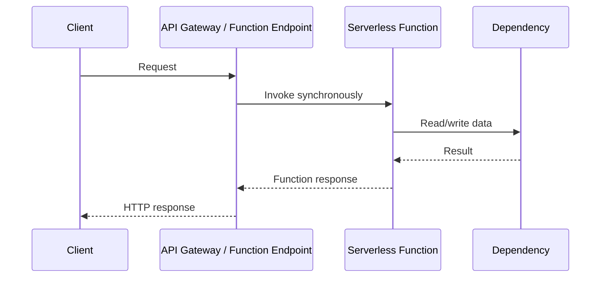
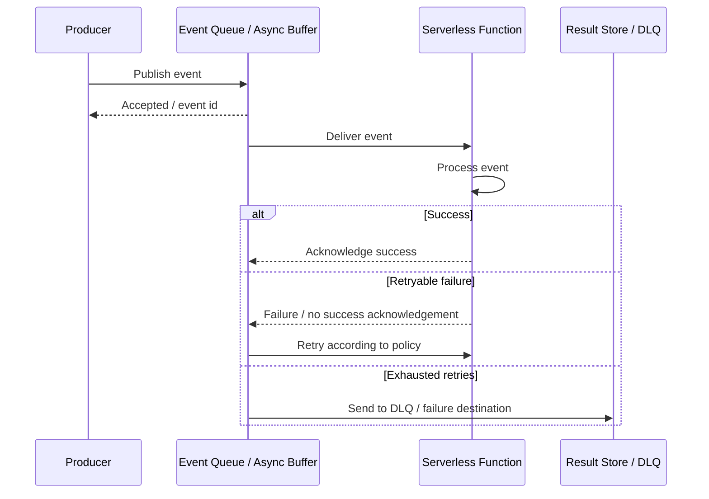
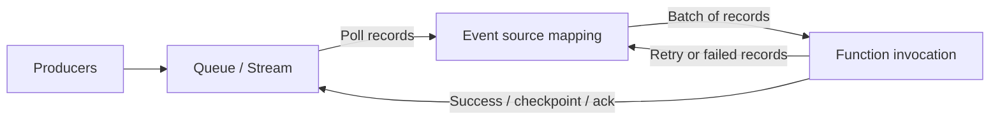
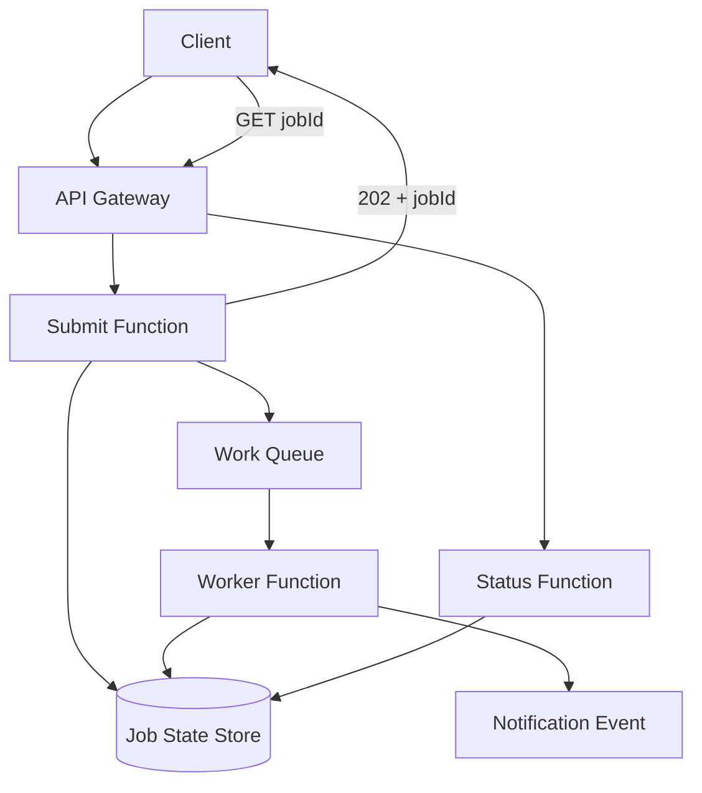

# Distinguishing synchronous, asynchronous, and batch event invocations

Serverless functions can be triggered in several ways. A client can invoke a function and wait for the result within the same request; a system can publish an event to a queue for the function to process later; or the platform can poll records from a queue/stream in batches and pass the entire batch to the function. These three models differ in response time, completion acknowledgement, retries, processing order, fault tolerance, and how concurrency is calculated.

Choosing the right invocation model aligns your application with business requirements. Synchronous invocation fits when the caller needs an immediate result. Asynchronous invocation fits when receipt can be decoupled from completion. Batch event consumption fits when high throughput is needed or grouping records reduces overhead. Real systems often combine all three.

## 1. Three serverless function trigger models

| Model | How it works | What does the caller receive? | Suitable use cases |
|---|---|---|---|
| Synchronous | Caller sends a request and holds the connection until the function finishes | Execution result or error within the timeout limit | APIs, validation, lookups, computations needing immediate responses |
| Asynchronous | System accepts the event, stores/queues it, and triggers the function later | Acknowledgement that the event was accepted, not the final business outcome | Sending emails, image processing, background workflows, notifications |
| Batch / event source polling | Platform reads multiple records from a queue/stream and passes a batch to the function | Typically batch processing/ack status or a checkpoint per event-source mechanics | ETL, telemetry, logs, event streams, queue workers |

Do not confuse asynchronous invocation with batch processing. An asynchronous event may trigger an individual execution; an event source mapping may bundle multiple messages into a batch. A platform may also support both approaches for the same data source, yet retry and acknowledgement semantics differ.

## 2. Synchronous invocation flow

In the synchronous model, the caller invokes the function endpoint or SDK directly and waits for the function to return a response. Basic flow:



The caller keeps an active request open until the function completes or times out. The function typically returns data, status, or an error along the original call path. For HTTP APIs, the gateway maps the function’s return value into an HTTP response according to the configured contract.

### Advantages

- The caller receives the result immediately to continue its business flow.
- Easy to express as a familiar request-response API.
- Execution errors can be returned directly so the caller decides how to display or handle them.
- Fits short operations with bounded execution times that need immediate user feedback.

### Limitations

- The caller must wait; function execution plus dependency calls contribute directly to end-to-end latency.
- Timeouts across the client, gateway, and function must be coordinated.
- Callers depend on the availability and latency of both the function and its dependencies.
- If the caller retries after a timeout, the function may already have executed side effects even though the response was lost.
- Long synchronous requests tie up client and gateway connections and resources.

Good examples include APIs for checking order status, calculating shipping rates, or validating input. If work can take several minutes, consider returning a job ID immediately and processing in the background instead of holding connections open.

## 3. Timeouts and errors in synchronous calls

A synchronous request can time out at multiple layers:

- Client timeout: the client stops waiting or closes the connection.
- API gateway/proxy timeout: the intermediary stops waiting on the function.
- Function timeout: the platform halts execution when maximum duration is exceeded.
- Dependency timeout: a database, HTTP API, or downstream service fails to reply in time.

A caller timeout shorter than the function timeout can cause the caller to report an error while the function is still running. When the caller retries, side effects can run twice. Thus, a timeout never proves the function performed no work.

Design requirements:

1. Set an overall deadline at the caller.
2. Set individual dependency timeouts smaller than the remaining deadline budget.
3. Ensure the function has time to close connections and record outcomes before the deadline.
4. Use idempotency keys for operations with side effects.
5. Return structured errors distinguishing input errors, business errors, transient errors, and timeouts.
6. Avoid unbounded client retries; use backoff and retry caps.

If a function handles order creation, the caller can supply a unique `Idempotency-Key` for the operation. The function stores the key’s processing state alongside the business result; duplicate requests with the same key return the stored result instead of creating a new order. Storing the key requires a transaction or conditional write so two concurrent requests cannot both commit side effects.

## 4. Asynchronous invocation flow

In the asynchronous model, the producer sends an event to an ingestion service or queue. The platform accepts the event and triggers the function when appropriate. The producer does not hold a connection open waiting for the entire job to complete.



The producer typically receives confirmation that the event was accepted or buffered. That confirmation does not prove the function succeeded, the database committed, or the end user received the final outcome.

### Advantages

- Decouples producer timing from consumer processing time.
- Absorbs brief bursts using buffers or queues.
- Retries transient failures without forcing users to resubmit requests.
- Scales workers independently from the ingestion API.
- Easy to attach DLQs, failure destinations, and redrive workflows.

### Limitations

- Callers do not receive the final business result immediately; a status lookup or completion notification mechanism is needed.
- Delay can occur between publish time and execution time.
- Events may be delivered multiple times; consumers must handle duplicates safely.
- Event ordering may not be guaranteed unless the service provides ordering.
- Requires operating queues, retries, DLQs, retention, and backlog monitoring.

Example: an API accepts a report-generation request, saves a job record, and emits an event. A function builds the report in the background and updates status to `COMPLETED` or `FAILED`. The client receives `202 Accepted` with a job ID and polls another endpoint for status.

## 5. Distinguishing acceptance from completion

In asynchronous systems, two distinct milestones exist:

- **Accepted:** the platform or broker accepted the event per service semantics.
- **Processed/committed:** the function completed processing and persisted the business outcome.

A producer receiving only `Accepted` should not display “completed.” It can display “request received” and return a tracking ID.

A job record can carry statuses such as:

| Status | Meaning |
|---|---|
| `ACCEPTED` | Request has been recorded |
| `QUEUED` | Event is waiting for a consumer |
| `RUNNING` | Function is actively processing |
| `SUCCEEDED` | Result has been committed |
| `RETRYING` | Transient failure awaiting retry |
| `FAILED` | Retries exhausted or unrecoverable error |
| `CANCELLED` | Work cancelled per business rules |

Status transitions must be controlled carefully. If a worker restarts after writing results but before acknowledging the message, the event may be redelivered. The next run must recognize the job already succeeded so side effects are not repeated.

## 6. Batch event consumption from queues or streams

With an event source mapping or equivalent polling mechanism, the platform reads multiple records from the source and invokes the function once with a batch. A batch can contain multiple messages, events, or records; the function iterates through each record and processes it.



Batching reduces invocation startup counts and orchestration overhead. For example, instead of invoking a function 1,000 times for 1,000 messages, the platform can deliver 10 batches of 100 messages each, if payload size and batching window permit.

Batches can be formed by:

- **Batch size:** maximum number of records per invocation.
- **Batch window:** maximum time spent collecting records before sending a batch, if supported by source and service.
- **Payload limit:** platform event/request size limit.
- **Partition/shard:** for streams, each batch typically pulls from a single partition or shard per source mechanics.
- **Concurrency limit:** number of batches processed simultaneously.

Large batch sizes cut overhead while increasing memory demand, execution duration, first-record latency, and retry blast radius on batch failure. Small batch sizes reduce wait times while increasing invocation counts and orchestration overhead.

## 7. Queues and streams have different semantics

Not all event sources acknowledge records the same way.

| Characteristic | Queue | Partitioned stream / log |
|---|---|---|
| Model | Messages wait for consumers to receive and ack/delete | Records stored in order within partitions/shards; consumers track read positions |
| Processing confirmation | Typically deletes or acks messages after successful processing | Typically advances a checkpoint/offset/sequence after processing |
| Retries | Messages reappear after visibility timeout or per broker policy | Can re-read from prior checkpoint; failing records can stall shard progress depending on mechanics |
| Ordering | Guaranteed only if queue type/config provides it; may be per message group | Typically ordered within a single partition/shard, not necessarily across the entire stream |
| Scaling | By message count, throughput, and consumer concurrency | By partitions/shards, parallelization factor, and consumer limits |
| Use cases | Task queues, background commands, independent jobs | Event logs, telemetry, clickstreams, CDC, and replayable data |

Queues suit workloads where each message is an independent unit of work that can be deleted once processed. Streams suit workloads needing record history, multiple independent consumers, or replay from offsets. Check retention, ordering, delivery guarantees, and throughput limits for the specific source.

## 8. Batch handling: all-or-nothing or per-record?

Some platforms treat a batch as a single acknowledgement unit. If a function processes 99 records successfully but fails on the 100th and reports overall failure, the platform may redeliver the entire batch. The first 99 records may be processed again.

Two common design options exist:

- **All-or-nothing:** acknowledge the batch only when every record succeeds; suits wrapping transactions or atomic batch processing.
- **Partial batch response:** the function returns the list of failed records or an appropriate checkpoint so the platform retries only the failed subset, if supported by the source service.

Partial batch responses curb duplicate work but must conform strictly to the event source’s format and semantics. For streams, some services require returning the sequence number of the first failed record to preserve order; for queues, you may return a list of failed message identifiers. Never assume a single response format works across providers.

Conceptual batch-processing logic example:

```python
def handler(event, context):
    failed_ids = []

    for record in event["records"]:
        try:
            process_idempotently(record)
        except TemporaryError:
            failed_ids.append(record["id"])
        except PermanentError as exc:
            send_to_quarantine(record, reason=str(exc))

    return {"failedRecordIds": failed_ids}
```

This is illustrative pseudocode, not a direct contract for a specific cloud provider. A handler-layer adapter must map `failed_ids` to the exact response schema required by the queue or stream in use. For permanent errors, quarantine a record and report success only if quarantine persistence is durable and business policy allows removing the record from the main stream.

## 9. Retries and delivery guarantees

Asynchronous serverless systems typically favor at-least-once delivery in many scenarios. That means an event may be redelivered if the platform cannot confirm the prior execution completed. Some services or modes offer different semantics; read the event source’s documentation carefully.

Situations causing duplicates:

- Function finishes processing, but the response/ack is lost.
- Function writes to the database successfully and times out before confirming.
- Consumer restarts before the checkpoint is committed.
- Queue visibility timeout is shorter than processing time, causing the message to reappear.
- Producer or broker retries resend the same event.
- An event is emitted twice due to missing upstream idempotency.

Therefore, consumers must be idempotent: processing an event multiple times produces the same business outcome as processing it once.

### Idempotency techniques

- Use a unique event ID or idempotency key.
- Store processed keys alongside outcomes in a durable store.
- Use unique constraints or conditional writes to prevent duplicate records.
- Combine state updates and idempotency recording inside the same transaction when possible.
- For external side effects, use idempotent APIs or a stateful outbox/workflow.
- Set idempotency record retention longer than any possible retry/replay window.

Checking a key in cache before writing to the database introduces a race condition: two concurrent invocations can both see the key absent and both execute side effects. Claiming the key must be atomic, such as via a unique insert or conditional transaction.

## 10. Retries, backoff, and dead-letter queues

Not every error should be retried:

- **Transient errors:** network timeouts, throttling, overloaded dependencies; usually safe to retry with backoff.
- **Permanent errors:** invalid schema, missing required fields, unprocessable data; retrying will not fix the root cause.
- **Unknown errors:** classify and bound attempts to avoid retry storms.

Exponential backoff lengthens delays between attempts; jitter adds randomness so multiple consumers do not retry in lockstep. Conceptual wait interval:

\[
Delay_n = \min(Delay_{max}, Delay_{base} \times 2^n) + Jitter
\]

Specific values must be bounded and aligned with deadlines, retry windows, and throughput. Some platforms manage retries automatically via settings such as maximum attempts, maximum event age, or visibility timeout.

A **dead-letter queue (DLQ)** or failure destination holds events that fail after the retry policy is exhausted. DLQs isolate bad messages from the main path for inspection, data repair, or later redrive.

DLQs need:

- Restricted access permissions and appropriate encryption.
- Retention long enough for incident handling workflows.
- Alerts when the first message arrives or counts cross thresholds.
- Stored error metadata, timestamps, attempt counts, and correlation IDs.
- Processes for triage, repair, replay, and duplicate prevention.
- Clarity on whether messages are redriven whole-batch or per-record.

A DLQ is not infinite storage. Without an owner and redrive procedure, messages sit forever and business operations stay incomplete.

## 11. Processing order and concurrency

Synchronous requests usually maintain isolated request-response pairings. Asynchronous and batch models can run many invocations in parallel, so completion order does not necessarily match event emission order.

For example, `OrderCreated` and `PaymentAuthorized` events arrive in sequence, yet two function invocations have different execution times; `PaymentAuthorized` might finish first. If business logic requires ordering:

- Partition by aggregate/entity key so events for the same entity stay in the same ordering group.
- Use FIFO queues or stream partitions with suitable ordering guarantees.
- Check sequence/version numbers before updating state.
- Design consumers to tolerate late or duplicate events.
- Avoid concurrently processing two order-dependent events for the same entity.

Function concurrency is typically constrained by account quotas, reserved/provisioned concurrency settings, partition/shard counts, batch size, and event sources. If functions scale faster than databases can serve, the system triggers connection storms or overloads dependencies.

Set concurrency caps aligned with downstream capacity. Queues absorb bursts, yet backlogs shrink only when average processing rate exceeds incoming event rate. If arrival rate stays above processing rate, backlogs grow continuously even when the function scales to its maximum.

## 12. How do batch size and batch window affect behavior?

Two common parameters:

- **Batch size:** maximum records delivered to one invocation.
- **Maximum batching window:** maximum wait time to accumulate more records before dispatching a batch, if supported by the platform.

Large batch sizes:

- Reduce invocation counts and fixed overhead.
- Can increase throughput when vectorized/bulk processing is efficient.
- Increase required memory and per-invocation duration.
- Increase records retried on batch failure if partial responses are unavailable.
- Can delay the first record when the batching window is long.

Small batch sizes:

- Lower per-record latency and failure blast radius.
- Simplify memory sizing.
- Increase invocation counts and orchestration overhead.
- Can reduce efficiency of bulk operations.

Benchmark with realistic record sizes, error distributions, memory limits, and dependency latencies. Do not size batches by record count alone; large payloads can hit byte limits long before reaching maximum record count.

## 13. Large payloads and passing data by reference

Events should generally carry routing metadata and a data reference rather than an entire large payload. For instance, an image upload event can contain bucket, object key, version ID, size, checksum, and tenant ID. The function downloads the object from storage during processing.

Advantages:

- Shrinks message size and avoids payload limit errors.
- Avoids copying bulky data across multiple queue/function hops.
- Uses object storage as durable data backing.
- Enables event retries without asking producers to re-upload content.

Verify object existence, exact version, and function access permissions. If an object key can be overwritten, an old event could accidentally process newer contents; use version IDs or immutable object keys when needed.

Never place secrets, access tokens, or unnecessary personal data inside event bodies, since events may persist in queues, logs, DLQs, or traces.

## 14. Event schemas, validation, and versioning

Producers and consumers are often deployed independently. If an event schema changes incompatibly with older consumers, asynchronous processing can fail after the event has already been persisted.

An event should include common fields:

```json
{
  "id": "evt-01J9X8M3Q2",
  "type": "com.example.order.created",
  "schemaVersion": 2,
  "occurredAt": "2026-11-22T09:30:00Z",
  "source": "orders-service",
  "correlationId": "req-7f8a",
  "aggregateId": "order-5821",
  "sequence": 17,
  "data": {
    "orderId": "order-5821",
    "customerRef": "customer-204"
  }
}
```

This is a vendor-neutral schema example. `id` supports deduplication; `type` routes handlers; `schemaVersion` manages compatibility; `occurredAt` aids investigation; `correlationId` links logs/traces; `aggregateId` and `sequence` support per-entity ordering.

Consumers should validate schemas before executing side effects. When evolving schemas:

- Prefer backward-compatible changes such as adding optional fields.
- Never alter the meaning of an existing field while keeping the same version.
- Plan for older consumers and in-flight events sitting in queues.
- Support multiple versions during rolling deployments when needed.
- Route invalid events to quarantine/DLQ with safe diagnostic metadata.

## 15. Security and access control by invocation model

Each invocation model has a distinct trust boundary:

- For synchronous HTTP, authenticate callers, authorize routes, enforce rate limits, validate inputs, and protect endpoints.
- For async publishing, allow only authorized producers to send events to target queues/event buses.
- For event source mappings, the function role needs permissions to read/consume the source and ack/checkpoint per service rules.
- Grant functions least-privilege access to databases, object storage, secrets, and downstream APIs.
- Encrypt events and DLQs holding sensitive data; control retention and read access.
- Verify event origins to prevent spoofing, unauthorized replays, or event injection.
- Never dump sensitive payloads into logs.

Events can arrive late or be replayed. For sensitive actions like payments or privilege grants, consumers must verify current business state and authorization rather than blindly trusting stale event data.

## 16. Observing and operating the three models

Do not track invocation counts alone. Each model requires specific metrics.

| Category | Metrics to track |
|---|---|
| Synchronous | Request rate, p50/p95/p99 latency, timeouts, error rate, throttling, and concurrency |
| Asynchronous | Accepted events, event age, queue depth, processing duration, retry count, failure destination/DLQ depth |
| Batch/event source | Actual batch size, records per invocation, iterator/consumer lag, checkpoint age, partial failures, and throttling |
| Dependencies | Database connections, pool wait, API latency, storage errors, and downstream throttling |
| Cost/capacity | Invocation count, execution duration, memory/CPU allocation, data transfer, and provisioned concurrency |

Propagate correlation IDs/event IDs across producers, queues, functions, and downstream services. Logs should distinguish when an event was created, received, started processing, and completed. Gaps between timestamps show whether events sit waiting in queues or functions run slowly.

Base alerts on business impact: queue age breaching SLAs, growing DLQs, non-decreasing consumer lag, rising sync timeouts, or repeated batch failures. High queue depth with low event age can indicate a healthy absorbed burst; continuously rising event age signals backlog isn't clearing in time.

## 17. Example 1: synchronous pricing API

A website must display shipping costs before a customer confirms an order. The API gateway invokes the `quoteShipping` function synchronously. The function validates the address, calls the rating service, and returns the price and expiration window.

Design:

1. Client sends a request with a request ID and validated address fields.
2. Gateway authenticates the caller, applies rate limits, and enforces a timeout.
3. Function validates input and calls dependencies with a deadline shorter than the overall deadline.
4. Function returns quote ID, amount, currency, and expiry.
5. Client displays the result; on timeout, the client can retry with an idempotency key or prompt the user to retry.

Synchronous fits because the user needs the result immediately to decide. If rating took several minutes or relied on huge batch datasets, switch to an asynchronous job instead.

## 18. Example 2: asynchronous image processing after upload

Users upload images to object storage. Storage emits an object-created event to an event bus or queue. A function receives the event, reads the object, generates a thumbnail, and saves the result.

Design:

1. API issues a time-limited upload URL; the client uploads directly to the bucket.
2. Object storage emits an event containing bucket, key, and version.
3. A queue buffers the event and triggers the function.
4. Function checks event ID and object version, then generates the thumbnail.
5. Function records completion status and emits an `ImageReady` event.
6. On transient errors, the event retries; after exhausting retries, it moves to the DLQ.

The consumer requires idempotency because the same object event may be redelivered. Derive the thumbnail name deterministically from the object key/version so repeated runs do not produce conflicting outputs. If image processing is slow, size function timeout, memory, and concurrency for expected image dimensions.

## 19. Example 3: consuming telemetry batches from a stream

Devices continuously emit telemetry into a multi-partition stream. A function triggers in batches to normalize records and write them into an analytics warehouse.

Design:

1. Producers emit events carrying device ID, timestamp, sequence, and schema version.
2. Stream partitions by device ID to preserve per-device ordering where supported by the partition key and service.
3. Event source mapping reads batches from each shard/partition.
4. Function validates and transforms each record, then writes using bulk operations.
5. Upon success, the consumer checkpoints the processed position.
6. When records fail, the handler reports partial failures per the source contract; poison records are quarantined.

Batch size and parallelization must balance throughput, latency, and ordering. Slow batch processing increases consumer lag. Scaling concurrency too high can overwhelm the target warehouse.

## 20. Choosing an invocation model by requirement

| Requirement | Typically suitable choice | Conditions to verify |
|---|---|---|
| User needs immediate result | Synchronous | Short processing time, aligned end-to-end timeouts, idempotent side effects |
| Long task or deferrable work | Asynchronous | Job status tracking, queues, retries, DLQs, and completion notifications |
| Bursty incoming load | Asynchronous via buffer/queue | Sufficient queue retention and consumers scaling with backlog |
| Millions of records processed continuously | Batch from stream/queue | Appropriate batch size, partitioning, checkpointing, ordering, and concurrency |
| Per-entity ordering required | FIFO/group key or partitioned stream | Ordering scope and service retry behavior |
| Records can fail independently | Batch with partial failure | Event source supports partial ack and handler returns exact schema |
| Historical replay required | Stream/event log with retention | Offsets/checkpoints, retention, and duplicate-handling readiness |
| Calling external APIs with unstable latency | Often decoupled asynchronously | Job state tracking and timeout/retry handling |

This is a selection guide, not a rigid rule. A single flow can combine models: a synchronous API accepts the request, an asynchronous queue executes business work, and a batch stream feeds analytics after transaction completion.

## 21. Combining sync and async in one workflow

A common architectural pattern is **sync acceptance, async execution**:



The Submit Function only validates input, generates a job ID, saves state, and publishes a message. The Worker Function performs the heavy work. The Status Function returns progress to the client. Notifications can fire once the job finishes.

To prevent saving a job record without publishing the message, use a transactional outbox: write the job and outbox event in one database transaction; a separate publisher forwards outbox events to the queue and marks them sent. If the database and queue lack distributed transactions, the outbox shrinks the lost-event window, though the publisher still requires idempotency.

## 22. Testing and optimization

Testing should cover both happy paths and failure scenarios:

1. Synchronous request completes within the deadline and honors the response contract.
2. Slow or timing-out dependency; verify deadlines propagate and callers avoid infinite retries.
3. Producer publishes successfully while workers are paused; accepted/queued status renders properly.
4. Function completes work but ack/checkpoint fails; verify duplicates cause no repeated side effects.
5. One record in a batch fails; verify partial failure or whole-batch retry matches source semantics.
6. Queue backlog grows; verify autoscaling and downstream concurrency caps.
7. Repeated poison message; verify DLQ routing, alerts, and redrive.
8. Out-of-order or late events; verify version/sequence checks and business rules.
9. Near-limit payloads; verify batch byte sizes and object-storage references.
10. Replaying historical events; verify idempotency retention and schema compatibility.

Data-driven optimization:

- Tune batch size/window around throughput, latency, and memory.
- Match concurrency caps to downstream capacity.
- Use database bulk APIs where applicable.
- Shrink payloads using references and lean schemas.
- Apply appropriate retry/backoff policies to prevent retry storms.
- Keep functions lean enough that cold starts and startup do not breach SLAs.
- Separate workloads with differing timeout, memory, or scaling profiles.
- Track cost per event or per successful job.

## 23. Common mistakes

- **Treating async accepted as processed:** producers report completion prematurely. Distinguish accepted, running, and succeeded.
- **Using sync for long tasks:** callers hold connections open and hit timeouts. Move to async jobs where suitable.
- **Assuming events are delivered exactly once:** duplicates repeat side effects. Build idempotent consumers.
- **Omitting DLQs or failure destinations:** failing events retry forever or vanish silently. Configure retention, alerts, and redrive runbooks.
- **Oversized batches:** inflate memory, latency, and retry blast radius. Benchmark by byte size and processing duration.
- **Retrying entire batches on a single record error:** healthy records re-run needlessly. Use partial batch responses when supported by the source.
- **Assuming global ordering:** concurrency finishes events out of order. Partition/group by entity and verify sequence numbers.
- **Scaling functions without bounds:** databases or downstream APIs overload. Enforce concurrency caps and backpressure.
- **Visibility timeout shorter than processing time:** messages reappear while old invocations are still running. Size timeouts and heartbeats/extensions per service.
- **Neglecting schema management:** old events break new consumers. Version schemas and preserve backward compatibility.
- **Embedding large payloads or secrets in events:** hits size limits or leaks sensitive data. Use object references and least privilege.
- **Ignoring event age/consumer lag:** queue depth alone can hide stuck older events. Track event age and processing time.

## 24. Design checklist

- [ ] Identified whether callers need immediate results, acceptance acknowledgement only, or batch record processing.
- [ ] Coordinated timeouts across client, gateway, function, and dependencies.
- [ ] Async flows distinguish accepted from processed/committed and expose job status when needed.
- [ ] Producers/consumers include event IDs, correlation IDs, and schema versions.
- [ ] Consumers are idempotent and claiming idempotency keys is atomic.
- [ ] Retries are bounded with backoff/jitter and transient/permanent error classification.
- [ ] DLQs/failure destinations have retention, owners, alerts, and redrive procedures.
- [ ] Batch size/window fit payload sizes, memory, latency, and throughput.
- [ ] Partial batch responses follow exact event-source contracts where supported.
- [ ] Ordering scope, partition keys, sequences, and concurrency are defined.
- [ ] Concurrency stays within downstream database/API capacity.
- [ ] Large payloads live in object storage with events carrying only necessary references.
- [ ] IAM, event source permissions, encryption, and log redaction are configured.
- [ ] Monitored invocation latency, errors, retries, event age, queue depth, consumer lag, and DLQs.
- [ ] Tested duplicates, timeouts, poison messages, partial failures, replays, and downstream outages.

Synchronous, asynchronous, and batch event invocations are three execution-flow models with distinct trade-offs. Synchronous optimizes for immediate responses; asynchronous decouples intake from completion and absorbs spikes via queues; batching boosts efficiency across many records while demanding checkpoint, partial-failure, and ordering management. Choosing by SLA and designing idempotency, retries, DLQs, concurrency caps, and full observability lets serverless functions handle diverse workloads while preserving correctness and resilience.
