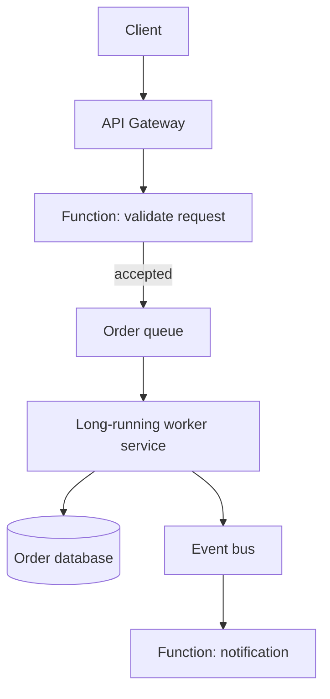

# Criteria for choosing between serverless functions and long-running services

When deploying a workload on the cloud, a critical decision is whether to run the logic as a **request/event-triggered serverless function** or as a **continuously running service** on containers, VMs, or an orchestration platform. Both models can handle HTTP requests, events, and background tasks, yet they differ in compute lifecycle, scaling mechanics, runtime limits, state handling, cost structure, and operational responsibilities.

Serverless functions suit work with a clear start and end, triggered by events, and without a need to keep processes alive continuously. Long-running services suit processes that must persist over time, hold connections open, handle continuous data streams, execute prolonged tasks, or require deeper runtime control. These are selection tendencies rather than absolute rules: timeout caps, concurrency limits, and capacity reservation differ across serverless offerings, and container services can also scale to zero or run as finite jobs.

In cloud compute, choose the execution model based on workload characteristics and SLOs before sizing CPU, memory, networking, runtime, and billing options. Real systems often combine both: functions handle incoming requests or events, while long-running services manage persistent connections or continuous background work.

## 1. Two execution models

### Serverless functions

A serverless function is an execution unit invoked by the platform when triggered by an HTTP request, queue message, object upload, timer, database event, or event bus. The provider manages most compute provisioning and the execution environment lifecycle. Developers focus on the handler, dependencies, configuration, identity, and processing logic.

Common characteristics:

- Invocations have a distinct start and end.
- The platform can spin up multiple execution environments to handle concurrency.
- Can scale to zero when idle, depending on the service.
- Resources are billed by invocation, execution duration, memory/CPU, or reserved capacity settings.
- Runtime, duration, memory, payloads, networking, and concurrency are bounded by product limits.
- Processes or environments may be reclaimed after completion or idle timeouts.

Serverless does not mean server-free. Compute still runs on provider infrastructure; users are simply relieved of most host and scheduler management.

### Long-running services

A long-running service is a process or group of processes kept running to accept requests, maintain connections, or perform sustained work. It typically runs on VMs, container services, Kubernetes Deployments, managed instance groups, or similar platforms.

Common characteristics:

- Processes start up and keep running until stopped, replaced, or scaled in.
- Can retain connection pools, caches, threads, actors, consumer loops, or models in memory.
- Can serve many requests per process and keep connections open long-term.
- Operators retain greater control over runtimes, process models, sidecars, daemons, and resource lifecycles.
- Requires managing replicas, health checks, rollouts, autoscaling, patching, and capacity.
- Charges can continue while processes sit idle, unless the platform supports scale-to-zero or demand-driven scaling.

“Long-running” does not necessarily mean a single always-on VM. A managed container service can replace instances automatically, scale with load, or scale down to zero while still presenting a service abstraction.

## 2. High-level comparison

| Criterion | Serverless function | Long-running service |
|---|---|---|
| Execution unit | Invocation/handler | Process, container, or VM |
| Lifecycle | Per request/event/task | Persists across many requests or sessions |
| Startup | May experience cold starts | Startup at deploy/scale/restart; process stays running afterward |
| Scaling | Typically by events, requests, or concurrency | By replicas, CPU, memory, queues, or metrics depending on platform |
| Scale to zero | Widely supported across products | Available on some container services; not universal |
| Long-lived connections | Constrained by timeouts/runtime or trigger model | Better suited for WebSockets, streams, and long sessions |
| In-process state | Lost when environment is reclaimed | Survives longer, though still lost on restarts/replacements |
| Runtime control | Bounded by runtime and service | Usually deeper runtime/process control |
| Long background work | Fits only if within limits and checkpointed | Better suited for continuous workers/consumers or long jobs |
| Infrastructure operations | Provider-managed for the most part | Platform/app team manages replicas, capacity, and lifecycles more directly |
| Idle cost | Can be low with scale-to-zero | May incur cost for standby replicas/capacity |
| Strongest fit | Event handlers, short APIs, glue logic, automation | Steady APIs, streaming, long workers, resident-process services |

Never choose solely by the label “serverless” or “container.” Inspect the actual limits of the specific service—especially timeouts, concurrency, startup latency, networking, filesystems, GPUs, and standby capacity pricing.

## 3. Workload duration and shape

Execution duration is the first dimension to measure. Look at median duration, p95/p99, maximum duration, and variance.

### Short, bounded workloads

Serverless functions usually fit well when each unit of processing:

- Starts from a well-defined request or event.
- Performs a finite unit of work.
- Finishes comfortably within platform timeout caps.
- Returns a result or writes outputs and terminates.
- Can retry safely if an invocation fails.

Examples: webhook validation, thumbnail generation, event normalization, sending notifications, index updates, scanning newly uploaded files, or calling an API to complete a workflow step.

### Prolonged or open-ended workloads

Long-running services usually fit better when a process:

- Continuously consumes from queues or streams.
- Maintains WebSockets, TCP sessions, or bidirectional connections.
- Performs processing exceeding function timeouts.
- Must keep large models or hot caches resident in memory.
- Runs control loops, internal schedulers, or resident agents.
- Needs continuous long-duration output streaming.

Examples: media streaming gateways, game session servers, MQTT broker adapters, continuous Kafka consumers, workers coordinating multi-hour jobs, or inference services holding models in memory.

### Long jobs do not necessarily need an always-on service

A long-running task can run on a batch service, container job, or workflow orchestrator instead of a function or permanent service. Distinguish:

- **Function invocation:** a single handler execution subject to service timeout caps.
- **Batch/container job:** a finite process running to completion, potentially long-lived and managed by a scheduler.
- **Long-running service:** a persistent process serving ongoing requests/events or holding open connections.

If a workload only needs to run once for 40 minutes and stop, a batch/container job fits better than an always-on service. Never keep an API service running merely to execute a finite task.

## 4. Triggers, protocols, and interaction patterns

### Decoupleable events and requests

Serverless functions suit trigger-based models: a request arrives, a message is delivered, a timer fires, or an event is emitted. The trigger creates an identifiable, observable unit of work.

### Persistent connections

Long-running services better suit protocols requiring durable connections, such as:

- WebSockets for bidirectional communication.
- Custom TCP connections.
- Streaming protocols or media relays.
- Consumers maintaining active broker sessions.
- Long polling or protocols with continuous heartbeats.

Some serverless platforms support WebSocket APIs or streaming responses, yet you must distinguish the gateway holding the connection from functions handling discrete events. The gateway maintaining a connection does not mean a single function invocation can live indefinitely.

### Request-response vs. asynchronous workflows

If a client needs an immediate reply, a function can handle brief authentication/validation and return immediately. Longer work can be placed on a queue and executed asynchronously. If clients need progress tracking, the API returns a job ID and exposes a status endpoint.

Never hold an HTTP request open for an extended period when clients, gateways, or load balancers enforce shorter timeouts. Choose asynchronous workflows or controlled streaming services when business logic demands it.

## 5. Concurrency and parallel processing models

Serverless functions typically spin up additional execution environments as concurrency grows. Long-running services typically scale replica counts or worker concurrency inside each replica. Both models can stress downstream dependencies in distinct ways.

### Serverless functions

- Scale out rapidly by requests/events within quotas and capacity limits.
- Each environment follows a runtime/service-specific concurrency model.
- Traffic bursts can trigger numerous cold starts.
- Without concurrency limits, downstream databases or APIs can be overwhelmed.
- Trigger retries can amplify load while dependencies are already degraded.

### Long-running services

- A single process can serve many requests via threads, async event loops, or worker pools.
- Replica count usually scales more gradually or requires startup time.
- Connection pools and caches persist across requests.
- Backpressure can be enforced directly inside the process or consumer.
- Replicas and per-replica concurrency must be sized safely.

### Example of dependency pressure

Suppose a database handles at most 500 connections. If each function environment opens 20 connections and scales to 40 environments, total connections can hit 800. A long-running service with 5 replicas, each pooling 40 connections, opens roughly 200 connections. This is an illustrative example; actual load depends on pooling, reuse, concurrency, and client connection behavior.

Whichever model you choose, cap total concurrency to match database/API capacity, add queues or rate limits where needed, and monitor dependency saturation.

## 6. Latency, cold starts, and responsiveness requirements

Serverless functions can incur cold starts when the platform creates new execution environments. A cold start spans compute allocation, runtime startup, code/dependency loading, and application initialization. Long-running services pay startup costs during deployments or scale-out, yet running processes serve subsequent requests without re-initializing the entire application.

### When functions fit

- Latency budgets tolerate cold starts or pre-warmed capacity is available.
- Requests do not require consistently ultra-low latency on every single call.
- Startup can be streamlined via lean packages/images and light initialization.
- Traffic is uneven with long idle gaps.

### When services fit

- Strict p95/p99 latency consistency is required.
- Traffic is steady so processes remain warm continuously.
- Models or caches incur heavy load times.
- Dependency connections need long-lived pooling and management.

### How to evaluate

Measure separately:

- Client-to-edge/network latency.
- Queue wait or trigger delivery delay.
- Cold start / runtime initialization.
- Handler or application processing.
- Dependency latency.
- Response/stream completion time.

Never compare a function against a service using only one warm request. Test first invocations, warm sequences, burst scale-out, idle gaps, and fresh deployments. Compare p50/p95/p99 alongside error rates and cost per successful operation.

## 7. State, sessions, and data

### Functions should favor statelessness

Execution environments can be reclaimed at any moment. Consequently, functions should draw state from requests/events or durable external stores. Global variables may be reused across calls but must never hold business state.

State best externalized from functions:

- Databases for transactional data.
- Object storage for files and artifacts.
- Distributed caches for regenerable data.
- Queues/event logs for pending work.
- Workflow stores for long-running task progress.

### Services can hold transient in-process state

Long-running services can retain sessions, caches, or connection pools in memory to boost performance. Even so, processes can restart, scale in, or be replaced. Whenever state affects correctness, persist it durably or use replication/rehydration.

### Session affinity

If an application relies on process-pinned sessions, examine sticky-session and failover behavior. Sticky sessions never substitute for a persistent session store since replicas can disappear. For functions, use external token/session stores rather than relying on returning to the same execution environment.

## 8. Runtimes, dependencies, and system-level control

Serverless functions fit when provider-supported runtimes suffice and the workload needs no special OS privileges. Long-running services fit better when custom OS packages, kernel capabilities, daemons, sidecars, or multi-process topologies are required.

### Checking function limits

- Supported languages/runtimes and versions.
- Maximum timeout duration.
- Memory/CPU and ephemeral storage.
- Package, layer, or image size limits.
- Concurrency and quotas.
- Network egress/ingress, VPC connectors, and DNS.
- Device, filesystem, and process permissions.
- Behavior of background threads after the handler returns.

Never assume background threads or subprocesses keep running after a function returns its response. All required work must be awaited/committed within the invocation or handed off to a job/queue system.

### Checking service requirements

- Are custom OS images or specialized native libraries needed?
- Are co-located sidecars, proxies, or agents required?
- Are GPUs, local NVMe disks, or device passthrough needed?
- Is a process supervisor or multi-process container needed?
- Is specialized filesystem or protocol access needed?
- Must long-lived listeners or sockets remain open?

Whenever requirements fall outside what function platforms support, container/VM services or batch runtimes are likely better choices.

## 9. Resource sizing: CPU, memory, and networking

Do not pick functions solely to avoid server management, nor pick services solely for larger CPUs. Benchmark resources against the actual workload.

### CPU-bound

Examples: video encoding, data compression, numerical computing, or inference. Check CPU allocation, instruction sets, throttling, and execution time. Some function platforms scale CPU with memory; raising memory boosts CPU capacity while also raising per-unit time pricing.

### Memory-bound

Examples: large file processing, parsing huge JSON payloads, loading models, or caching. Functions enforce per-invocation/environment memory caps. Services let you size container/VM memory and tune with profiling. Monitor peak memory, GC, OOMs, and memory leaks.

### Network-bound

Examples: calling many APIs, streaming data, or transferring objects. Measure DNS/TLS handshakes, throughput, connection reuse, and egress. Function scale-out can open many parallel connections; services can share connection pools. Set concurrency caps aligned with downstream limits.

### GPUs and accelerators

For continuous GPU/accelerator workloads with large models and steady demand, long-running services or managed inference endpoints usually fit best. Some platforms support accelerators on functions, though availability, duration limits, startup times, memory, and billing terms require careful verification.

### Unified benchmarking

Measure on the identical workload:

- Throughput and latency distributions.
- CPU time, peak memory, and throttling.
- Startup/cold-start time.
- Connection counts and dependency saturation.
- Cost per successful request/job.
- Error, retry, and timeout rates.

## 10. Cost: pay-per-invocation vs. pay-per-capacity

### Serverless functions

Costs can depend on invocation counts, execution duration, memory/CPU allocation, request fees, provisioned concurrency, and supporting services. Scale-to-zero eliminates compute charges during idle windows, though cold starts or pre-warmed capacity introduce trade-offs.

### Long-running services

Costs typically depend on replica/VM count, CPU/RAM sizing, uptime, storage, networking, and managed control planes. Idle processes still consume capacity and incur charges. Conversely, under steady traffic, keeping processes warm and reusing connections can lower per-request overhead.

### Simple cost models

For functions:

\[
C_{function} = N_{invocation} \times T_{avg} \times R_{allocated} + C_{request} + C_{dependency}
\]

For services:

\[
C_{service} = N_{replica} \times R_{replica} \times T_{running} + C_{storage} + C_{network} + C_{dependency}
\]

These are conceptual models. Real billing may include free tiers, minimum durations, request charges, provisioned capacity, licenses, logging, egress, and discounts.

### Break-even point

No universal request threshold applies to every system. The break-even point depends on:

- Traffic volume and time-of-day distribution.
- Handler duration and cold-start rate.
- Required memory/CPU.
- Minimum replica count for the service.
- Average service utilization.
- Connection, networking, logging, and dependency costs.
- Discounts/commitments and idle capacity costs.

Build cost models across realistic traffic profiles: idle, steady, burst, and seasonal. Compare total cost at identical successful request/job volumes and identical SLOs.

## 11. Autoscaling and capacity management

### Function scaling

Platforms typically scale execution environments by invocations/concurrency. Operators must configure quotas, reserved concurrency, or equivalent caps to protect dependencies. Once quotas are reached, requests get throttled or queue backlogs grow.

### Service scaling

Services typically scale on CPU, memory, request rate, queue depth, or custom metrics. Configure:

- Min/max replicas.
- Startup/readiness probes and times.
- Scale-out thresholds and cooldowns.
- Scale-in stabilization to avoid flapping.
- Headroom for traffic bursts.
- Behavior when max replicas or quotas are hit.

### Queues as buffers

Queues decouple producer speed from consumer speed. Functions can consume messages in batches/concurrently; service workers can run consumer loops. In both cases, monitor queue age, backlog, retries, and dead-letter queues.

Never scale consumers solely on queue depth if downstream dependencies are already saturated. Apply rate limits, backpressure, and connection caps as needed.

## 12. Reliability, retries, and error handling

### Serverless functions

Function invocations can fail due to timeouts, cold starts, throttling, dependencies, or runtime crashes. Triggers retry according to service semantics. Many event sources offer at-least-once delivery, requiring idempotent handlers and deduplication.

### Long-running services

Processes can crash, hit OOM, lose nodes, or fail deployments. The platform can restart or replace replicas, while the application must implement readiness/liveness probes, graceful shutdown, rolling updates, and in-flight request draining.

### Both models require

- Timeouts on dependencies and requests.
- Bounded retries with backoff and jitter.
- Idempotency for repeatable side effects.
- Circuit breakers or bulkheads when dependencies degrade.
- Durable queues/checkpoints for work that must not be lost.
- SLO-based alerting and recovery runbooks.

## 13. Observability and operational responsibilities

Serverless functions reduce host management but do not remove responsibility for code, dependencies, data, and SLOs. Long-running services grant more process control yet require monitoring replicas, resources, and lifecycles.

| Area | Serverless function | Long-running service |
|---|---|---|
| Runtime/host | Mostly provider-managed | Varies by managed service; team typically manages images/runtimes more |
| Application logs | Instrumented by app owner | Instrumented by app owner |
| Invocation/request metrics | Partially supplied by platform | Combine ingress and app metrics |
| CPU/memory | Per-execution-environment metrics where exposed | Container/VM and process metrics |
| Startup | Cold-start/init duration | Deployment startup/readiness |
| Scaling | Invocations/concurrency/quotas | Replicas/workers/queues/CPU |
| Deployment | Service-provided versions/aliases/traffic routing | Rolling/canary/blue-green per platform |
| Incidents | Triggers, quotas, runtime, dependencies, and code | Replicas, nodes, processes, networking, and dependencies |

Metrics should cover request/event rates, error rates, p95/p99 latency, duration, concurrency, throttles, queue age, CPU, memory, restarts, and cost per successful operation.

## 14. Security and workload identity

### Functions

Functions typically receive dedicated execution roles/service identities. Apply least privilege per function, separate deployment permissions from runtime permissions, and fetch secrets from a secret manager. Never embed credentials in packages or logs.

### Long-running services

Container/VM services require workload identities or service accounts, image scanning, patching, network segmentation, secret rotation, and runtime hardening. When running sidecars or agents, assess the permissions and attack surface of every component.

### Both

- Isolate dev/test/prod environments and permissions.
- Encrypt data in transit and at rest.
- Never log tokens, secrets, or sensitive payloads.
- Track dependency and image vulnerabilities.
- Audit deployments, permission changes, and secret access.

## 15. Workload profiles and recommended models

| Workload | Usually suitable model | Rationale / conditions |
|---|---|---|
| Short webhook handler | Function | Clear trigger, finite work, scales by event |
| Stateless API with uneven traffic | Function or service | Weigh cold starts against baseline utilization |
| Steady, low-latency API | Long-running service | Reuses processes/connections and keeps capacity warm |
| Image resizing after upload | Function or job | Split files/tasks; bound size and timeouts |
| Continuous queue consumer | Service worker or function trigger | Choose by batching/concurrency, queue semantics, and duration |
| Stateful Kafka consumer session | Long-running service | Consumer groups, rebalances, and persistent connections |
| 30–90 minute batch job | Batch/container job | Finite job exceeding function limits fits well |
| WebSocket gateway | Managed service/gateway | Holds open connections; functions can still handle discrete events |
| Streaming media relay | Long-running service | Continuous data streams and long sessions |
| Short scheduled cleanup | Function | Runs on schedule; no always-on process needed |
| Lightweight ML inference, bursty | Function or managed endpoint | Check model load times, accelerators, and cold starts |
| Large models, steady traffic | Service/inference endpoint | Keeps models resident and capacity steady |
| Device-monitoring agent/daemon | Long-running service | Process needs continuous connections and monitoring |
| Multi-step workflow | Orchestrator + functions/jobs/services | Separates steps, retries, timeouts, and durable state |

## 16. Hybrid architecture: functions in front, services behind

You do not need to force an entire application into one model. Use functions for short trigger entry points and services/jobs for prolonged execution.

### Order-processing example

In this architecture:

- The function validates requests and accepts jobs quickly.
- The queue stores work durably, decoupling clients from processing times.
- The worker service runs longer steps, maintains connection pools, and controls concurrency.
- The notification function fires when completion events arrive.
- The database holds authoritative business state without relying on function or worker memory.

### Telemetry ingestion example

A function receives small webhooks or events, validates them, and normalizes metadata. A stream processor or worker service processes data continuously, aggregates over time windows, and writes outputs. Functions can trigger alerts when metrics cross thresholds.

### ML inference example

A function accepts requests, verifies permissions, and routes to a long-running model endpoint. For large batch jobs, the function enqueues a job processed by GPU workers. This avoids loading huge models on every function cold start.

## 17. Decision workflow

Evaluate workloads through these steps:

1. Identify triggers: HTTP, events, schedules, queues, streams, or continuous processes.
2. Measure duration: median, p95/p99, maximum, and potential long tails.
3. Identify protocols: request-response, streaming, WebSockets, TCP, or consumer sessions.
4. Identify state: stateless, sessions, caches, connection pools, or durable workflow state.
5. Measure traffic profile: idle, steady, burst, seasonal, and concurrency.
6. Check resources: CPU, memory, GPU, disk, networking, and native dependencies.
7. Check platform limits: timeouts, payloads, concurrency, quotas, and filesystems.
8. Define SLOs: latency, availability, completion time, and recovery.
9. Model costs for both per-invocation execution and always-on baseline capacity.
10. Assess operational capacity: who manages runtimes, scaling, patching, rollouts, and incidents.
11. Test under real load, cold starts, bursts, dependency failures, and deployments.
12. Pick the simplest model meeting requirements; split components when parts have distinct profiles.

### Scoring matrix

Score each criterion from 1 to 5 for each model, weighted by system priorities.

| Criterion | Suggested weight | Favors serverless functions when | Favors long-running services when |
|---|---:|---|---|
| Traffic variability | 15% | Sharp bursts and idle periods | Steady load, high baseline |
| Tail latency | 15% | Cold starts acceptable or mitigated | Warm processes and steady latency required |
| Duration/protocol | 15% | Short invocations, clear triggers | Long processes, streams, or continuous sessions |
| State/connections | 10% | Stateless, externalized dependencies | Resident caches/connection pools needed |
| Resources/runtime | 10% | Supported runtimes, moderate resources | Custom runtimes, daemons, GPUs, or deep OS control |
| Cost | 15% | Low/sporadic volume, scale-to-zero helps | High utilization, keeping processes warm pays off |
| Operations | 10% | Want minimal host/replica management | Platform team exists and process control is needed |
| Reliability | 10% | Event-based retries/idempotency fit well | Continuous sessions/consumers and lifecycle control needed |

Weights are starting points only. For healthcare, finance, or industrial control systems, security, compliance, and failure impact may carry higher weights.

## 18. Simple cost comparison example

Suppose an API handles 10 million requests per month. Each request takes 150 ms of CPU-bound work, concentrated during business hours and nearly idle overnight.

### Function option

Estimate based on invocation count, billed duration, memory/CPU allocation, and per-request charges. Overnight scale-to-zero cuts idle compute cost. Account for cold starts, provisioned capacity if SLOs are strict, logging, and downstream connections.

### Service option

Estimate minimum replicas running 24/7, CPU/RAM sizing, and average utilization. During quiet overnight hours, baseline replicas may still run to preserve minimum capacity. If the service can safely scale to zero, idle costs can drop.

### How to compare

1. Use the exact same request mix and SLOs.
2. Total compute, networking, storage, logging, and dependency costs.
3. Factor cold starts and startup delays into p95/p99 compliance.
4. Account for minimum replicas and scale-out speed.
5. Compute cost per successful request.
6. Simulate 3× traffic growth and 50% traffic drops.

Never conclude functions are always cheaper at low traffic or services are always cheaper at high volume. Break-even points depend on sizing, duration, utilization, and regional provider pricing.

## 19. Common mistakes

- **Choosing functions for every API:** high-steady-traffic, strict-latency, or long-connection APIs often suit services better.
- **Choosing services for every background task:** short, sporadic event tasks rarely justify always-on processes.
- **Assuming functions have no time limits:** every product enforces specific timeout and runtime contracts.
- **Spawning background threads and returning from the handler:** processes may freeze or be reclaimed, leaving work unfinished.
- **Using global memory as a database:** both function environments and service processes can restart anytime.
- **Scaling without bounds:** function concurrency or replica counts can overwhelm downstream systems.
- **Comparing price without matching SLOs:** a cheaper option with frequent timeouts is not equivalent.
- **Ignoring cold starts and startup:** warm-only benchmarks hide real tail latency.
- **Ignoring scale-in:** services get terminated mid-request without graceful shutdown/checkpointing.
- **Putting large models into functions without measuring:** initialization and memory inflate latency and cost.
- **Mixing control planes and batch workers:** heavy batch workloads can degrade live request paths.
- **Lacking ownership:** provider-managed compute does not mean the provider owns application logic.

## 20. Selection checklist

**Choose serverless functions when:**

- [ ] Work is triggered by explicit requests, events, or schedules.
- [ ] Single invocations finish within runtime and timeout limits.
- [ ] Workloads are stateless or externalize state cleanly.
- [ ] Traffic fluctuates and scale-to-zero saves meaningful cost.
- [ ] Cold starts meet SLOs or pre-warmed capacity is viable.
- [ ] Retries/idempotency and concurrency limits are designed.
- [ ] Runtime, memory, networking, and dependencies fit service caps.

**Choose long-running services when:**

- [ ] Processes must run continuously or hold long-lived connections.
- [ ] Workloads require streams, consumer loops, or prolonged sessions.
- [ ] Tasks exceed invocation caps or need resident processes.
- [ ] Custom runtimes, daemons, sidecars, GPUs, or deeper OS control are required.
- [ ] Resident connection pools, models, or caches meaningfully improve latency/cost.
- [ ] Health checks, rollouts, autoscaling, and graceful shutdown are in place.
- [ ] Operations teams can manage capacity, patching, and incidents.

**Consider a hybrid model when:**

- [ ] Ingress requests are short while backend business processing runs long.
- [ ] Part of the workload is event-driven while another requires continuous consumers.
- [ ] APIs benefit from scale-to-zero while models/workers stay warm.
- [ ] Dedicated batch, streaming, or GPU workloads exist separately.
- [ ] Separating workloads protects SLOs and downstream dependencies.

## Conclusion

Serverless functions suit finite invocations, explicit triggers, variable traffic, and workloads that can safely retry within runtime caps. Long-running services suit resident processes, persistent connections, streaming, consumer loops, prolonged tasks, or workloads needing deep runtime control. Base decisions on duration, protocol, concurrency, state, latency, resources, cost, and operational capacity. For systems spanning diverse workloads, hybrid architectures let functions handle event boundaries while services and jobs handle sustained processing. Benchmark under identical SLOs, traffic profiles, and cost per successful operation before finalizing the model.
