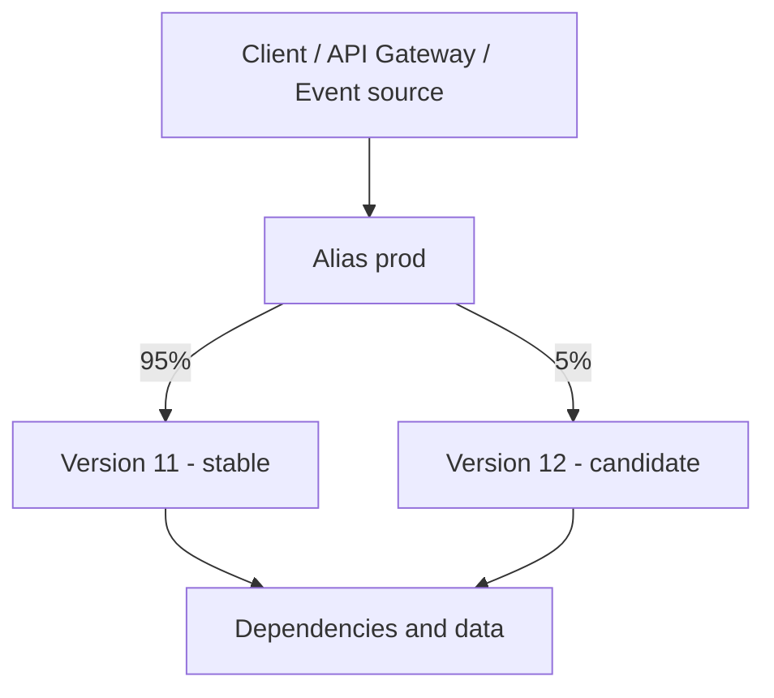
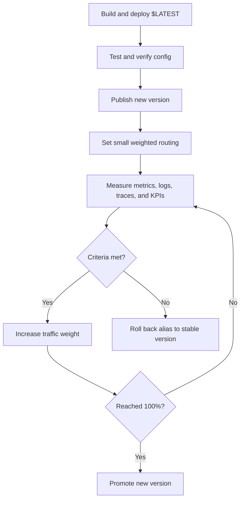

# Versions, Aliases, and Traffic-Shifting Function Releases

In serverless architectures, updating a function can immediately affect every request if production invokes the in-development version directly. Versions and aliases decouple code deployment from the production invocation endpoint: each published version is an immutable snapshot, while an alias is a logical name that can switch between versions or split traffic across multiple versions. This allows operations teams to roll out gradually, measure impact, incrementally increase user traffic, and roll back to a stable version when issues arise.

This lesson belongs to the **Serverless Operations and Optimization** chapter of the **CLOUD_CORE_SERVICES_COMPUTE** module. It focuses on version lifecycles, aliases, traffic-weighted rollouts, and operational decisions affecting function reliability, scalability, and cost in the cloud. Command examples use AWS Lambda because it provides explicit version and alias terminology; the same staged rollout principles apply to other function services with equivalent mechanisms.

After this lesson, learners will be able to:

- Distinguish `$LATEST`, published versions, and aliases.
- Design release workflows so production always invokes through a stable alias.
- Configure weighted routing to split traffic between the running version and a new version.
- Choose canary, linear, or all-at-once strategies based on risk and traffic volume.
- Monitor metrics, logs, traces, and business signals to decide whether to proceed or roll back.
- Promote or roll back without modifying client endpoints.

## 1. What Problems Do Versions and Aliases Solve?

Serverless functions are frequently updated multiple times per day. If clients invoke a function without a version qualifier, requests typically route to `$LATEST` in AWS Lambda. This is the mutable working copy that changes with every deployment. When an update contains a bug, every client calling `$LATEST` is impacted immediately, and pinpointing which request ran which code becomes harder.

Versions and aliases introduce a control layer between development and live traffic:

- **`$LATEST`:** the mutable copy of the function. This is typically where new code and configuration are deployed prior to testing.
- **Published version:** a numbered snapshot, such as `11` or `12`. Version-scoped code and configuration are frozen at publish time. Published versions cannot be modified; making changes requires publishing a new version.
- **Alias:** a mutable pointer name, such as `dev`, `staging`, or `prod`. An alias points to a published version and can optionally route a percentage of traffic to another version.

For example, the `prod` alias initially points to version `11`. When version `12` is ready, the alias can send 95% of requests to version `11` and 5% to version `12`. If metrics remain healthy, operations shifts the alias so version `12` handles all traffic. On errors, the alias can be reverted to version `11`.



Aliases keep clients invoking a stable name while deployment teams swap versions underneath. Clients do not need to update ARNs or endpoints after each release, provided integrations and invocation permissions are configured to use the alias.

## 2. Distinguishing Function Copy, Version, and Alias

| Component | Mutable? | Role | Example |
|---|---|---|---|
| `$LATEST` | Yes | Target for code and configuration updates before release | `orders-handler` |
| Published version | No after publish | Release snapshot for testing, comparison, and recovery | `orders-handler:11` |
| Alias | Target version and routing weights can change | Stable invocation target for an environment or traffic group | `orders-handler:prod` |
| Weighted routing | Adjustable on the alias | Splits requests between primary and secondary versions | `prod`: 95% version 11, 5% version 12 |

A published version is a snapshot of version-scoped function code and configuration. However, not everything a function depends on is frozen with the version. IAM policies attached to the execution role, secret values read from external services, database schemas, partner APIs, queues, and shared data can all change independently. Consequently, two versions running concurrently during a canary rollout still interact with the same dependencies or shared data. Backward compatibility of those changes must be evaluated.

An alias is neither a separate copy of the function nor code storage. It is a named reference to versions. Updating an alias affects all clients calling it according to the new configuration. Restrict `UpdateAlias` permissions to the release pipeline or authorized release team.

## 3. Designing Production Invocation Points via Aliases

An operationally clean convention is creating separate aliases per environment, such as `dev`, `staging`, and `prod`. Production integrations invoke the alias-qualified ARN, for example `arn:aws:lambda:ap-southeast-1:123456789012:function:orders-handler:prod`.

Clients can invoke functions in several ways: API Gateway, Lambda function URLs, Step Functions, event source mappings, or another function. Verify each integration configuration to ensure it references the intended alias. If an integration still calls an unqualified ARN or `$LATEST`, it bypasses weighted routing on the `prod` alias.

Invocation permissions must also match the invocation target. When using a resource-based policy for an alias, grant permissions on the exact qualified ARN to the exact required principals. Check caller permissions, function policies, and dependency permissions; an alias pointing to the right version can still fail if that version's permissions or network configuration are misaligned.

Do not use the `prod` alias for manual testing. Use a separate alias or invoke a specific version during controlled tests. This prevents test traffic from inadvertently skewing candidate traffic share in production.

## 4. Workflow for Releasing a New Version

A sample workflow can be divided into the following steps:

1. **Build and deploy to `$LATEST`:** produce a traceable artifact and update code and required configuration.
2. **Pre-release testing:** run unit tests, integration tests, and verify permissions, timeouts, memory, environment variables, and dependencies.
3. **Publish version:** create an immutable version once validated. Attach a description or release metadata linking back to the commit and build.
4. **Add candidate to alias:** route a small traffic percentage to the new version.
5. **Observe:** compare errors, latency, throttling, cold starts, and business metrics of the candidate against the stable version.
6. **Increase weight or roll back:** ramp up in stages when criteria pass; halt and revert to the stable version on anomalies.
7. **Complete release:** shift the alias completely to the new version, re-verify, and record deployment metadata.



A key checkpoint is publishing only after both code and required configuration have been updated. If code changes after publishing, the older version retains the older snapshot; another new version must be published. Record version numbers, commit SHAs, build IDs, releasing user or pipeline, timestamps, and test results in your release management system.

## 5. Splitting Traffic with Weighted Alias Routing

In AWS Lambda, an alias can point to a primary version while routing a percentage of traffic to an additional version. For example, alias `prod` points primarily to version `11` while sending 5% of requests to version `12`:

```json
{
  "FunctionVersion": "11",
  "RoutingConfig": {
    "AdditionalVersionWeights": {
      "12": 0.05
    }
  }
}
```

A weight of `0.05` corresponds to 5%. The remaining traffic goes to the primary version. Weighted routing uses probabilistic distribution across requests, not a deterministic counter guaranteeing exactly 5 out of every 100 requests hit the candidate. Under low traffic, observed percentages over short windows can fluctuate significantly. Evaluate over enough requests and sufficient duration to obtain reliable signals.

An illustrative progressive ramp-up:

| Stage | Stable Version | New Version | Continuation Criteria |
|---|---:|---:|---|
| Initial canary | 99% | 1% | Zero critical errors; logs and traces valid |
| Expansion 1 | 95% | 5% | Error rate and p95 within acceptable thresholds |
| Expansion 2 | 90% | 10% | No increase in throttling, timeouts, or business errors |
| Expansion 3 | 50% | 50% | Candidate remains stable under higher load |
| Complete | 0% | 100% | Observation window and release criteria satisfied |

These percentages are illustrative only. In high-traffic systems, 1% may yield sufficient test samples. In low-traffic systems, extend the observation window or run dedicated load tests before increasing traffic. Never decide solely on traffic percentage if the candidate has not received enough representative requests across critical operations.

### Configuring via AWS CLI

Suppose function `orders-handler` already has version `11`, version `12` was just published, and alias `prod` currently points to version `11`.

```bash
# Publish a version after updating and testing $LATEST
aws lambda publish-version \
  --function-name orders-handler \
  --description "release-2026-11-22-build-1842"

# Create the alias initially if prod does not yet exist
aws lambda create-alias \
  --function-name orders-handler \
  --name prod \
  --function-version 11

# Shift 5% of prod alias traffic to version 12
aws lambda update-alias \
  --function-name orders-handler \
  --name prod \
  --function-version 11 \
  --routing-config '{"AdditionalVersionWeights":{"12":0.05}}'

# Verify current primary version and routing weights
aws lambda get-alias \
  --function-name orders-handler \
  --name prod
```

Use `create-alias` only when the alias does not yet exist. In real pipelines, read current state before creating or updating to avoid errors when an alias already exists. Also capture the actual version number returned by `publish-version`; never assume the new version is always `12`.

Once the candidate meets criteria, point the alias completely to version `12`:

```bash
aws lambda update-alias \
  --function-name orders-handler \
  --name prod \
  --function-version 12 \
  --routing-config '{"AdditionalVersionWeights":{}}'
```

If version `12` fails during canary, clear the additional routing weights and keep version `11` as primary:

```bash
aws lambda update-alias \
  --function-name orders-handler \
  --name prod \
  --function-version 11 \
  --routing-config '{"AdditionalVersionWeights":{}}'
```

These commands illustrate alias operations. Pipelines should check command exit status, record the alias ARN and actual version, and send a verification request after updating. Do not treat a successful API return as sole proof that the entire production flow works.

## 6. Choosing a Release Strategy

| Strategy | How It Works | Best Fit When | Trade-offs |
|---|---|---|---|
| All-at-once | Shifts entire alias to the new version in one step | Small change, thoroughly tested, fast rollback available | Large initial blast radius |
| Canary | Sends a small share to candidate, observes, then ramps or promotes | Wanting to catch issues on live traffic with small initial blast radius | Requires sufficient traffic and observation time |
| Linear | Increases traffic in equal increments over a set interval | Wanting gradual load ramp-up with periodic checkpoints | Multiple phases to monitor and coordinate |
| Blue/green | Maintains two versions/environments and switches ingress when ready | Major change needing relatively independent validation of the new environment | May consume extra resources and requires managing data compatibility |

In AWS, CodeDeploy supports Lambda deployments using presets such as `LambdaCanary10Percent5Minutes`, `LambdaCanary10Percent30Minutes`, `LambdaLinear10PercentEvery1Minute`, `LambdaLinear10PercentEvery2Minutes`, and `LambdaAllAtOnce`. These configurations automate alias updates on a rollout schedule. They can be paired with CloudWatch alarms and pre-/post-traffic hooks to check conditions, halt rollouts, or run validation tasks. Deployment configuration names are built-in CodeDeploy presets; pick one matching your application's traffic volume and observation window.

Canary and linear rollouts shrink the initial blast radius but do not eliminate risk. A single buggy request can still write bad data or trigger side effects before rollback. For payments, notifications, order creation, or data mutations, use idempotency keys, duplicate controls, and data compatibility rules so irreversible consequences cannot happen just before an alias switch.

## 7. Observing the Candidate Before Ramping Traffic

Do not promote simply because the function returned success codes on a few smoke tests. Compare the candidate and stable version across the same traffic mix, same time window, and user-meaningful metrics.

### Technical Metrics

- **Invocations:** how often the function is called, confirming the candidate actually receives traffic.
- **Errors and error rate:** error counts and error percentage over total invocations. Track both absolute counts and rates because percentages fluctuate heavily on small samples.
- **Duration:** processing time; monitor p50, p95, and p99 when your monitoring captures suitable percentiles.
- **Throttles:** requests throttled due to concurrency or quota limits.
- **Concurrent executions:** concurrency levels, helping surface capacity pressure during ramp-up.
- **Init duration/cold starts:** execution environment initialization time, especially after changing runtimes, packages, or initialization logic.
- **Async event age and iterator age:** processing delay for asynchronous events or stream records; names and measurements depend on the trigger.
- **DLQs and retries:** failed message counts, retry counts, and events routed to dead-letter queues.

In Lambda, use the executed version dimension (such as `ExecutedVersion` on metrics that support it) to compare versions. Confirm which metrics and dimensions are available for your function type, triggers, and observability setup. If dashboards aggregate only at the function level, candidate errors can get masked by stable version traffic.

### Structured Logs

Logs should capture enough context to identify which version handled each request, while avoiding tokens, passwords, personal data, or sensitive payloads. Example JSON log:

```json
{
  "level": "INFO",
  "event": "order_validation_completed",
  "function": "orders-handler",
  "executedVersion": "12",
  "alias": "prod",
  "requestId": "a1b2c3d4",
  "traceId": "1-655f0000-1234567890abcdef12345678",
  "durationMs": 42,
  "result": "success"
}
```

Not every runtime automatically includes the alias in log context. Release or alias info can be passed via deployment config, metadata, or the calling layer, but distinguish application-logged fields from the actual executed version reported by the platform. Propagate request IDs and trace IDs across downstream calls to correlate logs across services.

### Distributed Traces

Traces show which components a request traversed and how much time each segment consumed. When a candidate increases latency, traces pinpoint whether the slowdown comes from function initialization, database queries, external API calls, retries, or internal processing. On AWS, use AWS X-Ray or OpenTelemetry standards via instrumentation compatible with your runtime and platform.

When comparing two versions, inspect the same span groups and attributes such as function name, executed version, route, dependency, and status. Too low a sampling rate may miss rare errors; too high a sampling rate on high-volume systems drives up storage and processing costs. Select an appropriate sampling rate and provide a way to raise sampling during incident investigations.

### Business Metrics

Technical metrics alone cannot confirm a release is business-correct. Also track order creation success rates, payment completion rates, rejected transactions, duplicate event counts, and manual support intervention rates. A function can return HTTP 200 while still persisting incorrect state or invalid data.

Define alert thresholds before starting the rollout. For example: halt ramp-up if candidate error rate exceeds an absolute limit or rises above baseline by a set margin, p95 breaches thresholds, severe business errors appear, or async event age climbs steadily. Specific thresholds must reflect your application's SLOs, baselines, and traffic profile—never a single universal number for every function.

## 8. Rollback and Post-Release Recovery

Rolling back via an alias is typically fast because it only switches the target version. However, flipping an alias does not undo already-committed side effects, automatically revert database schemas, or recall messages already sent to other systems.

Prepare the rollback procedure before starting a canary:

1. Identify the latest stable version and verify it still runs cleanly against current dependencies.
2. Point the alias back to the stable version and clear weighted routing to the candidate.
3. Send a verification request through the production alias to confirm new requests hit the intended version.
4. Monitor error rates, duration, throttling, event age, and business metrics after rollback.
5. Check backlogged messages, retries, DLQs, and side effects generated while the candidate was active.
6. Pause automated release pipelines until root cause is identified and a tested fix is ready.

Rollbacks should not rely on improvising manual commands mid-incident. Pipelines should maintain pre-built rollback actions, required permissions, recorded stable versions, and post-change verification alerts. For systems with strict recovery requirements, rehearse rollbacks in staging and measure actual recovery times.

## 9. Important Considerations for Traffic-Shifting Releases

### Data and Dependency Compatibility

During weighted routing, two versions run side by side. If the new version modifies database schemas, message formats, or inter-service protocols, the old version may fail to read data written by the new version. Use multi-step schema evolution: make backward-compatible schema additions first, deploy code able to read both old and new formats, migrate data, and only remove old structures in a separate later release.

### Concurrency and Cold Starts

Shifting candidate traffic changes load distribution, not total concurrency guarantees. A new version might run slower, hold more concurrent requests, or need more initialization resources. Check reserved concurrency, account quotas, provisioned concurrency if used, and throttling signs before raising traffic share. For spiky workloads, verify both scaling behavior and initialization time, not just average load.

### Triggers and Endpoints

Verify every invocation source targets the production alias. An API Gateway integrated with the `prod` alias may honor weighted routing, while an event source mapping or another function might still invoke an unqualified ARN if stale configuration remains. Maintain an inventory of integrations, permissions, and event source mappings to avoid partial rollouts.

### Security and Release Permissions

Release pipelines need permissions to deploy code, publish versions, and update aliases within managed functions. Separate deployment permissions from policy or secret modification permissions if organizational governance requires it. Audit who triggered the release, pipeline run, commit, and rollback reason for production change tracking.

### Cost

During a canary, both old and new versions consume invocations, compute duration, logs, traces, and potentially provisioned concurrency. A buggy release that triggers heavy retries can inflate invocations and downstream costs. Track costs by function, environment, and release; set sensible retry caps and rollout durations. Canaries reduce blast radius, but they introduce an interval where two versions operate simultaneously.

## 10. Hands-On Exercise

Simulate releasing an order-processing function on AWS Lambda:

1. Create an `orders-handler` function with a health check endpoint and one simple business operation. Deploy initial code, test, and publish version `11`.
2. Create an alias named `prod` pointing to version `11`. Configure a test integration calling the alias-qualified ARN.
3. Update code in `$LATEST` to build a candidate, such as adding validation for order IDs. Run unit and integration tests before publishing a new version.
4. Publish the new version (say `12`) and configure the `prod` alias to route 5% of requests to version `12`.
5. Send enough test requests through the alias. Collect invocations, error rates, duration, logs containing executed version, and request traces.
6. Simulate an error in version `12`, such as failing for a subset of test inputs. Verify alerts fire and revert the alias back to version `11`.
7. Send requests after rollback, confirm executed version is `11`, and verify zero traffic remains routed to `12`.
8. Fix the candidate code, republish after patching, ramp traffic in stages, and promote once all criteria pass.

In this exercise, never use real customer data and never send side-effecting calls to production systems. If working only in a lab environment, simulate traffic splitting via a script targeting the alias and compare logged versions. Observed ratios may fluctuate around configured weights because weighted routing distributes traffic probabilistically.

## 11. Pre-, During-, and Post-Release Checklist

**Pre-release**

- [ ] Code and configuration tested on `$LATEST` or in staging.
- [ ] Artifact, commit SHA, build ID, and current stable version recorded.
- [ ] Candidate published with no further edits after publishing.
- [ ] Production clients, triggers, permissions, and integrations verified to target the alias.
- [ ] Dependencies and schemas confirmed compatible with both versions running concurrently.
- [ ] Dashboards, logs, traces, business metrics, and alerts are ready.
- [ ] Rollout halt thresholds and rollback commands are defined.

**During release**

- [ ] Started with a small traffic percentage suited to traffic volume and risk.
- [ ] Confirmed candidate is actually receiving requests via the alias.
- [ ] Compared error rate, duration, throttling, concurrency, and cold starts against baseline.
- [ ] Monitored retries, event age, DLQs, and business metrics.
- [ ] Increased traffic only after sufficient representative requests and a passing observation window.
- [ ] Halted ramp-up and rolled back if thresholds breached or severe errors appeared.

**Post-release**

- [ ] Alias points 100% to the new version with no unintended remaining weighted routing.
- [ ] Smoke test via the alias confirmed the expected version.
- [ ] Dashboards and alerts continue monitoring post-promotion.
- [ ] Release record captures version, commit, timestamp, outcome, and releasing user/pipeline.
- [ ] Monitored backlogged messages, side effects, and costs incurred during rollout.
- [ ] Previous version retained ready for rollback per organizational retention policy.

Versions freeze verifiable releases; aliases provide stable invocation endpoints; weighted routing enables incremental traffic expansion. Combining a controlled release workflow with metrics, logs, traces, business criteria, and prepared rollbacks lets operations teams limit blast radius, detect issues early, and maintain serverless application availability.
