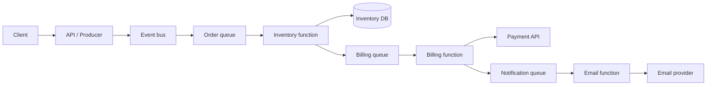

# Logs, Traces, and Diagnosing Failures Across Event Processing Chains

Serverless applications typically process a business flow across multiple components: API gateways, event buses, queues, functions, databases, object storage, and external services. A single initial request can produce multiple events; each event can trigger one or more functions running at different times and in different execution environments. Consequently, when a business flow fails, inspecting logs from only the final function is rarely enough to pinpoint where the failure began.

Observability for event chains must combine three signal types: **logs** record discrete events and context at each step; **traces** capture relationships and timing across steps; **metrics** reveal trends, error rates, and system-wide impact. Signals must carry correlation identifiers end-to-end while respecting asynchronous boundaries, retries, fan-out, and sensitive data protection.

## 1. Why Is Diagnosing Event-Driven Serverless Harder Than a Single Request?

In a simple synchronous application, a request usually follows a call stack observable inside a single process. In event-driven systems, work splits across multiple independent executions:

- A producer receives a request and emits an event.
- An event bus evaluates rules and routes the event to queues or subscribers.
- A queue holds the event until a consumer has capacity.
- A function spins up to process the event.
- The function calls databases, object storage, or external APIs.
- The function emits subsequent events to trigger another processing chain.
- Retries, redrives, or dead-letter queues can cause an event to run again minutes or hours later.

Steps may execute across different regions, accounts, runtimes, and timestamps. One event can be delivered multiple times; multiple events can stem from one business action; one function can process a batch containing multiple events. Therefore, distinguish business IDs, event IDs, invocation IDs, and trace IDs.

### Processing Chain Example

A customer submits an order creation request. The API emits `OrderCreated`; the event bus routes the event to a queue; a function checks inventory; another function generates an invoice; a notification service sends an email.



If the email is not sent, you must determine whether the event was emitted, whether the queue received the message, whether the function was invoked, whether the provider rejected the request, and how many retries occurred. Correlated traces and logs answer these questions without guessing from a single isolated error line.

## 2. Distinguishing Logs, Traces, and Metrics

| Signal | Question Answered | Diagnostic Use |
|---|---|---|
| Log | What happened at a specific point in time? | Inspect sanitized inputs, decisions, errors, and outcomes |
| Trace | How are steps related and how long did each take? | Follow flows across producers, queues, functions, and dependencies |
| Metric | How is system health changing over time? | Detect error spikes, queue backlogs, latency, and saturation |

All three signals complement one another. Metrics show queue age rising; traces show the function spending time in the database; logs pinpoint a query timeout or specific error code. Never rely on logs alone to track long-term trends or use traces as a substitute for audit logs.

### Logs

A log is a timestamped record of an event in an application or platform. Good logs are structured, use consistent fields, and can be queried by event ID, trace ID, function name, or request ID.

### Traces

A trace is a collection of spans representing a processing journey. Each span captures start/end timestamps, operation name, status, attributes, and relationships to other spans. Traces reveal which step called which, which ran in parallel, and where latency accrued.

### Metrics

Metrics are numeric data aggregated over time, such as invocation counts, error counts, duration histograms, queue depth, oldest message age, and retry counts. Metrics maintain bounded cardinality to power dashboards and alerts efficiently.

## 3. Correlation Identifiers Across Event Chains

An observability design needs multiple ID types because each answers a different question.

| Identifier | Scope | Purpose |
|---|---|---|
| `request_id` | One synchronous request from client or gateway | Look up the originating request |
| `correlation_id` | One business workflow spanning multiple components | Group steps belonging to the same business operation |
| `event_id` | One specific event | Identify messages and detect redeliveries |
| `trace_id` | One distributed trace | Connect spans belonging to the same observed journey |
| `span_id` | One operation within a trace | Identify a specific step |
| `invocation_id` | One runtime execution of a function | Distinguish individual runs/retries |
| `attempt` | Processing attempt count for an event/task | Track retries and redrives |
| `business_id` | Business identifier such as order ID | Look up business state under appropriate authorization |

Do not overload a single field for everything. For instance, an event delivered three times keeps the same `event_id` across all three attempts, while having distinct `invocation_id` values and potentially separate spans/traces depending on tracing mode. `correlation_id` can stay constant to tie the entire workflow together.

### Generating Correlation IDs

Generate a correlation ID at the first ingress boundary if the client has not supplied a valid one. When accepting client-supplied IDs, enforce length and character restrictions and disallow sensitive data or log-injection characters. Random unguessable IDs or UUIDs are usually better than emails, phone numbers, or personal data.

### Propagating IDs via Event Envelopes

When a producer emits an event, place correlation metadata in an agreed-upon envelope or message attributes schema.

```json
{
  "event_id": "evt-7f3a91",
  "event_type": "OrderCreated",
  "event_version": 2,
  "correlation_id": "wf-91c24d",
  "occurred_at": "2026-11-22T08:30:00Z",
  "traceparent": "00-4bf92f3577b34da6a3ce929d0e0e4736-00f067aa0ba902b7-01",
  "data": {
    "order_id": "ord-10482"
  }
}
```

This envelope is illustrative. Production schemas must specify versioning, maximum size, required fields, and metadata propagation suited to the event/queue service in use. Never place access tokens, secrets, or full sensitive business payloads inside correlation metadata.

### Event ID Is Not Always an Idempotency Key

`event_id` identifies a single message. An idempotency key identifies a retryable operation that must not duplicate side effects. Often the event ID can serve as part of the idempotency key, yet if the same business action can emit multiple equivalent events, key by the appropriate business operation and version.

## 4. Structured Logging for Functions

Structured logging emits named fields instead of unstructured concatenated strings. JSON is widely used because it is easy to parse, filter, and ingest into centralized log platforms.

A log entry may include:

- UTC timestamp and log severity.
- Service/function name, version, and environment.
- Event type, event ID, correlation ID, and trace/span ID.
- Invocation ID, attempt number, and source queue/topic.
- Operation name and processing outcome.
- Duration, dependency name, and error code.
- Region or non-sensitive resource identifiers.

Example:

```json
{
  "timestamp": "2026-11-22T08:30:01.125Z",
  "severity": "ERROR",
  "service": "inventory-consumer",
  "environment": "production",
  "function_version": "42",
  "event_type": "OrderCreated",
  "event_id": "evt-7f3a91",
  "correlation_id": "wf-91c24d",
  "trace_id": "4bf92f3577b34da6a3ce929d0e0e4736",
  "span_id": "00f067aa0ba902b7",
  "invocation_id": "inv-8831",
  "attempt": 2,
  "operation": "reserve_inventory",
  "duration_ms": 1830,
  "error_code": "DEPENDENCY_TIMEOUT",
  "message": "Inventory database request timed out"
}
```

### Logging at Processing Boundaries

Emit logs at key milestones:

1. Invocation starts and identifies the event source.
2. Event is parsed and validated.
3. Task is claimed or message is received.
4. Dependency calls start/finish when diagnostic visibility is needed.
5. Decision to retry, acknowledge, reject, or route to DLQ.
6. Output commits and processing completes.

You do not need to log every line of code or entire payloads. Choose high-value diagnostic milestones to control cost, noise, and sensitive data exposure.

### Consistent Severity Levels

| Level | When to Use |
|---|---|
| `DEBUG` | Development details or temporary diagnostics, usually disabled in production |
| `INFO` | Invocation start/end, event commit, key normal state transitions |
| `WARN` | Retries, fallbacks, throttling, or self-recoverable conditions |
| `ERROR` | An operation failed and requires attention/investigation |
| `FATAL` | Process or runtime cannot continue; reserve for truly critical failures |

Do not log the exact same error at `ERROR` across every layer if a retry ultimately succeeded. Log initial failed attempts at `WARN`, then log the final outcome at `INFO` or `ERROR` according to business status.

## 5. Propagating Trace Context Across Asynchronous Boundaries

Distributed tracing relies on trace context to link operations across services. W3C Trace Context defines headers such as `traceparent` and `tracestate` for propagating context across compliant components.

For synchronous HTTP, instrumentation can inject context automatically via headers. For queues or event buses, context must be written into message attributes/envelopes on publish and extracted by consumers on receipt. Not every broker or trigger preserves headers automatically; verify your specific integration and settings.

### Producer

The producer starts or continues a trace, creates a span for publishing, and injects context into message metadata. The publish span should record the topic/queue or event destination as non-sensitive attributes.

### Broker/Event Bus

Brokers may emit dedicated metrics such as publish latency, delivery count, age, throttling, or rule failures. Not every broker produces full distributed spans. When spans are absent, rely on logs/metrics and event IDs to bridge the gap between publish and consume.

### Consumer

The consumer extracts trace context from the message and starts a processing span. For messages delivered after long delays or processed in batches, choose appropriate trace relationships. Use parent-child links when a message clearly continues the prior operation; for batches or fan-in across multiple traces, span links generally represent relationships better than forcing a single parent.

### Retries and Redrives

Retries can either continue the same trace or start a new trace linked to the original, depending on instrumentation capabilities and workflow duration. Either way, logs must preserve `event_id`, `correlation_id`, and `attempt` so operators can reconstruct the complete history.

Do not start a new trace and drop the correlation ID; likewise, do not stretch a single trace indefinitely across multi-day workflows if your tracing backend enforces retention limits. For long-running workflows, correlation IDs and event histories provide a more durable link than traces alone.

## 6. Trace Spans for Event-Driven Workflows

A trace may include spans such as:

- `http.server`: receives the initial request.
- `event.publish`: publishes the event to the bus.
- `messaging.receive`: receives the message from the queue.
- `function.invoke`: starts the function invocation.
- `inventory.reserve`: calls the inventory database or service.
- `event.publish`: publishes the next event.
- `payment.authorize`: calls the payment provider.
- `notification.send`: sends the notification.

Spans should have stable operation names and bounded-cardinality attributes. Never embed order IDs or user IDs in span names; place those IDs in logs or controlled trace attributes if policy permits.

### Span Duration and Queue Wait Time

In event processing, total business latency is not just function execution duration. Measure:

- Publish-to-delivery latency.
- Queue wait time.
- Function startup/init duration when exposed by the platform.
- Handler duration.
- Dependency latency.
- Retry delays and redrive wait times.
- End-to-end workflow duration.

If you measure only function duration, a queue might hold messages for 30 minutes while dashboards claim functions are fast. Queue age/oldest message age is essential for catching this gap.

### Fan-Out and Fan-In

One event can trigger multiple parallel subscribers. The workflow completes when required branches finish or reach a business decision. Traces should reflect fan-out/fan-in relationships; correlation IDs link branches together while each branch has its own spans and event IDs.

When a function processes a batch of multiple events, do not collapse the entire batch onto a single event ID. Record a distinct batch ID and log or attach size-bounded event ID lists appropriately.

## 7. Instrumentation with OpenTelemetry

OpenTelemetry provides APIs, SDKs, and semantic conventions for instrumenting traces, metrics, and logs. In serverless environments, select an integration mode compatible with your runtime and platform: auto-instrumentation, wrappers/extensions, or manual instrumentation.

### Instrumentation Principles

- Initialize SDKs/exporters per runtime and provider guidance.
- Instrument HTTP clients, database clients, and messaging libraries where compatible.
- Create manual spans around key business operations.
- Inject/extract trace context via message attributes.
- Record exceptions and error status on spans when operations fail.
- Flush telemetry before the runtime freezes or shuts down the environment if required by the platform; set timeouts so flushing never stalls the handler indefinitely.
- Test sampling and exporter behavior under rising concurrency.

### Producer Pseudocode Example

```python
def publish_order_created(order, tracer, producer):
    with tracer.start_as_current_span("order.publish") as span:
        span.set_attribute("messaging.destination.name", "orders")
        span.set_attribute("app.event.type", "OrderCreated")

        envelope = {
            "event_id": new_event_id(),
            "correlation_id": order.workflow_id,
            "event_type": "OrderCreated",
            "data": {"order_id": order.id}
        }

        inject_current_trace_context(envelope)
        producer.send(envelope)
        span.set_attribute("app.publish.result", "accepted")
```

These functions are pseudocode. Actual APIs depend on your SDK, messaging client, and provider. The broker accepting a publish does not mean consumers succeeded; track delivery and consumer outcomes separately.

### Consumer Pseudocode Example

```python
def handle_message(message, tracer, consumer):
    context = extract_trace_context(message.attributes)
    with tracer.start_as_current_span(
        "order.consume", context=context
    ) as span:
        event = validate_envelope(message.body)
        span.set_attribute("app.event.type", event["event_type"])
        span.set_attribute("messaging.message.id", event["event_id"])

        try:
            process_idempotently(event)
            consumer.ack(message)
            span.set_status("OK")
        except RetryableError:
            span.record_exception()
            span.set_status("ERROR")
            raise
```

This is also pseudocode. Ack/retry semantics depend on the trigger. Some runtimes require returning batch item failures or throwing exceptions instead of calling `ack` directly. With partial batch failures, report only failed records per the supported mechanism to avoid reprocessing the entire batch unnecessarily.

## 8. Correlation Across Queues, Event Buses, and Long Workflows

Each event source has different semantics. Observability must capture enough context to connect producers with consumers.

### Queues

Logs and metrics should capture:

- Queue/topic name.
- Message/event ID.
- Receive count or attempt number when provided.
- Enqueue time and message age.
- Visibility timeout/lease behavior.
- Ack/delete outcome.
- DLQ destination and redrive status.

Never log full payloads by default. Use message IDs and correlation IDs to retrieve payloads from access-controlled stores when needed.

### Event Buses

Record event source, event type, rule/route, destination, and publish outcome. If an event is dropped by filters or schema mismatches, capture broker metrics/logs or dead-letter events. Producer success only confirms the publish was accepted per API semantics—not that every subscriber processed it.

### Workflow Orchestration

For multi-step workflows, record workflow execution ID, step name, state transitions, retry count, and wait duration. Workflow ID serves as a durable business correlation key; trace IDs may vary across execution segments.

### Scheduled Events

For timers/schedules, record scheduled time, actual start time, lateness, and execution ID. This separates slow functions from delayed scheduler triggers.

## 9. Metrics for Event-Driven Serverless

Design metrics covering both function reliability and end-to-end chain latency.

| Category | Suggested Metrics | Operational Question |
|---|---|---|
| Invocation | Invocations, errors, throttles, duration | Is the function running and completing? |
| Startup | Cold starts, init duration | Are cold starts adding latency? |
| Queue | Depth, oldest age, enqueue/dequeue rate | Are events backing up? |
| Retry | Receive count, retry rate, redrive count | Are messages failing repeatedly? |
| DLQ | DLQ depth, oldest DLQ age | Are events falling out of the main pipeline? |
| Dependency | Request rate, latency, errors, connection saturation | Is a database/external API the bottleneck? |
| Workflow | End-to-end completion time, success rate | Are business workflows meeting SLOs? |
| Cost | Cost per invocation/successful event | Are retries and telemetry inflating costs? |

### RED for Services

RED tracks Rate, Errors, and Duration:

- **Rate:** requests or events processed per second.
- **Errors:** rate or ratio of failed executions.
- **Duration:** processing time, typically tracked at p50/p95/p99.

For event-driven systems, supplement RED with queue age, backlog depth, and completion rate because pre-invocation wait times affect end-to-end latency.

### USE for Resources

USE stands for Utilization, Saturation, and Errors. In serverless environments, some host-level metrics are hidden from customers; you can still track concurrency, throttling, memory, CPU, network, and quotas exposed at the service level.

### Avoiding Cardinality Explosions

Never use event ID, correlation ID, user ID, or order ID as metric labels/dimensions. High-cardinality values inflate bills and degrade metrics backends. Keep IDs in logs/traces; use bounded dimensions on metrics such as service, function, event type, environment, region, and outcome.

## 10. Trace Sampling and Retention

Trace volume grows rapidly when one request spawns multiple events and each event produces multiple spans. Sampling controls costs, but avoid dropping traces of rare errors or major incidents.

### Head-Based Sampling

Head-based sampling decides whether to trace at the start, typically via a fixed percentage or initial rule. It is simple and low-overhead, but it may discard traces for errors that only surface late in a workflow.

### Tail-Based Sampling

Tail-based sampling decides after observing the trace, allowing prioritization of traces with errors, high latency, or key attributes. It is powerful for diagnostics, though it requires collectors/buffers with enough resources to hold spans pending a decision.

### Practical Rules

- Keep a baseline sampling rate sufficient to observe normal behavior.
- Prioritize retaining traces with errors, timeouts, or latency violations if supported.
- Rely on logs/metrics to catch failures even when a trace is not sampled.
- Set retention aligned with operations, auditing, and budget.
- Never assume every span of a multi-day workflow remains stored simultaneously.

Configure sampling consistently across services to avoid broken traces. If a producer samples out while a consumer independently samples in, backends show fragmented traces. Propagate sampling decisions inside the trace context per your tracing standard.

## 11. Protecting Data in Logs and Traces

Event payloads may contain personal data, payment details, tokens, addresses, customer records, or internal data. Logs and traces are often accessible to wider audiences than business databases, so never copy raw payloads blindly into telemetry.

### Do Not Log

- Passwords, API keys, access tokens, refresh tokens, or private keys.
- Card numbers, payment credentials, or unnecessary personal data.
- Full request/response bodies containing sensitive data.
- Secrets inside environment variables or connection strings.
- Full message payloads when only event ID and event type are needed.

### Safe to Log

- Non-sensitive event IDs and correlation IDs.
- Event type, schema version, and outcome.
- Standardized error codes.
- Dependency name, duration, and retry count.
- Classified, log-approved business attributes.

### Redaction and Access Control

Apply redaction in loggers or telemetry pipelines, but never rely solely on post-emission filtering. Best practice is never emitting sensitive data from the application in the first place. Enforce role-based access controls, encrypt in transit and at rest, audit queries, and apply appropriate retention.

### Correlation IDs Are Not Secrets

Correlation IDs appear in logs, traces, and support tickets. Never treat them as credentials or authorization tokens. Lookup endpoints accepting an ID must still authenticate and authorize callers per tenant/user.

## 12. Business-Impact Alerting

Alerts should reflect user- or workflow-impacting failures rather than paging on every isolated exception.

Actionable alerts:

- Event processing success rate drops below threshold.
- Oldest message age breaches SLO.
- DLQ grows rapidly or contains aged messages near expiration.
- Function throttling rises while queue backlogs keep growing.
- End-to-end workflow completion time exceeds target.
- Dependency timeouts or error rates spike.
- Average retry attempts rise abnormally.
- Zero consumer invocations despite messages sitting in the queue.
- Events publish successfully, yet subscribers fail to receive them within expected windows.

### Multi-Window Alerting

For error-rate or latency metrics, combine a short window to detect sudden spikes with a longer window to suppress transient noise. For queue age, alerting on how long the oldest message has waited often aligns more closely with SLOs than raw queue depth alone.

Avoid alerting solely on absolute DLQ message counts if traffic varies dramatically. Track both the DLQ ratio over total events and absolute counts to understand real impact.

## 13. Diagnosing Each Segment of an Event Chain

When a business flow fails, trace step by step from producer to consumer and dependencies. Use event ID/correlation ID to find the last point with proof of success.

### Step 1: Did the Producer Receive the Request?

Check API access logs, request IDs, validation errors, and responses. Determine whether the producer committed business state or only accepted the request asynchronously. If rejected prior to emitting an event, investigate at the API/application layer.

### Step 2: Was the Event Published?

Inspect publish spans/logs, broker responses, event IDs, schema versions, and destinations. Distinguish a timed-out publish request from cases where the broker accepted the message but the producer missed the acknowledgment. The latter can produce duplicate publishes requiring idempotency.

### Step 3: Did the Event Bus Route Correctly?

Check rules/filters, event patterns, permissions, target configurations, and delivery failures. If an event fails to match a rule, it may never reach the queue despite a successful publish. Check bus metrics and any dead-letter destinations.

### Step 4: Does the Queue Have Messages and Are Consumers Receiving Them?

Check queue depth, oldest age, receive count, visibility/leases, consumer mappings, batch size, and concurrency. If the queue holds messages with zero invocations, check disabled triggers, permissions, quotas, or throttling.

### Step 5: Did the Function Start and Complete?

Look up invocation IDs, cold-start/init duration, timeouts, memory, runtime errors, handler exceptions, and batch failure responses. If only one record in a batch failed, verify partial batch response handling so the whole batch does not keep retrying.

### Step 6: Did Dependencies Respond?

Use trace spans and dependency metrics to inspect databases, caches, storage, or external APIs. Check latency, connection pools, throttling, DNS, TLS, and timeouts. When dependencies fail, avoid raising concurrency without bound.

### Step 7: Did Output Commit and Was the Event Acknowledged?

Inspect transactions, output references, idempotency records, acknowledgments, and workflow state. A log reading "handler returned success" does not prove durable output if commits are asynchronous or an error happened afterward.

## 14. Symptom-to-Cause Matrix

| Symptom | Possible Cause | Evidence to Inspect |
|---|---|---|
| Producer returns success, but no consumer runs | Rule mismatch, destination permissions, or disabled trigger | Publish logs, event bus metrics, rule/delivery logs |
| Queue depth grows continuously | Under-provisioned consumers, function errors, or slow dependencies | Queue age, concurrency, throttles, function duration |
| No function logs despite queued messages | Trigger mapping/permissions/quotas or logging setup | Service events, trigger state, invocation metrics |
| Function timeouts | Slow handler, dependency timeout, oversized batch | Trace spans, duration, memory/CPU, and dependency logs |
| Event processed multiple times | At-least-once delivery, failed ack, or visibility timeout | Event ID, attempt, invocation ID, idempotency records |
| DLQ growing | Poison messages, schema mismatch, or permanent errors | DLQ payload reference, error codes, receive counts |
| Traces break after queue | Context not injected/extracted or backend fails to link | Message attributes, `traceparent`, instrumentation |
| Workflow p99 climbs while function duration stays flat | Queue wait or scheduler delay | Enqueue time, oldest age, delivery latency |
| One event type fails more often | Schema/version issue or event-specific consumer logic | Event type/version, validation logs, and error rates |
| Database slows during scale-out | Connection storm or query saturation | DB connections, query latency, function concurrency |
| Logs missing correlation ID | Context not propagated or wrong field mapping | Producer envelope, consumer extraction, and log schema |
| DLQ redrive fails immediately again | Root cause unfixed or messages still incompatible | Error fingerprint, deployment version, redrive attempts |

## 15. Runbook for Investigating a Failed Event

1. Retrieve `correlation_id`, `event_id`, event type, and occurrence timestamp from the support ticket or business system.
2. Query producer logs/traces to verify the event was created and published.
3. Inspect event bus rules, delivery outcomes, and targets.
4. Locate the message in the queue or DLQ by event ID; inspect enqueue time and receive count.
5. Query function invocations by event ID, correlation ID, and attempt.
6. Open the trace to identify failing spans or long wait intervals.
7. Check dependency logs/metrics at the corresponding timestamp.
8. Verify whether output committed and whether the event was acknowledged.
9. Classify as transient vs. permanent; decide whether to retry, redrive, repair data, or roll back.
10. Verify business outcomes after recovery and document the incident timeline.

### Collecting Evidence Before Redriving

Before redriving a DLQ or replaying events, capture key metadata: event ID, correlation ID, error fingerprint, receive count, first/last failure timestamps, consumer version, and a protected payload reference. Never bulk-redrive before understanding the root cause; doing so can trigger a second wave of failures and overload dependencies.

## 16. Handling Retries, Poison Messages, and DLQs

Retries suit transient errors such as brief timeouts, throttling, or network resets. Poison messages always fail due to invalid data, schemas, or logic. Retrying poison messages infinitely wastes capacity and floods logs with noise.

### Retry Policy

- Set a maximum receive count or retry limit.
- Apply backoff and jitter where supported.
- Align timeouts with processing duration and visibility/lease settings.
- Separate retryable from permanent errors.
- Enforce idempotency to handle duplicate deliveries.
- Alert when attempts climb or queue age breaches SLOs.

### Dead-Letter Queues

A DLQ holds events that fail after configured attempts. Every DLQ needs an owner, retention policy, alerts, triage process, and redrive policy. It is not long-term storage for all failed messages.

When redriving:

1. Identify and fix the root cause.
2. Verify schema/event version and consumer compatibility.
3. Confirm dependencies have recovered and have headroom.
4. Set bounded batch size and redrive rate.
5. Monitor error rates, queue age, and duplicate suppression.
6. Verify business outcomes before deleting or closing DLQ items.

### Partial Batch Failures

With batch triggers, if one record fails, some services retry the entire batch unless the consumer returns failed record identifiers via partial batch responses. Otherwise, previously successful records get redelivered. Instrument each record with event ID and attempt in logs/traces, without creating high-cardinality per-record metric labels.

## 17. Diagnosing Cold Starts and Runtime Errors via Telemetry

Cold starts can slow individual invocations along an event chain. Separate queue wait time from runtime initialization time.

Useful fields:

- Function version/alias and runtime version.
- Cold-start indicator if provided by the platform.
- Init duration and handler duration.
- Memory allocation, peak memory, and timeout.
- Concurrency, throttling, and execution environment count.
- Image/package version and deployment timestamp.

If queue age rises while handler duration stays flat and init duration spikes, investigate cold-start regressions or rapid scale-out. If init stays stable while handler duration climbs, focus on application code and dependencies. If function duration is low yet queue age is high, investigate consumer capacity, trigger mappings, and delivery throttling.

## 18. Optimizing Logs and Traces While Controlling Cost

Telemetry incurs ingest, storage, query, and export costs. Event-driven systems often generate far more logs and spans than initial requests because each event fans out into multiple invocations.

### Reducing Log Noise

- Log key milestones at `INFO`; enable `DEBUG` only temporarily.
- Avoid logging every empty polling attempt when metrics suffice.
- Never log full payloads or large objects.
- Group recurring errors using error fingerprints.
- Avoid logging identical stack traces across multiple layers once handled.
- Apply controlled sampling or rate limiting to repetitive logs without dropping mandatory audit logs.

### Trace Sampling

Keep a baseline sampling rate and prioritize error/slow traces if tail sampling is supported. Verify sampling decisions propagate across messages. For long workflows, rely on correlation IDs and event histories rather than depending solely on trace retention.

### Retention

Tier retention by purpose: short-term debugging, operations/SLO tracking, security/auditing, and compliance requirements. Do not retain full detailed traces long-term without need. Retain aggregated metrics longer than raw logs/traces when aligned with policy.

### Do Not Optimize Away Critical Evidence

Telemetry reduction must preserve the ability to identify which event failed, at which step, and due to which dependency. Before tuning sampling or retention, review incident runbooks and investigation requirements.

## 19. Investigation Example: Order Confirmation Email Not Sent

A customer reports an order was created without receiving a confirmation email. The API returned HTTP 202.

### Initial Evidence

- `correlation_id`: `wf-91c24d`.
- `event_id` of `OrderCreated`: `evt-7f3a91`.
- Producer logs show the broker accepted the publish.
- Billing function processed and emitted `OrderReadyForNotification`.
- Notification queue holds messages while oldest age climbs.
- Notification function shows multiple invocation timeouts.

### Traces and Logs

Traces reveal the notification function spent most of its time calling the email provider. Logs report error code `UPSTREAM_TIMEOUT`; retry attempts climbed from 1 to 5. The database and event bus remained healthy.

### Actions

1. Confirm the email provider is degraded and check quotas/rate limits.
2. Cap notification function concurrency to avoid piling on requests.
3. Apply exponential backoff and jitter per retry policy.
4. Enforce an idempotency key per notification ID so duplicate emails are not sent if the provider processed a request whose response timed out.
5. Monitor queue age and DLQ; redrive only after the provider recovers.
6. Verify final status by notification ID and confirm the email was sent once as expected.

Looking solely at API logs made the system appear healthy because it returned 202. Traces and queue metrics revealed the incomplete workflow.

## 20. Investigation Example: Event Processed Twice

A consumer updates shipment status twice. Both invocations share the same `event_id` but have different `invocation_id` values. The first log shows the database commit succeeded, yet the consumer timed out before acknowledgment completed. The queue redelivered the message.

Remediation steps:

1. Look up both invocations using the event ID and idempotency key.
2. Confirm the first transaction committed.
3. Add deduplication/conditional updates so subsequent runs recognize the event already completed.
4. Acknowledge only after outputs and committed state are confirmed.
5. Monitor duplicate suppression counts and retry rates.

Do not merely raise the timeout when the root cause is a lost ack after commit. A longer timeout reduces occasional redeliveries, but it does not eliminate at-least-once semantics.

## 21. Investigation Example: Trace Broken After Event Bus

The producer has a full trace up to the publish span, yet the consumer starts an unlinked root trace.

Checks:

- Did the producer inject `traceparent` into message attributes/envelopes?
- Did the event bus preserve that metadata during routing?
- Did the consumer extract context from the right field and encoding?
- Did another wrapper/instrumentation start a root span before extraction?
- Did a batch consumer receive multiple parent contexts requiring span links?
- Did a sampling decision drop part of the trace?

After fixing propagation, emit a test event and confirm end-to-end traces or span links appear across producer and consumer. Keep correlation IDs as a reliable fallback query mechanism whenever a broker lacks full trace context propagation.

## 22. Observability Implementation Checklist

**Identifiers and Schemas:**

- [ ] Appropriate `correlation_id`, `event_id`, `invocation_id`, and attempt fields exist.
- [ ] Event envelopes include schema/version and correlation metadata.
- [ ] Trace context is injected/extracted across messages where integrations support it.
- [ ] Batch/fan-out/fan-in flows have clear correlation links.
- [ ] IDs contain no secrets or personal data.

**Logging:**

- [ ] Logs are structured with UTC timestamps.
- [ ] Include service, environment, version, event type, and outcome.
- [ ] Include required error codes, dependency names, and durations.
- [ ] Severities are consistent without redundant stack traces.
- [ ] Payloads and secrets are stripped or redacted.

**Tracing:**

- [ ] Spans cover publish, receive, handler, and dependencies.
- [ ] Queue wait and end-to-end duration are measured separately.
- [ ] Retries and redrives retain links to the original event/workflow.
- [ ] Span links are used for batches/fan-in where needed.
- [ ] Sampling preserves visibility into failures.

**Metrics and Alerting:**

- [ ] Invocation, error, throttle, duration, and cold-start metrics exist.
- [ ] Queue depth, oldest age, retry, and DLQ metrics exist.
- [ ] Dependency latency/error and workflow completion metrics exist.
- [ ] Metric labels maintain bounded cardinality.
- [ ] Alerts reflect SLOs and business impact.

**Runbooks and Security:**

- [ ] Runbooks trace from correlation ID across producer, broker, consumer, and dependencies.
- [ ] Procedures verify commit/ack status before retrying or redriving.
- [ ] DLQs have clear owners and triage workflows.
- [ ] Logs/traces are encrypted, access-controlled, and governed by retention policies.
- [ ] Rehearsed lost events, duplicate deliveries, poison messages, and dependency timeouts.

## Conclusion

Diagnosing event-driven serverless systems requires linking initial requests across events, queues, invocations, dependencies, and business outcomes. Use structured logs to record milestones, correlation/event IDs to query across services, trace context to connect spans across async boundaries, and metrics to spot backlogs, retries, errors, and end-to-end latency. Measure queue wait, cold starts, handlers, and dependencies separately; protect sensitive data and bound cardinality/sampling so telemetry stays both useful and cost-effective. During incidents, follow evidence from producer through commit/ack, inspect DLQs, and verify idempotency before redriving. A runbook grounded in these signals pinpoints the exact failing layer, recovers workflows safely, and reduces time to resolution.
