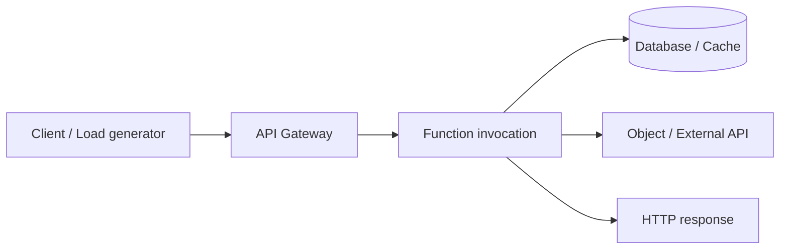
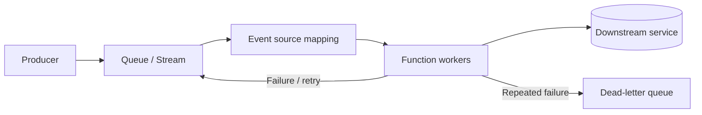

# Load Testing and Fault Drills for Serverless Applications

Serverless applications can automatically scale up execution environments as requests or events increase, but elastic scaling does not mean a system can automatically withstand every load surge. Functions can hit concurrency limits, API gateways can throttle, queues can build backlogs, databases can exhaust connections, and retries can amplify a small fault into a major outage. A function that runs well under low load does not prove the entire serverless pipeline can survive traffic bursts or dependency failures.

Within the **CLOUD_CORE_SERVICES_COMPUTE** module, load testing and fault drills reveal the real-world limits of functions, triggers, queues, storage, networking, and downstream services. This lesson explains how to design load tests, measure cold starts and concurrency, verify throttling/backpressure, rehearse dependency and event delivery failures, define abort conditions, and turn results into capacity limits, retry policies, alerts, and operational runbooks.

## Learning Objectives

After this lesson, you will be able to:

- Distinguish load tests, stress tests, spike tests, soak tests, and breakpoint tests.
- Define test scope across synchronous and asynchronous serverless flows.
- Estimate concurrency from arrival rate and execution duration.
- Design scenarios covering warm/cold starts, traffic bursts, queue backlogs, and downstream saturation.
- Measure p50/p95/p99 latency, error rates, throttling, concurrency, init duration, and cost.
- Test retries, timeouts, idempotency, partial batch failures, and dead-letter queues.
- Conduct controlled fault drills for dependency, network, secret, queue, and quota failures.
- Define SLOs, Go/No-Go thresholds, abort conditions, and recovery criteria.
- Build dashboards, alerts, and runbooks from test evidence.

## 1. Why Do Serverless Applications Still Need Load Testing?

Serverless offloads most server provisioning and runtime scaling to the cloud provider. Development teams remain responsible for function logic, concurrency settings, timeouts, memory/CPU sizing, triggers, data, and dependencies. As load increases, multiple layers shift simultaneously:

- API gateways or event sources ingest more requests/events.
- The platform spawns more invocations or execution environments.
- Functions initialize runtimes, load code/configuration, and run handlers.
- Functions open connections to databases, caches, object storage, or external APIs.
- Queues/streams distribute events and consumers process them according to concurrency/batch policies.
- Logging, tracing, metrics, and billing scale with invocation counts and duration.

A function can scale faster than its downstream database. In that scenario, the function itself is not the bottleneck, yet it opens too many connections and saturates the database. Similarly, a queue can absorb a burst while backlog depth and message age exceed business deadlines.

Testing must answer four questions:

1. **Capacity:** how many requests/events can the system handle while still meeting SLOs?
2. **Elasticity:** how long does it take from a load increase until new capacity is ready?
3. **Resilience:** when a dependency slows down or fails, does the system degrade gracefully or trigger a retry storm?
4. **Cost:** does cost scale predictably with traffic, or does it amplify due to retries, logging, provisioned capacity, or downstream work?

## 2. Defining Scope and Flows to Test

Do not benchmark a handler inside a single local process and conclude the production function has sufficient capacity. Map the real path of requests and events.

### 2.1. Synchronous Flow

Example HTTP API invoking a function:



End-to-end latency includes gateway overhead, invocation scheduling, cold starts if any, handler execution, network calls to dependencies, and response serialization. Measuring only handler duration underreports real client experience.

### 2.2. Asynchronous Flow

Example where events enter a queue and are consumed by functions:



In this flow, the producer's response usually confirms only that the event was received or enqueued. Business completion time must be measured from publish to successful completion, alongside queue age, consumer lag, retries, and DLQ counts.

### 2.3. Mapping Dependencies

Before testing, list:

- Functions, versions, aliases, runtimes, and memory/CPU/timeout settings.
- Triggers: HTTP, queues, event buses, object storage, streams, schedules, or database events.
- Concurrency limits, reserved/provisioned concurrency, or equivalent caps.
- API gateways, load balancers, authorizers, and network paths.
- Databases, caches, queues, streams, storage, and external APIs.
- Secret managers, KMS, VPC connectors, NAT gateways, and DNS.
- Logging, metrics, tracing, and billing dimensions.

Specify which dependencies are in scope for real testing, which use sandboxes/mocks, and which carry real quotas/costs. A simple map reveals where saturation can occur and where fault injection is needed.

## 3. Types of Load Tests

Each test type answers a distinct question. A thorough campaign combines several types rather than running a single long load test.

| Test Type | Purpose | Example Scenario |
|---|---|---|
| Baseline test | Measure performance under normal load | 50 requests/second for 10 minutes |
| Load test | Validate expected production load | Ramp to 500 requests/second and hold for 30 minutes |
| Stress test | Find limits and overload behavior | Ramp up until throttling/errors cross thresholds |
| Spike test | Verify response to sudden bursts | Jump from 20 to 800 requests/second in a few seconds |
| Soak test | Detect leaks, backlog buildup, or degradation over time | Sustain steady load for 4 hours |
| Breakpoint test | Pinpoint where SLOs start failing | Step up load incrementally and measure p99/error rate |
| Recovery test | Verify recovery after overload | Drop load back down and watch queue drain and concurrency |
| Cold-start test | Measure startup when new environments spin up | Trigger invocations after idle periods or on a fresh version/environment |

### 3.1. Baseline Test

A baseline provides a before-and-after reference for changes. Record throughput, latency, error rates, concurrency, duration, init duration, memory, dependency metrics, and cost. Without a baseline, it is difficult to tell whether a change improved or degraded the system.

### 3.2. Load Test

Load tests simulate expected traffic under realistic conditions. Include realistic request mixes, payload sizes, authentication, cache hit/miss ratios, tenant distributions, and enough duration for runtimes/queues to stabilize.

### 3.3. Stress and Breakpoint Tests

Stress tests push load beyond expected levels to locate limits, but they require clear stop thresholds. Never keep ramping purely to crash the system when shared dependencies or real data are involved.

The breakpoint is where SLOs no longer hold—such as p99 breaching deadlines, error rates climbing, queue age exceeding SLAs, or continuous function throttling. Record both function limits and downstream limits.

### 3.4. Spike and Soak Tests

Spike tests uncover scale-out lag, cold starts, burst quotas, and connection storms. Soak tests uncover memory leaks, connection leaks, log growth, retry accumulation, queue retention issues, and cost drift.

## 4. Designing a Representative Workload

Results are meaningful only when test load mirrors production. A lightweight endpoint that merely reads cache does not represent a function creating orders, writing to a database, and publishing events.

### 4.1. Request Mix

Categorize requests by behavior:

- Read-heavy vs. write-heavy.
- Small payloads vs. large payloads.
- Cache hits vs. cache misses.
- Requests hitting one dependency vs. multiple dependencies.
- Successes, validation errors, and retryable failures.
- Small tenants vs. high-volume tenants.
- Synchronous requests vs. asynchronous events.

Assign weights to each category from telemetry or forecasts. Avoid letting the single easiest request path represent the entire application.

### 4.2. Test Data and Side Effects

Use synthetic, anonymized, or sandbox data whenever possible. For write operations:

- Use dedicated test tenants/accounts.
- Scope test objects under a dedicated namespace or prefix.
- Use idempotency keys to avoid duplicate records.
- Never send real emails, SMS, payments, or external webhooks unless isolated.
- Set TTLs or post-test cleanup procedures.
- Track all created test data for reconciliation.

Load generators must avoid polluting production data or incurring unexpected third-party charges.

### 4.3. Ramp-Up Rate

Pick a ramp profile matching how real traffic arrives. Linear ramps suit finding capacity thresholds; spikes fit flash sales/webhook bursts; arrival-rate models fit maintaining fixed request rates regardless of response latency.

With a closed-loop load generator (sending a new request only after the previous finishes), when the system slows down, the sending rate drops automatically—masking overload. For APIs where arrival rate matters, consider open-model/rate-based load generation and monitor dropped iterations.

### 4.4. Ensuring the Load Generator Is Not the Bottleneck

Distribute generators when necessary, and monitor generator CPU/network, sockets, DNS, and connection limits. Reconcile intended request rates sent by the generator against requests actually received by the gateway/function. If the generator cannot sustain the target rate, the test has not proven system capacity.

## 5. Estimating Concurrency and Capacity

Concurrency is the number of invocations executing simultaneously. For synchronous functions, estimate initially via Little's Law:

\[
Concurrency \approx Arrival\ rate \times Average\ execution\ duration
\]

With arrival rate in requests/second and duration in seconds, the result is concurrent invocations.

### 5.1. Concurrency Calculation Example

A function receives 400 requests/second with an average execution duration of 250 ms (0.25 seconds):

```text
Average concurrency ≈ 400 × 0.25
                    = 100 invocations
```

To target 70% concurrency utilization for headroom:

```text
Planned concurrency ≈ 100 / 0.70
                    ≈ 143
```

This estimates steady-state load. Bursts, tail duration, retries, batch sizes, and request skew can push peak concurrency higher.

### 5.2. Rising Duration Drives Rising Concurrency

If a slow dependency pushes duration from 250 ms to 1 second, the same 400 requests/second arrival rate can require roughly 400 concurrent invocations. A database slowdown therefore does not just slow responses—it quadruples concurrency, hitting function limits and gateway throttling.

This is why tests must combine dependency latency/failures with concurrency, rather than scaling request rate only while dependencies are healthy.

### 5.3. Function Concurrency Differs from Instance Count

An execution environment may handle one or multiple concurrent invocations depending on runtime and platform model. Some runtimes process invocations sequentially per environment; others support in-instance concurrency. Never equate total concurrency with VM or container count.

Verify provider and runtime semantics: account/region concurrency quotas, function-level reserved concurrency, provisioned capacity, maximum instances, and trigger caps may all apply simultaneously.

### 5.4. Async Queues and Event Source Mappings

For queues/streams, concurrency depends on message/partition counts, batch sizes, polling, maximum concurrency, and downstream speed. Adding more function invocations will not scale throughput linearly if:

- Partition count is lower than desired consumer count.
- A batch contains a slow message or poison message.
- The database connection pool is already saturated.
- The function is capped by account/function concurrency limits.
- Visibility timeouts or retry policies are misconfigured.

Compute throughput as batches/second × records/batch × success rate, while tracking oldest message age and backlog depth.

## 6. Cold Starts and Warm Invocations in Load Tests

A cold start is the extra time spent preparing a new execution environment before the handler runs. Warm invocations reuse an existing ready environment, provided the platform retains and selects one.

### 6.1. What Can Be Included in a Cold Start

- Provisioning the execution environment.
- Downloading or mounting the package/container image.
- Starting the runtime and extensions.
- Running module/global initialization.
- Establishing connections/clients/caches.
- Invoking the handler for the first time.

Platforms do not always report a single unified cold start metric. Distinguish init duration, handler duration, and end-to-end latency.

### 6.2. Warm Environments Are Not Guaranteed

Never assume environments stay alive forever or that subsequent invocations always land on the same environment. Scale-out, idle reclamation, deployments, runtime updates, or platform maintenance can spin up new environments.

Load tests should include:

- Warm steady-state to measure performance once environments are initialized.
- Cold-start-biased scenarios to observe startup as new environments form.
- Burst scenarios to force scale-out and environment creation.
- Deployment/version switches to evaluate re-initialization after releases.

Do not invoke a function once after a few minutes of idle time and treat that single data point as your production cold-start distribution. Repeat across many trials and use platform/runtime telemetry where available.

### 6.3. Factors That Worsen Cold Starts

- Large deployment packages or container images.
- Importing many unused libraries.
- Global initialization making multiple API calls or sequential secret fetches.
- Slow-starting runtimes/compilers.
- VPC/network attachment or DNS/TLS setup.
- Opening fresh database connections per environment.
- Loading large models/ML artifacts at startup.

Measure each component separately to optimize the real bottleneck. Avoid stuffing everything into global initialization if it bloats cold starts or causes side effects when environments are reused.

## 7. Measuring Performance and Defining SLOs

SLOs must express outcomes meaningful to users or the business. Platform metrics serve as supporting evidence.

### 7.1. Key Metrics

| Category | Metrics | Meaning |
|---|---|---|
| Latency | End-to-end p50, p95, p99 | Typical experience and tail latency |
| Reliability | Success rate, 4xx/5xx, timeouts | Are requests completing properly? |
| Capacity | Invocations, requests/s, concurrency | Current workload volume handled |
| Platform | Throttles, max concurrency, init duration | Platform limits and startup overhead |
| Runtime | Duration, memory used, CPU utilization if available | Handler efficiency and sizing |
| Async | Queue depth, oldest age, consumer lag, DLQ | Event consumption health |
| Dependencies | DB connections, query latency, cache hits, API errors | Bottlenecks behind the function |
| Cost | Invocations, billed duration, memory allocation, provisioned capacity | Cost under load and retries |

### 7.2. Latency Percentiles

- p50 shows the median threshold half of requests beat.
- p95 captures the tail latency of slower requests.
- p99 highlights the slowest outliers, critical for APIs with tight deadlines.

Never report average latency alone. Cold starts or dependency timeouts can hide inside averages while impacting many users.

### 7.3. Breaking Down Latency by Span

With distributed tracing, isolate:

- Gateway/authorizer.
- Invocation scheduling and initialization.
- Handler logic.
- Database/cache calls.
- External API calls.
- Queue publish/consume and retries.
- Serialization/response transfer.

Propagate correlation IDs and trace context across events when supported by the platform. For async flows, retain event ID/correlation ID to link producers with consumers and retry attempts.

### 7.4. Defining Pass Criteria

For example, an internal API might target:

- End-to-end p95 under 300 ms at expected load.
- p99 under 800 ms in steady state.
- At least 99.9% success rate over the measurement window.
- Zero sustained throttling under normal load.
- Concurrency headroom below configured limits.
- Cost per 1,000 requests within budget.

These are illustrative targets. Real thresholds must come from product requirements, business deadlines, error budgets, and service agreements.

## 8. Testing Concurrency, Throttling, and Quotas

Serverless environments enforce multiple limit layers. Upon breaching limits, platforms may reject invocations, buffer events, slow polling, or return throttling errors depending on the trigger/service.

### 8.1. Distinguishing Limit Layers

- Account/region concurrency quotas.
- Reserved concurrency per function or workload.
- Provisioned concurrency/minimum warm capacity.
- Maximum instance/task/replica counts.
- API gateway requests-per-second/burst quotas.
- Queue polling/consumer concurrency.
- Database connection and downstream API quotas.

One limit does not replace another. Raising function concurrency can exhaust database connections long before the function hits its throughput target.

### 8.2. Controlled Near-Limit and Over-Limit Testing

Step load in increments such as 25%, 50%, 75%, 90%, and 100% of target concurrency. Test beyond thresholds only in approved environments with cost caps and abort conditions.

Observe:

- At what threshold does throttling begin?
- Are excess requests rejected, retried, or queued?
- How fast does the system recover after load drops?
- Do retry storms or duplicate side effects occur?
- Do dependencies overload before the function does?
- How does cost climb as retries and duration grow?

### 8.3. Limiting Concurrency to Protect Downstream

Function concurrency limits act like a bulkhead/admission guard: they bound concurrent invocations to shield downstream dependencies. Excess requests may still throttle or queue depending on trigger semantics. For async sources, events may be retried/retained; for sync HTTP, clients may receive errors and retry. This does not replace a circuit breaker at the dependency-calling layer.

Base limits on downstream capacity rather than solely on how high the function can scale. Test behavior on both sides of the limit and verify appropriate error messages/responses.

## 9. Testing Timeouts, Retries, and Idempotency

Timeouts and retries are integral to serverless semantics. When dependencies slow down, functions can time out, triggers can redeliver events, and the same business operation can run multiple times.

### 9.1. Timeout Budget

Function timeouts must be smaller than or compatible with trigger/client and dependency timeouts. Budget total duration:

\[
T_{total}=T_{init}+T_{handler}+T_{dependency}+T_{retry}+T_{response}
\]

Do not set huge timeouts to mask hung dependencies. Long timeouts hold concurrency longer, driving up concurrency demand and cost.

### 9.2. Retry Amplification

If failed requests retry at multiple layers, total attempts can multiply across layers. For instance, up to 3 client attempts, up to 2 gateway attempts per request, and up to 3 worker attempts per event can multiply executions for a single business action.

Rules:

- Retry only recoverable transient errors.
- Apply exponential backoff and jitter.
- Enforce retry budgets/maximum attempts.
- Avoid uncoordinated simultaneous retries across every layer.
- Separate validation/permanent errors from transient errors.
- Route repeatedly failing messages to a DLQ or quarantine per policy.

### 9.3. Idempotency

Functions may receive the same event multiple times due to at-least-once delivery, timeouts, or retries. Idempotency keys ensure a business operation applies at most once in effect.

Example:

```text
event_id = evt-123
idempotency_key = tenant-42:order-9001

1. Check whether the key has already been processed.
2. If processed, return the stored result.
3. If not, write processing state via an atomic/unique condition.
4. Execute side effects in an appropriate transaction/outbox.
5. Persist the completed result and key.
6. Retrying the same key creates no additional side effects.
```

The idempotency store must have a TTL/retention covering retry/replay windows and enforce atomicity between claiming the key and recording the outcome. Storing keys only in execution-environment RAM is insufficient because environments can be replaced.

### 9.4. Partial Batch Failures

With queue/stream triggers, one invocation can handle multiple records. If one record fails, retry behavior may redeliver the entire batch depending on the event source and partial batch response settings.

Test:

- One poison record inside a batch.
- One record timing out while others succeed.
- Retrying the same batch and duplicate handling.
- Large batch sizes pushing duration past timeouts.
- DLQ/redrive after repeated failures.
- Ordering and checkpoints/offsets when processing streams.

## 10. Dependency Fault Drills

Fault drills verify how the system responds when a critical component slows down, errors, or becomes unreachable. Start in staging or an isolated test environment before considering approved, tightly scoped production game days.

### 10.1. Faults to Simulate

| Fault | Safe Simulation Method | What to Observe |
|---|---|---|
| Dependency timeout | Mock endpoint delays responses | Function duration, concurrency, timeouts, and retries |
| HTTP 5xx | Stub returns errors at a configured rate | Retry budget, error classification, DLQ |
| Connection refused | Block route to sandbox endpoint | Connect timeout, fallback, and alerts |
| Slow database | Delayed queries or throttled test DB instance | Pool wait, query latency, connection exhaustion |
| Cache unavailable | Disable sandbox cache or inject errors | Cache fallback and load shifting to database |
| Queue backlog | Spike producer rate in test environment | Oldest message age, consumer scaling, and drain time |
| Poison message | Deliberately inject invalid records | Retry counts, partial batches, and DLQ |
| Secret unavailable | Use missing test secret or revoked permission | Startup/runtime errors, alerts, and recovery |
| DNS/network delay | Proxy or fault injector in test VPC | DNS timeouts, connection retries, and end-to-end latency |
| Concurrency throttling | Set a controlled low test limit | 429/throttles, queue behavior, and client retries |

Never assume you can or should shut down a managed production cloud service to induce failure. When provider failure domains are outside your control, inject faults at application boundaries using mocks, proxies, test endpoints, or supported fault injection tools.

### 10.2. Slow Dependencies Are More Dangerous Than Fail-Fast Dependencies

When a dependency fails immediately, functions release concurrency quickly. When a dependency hangs or responds very slowly, invocations hold slots, tie up connections, and spike concurrency. Fault drills must therefore test both latency injection and hard failures.

Set connect/read timeouts, connection pool bounds, circuit breakers, and bulkheads. Test dependency recovery to ensure recovering invocations do not trigger a synchronized retry flood.

### 10.3. Circuit Breakers and Fallbacks

A circuit breaker halts calls to a failing dependency once errors cross a threshold, then probes with limited requests in half-open state. Fallbacks may serve cached/stale data, degraded responses, or queue work for later processing.

Never fall back silently on transactions requiring strict correctness. Surface degraded status explicitly and track fallback usage counts.

## 11. Fault Drills for Queues and Event-Driven Functions

Queues decouple producers and consumers, yet recovery across the full pipeline must be verified.

### 11.1. Backlog and Drain Time

If arrival rate is `λ` messages/second and consumers finish `μ` messages/second, backlog grows whenever `λ > μ`. Once producer rate drops or consumer capacity rises, approximate drain time is:

\[
T_{drain}\approx\frac{Backlog}{Consumer\ rate-Arrival\ rate}
\]

This holds while consumer rate remains steadily higher than arrival rate. When both rates are nearly equal, queues can take a very long time to drain.

Example: a queue holds 60,000 messages, consumers process 500 messages/second, and producers still send 100 messages/second:

```text
Net drain rate = 500 - 100 = 400 messages/s
Drain time     = 60,000 / 400 = 150 seconds
```

In practice, factor in retries, batching, rate limits, partition skew, and downstream latency.

### 11.2. Visibility Timeouts and Duplicate Deliveries

In queues with visibility timeouts, unacknowledged messages reappear once the timeout expires. Too short a visibility timeout triggers duplicates while valid functions are still running; too long delays retrying genuinely failed messages.

Verify alignment across:

- Function timeout.
- Batch processing duration.
- Visibility timeout.
- Retry delay/redrive policy.
- Maximum receive count.
- DLQ retention and source queue retention.

Exact rules depend on queue/stream type and provider. Check your trigger's semantics and test with messages executing near the timeout boundary.

### 11.3. DLQs and Replays

DLQs retain messages that failed processing per policy. Verify:

- Messages move to the DLQ after the exact configured failure count.
- Alerts fire when the DLQ receives new messages or spikes anomalously.
- Poison message triage workflows.
- Rate-limited, idempotent replays.
- Replays do not overload databases or produce duplicate side effects.
- Ordering/tenant boundaries can be restored if required by business logic.

A DLQ is not indefinite ownerless error storage. Define retention, dashboards, escalation, and triage procedures.

## 12. Cold-Start, Deployment, and Configuration Drills

Cold starts can increase after deployments, runtime changes, package updates, or sudden concurrency jumps. Tests should exercise both warm steady-state and fresh initializations.

### 12.1. Scenarios

- Traffic surging after an idle period.
- Spinning up many execution environments simultaneously.
- Deploying a new version and shifting alias/traffic weights.
- Changing memory/CPU/runtime/package size.
- Secret rotation or configuration cache refresh.
- Newly modified network/VPC endpoints.
- Provisioned capacity scaling up/down or hitting configured limits.

### 12.2. Observing Initialization

Record init duration, runtime startup errors, extension startup, secret fetches, DNS/TLS, database connections, and handler start. Compare p50/p95/p99 of cold invocations against warm invocations.

If the platform lacks granular init duration metrics, instrument global initialization and handler entry with timestamped structured logs/spans. Never log secrets or sensitive data.

### 12.3. Deployment Safety

With version/alias traffic shifting:

- Shift a small traffic slice first.
- Tag metrics and traces with version/alias.
- Monitor error rate, latency, init duration, and cost per version.
- Ramp traffic at defined checkpoints.
- Roll back automatically or manually when thresholds breach.
- Verify event source mappings and permissions post-deployment.

Do not test only HTTP endpoints; verify functions triggered by queues, schedules, or storage events as well.

## 13. Designing Safe Fault Drills

Fault drills require defined scope, ownership, and stop conditions. The goal is validating recovery hypotheses, not causing uncontrolled disruption.

### 13.1. Before the Drill

- State a clear hypothesis: e.g., "when database latency adds 2 seconds, the function still finishes within its timeout budget without triggering a retry storm."
- Select the environment, test tenant, function alias, and dependency sandboxes.
- Define request/event volume, concurrency caps, and duration.
- Prepare dashboards, alerts, traces, and logs.
- Verify rollback/kill switches work.
- Notify owners and observers.
- Set cost caps, quota guardrails, and abort thresholds.
- Confirm zero out-of-scope production side effects.

### 13.2. During the Drill

1. Record a baseline before injecting faults.
2. Start with a small slice of traffic or a single test tenant.
3. Inject one fault at a time to preserve clear root-cause attribution.
4. Observe functions, triggers, dependencies, and business outcomes.
5. Expand scope at checkpoints only if safe.
6. Halt immediately if an abort condition triggers.
7. Remove the fault and confirm system recovery.
8. Reconcile events, transactions, and side effects post-test.

### 13.3. Abort Conditions

Examples:

- Error rate exceeds approved threshold.
- p99 breaches deadline across consecutive windows.
- Database connections/CPU hit protective ceilings.
- Queue age or DLQ breaches limits.
- Throttling escalates enough to affect other tenants.
- Spend exceeds test budget.
- Out-of-scope side effects reach production systems.
- Fault cannot be removed or observability goes blind.

Thresholds must be agreed upon by owners beforehand. Never keep testing just to gather more data once safety thresholds are breached.

### 13.4. After the Drill

- Remove fault injection configs and test credentials.
- Confirm queue backlogs drained or are handled as planned.
- Inspect DLQs, retries, and duplicates.
- Reconcile business data and clean up test data.
- Confirm alerts returned to normal state.
- Document timeline, metrics, impact, and decisions.
- Create owned action items with deadlines for every weakness uncovered.

## 14. Testing Downstream Protection and Backpressure

Serverless can scale out faster than many traditional systems. Prove functions cannot drive downstream systems past capacity.

### 14.1. Connection Budgets

If each execution environment opens a connection pool of up to `P` connections across `E` environments, potential connections are:

\[
Connections_{max}\approx E\times P
\]

For example, 150 environments each opening up to 8 connections can create 1,200 connections. If the database supports only 500 connections for this workload, shrink pools, use an appropriate proxy/pooler, or cap function concurrency.

### 14.2. Backpressure

Backpressure prevents producers or functions from pushing work faster than downstream can handle. Measures:

- Cap concurrency or maximum pollers.
- Cap batch sizes and publish rates.
- Use queues as buffers with clear retention and max age.
- Apply per-tenant/API rate limits.
- Trip circuit breakers when dependencies fail.
- Shed non-critical load and prioritize critical transactions.

Test with downstream capacity degraded by 50%, not only completely offline. Systems should degrade gradually rather than snapping from healthy to total outage.

### 14.3. Bulkheads and Tenant Isolation

Bulkheads isolate concurrency/resource pools across workload groups or tenants. A single bursting tenant should not starve concurrency and quotas for other tenants.

Test fairness, reserved capacity, per-tenant rate limits, and quota accounting. Emit per-tenant metrics with bounded cardinality rather than creating millions of high-cardinality labels.

## 15. Testing Cost Under Load

Serverless billing typically depends on invocations, execution duration, allocated memory/CPU, and supporting services. Retries, cold starts, log volume, and provisioned capacity can all drive costs upward.

### 15.1. Cost Per Operation

Measure:

- Cost per 1,000 successful invocations.
- Cost per completed business transaction.
- Billed duration vs. handler duration.
- Failed/retried invocation ratio.
- Log/trace volume and retention.
- Queue, API gateway, storage, and data transfer costs.
- Provisioned/minimum capacity idle costs.

Tracking per successful business operation matters more than cost per invocation when a single transaction spawns multiple invocations due to retries or fan-out.

### 15.2. Cost Amplification

A slow dependency lengthens duration; longer duration raises concurrency and billed duration; retries multiply invocations; verbose logging spikes ingestion costs. Fault tests must therefore monitor cost during degraded states too.

### 15.3. Cost Guardrails for Testing

- Use dedicated test accounts/projects/subscriptions whenever possible.
- Set budget alerts and quota caps.
- Cap test duration and total request counts.
- Automatically stop load generators upon reaching targets or abort thresholds.
- Mock paid third-party APIs or real external side effects.
- Clean up test resources, queues, objects, and logs per retention rules.

## 16. Tools and Load Test Examples

Use k6, Locust, JMeter, Gatling, or internal tools. Choose a tool capable of generating the target arrival rate with realistic authentication, payloads, and request distributions.

### 16.1. k6 Example for an HTTP Function Endpoint

```javascript
import http from 'k6/http';
import { check } from 'k6';

export const options = {
  scenarios: {
    serverless_load: {
      executor: 'ramping-arrival-rate',
      startRate: 20,
      timeUnit: '1s',
      preAllocatedVUs: 50,
      maxVUs: 500,
      stages: [
        { target: 50, duration: '2m' },
        { target: 150, duration: '3m' },
        { target: 300, duration: '5m' },
        { target: 300, duration: '5m' },
        { target: 20, duration: '2m' },
      ],
    },
  },
  thresholds: {
    http_req_failed: ['rate<0.01'],
    http_req_duration: ['p(95)<500', 'p(99)<1000'],
  },
};

export default function () {
  const response = http.post(
    __ENV.FUNCTION_URL,
    JSON.stringify({ testRun: __ENV.TEST_RUN_ID, operation: 'validate' }),
    { headers: { 'Content-Type': 'application/json' } },
  );

  check(response, {
    'status is successful': (r) => r.status >= 200 && r.status < 300,
  });
}
```

This is an illustrative skeleton. Supply a test URL, authentication, test run ID, and representative data; never hardcode secrets in scripts or repositories. `ramping-arrival-rate` attempts to hold the target arrival rate, so monitor dropped iterations and generator resource saturation. Thresholds should match real SLOs.

### 16.2. Event Queue Test Example

For queues, build a dedicated producer emitting events tagged with `testRunId`, `eventId`, and timestamp. Then measure:

```text
publish_time = timestamp when producer sent the event
complete_time = timestamp when consumer recorded successful completion
end_to_end_age = complete_time - publish_time
```

Aggregate p50/p95/p99 age, remaining messages, retries, DLQ counts, and duplicate rates. Run the producer across increasing rates and hold a steady-state phase to verify consumer rate exceeds arrival rate.

### 16.3. Dependency Fault Injection Example

In staging, configure a mock service to inject 2-second latency on 20% of requests and HTTP 503 on 5% of requests for 3 minutes. Verify:

- Function timeouts and p99 latency.
- Circuit breakers open/close at intended thresholds.
- Retries use backoff/jitter and stay within budget.
- Whether concurrency hits limits.
- Whether queues/DLQs grow.
- Database avoids a connection storm.
- After removing the fault, backlogs drain and SLOs recover.

## 17. Test Campaign Example for an Order System

A system accepts HTTP order requests, a function writes to a database, emits an event to a queue, and another function sends notifications. The goal is handling promotional traffic bursts without creating duplicate orders or overloading the database.

### 17.1. Scenarios

| Scenario | Load/Fault | Objective |
|---|---|---|
| Baseline | 50 requests/s for 15 minutes | Establish baseline latency and cost |
| Expected load | 300 requests/s for 30 minutes | Verify SLOs under expected load |
| Spike | 50 to 800 requests/s in 30 seconds | Measure scale-out and throttling |
| Dependency slow | 1.5-second database delay on 10% of queries | Verify timeouts, pools, and circuit breakers |
| Dependency unavailable | Sandbox database returns 503 | Verify fail-fast, retries, and responses |
| Queue backlog | Producer runs at 3x consumer rate | Measure oldest message age and drain time |
| Duplicate delivery | Replay a subset of event IDs | Verify idempotency and duplicate suppression |
| Recovery | Remove fault and drop load to baseline | Measure recovery time and backlog drain |

### 17.2. Pass Criteria

- API meets p95/p99 SLOs under expected load.
- Error rate stays within defined error budgets.
- Concurrency stays within downstream limits.
- Spikes produce zero duplicate orders.
- Queue backlogs remain within retention and business deadlines.
- Poison messages route to the DLQ per policy with alerts firing.
- After faults clear, the system recovers within agreed RTO.
- Cost per successful order remains within budget.

### 17.3. Post-Test Actions

If p99 climbs due to cold starts, optimize packages/runtimes or retain appropriate warm capacity. If concurrency overloads the database, shrink pools/concurrency and strengthen backpressure. If queues drain too slowly, tune batch/consumer capacity after verifying downstream headroom. If retries create duplicates, fix idempotency before raising traffic.

## 18. Dashboards, Alerts, and Runbooks

Organize dashboards by function, trigger, dependency, and business operation.

### 18.1. Function Dashboard

- Invocations, successes/errors, and throttles.
- Concurrent executions and configured concurrency limits.
- Duration p50/p95/p99 and timeout counts.
- Init/cold-start duration.
- Memory used, configured memory, and runtime errors.
- Version/alias distribution.

### 18.2. Event Pipeline Dashboard

- Producer rate and consumer completion rate.
- Queue depth, oldest message age, and stream lag.
- Batch sizes, partial failures, and retry counts.
- DLQ counts, redrive rates, and poison messages.
- Time-to-process from publish to completion.

### 18.3. Dependency and Cost Dashboard

- Database connections, pool waits, query latency, and errors.
- Cache hit/miss rates, latency, and evictions.
- External API latency, status codes, and quotas.
- Network timeouts, DNS errors, and NAT usage if applicable.
- Cost per invocation and cost per business transaction.
- Log/trace ingestion and provisioned capacity utilization.

### 18.4. Actionable Alerts

Examples:

- Rising throttles: inspect concurrency quotas, bursts, and downstream capacity.
- p99 climbing with duration: inspect cold starts or dependency latency.
- Rising queue age: inspect consumer rate, concurrency, poison messages, and downstream health.
- Growing DLQ: halt automated replays, triage errors, and notify owners.
- Rising OOMs/timeouts: inspect memory sizing, payloads, batch sizes, and handler logic.
- Anomalous cost spikes: inspect retry loops, log volume, fan-out, and provisioned capacity.

Every alert needs an owner, severity, dashboard link, and initial runbook steps. Avoid alerting on a single raw metric disconnected from service impact.

## 19. Common Mistakes

| Mistake | Consequence | Fix |
|---|---|---|
| Testing handlers only locally | Misses gateways, cold starts, queues, and networking | Test end-to-end in production-like environments |
| Looking only at average latency | Hides cold starts and tail latency | Track p50/p95/p99 and split warm/cold metrics |
| Ramping load with an underpowered generator | Artificially low apparent capacity | Track dropped iterations and scale generators |
| No test cost caps | Unexpected cloud bills | Set budgets, quotas, time caps, and kill switches |
| Non-representative test data | Misses large payloads, cache misses, and write paths | Simulate realistic request mixes and data |
| Ignoring downstream concurrency | Databases/caches overload as functions scale | Calculate connection budgets and set concurrency caps |
| Retrying every error | Retry storms and duplicate side effects | Classify errors, apply backoff, jitter, and retry budgets |
| Skipping idempotency checks | Redeliveries create duplicate transactions | Use durable idempotency keys and atomic claims |
| Visibility timeout too short | Messages redeliver while valid processing continues | Align timeouts with batch duration |
| Unmonitored DLQs | Failed messages sit forgotten | Add alerts, owners, retention, and replay policies |
| Overly broad fault injection | Impacts out-of-scope tenants or dependencies | Use canary scope, abort conditions, and sandboxes |
| Testing only hard dependency failures | Misses slow dependencies tying up concurrency | Test latency injection and timeouts |
| Skipping recovery verification | Queues/backlogs keep growing after faults clear | Measure drain time, retry recovery, and SLO return |
| Not measuring cost during failures | Retries/duration/logs explode bills | Track cost per successful operation |

## 20. Pre-Production Checklist for Serverless Workloads

**Test Design**

- [ ] Identified synchronous/asynchronous flows and all dependencies.
- [ ] Representative request mix, payloads, tenants, and test data.
- [ ] Load generators achieve required arrival rates.
- [ ] Baseline, load, spike, stress, soak, and recovery scenarios defined.
- [ ] SLOs, error budgets, cost caps, and abort conditions established.

**Capacity and Scaling**

- [ ] Concurrency calculated from arrival rate and execution duration.
- [ ] Account/function/API/queue quotas verified.
- [ ] Concurrency caps aligned with downstream capacity.
- [ ] Cold-start and warm invocations measured.
- [ ] Queue backlogs, batch sizes, and consumer scaling verified.

**Resilience**

- [ ] Timeout budgets aligned across clients/triggers and dependencies.
- [ ] Retries include error classification, backoff, jitter, and limits.
- [ ] Side effects protected by idempotency and deduplication.
- [ ] Partial batch failures and DLQs tested.
- [ ] Dependency latency/failures and network errors rehearsed.
- [ ] Circuit breakers, fallbacks, and backpressure work properly.

**Observability and Operations**

- [ ] p50/p95/p99, error rates, concurrency, throttles, and init duration tracked.
- [ ] Queue age, consumer lag, retries, and DLQ dashboards ready.
- [ ] Dependency metrics and cost per successful operation tracked.
- [ ] Alerts include owners, severities, and runbooks.
- [ ] Procedures ready for fault removal, data reconciliation, and test artifact cleanup.
- [ ] Test results, capacity limits, and action items documented.

## 21. Conclusion

Serverless testing must cover both functions and end-to-end request/event paths. Load, spike, stress, and soak tests reveal capacity, cold-start distributions, tail latency, and cost; fault drills reveal how the system behaves when dependencies slow down, queue backlogs grow, quotas hit ceilings, or events are redelivered.

Compute concurrency from arrival rates and duration, cap functions to downstream capacity, apply deliberate timeouts/retries/idempotency, and monitor queue age alongside DLQs. Every fault drill needs clear scope, ownership, cost caps, and abort conditions. After each campaign, translate findings into SLOs, scaling limits, alerts, and runbooks so serverless applications scale and recover predictably.

## Glossary of Key Terms

| Term | Meaning |
|---|---|
| Load test | Testing a system under expected production load. |
| Stress test | Pushing load beyond expected levels to find limits and overload behavior. |
| Spike test | Testing system response to sudden, sharp load surges. |
| Soak test | Sustaining load over extended periods to uncover cumulative degradation. |
| Breakpoint | The point where a system stops meeting SLOs or operational criteria. |
| Cold start | Initializing a fresh execution environment prior to invocation. |
| Warm invocation | An invocation running on an already-initialized, reused environment. |
| Concurrency | The number of invocations executing simultaneously. |
| Throttling | Platform limiting or rejecting invocations when hitting quotas or concurrency caps. |
| Backpressure | Limiting producer/consumer rates to protect downstream systems. |
| Retry amplification | Multiplied load caused by multiple layers retrying concurrently. |
| Idempotency | Applying an operation multiple times while producing only one business outcome. |
| Partial batch failure | Only specific failed records in a batch are retried individually when supported by the trigger. |
| DLQ | Dead-letter queue; holds messages that could not be processed successfully under policy. |
| Queue age | How long a message has waited in a queue or elapsed since publish until processing. |
| Fault injection | Intentionally introducing controlled errors/latency to test resilience. |
| Circuit breaker | Mechanism that temporarily halts calls to a failing dependency to avoid amplifying outages. |
| Bulkhead | Isolating resources/concurrency so one workload cannot exhaust capacity for others. |
| Abort condition | Mandatory stop criteria during a test or drill to protect the system. |
