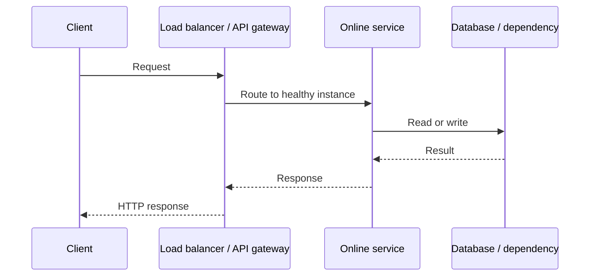
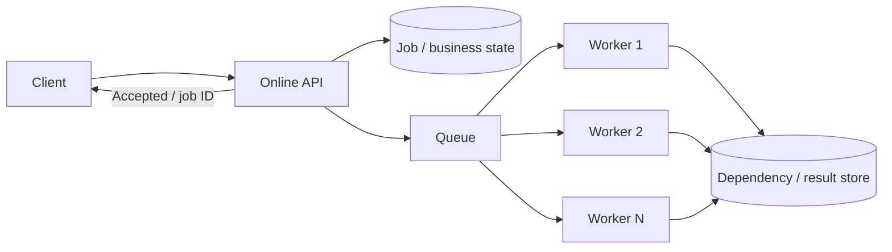
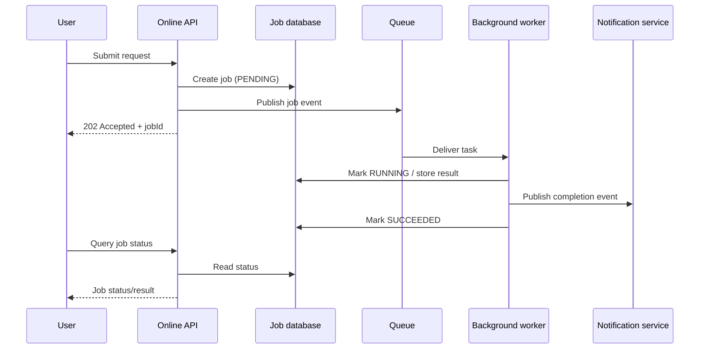
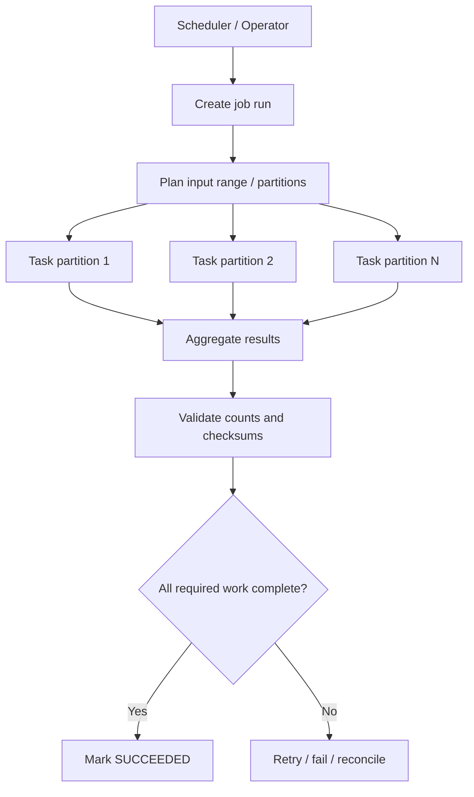

# Distinguishing Between Background Workers, Batch Jobs, and Online Services

A compute system often has multiple types of workloads coexisting. An API needs to respond to users within a few hundred milliseconds; a worker needs to process emails, images, or messages after a request has been accepted; a batch job needs to scan and process a large dataset on a schedule or in batches. Even though all three can run on VMs, containers, or serverless platforms, the way their lifecycles, scaling, error handling, and performance measurements are organized differs.

Properly distinguishing between an **online service**, a **background worker**, and a **batch job** helps choose the right compute model. An online service optimizes response time and continuous availability. A background worker optimizes the consumption rate of pending work and the recoverability of individual tasks. A batch job optimizes completing a finite set of work with a start/end point, progress tracking, and reconcilable results.

## 1. Three types of workloads in a system

| Workload type | How work is received | Lifecycle | Primary goal | Examples |
|---|---|---|---|---|
| Online service | Receives requests directly from clients or upstream | Runs continuously, ready to accept requests | Latency, availability, throughput, and SLOs | HTTP API, web backend, authentication service |
| Background worker | Pulls messages/tasks from a queue, stream, or scheduler | Runs continuously or scales based on pending work | Reliable task processing, backlog reduction, safe retries | Sending emails, image processing, order synchronization, sending webhooks |
| Batch job | Receives a defined dataset or scope of work | Starts, runs, succeeds or fails | Overall throughput, completion time, data completeness | End-of-day reconciliation, ETL, report aggregation, data import |

These three types describe **processing models**, not necessarily three different infrastructure products. A container can run an API, a worker, or a batch command. A serverless platform can serve HTTP requests, process messages, or run scheduled jobs. The same application can have an online service and a worker sharing business libraries while being deployed as separate workloads.

## 2. Online services

An online service receives a request and returns a response within the same interaction flow. The client typically needs the result to display or decide the next step. Examples include an order lookup API, user authentication, price checking, or updating a data field.

Basic flow:



Online services typically have the following characteristics:

- Long-lived processes that continuously accept requests.
- Have a listener, endpoint, or protocol serving clients.
- Typically run multiple replicas for fault tolerance and load distribution.
- Need readiness/health checks so the load balancer only sends requests to ready instances.
- Scale by request rate, concurrency, CPU, latency, or business metrics.
- Need limits on requests, connections, threads, and processing time to protect dependencies.

Online services typically have SLOs for p95/p99 latency, availability, and error rate. If a request must perform long-running work, holding the connection open until completion can cause timeouts and consume resources. In that case, the service can acknowledge the request and offload the long-running work to a worker.

## 3. What is a background worker?

A background worker is a process that performs work that does not need to finish within the initial request-response cycle. Workers typically pull tasks from a queue, broker, stream, or job table; process them; and then ack, update status, or checkpoint according to the source's protocol.

Examples:

- Sending a confirmation email after an order is created.
- Generating thumbnails after a user uploads an image.
- Sending webhooks to partners and retrying when an endpoint temporarily fails.
- Synchronizing status with an ERP system.
- Processing messages from a queue to update analytics data.
- Performing user-requested background tasks that may take several minutes.

Typical flow:



Workers can run continuously waiting for messages, or be triggered by the platform on events. A worker typically processes a single task or a small batch, then continues fetching new work. The number of workers can scale up or down based on queue depth, message age, throughput, and dependency capacity.

### Characteristics of a background worker

- Work is typically represented as a message or task with an ID.
- Producers and workers are decoupled in runtime; the producer does not have to wait for the task to complete.
- Can retry transient errors and route persistently failing tasks to a dead-letter queue.
- Must handle duplicates because messages may be delivered multiple times.
- Can scale horizontally by increasing consumer/worker concurrency.
- Needs backpressure and concurrency limits to avoid overloading downstream databases or APIs.
- Needs monitoring for message age, queue depth, processing time, and task failure rate.

A worker does not necessarily need an HTTP endpoint. If a health check or metrics endpoint is needed, a separate administrative endpoint can be provided; that endpoint does not mean the worker is a business-facing online service.

## 4. What is a batch job?

A batch job processes a finite set of work or a defined data scope. A job has a start point, inputs, progress, outputs, and a terminal state. Jobs are typically triggered on a schedule, on operational demand, or when a dataset is ready.

Examples:

- Aggregating end-of-day transactions.
- Calculating monthly invoices.
- Importing a large CSV file into a database.
- Running ETL from object storage to an analytics warehouse.
- Generating reports for a time range.
- Re-indexing data or running backfills after logic fixes.

Batch jobs typically have the following characteristics:

- Process a specific set of records, files, partitions, or time ranges.
- Have states such as `PENDING`, `RUNNING`, `SUCCEEDED`, `FAILED`, or `CANCELLED`.
- Can be split into multiple partitions/subtasks to run in parallel.
- Need checkpoints to resume after failures if execution takes a long time.
- Need reconciliation of input counts, succeeded counts, skipped counts, and failed counts.
- Typically prioritize overall throughput and completion deadlines over per-record latency.
- Can run on dedicated compute, separate node pools, or ephemeral environments.

A batch job can run once and terminate; a scheduler or controller is responsible for creating the next run. A batch process should not be kept running indefinitely if the actual work consists of finite processing runs that can be tracked individually.

## 5. How do background workers and batch jobs differ?

Both models process work outside of direct requests, but the way they manage units of work differs.

| Criterion | Background worker | Batch job |
|---|---|---|
| Input | Tasks/messages generated continuously or by events | A defined dataset or scope of work |
| Trigger | Queue event, stream, scheduler, or polling | Cron/scheduler, operator, workflow, or data-ready event |
| Process lifecycle | Typically runs continuously and loops to pull tasks | Typically has a start/end for each run |
| Tracking unit | Message/task | Job/run, partition, and subtask |
| Completion condition | Ack/commit a task or record | Complete the entire scope or fail according to policy |
| Scaling | Number of consumers/workers based on backlog and downstream capacity | Number of parallel jobs/partitions/tasks based on deadline and quota |
| Retry | Typically per message/task | Per job, partition, chunk, or record depending on design |
| Progress | Queue depth, oldest message age, task throughput | Processed/total, checkpoint, partition status, ETA |
| Examples | Sending emails, processing webhooks, processing new images | Daily reconciliation, file import, ETL, backfill |

A batch job can generate many messages for background workers to process. Conversely, a worker can group multiple messages into small batches to reduce overhead. What determines the model is the **management unit, trigger mechanism, and completion condition** of the workload.

## 6. Choosing a model based on timing requirements

Response time and completion deadline are two different concepts.

- Online services typically have per-request deadlines, such as responding within 300 ms or 2 seconds.
- Background workers typically have targets for the time from event creation to task completion, such as sending an email within 1 minute.
- Batch jobs typically have processing-window deadlines, such as finishing reconciliation before 06:00 or importing 10 million records within 2 hours.

| Question | Online service | Background worker | Batch job |
|---|---|---|---|
| Is the user waiting for a response? | Yes | Usually no | Usually no |
| Can work be queued? | Limited, usually only short queues | Yes, this is the standard mechanism | Can wait for a schedule/execution window |
| Measure per-request latency? | Very important | Measure processing time and queue wait | Measure job duration and throughput |
| Does it have a finite endpoint? | The process usually does not | Each task does | Each job/run does |
| Primary deadline | Request SLO | Event/task completion SLO | Job completion deadline |

Do not use a long timeout to turn an online service into a batch processor. If work cannot finish within a reasonable request time, return a job identifier and offload processing to the background.

## 7. Architecture combining an online service and a background worker

A common pattern is for an online service to validate and record the request, then emit a message so a worker performs the long-running work.



The API responds quickly with `202 Accepted` once the request is accepted. The worker executes the background work. Clients can poll for status, receive webhooks, or get notifications upon completion.

If the database writes the job successfully but publishing the message fails, the job can get stuck in `PENDING`. If publishing succeeds but the API times out before returning a response, the client may retry the request. Idempotency and a mechanism to guarantee event publication must be designed.

A common solution is the transactional outbox: write the job and the outbox event in the same database transaction; a publisher reads the outbox and sends the message, then marks the event as published. The publisher may send duplicates, so the consumer still needs idempotency.

## 8. Queues, tasks, and job states

A queue acts as a buffer between producers and consumers. Queues decouple the rate of work generation from the rate of processing, but they do not increase processing capacity infinitely. If the sustained message arrival rate exceeds the worker processing rate, the backlog will grow.

A task should carry enough metadata for processing and investigation:

```json
{
  "taskId": "task-8f31",
  "taskType": "generate-invoice",
  "schemaVersion": 1,
  "createdAt": "2026-11-22T09:30:00Z",
  "correlationId": "request-42c1",
  "idempotencyKey": "invoice-order-5821-v1",
  "payloadRef": {
    "type": "database-record",
    "id": "order-5821"
  },
  "attempt": 0
}
```

This is an illustrative structure. Do not put secrets or large payloads into a message if a safe reference can be passed instead. Workers must validate the task type/schema, check data access permissions, and handle invalid messages according to policy.

Job state can be stored separately in a database:

| State | Meaning |
|---|---|
| `PENDING` | Created, waiting to be queued for processing |
| `QUEUED` | Placed into the queue |
| `RUNNING` | Worker/job is currently executing |
| `RETRYING` | Transient error, will be retried |
| `SUCCEEDED` | Completed and results durably persisted |
| `FAILED` | Permanently failed according to the retry policy |
| `CANCELLED` | Cancelled by request or policy |

State transitions must be valid. For example, a `SUCCEEDED` job should not transition back to `RUNNING` just because a duplicate message is redelivered. State updates should use version conditions or transactions to prevent two workers from claiming the same job.

## 9. Worker loop and safe task processing

A worker typically loops through these steps: fetch a task, claim ownership, execute, persist results, and ack. The order of persisting results and acking is critical.

```python
def worker_loop(queue):
    while True:
        message = queue.receive(timeout=20)
        if message is None:
            continue

        try:
            claim = claim_idempotency_key(message.task_id)
            if claim.already_completed:
                queue.ack(message)
                continue

            result = process_task(message.payload)
            persist_result_and_mark_completed(message.task_id, result)
            queue.ack(message)
        except TemporaryError:
            queue.retry_later(message)
        except PermanentError as error:
            persist_failure(message.task_id, error)
            queue.send_to_dlq(message)
```

This is pseudocode; APIs for receiving messages, acking, visibility timeouts, and DLQs vary by broker. `claim_idempotency_key`, persisting results, and marking completion must be designed atomically or with recoverable intermediate states. Do not assume the queue and database share a single distributed transaction.

### Why is idempotency needed?

At-least-once delivery can deliver a message multiple times. For example, a worker creates an invoice in the database but gets killed before acking; the message reappears and a second worker might create a duplicate invoice.

Ways to reduce duplicates:

- Use a unique task ID or idempotency key.
- Create unique constraints/conditional writes in the database.
- Write the completion marker in the same transaction as the business result.
- Use downstream APIs that support idempotency keys.
- For irreversible side effects, store the intent and result for reconciliation.
- Design retries not to recreate resources or transactions that have already completed.

Merely checking a key in a cache before performing a side effect can suffer from race conditions when two workers receive the same message nearly simultaneously. Atomic claiming in the data store or a locking mechanism with appropriate fencing is required.

## 10. Retries, poison messages, and dead-letter queues

Transient errors such as timeouts, throttling, or network resets can be retried. Permanent data errors such as an invalid schema usually cannot be fixed by retrying.

A retry policy needs to define:

- Maximum number of attempts.
- Wait interval between attempts, typically using exponential backoff and jitter.
- A visibility timeout or lease long enough for a single processing attempt.
- Criteria for classifying retryable vs. permanent errors.
- Behavior when a worker is terminated mid-execution.
- Where tasks that exhaust retries are stored and the process for reprocessing them.

A **poison message** is a message that always causes the worker to fail, such as a corrupted payload or data that triggers a bug. If the message is retried indefinitely, workers can consume capacity without making progress. A DLQ isolates failing messages from the main flow for investigation and redrive after the root cause is fixed.

A DLQ needs an owner, retention policy, alerts, access controls, error details, and a redrive procedure. Redriving must preserve idempotency so old messages do not repeat already-executed side effects.

## 11. Batch jobs: planning, execution, and completion

A batch job typically starts from a scheduler or workflow controller. A job can run as a single process or split into multiple subtasks for parallel processing.



The job controller is responsible for creating runs, assigning tasks, tracking state, and determining when the entire scope is complete. Workers or task runners execute each partition. For large batches, do not only keep a counter variable in the main process's RAM; state must be durably persisted to recover when a node or process fails.

### Components of a batch job

- **Input definition:** files, tables, partitions, data dates, or query snapshots.
- **Run ID:** unique identifier for the run.
- **Partition plan:** divides data into independent chunks.
- **Worker/task:** processes a portion of the data.
- **Checkpoint:** stores the latest completed position or chunk.
- **Output:** results, destination tables, files, or reports.
- **Validation:** reconciling record counts, checksums, and business invariants.
- **Completion state:** succeeded, failed, cancelled, or partially completed according to policy.

## 12. Partitioning and parallel processing

Large batch jobs can be partitioned by:

- ID or key range.
- Time range.
- Tenant or customer group.
- File/object prefix.
- Database partition or stream shard.
- Hash bucket.

Partitions should be large enough to reduce overhead yet small enough for individual retries and even distribution. If a partition is too large, a failing task loses a lot of processing time; if too small, scheduler and metadata overhead increase.

For example, importing 100 million records can be split into 100 partitions of about 1 million records each. This number is illustrative only. The right size depends on record size, storage throughput, memory, transaction size, and retry time.

Avoid skewed partitions. If one tenant accounts for 70% of the data, partitioning by tenant creates one huge task and many small ones. Sub-partitioning by hash or key range can balance the load, while maintaining rules to avoid overwrites and preserve ordering if required by the business logic.

## 13. Checkpoints and resumability after failures

Checkpoints durably record progress so a job does not have to restart from the beginning after a process restart. For file-reading batches, a checkpoint might be a byte offset or record number. For databases, it might be completed key ranges/partitions. For streams, it is usually an offset/sequence or checkpoint managed by the consumer framework.

A checkpoint should be recorded after the results of that unit of work have been committed. If the checkpoint is written before the data, a crash can cause the job to skip unprocessed records. If the data commits but the checkpoint has not been written, the job might reprocess that portion; therefore, processing must be idempotent or use an appropriate transaction/manifest mechanism.

One way to store partition state:

| Field | Meaning |
|---|---|
| `run_id` | Batch run identifier |
| `partition_id` | Assigned data partition |
| `input_start` / `input_end` | Input range |
| `status` | PENDING, RUNNING, SUCCEEDED, FAILED |
| `attempt` | Attempt count |
| `checkpoint` | Latest completed position |
| `processed_count` | Number of records processed |
| `output_ref` | Output location |
| `updated_at` | Last updated timestamp |

When retrying a partition, the controller must check the lease/owner so two workers do not write the same output concurrently. If an old worker pauses and resumes after its lease expires, a fencing token or conditional update can prevent it from overwriting the new worker's results.

## 14. Scheduled batch, ad hoc batch, and continuous worker

| Trigger type | Description | Examples |
|---|---|---|
| Scheduled batch | Runs on a fixed schedule or cron | Nightly reconciliation, hourly report aggregation |
| Ad hoc batch | Operator or system creates a run on demand | Re-index, backfill, importing a new file |
| Event-triggered job | An event signals that a dataset is ready | Creating a job to process an entire file once upload completes |
| Continuous worker | A process continuously pulling new tasks | Consumer sending emails, webhooks, or processing events |
| Micro-batch | Collects data over a short window and then processes it | Aggregating telemetry every 30 seconds |

A scheduled batch should not start a new run while the previous run is still processing the same scope if that would cause conflicts. Distributed locks, unique run keys, or scheduler concurrency policies can be used. If a schedule is missed, decide whether to catch up, skip, or coalesce the missed intervals.

## 15. Choosing VMs, containers, or serverless for each workload type

The three processing models can run on multiple compute platforms:

| Platform | Online service | Background worker | Batch job |
|---|---|---|---|
| VM | Long-running service behind a load balancer | Daemon/process consuming a queue | Script/command run by a scheduler |
| Container | Deployment/service with replicas and readiness | Worker Deployment or consumer service | Job/CronJob or task container |
| Serverless function | Synchronous HTTP/request invocation | Event-triggered function or queue consumer | Scheduled invocation, map/batch source, or workflow |
| Managed batch/orchestration | Poor fit for continuous API requests | Can orchestrate background tasks | Suitable for multi-step jobs, dependencies, and partitions |

Choose a platform based on runtime duration, networking requirements, state, concurrency, startup time, checkpointing capability, timeout limits, and cost. A function with an execution time limit is not suitable for a multi-hour batch unless broken into smaller tasks or run on a batch/container job service.

## 16. Resource sizing by workload type

Each workload type has a different resource profile.

### Online service

- Size CPU/RAM based on request concurrency, latency, and working set.
- Keep spare capacity to survive losing a replica or zone.
- Set limits on connections, threads, and request queues.
- Monitor CPU throttling, memory pressure, and dependency pools.
- Scale by request rate or concurrency alongside CPU/latency.

### Background worker

- Size based on per-task processing cost, payload size, and concurrent tasks.
- Limit concurrency according to downstream database/API capacity.
- Use queues to absorb bursts, but set a max backlog age.
- Scale by queue depth, oldest message age, and processing rate.
- Allocate enough memory for payloads/batches and control retries.

### Batch job

- Size based on total data volume, completion deadline, and parallelism level.
- Use nodes/instances matched to CPU-bound, memory-bound, or I/O-bound needs.
- Partition to scale horizontally and retry locally.
- Can use ephemeral compute or Spot instances if checkpoint/retry meets requirements.
- Monitor throughput, processed count, checkpoints, disk spill, and ETA.

Do not use CPU utilization as the sole metric. A worker might have low CPU because it is waiting on a database; a batch job might be bottlenecked by storage throughput; an online service might suffer high latency due to connection pool exhaustion even with idle CPU.

## 17. Autoscaling and backpressure

Online services typically scale by request rate, active requests, or CPU. Workers scale by queue depth, event age, or pending task count. Batch jobs scale by remaining partitions, deadlines, and compute quotas.

For workers, scaling solely by queue depth can overload dependencies. For example, if a queue has 100,000 messages and 500 workers spin up at once, the database may receive too many connections. Max concurrency limits, rate limits, and batch sizes must be enforced.

Backpressure slows down work intake when consumers or downstream systems lack capacity. Common techniques:

- Limit the number of concurrently processed messages.
- Use bounded queues or semaphores.
- Reduce poll/consume rate when downstream latency increases.
- Apply rate limits per tenant or task type.
- Pause consumers or defer messages using broker mechanisms.
- Reject new requests or return `429/503` at the online layer when needed to protect the system.

Queues only absorb temporary bursts. If the average arrival rate exceeds the processing rate over a sustained period, the backlog will still grow. You must increase processing capacity, reduce work volume, optimize tasks, or adjust SLAs.

## 18. Reliability and error handling by workload type

| Scenario | Online service | Background worker | Batch job |
|---|---|---|---|
| Process crash | Load balancer routes new requests to other replicas; in-flight requests may fail | Messages can be redelivered after visibility/lease expiry; other workers process them | Tasks/partitions are retried from checkpoints or the job reruns |
| Dependency timeout | Return controlled error, timeout, and circuit breaker | Retry with backoff; do not block workers indefinitely | Retry partition or workflow step |
| Invalid input data | Return 4xx/validation error | Route message to quarantine/DLQ | Flag erroneous records, report, and decide fail/partial |
| Duplicates | Idempotency key for requests with side effects | Idempotent consumer by task ID | Idempotent partition/output or record deduplication |
| New deployment | Rolling/canary, readiness, and draining | Rolling deploy, stop consuming then drain tasks | Version jobs and control active runs |
| Node/zone loss | Maintain replicas and N-1 capacity | Queue retains work; other workers continue | Scheduler spawns new tasks on remaining compute |

Not every workload can safely retry in full. For payments, sending emails, or external state updates, retries can create duplicate side effects. For batch imports, rerunning an entire file might overwrite data that users modified after the previous run. Retry scope and reconciliation mechanisms must be clearly defined.

## 19. Observability: measuring the right things to optimize

### Online service

- Request rate, error rate, and p50/p95/p99 latency.
- Active in-flight requests, connection pools, and internal queues.
- Availability/readiness, replica count, and restarts.
- CPU, memory, network, storage, and dependency latency.

### Background worker

- Queue depth and oldest message age.
- Tasks received, started, succeeded, failed, and retried.
- Processing duration p50/p95/p99.
- Worker concurrency, utilization, and throughput.
- DLQ count, duplicate rate, and downstream throttling.

### Batch job

- Run status, start/end time, and duration.
- Input count, processed count, skipped count, and failed count.
- Partition progress, checkpoint age, and retry count.
- Records/bytes per second and estimated completion time.
- Data validation, reconciliation, and output location.

Correlation IDs, task IDs, job IDs, and run IDs should propagate across producers, queues, workers, batch controllers, and dependencies. Avoid using task IDs or customer IDs as high-cardinality metric labels; put them in logs/traces rather than metric dimensions.

## 20. Cost and operational efficiency

Online services typically require baseline capacity to handle requests at any time. Workers can scale down to a minimum when queues are empty, though cold starts and event completion SLAs must be balanced. Batch jobs can use short-lived compute, throughput-matched instances, and Spot/preemptible capacity if checkpointing is in place.

| Cost factor to watch | Online service | Background worker | Batch job |
|---|---|---|---|
| Idle capacity | Minimum replicas and HA headroom | Workers waiting on queue or minimum consumers | Usually can stop after job completion |
| Burst | Autoscaling by request | Queue absorbs burst then scales workers | Split partitions or scale compute during job window |
| Compute model | VM/container/serverless request | Container worker/serverless event consumer | Batch service, VM/container job, short serverless tasks |
| Primary optimization | Cost per successful request | Cost per completed task/event | Cost per record/job and deadline |
| Over-saving risk | Higher latency, insufficient HA capacity | Growing backlog age, delayed tasks | Missing deadlines or prolonged retries |

A useful unit economics metric:

\[
\text{Cost per useful unit} = \frac{\text{Total compute and platform cost}}{\text{Successful requests, tasks, or records}}
\]

Choose an appropriate denominator: successful requests, completed tasks, or reconciled records. Total incoming requests or records do not reflect efficiency if error rates or skipped data increase.

## 21. Example: order processing system

An online store has three types of work:

1. Users view their cart and confirm an order; requires fast response.
2. After an order is created, the system sends emails, updates the CRM, and dispatches partner webhooks.
3. Every night, the system aggregates revenue, reconciles payments, and generates reports.

A suitable design can be:

| Work | Workload | Why |
|---|---|---|
| Order creation and lookup API | Online service | Users need immediate response and validation |
| Sending emails/webhooks/CRM sync | Background worker | Can be processed asynchronously, retried independently, and does not block user requests |
| End-of-day reconciliation and reporting | Batch job | Processes a daily data scope with progress tracking and reconciliation outputs |

The order creation API writes the business transaction and an outbox event. Workers consume events and send emails or webhooks per task with an idempotency key. The batch job runs daily, reads closed transactions, partitions by day/merchant, computes totals, and reconciles against payment data.

If the email provider temporarily fails, the worker retries without failing the order creation API. If the reconciliation batch fails on merchant X's partition, only that partition can be retried instead of rerunning the entire day, provided outputs and checkpoints are idempotent.

## 22. Example: choosing workloads for a container platform

A Kubernetes cluster can run the three workload types using different controllers:

```yaml
apiVersion: apps/v1
kind: Deployment
metadata:
  name: orders-api
spec:
  replicas: 3
  selector:
    matchLabels:
      app: orders-api
  template:
    metadata:
      labels:
        app: orders-api
    spec:
      containers:
        - name: api
          image: registry.example.com/orders-api:1.0.0
          ports:
            - containerPort: 8080
          readinessProbe:
            httpGet:
              path: /health/ready
              port: 8080
---
apiVersion: apps/v1
kind: Deployment
metadata:
  name: email-worker
spec:
  replicas: 2
  selector:
    matchLabels:
      app: email-worker
  template:
    metadata:
      labels:
        app: email-worker
    spec:
      containers:
        - name: worker
          image: registry.example.com/email-worker:1.0.0
          env:
            - name: QUEUE_NAME
              value: email-tasks
---
apiVersion: batch/v1
kind: CronJob
metadata:
  name: nightly-reconciliation
spec:
  schedule: "0 2 * * *"
  concurrencyPolicy: Forbid
  jobTemplate:
    spec:
      backoffLimit: 2
      template:
        spec:
          restartPolicy: Never
          containers:
            - name: reconcile
              image: registry.example.com/reconcile-job:1.0.0
```

This is a simplified example to illustrate controllers: Deployments maintain replicas for services and workers; CronJob creates Jobs on a schedule. Production configurations must add resource requests/limits, security contexts, image pinning, secrets, network policies, appropriate probes, service accounts, and monitoring. Worker Deployments must manage consume/ack and graceful shutdown themselves; CronJobs must handle overlapping runs, missed schedules, and idempotent outputs.

`concurrencyPolicy: Forbid` prevents CronJob from creating a new run while the previous run is still active within that controller's scope. It does not replace a distributed lock if the same job can be triggered from another source.

## 23. Example: batch job with checkpoints

Suppose a large file needs to be processed in chunks. Each chunk is marked completed after its results are durably written.

```python
def run_batch(run_id, input_file, chunk_size=10_000):
    for chunk_id, rows in read_chunks(input_file, chunk_size):
        if checkpoint_exists(run_id, chunk_id):
            continue

        result = transform(rows)
        write_output_idempotently(run_id, chunk_id, result)
        mark_checkpoint_completed(run_id, chunk_id)

    validate_run_output(run_id)
    mark_run_succeeded(run_id)
```

This example assumes `write_output_idempotently` ensures repeated runs do not create duplicate records and checkpoints are written only after outputs commit. If outputs and checkpoints reside in two systems without a shared transaction, reconciliation or intermediate states must be designed to handle cases where output is written but the checkpoint was not updated.

For large files, chunk metadata can be stored in a database and multiple tasks can run in parallel. Ensure two workers cannot claim the same chunk concurrently and final results are published only after all required partitions have completed.

## 24. Process for choosing a workload model

When designing a new feature, you can walk through these questions:

1. Does the user or calling system need the result immediately in the request?
2. Can the work finish within the request's timeout and latency budget?
3. If the caller disconnects, does the work still need to continue?
4. Does work arrive continuously per event, or does it process a finite dataset?
5. Are ordering, deduplication, or per-entity transactions required?
6. Can it be split into independent tasks/partitions?
7. Should retries happen for the whole job or per task/record/partition?
8. Are checkpointing and resuming after a process stop required?
9. How much concurrency can downstream dependencies handle?
10. Is the goal per-request latency, event processing time, or a batch completion deadline?

Selection guidelines:

- Immediate response needed, short work with clear timeouts: online service.
- Work arrives per task, can wait and be retried independently: background worker.
- Finite dataset, requires progress tracking, reconciliation, and deadlines: batch job.
- Work with both an intake API and long processing: combine an online service with a queue and worker.
- Large batch needing parallel processing: batch controller creates partitions/tasks, workers execute them.

## 25. Common mistakes

- **Putting long-running work in synchronous requests:** holds connections open for too long, causing timeouts and duplicate retries. Offload to background jobs when appropriate.
- **Calling a worker a batch job just because it runs in the background:** lacks a run ID, input range, or completion criteria. Define the unit of management clearly.
- **Running a batch infinitely like a daemon:** hard to tell which run finished and hard to reconcile. Create finite runs/jobs or use a true continuous worker.
- **Using a queue without concurrency limits:** workers overload downstream databases/APIs. Set max concurrency and backpressure.
- **Acking messages before persisting results:** a crash after ack can lose work. Persist results durably before acking according to source semantics.
- **Lacking idempotency:** duplicate deliveries cause repeated side effects. Use task IDs, unique constraints, and conditional writes.
- **Retrying poison messages indefinitely:** workers repeatedly process the same failing data. Classify errors, limit retries, and use a DLQ.
- **Batches without checkpoints:** failures near the end force a full rerun. Persist checkpoints after outputs commit.
- **Skewed partitioning:** one task takes much longer than others. Measure skew and choose an appropriate partition key.
- **Lacking job status:** users do not know whether their request has run. Persist status and provide a way to query it.
- **Using CPU as the sole metric:** misses queue age, dependency waits, or I/O bottlenecks. Track workload-specific metrics.
- **Not testing deployments/shutdowns:** in-flight tasks get cut off and messages get redelivered. Drain workers and make handlers idempotent.

## 26. Design and operations checklist

**Online service**

- [ ] Has SLOs for latency, availability, and error rate.
- [ ] Has multiple replicas/health checks suited to HA requirements.
- [ ] Timeouts, rate limits, connection pools, and concurrency are bounded.
- [ ] Long requests are offloaded to background jobs when appropriate.

**Background worker**

- [ ] Tasks have an ID, schema version, correlation ID, and idempotency key.
- [ ] Queues have retention, visibility/lease, retry policies, and a DLQ.
- [ ] Workers persist results durably before acking according to broker semantics.
- [ ] Has max concurrency, backpressure, and graceful shutdown.
- [ ] Monitors queue depth, oldest message age, throughput, failures, and retries.

**Batch job**

- [ ] Has a run ID, input scope, deadline, and completion criteria.
- [ ] Has a partition plan, checkpoints, and per-task status.
- [ ] Outputs and checkpoints support retries/idempotency.
- [ ] Reconciles input, processed, skipped, failed, and output counts.
- [ ] Has policies for missed schedules, overlapping runs, cancellations, and reruns.
- [ ] Monitors progress, throughput, ETA, retries, and resource usage.

**Platform and security**

- [ ] Selects VM/container/serverless based on duration, resources, and runtime limits.
- [ ] Separates resource profiles and scaling policies for APIs, workers, and batches.
- [ ] IAM/service identities have only the necessary permissions to queues, databases, and storage.
- [ ] Secrets are provided via a secret manager or appropriate runtime mechanism.
- [ ] Logs/metrics/traces include correlation and do not expose sensitive data.
- [ ] Tested for process crashes, node loss, duplicates, poison messages, and downstream outages.
- [ ] Costs are measured per completed request/task/job or record.

Online services, background workers, and batch jobs are all compute workloads serving different goals. Online services keep the response path open for clients; workers consume continuously arriving tasks; batch jobs complete a finite data scope and require progress tracking, checkpoints, and reconciliation. By separating responsibilities properly, bounding concurrency, designing retries/idempotency, and tracking the right SLOs, a system can scale each part independently, recover better, and use compute resources efficiently.
