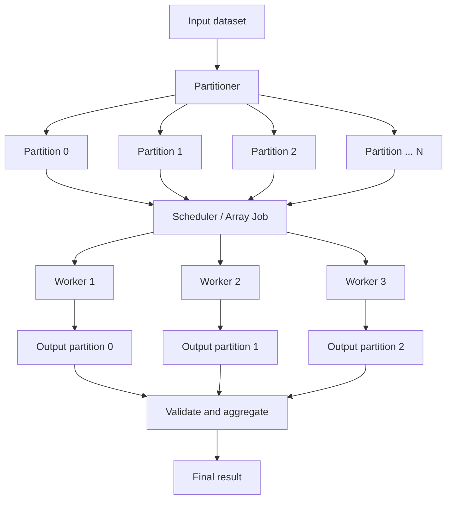

# Data Partitioning, Array Jobs, and Parallel Processing

## Learning Objectives

After this lesson, you will be able to:

- Explain why a large workload should be partitioned into smaller, independently processable partitions or tasks.
- Choose data partitioning strategies by range, key, hash, time, file, or size.
- Design array jobs to run the same program template across multiple task indices.
- Distinguish between parallelism, concurrency, throughput, and actual allocated concurrency.
- Estimate an appropriate worker count based on resources, partition size, and dependency limits.
- Design retries, idempotency, checkpoints, and output commit strategies to avoid losing or duplicating results.
- Handle data skew, stragglers, tasks that are too small, and tasks that are too large.
- Choose between static array jobs and dynamic queue workers.
- Monitor progress, performance, cost, and correctness of batch workloads.
- Deploy and operate parallel processing safely on Kubernetes or batch scheduler systems.

## 1. Why partition data?

A batch workload typically processes a large volume of data or a repetitive set of work. Running everything on a single process can take a long time, fails to utilize multiple machines, and may require restarting from scratch upon failure.

Workload partitioning (or task decomposition) turns a large job into smaller parts. Each part has well-defined inputs, processing scope, and outputs. Independent parts can run concurrently across multiple CPUs, VMs, or containers.

Examples:

- An ETL pipeline processing 10 TB of data can partition by date, tenant, or key range.
- A rendering system can split a video into frames or segments.
- An ML pipeline can run inference across data batches.
- A test suite can split by test suite or test case group.
- A compression task can split by file or object.
- An aggregation report can process each region separately and merge the results.

Partitioning pays off when parts can be processed independently or coordinated at reasonable cost. If parts have tight sequential dependencies, running more workers may not speed things up and can increase communication and coordination overhead.

### 1.1. From one large job to many tasks

Suppose 1,000,000 records need processing. Instead of one process reading and processing all of them, we split them into 100 partitions of roughly 10,000 records each.

Each task receives a partition ID, reads the corresponding data range, performs transformations, and writes its own output. When a task completes, the system marks that partition as succeeded. If task 37 fails, only partition 37 needs to be rerun.

Core components:

- **Dataset:** the input dataset to process.
- **Partition:** a slice of data divided by a deterministic rule.
- **Task:** a unit of work that can be scheduled, retried, and tracked.
- **Worker:** the process or container executing the task.
- **Coordinator/scheduler:** creates tasks, distributes them, tracks state, and aggregates status.
- **Output:** the durable result of a task.
- **Manifest/checkpoint:** metadata recording scope and progress.

A partition is how data is divided; a task is the unit of execution. One task may process one or more partitions. Conversely, a large partition can be split into multiple subtasks if the processing logic allows.

### 1.2. Parallel processing model



The diagram illustrates a processing flow. The scheduler may run only a subset of tasks at the same time; remaining tasks wait for capacity or quota. Only when all required partitions finish and outputs are valid is the aggregation step allowed to run.

## 2. Partition design principles

A good partition has a clear scope, can be deterministically reconstructed on retry, and does not contend on output with other partitions.

Key principles:

1. **Deterministic:** the same dataset version and partition ID must produce the same data range.
2. **Bounded:** size or processing duration falls within predictable bounds.
3. **Independent:** minimize dependencies between partitions.
4. **Retryable:** can be rerun without corrupting data.
5. **Observable:** know which partition is running, completed, or failed.
6. **Balanced:** time and resource requirements across partitions do not diverge excessively.
7. **Durable output:** results are durably saved before the task is marked complete.
8. **Versioned input:** know which version of the data the task processed.

If a partition is identified solely by its index in a mutable list, retrying after the dataset changes can process the wrong data. Tie partitions to an input snapshot, manifest, or version.

### 2.1. Choosing partition size

Partitions too large:

- Tasks run long and may exceed timeouts.
- On failure, the amount of work to rerun is large.
- Fewer tasks reduce available parallelism.
- One slow partition can hold up the entire pipeline.

Partitions too small:

- High overhead for creating tasks, scheduling, and starting workers.
- Excessive metadata and requests to queues/storage.
- Overhead can exceed actual processing time.
- The orchestration system can become a bottleneck.

The right size depends on startup time, processing speed, data size, API limits, and deadlines. Start by benchmarking a few sizes, then pick a balance between execution time, retry cost, and overhead.

### 2.2. Using processing time as a criterion

If each task takes a few seconds while a container takes 30 seconds to start, spinning up a container per task is inefficient. You can pack multiple partitions into one task or use long-lived workers pulling multiple messages from a queue.

If a task takes hours, consider splitting further or checkpointing to reduce lost work when interrupted.

A practical goal is for a task's useful work time to be large enough relative to startup and scheduling overhead, yet not so large that retries become prohibitively expensive.

## 3. Data partitioning strategies

No single partitioning strategy fits every dataset. Choose based on data structure, queries, key distribution, and how outputs are written.

### 3.1. Range partitioning

Partition data along an ordered field such as ID, timestamp, or sequence number.

Example:

| Partition | ID range | Expected records |
|---|---|---:|
| 0 | 0–99,999 | 100,000 |
| 1 | 100,000–199,999 | 100,000 |
| 2 | 200,000–299,999 | 100,000 |
| 3 | 300,000–399,999 | 100,000 |

Pros:

- Ranges are easy to understand and query.
- Can partition by time range or ID range.
- Outputs and retries are easy to pinpoint.

Risks:

- Data may be unevenly distributed.
- Some ranges have more or heavier records.
- Monotonically increasing IDs can create hotspots in certain storage/indexes.
- Late-arriving data may fall outside expected ranges.

Profile the distribution before picking boundaries. Do not divide ID counts equally if actual data density is uneven.

### 3.2. Hash partitioning

Use a stable hash function on a key to assign records to one of N partitions:

\[
partition(key) = hash(key) \bmod N
\]

Pros:

- Relatively even key distribution if the hash is good and data fits.
- Easy to determine the partition for a record.
- Useful when you want records with the same key grouped into the same partition.

Risks:

- Changing N moves most keys to different partitions.
- Very hot keys can still cause skew.
- Changing the hash function or serialization alters distribution results.
- Poorly suited for range queries.

If you need to change partition counts while minimizing key movement, use consistent hashing or a versioned partition map. Record the hash algorithm and partition count in the manifest.

### 3.3. Key or tenant partitioning

Partition by customer, tenant, account, region, or business group.

Pros:

- Easy to enforce per-tenant quotas and concurrency limits.
- Data for the same tenant can be processed together.
- Easy reconciliation and cost attribution.

Risks:

- A large tenant can create an oversized partition.
- A highly active tenant can create a hotspot.
- Small-data tenants finish very quickly while large tenants drag on.

Large tenants can be sub-partitioned by time or secondary key, while small tenants can be grouped together.

### 3.4. Time-based partitioning

Logs, events, and telemetry data are often partitioned by hour, day, or month.

Examples:

- One task processes one day of logs.
- One task processes one hour of events.
- One task processes a time window in a stored stream.

Specify timezone, inclusive/exclusive boundaries, and late-event handling. For timestamped data, standardize on UTC or an explicit business timezone to avoid missing or double-processing records at day boundaries.

### 3.5. File or object partitioning

If data is already stored as many independent files/objects, you can create one task per file or group of files.

This is simple when files are relatively uniform in size. If file sizes vary wildly, a single task processing a 5 GB file can take longer than hundreds of tasks processing small files.

Build a manifest with object keys, versions, sizes, and checksums, then bin-pack files by total byte size or estimated processing time.

### 3.6. Size or workload-cost partitioning

Not all records cost the same to process. A 4K image requires more CPU/GPU than a thumbnail; a huge JSON blob takes more RAM than a small record.

Instead of splitting strictly by record count, estimate a cost weight for each item:

\[
W_i = \sum_{r \in partition_i} estimatedCost(r)
\]

The goal is to keep total weight \(W_i\) similar across partitions. Estimates can be based on bytes, pixel counts, token counts, operation counts, or historical execution metrics.

## 4. Data skew and partition balancing

Data skew occurs when record counts or processing costs vary drastically across partitions. Even with many workers, the pipeline still has to wait for the slowest partition.

For example, 9 partitions take 2 minutes, while one partition containing a huge tenant takes 40 minutes. Adding workers will not help if that heavy partition cannot be split further.

Symptoms:

- Some workers finish very early while others run for a long time.
- CPU/GPU utilization drops toward the end of the job.
- Overall duration is dictated by the last few tasks.
- Retrying one partition significantly delays the pipeline.
- Record counts per partition are equal, yet processing durations differ widely.

### 4.1. Ways to reduce skew

- Use histograms or distribution statistics before partitioning.
- Split hot tenants/keys into multiple subpartitions.
- Use cost-based partitioning rather than simple record counts.
- Use a dynamic work queue so idle workers pull the next available task.
- Use speculative execution for abnormally slow tasks if outputs can commit safely.
- Set timeouts and retries for hung tasks.
- Track p50/p95/p99 duration across partitions.

Do not split a key if logic requires all records with the same key to be processed sequentially or in the same transaction. Preserve business invariants.

### 4.2. Static partitioning vs. dynamic work assignment

**Static partitioning:** pre-divides the entire scope and assigns fixed partition IDs to each task. Suitable when part counts are known upfront, sizes are stable, and scheduling is straightforward.

**Dynamic work assignment:** workers pull tasks from a queue as they become available. Suitable when processing times are uneven or task counts are large and variable.

| Criterion | Static partition | Dynamic queue |
|---|---|---|
| Task determination | Before execution | When a worker claims a task |
| Load balancing | Depends on partition quality | Idle workers can pick up the next task |
| Coordination | Simpler with a fixed task count | Requires queue, leases, and acks |
| Retry | Rerun the specific partition | Message/task is redelivered |
| Best fit | Batches with clear, stable scope | Uneven tasks or continuously arriving work |
| Overhead | Can be low | Adds queue and coordination overhead |

You can combine both: create large static partitions, then break them into dynamic subtasks during execution.

## 5. What is an array job?

An array job is a way to declare a job template and instruct the system to run multiple copies of that template, each with a distinct index or parameter. Instead of writing hundreds of individual job manifests, operators declare the task count and concurrency limit.

An array job typically has:

- A shared job template.
- Total task count or completion count.
- Unique task indices.
- A mapping from index to partition/input.
- A limit on concurrently running tasks.
- Retry and timeout policies.
- Dedicated output paths per task.
- An aggregation step after all tasks finish.

For example, an array has 100 tasks indexed 0 to 99. Task 0 processes partition 0, task 1 processes partition 1, and so on. The scheduler might allow only 10 tasks to run concurrently; the rest wait for resources.

### 5.1. Why are array jobs useful?

- Reduces the number of configurations to maintain.
- Shares image, command, and resource profiles.
- Each task has a clear index to locate inputs/outputs.
- Easy to retry failed tasks individually.
- Can cap concurrency to protect databases or storage.
- Tracks progress by index and total completion count.

Array jobs fit well when tasks share the same execution logic and differ only by input or parameters. If tasks have significantly different dependencies, resource needs, or runtimes, a more flexible template or queue-based scheduler is needed.

### 5.2. Index is not completion order

Task index 7 does not necessarily finish before task index 8. The scheduler allocates resources by capacity, priority, and policy. Do not use indices to infer execution order or commit order.

If the aggregation step needs ordered data, sort by metadata/partition ID in the final step. Do not rely on when workers finish.

## 6. Array job example on Kubernetes Indexed Job

Kubernetes Jobs support an Indexed completion mode. Each Pod receives a completion index and can use the `JOB_COMPLETION_INDEX` environment variable to identify which partition to process.

Example:

```yaml
apiVersion: batch/v1
kind: Job
metadata:
  name: etl-array
spec:
  completions: 100
  parallelism: 10
  completionMode: Indexed
  backoffLimit: 3
  template:
    metadata:
      labels:
        app: etl-array
    spec:
      restartPolicy: Never
      containers:
        - name: worker
          image: registry.example.com/data/etl-worker:2.1
          command: ["python", "/app/worker.py"]
          env:
            - name: DATASET_VERSION
              value: "snapshot-2026-11-22"
          resources:
            requests:
              cpu: "1"
              memory: "2Gi"
            limits:
              cpu: "2"
              memory: "4Gi"
```

The values above are illustrative. The Job creates 100 indexed completions, while at most 10 Pods run in parallel as configured. Each worker must read `JOB_COMPLETION_INDEX`, look up the manifest, and process the matching partition. The image must contain the corresponding code.

### 6.1. Reading the index in the application

Python example:

```python
import os
import json

index = int(os.environ["JOB_COMPLETION_INDEX"])
dataset_version = os.environ["DATASET_VERSION"]

with open("/app/partition-manifest.json", encoding="utf-8") as f:
    manifest = json.load(f)

partition = manifest["partitions"][index]

process_partition(
    dataset_version=dataset_version,
    partition=partition,
)
```

This snippet is an illustrative skeleton; `process_partition` must be implemented for your data format. Validate that the index falls within the manifest bounds and that the data version matches the manifest before processing.

### 6.2. Limiting concurrency

`parallelism: 10` limits the number of Pods running concurrently for the Job. This is a Job controller cap and does not guarantee 10 Pods will always run if the cluster lacks CPU, memory, GPU, quota, or suitable nodes.

Choose `parallelism` based on:

- Available CPU and RAM.
- Database/object storage throughput.
- API limits and rate limits.
- Maximum connection counts.
- I/O and network bandwidth.
- Capacity cost.
- Batch deadline.

If increasing parallelism overloads the database, total completion time may increase rather than decrease.

### 6.3. Monitoring an Indexed Job

Useful observation commands:

```bash
kubectl get job etl-array
kubectl describe job etl-array
kubectl get pods -l job-name=etl-array -o wide
kubectl get pods -l job-name=etl-array
kubectl logs job/etl-array
```

Label names and aggregated log retrieval depend on your setup. When investigating a specific partition, locate the Pod with the completion index annotation or inspect Pod metadata according to your Kubernetes version.

Do not delete a Job immediately once some Pods finish if logs, status, or outputs are still needed for reconciliation. Use TTL cleanup after verifying results and satisfying retention needs.

## 7. Array jobs on batch schedulers

Array jobs are not exclusive to Kubernetes. Batch schedulers and cloud batch services also provide job array or array task concepts.

Example with Slurm:

```bash
#!/bin/bash
#SBATCH --job-name=partition-etl
#SBATCH --array=0-99%10
#SBATCH --cpus-per-task=2
#SBATCH --mem=4G
#SBATCH --time=00:30:00

python worker.py --partition "$SLURM_ARRAY_TASK_ID"
```

In this example, the scheduler creates task indices 0 to 99 and caps concurrent running tasks at 10 using Slurm syntax. Each task invokes the same program with its specific partition ID.

Index variable names and concurrency syntax differ across schedulers. For cloud batch services, check the specific API/SDK to see how array indices are passed, how child jobs are capped, and how retries behave.

### 7.1. Comparing implementation models

| Model | How it is expressed | Best fit |
|---|---|---|
| Kubernetes Indexed Job | `completions`, `parallelism`, `completionMode: Indexed` | Batches running inside a Kubernetes cluster |
| Slurm Job Array | `--array` and task ID | HPC, research, and cluster schedulers |
| Cloud Batch Array | Job definition and array size/index | Batches on a cloud provider |
| Queue workers | Tasks/messages in a durable queue | Dynamic workloads with uneven tasks |
| Workflow DAG | Steps with dependencies | Multi-stage and branching pipelines |

Do not pick a tool solely by task count. Consider where data resides, how compute is provisioned, inter-task dependencies, retry requirements, observability, and operational cost.

## 8. Handling outputs and preventing mutual overwrites

Each task needs its own output path or key. If all workers write to the same file without coordination, results can be overwritten or corrupted.

Example structure:

```text
s3://data-results/run-2026-11-22/
  manifest.json
  partitions/
    part-00000/
      result.parquet
      metadata.json
    part-00001/
      result.parquet
      metadata.json
    part-00002/
      result.parquet
      metadata.json
  _SUCCESS
```

Each partition has an isolated output area. The aggregation step reads the manifest and verified outputs, then produces the final result.

### 8.1. Safe output commits

A worker may crash after writing a file but before marking the task complete. On retry, another worker will rerun the same partition. A commit protocol is needed:

1. Write output to a temporary path scoped to the attempt.
2. Flush/close and verify checksum or format.
3. Write metadata containing partition ID, dataset version, attempt ID, and code version.
4. Publish the output via an atomic operation if storage supports it, or update a manifest/commit record conditionally.
5. Mark the task succeeded only after the commit.
6. Clean up temporary outputs of failed attempts according to retention.

Object storage does not always support atomic renames like a filesystem. You can use immutable per-attempt object keys and a manifest pointer/conditional write to publish the winning version.

### 8.2. Idempotency

Idempotent means rerunning the same task does not unintentionally alter the final outcome. It can be designed using:

- Partition ID and dataset version as an idempotency key.
- Unique constraints in the database.
- Conditional upserts.
- Versioned output paths.
- Write-once commit markers.
- Transactions or compare-and-swap when updating state.

If a task sends emails, charges payments, or calls APIs with side effects, writing separate output files alone is insufficient. Use idempotency keys at the target service or a transactional outbox/command log to prevent duplicate side effects.

## 9. Retries, timeouts, and checkpoints

Tasks can fail due to data errors, networking issues, resource exhaustion, interruptions, or bugs. Retries recover from transient errors but should not loop forever.

### 9.1. Error classification

| Error type | Examples | Handling approach |
|---|---|---|
| Transient | Storage timeout, rate limit, network reset | Retry with exponential backoff and jitter |
| Capacity | Unable to provision VM, temporary quota | Wait for capacity, reduce concurrency, or switch pools |
| Data-specific | Corrupted record, invalid schema | Quarantine record/partition and report error |
| Permanent | Misconfiguration, missing permissions, missing image | Stop retrying and fix root cause |
| Resource | OOM, disk full, CPU timeout | Adjust sizing or split tasks smaller |
| Duplicate execution | Lease expired, duplicate worker running | Idempotency and conditional commits |

### 9.2. Exponential backoff and jitter

When many tasks fail simultaneously due to a dependency, immediate retries can trigger a retry storm. Use progressive backoff plus jitter to spread retry times.

Example formula:

\[
delay_n = \min(delay_{max}, base \times 2^n) + jitter
\]

`base`, `max`, and `jitter` values should be chosen based on timeouts and SLAs. For rate limits, respect `Retry-After` if returned by the API.

### 9.3. Layered timeouts

Distinguish between:

- Task timeout: maximum duration for one partition.
- Worker shutdown grace period: time for a worker to finish or checkpoint when stopped.
- Queue visibility/lease timeout: duration a message is hidden from other workers.
- API/database timeout: wait limit for a dependency.
- Workflow deadline: deadline by which the entire pipeline must complete.

If the lease is shorter than processing time, a message may be redelivered while the first worker is still running. If the task timeout is too long, hung tasks hold resources and delay the pipeline. Timeouts across layers must be aligned.

### 9.4. Checkpoints

For long tasks, checkpoints save progress at safe points. On retry, a worker can resume instead of starting over from scratch.

A checkpoint should include:

- Task/partition ID.
- Dataset version and schema version.
- Code/model version.
- Processed offset or cursor.
- Committed outputs.
- Checksum and timestamp.
- Transaction state needed for recovery.

Never write a checkpoint before the corresponding data has been durably committed. If the checkpoint claims offset 10,000 was processed while output only saved up to 9,500, the remaining data could be skipped.

## 10. Handling duplicate task execution and leases

In distributed systems, a worker may pause, lose connectivity, or respond slowly. The coordinator may assume the worker died and reassign the task while the old worker keeps running.

This is duplicate execution. Design the system so two workers cannot overwrite results or trigger duplicate side effects.

Techniques:

- Bounded leases with heartbeats.
- Fencing tokens/generation numbers that increment on each lease grant.
- Conditional commits that accept only the latest token.
- Idempotency keys at target systems.
- Per-attempt outputs with a single publish step.
- Timeouts and cancellation so old workers halt when losing their lease.

A lease is only a coordination mechanism; it does not automatically kill the old process. Fencing tokens enable storage or databases to reject writes from workers holding stale tokens.

## 11. Parallelism, concurrency, and throughput

Terms to distinguish:

- **Parallelism:** the number of tasks actually executing simultaneously across multiple execution units.
- **Concurrency:** the number of tasks in progress or managed at once; not necessarily running at the exact same instant.
- **Throughput:** the number of work units completed per unit of time.
- **Latency:** the time it takes for a single task or request to finish.
- **Utilization:** how heavily allocated resources are used.
- **Queue wait:** how long a task waits before starting.

Increasing concurrency can raise throughput until a resource becomes a bottleneck. Beyond that point, adding workers only increases contention and latency.

### 11.1. Estimating ideal execution time

With N equal partitions, each taking time t, and P workers, the approximate ideal time is:

\[
T \approx \left\lceil \frac{N}{P} \right\rceil \times t
\]

This formula assumes identical workers, balanced partitions, zero overhead, no dependency bottlenecks, and zero failures.

In practice, startup, queue wait, data transfer, coordination, retries, and stragglers all add time. Therefore, measure wall-clock completion time rather than dividing total CPU time by worker count.

### 11.2. Limits from Amdahl's Law

If the sequential portion accounts for fraction s of the workload and the remainder can be parallelized, the maximum speedup with P workers is approximated by:

\[
Speedup(P) = \frac{1}{s + \frac{1-s}{P}}
\]

If 20% of the work must run sequentially, even with infinite workers, maximum speedup under this model is only 5x. Sequential portions can include reading manifests, creating partitions, merging outputs, or updating metadata.

To go faster, optimize the setup and aggregation steps as well, not just worker count.

### 11.3. When does adding workers not help?

- The database has hit its connection or IOPS limit.
- Object storage/API is rate-limiting requests.
- Network bandwidth is saturated.
- All tasks contend on a single lock or file.
- Partitions are too small and scheduler overhead dominates.
- Partitions are heavily skewed, leaving most workers idle waiting on stragglers.
- Worker CPUs lack RAM or disk.
- The final merge step is sequential.

Identify the bottleneck using metrics before increasing parallelism.

## 12. Backpressure and protecting dependencies

A batch system can spawn thousands of workers and send sudden load spikes to databases, object storage, or APIs. If dependencies cannot handle the load, the pipeline can degrade shared services.

Backpressure adjusts task creation or processing rates to match downstream capacity.

Implementation approaches:

- Cap the array job's `parallelism`.
- Use queues that limit message consumption rates.
- Apply concurrency limits per tenant or dependency.
- Use token buckets/rate limiters.
- Pause producers when backlogs or errors spike.
- Use circuit breakers when dependencies are unhealthy.
- Prioritize critical tasks and cap batch sizes.

Do not rely solely on global limits. One hot tenant or partition can consume the entire capacity; use per-group fairness or quotas when appropriate.

## 13. Large data, data locality, and data transfer

When running cloud batches, reading inputs and transferring outputs can take longer than computation itself. Placing workers near data can reduce network costs and latency.

Considerations:

- Same region as object storage/database.
- Local caches for repeatedly read data.
- Appropriate columnar formats and compression.
- Range or prefix reads to avoid scanning entire datasets.
- Avoiding hundreds of workers downloading the same huge file.
- Generating manifests and checksums to avoid repeated storage listings.
- Writing outputs by partition with well-sized files.

Data locality must never trade off correctness. Caches need explicit versions or invalidation; never let a worker read stale data and write results into a new run.

### 13.1. Avoiding the small files problem

If each task produces thousands of tiny files, object storage or metadata services suffer heavy overhead. You can:

- Write larger intermediate files.
- Batch outputs together.
- Use manifests to manage files.
- Run compaction after tasks complete.
- Pick a target file size aligned with the engine and format.

Do not compact files using a single writer if that turns the final step into a bottleneck. Run multiple compaction tasks across partition groups.

## 14. Aggregating results and verifying completeness

Once tasks finish, the aggregation step needs to know which partitions were processed and which outputs are valid.

A manifest can store:

```json
{
  "run_id": "etl-2026-11-22-001",
  "dataset_version": "snapshot-2026-11-22",
  "partition_count": 3,
  "partitions": [
    {
      "id": 0,
      "input": "source/date=2026-11-20/part-0",
      "output": "results/run-001/part-0.parquet",
      "status": "SUCCEEDED",
      "checksum": "sha256:..."
    },
    {
      "id": 1,
      "input": "source/date=2026-11-20/part-1",
      "output": "results/run-001/part-1.parquet",
      "status": "SUCCEEDED",
      "checksum": "sha256:..."
    },
    {
      "id": 2,
      "input": "source/date=2026-11-20/part-2",
      "output": "results/run-001/part-2.parquet",
      "status": "SUCCEEDED",
      "checksum": "sha256:..."
    }
  ]
}
```

This is an illustrative structure. In practice, state can live in a database or metadata store for conditional updates.

Before publishing results:

1. Confirm all required partitions are present.
2. Verify every output has the correct version.
3. Validate checksums or schemas.
4. Reconcile input/output record counts if invariants exist.
5. Verify no partition ran twice and published duplicate outputs.
6. Aggregate in the proper business order or logic.
7. Write the completed run manifest.
8. Only then expose outputs to consumers.

If a partition fails, decide whether the pipeline fails, retries, or publishes partial results per the business contract. Do not mark a run successful just because most tasks completed.

## 15. Practical example: ETL partitioned by date and hash bucket

A system needs to process 30 days of events. Each day has varying event volumes, and a few tenants are massive.

Design:

- Create 30 partitions by UTC date.
- For high-volume days, split further into 16 hash buckets by tenant ID.
- Store a manifest containing dataset snapshot, date, bucket, estimated bytes, and input prefix.
- Create an array job for the defined partitions.
- Cap initial parallelism at 12 to protect the source database.
- Each worker writes output to an isolated prefix keyed by run ID and partition ID.
- Workers commit outputs with checksums before marking success.
- Tasks with transient errors retry with backoff; schema errors go to quarantine.
- A validation step checks record counts, schemas, and checksums.
- A compaction step merges small files.
- A publish step updates the pointer to the new run after all partitions meet criteria.

If day 12 has a huge tenant making bucket 7 run slowly, the team can sub-partition that specific tenant by hashing the event ID. The new manifest must be versioned so retries and aggregation never mix old and new partition maps.

### 15.1. Pipeline diagram


## 16. Monitoring and measuring batch effectiveness

Do not monitor CPU and RAM alone. Track business progress and task behavior as well.

| Category | Metric | Meaning |
|---|---|---|
| Volume | Total partitions, completed, pending, failed | Progress level |
| Throughput | Records/second, bytes/second, tasks/minute | Processing speed |
| Latency | Task duration p50/p95/p99, wall-clock run time | Completion time |
| Queue | Queue depth, oldest task age, wait time | Backlog and worker provisioning |
| Balance | Duration by partition, straggler count | Data skew |
| Reliability | Retry count, failure rate, duplicate attempts | Reliability |
| Data quality | Record count, checksum, validation failures | Correctness |
| Resource | CPU, memory, disk, network, throttling | Bottlenecks |
| Dependency | DB connections, API rate limits, storage latency | Downstream impact |
| Cost | Compute hours, storage, transfer, cost per output | Economic efficiency |

### 16.1. Tracking tail tasks (stragglers)

When 99% of tasks are done but a few keep running, the pipeline still cannot publish. Compare durations across partitions and inspect input size, record count, tenant, or retry errors.

Speculative execution can be used: if a task runs abnormally long, launch another attempt on a different worker. Only one attempt is allowed to commit output. This can reduce tail latency at the expense of higher compute cost and potential dependency load; use it only when outputs are idempotent and fencing/conditional commits are in place.

### 16.2. Cost per output

A useful metric is:

\[
CostPerUnit =
\frac{Compute + Storage + Transfer + Orchestration}
{ValidatedOutputUnits}
\]

An output unit can be one million valid records, one GB of processed data, or one completed file/video. Compare across identical dataset versions, quality levels, and deadlines.

## 17. Security and access control in parallel processing

Array jobs can spin up many Pods/VMs at once. If every worker shares overly broad permissions, a bug in one task can affect the entire dataset or other tenants.

Principles:

- Use a dedicated service account/workload identity for the job.
- Grant read access only to the exact input prefix and write access only to the exact output prefix.
- Separate permission to publish final results from permission to write temporary outputs.
- Never bake secrets into images or command lines.
- Use a secret manager with rotation.
- Encrypt data in transit and at rest.
- Restrict network egress and allowed dependencies.
- Use namespaces, quotas, and policies per team/tenant.
- Audit job ID, partition ID, image digest, and identity.
- Delete temporary outputs and checkpoints according to retention.

If data is partitioned by tenant, ensure the partitioner and authorization layer prevent tenant A's worker from reading tenant B's data. A partition ID is not an authorization boundary.

## 18. Common design mistakes

- **Equal record counts mean balanced partitions.** Processing cost per record can vary; measure duration or cost weight.
- **One task per container is always good.** For tiny tasks, startup/scheduling overhead can exceed the work itself.
- **Increasing parallelism always reduces time.** Dependencies or storage can become bottlenecks.
- **Array index equals completion order.** The index only identifies a task; schedulers do not guarantee execution order.
- **Retrying is inherently safe.** Retries can duplicate side effects if operations are not idempotent.
- **If a worker writes output and crashes, the task succeeded.** Commit markers/manifests are needed so the coordinator knows the output is valid.
- **Lease expiry means the old worker stopped.** The old worker can keep running; use fencing and conditional commits.
- **Queues guarantee exactly-once automatically.** Many queues deliver at-least-once; applications must prevent duplicate processing.
- **One shared output file makes aggregation easier.** Concurrent writes by many workers cause races and corruption.
- **Slow tail tasks just need more workers.** Address skew, heavy partitions, and stragglers instead.
- **All partitions must have equal byte size.** Byte size does not always match processing duration; use appropriate cost estimates.
- **Input data can mutate while the job runs.** Use snapshots/versions or stable manifests so tasks do not process inconsistent states.
- **Publishing each partition immediately on completion is always safe.** Consumers may see incomplete results; define a contract for partial outputs.
- **Stdout logs are enough for monitoring.** Use structured logs and metrics tagged with run ID, partition ID, and attempt ID.
- **Measure only compute cost.** Storage, transfer, retries, orchestration, and dependency costs also impact total cost.

## 19. Design and rollout process

1. Define final deliverables, quality bar, and deadline.
2. Lock the dataset snapshot/version.
3. Choose the partitioning key or dimension.
4. Measure distribution and estimate cost per partition.
5. Select partition count and task size.
6. Choose a static array job or dynamic queue.
7. Set parallelism based on CPU, RAM, and dependency capacity.
8. Design isolated outputs, manifests, and a commit protocol.
9. Design idempotency, retries, timeouts, and checkpoints.
10. Test with representative data and fault injection.
11. Measure throughput, p95/p99, skew, failures, and cost.
12. Tune partition size and concurrency.
13. Run in production within the batch window and monitor.
14. Validate thoroughly before publishing.
15. Retain logs/manifests long enough for audit and recovery.

### 19.1. Starting with a small baseline

A safe rollout approach:

- Run 4–8 partitions first.
- Limit to 2–4 workers.
- Verify inputs/outputs and retries.
- Increase partition count or parallelism incrementally.
- Monitor dependency latency and errors.
- Stop scaling up when throughput plateaus or p95 spikes sharply.

These numbers are only starting points for testing. Real capacity and service limits determine the right values.

## 20. Operations checklist

### Before running

- [ ] Dataset has a stable snapshot/version.
- [ ] Partition manifest includes ID, input range, and version.
- [ ] Partition size has been benchmarked.
- [ ] Data skew and hot keys have been evaluated.
- [ ] Tasks can retry or resume safely.
- [ ] Output paths are isolated by run/partition/attempt.
- [ ] Idempotency keys and commit protocol are in place.
- [ ] Parallelism matches dependency capacity and rate limits.
- [ ] Timeouts, retries, backoff, and deadlines are aligned.
- [ ] Service account has least-privilege permissions only.
- [ ] Halt conditions exist if errors or dependency pressure rise.

### During execution

- [ ] Monitor completed/pending/failed partitions.
- [ ] Monitor queue wait and task duration.
- [ ] Monitor p95/p99 and stragglers.
- [ ] Monitor CPU, memory, disk, and network.
- [ ] Monitor dependency connections and rate limits.
- [ ] Monitor retries, duplicate attempts, and checkpoint age.
- [ ] Verify output checksums/schemas.
- [ ] Control concurrency and backpressure.
- [ ] Emit logs with run ID, partition ID, and attempt ID.

### After execution

- [ ] Confirm all required partitions succeeded.
- [ ] Verify record counts, checksums, and schemas.
- [ ] Aggregate/compact outputs.
- [ ] Publish the manifest or pointer of the complete run.
- [ ] Ensure no orphaned workers or tasks remain.
- [ ] Delete temporary outputs per retention.
- [ ] Calculate cost per output and p95 duration.
- [ ] Document partition skew and errors to address.
- [ ] Update sizing, parallelism, and runbooks.

## 21. Self-check

**Scenario 1:** An ETL splits into 100 partitions, each with 10,000 records. One partition takes 30 minutes while all others take 2 minutes. What could be wrong?

**Hint:** Possible data skew or one partition holds records with high processing cost. Check byte sizes, key distribution, and durations; sub-partition the heavy slice if logic permits.

**Scenario 2:** A Kubernetes Indexed Job has `completions: 100` and `parallelism: 20`. Why are only 8 Pods running?

**Hint:** `parallelism` is the maximum desired by the Job controller, not guaranteed capacity. The cluster may lack CPU/RAM/GPU, quotas, suitable nodes, or Pods are blocked by scheduler constraints.

**Scenario 3:** A worker writes output successfully and loses connection before reporting task completion. The queue redelivers the task to another worker. How do you avoid writing results twice?

**Hint:** Use idempotency keys, per-attempt outputs, conditional commits, or unique constraints. Publish only one valid output and acknowledge after durable commit.

**Scenario 4:** Increasing parallelism from 10 to 50 lowers throughput and spikes database latency. What should you do?

**Hint:** The database is the bottleneck or overloaded. Reduce concurrency, apply rate limits/backpressure, optimize queries, and re-measure throughput before scaling workers up again.

**Scenario 5:** An array task with index 5 finishes after index 9. Is this a scheduler bug?

**Hint:** No. Indices only identify completions; the scheduler runs tasks based on capacity and policy without guaranteeing completion order.

**Scenario 6:** The dataset mutates while 100 tasks are running, so some tasks read the new version and others read the old version. What is the risk?

**Hint:** Outputs can become inconsistent because partitions processed different snapshots. Pin a dataset version or snapshot in the manifest and pass that same version to every task.

## Conclusion

Data partitioning and parallel processing shorten batch workloads, improve retryability, and leverage multiple compute workers. Effectiveness depends on how partitions are chosen, balance, task granularity, concurrency limits, and protecting dependencies. Array jobs fit fixed-structure task sets; dynamic queues fit uneven or continuously arriving workloads. Every task needs an explicit input version, isolated output, idempotency, and safe commits so retries do not corrupt results. Measure throughput, p95/p99, data skew, failures, dependency pressure, and cost per output before increasing parallelism or scaling out.
