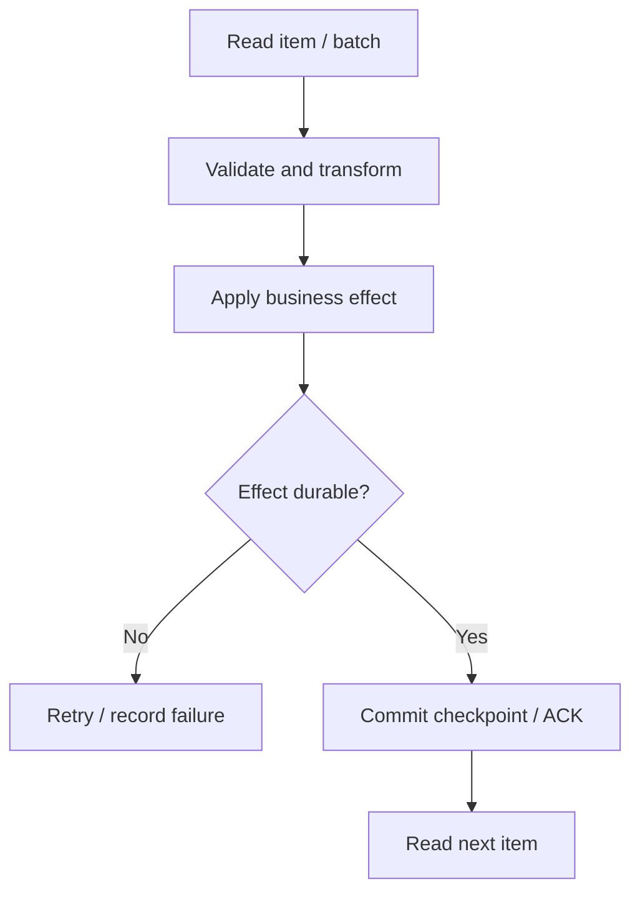
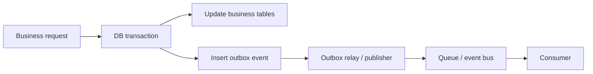
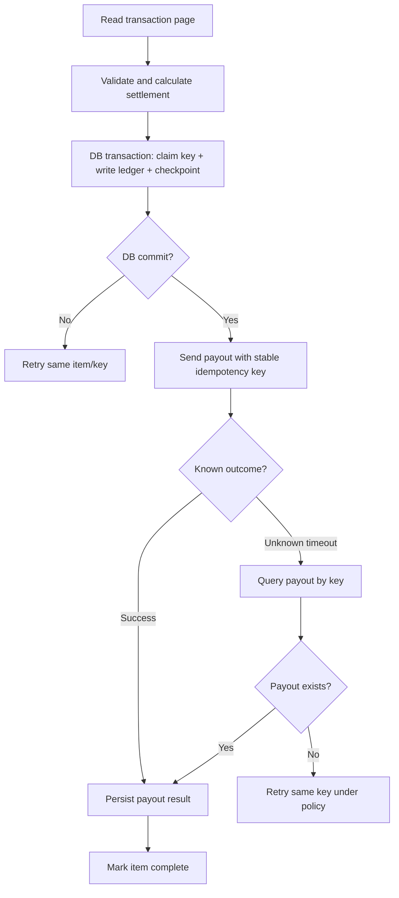

# Checkpointing and Guaranteeing Non-Duplicate Business Effects

## Context: batches may rerun after producing partial results

A batch job typically reads many records, transforms them, and writes results to a database, object storage, or external service. If a job stops mid-way due to a VM restart, container replacement, function timeout, or network error, the system needs to know how far processing progressed so it can resume. The mechanism for persisting that progress is called a **checkpoint**.

Checkpointing avoids re-reading and recomputing all data, but by itself it does not guarantee a business effect happens only once. Consider a scenario where a worker successfully transfers funds or creates an invoice, then crashes before saving the checkpoint. When the job reruns, the same record may be processed again. Conversely, if the worker saves the checkpoint before writing the result and then crashes, the record may be skipped even though the effect never completed.

Therefore, batch processing must combine two mechanisms:

- **Checkpoint/progress tracking:** records the position or completed work units so execution can resume.
- **Idempotency/deduplication:** guarantees that reprocessing the same unit of work does not create unintended extra business effects.

In the **CLOUD_CORE_SERVICES_COMPUTE** module, these mechanisms apply to VM workers, container jobs, Kubernetes Jobs, serverless functions, queue consumers, stream processors, and ETL pipelines. The goal is to recover from failures, replay safely when needed, and preserve data correctness even when a batch or message is delivered multiple times.

## 1. What is a checkpoint?

A checkpoint is a durable record describing processing progress at a resumable boundary. It can store a read position, the last committed record ID, a partition offset, processed page count, active file/chunk, or per-item state.

A good checkpoint should answer:

1. Which job or run is being tracked?
2. Which data source and input version is being processed?
3. Which units of work have completed durably?
4. What is the next unit to process?
5. Which worker/attempt updated the checkpoint and when?
6. How can execution resume or replay from that checkpoint?

### 1.1. Checkpoints vs. logs

Logs describe what happened for human investigation; a checkpoint is structured state that the program uses to resume. A log line saying "processed record 500" is insufficient as a checkpoint without knowing the run, input version, partition, transaction outcome, and whether that record was durably persisted.

Checkpoints should live in an appropriate durable store such as a database, object storage metadata, workflow state store, or stream platform offset store. Never store checkpoints solely in RAM or the ephemeral filesystem of a replaceable container/VM.

### 1.2. Position-based vs. state-based checkpoints

Two common representations:

- **Position-based:** stores an offset, cursor, page token, file row number, or next sequence number.
- **State-based:** stores per-item states such as `PENDING`, `IN_PROGRESS`, `SUCCEEDED`, `FAILED` alongside attempts, leases, and results.

Position-based checkpointing is compact and efficient when the source has stable ordering, such as a partition log. State-based checkpointing fits when items are independent, processed in parallel, or vary in duration. Large systems may combine both: offset checkpoints per partition plus state tables for items with complex side effects.

### 1.3. Choosing the right checkpoint unit

A checkpoint unit can be:

| Unit | Example | Trade-offs |
|---|---|---|
| Per record | One CSV row or one message | Precise resumption, but high checkpoint write overhead |
| Small batch | 100 records or one page | Lower overhead, may re-execute the tail of a batch |
| Per partition | Committed offset within a partition | Fits ordered partitioned streams |
| Per file/chunk | File ID and byte/row range | Fits large-file ETL, requires immutable inputs |
| Per stage | Validate, transform, export | Fits multi-step workflows, coarser granularity |

Choose checkpoint granularity based on progress write cost, acceptable rework time, and the risk of duplicate side effects. If a batch takes 30 minutes and checkpoints only once per batch, an error near the end can force nearly 30 minutes of rework.

## 2. Offsets, cursors, and checkpoints across data source types

Checkpoints must align with source semantics. Not every source provides a single global sequential offset.

### 2.1. Queues

With queues, messages are typically received under a visibility/lease window. The worker processes the message and ACKs/deletes it on completion. If the worker crashes before ACKing, the message can reappear after the visibility timeout. This is standard at-least-once delivery in many queue systems.

In this case, checkpointing is usually expressed via message acknowledgement or separate item state. Never ACK before the business effect is durably persisted, unless the message has been safely handed off to another durable system.

### 2.2. Streams and partition offsets

Streams are usually divided into partitions/shards, each with its own record ordering. Consumers persist processed offsets/sequences. On restart, consumers resume from the committed position.

Offset semantics must be exact: some systems store "last processed offset", while others store "next offset to read". Confusing the two conventions can skip or double-read records. With multiple partitions, checkpoints must track progress separately per partition.

### 2.3. Database pagination and change streams

Batches reading databases can use keyset pagination, cursors, or change sequences. Row-number offsets (`OFFSET n`) can shift when underlying data mutates between queries. Keyset pagination on a unique sort key is generally safer for large datasets:

```sql
SELECT id, updated_at, payload
FROM source_records
WHERE (updated_at, id) > (:last_updated_at, :last_id)
ORDER BY updated_at, id
LIMIT 500;
```

The checkpoint must store the full composite sort key, not just `updated_at`, because multiple records can share the same timestamp. If the source mutates while the batch runs, define a snapshot boundary or watermark so late-updated records are not missed.

### 2.4. Files and object storage

For large files, checkpoints can record the object key, version/generation, checksum, and processed chunks. If a file can be overwritten, storing only the key is insufficient: resuming may read different contents than the initial run. Use version IDs, immutable object keys, or checksums to pin the run's input.

For CSV/JSONL, row numbers are stable only if the file is immutable and the parser can resume at clean boundaries. For compressed or binary formats, resuming by byte offset may be infeasible; split files into independent chunks or build a manifest before processing.

## 3. Critical rule: checkpoint only after results are durable

A core rule is **commit outputs first, then advance the checkpoint**. If the checkpoint advances before the output, a crash can lose work. If the output commits before the checkpoint, a crash can cause reprocessing, so outputs must be idempotent or outputs and checkpoints must share the same transaction.



### 3.1. Two fundamental crash windows

| Operation order | Crash point | Consequence |
|---|---|---|
| Checkpoint first, output second | After checkpoint, before output | Record is skipped on resume; lost business effect |
| Output first, checkpoint second | After output, before checkpoint | Record is re-read; risk of duplicate business effect |

If both output and checkpoint reside in the same database, commit both in a single transaction. If the output lives in another system, cross-system atomic transactions are generally unavailable; use idempotency keys, inbox/outbox, workflow state, or reconciliation instead.

### 3.2. Transactional checkpoints

When business results and checkpoints live in the same transactional database, update them in the same transaction:

```sql
BEGIN;

-- Application reads the RETURNING result to check whether the item was newly claimed.
INSERT INTO processed_items (job_id, item_id, processed_at)
VALUES (:job_id, :item_id, CURRENT_TIMESTAMP)
ON CONFLICT (job_id, item_id) DO NOTHING
RETURNING item_id;

-- Execute the statements below only if INSERT returned exactly one row.
-- If no row was returned, verify the marker is SUCCEEDED and skip side effects.
UPDATE account_balances
SET balance = balance - :amount
WHERE account_id = :source_account;

UPDATE account_balances
SET balance = balance + :amount
WHERE account_id = :destination_account;

UPDATE job_checkpoints
SET last_item_id = :item_id, updated_at = CURRENT_TIMESTAMP
WHERE job_id = :job_id;

COMMIT;
```

This is an illustrative SQL/pseudocode flow: the application must inspect the row count returned by `INSERT ... RETURNING` and execute the two business updates plus checkpoint update only when the marker was newly inserted. If the marker already exists, inspect the operation state; if already `SUCCEEDED`, skip side effects. Never execute unconditional `UPDATE` statements after an insert conflict. In production, verify balances/business constraints, lock both accounts within the transaction, and ensure checkpoints advance only in a safe order.

### 3.3. Never advance checkpoints past incomplete items

In parallel batches, item 12 may finish before item 10. You cannot simply record "done up to 12" while 10 and 11 are still running. Use one of these approaches:

- Advance only a contiguous offset: record up to the highest position where every preceding item has completed.
- Track per-item states and compute the contiguous frontier.
- Partition/sequence work so independent workers maintain separate checkpoints.
- Advance a batch boundary only when the entire batch commits cleanly.

If the source guarantees per-partition ordering, never commit an offset past an incomplete record in that partition.

## 4. Idempotency: repeated execution with unchanged business outcomes

An operation is **idempotent** if executing it multiple times with the same identifier and intent yields a business outcome equivalent to executing it once. Idempotency does not mean code runs only once; code may be invoked repeatedly, while side effects are controlled so they never double-apply.

Examples:

- `SET account_status = 'CLOSED'` can be idempotent if it updates the target account without triggering extra side effects.
- `balance = balance - 100` is not idempotent if re-execution subtracts another 100.
- `INSERT invoice` is not idempotent if each retry generates a new invoice ID.
- `PUT object` to a deterministic key can be idempotent in final state if content and key are unchanged; however, versioning, notifications, or audit side effects may still fire multiple times.

### 4.1. Idempotency keys must remain stable across retries

An idempotency key uniquely identifies a business intent or processing unit. The key must be derived from deterministic data and stay unchanged across all retries.

Example key for a batch:

```text
idempotency_key = job_id + input_version + item_id + operation_name
```

For example: `daily-settlement-2026-11-22:v18:payment-9281:post-ledger`. If the same payment is reprocessed within the same job/input version/operation, the key remains identical and the system recognizes it as a retry.

Never generate a fresh random UUID on every attempt; doing so makes every retry look like a brand-new operation. Also avoid merely hashing payloads if two legitimate business actions happen to have identical payloads but must be recorded separately. Prefer producer-supplied event IDs, transaction IDs, source record IDs, or business operation IDs.

### 4.2. Persisting idempotency keys with unique constraints

A database can use a unique constraint so two concurrent workers cannot both claim the same task:

```sql
CREATE TABLE processed_operations (
    idempotency_key TEXT PRIMARY KEY,
    status TEXT NOT NULL,
    result_reference TEXT,
    completed_at TIMESTAMP,
    created_at TIMESTAMP NOT NULL DEFAULT CURRENT_TIMESTAMP
);
```

During processing, a worker opens a transaction and attempts to insert the key. Only the worker whose insert succeeds applies the business effect in that transaction. If the key already exists as `SUCCEEDED`, the worker returns the stored result; if `IN_PROGRESS`, inspect the lease/owner instead of running blindly in parallel.

```python
def process_item(db, item):
    key = make_idempotency_key(item)

    with db.transaction():
        claimed = db.fetch_one(
            """
            INSERT INTO processed_operations (idempotency_key, status)
            VALUES (%s, 'IN_PROGRESS')
            ON CONFLICT (idempotency_key) DO NOTHING
            RETURNING idempotency_key
            """,
            [key],
        )

        if claimed is None:
            existing = db.fetch_one(
                "SELECT status, result_reference FROM processed_operations "
                "WHERE idempotency_key = %s FOR UPDATE",
                [key],
            )
            if existing["status"] == "SUCCEEDED":
                return existing["result_reference"]
            raise RetryableInProgress(key)

        result = apply_business_change(db, item)
        db.execute(
            "UPDATE processed_operations "
            "SET status='SUCCEEDED', result_reference=%s, completed_at=CURRENT_TIMESTAMP "
            "WHERE idempotency_key=%s",
            [result.reference, key],
        )
        advance_checkpoint_in_same_transaction(db, item)

    return result.reference
```

This is SQL-transaction pseudocode; handle transaction isolation, lock timeouts, and database exceptions properly for your engine. Because the marker, business update, and checkpoint share a transaction, if the transaction rolls back, all three roll back together. If the commit succeeds and the worker loses the response, a retry reads the `SUCCEEDED` marker and skips re-applying side effects.

### 4.3. `IN_PROGRESS` states require leases or timeouts

If an `IN_PROGRESS` marker is committed separately before calling an external service, a worker crash can leave it stuck. The design needs:

- `owner_id` or worker ID.
- `lease_until`/`expires_at` to tell when the claim expires.
- `attempt` and `updated_at` for investigation.
- Fencing tokens/epochs if multiple workers may take over the same item.
- Recovery rules when a lease expires.

Do not delete an `IN_PROGRESS` marker immediately upon timeout if you do not know whether the external side effect occurred. Before reclaiming, query the business state or call the API with the same idempotency key to determine the outcome.

### 4.4. Idempotency for external APIs

If a batch calls payment gateways, email providers, or external APIs, use provider-supported idempotency keys whenever available. Send the exact same key on all retries so the receiver returns the outcome of the already-executed action rather than creating a new one.

If an API does not support idempotency:

- Persist operation IDs and request/response states in your own system.
- Attach a unique client reference if the API allows lookups by reference.
- After an ambiguous timeout, query status before resending.
- Run reconciliation jobs to compare internal state against external records.
- Never treat a network error as proof that a transaction did not happen.

## 5. Exactly-once processing and practical limits

Platforms may offer at-least-once delivery, at-most-once delivery, or platform-specific transaction/stream semantics. Distinguish between **message delivery**, **handler execution**, and **business effect**:

- At-most-once: messages may be lost, never redelivered after certain failures.
- At-least-once: messages are not lost under service guarantees, but may be delivered multiple times.
- Exactly-once delivery/processing: guaranteed by some platforms within a bounded scope, usually tied to that platform's own transactions or read-process-write path.
- Effectively-once business outcome: even if invocations run multiple times, the system uses idempotency/deduplication to produce one unique business outcome within a defined boundary.

Do not claim "exactly once" across an entire workflow if the database, queue, and external API do not participate in a single atomic transaction. A broker can commit offsets strictly once inside its own transaction, while outbound emails or payment calls are not automatically part of that transaction.

### 5.1. Why is cross-system exactly-once hard?

Suppose a worker writes to a database and then commits an offset on a broker. If the database commits and the worker crashes before committing the offset, the record will be re-read. If the worker commits the offset first and the database rolls back, the record may be skipped. Without a shared transaction across database and broker, statement ordering alone cannot eliminate both crash windows.

Common solutions:

1. Designate a single source of truth for business state.
2. Write side effects alongside idempotency markers inside a local transaction whenever possible.
3. ACK/commit offsets only after local results are durable.
4. Use an outbox to emit events after the database transaction.
5. Use an inbox/deduplication table in consumers to handle duplicate events.
6. Reconcile external systems when no shared transaction exists.

## 6. Inbox and outbox patterns

Inbox/outbox patterns synchronize database mutations with message publishing/consumption without assuming distributed transactions.

### 6.1. Transactional outbox

A service updates business data and also needs to emit an event. If the database write succeeds while publishing fails, consumers miss the change. If publishing happens first and the database rolls back, consumers receive an event for a non-existent change.

The transactional outbox writes the business mutation and an outbox record in the same transaction:



A relay reads unpublished outbox records and sends them to the broker. If the relay publishes successfully but crashes before marking the outbox record sent, it may publish again. Hence consumers still need idempotency/inbox handling.

Example schema:

```sql
CREATE TABLE outbox_events (
    event_id TEXT PRIMARY KEY,
    aggregate_id TEXT NOT NULL,
    event_type TEXT NOT NULL,
    payload JSON NOT NULL,
    created_at TIMESTAMP NOT NULL DEFAULT CURRENT_TIMESTAMP,
    published_at TIMESTAMP
);
```

### 6.2. Transactional inbox

The consumer inserts the event ID into an inbox table inside the same transaction as the business update. A unique key on `event_id` prevents the same event from applying side effects multiple times:

```sql
CREATE TABLE inbox_events (
    consumer_name TEXT NOT NULL,
    event_id TEXT NOT NULL,
    processed_at TIMESTAMP NOT NULL DEFAULT CURRENT_TIMESTAMP,
    PRIMARY KEY (consumer_name, event_id)
);
```

Inside one transaction, the consumer inserts the inbox event; if the insert succeeds as a new row, it executes the business update. If the key already exists, the consumer skips side effects and ACKs the message. Inbox records need retention long enough to cover the window during which messages might be replayed; pruning too early allows old events to re-apply effects.

### 6.3. When to use inbox/outbox?

- Outbox: a service updates a database and must emit events reliably.
- Inbox: a consumer receives potentially duplicate messages and must deduplicate alongside business updates.
- Both: critical event-driven workflows spanning multiple services with strict audit/replay requirements.

These patterns do not replace schema governance, retries, DLQs, or reconciliation. They provide crisp transaction boundaries to minimize gaps between databases and brokers.

## 7. Checkpointing during parallel processing

Batches are often distributed across multiple workers for higher throughput. When items complete out of order, checkpoints cannot simply be a single "last completed record" number.

### 7.1. Contiguous completion frontier

Suppose a partition spans offsets 100 to 105. Parallel workers finish 100, 101, 103, 104, 105; offset 102 is still failing. A safe ordered checkpoint can advance only to 101. Committing 105 risks skipping 102 upon restart.

```text
Offset:       100  101  102  103  104  105
Status:       OK   OK   FAIL OK   OK   OK
Safe commit:  ----------------^
               contiguous frontier = 101
```

Offsets beyond the frontier may already be complete, so retain state or dedup markers to avoid redoing side effects when the consumer resumes from 102. Some stream processors manage offsets and in-flight records internally; follow the platform's contract.

### 7.2. Partition ownership and fencing tokens

When worker A disconnects, worker B may be assigned the same partition. If A is still alive without realizing it lost ownership, both can write conflicting data or overwrite each other's checkpoints.

Use leases/epochs:

- Each ownership grant increments a generation/epoch number.
- Workers may update checkpoints only if their epoch still matches.
- Stale workers with older epochs are rejected when attempting writes.
- Leases expire after a timeout so ownership can be reclaimed if a worker dies.

Fencing tokens protect checkpoints from stale workers; they do not automatically roll back side effects a stale worker already performed on another system. Business operations still require idempotency or fencing enforced directly at the target resource.

### 7.3. Never rely solely on timestamps as checkpoints

Timestamps can collide, arrive late, or shift due to clock skew. If using timestamps as watermarks, include a unique tie-breaker such as `(event_time, event_id)` and rules for late arrivals. For streams providing source-assigned offsets/sequences, prefer those sequences over wall-clock time.

## 8. Designing a checkpoint store

A checkpoint store persists progress durably. Its design should support atomic updates, fast lookups, locking/leases across multiple workers, and auditing when required.

### 8.1. Suggested checkpoint schema

```sql
CREATE TABLE batch_checkpoints (
    job_id TEXT NOT NULL,
    input_id TEXT NOT NULL,
    input_version TEXT NOT NULL,
    partition_id TEXT NOT NULL DEFAULT '0',
    next_position TEXT,
    status TEXT NOT NULL,
    owner_id TEXT,
    lease_until TIMESTAMP,
    epoch BIGINT NOT NULL DEFAULT 0,
    attempt INTEGER NOT NULL DEFAULT 0,
    updated_at TIMESTAMP NOT NULL DEFAULT CURRENT_TIMESTAMP,
    PRIMARY KEY (job_id, input_id, input_version, partition_id)
);
```

This is a conceptual schema; `next_position` can be a number, offset, cursor, or token depending on the source. `input_version` locks the checkpoint to the exact snapshot/file/version. `epoch` supports fencing when ownership transfers between workers.

### 8.2. Atomic compare-and-set

When multiple workers might touch the same checkpoint, use compare-and-set or optimistic concurrency to prevent overwriting newer progress with stale values:

```sql
UPDATE batch_checkpoints
SET next_position = :new_position,
    updated_at = CURRENT_TIMESTAMP
WHERE job_id = :job_id
  AND input_id = :input_id
  AND input_version = :input_version
  AND partition_id = :partition_id
  AND epoch = :worker_epoch
  AND next_position = :expected_position;
```

Workers must inspect the affected row count. If it is 0, the checkpoint changed, the epoch is stale, or ownership was lost. Never assume you still hold ownership.

### 8.3. Checkpoints do not replace job state

Jobs often need overall lifecycle states such as `CREATED`, `RUNNING`, `PAUSED`, `SUCCEEDED`, `FAILED`, `CANCELLED`, and `RETRYING`. Per-partition/per-item checkpoints track granular progress; job state tracks the run's lifecycle.

Also store:

- Unique `run_id` per logical execution.
- `job_definition_version` or code/config version.
- Input manifest/snapshot boundary.
- Counts of items read, succeeded, failed, and skipped.
- Start/end timestamps, owner, and reason.
- Links to logs, metrics, and error reports.

A fresh run from the start can carry a new `run_id` while reusing the same business idempotency keys as the earlier run if the goal is avoiding duplicate effects. If the goal is intentionally regenerating outputs under new logic, explicitly version the operation to distinguish them.

## 9. Retries, replays, and error handling

A retry re-attempts the same work after a likely transient error. A replay deliberately reprocesses an event, record, or data range—typically to recover from a bug, rerun a pipeline, or regenerate outputs. Both can create duplicate side effects without idempotency.

### 9.1. Classifying errors before retrying

| Error type | Examples | Appropriate action |
|---|---|---|
| Transient | Network timeouts, throttling, temporary dependency outage | Retry with backoff and jitter |
| Permanent input | Invalid schema, missing required fields, corrupted file | Quarantine record, report data error, do not retry forever |
| Business rejection | Closed account, disallowed state | Record business outcome and terminate per policy |
| Resource exhaustion | Out of memory, disk full, exhausted connection pool | Shrink batch/concurrency, add capacity, or fix leaks |
| Unknown outcome | Timeout after sending external request | Query by operation ID/idempotency key before resending |
| Code/config defect | Transform bug, missing permission | Halt/limit retries, fix bug, then replay safely |

### 9.2. Backoff and retry budgets

Exponential backoff with jitter reduces retry storms when dependencies recover slowly. Cap attempts, total retry duration, and maximum item age. When the retry budget runs out, move the item to a failed state or DLQ for separate handling.

Illustrative formula:

```text
delay(attempt) = min(max_delay, base_delay * 2^attempt) + random_jitter
```

This is a directional formula; bound values and prevent overflow. Retries must not exceed business deadlines or let messages expire past broker retention before processing.

### 9.3. Partial failures within a batch

If a batch has 500 records and only 3 fail, there are three options:

- Retry the whole batch: simple, though the 497 succeeded records may re-execute.
- Report partial failure: retry only failed records if the trigger supports it.
- Split batch into per-item states: track each record's status and resume only incomplete items.

For business effects, whether retrying whole batches or individual items, idempotency remains mandatory because workers can crash before saving checkpoints or ACKing.

### 9.4. DLQs and quarantine

Unprocessable records should move to a DLQ/quarantine with:

- Job/run ID, input ID/version, and record ID.
- Failure reason, error class, and attempt count.
- First/last attempt timestamps.
- Correlation ID and code/transform version.
- Payload or payload reference in accordance with security policy.

DLQs must have retention, alerts, owners, and replay procedures. Never auto-replay the entire DLQ after deploying new code without evaluating side effects and input versions.

### 9.5. Safe replays

Before replaying:

1. Confirm the root cause of failure is fixed.
2. Lock the input version and record range to replay.
3. Determine which business operations already happened before the crash.
4. Reuse stable idempotency keys or look up committed results.
5. Use dry-run mode if the replay affects financial or critical data.
6. Rate-limit the replay so downstream systems are not overwhelmed.
7. Audit who requested the replay, its scope, and its outcome.

If rerunning with new business logic, do not arbitrarily delete old dedup markers. Define a distinct operation version or correction event that reverses/adjusts previous results via compensating business actions.

## 10. Practical example: payment settlement batch

Suppose a settlement job reads captured transactions, posts ledger entries, and issues payout requests. The job runs daily with hundreds of thousands of transactions per run. Requirements are crash resumability and never posting a ledger entry or payout twice.

### 10.1. Defining identifiers and business boundaries

- `run_id`: settlement run keyed by date and input version.
- `transaction_id`: source transaction identifier.
- `operation`: `POST_LEDGER` or `CREATE_PAYOUT`.
- `idempotency_key`: combination of transaction ID and operation, invariant across retries.
- `checkpoint`: last committed offset/page per partition.

Ledger posting and payout are two separate side effects, so they require two separate idempotency keys. The ledger may commit cleanly while the payout API times out; on resume, the ledger must not post again, and the payout must be queried using its matching key.

### 10.2. Processing flow



The diagram highlights two system boundaries. Database checkpoints can commit atomically with ledger postings; external payouts sit outside the database transaction, thus requiring payout-API idempotency keys or operation states and reconciliation.

### 10.3. Item state table

| State | Meaning | Action on resume |
|---|---|---|
| `PENDING` | Not started | Claim and process |
| `IN_PROGRESS` | Worker claimed, outcome unknown | Check lease/attempt and side effects before taking over |
| `LEDGER_POSTED` | Ledger committed | Skip ledger posting; proceed to payout |
| `PAYOUT_PENDING` | Payout sent, outcome uncertain | Query by idempotency key before retrying |
| `SUCCEEDED` | All required side effects completed | Skip when batch reruns |
| `FAILED_PERMANENT` | Business/data error not auto-retryable | Quarantine and handle per business workflow |

State transitions must be durably persisted and conditional. For instance, allow only `PENDING -> IN_PROGRESS`, `LEDGER_POSTED -> PAYOUT_PENDING`, and `PAYOUT_PENDING -> SUCCEEDED`; never let a stale worker revert `SUCCEEDED` back to `IN_PROGRESS`.

### 10.4. Reconciliation

For external payouts, the API may execute the payout while the response gets lost. A reconciliation job compares:

- Internal operation ID and idempotency key.
- Payout status at the provider.
- Internal ledger entry.
- Amount, currency, beneficiary, and settlement date.
- Final outcome: matched, missing, duplicate, or needs investigation.

Never automatically issue a fresh payout when status is unknown. Query the existing status and resolve discrepancies via financial runbooks.

## 11. Large-file ETL example with chunk-based checkpointing

A job reads a 20 GB JSONL file, normalizes records, and writes to a data warehouse. Instead of saving arbitrary byte offsets, the pipeline creates a manifest of chunks with stable boundaries:

```json
{
  "inputId": "daily-orders-2026-11-22",
  "objectVersion": "generation-18",
  "checksum": "sha256:...",
  "chunks": [
    {"chunkId": "0001", "startLine": 1, "endLine": 100000},
    {"chunkId": "0002", "startLine": 100001, "endLine": 200000},
    {"chunkId": "0003", "startLine": 200001, "endLine": 300000}
  ]
}
```

The manifest is an illustrative pipeline artifact. It pins the run to an object version and checksum; chunk IDs stay constant across job retries.

### 11.1. Writing outputs by partition/run

Outputs can write to a staging table with unique key `(run_id, chunk_id, row_id)` before merging/upserting into the target table. If a chunk reruns, staging writes overwrite the same key rather than appending duplicate rows.

One implementation approach:

1. Read the chunk from the pinned object version.
2. Validate and transform records using the run's code version.
3. Write staging rows with deterministic keys.
4. Reconcile counts of read, valid, rejected, and written records.
5. Within a transaction, mark the chunk `SUCCEEDED` and update the chunk checkpoint.
6. Once all chunks finish, merge from staging into target by business key.
7. Write the manifest/output version and mark the run complete.

If the merge is not idempotent, retrying the merge step can duplicate rows. Use `MERGE`/upsert by business key, transactions, or a new output table version with an atomic switch depending on warehouse capabilities.

### 11.2. Input snapshots and late data

If the source file can mutate while the job runs, resuming from an older chunk can mix data from two versions. Always pin the input version or create an immutable snapshot. For late-arriving data, define watermarks and correction windows; do not rely solely on the highest observed timestamp to drop older records.

## 12. Parallel batches, ordering, and blast-radius limits

Checkpointing and idempotency must be designed alongside concurrency. Adding workers increases throughput, yet also raises the chance of two workers claiming the same item or writing to the same business entity.

### 12.1. Conditional item claiming

Use atomic updates so only one worker can claim an item:

```sql
UPDATE batch_items
SET status = 'IN_PROGRESS',
    owner_id = :worker_id,
    lease_until = :lease_until,
    attempt = attempt + 1
WHERE job_id = :job_id
  AND item_id = :item_id
  AND status = 'PENDING'
RETURNING item_id;
```

The worker processes the item only if a row is returned. If no row is returned, another worker already claimed or finished it. Pair this with a transaction/lease policy to recover from dead workers and expired claims.

### 12.2. Lease renewal and fencing

Workers can renew leases during long execution. If a lease expires and another worker acquires the item, the old worker may still be running due to a network partition or long pause. Use incrementing epochs and require state/side-effect updates to verify the epoch wherever the target system supports it.

Leases are only a coordination mechanism; they do not automatically kill stale workers. Fencing tokens are what reject writes from previous owners at the target resource. For external APIs lacking fencing support, idempotency keys and operation state remain mandatory.

### 12.3. Ordering by business key

Some tasks require ordering per account, order, or customer. For example, balance updates on the same account should not run concurrently if calculations depend on prior results. Partition by business key, use per-key serialization, or apply appropriate transactions/locking.

Global ordering is unnecessary when only per-entity ordering is required. Key-based partitioning lets different entities execute in parallel while preserving order within each entity, increasing throughput without breaking semantics.

### 12.4. Limiting concurrency to protect downstream systems

If batch workers scale from 10 to 200, database connections, API rate limits, or storage request quotas can be exceeded. Set concurrency caps, batch sizes, and rate limits matched to dependency capacity. When downstream slows down, backpressure lets queues grow controllably rather than triggering waves of timeouts/retries that cause hard-to-control duplicate effects.

## 13. Choosing strategies by business effect type

Not every batch needs the same level of protection. Classify side effects before choosing checkpoint and idempotency mechanisms.

| Effect type | Examples | Suitable mechanisms |
|---|---|---|
| Read/compute only | Generating reports, computing stats | Page/chunk checkpoints; reproducible outputs |
| Internal data writes | Upserting profiles, computing aggregates | Unique keys, upserts, transactions + checkpoints |
| Balance/state updates | Debiting funds, changing order status | Idempotency keys, transactions, version/condition checks, and audit ledgers |
| External API calls | Payments, sending emails, creating tickets | External idempotency keys, operation states, query/reconciliation |
| Downstream events | Publishing notifications or downstream events | Transactional outbox and consumer inbox/dedup |
| Generating artifacts/files | Exporting CSVs, thumbnails, archives | Deterministic output keys, immutable versions, manifests, and atomic publish |

### 13.1. Reversible vs. irreversible side effects

Some operations can rerun safely by overwriting computed results. Others—like sending emails, transferring money, or dispatching notifications—cannot be recalled. Irreversible actions require upfront idempotency before calling and persisted operation states to confirm outcomes.

If a completed effect must be corrected, create an audited compensating action or correction record; never delete idempotency history to force the system to replay the old action.

### 13.2. Versioning operations

When transform code changes, the same input can yield a different output. Keys can embed `operation_version` to distinguish runs under new logic:

```text
key = source_event_id + operation_name + operation_version
```

Increment the version only when you genuinely want a new business effect. If the version changes solely due to a build number or deploy metadata, the exact same operation may be treated as brand new and execute duplicate side effects.

## 14. Observability for checkpoints and idempotency

Do not measure only batch success counts. Track progress, checkpoint freshness, duplicates, retries, and stuck items.

### 14.1. Metrics to monitor

- `items_read`, `items_succeeded`, `items_failed`, `items_skipped`.
- `checkpoint_position` or `checkpoint_lag` per partition.
- Time since last checkpoint update.
- Count of `IN_PROGRESS` items and lease ages.
- Retry counts, attempt distributions, and DLQ/quarantine depth.
- Duplicates detected and idempotency key conflict counts.
- Transaction rollbacks, unique constraint conflicts, and checkpoint CAS failures.
- External operation unknown outcomes and reconciliation mismatches.
- Batch duration, throughput, and rework time after resume.

### 14.2. Structured logs

Each processing log should carry linkable identifiers:

```json
{
  "jobId": "daily-settlement",
  "runId": "run-2026-11-22-v18",
  "partitionId": "p-03",
  "itemId": "payment-9281",
  "idempotencyKey": "payment-9281:post-ledger:v1",
  "attempt": 2,
  "checkpointBefore": "offset-1200",
  "checkpointAfter": "offset-1201",
  "outcome": "duplicate_skipped"
}
```

Illustrative example; avoid logging sensitive payloads, tokens, or full payment details. Payload hashes/references may be logged if needed for investigation and permitted by policy.

### 14.3. Anomaly alerts

- Checkpoint stops advancing for an extended period despite remaining backlog.
- Surge in `IN_PROGRESS` items past lease expiration.
- Sudden spike in duplicate rates after deployments or replays.
- Retries/DLQ exceed thresholds, or a poison item stalls a partition.
- Offset/checkpoint jumps past the contiguous completion frontier.
- Count of succeeded business operations mismatches committed item counts.
- External operations remain in unknown outcome past deadlines.
- Reconciliation uncovers ledger, payout, or output mismatches.

Alerts should include job/run/partition and checkpoint position so on-call engineers can scope the impact. Avoid high-cardinality metric labels like item IDs; keep granular identifiers in logs/traces.

## 15. Crash resumption procedure

When a worker or node stops unexpectedly, do not blindly restart the entire batch. A resumption procedure should:

1. Read job state, run ID, input version, and per-partition checkpoints.
2. Verify the old worker no longer holds ownership or its lease has expired.
3. Acquire a new fencing epoch if using leases.
4. Identify the last durably committed item; cross-check business markers if the checkpoint lagged behind.
5. Resume from a safe position (contiguous frontier) or incomplete items.
6. For items in `IN_PROGRESS`, inspect side effects before reclaiming.
7. Preserve idempotency keys for identical operations and input versions.
8. Monitor duplicate skips, retries, throughput, and checkpoint progress.
9. Upon completion, reconcile input/output counts and mark the run `SUCCEEDED`.

If it is impossible to verify whether an external side effect occurred, move the item to `UNKNOWN` for reconciliation; never automatically re-send an action that risks duplication.

## 16. Common design mistakes

**Saving checkpoints before writing outputs.** A crash after checkpointing can lose business effects. Commit outputs before or in the same transaction as checkpoints.

**Writing outputs before checkpoints without idempotency.** Crashing between the two causes records to reprocess and repeat side effects. Use unique keys, upserts, or operation markers.

**Generating a new idempotency key per attempt.** Retries look like brand-new operations. Keys must come from stable business identifiers.

**Using timestamps as the sole checkpoint.** Timestamps can collide or arrive out of order. Use sequences/offsets or timestamps paired with unique tie-breakers.

**Committing offsets past in-flight records.** Resuming skips unfinished records. Commit only the contiguous frontier or track per-item states.

**ACKing queues before committing business state.** Worker crashes after ACK lose messages and unfinished work. ACK only after side effects are durable.

**Treating leases as proof the old worker stopped.** Stale workers can keep running across network partitions. Enforce epochs/fencing and idempotency at the target write resource.

**Purging dedup markers too early.** Replays or delayed messages can re-trigger effects. Retention must exceed retry/replay windows and audit requirements.

**Retrying all errors with one policy.** Permanent input errors cannot be fixed by retrying. Classify errors, use backoff, DLQs, and quarantine.

**Assuming broker exactly-once covers external APIs.** Broker transactions do not automatically include databases or external APIs. Use outbox/inbox and reconciliation.

**Replaying by deleting checkpoints and markers.** Doing so repeats completed side effects. Replays need defined scopes, input versions, operation versions, and side-effect checks.

## 17. Checkpoint and idempotency design checklist

### Sources and progress

- [ ] Job/run ID, input ID/version, and checkpoint unit are defined.
- [ ] Offset/cursor/sequence conventions are explicit (last completed vs. next to read).
- [ ] Checkpoints are durably persisted and readable after restarts.
- [ ] In parallel processing, checkpoints never skip incomplete items.
- [ ] Leases/epochs/fencing exist if multiple workers can claim the same partition/item.

### Business effects

- [ ] Every operation has an idempotency key stable across retries.
- [ ] Dedup markers use unique constraints or equivalent atomic claims.
- [ ] Side effects and markers/checkpoints share a transaction when possible.
- [ ] External calls use external idempotency keys or query/reconciliation workflows.
- [ ] `IN_PROGRESS`, `SUCCEEDED`, `FAILED`, and `UNKNOWN` states are distinguished.
- [ ] Idempotency record retention covers retry and replay windows.

### Retries and replays

- [ ] Retries enforce backoff, jitter, max attempts, and deadlines.
- [ ] Partial batch failures follow source contract semantics.
- [ ] Poison messages have DLQs/quarantine and owners.
- [ ] Replays enforce input versions, scope, auditing, and dry-runs when needed.
- [ ] Corrections use distinct operations/compensation rather than deleting history.

### Operations

- [ ] Metrics exist for checkpoint lag, duplicates, retries, DLQs, and stuck items.
- [ ] Logs link job/run/partition/item/idempotency keys.
- [ ] Runbooks exist for crash resumption and unknown-outcome reconciliation.
- [ ] Crashes are tested before/after output commits, checkpoints, and ACKs.
- [ ] Concurrent worker claims and stale workers after lease expiry are tested.

## 18. Scenario exercise: crashing at each boundary

Suppose a worker processes message `order-451` and creates a shipment record. Consider each crash point:

| Crash point | Possible remaining state | Safe resumption |
|---|---|---|
| Before reading message | No effects yet | Read message normally |
| After reading, before claiming | No business effect yet | Message/lease expires and redelivers |
| After claiming, before business update | `IN_PROGRESS` | Lease expires; new worker claims with a new epoch |
| After business commit, before checkpoint/ACK | Business effect applied, progress not advanced | Dedup marker sees success; only advance checkpoint/ACK |
| After checkpoint/ACK | Item completed | Not redelivered per source semantics; manual replays are still blocked by idempotency |
| After calling external API, before saving response | Outcome unknown | Query external API by operation ID/key; do not create a second shipment |

The most important takeaway is distinguishing "the worker did not receive a response" from "the business operation never happened". A network timeout only tells the caller the outcome is unknown; it does not prove the receiver never committed.

## Conclusion

Checkpoints persist progress so batches can resume, while idempotency protects business effects when records are reprocessed. Checkpoints must reflect durable results and must never advance past incomplete items; parallel workloads require contiguous frontiers, partition ownership, and proper fencing. When outputs and checkpoints cannot commit in the same transaction, use stable idempotency keys, unique constraints, inbox/outbox, or operation states to close crash windows. Retries, DLQs, and replays need bounds, auditing, and reconciliation—especially when external API calls return ambiguous outcomes. Testing crashes at every boundary proves a job can resume without dropping or duplicating business effects.
