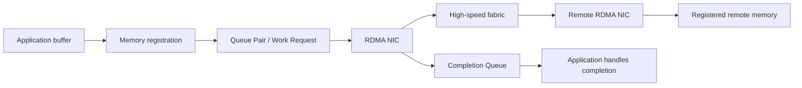
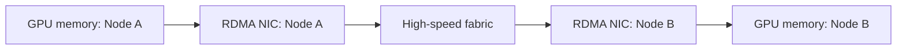

# RDMA, High-Speed Networking, and Cluster Placement Locality

In High-Performance Computing (HPC), the runtime of a distributed workload does not depend solely on CPU or GPU speed. Nodes must exchange data, synchronize, and coordinate over the network. If each compute step takes only a few microseconds while every data exchange takes much longer, a cluster can spend most of its time waiting on the network instead of computing.

**RDMA (Remote Direct Memory Access)** allows one machine to access registered memory regions on another machine via the NIC and network fabric with far less CPU/kernel involvement on the data path than traditional TCP sockets. Combining RDMA with high-speed NICs, suitable network topology, and close node placement can lower latency, raise throughput, and improve scale-out efficiency. These benefits only materialize when the application, drivers, NICs, switches, runtime, and placement configuration all support the right data path.

## 1. Why Does Networking Matter for HPC?

An HPC workload typically divides a problem into multiple parts running concurrently across many CPUs, GPUs, or nodes. Those parts must exchange input data, intermediate results, halos/boundaries, gradients, tensors, or synchronization states.

Common communication patterns:

- **Point-to-point:** one rank/process sends data to another rank/process.
- **Broadcast:** one node distributes the same data to multiple nodes.
- **Reduce:** aggregates data from multiple nodes into a single result.
- **All-reduce:** every node contributes data and receives the aggregated result; common in distributed training.
- **All-to-all:** every node exchanges data with many or all other nodes; typically puts heavy pressure on the fabric.
- **Barrier/synchronization:** nodes wait for one another at a synchronization point.

When communication sits on the critical path, network latency accumulates directly into completion time. For many small exchanges, latency matters more than peak bandwidth. For large tensor or checkpoint transfers, throughput and aggregate bandwidth have a major impact.

A simple model for message transmission time:

\[
T_{message} \approx L + \frac{S}{B}
\]

Where `L` is the fixed path latency, `S` is the data size, and `B` is the effective throughput. This is an approximation; actual time also includes protocol overhead, queueing, congestion, copies, serialization, contention, and processing time at both endpoints.

For small messages, the `L` term dominates. For large messages, the `S/B` term dominates. Consequently, looking solely at NIC link speeds on a spec sheet is insufficient to predict application runtime.

## 2. What Is RDMA?

RDMA enables a NIC to perform data transfers directly to or from registered memory regions on a remote machine. In an appropriate setup, data can move between the memories of two machines without requiring the destination CPU to copy bytes byte-by-byte through the kernel networking stack as traditional sockets typically do.

Key benefits:

- **Low latency:** reduces context switches and kernel processing on the data path.
- **Low CPU overhead:** NICs handle much of the data movement, freeing CPUs for computation.
- **High throughput:** supports high-speed transfers and many concurrent queues/operations.
- **Fewer copies:** some paths allow data to travel directly between application buffers and the NIC or remote memory; the degree of zero-copy depends on implementation and application.
- **Scales well for tightly coupled communication:** valuable when many nodes exchange data frequently and synchronize together.

RDMA does not automatically make an application faster if the workload computes mostly locally, communicates rarely, or is bottlenecked by storage, CPU, GPU, or algorithm design. The application must use an RDMA-capable library/protocol; installing an RDMA-capable NIC does not automatically convert standard TCP sockets into RDMA.

## 3. How RDMA Works Conceptually

The application prepares buffers in memory, registers memory regions with the RDMA subsystem, creates queue pairs, and posts work requests. The NIC uses the registered metadata to read/write data according to granted permissions. Completion queues record operation outcomes so the application knows when buffers can be reused or processing can continue.



Common components in RDMA verbs:

| Component | Role |
|---|---|
| Protection Domain (PD) | Groups related RDMA resources and access permissions |
| Memory Region (MR) | Registered memory range with access permissions and keys |
| Queue Pair (QP) | Communication channel comprising a send queue and receive queue per transport |
| Completion Queue (CQ) | Receives completion events/entries for work requests |
| Work Request (WR) | Describes a send/receive/read/write/atomic operation for the NIC to execute |
| Local/Remote Key | Credentials authenticating access permissions to a memory region within RDMA scope |
| Completion Queue Entry (CQE) | Completion status or error result of an operation |

The application or communication library manages the lifecycle of these resources. Creating and registering too many small memory regions increases overhead; many high-performance applications use pre-registered, reusable buffer pools.

## 4. Memory Registration and Why Arbitrary Access Is Disallowed

The RDMA NIC needs to know which memory regions are permitted for access and how to map those regions for the device. Memory registration typically pins or locks memory page mappings while registered, depending on the OS and driver. This lets the NIC safely access buffers while an operation is in flight.

Important considerations:

- Only registered memory regions with matching permissions can be used for RDMA operations.
- Registration/unregistration carries overhead; avoid repeating it per small message when buffer pooling is possible.
- Pinning too much memory reduces OS page reclaim flexibility and can impact system stability.
- Page sizes, IOMMU, DMA mappings, huge pages, and locked memory limits can affect performance or registration capacity.
- Buffers must not be freed or reused before the operation completes.
- Applications must manage lifetimes, alignment, and access permissions accurately.

Huge pages can reduce page translation/TLB pressure in some workloads, though they are not mandatory for every RDMA deployment. Benchmark and verify OS, NIC driver, runtime, and cloud platform support before enabling them.

## 5. RDMA Operation Types

RDMA APIs provide several common operation types:

- **Send/Receive:** the sender posts data to a send queue; the receiver prepares a receive buffer. Both sides coordinate to transfer a message.
- **RDMA Write:** the sender writes data directly into a registered memory region on the remote host using granted remote-write permissions.
- **RDMA Read:** the sender reads data directly from a registered memory region on the remote host using granted remote-read permissions.
- **Atomic operations:** some transports/NICs support atomic operations on authorized memory regions, such as compare-and-swap or fetch-and-add.

Send/Receive generally fits two-sided coordinated message passing. RDMA Read/Write can eliminate remote CPU processing steps, but demand meticulous management of memory keys, access rights, and synchronization. Atomic operations have constraints on data types, alignment, ordering, and hardware support.

One-sided RDMA does not mean an application needs no protocol. Both sides must still agree on addresses/offsets, keys, buffer states, ownership, and when data is valid. Faulty synchronization causes stale reads, overwrites, or race conditions.

## 6. Network Technologies Supporting RDMA

RDMA can run across several fabric types. Three commonly referenced technologies are:

| Technology | Transmission medium | General characteristics |
|---|---|---|
| InfiniBand | Dedicated InfiniBand fabric | Long-standing HPC ecosystem with native RDMA and dedicated fabric management |
| RoCE (RDMA over Converged Ethernet) | Ethernet | Brings RDMA to Ethernet; RoCEv2 runs over UDP/IP and can be routed over IP networks |
| iWARP | TCP/IP | RDMA over TCP, capable of traversing existing IP/TCP infrastructure with varying deployment support |

Not every Ethernet NIC supports RoCE, and not every cloud network offers RDMA. Verify whether the instance type, NIC, drivers, OS image, network fabric, and cluster service support it.

### InfiniBand

InfiniBand is widely used in HPC clusters and AI systems demanding low latency, high throughput, and massive collective communication. The fabric has its own subnet manager and topology management. Performance depends on switch configuration, links, rails, firmware, and how applications utilize NICs.

### RoCE

RoCE leverages Ethernet but requires proper congestion control and loss-behavior design. In many deployments, PFC (Priority Flow Control) is used to curb frame drops for RDMA traffic classes; ECN (Explicit Congestion Notification) and control algorithms like DCQCN help react to congestion. Misconfigured PFC can cause head-of-line blocking or pause propagation; misconfigured ECN/congestion control can cause oscillating throughput or packet drops.

RoCEv1 is typically confined to a Layer 2 domain, whereas RoCEv2 encapsulates via UDP/IP and can route at Layer 3. However, practical routing capability still depends on fabric design, MTU, QoS, switches, and NIC configuration.

### iWARP

iWARP uses TCP/IP to carry RDMA, allowing it to leverage some existing IP infrastructure. Adoption and support across cloud HPC platforms tend to be lower than InfiniBand or RoCE. Do not choose it solely for TCP compatibility; evaluate performance, NICs, OS, and application library support.

## 7. RDMA vs. Standard TCP Sockets

| Criterion | TCP socket | RDMA |
|---|---|---|
| Common API | Berkeley sockets | RDMA verbs or abstraction libraries |
| Data path | Usually traverses kernel networking stack | NIC handles many operations directly on registered memory |
| CPU overhead | Can be higher due to protocol stack and copies | Typically lower for suitable workloads |
| Latency | Depends on stack, congestion, and tuning | Can be substantially lower on supported fabrics |
| Buffers | Standard socket buffers | Memory regions must be registered and permission-managed |
| Application complexity | Usually easier to implement and debug | Managing QPs, CQs, MRs, keys, and synchronization is more complex |
| Compatibility | Broad, works across most networks | Requires compatible NICs, drivers, fabric, and runtime |
| Use cases | APIs, web services, control planes, general traffic | MPI, distributed training, storage/HPC, and latency-sensitive exchanges |

RDMA does not need to replace TCP for all traffic. Control planes, health checks, metadata, logging, and general traffic can continue using TCP/IP. A cluster can use distinct network paths for different traffic classes.

## 8. MPI, UCX, libfabric, and Application Libraries

HPC applications rarely invoke raw RDMA verbs directly for every operation. Communication libraries provide abstractions and select suitable transports:

- **MPI (Message Passing Interface):** standard communication model for distributed parallel programs; implementations can use RDMA when supported by the environment.
- **UCX (Unified Communication X):** high-performance communication framework providing transport abstractions across diverse devices and networks.
- **libfabric:** fabric abstraction API used across many HPC stacks.
- **NCCL:** collective communication library for GPUs, capable of leveraging GPU-aware and RDMA paths where supported.
- **GASNet and other runtimes:** provide communication abstractions for specialized parallel computing models.

Simply installing a library does not guarantee the application is using RDMA. A runtime may silently fall back to TCP if it cannot find the required NIC, provider, or configuration. Inspect startup logs, selected transports, active interfaces, and benchmarks to confirm the actual data path.

## 9. GPUDirect RDMA and Inter-Node GPU Communication

In AI/HPC workloads, data often needs to move from a GPU on one node to a GPU on another node. **GPUDirect RDMA** allows a NIC to access GPU memory directly on supported hardware/software stacks, reducing the need to stage data through host memory.

Conceptual path:



Benefits depend on GPU, NIC, PCIe topology, drivers, CUDA/runtime, kernel modules, and collective libraries. Not all GPU instances support GPUDirect RDMA; some platforms support it only intra-host or restrict it to specific instance families.

Distinguish:

- **NVLink/NVSwitch:** high-speed interconnect between GPUs within the same machine or supported hardware domain.
- **PCIe:** connects GPUs, NICs, and CPUs inside a host; topology/NUMA impacts transfer paths.
- **RDMA fabric:** connects distinct nodes across the cluster network.
- **GPUDirect RDMA:** optimizes the path between NIC and GPU memory across the fabric when supported by hardware/software.

Never treat NVLink as a default inter-node network, nor assume RDMA automatically eliminates all host copies. Measure the framework's actual transfer path and verify topology with vendor tools.

## 10. Latency, Bandwidth, and Message Rate

Distinguish three metrics:

- **Latency:** time from send initiation until data/operation completion is observed at the receiver. In HPC, microseconds and tail latency are key concerns.
- **Bandwidth/throughput:** volume of data transferred per second, usually measured in Gb/s or GB/s.
- **Message rate/IOPS:** messages or operations per second; critical for small messages and high request rates.

A 200 Gb/s NIC does not mean an application always sustains 25 GB/s. Real-world throughput is bounded by protocol overhead, PCIe, CPU, memory bandwidth, switch oversubscription, congestion, queue counts, and access patterns.

When measuring, document:

- Message size and concurrent operation count.
- Unidirectional vs. bidirectional; single node pair vs. multi-node.
- Average latency, p95/p99, and variance.
- Per-flow throughput and cluster-wide aggregate throughput.
- CPU utilization, context switches, and NIC utilization.
- Warm-up, iteration count, and benchmark duration.
- Whether GPU memory, host memory, or pinned buffers are used.

Microbenchmarks can post impressive numbers while the real application still runs slowly due to differing communication patterns, synchronization, imbalance, or serialization. Measure both network primitives and end-to-end applications.

## 11. Network Topology and Bisection Bandwidth

Clusters typically connect nodes via leaf/spine or Clos fabrics. An oversubscribed topology means total access-side bandwidth exceeds what uplinks can serve simultaneously. When many nodes transmit across uplinks at once, actual throughput is shared.

**Bisection bandwidth** describes the minimum aggregate bandwidth between two halves of a network when cutting the topology into two roughly equal groups of nodes. This metric helps assess capacity for all-to-all traffic or widely distributed communication patterns.

Key concepts:

- **Non-blocking fabric:** design capable of delivering target port-to-port bandwidth under configuration assumptions.
- **Oversubscription ratio:** ratio of aggregate server-facing bandwidth to uplink bandwidth; e.g., 4:1 means access bandwidth is four times uplink bandwidth per the design calculation.
- **Leaf-spine:** each leaf connects to spines; inter-leaf traffic traverses spines.
- **Rail-optimized topology:** multiple independent or parallel network rails to boost bandwidth and reduce contention for HPC.
- **ECMP:** distributes flows across multiple equal-cost paths; effectiveness depends on hashing and traffic patterns.

A cluster with co-located nodes on a heavily oversubscribed fabric can still congest. Conversely, a strong fabric cannot fully compensate for placement that forces traffic repeatedly across distant network tiers or domains.

## 12. Cluster Placement Locality

Placement locality means positioning nodes that exchange data frequently close together topologically or within a fault domain to minimize hops, latency, and contention. "Close" can mean several levels:

1. Same host: communication can traverse shared memory, PCIe, or internal interconnects rather than the network fabric.
2. Same rack/leaf switch: can reduce hop count and avoid certain uplink aggregations.
3. Same cluster/placement group: the platform attempts to place instances in a topology suited for low-latency or high-throughput workloads.
4. Same availability zone: can reduce latency and cross-zone transfer fees depending on cloud architecture.
5. Same region, different zones: improves fault isolation but can increase latency and data transfer costs.

Placement locality must be balanced against availability. Putting all nodes in one rack lowers latency but expands the blast radius if a rack or switch fails. Putting all nodes in one AZ lowers AZ-level fault tolerance. Tightly coupled HPC jobs typically need nodes within the same placement group; stateful HA services need replicas spread across fault domains.

Never assume cloud users can hand-pick physical racks or switches. Many platforms only expose placement groups, cluster placement, dedicated hosts, or instance families with defined network performance. Read the service's placement guarantees rather than inferring behavior from feature names.

## 13. Placement Groups and Cluster Placement on the Cloud

Some cloud providers offer placement groups or cluster placement policies to try co-locating VMs physically in the infrastructure. Goals may include lowering network latency, increasing the likelihood of reaching peak throughput, or enabling high-performance network adapters.

When using placement features, check:

- Supported scope: which zones, regions, host groups, or instance types.
- Limits on allowed instance counts and machine types.
- Behavior when capacity is constrained; retries or instance type changes may be needed.
- Whether RDMA/EFA/InfiniBand/RoCE is supported or only standard network optimization.
- Scale-out limits once a group approaches capacity.
- Behavior during stop/start, replacement, or instance resizing.
- Impact on availability and failure domains.

Placement groups can improve locality but do not guarantee fixed latency or absolute bandwidth. Benchmark after cluster creation and monitor network performance under concurrent load.

## 14. NUMA, PCIe, and NIC Affinity

Multi-socket machines can contain multiple NUMA nodes. CPU cores, memory banks, and PCIe devices usually have specific locality. If a process runs on a CPU in NUMA node 0 while its buffer or NIC sits on NUMA node 1, data must cross inter-socket links, raising latency and consuming internal bandwidth.

Points to observe:

- Which PCIe root complex/NUMA node the NIC attaches to.
- Which NUMA node owns the CPU cores running network and application threads.
- Which node allocates the buffer memory.
- Whether IRQ/NAPI and queue affinity align properly.
- Whether GPUs and NICs connect directly via PCIe or cross another switch/root complex.
- Whether PCIe links or memory controllers are oversubscribed.

On Linux, tools like `lscpu`, `numactl --hardware`, `lspci -tv`, `numastat`, and `ethtool -i` help inspect topology. Pinning CPUs, memory, or IRQs should be benchmark-driven; poor pinning can break scheduler balancing or create hotspots.

## 15. Placing Ranks/Processes and GPUs by Topology

In MPI or distributed training, process placement should match node topology:

- Place heavily communicating ranks on the same node if the workload benefits from shared memory.
- Map ranks to the nearest NUMA node and NIC when multiple NICs/rails exist.
- Pair GPUs with CPUs/NICs according to PCIe topology.
- Avoid multiple ranks contending for the same NIC queue or CPU core.
- Distribute processes by physical cores, memory bandwidth, and GPUs—not vCPU count alone.
- Verify affinity after the scheduler/container runtime places the workload.

For MPI, mapping/binding flags depend on the implementation such as Open MPI, MPICH, or vendor MPI. For GPU collectives, NCCL topology detection and transport selection impact performance. Never copy a `--bind-to` command or NCCL configuration across platforms without verifying it.

## 16. Congestion Control and QoS

When multiple flows share a fabric, congestion increases latency and reduces throughput. RDMA is not immune to congestion; in fact, some workloads are more sensitive to tail latency than standard TCP.

Mechanisms you may encounter:

- **PFC:** priority-based Ethernet pause to curb frame drops for specific traffic classes. Requires consistent end-to-end configuration and careful prevention of unintended pause propagation.
- **ECN:** marks packets when switch queues cross a threshold so senders throttle back before packet drops occur.
- **DCQCN:** a congestion control mechanism commonly used in RoCE deployments.
- **QoS/traffic classes:** classifies RDMA, control-plane, and standard traffic to manage priorities.
- **Adaptive routing/ECMP:** distributes flows across multiple paths, depending on fabric capabilities.

PFC is not a complete congestion solution. Misconfiguration can trigger head-of-line blocking, pause storms, or deadlocks. ECN thresholds, queue buffers, MTU, and NIC rate control must be configured in unison per fabric vendor guidelines.

In managed cloud networks, users typically cannot access switches directly to tune PFC/ECN. Instead, use supported instance/NIC profiles and collect platform-exposed metrics.

## 17. Security and Isolation for RDMA

RDMA grants NICs access to registered memory regions. Therefore, permission management and isolation are critical:

- Use properly scoped protection domains, memory keys, and access permissions.
- Expose only necessary memory regions; never grant broader remote read/write permissions than required.
- Authenticate and establish QPs using the fabric/runtime's security mechanisms.
- Isolate tenant workloads using network partitions, security policies, or cloud isolation features.
- Protect the control plane and metadata channels used to exchange addresses/keys.
- Revoke keys and deregister memory when workloads terminate.
- Keep drivers, firmware, kernels, and communication libraries updated.
- Never treat a private RDMA fabric as a substitute for IAM, encryption, or application access controls.

Wire encryption capabilities depend on NIC/fabric technology and cloud service offerings. If sensitive data requires encryption, verify hardware encryption support or encrypt at the application layer; encryption can affect throughput/latency and should be benchmarked.

## 18. When Should You Use RDMA?

RDMA is typically beneficial when:

- Multiple nodes exchange data frequently and low latency heavily impacts completion time.
- MPI collectives, halo exchanges, or distributed training dominate communication time.
- Network-stack CPU overhead bottlenecks throughput.
- The workload transfers many small messages or large volumes with strict performance targets.
- Applications and libraries already have stable RDMA support.

RDMA may be unnecessary when:

- The workload computes mostly locally with minimal communication.
- Traffic consists mainly of standard HTTP/API calls.
- Node counts are small and TCP throughput already meets SLOs.
- The application lacks RDMA support and porting/testing cost outweighs the gain.
- The target cloud region/instance lacks a suitable fabric.
- The real bottleneck sits in storage, GPU compute, serialization, or the algorithm.

Before investing, measure the share of runtime spent in communication, CPU network overhead, latency, and throughput. If networking accounts for only 2% of runtime, switching fabrics may yield minimal overall improvement.

## 19. Benchmarking and Verifying the RDMA Path

Proceed systematically from device checks to application testing:

1. Confirm the instance/host has an RDMA-capable NIC and fabric.
2. Verify drivers, firmware, kernel modules, and device nodes.
3. Check interface/link state, GID/port, and MTU per technology.
4. Run latency, bandwidth, and message-rate microbenchmarks between two nodes.
5. Scale up node/flow counts to test fabric congestion and oversubscription.
6. Verify MPI/UCX/libfabric/NCCL selects the RDMA transport instead of falling back to TCP.
7. Run the real workload and measure communication time and end-to-end runtime.
8. Compare placement within the same group against standard placement if supported by the platform.
9. Repeat at different times and under concurrent load to detect variance.

Some Linux tools that may be useful, depending on driver and fabric:

```bash
# Check CPU and NUMA topology
lscpu
numactl --hardware

# Check PCIe and NIC driver
lspci -tv
ethtool -i eth0

# Check RDMA device and link (if toolkit is installed)
ibv_devinfo
ibstat
rdma link

# Verbs microbenchmarks (tool names depend on installed package)
ib_write_bw
ib_read_lat
ib_send_lat
```

Interface names, tools, and required privileges vary by distribution and vendor. `ibstat`/`ibv_devinfo` are not preinstalled on every machine. For RoCE, also check GIDs, MTU, NIC counters, ECN/PFC counters, and switch telemetry if authorized.

### Checking for TCP Fallback

A passing benchmark alone does not prove RDMA is active. Verify:

- Communication library startup logs and selected transport/provider.
- Actual RDMA interface or device being used.
- NIC and fabric counters incrementing during the benchmark.
- Whether the TCP interface is carrying the bulk of data traffic.
- Performance comparison when disabling/excluding the RDMA transport in a controlled test environment.

Never disable production network interfaces to test fallback. Use staging or test nodes.

## 20. Optimizing Placement by Communication Pattern

Not all nodes in a job communicate uniformly. Placement should follow the communication graph:

- For frequent point-to-point between specific rank pairs, place those pairs close together if it does not create hotspots.
- For all-reduce, choose topologies matching ring/tree algorithms and rail counts.
- For all-to-all, pay attention to bisection bandwidth, oversubscription, and congestion.
- For partitioned data, place compute near storage or data shards if it lowers traffic.
- For multi-GPU, map ranks to match NVLink/PCIe/NUMA and NIC topology.

A job may split into densely communicating node subgroups. If the platform supports cluster placement groups, those subgroups can sit within a placement domain. However, tight co-location also shrinks fault isolation. For jobs capable of restarting from checkpoints, accepting a concentrated domain may be sensible; for continuous-HA services, favor broader fault-domain distribution.

## 21. Example: Multi-Node MPI Workload

A CFD simulation runs across 16 nodes. Each node has many cores and the application splits the domain into partitions. Every iteration, ranks exchange halo data with neighboring partitions and compute the next step.

If nodes use standard TCP and CPUs handle heavy packet/copy work, communication overhead can rise as node count grows. A setup with RDMA-capable NICs, an RDMA-enabled MPI stack, and close placement can cut latency and CPU overhead.

Testing workflow:

1. Run a baseline on the current network config; record runtime, CPU utilization, and communication time.
2. Confirm all nodes share the same supported NIC/fabric type.
3. Install compatible driver and MPI/UCX/libfabric versions.
4. Place nodes in an appropriate placement domain if supported by the cloud.
5. Verify process binding aligns with NUMA/NIC.
6. Run microbenchmarks and confirm the RDMA data path.
7. Re-run the simulation with identical inputs, rank counts, and compiler flags.
8. Compare runtime, tail latency, CPU overhead, and scalability efficiency.
9. Test scaling node counts and behavior when a node/network path fails.

If runtime does not improve, inspect partition imbalance, collective algorithms, memory bandwidth, storage I/O, and synchronization frequency. RDMA cannot fix an imbalanced work partitioning algorithm.

## 22. Example: Distributed AI Training

In distributed training, each GPU computes gradients on a local mini-batch. GPUs then require collective communication to synchronize gradients or parameters. Across many nodes, all-reduce can become the bottleneck.

A high-performance design can combine:

- GPUs and NICs supporting GPUDirect RDMA.
- High-speed fabric with optimized topology and congestion control.
- NCCL or communication runtime aligned with driver/CUDA/NIC versions.
- Node placement inside a supported cluster/placement group.
- GPU/NIC/CPU mapping aligned with PCIe and NUMA.
- Tuned batch sizes, gradient bucketing, and compute/communication overlap.

Measure metrics such as step time, all-reduce time, GPU utilization, NIC throughput, and scaling efficiency. If GPU utilization drops while waiting on all-reduce, networking or communication scheduling may be the culprit. If GPU utilization stays high yet step time remains long, analyze kernels, memory, and the input pipeline.

Not every training workload needs RDMA. Small models, low GPU counts, or low communication volume can run well on standard networking.

## 23. Scaling Efficiency and Bottlenecks When Adding Nodes

Adding nodes does not guarantee proportional runtime reduction. One simple metric:

\[
E_{scale} = \frac{T_1}{N \times T_N}
\]

Where `T_1` is the runtime with one compute unit, and `T_N` is the runtime with `N` compute units; `E_scale` close to 1 indicates high strong-scaling efficiency under this definition. Keep inputs and measurement methodology consistent.

As nodes scale out, efficiency can drop due to:

- Growing communication volume.
- Synchronization and barrier wait times.
- Network oversubscription/congestion.
- Load imbalance across ranks.
- Storage or shared filesystems failing to keep pace.
- Suboptimal CPU/NIC/PCIe/NUMA affinity.
- Startup, orchestration, and checkpoint overhead.

RDMA and placement locality reduce portions of network overhead, but do not eliminate algorithmic synchronization or imbalance costs.

## 24. Troubleshooting RDMA Networking and HPC Clusters

When performance drops or RDMA connections fail, investigate layer by layer:

**Device and driver**

- Is the NIC visible with the expected firmware?
- Are drivers and kernel modules compatible?
- Is the RDMA device/port active at the expected link speed?
- Are there PCIe errors, resets, or firmware events?

**Fabric and network path**

- Are MTU/GID/VLAN/routes consistent?
- Are switch ports showing errors, drops, pauses, or congestion?
- Are PFC/ECN/QoS configured uniformly?
- Is there oversubscription or ECMP imbalance?
- Are nodes inside the expected placement domain?

**Application and runtime**

- Did MPI/UCX/libfabric/NCCL select the intended RDMA provider?
- Were QPs/CQs/MRs created and registered cleanly?
- Were memory registration limits or locked memory limits hit?
- Are buffer lifetimes and synchronization handled correctly?
- Did it silently fall back to TCP?
- Are rank mapping, CPU affinity, and NUMA placement sensible?

**Performance measurement**

- Does latency spike on small messages or bandwidth drop on large messages?
- Is a single node pair slow or the entire fabric slow?
- Does it occur only under multi-job contention or even when idle?
- Are CPU/network threads throttled or contending?
- Were there recent image, driver, firmware, or placement changes?

Change one configuration group at a time and preserve baselines. For managed fabrics, provide the vendor with timestamps, node/instance IDs, NIC counters, benchmark commands, and observed topology; avoid guessing switch settings you do not control.

## 25. Common Mistakes

- **Assuming a fast NIC means the app uses RDMA:** the runtime may be falling back to TCP. Verify transport and NIC counters.
- **Measuring bandwidth and assuming low latency:** these are distinct metrics. Measure latency with small message sizes and tail percentiles.
- **Registering memory per message:** drives up registration overhead. Reuse buffer pools when appropriate.
- **Pinning too much memory:** impairs OS memory reclaim. Register only needed regions and monitor locked memory.
- **Treating RDMA as absolute zero-copy:** some paths still stage or copy data. Check implementation details and profilers.
- **Enabling PFC without congestion control design:** can cause pause storms or head-of-line blocking. Use supported fabric configurations.
- **Putting all nodes in one rack for lower latency:** expands the blast radius. Balance locality with failure domains.
- **Assuming placement groups guarantee rack adjacency or fixed latency:** semantics vary by provider. Verify documented support scope.
- **Ignoring NUMA/PCIe:** distant NICs, CPUs, and buffers add internal latency. Check topology and affinity.
- **Confusing NVLink with inter-node RDMA:** each serves a different interconnect tier. Design GPU-local and network paths appropriately.
- **Scaling node count without measuring the fabric:** oversubscription and all-to-all congestion erode efficiency. Run end-to-end tests at target scale.
- **Running only microbenchmarks:** results may not reflect real workloads. Always run application benchmarks.

## 26. HPC Cluster Design Checklist

- [ ] Analyzed communication patterns: point-to-point, broadcast, reduce, all-reduce, all-to-all, and synchronization.
- [ ] Determined whether RDMA is genuinely needed based on communication time and CPU overhead.
- [ ] NICs, drivers, firmware, OS, fabric, and cloud instances all support the same RDMA technology.
- [ ] Selected InfiniBand, RoCE, or iWARP and verified fabric semantics.
- [ ] Verified applications/libraries use the intended RDMA provider without unexpected fallback.
- [ ] Memory registration, buffer lifetimes, locked memory, and key permissions are properly managed.
- [ ] Benchmarked latency, bandwidth, message rate, and tail latency.
- [ ] Checked NUMA, PCIe, NIC/GPU affinity, and process binding.
- [ ] Placement locality matches the communication graph without creating an overly concentrated failure domain.
- [ ] Accounted for bisection bandwidth, oversubscription, rails, and congestion when scaling nodes.
- [ ] RoCE PFC/ECN/QoS or fabric policies match supported guidelines.
- [ ] Security isolation, memory access keys, encryption, and firmware updates are controlled.
- [ ] Tested with real workloads, multi-node runs, and concurrent jobs.
- [ ] Monitored network counters, errors/drops, congestion, application communication time, and scaling efficiency.
- [ ] Established baselines, troubleshooting runbooks, and escalation workflows with the cloud/provider for managed fabrics.

RDMA, high-speed networking, and placement locality help HPC clusters reduce latency, boost throughput, and lower CPU overhead for inter-node communication. Effectiveness depends on the entire path from application buffers, runtime, NICs, and PCIe/NUMA to the switch fabric and physical node placement. By targeting the right workloads, verifying the RDMA data path, measuring both microbenchmarks and real applications, and balancing locality with fault isolation, clusters can scale effectively while keeping operational risk under control.
