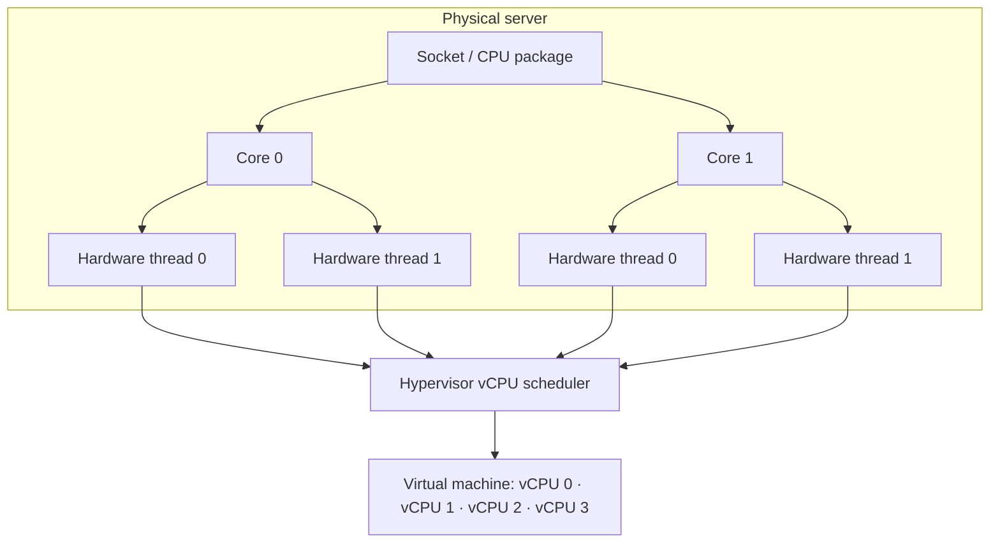

# vCPU, Core, Thread, and How to Interpret Virtual Machine Configurations

When creating a virtual machine in the cloud, the configuration typically displays specifications such as 2 vCPUs, 8 vCPUs, or 16 vCPUs. These numbers indicate the amount of logical processing capacity allocated to the virtual machine, but they do not automatically tell you how many physical cores the machine uses, how many hardware threads exist, or how much CPU capacity is guaranteed per vCPU.

To choose the right configuration, you need to understand the relationship between **socket, core, hardware thread, and vCPU**; how the hypervisor schedules CPU; and how providers describe instance types. A virtual machine with more vCPUs is not necessarily faster than one with fewer vCPUs that uses a newer CPU generation, higher clock speed, or dedicated resources. The final decision must be based on workload characteristics and actual measurements.

## 1. CPU Structure from Hardware to Virtual Machine

### Socket and CPU Package

A socket is the physical connector for a CPU package on the motherboard. A server can have one or more sockets. A modern CPU package can contain one or more dies, memory controllers, cache clusters, and multiple processing cores. In operations documentation, the term *socket* is often used to refer to a physical CPU installed on a server.

Socket count can affect NUMA architecture, memory bandwidth, RAM access latency, and commercial software licensing. However, more sockets do not automatically make an application run faster; performance also depends on parallelizability and how data is laid out across nodes.

### Core (Physical Core)

A core is a physical processing unit inside a CPU. Each core has execution resources to decode and run instructions. A CPU package can have multiple cores; for example, a two-socket server with 24 cores per socket has a total of 48 physical cores.

When a workload needs to process multiple independent tasks simultaneously, multiple cores can execute work streams in parallel. However, a single-threaded application typically cannot utilize all cores. For such an application, single-core processing speed, memory latency, and per-cycle performance can matter more than total core count.

### Hardware Thread and SMT

A core can provide one or more hardware threads. Simultaneous Multithreading (SMT) technology, called Hyper-Threading by Intel on certain CPU families, allows a core to maintain the state of multiple threads and share the core's execution resources among them.

For example, an 8-core CPU with 2-way SMT can present 16 logical processors to the operating system. Two logical processors on the same core are not equivalent to two independent physical cores: they share parts of the resources such as execution units and cache. SMT can improve core utilization when one thread is waiting for data, but the performance gain depends on the workload and can be much lower than double.

Terms to distinguish:

- **Core:** physical processing core.
- **Hardware thread:** hardware execution context that a core can run; a core can have one or more hardware threads.
- **Logical processor:** processing unit seen and scheduled by the operating system. On a physical machine with SMT, each hardware thread typically appears as a logical processor.

### vCPU (Virtual CPU)

A vCPU is a logical CPU unit presented by the hypervisor or virtualization platform to a virtual machine. The guest OS sees these logical processors and schedules processes and application threads onto them just as an operating system runs on a CPU.

On the host side, the hypervisor schedules vCPU execution time onto physical logical processors. The mapping can change over time and according to platform policies. A vCPU is not necessarily pinned to a physical core, nor is it guaranteed exclusive use of a hardware thread by default.

The layers can be visualized as follows:



The diagram only illustrates a simplified mapping. In real environments, a host can have more sockets, cores, and hardware threads; a VM can also be scheduled across different logical processors over time.

## 2. Is a vCPU Equivalent to a Physical Core?

There is no single convention that applies across all cloud providers. You must read the instance type definition and the service's CPU policy. Common models include:

1. **One vCPU corresponds to one hardware thread.** On a host with 2-way SMT, 2 vCPUs may be mapped to two hardware threads belonging to the same physical core. Thus, 8 vCPUs may correspond to 4 physical cores with 2-way SMT in an illustrative configuration.
2. **One vCPU corresponds to one physical core.** Some services disable SMT or define vCPUs per core to provide dedicated CPU capacity. In this case, the number of vCPUs and physical cores may be equal per the service's commitment.
3. **Time-shared vCPUs.** Multiple VMs can share processing time on the same physical resources. The hypervisor allocates CPU time slices to each vCPU. The level of contention and performance limits depend on host and instance-type policies.

Therefore, the statement "the VM has 8 vCPUs" only indicates that the guest is presented with 8 logical processing units. To understand actual capacity, you must also check:

- whether a vCPU is a hardware thread, a core, or a shared unit according to the service definition;
- whether the CPU is shared or dedicated, and whether there is pinning or runtime limits;
- whether the host has SMT enabled and how the provider allocates sibling threads;
- the CPU model, CPU generation, instruction set architecture, and clock speed provided;
- whether there is a burst mechanism, CPU credits, power limits, or throttling policies under sustained load.

A service may publish the exact vCPU count without disclosing the host's physical topology. This is a normal design choice in multi-tenant clouds. If an application needs to know or control physical cores, you must select a service that guarantees dedicated cores, host placement, or bare metal and verify the scope of the guarantee in the provider's documentation.

## 3. Shared CPU, Dedicated CPU, and Burst Capability

### Shared CPU

In a shared CPU configuration, multiple VMs can share the host's capacity. The hypervisor divides processing time among vCPUs according to its scheduler and platform policies. When the host is lightly loaded, a VM can achieve good performance; when many workloads are active simultaneously, scheduling wait time can increase.

On Linux, the `%steal` metric in some virtualization environments indicates the time a vCPU is ready to run but must wait for the hypervisor to allocate CPU. On other platforms, providers may expose CPU ready, CPU contention, or an equivalent metric. The exact name and calculation depend on the hypervisor.

### Dedicated CPU

With dedicated vCPUs or dedicated cores, the provider commits to a dedicated CPU allocation as defined by the service. The commitment may be CPU time, physical cores, hardware threads, or pinning. Marketing terms such as *dedicated*, *reserved*, or *isolated* are not sufficient to infer the exact model; you need to check the technical documentation.

Dedicated CPUs usually provide more predictable performance under sustained high load or for latency-sensitive workloads. In return, costs are typically higher and resources can go unused when the application is lightly loaded. A dedicated host also does not automatically mean every vCPU of a VM is pinned to an exclusive physical core; the scope of isolation must be verified separately.

### Burstable CPU and CPU Credits

Some instances are designed to maintain a low baseline CPU level while being able to burst higher for short periods. The platform may use a CPU credit mechanism: the VM accumulates credits when running below the baseline and consumes credits when bursting above it. Once credits are depleted, performance may be throttled down to the baseline or a provider-defined level.

Burstable instances are suitable for development servers, low-load background services, small websites, or workloads with short spikes and long idle periods. They may not be suitable for continuous video processing, multi-hour data analytics, or databases that consistently use high CPU. When choosing this instance type, you must examine the CPU baseline, how credits are earned and spent, burst limits, and sustained-performance behavior when credits run out.

## 4. vCPU Count Is Not the Whole Story for CPU Performance

When comparing two instances, do not look only at vCPU count. Performance is also influenced by the following factors:

| Factor | Meaning when selecting a machine |
|---|---|
| CPU architecture | x86-64 and ARM64 have different instruction sets and compatibility; verify images, binaries, libraries, and monitoring agents |
| CPU generation | Newer CPUs can improve performance per cycle, memory bandwidth, and instruction sets even with the same vCPU count |
| Clock speed | Base and turbo frequencies vary with load, temperature, power limits, and provider policies |
| SMT | Increases the number of logical processors a core presents, but threads on the same core share resources |
| Cache | Cache size and latency affect workloads with repeatedly accessed datasets |
| NUMA and memory | Accessing RAM on a remote node can increase latency; vCPU and RAM placement must match topology |
| Accelerator instructions | AVX2, AVX-512, AES-NI, or other extensions can accelerate certain tasks if the software uses them |
| Sharing policy | CPU contention, power limits, and burst mechanisms affect sustained capacity |

A core running at a higher clock speed is not always faster than one at a lower clock speed: architecture, instructions per cycle (IPC), cache, and vectorization capabilities also matter. Similarly, a maximum turbo specification does not mean all cores will sustain that frequency over long periods.

### NUMA and VM Topology

Multi-socket servers are typically organized into NUMA (Non-Uniform Memory Access) nodes. Each node has a group of cores and a region of memory attached closely to it. A CPU accessing local memory generally has lower latency than accessing memory belonging to another node.

When a large VM has many vCPUs and RAM, the hypervisor must place resources appropriately on the host. Some platforms allow choosing vCPU topology or NUMA optimization; others manage it automatically without exposing details. If a VM has many vCPUs but the workload frequently accesses remote RAM, performance can degrade even when CPU utilization has not reached 100%.

The topology seen by the guest OS can also affect the scheduler and software licensed or limited by socket or core. For example, an 8-vCPU VM can be presented as 1 socket × 8 cores × 1 thread or 2 sockets × 4 cores × 1 thread. The total vCPU count is the same, but how the guest OS and certain software interpret the topology can differ. Only adjust topology when you understand the operating system requirements, application behavior, and licensing terms.

## 5. How to Read Cloud Instance Specifications

An instance selection page or machine specification table usually contains many fields. Read them in groups rather than relying on the instance name.

| Field | What to understand | Questions to verify |
|---|---|---|
| Family | Optimization target: general purpose, compute optimized, memory optimized, storage optimized, GPU | Does the workload match the characteristics the family optimizes for? |
| Size | Resource tier within a family | Does increasing size scale CPU and RAM linearly? |
| vCPU | Number of logical processors allocated to the guest | Is the vCPU shared or dedicated? What is the vCPU definition? |
| Memory | Amount of RAM allocated | Does it fit the application's working set and cache? |
| CPU model / architecture | CPU family, generation, x86-64 or ARM64 | Are binaries, libraries, and software compatible? |
| CPU credits / baseline | Baseline performance level and burst capability | Does the workload run at high CPU continuously? |
| Network bandwidth | Nominal or maximum network bandwidth | Is this guaranteed or "up to"? Are there packet-per-second limits? |
| Local storage / accelerator | Local NVMe, GPU, or hardware accelerators | Is data persistent? Are custom drivers or runtimes required? |
| Placement / tenancy | Shared host, dedicated host, or placement group | Are there host isolation or specific topology requirements? |
| Billing | Per second, hour, month, reservation, or usage-based | What is the cost when running continuously vs. when idle? |

### Example of Interpreting a Configuration

Suppose a service table describes an instance as follows:

| Attribute | Example value |
|---|---|
| Family | Compute optimized |
| CPU architecture | x86-64 |
| vCPU | 8 |
| Memory | 32 GiB |
| Network | Up to 10 Gbps |
| CPU allocation | Shared |
| Local disk | None |

You can conclude that the VM is presented with 8 vCPUs and 32 GiB of RAM, corresponding to a ratio of 4 GiB of RAM per vCPU. The compute-optimized family indicates the provider targets this instance at workloads requiring relatively more CPU. However, the table above **does not** prove the VM has 8 physical cores, nor does it prove the network always achieves 10 Gbps. The phrase "up to" usually denotes a maximum under specific conditions; you need to read baseline limits, packet-per-second caps, and sharing policies to know actual performance.

When comparing this with an 8-vCPU, 64 GiB RAM instance, the vCPU count is identical while the RAM-to-vCPU ratio is doubled. The second machine may be better suited for a database keeping a large working set in memory; the first may be more economical for compute processing with lower RAM usage. Even so, you must also compare CPU generation, benchmarks, networking, and pricing, because the same vCPU count does not guarantee the same processing power.

## 6. Checking the CPU Seen by the Guest Operating System

Commands inside the guest OS help verify the number of logical processors and the topology the VM presents. They do not necessarily reveal the exact number of physical cores or how the provider shares the host.

### Linux

```bash
# Total number of logical CPUs seen by the operating system
nproc

# Socket, core, thread, and NUMA information
lscpu

# View each logical CPU and its core/socket/node relationship
lscpu -e=CPU,CORE,SOCKET,NODE,ONLINE

# Monitor CPU utilization per logical processor
mpstat -P ALL 1

# Observe processes and CPU usage over time
pidstat -u 1
```

In `lscpu` output, the fields `CPU(s)`, `Socket(s)`, `Core(s) per socket`, and `Thread(s) per core` describe the topology presented to the guest OS. For example, `CPU(s): 8`, `Socket(s): 1`, `Core(s) per socket: 4`, `Thread(s) per core: 2` shows that the guest sees 8 logical processors presented as 4 cores with 2 threads/core. This is the virtual topology exposed by the VM; you cannot conclude from it that the physical host dedicates exactly 4 cores to the VM.

### Windows

```powershell
# Core and logical processor info for each CPU recognized by the OS
Get-CimInstance Win32_Processor |
  Select-Object Name, NumberOfCores, NumberOfLogicalProcessors

# Total logical processors on the machine
Get-CimInstance Win32_ComputerSystem |
  Select-Object NumberOfLogicalProcessors
```

The CPU name inside the guest may be generic or normalized by the hypervisor. If you need to verify physical CPUs, isolation levels, or core entitlements, rely on the cloud provider's specifications and commitments.

## 7. Sizing vCPUs by Workload

Do not select vCPUs simply by copying an old server's configuration. Identify actual load, measure how much CPU a unit of work consumes, and provision headroom for variability.

### Step 1: Classify the Workload

- **CPU-bound:** compression, encryption, rendering, image processing, compilation, or scientific computing. These tasks typically need substantial CPU power and can benefit from faster cores or more cores.
- **I/O-bound:** applications that frequently wait on network, disk, or database calls. Adding vCPUs may not improve throughput if CPU is not the bottleneck.
- **Latency-sensitive:** transactional APIs, real-time systems, or packet processing. Pay attention to p95/p99 latency, CPU variability, and headroom.
- **Batch / parallel:** batch processing, ETL, data analytics. Can utilize many vCPUs if the algorithm splits work efficiently and scaling cost is reasonable.
- **Single-threaded or low-parallelism:** prioritize per-core performance, sustained clock speed, and memory latency over high vCPU counts.

### Step 2: Measure CPU Consumption

For request-handling services, CPU demand can be estimated from the actual CPU time consumed per request and the number of requests per second:

\[
\text{CPU demand (core equivalents)} =
\text{CPU seconds/request} \times \text{requests/second}
\]

For example, if each request uses an average of 40 ms of CPU and the system handles 150 requests/second:

\[
0.04 \times 150 = 6
\]

The system needs about 6 core-equivalents at that load, before adding headroom. If you target average utilization around 65% to leave room for traffic spikes, the estimate is:

\[
\text{vCPU estimate} = \frac{6}{0.65} \approx 9.23
\]

You can start testing with a 10- or 12-vCPU configuration depending on the sizes the provider supports. This is only an initial estimate: it assumes a vCPU's capacity matches the reference unit used in measurement. If vCPUs are shared resources, CPU generations differ, or the workload has limited parallelization, results will vary.

For running systems, measure CPU utilization, CPU time, run queue, throttling, steal/ready time, iowait, and latency during both normal and peak hours. Collect data over a long enough window to capture load cycles, scheduled jobs, and sudden spikes.

### Step 3: Check Parallelization Level

Adding vCPUs only helps when software can run multiple useful threads simultaneously. If a process uses only one thread, a 16-vCPU VM will not necessarily run faster than a 4-vCPU VM. Check thread pools, worker counts, concurrency limits, lock contention, and work-splitting capability.

Some workloads scale near-linearly up to a certain core count, then become bottlenecked by memory, I/O, synchronization, or coordination overhead. Benchmark at multiple vCPU levels to find the point where throughput gains slow down while cost continues to rise.

### Step 4: Choose Appropriate Headroom

Headroom is the spare capacity reserved to handle load increases, background tasks, and fluctuations. Critical or latency-sensitive services generally need more headroom than batch jobs that can queue and catch up later. There is no single fixed percentage that fits every system; base it on SLAs, ramp-up time, autoscaling, and queue tolerance.

If a workload has short spikes, you can use autoscaling or burstable instances when credit policies fit. If load is continuously high, evaluate dedicated-CPU configurations or steady-performance instances. Always verify instance boot time, scale-out time, and quota limits before relying on autoscaling.

### Step 5: Compare Cost per Unit of Work

Do not compare only hourly rates. For each configuration, measure the number of requests, records, files, or tasks completed over a period; then calculate the cost per completed unit. A more expensive instance that finishes work faster can yield a lower cost per transaction. Conversely, a high-vCPU instance can waste money if the application cannot utilize that level of parallelism.

## 8. Reading Signs of Under- or Over-Provisioned CPU

| Observed symptom | Possible cause | What to check |
|---|---|---|
| Continuously high CPU utilization, rising run queue, increasing latency | Insufficient CPU capacity or CPU-hogging task | Identify hot processes, benchmark, add vCPUs, or optimize code |
| One logical processor near 100%, total CPU still low | Application bottlenecked by a single thread or lock | Check thread profile, algorithms, and parallelization |
| Rising `%steal` or CPU ready | vCPU waiting for host scheduling | Check shared/dedicated type, contention periods, and provider metrics |
| CPU throttled despite many vCPUs configured | Hit quota, CPU limit, or depleted credits | Check burst policies, credits, and CPU limits |
| Low CPU utilization but slow requests | Possible network, disk, database, lock, or external service bottleneck | Measure I/O wait, network latency, queues, and per-request tracing |
| High CPU for short periods, then drops | Burst load or scheduled jobs | Consider burstable instances, autoscaling, and job schedules |
| Many vCPUs with almost no throughput gain | Poor software parallelization or bottleneck elsewhere | Benchmark by worker count, check memory bandwidth and I/O |

Low CPU utilization does not always mean a machine is well-sized; the application may be blocked on a single thread, waiting on I/O, or experiencing throttling. Conversely, high CPU utilization during a batch run can be completely normal if completion time still meets requirements.

## 9. Distinguishing VM vCPUs from Container and Serverless CPU Limits

In a VM, the hypervisor provides the vCPUs seen by the guest OS. In containers, containers usually share the host kernel; CPU requests and CPU limits are enforced via operating system scheduling and quota mechanisms, such as cgroups on Linux. A container with a CPU limit of 2 can be capped at total CPU time roughly equivalent to two logical CPUs, though enforcement depends on runtime and platform configuration. A CPU request in Kubernetes primarily participates in scheduling and resource allocation; it does not mean the container owns two dedicated physical cores.

With serverless, the platform may automatically allocate CPU based on memory configuration, concurrency level, or runtime type. Developers generally do not select core/thread topology directly. When a workload requires high processing power or consistent performance, you must read the CPU allocation model and execution limits of that specific serverless service.

Therefore, do not directly equate "2 vCPU VM", "CPU limit 2 container", and "a serverless CPU tier" without understanding how each platform defines and caps capacity.

## 10. Process for Choosing a Virtual Machine CPU Configuration

1. **Define application requirements:** throughput, p95/p99 latency, batch completion time, concurrent users, and availability requirements.
2. **Measure the current workload:** CPU time, per-core usage, run queue, memory bandwidth, I/O wait, steal/ready time, and peak windows.
3. **Read instance definitions:** vCPU count, CPU architecture, CPU generation, shared/dedicated, baseline/burst, networking, and quota limits.
4. **Select a few candidate configurations:** start with a configuration that has enough RAM and CPU per measurements, then adjust vCPUs up or down in a controlled manner.
5. **Benchmark with representative load:** keep data, application version, and network conditions constant; measure throughput, p95/p99 latency, CPU utilization, and cost.
6. **Test under failure or peak load:** observe scale-out, throttling, CPU contention, startup time, and recovery capability.
7. **Monitor after deployment:** set alerts based on trends and SLOs, and periodically re-evaluate the configuration as traffic or software versions change.

A quick pre-launch checklist before creating a VM:

- [ ] Identified whether the workload is CPU-bound, I/O-bound, latency-sensitive, or batch.
- [ ] Understood whether the service's vCPUs are shared or dedicated and how the provider defines them.
- [ ] Checked CPU architecture, CPU generation, and software compatibility requirements.
- [ ] Reviewed baseline, CPU credits, throttling, and burst limits if the instance supports bursting.
- [ ] Checked RAM-to-vCPU ratio, NUMA topology, and application memory requirements.
- [ ] Calculated headroom based on SLAs and load characteristics.
- [ ] Benchmarked at least the candidate configurations and compared cost per unit of work.

## Conclusion

A core is a physical core; a hardware thread is an execution thread provided by a core; a logical processor is the unit seen by the operating system; and a vCPU is the logical CPU unit presented by the hypervisor to a VM. vCPU count does not directly indicate the number of physical cores or the guaranteed performance level. When reading virtual machine specifications, examine how the provider maps and shares CPUs, CPU generation and architecture, baseline/burst behavior, NUMA, memory, and network limits. Choose configurations using workload metrics, benchmarks, and cost per unit of work to avoid under-provisioning or paying for unused capacity.
