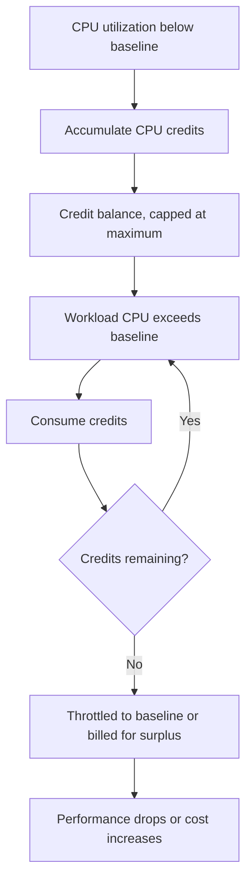

# Burstable Instances, CPU Credits, and Sustained Performance Limits

When choosing virtual machine configurations in the cloud, the vCPU count listed in an instance name does not tell you the entire processing capacity a workload can sustain continuously. Some instance families are designed to run at a baseline CPU level most of the time and burst higher during short spikes in load. This model is commonly called **burstable performance**. The platform manages the additional capacity through an accumulation and consumption mechanism called **CPU credits**.

Burstable instances can save money for services with uneven load, such as small websites, internal APIs, development environments, or background tasks that occasionally spike. However, if an application frequently uses high CPU, credits can drop to zero and performance can be throttled to the instance's sustained level or incur extra charges depending on the provider's mode. Therefore, when selecting a machine, you must understand baseline CPU, credit accumulation rate, consumption rate, balance cap, and behavior when credits are exhausted.

## 1. What Is a Burstable Instance?

A burstable instance is an instance type capable of delivering CPU performance above a base level for a period of time. Providers typically define a base performance level, called **baseline performance** or baseline CPU utilization. When a workload uses less CPU than this level, the instance accumulates burst capacity in the form of credits. When the workload needs more CPU than the baseline, the instance spends accumulated credits to boost performance.

This model fits workloads with the following characteristics:

- CPU is usually idle or used at low-to-moderate levels.
- There are short load spikes, such as users logging in at the start of the workday, running reports, or handling a burst of requests.
- Lower processing throughput is acceptable after a spike ends or once credits are depleted.
- Continuously high CPU is not required for many hours.

For example, an internal admin service averages 8% CPU, but occasionally spikes to 70% for a few minutes when generating reports. A burstable instance can use accumulated credits to handle that burst. If the same instance had to run encoding or data analytics at 80% CPU all day long, credits would deplete quickly and this machine type would likely no longer be suitable.

Burstable instances still have vCPUs, memory, networking, and storage like other instances. The main difference lies in how the provider allocates and caps CPU capacity over time. RAM configuration, network bandwidth, IOPS, or disk throughput may have separate limits and do not automatically increase just because the instance still has CPU credits.

## 2. Baseline CPU and Maximum Burst Level

**Baseline CPU** is the CPU capacity level the burstable model is designed to sustain long-term under the provider's policy. Baseline is typically expressed as a percentage of the instance's CPU capacity or as a credit accumulation rate. Specific values depend on the machine family, instance size, and platform.

**Burst capacity** is the CPU capacity usable above the baseline while credits remain or when an operating mode permits using credits beyond earned balances. An instance may temporarily use nearly all of its allocated vCPU capacity, but that does not mean it can sustain that usage indefinitely.

Distinguish three concepts:

| Concept | Meaning | Question to answer |
|---|---|---|
| Baseline | Base CPU level sustainable under the instance's model | When no credits remain, what CPU performance level is left? |
| Burst | CPU usage above baseline for a limited duration | How high can the instance burst while credits remain? |
| Credit balance | Balance used to pay for CPU usage above baseline | How long can it burst before the balance hits the limit threshold? |

Baseline should not be interpreted as a guarantee that every workload always achieves that exact CPU percentage. Actual performance also depends on CPU generation, instance type, platform limits, resource contention, OS configuration, and other caps. Read the specifications for the exact machine family in use.

### Baseline Is Not a Cap on Total vCPU Count

Suppose an instance has 2 vCPUs and a 20% baseline CPU. You can think of the base CPU level as equivalent to 0.4 vCPU used continuously out of 2 vCPUs total capacity. When the workload needs 70% of total CPU capacity, usage above the baseline equals 1 vCPU. That excess consumes credits under the common model.

CPU percentage is usually the aggregate utilization across the instance. If a single-threaded application runs at maximum on only one vCPU, the overall CPU chart of a 4-vCPU machine may show only about 25% even though one core is completely saturated. When diagnosing, look at per-core usage, runnable threads, and CPU wait time, rather than a single aggregate number.

## 3. How Do CPU Credits Work?

A CPU credit is an accounting unit of processing capacity in certain burstable instance families. Credits are not currency, not storage capacity, and not a pool of CPU you can arbitrarily transfer between instances. They represent the amount of CPU time above baseline that an instance is permitted to use under the provider's rules.

In a common model, one credit equals one vCPU running at 100% for one minute. If an instance has multiple vCPUs, consumption is calculated from total capacity used above baseline. However, the exact unit and formula must be confirmed in the provider's documentation; do not apply one platform's formula to every machine type.

The credit lifecycle usually consists of three operations:

1. **Accumulation:** the instance earns credits at a predefined rate when operating under the model's conditions.
2. **Consumption:** when CPU usage exceeds the baseline, the excess reduces the credit balance.
3. **Balance cap:** accumulated credits typically have a ceiling. Once the ceiling is reached, the instance does not keep accumulating indefinitely during idle time.

Think of credits like a finite energy tank. Low-CPU periods refill the tank; bursts above baseline gradually drain it. A workload can burst longer if it has built up enough credits before a high-load period begins.

### 3.1. Accumulation Rate

Each instance size typically has its own credit accumulation rate. Larger instances may have more vCPUs and a higher earn rate. This rate is tied to the configuration's baseline, though how it is published varies across providers.

If a workload uses low CPU for a while, the credit balance rises until it hits the cap. When workload load increases, the balance drops. Because the balance has a cap, leaving a machine idle for days does not create unlimited burst capacity; once the credit tank is full, additional idle time provides no extra reserve benefit.

### 3.2. Consumption Rate

When CPU usage exceeds baseline, the excess is converted into credits consumed. The higher and longer the usage, the faster credits drop.

A simple example under the convention of one credit per vCPU-minute:

- The instance has 2 vCPUs.
- Baseline is 20% of total capacity.
- The workload uses an average of 70% of total capacity for one hour.
- The excess over baseline is 50 percentage points, equivalent to 1 vCPU at 100%.
- One hour of this excess consumes roughly 60 credits.

If the instance earns 24 credits per hour, the net balance drops by roughly 36 credits over that period. This is an illustrative calculation; when applying it to a real instance, use the earn/spend rates and credit units published by the provider.

## 4. Estimating Burst Duration

To estimate burst capability, you need the current credit balance, the earn rate, the consumption rate at expected load, and operating mode limits.

In a vCPU-minute credit model, credit consumption per hour when CPU is above baseline can be estimated with the formula:

\[
 C_{use}=60\times N\times\max(0,U-B)
\]

Where:

- \(C_{use}\): credits consumed in one hour.
- \(N\): number of vCPUs on the instance.
- \(U\): average CPU utilization across the entire instance, expressed as a number from 0 to 1.
- \(B\): baseline CPU, also expressed as a number from 0 to 1.
- The factor 60 converts vCPU-minutes into vCPU-hours.

If the instance earns \(C_{earn}\) credits per hour, the net change in balance over one hour can be estimated as:

\[
 \Delta C=C_{earn}-C_{use}
\]

When \(\Delta C\) is negative, the balance is declining. If load and consumption rate are steady, the approximate time until the balance hits the threshold is:

\[
 T_{hours}\approx\frac{C_{balance}}{C_{use}-C_{earn}}
\]

This formula only applies when the platform's credit model matches the assumptions above, load is relatively steady, and no billing mode changes occur. It does not replace actual measurements or simulations based on provider policies.

### Calculation Example

Suppose an instance has 2 vCPUs, a 20% baseline, an earn rate of 24 credits per hour, and a current balance of 180 credits. The application is expected to average 70% CPU during a peak window.

Usage above baseline is:

\[
2\times(0.70-0.20)=1\text{ vCPU}
\]

The consumption rate is 60 credits per hour. After subtracting 24 earned credits, the net balance drops by 36 credits per hour. Approximate time until the balance runs out:

\[
180\div36=5\text{ hours}
\]

If the peak lasts only 10 minutes, net credit consumption under this assumption is about 6 credits. If the 70% load lasts many hours, the instance will gradually approach the limit. This is the key difference between a short burst and sustained CPU load.

## 5. What Happens When CPU Credits Run Out?

Behavior when the credit balance hits the threshold depends on the provider, machine family, and operating mode. Two main patterns are common:

**Throttled to baseline:** the instance reduces or caps CPU at its base performance level. The workload can still run, but processing time increases, requests may queue, latency rises, and throughput drops. When load decreases and credits accumulate again, burst capability can recover.

**Allowing usage beyond earned credits:** some platforms offer a mode that permits continued bursting after normal credits are exhausted. The excess may be recorded as surplus credits and billed according to provider policy. This mode prevents sudden performance drops but can raise costs if the workload sustains high CPU for long periods.

Not every machine family offers both modes, and names like Standard, Unlimited, or surplus calculation rules vary across instance generations. Before enabling a mode that allows exceeding credits, verify clearly:

- When does the platform begin counting excess usage?
- In what unit and over what interval is excess usage billed?
- Are there alert thresholds or budget caps?
- When this mode is disabled, at what level will the instance be capped?
- Is there any impact to a running instance when changing modes?

Do not assume that enabling unlimited bursting means high CPU performance is provided for free. Include surplus charges when comparing total cost of ownership.

## 6. Cloud Platform Examples

Many providers offer burstable families, though names, credit earning, baselines, and over-credit modes differ. Two well-known examples are:

| Provider | Commonly known families | What to look up in configuration docs |
|---|---|---|
| Amazon Web Services (AWS) | T families such as T2, T3, T3a, and T4g | Baseline by size, earn rate, CPU credit balance, Standard/Unlimited mode, and surplus credits |
| Microsoft Azure | B-series family | Baseline CPU, earn/spend rate, CPU credit balance, and behavior when balance hits zero |

This family list is illustrative only. Availability, CPU architecture, deployment regions, sizes, and billing terms can change. Look up the exact SKU, region, and instance generation you plan to deploy.

### What Not to Assume Across Providers

- Do not assume one credit has the same definition or conversion value across platforms.
- Do not assume the baseline of two instances with the same vCPU count is identical.
- Do not assume the default mode is Standard or Unlimited across all generations.
- Do not assume credits carry over to another instance on resize, stop, start, or new instance creation.
- Do not assume maximum credit caps or surplus billing rules are the same.

When migrating workloads between providers, re-evaluate CPU profiles, baselines, credit balances, and costs. The same workload may run fine on one family yet get throttled sooner on another.

## 7. Matching Workloads to Burstable Instances

Burstable instances provide the most benefit when CPU usage fluctuates and averages below the configuration's sustained capacity. Common suitable scenarios include:

| Workload | Suitability | Rationale and conditions |
|---|---|---|
| Small websites, low-request APIs | Usually suitable | CPU stays low most of the time, spiking briefly during short request bursts |
| Dev, staging, and test machines | Usually suitable | Intermittent load; performance variation outside peak hours is acceptable |
| Internal services, bots, or webhooks | Potentially suitable | Need to measure duration and frequency of bursts |
| Scheduled workers | Case-by-case | Suitable if each run is brief and longer runtimes are acceptable when credits are low |
| Databases with steady load | Requires caution | Sustained high CPU, consistent latency, and response times are usually critical |
| Video encoding, large builds, continuous analytics | Usually unsuitable | CPU can stay high for long periods and drain credits rapidly |
| Latency-sensitive real-time services | Requires careful evaluation | Degradation upon credit exhaustion can violate SLOs |

A workload with low average CPU may still be unsuitable if it needs instant responsiveness during long bursts. Conversely, a workload with relatively high average CPU may still work if idle periods are long enough to replenish credits, provided measurements confirm it.

### Evaluating by Load Cycles

Do not look only at daily average CPU. Inspect per-minute or shorter intervals matching the application's load rhythm. Two systems with the same 20% average CPU can behave very differently:

- System A stays around 20% continuously with few spikes.
- System B alternates 5 minutes at 100% and 20 minutes near 0%.

System B may need credits for high-load intervals and use idle intervals to replenish them. System A may fit an instance whose baseline is close to steady usage, without necessarily needing large burst capacity. Simulate against actual load cycles and initial credit balances.

## 8. Comparing Burstable vs. Sustained-Performance Instances

Sustained-performance instances (general-purpose, compute-optimized, or other suitable classes depending on the provider) are typically designed to provide steadier processing power under prolonged high CPU load. Burstable instances often have a lower entry price for certain sizes, at the trade-off of sustained capacity being governed by baseline and credit mechanisms.

| Criterion | Burstable instance | Sustained-performance instance |
|---|---|---|
| Suitable load pattern | Low most of the time, spiky in bursts | Moderate-to-high or continuously high |
| Long-term CPU performance | Governed by baseline or credit policy | Governed by SKU sustained capacity and platform limits |
| Short-term burst capability | Uses credits or burst mode | Can use full configured CPU capacity without relying on burst credits |
| Risk during prolonged load spikes | Credit exhaustion, CPU throttling, or surplus charges | Higher base configuration cost, but less dependent on credit balance |
| Selection basis | Load distribution, baseline, credits, and burst duration | vCPU count, CPU generation, measured performance, and SLOs |

A sustained-performance instance does not mean infinite or unrestricted CPU. It is still subject to vCPU limits, quotas, platform caps, thermals, memory bandwidth, and application behavior. The difference is that sizing decisions depend far less on CPU credit balances.

When comparing costs, include instance fees, over-credit burst charges, processing duration, load responsiveness, and the cost of scaling multiple small machines. A cheaper hourly instance can cost more overall if it must run longer to finish the same work or frequently incurs surplus charges.

## 9. CPU Credits Do Not Replace Memory, Network, and Storage Sizing

CPU bursting solves only one dimension of performance. A workload can still be bottlenecked by RAM, network bandwidth, IOPS, storage throughput, connection limits, or downstream service resources.

**Memory:** CPU credits do not grant extra RAM. If an application exceeds memory limits, the OS may swap, the kernel may terminate processes, or containers may be OOMKilled. Size RAM for the working set, caches, heap, process count, and expected load growth.

**Network:** network throughput may depend on instance type, machine size, flow count, per-flow limits, or provider policies. Having remaining CPU credits does not guarantee network bandwidth scales accordingly.

**Storage:** volume IOPS and throughput may have their own baseline, burst buckets, or caps. This is a separate mechanism from CPU credits. Distinguish CPU credits from disk burst credits if the platform provides them.

**Application:** synchronization locks, database queries, connection pool limits, garbage collection, or downstream latency can slow down requests even with spare CPU. Use tracing and profiling to find the real bottleneck.

## 10. Monitoring CPU Credits and Operational Performance

A system running on burstable instances must monitor both CPU usage and credit balance. Watching CPU utilization alone can miss risk: the instance may currently use little CPU while its credit balance is already low from a prior spike, or CPU may be throttled when load rises next.

Metric groups to track:

| Metric group | Meaning | How to use |
|---|---|---|
| Total and per-core CPU utilization | CPU busy level and single-core saturation | Identify high CPU load, single-thread bottlenecks, and hourly trends |
| Credit balance | Remaining burst capacity reserve | Alert when balance is low or steadily declining |
| Credit usage/consumption | Rate at which credits are spent | Estimate time to exhaustion during the current load wave |
| Credit surplus or excess charges | Usage above normal balance and associated fees, if any | Detect burst modes driving up bills |
| CPU throttling, run queue, CPU steal | Signs CPU is capped or waiting | Distinguish insufficient capacity from application or infra issues |
| Latency, throughput, error rate | Impact on user experience and SLOs | Identify at which CPU level service quality starts degrading |

Metric names and collection methods depend on the platform. For example, AWS CloudWatch includes metrics such as `CPUCreditBalance`, `CPUCreditUsage`, and surplus metrics in supported modes. Azure Monitor provides CPU credit metrics for B-series machines. Check exact metric names, units, sampling intervals, and applicability for the specific service.

### Alert on Trends, Not Just CPU Thresholds

A useful alert set might include:

- Credit balance below a reserve threshold for multiple consecutive intervals.
- Credit balance declining steadily during peak hours without recovering between load waves.
- Credit surplus or excess charges appearing frequently.
- High CPU utilization coinciding with rising latency or error rates.
- Low CPU utilization while run queue, CPU throttling, or processing times remain high; this signals a need to investigate cgroup limits, CPU steal, or other bottlenecks.

Alert thresholds should be based on the minimum burst duration the service must sustain. For instance, if the application must handle a 30-minute peak window, the warning balance should suffice for that window plus a safety margin for variability.

## 11. Process for Selecting and Sizing Burstable Instances

Apply the following process when choosing a configuration for a workload:

1. **Collect load samples.** Measure total CPU, per-core CPU, RAM, network, I/O, and latency during regular days, peak hours, batch runs, and unusual events.
2. **Determine required baseline.** Find the CPU level the workload must sustain long-term to meet SLOs, not just average CPU.
3. **Characterize bursts.** Record peak CPU, duration of each burst, repetition frequency, intervals between bursts, and predictability.
4. **Read SKU credit specs.** Confirm earn rate, balance cap, consumption calculation, initial state, and behavior upon exhaustion.
5. **Estimate burst duration.** Use current balance and net consumption rate to estimate duration; then verify via load testing.
6. **Evaluate RAM and other limits.** Ensure memory, network, storage, and quotas satisfy the workload in both normal and peak states.
7. **Compare total cost.** Compare burstable instances in supported modes against sustained-performance instances, factoring in surplus fees, runtime, and operational overhead.
8. **Test under low credits.** Verify application behavior when the balance nears depletion or when the platform caps CPU. Verify autoscaling, timeouts, and recovery.
9. **Monitor post-deployment.** Alert on low balance, prolonged above-baseline usage, and burst charges; re-evaluate SKUs when load patterns shift.

### Selection Example for a Small API

An API has 2 vCPUs and 4 GiB RAM; CPU usually sits at 5–12%, but rises to 65% for 8 minutes every hour. Spikes usually finish quickly and do not overlap with batch jobs. This is a candidate for testing a burstable instance.

Before choosing the SKU, the operations team must check whether the machine's baseline serves normal load, whether the earn/spend rate replenishes credits spent each hour, and whether the balance covers an unexpectedly longer peak. They must also verify that 4 GiB RAM fits the working set and cache, because CPU credits do not resolve memory shortages.

If the balance declines hour over hour, actual load is draining credits faster than they are earned. You can then increase the burstable size, reduce CPU demand, optimize queries, or switch to a sustained-performance instance. Base the decision on SLOs and total cost, not hourly price alone.

## 12. Combining Burstable Instances with Containers and Autoscaling

Burstable instances are often used as nodes for containerized workloads with variable load. However, distinguish **VM CPU credits** from **container CPU requests/limits**.

- CPU credits are managed at the instance level or per the provider's model.
- Kubernetes `requests.cpu` represents the CPU amount the scheduler uses to calculate Pod placement.
- Kubernetes `limits.cpu` caps the CPU a container is allowed to use via runtime/cgroup mechanisms.
- Container CPU throttling can happen due to `limits.cpu` even when the VM still has credits.
- Conversely, the VM can be capped at baseline when credits run out even if the container has not hit its CPU limit.

Therefore, when investigating performance, inspect both node/VM metrics and container metrics. Setting CPU limits too low can throttle the application independently of credits. Setting requests too low can let the scheduler pack too many Pods onto one node, pushing aggregate load above baseline and draining credits rapidly.

Autoscaling must also account for credits. If scaling out only happens once CPU is already high, new nodes may start with low credit balances or different initial credit states depending on the platform. If scaling in happens too aggressively, load concentrating on remaining nodes can exhaust credits. Test scale-out/scale-in cycles, credit initialization policies, and Pod distribution to avoid oscillation.

Useful operational practices include:

- Dedicate burstable nodes to workloads with variable CPU and clear resource limits.
- Avoid placing CPU-intensive batch jobs on the same nodes as latency-sensitive APIs.
- Monitor credit balance per node, not just the cluster-wide average.
- Configure autoscalers using CPU, queue depth, and application signals where appropriate.
- Maintain a sustained-performance node pool to shift critical workloads when steady load exceeds baseline.

## 13. Common Mistakes When Using Burstable Instances

**Choosing instances by average CPU.** Low average CPU can hide extended high-load periods. Look at distribution over time, burst duration, and credit balance.

**Assuming vCPU count equals sustained performance.** A 2-vCPU burstable instance will not necessarily sustain 2 vCPUs at 100% continuously. Read the baseline and credit limits.

**Not monitoring credit balance.** Current CPU utilization may look normal while the balance is nearly empty, causing performance degradation on the next load spike.

**Enabling over-credit modes without accounting for cost.** The service may run more smoothly while generating unexpected charges. Track surplus usage and configure budget alerts.

**Using burstable instances for continuously high-CPU tasks.** Credits drain rapidly; a sustained-performance machine can be cheaper when factoring in total processing time and operational cost.

**Confusing CPU credits with container limits.** A container can be throttled by CPU limits, or the VM can be throttled by exhausted credits. Observe the right resource layer.

**Ignoring RAM, network, and storage.** Remaining CPU credits do not fix OOMs, network congestion, or IOPS caps. Size all resources coherently.

**Not testing after changing SKUs.** Resizing or switching machine families can alter baselines, credit balances, CPU generations, and network characteristics. Re-test under representative load.

## 14. Pre-Production Checklist

- [ ] Measured CPU over time, per core, and during high-load periods.
- [ ] Identified the baseline CPU required to meet SLOs.
- [ ] Verified SKU vCPU count, baseline, earn rate, and credit caps.
- [ ] Estimated burst duration using initial balance and expected load.
- [ ] Verified behavior when credits run out and surplus billing policies.
- [ ] Sized RAM, networking, and storage independently of CPU credits.
- [ ] Distinguished VM CPU limits from container requests/limits and throttling.
- [ ] Configured alerts for low credit balance, rapid credit consumption, and excess charges.
- [ ] Tested sustained high load and near-exhaustion scenarios.
- [ ] Prepared a plan to upgrade or migrate to sustained-performance instances if load shifts.

## 15. Conclusion

Burstable instances use CPU credits to let workloads burst for short periods after accumulating capacity during low-load phases. Baseline represents the base performance level, while credit balance governs the ability to use CPU above that level for a limited time. When credits run out, the instance may be capped at baseline or incur excess charges depending on provider policy.

To pick the right machine, analyze load cycles, burst duration, credit earn and burn rates, exhaustion behavior, RAM, and network/storage limits. Burstable instances fit fluctuating workloads; continuously high-CPU or latency-sensitive workloads typically require configurations with steadier sustained performance. Base the final decision on measurements, load testing, and total cost under real operating conditions.
