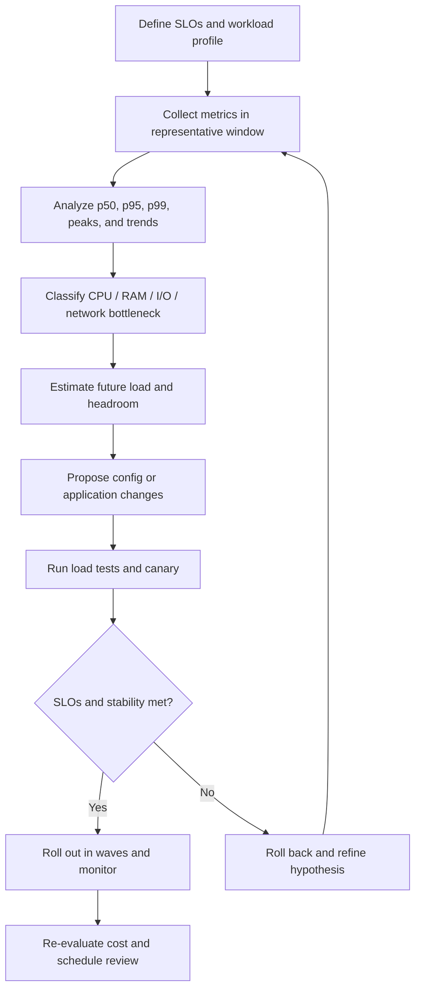

# Right-Sizing Based on Utilization Metrics and Headroom

A cloud server can run reliably while still being over-provisioned with too much CPU or memory relative to demand. Conversely, a cost-cutting configuration can leave an application slow, out of memory, or unable to withstand peak hours. **Right-sizing** is the process of selecting and adjusting resource configurations based on operational metrics, service objectives, and appropriate headroom.

Right-sizing does not mean always picking the smallest machine. The goal is to supply enough capacity for actual and projected load, maintain a safety margin for variability, and avoid paying for unused resources. Decisions must consider multiple signals together: CPU, RAM, storage, networking, application latency, error rates, and growth trends.

After this lesson, you will be able to:

- Collect and interpret key metrics to evaluate resource utilization.
- Distinguish average load, percentile high load, and short-term spikes.
- Estimate required CPU, memory, and storage based on current load, growth, and headroom.
- Recognize when to resize an instance, switch instance families, optimize the application, or scale horizontally.
- Test changes safely, validate outcomes, and track cost impact.

## 1. What Is Right-Sizing?

Right-sizing is matching **provisioned resources** to **the resources a workload actually needs** to achieve performance and availability goals. This evaluation applies to virtual machines, dedicated physical servers, container cluster nodes, or compute configurations of managed services.

For example, a VM provisioned with 16 vCPUs and 64 GiB RAM consistently uses only 20% CPU and 30% memory during peak hours. This may signal over-provisioning, though it is not enough on its own to conclude you should downsize: check peak bursts, latency, batch runs, backup windows, growth rates, I/O caps, and redundancy requirements.

Similarly, an average CPU of just 35% does not prove a machine has excess CPU. If CPU frequently hits 95% during brief spikes that coincide with sharp p99 latency jumps, cutting vCPUs could degrade user experience.

Right-sizing must balance three objectives:

1. **Performance:** meet the throughput and latency required by the application.
2. **Resilience to variability:** keep enough resources when load surges, background tasks run, or part of infrastructure fails.
3. **Cost:** curb idle resources and ancillary costs without introducing excessive operational risk.

## 2. Start with Service Objectives and Workload Characteristics

Before looking at dashboards, define what the application needs to do and what good performance looks like. A configuration suitable for a batch worker may not suit an online transactional API.

| Workload type | Characteristics to understand | Metrics to prioritize |
|---|---|---|
| API or website | Hourly traffic shifts, users waiting for responses | Requests/second, p50/p95/p99 latency, error rate, CPU, RAM, connection count |
| Queue worker | Work can accumulate and process in parallel | Queue depth, age of oldest message, processing time, CPU, RAM |
| Scheduled batch | Load spikes during execution, may have deadlines | Completion time, CPU, RAM, I/O, parallel task count |
| Database | Sensitive to cache memory, storage latency, and connections | RAM, cache hit ratio, IOPS, latency, queue depth, connection count, replication lag |
| Cache or in-memory service | Active data must stay in RAM | Working set, memory pressure, evictions, hit ratio, networking |
| Analytics or machine learning | May need many CPU cores, large RAM, or GPUs | Completion time, device utilization, GPU memory, data throughput |

Document targets such as maximum p95 latency, acceptable error rates, batch completion windows, uptime targets, and projected growth. If quantitative targets do not exist yet, agree on an initial threshold to evaluate before and after adjustments.

## 3. Collecting Metrics Properly

### Choose a Long Enough Observation Window

A single point-in-time dashboard snapshot does not represent full operation. Your measurement window must span meaningful workload cycles:

- For applications with relatively steady load, collect at least one complete operational cycle including peak hours.
- For systems with daily or weekly schedules, observe across multiple days and scheduled batch runs.
- For products with seasonality, campaigns, or peak days, use data from comparable events or generate controlled load tests.
- For new systems, short-term data is only an initial baseline; keep alerts active and re-evaluate once real traffic data accumulates.

The observation window may be several weeks or longer depending on load cycles. No fixed number of days fits every workload. Pick a window wide enough to capture weekdays, weekends, background jobs, and major peaks.

### Look Beyond Averages

Percentiles reveal load distribution:

- **p50 (median):** half of samples fall at or below this value; describes typical levels.
- **p95:** 95% of samples fall at or below this value; useful for observing common high-load intervals.
- **p99:** 99% of samples fall at or below this value; helps catch rarer high-load bursts.
- **Maximum:** highest recorded value; may reflect a brief event or anomalous sample.

Averages smooth out spikes. Maximums can be skewed by a single noisy sample. Therefore, read average, p95, p99, maximum, and time-series charts together. Also inspect spike duration: hitting 100% CPU for a few seconds is very different from saturating CPU continuously for 30 minutes.

### Metric Sources

Combine telemetry from multiple layers to avoid misdiagnosis:

1. **Operating system or hypervisor:** CPU utilization, load, run queue, available memory, swap, disk I/O, network throughput.
2. **Cloud platform:** allocated vCPUs, CPU credits or throttling if applicable, bandwidth caps, IOPS, instance health, and service metrics.
3. **Container/runtime:** CPU requests/limits, memory working set, throttling, restarts, OOM kills, and replica counts.
4. **Application:** request rate, concurrency, response times, errors, per-stage processing time, connection counts, and queue lengths.
5. **Dependencies:** database latency, cache hit ratio, external API response times, and queue health.

Synchronize timestamps across metrics, logs, and traces. When CPU spikes, check whether latency and error rates rise at the exact same timestamp. Temporal correlation helps separate root causes from side effects.

## 4. Evaluating CPU

CPU utilization shows the fraction of processing capacity used during a measurement interval. However, a standalone CPU percentage is not enough to decide whether to scale up or down.

### CPU Metrics to Inspect

| Metric | Meaning | Signs to investigate |
|---|---|---|
| CPU utilization | Percentage of CPU busy time | Sustained high levels alongside rising latency or queues |
| Load average / run queue | Work running or waiting for CPU, calculated per OS | Persistent long queues while available CPU stays unchanged |
| CPU throttling | Time the workload is capped by CPU quotas | Containers throttled at the same time response times climb |
| CPU steal / ready time | Time the VM waits for the hypervisor to schedule physical CPU | High levels can indicate resource contention or platform caps |
| Frequency / CPU credits | Operating frequency or remaining burst credits on supported types | Performance drops after sustained high load |
| Per-core utilization | Busy level per individual core or thread | One core saturated while other cores remain idle |

In single-threaded applications, total CPU can look low even when one core is completely saturated. In multi-threaded applications, verify the app can actually utilize extra cores rather than stalling on locks, I/O, or an external service.

### Estimating Required CPU

An initial estimate can take CPU demand observed at a chosen percentile and adjust for growth and target utilization:

\[
\text{Required vCPUs} \approx
\frac{\text{Current vCPUs} \times \text{Observed CPU utilization} \times \text{Growth factor}}
{\text{Target utilization}}
\]

Express all percentages as decimals. For example, 40% is written as `0.40`. The formula assumes demand scales roughly linearly with load and CPU configuration; it is only a screening estimate. Per-vCPU performance can differ across CPU generations, machine families, architectures, and resource sharing policies.

Target utilization should depend on the workload. A latency-sensitive API usually needs more headroom than a batch job that can run longer. Do not treat a 70% or 80% threshold as a rigid rule for every system.

### CPU Estimation Example

An API currently runs on an 8-vCPU machine. Over a representative observation window:

- p95 CPU is 40%.
- p99 CPU is 58%.
- Highest peak is 68% and lasts briefly.
- The team forecasts 25% traffic growth in the next period.

Using p95 and a 70% target, estimated demand is:

\[
\frac{8 \times 0.40 \times 1.25}{0.70} \approx 5.72\text{ vCPUs}
\]

Based on p95, a 6-vCPU configuration could handle projected load. However, checking p99 yields:

\[
\frac{8 \times 0.58 \times 1.25}{0.70} \approx 8.29\text{ vCPUs}
\]

If p99 peaks must be served immediately without adding latency, even 8 vCPUs may lack headroom under these assumptions. The team must check spike duration, autoscaling responsiveness, queues, and latency limits before deciding. If brief spikes can be absorbed by queues or rapid scale-out, a 6-vCPU baseline can be a more economical test candidate.

This example shows why you should not pick a single percentile mechanically. Service objectives and load behavior determine which percentile must be protected.

## 5. Evaluating RAM Memory

RAM is usually harder to cut arbitrarily because applications may need to keep working sets, caches, heaps, buffers, and connection state in memory. Insufficient RAM can trigger swapping, cache eviction, prolonged garbage collection, or OS process termination.

### Metrics to Monitor

- **Memory used and available:** memory currently in use versus memory the system can still allocate to processes. Understand how the OS accounts for page cache and buffers.
- **Working set:** the memory an application genuinely needs to retain to operate efficiently over the observation window.
- **Heap and non-heap:** for runtimes such as the JVM, monitor heap, metaspace, direct buffers, thread stacks, and native memory.
- **Swap / page faults:** swapping activity or page faults can indicate memory pressure; examine severity and duration.
- **OOM kills / restarts:** processes or containers terminated for exceeding memory limits.
- **Memory growth:** rate of memory increase over time, helping detect leaks or unbounded caches.

Do not conclude RAM is tight just because the OS reports low `free` memory. Operating systems use free RAM as page cache and reclaim it when applications need memory. Watch `available` memory, working set, swap, OOMs, and application latency.

### Calculating Required RAM Headroom

Required allocation can be estimated as:

\[
\text{RAM to allocate} \approx
\frac{\text{Working set at chosen percentile} \times \text{Growth factor}}
{\text{Target RAM utilization}}
\]

For example, p95 working set is 21 GiB, projected growth is 20%, and the team wants to keep utilization under 75%:

\[
\frac{21 \times 1.20}{0.75} = 33.6\text{ GiB}
\]

The team should choose the next available RAM tier above 33.6 GiB in the machine catalog. If only 32 GiB and 48 GiB sizes exist, 48 GiB is a sensible starting point for testing. Validate under real load while checking p99, OOMs, caches, heap, and growth trends.

For containers, inspect both memory requests and limits. Requests affect scheduling; limits can terminate containers if exceeded. Setting requests too high lowers node workload density; setting limits too low raises OOM risk. Base settings on actual working set and peak usage.

## 6. Evaluating Storage and Networking

Right-sizing does not stop at CPU and RAM. Disks or network links can be the bottleneck even while CPU sits idle.

### Storage

Monitor at least four metric groups:

1. **Capacity:** used space, free space, and data growth rate. Forecast primary data, logs, temporary files, indexes, snapshots, and replicas.
2. **IOPS:** read/write operations per second. Distinguish reads and writes if the platform enforces separate caps.
3. **Throughput:** data transferred per second. A high-IOPS disk may still fail to sustain desired throughput for large blocks.
4. **Latency and queue depth:** I/O wait times and pending operations. Latency rising with queue depth can signal storage performance caps.

Do not downgrade disk tiers or IOPS limits merely because CPU is low. For databases, slow I/O stretches query times and keeps CPU low because processes sit waiting. Cross-reference disk metrics with query times, cache hit ratios, and application queues.

To forecast capacity, you can use:

\[
\text{Storage to allocate} \approx
\frac{\text{Projected data at end of period}}{\text{Target max fill ratio}}
\]

For example, projected data reaches 1.44 TiB at the end of the planning period and the team targets a maximum 80% fill ratio, requiring roughly 1.8 TiB. Round up to supported allocation increments and leave extra room for logs, indexes, temporary files, or unexpected growth.

### Networking

Monitor ingress/egress throughput, packet rates, packet loss, retransmissions, latency, concurrent connections, and instance bandwidth limits. For apps calling many downstream services, measure per-hop timings to tell whether latency comes from networking, DNS, TLS handshakes, or the target service.

Insufficient network capacity can cause timeouts and retries. Excessive retries further amplify traffic and load on dependencies. When evaluating network sizing, examine both peak rates and behavior when many connections are open concurrently.

## 7. Determining Appropriate Headroom

**Headroom** is the spare capacity remaining after serving expected load. Headroom lets the system absorb fluctuations, autoscaling instance startup times, background tasks, and partial failures.

No single headroom percentage fits all workloads. Set headroom based on:

- **Load volatility:** the more sudden and unpredictable the load, the more spare capacity or queue buffering is needed.
- **Latency targets:** interactive APIs must stay clear of saturation zones; deadline-driven batches can tolerate higher utilization if completion margins allow.
- **Scaling time:** if launching an instance takes several minutes, the system needs enough baseline capacity to serve traffic while scaling out.
- **Fault domains:** when an instance or AZ fails, remaining capacity must carry required load per recovery objectives.
- **Data confidence:** short observation windows or missing peak seasons require extra headroom and re-verification.
- **Growth:** factor in user growth, data growth, new features, and known business events.

### Using Growth Factors and Target Utilization

A simple planning method multiplies observed demand by a growth factor, then divides by target utilization:

\[
\text{Capacity to allocate} \approx
\frac{\text{Current demand} \times \text{Growth factor}}
{\text{Target utilization}}
\]

If traffic is projected to grow 30%, the growth factor is 1.30. If the team sets a 65% maximum utilization target for latency-sensitive load, the remainder serves as assumed headroom. Select factors and targets from workload traits, SLAs/SLOs, and test outcomes.

For multi-instance systems, calculate capacity when losing one instance or fault domain. For instance, if three instances split load evenly and one fails, the remaining two must serve ongoing load. Having each instance at 50% when all three are healthy does not guarantee the remaining two stay below limits after a failure.

### Headroom Is Not Just Idle Resources

Headroom can be achieved in multiple ways:

- Retaining unused CPU/RAM on running instances.
- Keeping a minimum pool of warm instances ready for traffic.
- Triggering autoscaling on leading indicators such as queue depth or request rate.
- Offloading non-interactive tasks to queues for gradual processing.
- Applying load shedding, backpressure, or graceful rejection at safe thresholds.
- Distributing replicas across fault domains and ensuring survivors have sufficient capacity.

Autoscaling can cut baseline costs, but cannot replace all headroom if startup times are slow or traffic spikes faster than scale-out speed.

## 8. Controlled Right-Sizing Workflow

A practical workflow should include a baseline, hypothesis, small change, re-measurement, and rollback capability.

### Step 1: Establish a Baseline

Record current configuration, usage-based pricing, instance counts, resource metrics, and application metrics. Select representative time frames and capture normal hours, peak hours, background jobs, and anomalous events.

### Step 2: Find the True Bottleneck

Correlate infrastructure metrics with latency, error rates, throughput, and queues. High CPU might reflect insufficient vCPUs or inefficient algorithms; high RAM might reflect large working sets or memory leaks; high I/O might reflect unoptimized queries. Verify the root cause before adding resources.

### Step 3: Form a Testable Hypothesis

For example: "Downsizing from 8 to 6 vCPUs will reduce compute unit cost by roughly 25%, while post-change p95 CPU stays below target and p99 latency stays within SLO under load testing." A good hypothesis has explicit metrics, success thresholds, and rollback criteria.

### Step 4: Test in a Suitable Environment

Run representative load or replay sanitized traffic in a test environment. Test normal load, peaks, slow dependency scenarios, and recovery. Do not use real sensitive data without proper safeguards.

### Step 5: Roll Out in Waves

Modify a small group or fraction of traffic first. Monitor CPU, RAM, I/O, networking, latency, errors, restarts, and queues. If metrics breach thresholds, halt rollout or roll back to the previous configuration.

### Step 6: Verify Benefits and Schedule Reviews

Compare before/after cost, performance, and stability under matching load conditions. Document the new configuration, rationale, measurements, and next review date. Right-sizing is continuous because applications, data, and user behavior evolve.

## 9. Choosing Instance Families and Scaling Paths After Measurement

Once bottlenecks are understood, choose resources with matching characteristics:

| Common configuration family | Best suited when | What to check |
|---|---|---|
| General purpose | Balanced CPU and RAM for typical APIs, web apps, or services | CPU/RAM ratio, per-vCPU speed, networking, and price |
| Compute optimized | CPU computation is the main bottleneck | Single-core/multi-core speed, CPU generation, architecture, and scalability |
| Memory optimized | Large working sets, caches, or databases needing high RAM | RAM capacity, memory bandwidth, I/O caps, and price |
| Storage optimized | Workloads needing high IOPS, throughput, or local storage capacity | Latency, data durability, device limits, and instance-replacement behavior |
| GPU / accelerator | Code can leverage hardware accelerators | GPU model, VRAM, drivers, frameworks, utilization, and cost |
| Burstable | Low baseline load with brief CPU spikes | CPU credits, baseline level, burst caps, and post-credit performance |

Family names and specifications vary by provider. Never compare two instances solely by vCPU and RAM; examine CPU generation, architecture, network bandwidth, I/O limits, and pricing.

### When to Resize vs. Scale Horizontally?

- **Resizing (vertical scaling):** fits when one instance lacks CPU/RAM, the app is hard to split, or changing instance count adds complexity. Check size ceilings and downtime during machine changes.
- **Horizontal scaling:** fits when the app runs multiple replicas, load distributes evenly, and state is not tied to a single instance. Factor in connection overhead, shared data, and synchronization capacity.
- **Code or config optimization:** fits when resources are wasted on slow queries, ineffective caching, excessive threads, or unnecessary work. This can cut costs without changing machine types.
- **Autoscaling:** fits when load fluctuates and can be tracked via clear signals. Configure min/max bounds, cooldowns, quotas, and dependency protections.

Switching from one machine family to another sometimes yields bigger gains than trimming vCPUs. For instance, a workload with a large working set and low CPU may fit a higher-RAM, lower-CPU machine if memory performance and other caps meet requirements.

## 10. Evaluating Cost Impact

Compute charges may drop when downsizing or reducing instance counts, yet the total bill also includes storage, snapshots, IP addresses, data transfer, load balancers, logs, monitoring, and auxiliary services.

When comparing options, use the same unit of work and identical quality targets:

\[
\text{Cost per unit of work} =
\frac{\text{Total cost in period}}{\text{Successful units of work}}
\]

For example, compare the cost per 1,000 successful requests while keeping the same p95 latency cap and error rate. If a smaller configuration raises response times, triggers more retries, or forces running more instances, per-machine savings can vanish.

Also check:

- Pricing differences by region, OS, software licenses, and CPU type.
- On-demand, committed/reserved, or preemptible capacity pricing models.
- Disk and snapshot charges that persist even when a VM is stopped.
- Egress or cross-zone data transfer, request fees, and log ingestion costs.
- Redundancy costs from multi-AZ deployments and minimum instance counts.
- Operational costs if an undersized configuration triggers more incidents or slower processing.

Do not lock in long-term commitments to mask an unmeasured configuration. Right-size first, then evaluate commitments for the steady baseline load.

## 11. End-to-End Example: Tuning a Retail Order API

A retail API runs on an 8-vCPU, 32 GiB RAM machine with a 2 TiB disk. The team collects metrics across weekdays, weekends, and a recent promotional event.

| Component | Observed metrics | Initial assessment |
|---|---|---|
| CPU | p95 40%, p99 58%, short peak 68% | p95 suggests room to test lower CPU; must keep p99 within target |
| RAM | Working set p95 21 GiB, p99 24 GiB | 32 GiB leaves tight margin if load grows 20% and target stays 75% |
| Storage | Projected 1.44 TiB at end of period, 80% max fill target | Needs ~1.8 TiB; 2 TiB may suffice if logs and snapshots are included |
| Networking | p95 throughput below cap, with spikes during report exports | Review report schedules and bandwidth limits before switching instances |
| Application | p95 latency meets SLO; p99 rises during promotions | Must also check queues, database, and downstream service call times |

Estimating CPU from p95 with 25% projected growth and a 70% target gives roughly 5.72 vCPUs. However, p99 after growth requires roughly 8.29 vCPUs under the same target. Since p99 latency matters for order creation, the team decides to keep 8 vCPUs initially and test reducing it via query optimization or scale-out during promo spikes.

For RAM, a 21 GiB p95 working set growing 20% at a 75% utilization target yields 33.6 GiB. The team tests a 48 GiB configuration if available in the catalog, while monitoring heap, caches, and memory growth to avoid over-provisioning if part of memory comes from tunable caches.

For storage, forecasting 1.44 TiB with an 80% max fill target corresponds to 1.8 TiB. A 2 TiB disk can cover primary data, though space for logs, indexes, temporary files, and snapshots must be verified. If data grows faster than forecast, set capacity alerts and prepare an expansion plan.

After testing, the team rolls out across traffic slices, tracks SLOs, and compares cost per successful order. If p99 latency, error rates, or OOMs worsen, they roll back and refine the hypothesis. Final configurations must be confirmed by post-deployment metrics, not forecasts alone.

## 12. Common Mistakes

**Looking only at average CPU.** Averages hide short spikes and per-core saturation. Check percentiles, maximums, spike duration, and application metrics.

**Cutting RAM because free memory looks low or high.** OS cache accounting differs from an application's working set. Inspect available memory, swap, page faults, OOMs, and memory trends.

**Choosing machines by vCPU and RAM alone.** Two configurations with identical vCPU counts can differ in CPU performance, architecture, networking, and I/O. Compare real characteristics and benchmark the workload.

**Applying a fixed headroom percentage.** Headroom should reflect volatility, latency targets, scaling speed, and fault domains. One number across all systems can be either wasteful or unsafe.

**Changing multiple variables at once.** Changing CPU, RAM, disk, and app settings simultaneously makes it hard to tell what caused the result. Controlled changes isolate cause and effect.

**Lacking a rollback plan.** A cost-saving change can spike errors during peak hours. Document the old configuration, stop thresholds, and rollback steps before deploying.

**Ignoring ancillary costs.** Cutting server spend while increasing network egress, logs, retries, or external service calls can raise total cost.

## 13. Right-Sizing Checklist

Before approving a configuration change, verify:

- [ ] Defined workload profile, SLO targets, and critical load windows.
- [ ] Observation window covers relevant daily/weekly cycles, batches, and peak seasons.
- [ ] Inspected p50, p95, p99, maximum, and spike durations.
- [ ] Correlated infrastructure metrics with latency, errors, throughput, and queues.
- [ ] Checked per-core CPU, throttling, steal/ready time, or CPU credits if applicable.
- [ ] Checked working set, swap, OOMs, and RAM growth trends.
- [ ] Checked storage capacity, IOPS, throughput, latency, and queue depth.
- [ ] Checked network throughput, latency, retransmissions, and bandwidth limits.
- [ ] Factored in projected growth, headroom, autoscaling startup time, and loss of an instance/AZ.
- [ ] Validated load tests, canary deployment, stop thresholds, and rollback plan.
- [ ] Compared total cost per unit of work at identical SLOs.
- [ ] Recorded decision, owner, and scheduled review date.

## 14. Self-Check

1. Why is 30% average CPU not enough to conclude a machine can cut its vCPU count in half?
2. How do p95 and p99 differ? When should an API pay special attention to p99?
3. A container with a 2 GiB memory limit frequently OOMs while CPU stays low. Which metrics would you inspect before raising the limit?
4. Why can low CPU paired with high latency signal an I/O or network bottleneck?
5. Use the estimation formula to compute CPU sizing given current demand, growth factor, and target utilization. Which assumptions could cause the estimate to be off?
6. How should headroom change when instance startup time is long or the system must survive losing an AZ?
7. Why test and run a canary rollout before applying a new configuration to the entire workload?
8. How can you fairly compare costs between two configurations that have different performance and error rates?

Right-sizing is an iterative loop of measurement and adjustment. With representative data, clear service objectives, reasoned headroom, and a rollback process, teams can cut resource waste while protecting application performance and stability.
