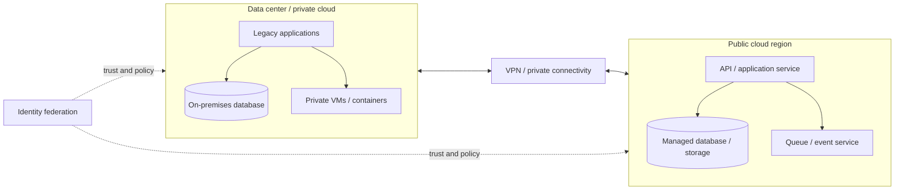

# Distinguishing hybrid cloud, edge compute, and centralized cloud

Modern compute architectures do not necessarily run every workload in a single data center. An application may place its core transaction system on a public cloud, keep certain data or legacy systems in a private data center, and run processing close to devices in a factory or retail store. To choose the right execution location, it is necessary to distinguish three concepts: **hybrid cloud**, **edge compute**, and **centralized cloud**.

Hybrid cloud describes how a private cloud environment is combined and coordinated with a public cloud or on-premises infrastructure. Edge compute describes placing processing close to where data is generated or where a response is needed. Centralized cloud describes the model of consolidating most compute and data into a provider's centralized regions/data centers. These three concepts are not mutually exclusive: a hybrid architecture can use edge nodes and synchronize data back to a centralized cloud.

In the cloud compute module, distinguishing them accurately helps decide where a workload should run, what CPU/memory/network resources are needed, how data moves, and who owns operations. You should not choose edge solely for low latency, or choose hybrid solely because you already own an on-premises server. The decision should be based on application requirements, data, connectivity, security, cost, and operational capability.

## 1. What is centralized cloud?

Centralized cloud is a deployment model in which compute, storage, and platform services primarily run in a cloud provider's large-scale regions or data centers. Users access resources over the WAN/Internet or through private connectivity such as VPN or private link/direct connection.

Centralized compute services typically include:

- VMs and bare metal instances.
- Container platforms, managed Kubernetes, and serverless containers.
- Function/serverless runtimes.
- Batch, HPC, GPU, and accelerator services.
- Managed databases, object storage, queues, and event services.

### Characteristics

- **Concentrated capacity:** consolidates compute, storage, and networking into large-scale regions.
- **Rich service ecosystem:** easy to integrate databases, analytics, AI, identity, monitoring, and automation.
- **On-demand scaling:** instances, containers, or functions can scale up or down with load.
- **Centralized management:** policies, inventory, logging, billing, and deployments can be shared.
- **Connectivity dependence:** remote clients or systems must connect to the region to exchange data and call services.

### When it fits

Centralized cloud fits workloads that require shared data, large-scale processing, integration with many managed services, or do not need immediate responses at the point where data is generated. Examples include nationwide e-commerce systems, SaaS backends, data warehouses, public APIs, batch processing systems, and applications that need to scale with broad traffic.

Centralized cloud does not mean having only one server or one region. Providers can deploy across multiple availability zones and regions; "centralized" here refers to placing compute in large-scale cloud locations rather than right next to devices or data-generating facilities.

## 2. What is hybrid cloud?

Hybrid cloud combines two or more distinct compute environments—typically a private cloud/on-premises environment with a public cloud—and establishes deliberate coordination between them. The goal may be to keep certain workloads on-premises due to data, latency, or legacy system requirements while using the public cloud for elasticity, managed services, and on-demand compute capacity.

A true hybrid architecture requires connectivity and coordination across workloads, data, identity, networking, policy, or operations. Simply renting cloud resources while also owning servers in an office does not automatically create a hybrid cloud if the two environments operate completely independently.

### Common components

- **On-premises/private environment:** private data center, private cloud, or branch infrastructure.
- **Public cloud:** provider regions and compute services.
- **Network connectivity:** site-to-site VPN, leased line, direct/private connection, SD-WAN, or other secure connectivity.
- **Identity federation:** integration of identities, roles, and permissions across environments.
- **Management/control plane:** inventory, policy, deployment, monitoring, and automation.
- **Data integration:** replication, synchronization, event streaming, backup, and data transfer.
- **Workload placement:** rules determining which services run in which environment.

### Conceptual diagram

This diagram illustrates only one connectivity pattern. In real deployments, network paths, identity trust, and data flows must be designed specifically; not every workload needs bidirectional access between environments.

### Hybrid cloud does not mean multi-cloud

Multi-cloud means using multiple public cloud providers. Hybrid cloud emphasizes coordination between heterogeneous environments, typically private/on-premises and public cloud. An organization can be both hybrid and multi-cloud, but the two terms answer different architectural questions.

## 3. What is edge compute?

Edge compute brings compute and/or storage closer to where data is generated, where devices operate, or where a response is required. An edge node can reside in a factory, retail store, hospital, telecom site, vehicle, ship, or IoT gateway.

The primary goal is to reduce reliance on round trips to a centralized cloud, process data locally, reduce the amount of data that must be transmitted, or continue operating when WAN connectivity is disrupted.

### Common edge tiers

- **Device edge:** processing directly on cameras, sensors, gateways, or endpoint devices.
- **Site/facility edge:** small servers or clusters at a factory, store, or facility.
- **Network edge:** compute placed near network points of presence or telecom infrastructure.
- **Regional edge:** compute locations closer to users than primary cloud regions.
- **Cloud region:** centralized processing, fleet management, and aggregated analytics.

There is no fixed physical distance definition for "edge." What matters is that compute placement is chosen to meet requirements for latency, data locality, bandwidth, or local operation.

### Examples

- Factory cameras detect product defects directly on a gateway so the production line reacts within milliseconds.
- A retail store continues processing certain operations when the WAN goes down, then synchronizes transactions once the network recovers.
- A telecom site runs video analytics or content caching close to subscribers.
- Autonomous vehicles process sensor data on-board because they cannot rely on cloud round trips for immediate safety decisions.
- Medical devices preprocess data on-site and send only results or filtered data to a central system according to policy.

Edge does not necessarily replace the cloud. Centralized cloud remains useful for fleet management, broad data analytics, model training, long-term storage, and software release distribution.

## 4. Comparing the three models

| Criterion | Centralized cloud | Hybrid cloud | Edge compute |
|---|---|---|---|
| Core concept | Compute in centralized cloud regions/data centers | Coordination of private/on-premises and public cloud | Compute close to data or users |
| Location | Cloud regions | Multiple environments | Device, site, network, or regional edge |
| Key strengths | Scale, rich services, centralized management | Combines on-premises control with cloud capabilities | Low latency, locality, and local operation |
| WAN connectivity | Usually required for clients and integrations | Critical between environments | Can reduce WAN dependence for local flows |
| Data locality | Data usually centralized in regions | Data distributed across environments | Data can be processed/stored at the site |
| Compute capacity | Large-scale and diverse | Depends on both private and public environments | Typically more constrained, depending on site/device |
| Governance | Relatively centralized | Complex due to multiple control planes | Distributed across many nodes and locations |
| Offline capability | Depends on application design | Can keep on-premises systems running | Often a primary design goal |
| Prominent costs | Compute, storage, network egress, and managed services | Cloud + private infrastructure + connectivity + integration | Hardware, site deployment, fleet management, and maintenance |
| Typical use cases | SaaS, APIs, analytics, batch | On-premises ERP connected to cloud services | IoT, industrial, retail, video, and real-time control |

Hybrid is an environment-combination model; edge is a location-based compute placement approach; centralized cloud is a way of organizing compute in large regions. A single system can use all three simultaneously.

## 5. Criteria for deciding where a workload should run

There is no single criterion. Evaluate latency, data locality, connectivity, compliance, scale, operability, and cost for each workload.

### Latency and response time

If an application needs millisecond-level responses and the network to the region cannot meet that consistently, edge processing may be appropriate. If latency requirements are in the hundreds of milliseconds or seconds and users are broadly distributed, a cloud region can serve it well.

You must calculate the full latency budget:

\[
T_{total} = T_{network} + T_{queue} + T_{compute} + T_{storage} + T_{response}
\]

Placing compute near the client only reduces part of `T_network`. If the workload still has to call a database in a distant region, total latency may not improve. Moving compute to the edge while keeping every dependency in the centralized cloud sometimes just shifts the bottleneck.

### Data locality and bandwidth

If devices generate large volumes of data, sending all raw data to the cloud can consume significant bandwidth and egress. The edge can filter, compress, aggregate, or forward only important events.

For example, cameras continuously produce video. A gateway can analyze frames locally and send only event clips and metadata. This reduces data transfer but requires managing models, firmware, and processing policies at the site.

### Intermittent connectivity

Factories, ships, vehicles, or remote sites can lose WAN connectivity. If the application must keep running, it needs edge/local compute, local storage, queues, and a synchronization mechanism once the network recovers.

An offline-first design must clearly define which operations are allowed to run independently, which data can conflict, and how synchronization works. Not every transaction is safe to perform offline.

### Compliance and data sovereignty

Some data must be stored or processed within specific geographic, legal, or controlled environments. Hybrid can keep the data plane on-premises; edge can process data at the site; an in-country cloud region may satisfy requirements if the services and contracts align.

Do not assume that running at the edge is automatically compliant. Edge devices still require encryption, access control, auditing, patching, and data deletion procedures.

### Scale and manageability

Centralized cloud is advantageous when you need large-scale elasticity and to manage thousands of workloads through a shared control plane. Edge can create hundreds or thousands of small nodes across different sites; fleet management, version drift, connectivity, and maintenance become primary challenges.

### Availability and failure domains

Placing compute at a site can reduce latency, yet that site remains its own failure domain. If the site loses power or hardware fails, you need local redundancy or the ability to shift workloads to another site/cloud. Cloud regions can also experience outages; designs need to define failover capabilities and how far data is synchronized.

## 6. Workload placement: classify before distributing

An application often has multiple components with different requirements. You do not have to put the entire application in the same place.

| Workload component | Potentially suitable location | Reason |
|---|---|---|
| Real-time machine control | Device/site edge | Needs fast response and WAN independence |
| Sensor data filtering | Gateway/site edge | Saves bandwidth and sends selected data |
| User management API | Centralized cloud | Shared system-wide and benefits from managed services |
| Core transactional database | Cloud region or private data center | Needs consistency, backups, and data governance |
| Legacy ERP integration | Hybrid | Keeps ERP on-premises, connects via cloud APIs |
| Large-scale ML training | Centralized cloud/HPC | Needs GPUs, storage, and scalability |
| Near-camera inference | Edge | Reduces latency and raw video transmission |
| Multi-site aggregated analytics | Centralized cloud | Collects data for global analysis |
| Content caching | Edge/network edge | Brings content closer to users |
| Fleet management and software distribution | Cloud control plane | Centrally coordinates many edge nodes |

### Separating control plane and data plane

A common architecture uses a centralized cloud for management while data processing happens at the edge:

- **Control plane:** inventory, policy, identity, software releases, fleet health, and configuration.
- **Data plane:** ingesting sensor data, running inference, local control, and temporary storage.

If connectivity to the control plane is lost, the edge data plane can keep operating using the latest policy and configuration. When connectivity returns, the edge syncs state and receives new updates.

## 7. Typical hybrid architectures

### Keeping legacy systems on-premises, extending with the cloud

An enterprise has a legacy ERP and database in its data center. They deploy a new portal/API on the cloud and connect to the legacy system over private connectivity. Some batch jobs can run on the cloud to take advantage of on-demand compute.

Key design considerations:

- Network routing, DNS, firewalls, and private connectivity.
- Identity federation and service-to-service authentication.
- Data contracts/APIs between new and legacy systems.
- Latency and timeouts when calling across the WAN.
- Data synchronization and retry handling when links drop.
- Division of backups, DR, and ownership between the two environments.

### Cloud bursting

Cloud bursting uses the public cloud to add capacity when a private environment reaches its limits. This model fits horizontally scalable workloads that do not depend on local state.

Before bursting, verify:

- Image/runtime and configuration compatibility between both environments.
- Whether input data is already in the cloud or must cross the WAN.
- Whether identities, networking, and secrets can be provisioned securely.
- Whether licensing permits running on the cloud.
- Compute, egress, and data synchronization costs.
- How cloud capacity is reclaimed when load decreases.

Cloud bursting is difficult to apply to workloads with large state, hardware-bound licenses, or data that cannot be replicated externally. Do not treat it as simple autoscaling if the data plane and control plane are not prepared.

### Hybrid DR and backup

One environment can serve as the recovery site for the other. For example, backups from a private data center are copied to the cloud; when the data center suffers an outage, new compute is provisioned in the cloud and data is restored.

You must validate actual RPO/RTO, region quotas, keys, networking, DNS, identity, and restore capability. Having a backup stored in the cloud does not mean the application is ready to run there.

## 8. Typical edge architectures

### Edge gateway in a factory

The gateway receives data from PLCs/sensors, normalizes protocols, filters noise, and runs rules or model inference. Required data is sent to the cloud via a message broker when connectivity is available.

The design needs:

- Bounded local buffers.
- Timestamps and sequence numbers to detect delayed/duplicate data.
- Time synchronization across devices.
- Store-and-forward when WAN connectivity drops.
- Data prioritization policies when buffers near capacity.
- Signed model/firmware updates with rollback.
- OT and IT network isolation following secure architecture principles.

### Edge cache/CDN

Content caches placed close to users reduce latency and origin load. The centralized cloud still manages origin content, policies, and analytics. You need cache invalidation, TTLs, protection for private content, and handling when the origin is unreachable.

### Retail edge

A store can run POS, an inventory cache, and certain local business functions. When the WAN drops, the store can continue limited operations and synchronize transactions back to the cloud. You need to handle conflicts, transaction ordering, duplicates, and offline feature limits.

## 9. Networking: a decisive factor across cloud, hybrid, and edge

Networking is a critical part of distributed architectures. Map out actual data flows rather than merely drawing a single line connecting two environments.

### Connectivity types

- Internet with TLS and ingress/egress controls.
- Site-to-site VPN over the Internet.
- Private dedicated connections or private peering.
- SD-WAN connecting multiple branches.
- 5G/private cellular or dedicated networks for mobile edge.
- Local site networks for devices and gateways.

### Evaluating network paths

For each flow, document source, destination, protocol, port, bandwidth, latency target, availability, encryption, and owner. Pay particular attention to:

- Cross-environment DNS resolution.
- Route propagation and overlapping IP ranges.
- Firewalls/security groups and egress controls.
- TLS certificates, mutual TLS, and rotation.
- NAT, proxies, and connection limits.
- MTU, packet loss, jitter, and bandwidth contention.
- Network egress costs and inter-region transfers.

### Disconnection and recovery

Hybrid/edge applications need timeouts, retries with backoff, queues, and circuit breakers. Unbounded retries while a link is down can cause a request storm when connectivity returns. Store-and-forward needs bounded buffers and policies for stale or expired data.

## 10. Data architecture and synchronization

Distributing compute usually entails distributing data. Determine which data is the source of truth, which copies are read-only/cached, and which systems are allowed to write.

### Replication

Replication copies data between environments. Synchronization can be synchronous or asynchronous. Synchronous replication can increase latency and depend on connectivity; asynchronous replication allows local operation but introduces replication lag and potential loss of recent changes upon failure.

### Event-driven synchronization

The edge can write events to a local queue and send them to the cloud when connectivity recovers. Each event needs an event ID, sequence/version, and timestamp; consumers need idempotency to handle redelivery.

### Conflict resolution

If the same data is updated at multiple sites while offline, conflict resolution rules are required:

- Single-writer: only one environment is permitted to write authoritative data.
- Last-write-wins: uses timestamps/versions, but requires clock synchronization and accepting the loss of some updates.
- Version/vector-based merge: merges changes where the domain allows.
- Application-specific resolution: uses business rules, such as inventory or financial transactions.

Do not use last-write-wins for all data. For transactions requiring strong consistency, restrict offline writes or use workflows with explicit reconciliation mechanisms.

### Data gravity

Large datasets with many consumers create "data gravity": moving compute to where the data resides is sometimes cheaper and faster than moving data to compute. When choosing placement, account for copy costs, egress, latency, and synchronization time.

## 11. Security and governance in distributed environments

Hybrid and edge extend the security boundary beyond a single cloud account or data center. Every site, gateway, and connection is part of the attack surface.

### Identity and zero trust

- Use unique identities per device/node/service.
- Prefer short-lived credentials and rotating certificates.
- Authenticate both workloads and devices before granting access.
- Scope permissions by resource and action.
- Never share admin credentials across the entire edge fleet.
- Have a process to revoke identity when a device is lost or replaced.

### Network segmentation

Separate OT, IT, management, and guest networks as required. Open only necessary flows between edge gateways, devices, cloud endpoints, and the control plane. Do not expose management interfaces directly to the Internet without appropriate protection layers.

### Device hardening

Edge nodes may be deployed in locations with minimal physical security. Implement secure boot, disk encryption, tamper protection where appropriate, patching, USB/console restrictions, and physical controls. When a device is lost, you must be able to revoke credentials and protect data on disk.

### Software supply chain

Edge software must be built, signed, distributed, and verified before installation. Use explicit artifact versions, controlled registries/repositories, and rollback procedures. Never allow edge nodes to download unverified scripts from public endpoints.

### Data residency and privacy

Edge can reduce raw data transfer, but you still need to define what data is processed/stored at the site, retention periods, encryption, and access rights. Aggregated data sent to the cloud may still be sensitive depending on its contents.

## 12. Availability, resilience, and offline operation

Centralized cloud typically offers multiple availability zones and managed services. Edge usually has fewer nodes per site, though it reduces WAN dependence. Hybrid requires designing resilience for both sides and the links between them.

### Failure domains

Categorize failures by:

- Process/container/VM.
- Edge device or gateway.
- Rack, power, or site networking.
- WAN link or ISP.
- Cloud availability zone/region.
- Identity, DNS, certificates, or control plane.
- Databases, queues, and dependent services.

A single edge gateway is a single point of failure for a site even if the cloud behind it spans multiple regions. Conversely, two gateways sharing one switch or power source still share a failure domain.

### Store-and-forward

When the WAN goes down, the edge can write data to a local queue and send it later. Define:

- Maximum buffer limits by bytes/messages and duration.
- Behavior when the buffer is full.
- Which data is prioritized for retention or eviction.
- Message expiry and processing order.
- Retry/backoff and rate limits when connectivity returns.
- Deduplication and idempotency at the cloud consumer.
- How backlog and sync duration are monitored.

### Graceful degradation

Applications must define which functions continue working when cloud connectivity is lost. For instance, a POS can store offline transactions within limits; analytics dashboards can pause updates; factory safety controls must continue via local logic. Not every function should fail open.

## 13. Edge compute and resource sizing

Edge nodes typically face power, space, thermal, bandwidth, and hardware-replacement constraints. CPU/RAM/GPU sizing must be based on real workloads and environmental conditions.

### CPU

Select CPUs based on thread concurrency, instruction set architecture, hardware encryption/decoding acceleration, and runtime requirements. Verify that binaries/container images match the device's ARM/x86 architecture or accelerators.

### Memory

Account for memory used by the OS, management agents, runtime, caches, offline buffers, and workloads. Store-and-forward buffers can consume significant RAM/disk during WAN outages; bound and monitor them.

### GPU/accelerator

Edge inference may require a GPU/NPU. Check model formats, drivers, runtimes, memory, and update mechanisms. Do not assume a model runs identically on every accelerator; benchmark latency, throughput, and power draw.

### Storage

Use SSDs suited for the workload and industrial thermal/vibration conditions if deployed in industrial settings. Account for endurance, encryption, backup, and disk replacement time. Temporary data can use local disk; critical data needs replication or durable synchronization.

### Thermal and power envelope

Edge devices may run inside electrical cabinets, outdoors, or on vehicles. Account for power consumption, cooling, backup power, and thermal limits. Thermal throttling can increase latency even when CPU specs look sufficient on paper.

## 14. Operating an edge fleet

An edge system can consist of hundreds or thousands of nodes across different locations. Managing nodes manually one by one does not scale.

### Fleet inventory

Each node needs a unique identifier, site, hardware model, OS/runtime version, owner, network status, certificate expiry, and software release. Inventory must be updated when nodes are replaced or relocated.

### Remote provisioning

Provisioning must verify the device, issue an identity, configure networking, install agents, and pull signed workloads. A new device should never be trusted merely because it plugged into a site network.

### OTA updates

Over-the-air updates require:

- Signed artifacts and checksums.
- Canary rollouts to small groups/sites before wide deployment.
- Compatibility and dependency checks.
- Atomic updates or A/B partitions if supported by the device.
- Post-update health checks.
- Automated rollback or runbooks when an update fails.
- Rollout throttling when many sites are offline.

### Drift and configuration management

Track version drift, config drift, and nodes that have not received new policies. A node that has been offline for a long time may come back with expired certificates or outdated software; establish re-enrollment and safe update procedures.

### Observability under intermittent connectivity

Edge agents can buffer logs/metrics locally and send them when connectivity returns. Timestamps must be synchronized; if clocks drift, log correlation becomes difficult. Record both the event occurrence time and the cloud ingestion time.

## 15. Cost: full-lifecycle comparison

Do not compare only cloud VM pricing against edge server hardware pricing. Total cost must include hardware, connectivity, operations, and data.

### Centralized cloud

- Compute, storage, and managed services.
- Network egress, inter-region transfer, and private connectivity.
- Logging, monitoring, backups, and support.
- Commitments, reservations, and idle capacity.

### Hybrid cloud

- Public cloud costs.
- Data center/private cloud, licenses, and hardware.
- VPN/dedicated links, firewalls, and network operations.
- Integration, identity federation, and data synchronization.
- Teams operating both environments and DR.

### Edge compute

- Purchasing/replacing devices, gateways, GPUs/NPUs, and accessories.
- Installation, power, cooling, racks, and connectivity.
- Field service, maintenance, and on-site logistics.
- Fleet management, OTA, security, and observability.
- Local storage, backups, and data transmission to the cloud.
- Spare hardware and hardware lifecycle replacement.

### Calculating TCO

\[
TCO = C_{hardware} + C_{compute} + C_{storage} + C_{network} + C_{operations} + C_{security} + C_{lifecycle}
\]

This is a generalized cost-bucket model. Calculate over the same time horizon and workload volume. For edge, field service and hardware replacement costs can exceed compute costs; for cloud, egress and managed services can be a substantial share.

### Cost per useful outcome

Compare cost by business outcome, such as cost per monitored device, per analyzed video, per transaction, or per SLO-compliant operating hour. This reflects real value better than cost per isolated vCPU-hour.

## 16. Architecture selection examples

### Example A: e-commerce platform

Website, APIs, databases, and analytics serve users across many provinces and cities. Workloads do not require processing directly on user devices; transactional data needs consistency and integration with many managed services.

Centralized cloud across multiple availability zones is usually the right choice. A CDN/edge cache can deliver static content, while business transactions and databases remain in the cloud region. If a legacy ERP sits in a private data center, add hybrid connectivity to the ERP.

### Example B: manufacturing line

Cameras and sensors generate continuous data; controllers must react quickly and the factory cannot halt when the WAN drops.

Edge gateways handle inference and local rules; events, metrics, and results are sent to the cloud when connectivity is available. The cloud manages the fleet, analyzes historical data, and trains models. If MES/ERP stays in a private data center, the overall architecture is hybrid with edge.

### Example C: hospital

Certain data must be processed on-site due to latency, connectivity, or policy. The central management system can run in a cloud region meeting regulatory requirements; gateways at the hospital process device data and continue operating locally during connectivity disruptions.

You must define which data stays at the edge, which is sent to the cloud, and how encryption, auditing, and retention work. Edge does not automatically guarantee healthcare data compliance.

### Example D: multi-store retail chain

Each store runs POS, a local cache, and select inventory services. When the WAN drops, POS stores offline transactions within limits; once the network recovers, it syncs to the cloud. The centralized cloud manages the catalog, reporting, and pricing policies; store edge reduces WAN dependence for operations that must continue locally.

## 17. Placement decision process

Use the following process for each workload:

1. Define latency, throughput, availability, and allowable offline duration requirements.
2. Identify where data is generated, stored, and consumed; its volume and rate of change.
3. Determine whether data is permitted to leave the site/region.
4. Measure network latency, bandwidth, jitter, and data transfer costs.
5. Identify which dependencies must sit close to the workload and which can use managed cloud services.
6. Evaluate compute sizing, accelerators, storage, and power/thermal constraints.
7. Define failure domains, offline behavior, replication, and recovery.
8. Assess fleet governance, patching, identity, and monitoring capabilities.
9. Calculate TCO and cost per useful outcome.
10. Run a pilot at one site/region, measure SLOs, and test disconnection before scaling out.

### Quick decision table

| If the primary requirement is... | Consider first | What to validate |
|---|---|---|
| Rich managed services and large scale | Centralized cloud | Region, quotas, egress, availability |
| Keeping legacy data/systems on-premises while using cloud | Hybrid cloud | Connectivity, identity, data consistency |
| Ultra-fast response at device/site | Edge compute | Local capacity, power, offline operation |
| Reducing raw data transmission | Edge preprocessing | Bandwidth savings, model updates, local storage |
| Recovering when a private data center fails | Hybrid DR | RPO/RTO, quotas, restore, and runbooks |
| Managing many distributed sites | Edge fleet + cloud control plane | Provisioning, OTA, inventory, and security |

## 18. Common mistakes

- **Equating hybrid with multi-cloud:** the two concepts have different focuses.
- **Treating edge as a type of cloud provider:** edge refers to processing location, which can be operated by the enterprise or a provider.
- **Moving everything to the edge to cut latency:** distant cloud dependencies can still dominate response time.
- **Keeping databases in multiple places without a conflict strategy:** easily causes overwrites and inconsistent data.
- **Ignoring network egress:** continuous data streaming can drive costs up sharply.
- **Assuming edge always works offline:** applications still need local dependencies, buffers, and degradation rules.
- **Skipping fleet management:** nodes suffer drift, expired certificates, or outdated firmware.
- **Sharing one credential across an entire site:** compromising one device can affect the whole fleet.
- **Never testing WAN failure:** store-and-forward buffers can overflow or flood the cloud when the network recovers.
- **Overlooking field service and hardware lifecycle:** underestimates edge TCO.
- **Assuming cloud regions and edge nodes have identical capabilities:** edge usually has more limited capacity, redundancy, and managed services.
- **Not defining ownership by layer:** incidents get bounced between network, platform, site, and application teams.

## 19. Hybrid and edge design checklist

**Workload placement:**

- [ ] Distinguished centralized cloud, hybrid, and edge according to actual goals.
- [ ] Identified which components must run at the site, region, or private data center.
- [ ] Measured latency, bandwidth, data volume, and dependency paths.
- [ ] Defined data residency and compliance requirements.

**Networking and data:**

- [ ] Defined clear network topology, routing, DNS, firewalls, and encryption.
- [ ] Established source of truth and replication model.
- [ ] Defined conflict resolution for offline or multi-site writes.
- [ ] Implemented store-and-forward, buffer limits, and replay/idempotency.
- [ ] Defined rules for delayed, duplicate, and expired data.

**Compute and operations:**

- [ ] Benchmarked CPU, RAM, GPU, storage, and power/thermal limits.
- [ ] Established inventory and unique identities for every edge node.
- [ ] Implemented provisioning, OTA, signature verification, and rollback.
- [ ] Established patching, certificate rotation, and revocation.
- [ ] Verified observability works during WAN disruptions.
- [ ] Assigned owners and runbooks for every failure domain.

**Resilience, security, and cost:**

- [ ] Planned for site/device/link/region failures.
- [ ] Implemented appropriate local redundancy or graceful degradation.
- [ ] Segmented identity and networking according to least privilege.
- [ ] Encrypted both local data and data in transit.
- [ ] Included hardware, connectivity, operations, and lifecycle in TCO.
- [ ] Pilot tested latency, offline behavior, recovery, and cost per outcome.

## Conclusion

Centralized cloud places most compute in large-scale regions/data centers to leverage managed services, elasticity, and centralized management. Hybrid cloud coordinates private/on-premises environments with public cloud to combine on-premises control with cloud capabilities. Edge compute places processing close to devices, data, or users to reduce latency, cut data transfer, and sustain select functions during WAN outages. All three models can be combined within the same architecture. Choose placement for each workload based on latency budgets, data locality, connectivity, compliance, failure domains, operability, and TCO; then test data flows, offline behavior, and recovery before broad deployment.
