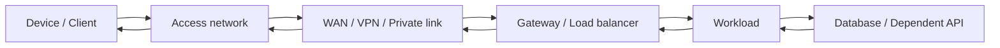
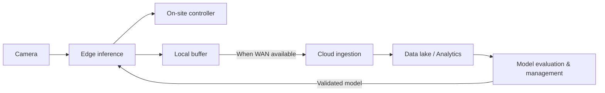

# Choosing execution placement by latency, data, and connectivity

A cloud workload does not necessarily have to run in the same place as all data components and users. An application can process in a central cloud region, in a private data center, at a factory or retail store, or on a gateway device close to the data source. The right placement depends on the response time the application requires, where data is generated and stored, and the ability to keep operating when links are unstable.

This lesson belongs to the **Hybrid and Edge Computing** chapter in the **CLOUD_CORE_SERVICES_COMPUTE** module. Its content helps you select workload placement based on latency, data location and regulations, bandwidth, connection reliability, security requirements, and operational cost. These principles support deploying applications, scaling compute capacity, and maintaining availability across cloud, on-premises, and edge environments.

After this lesson, learners can:

- Distinguish cloud regions, private data centers, edge sites, and edge devices.
- Determine end-to-end latency and the latency budget for each processing step.
- Evaluate requirements for data storage locations, data flows, and data control.
- Select execution placement based on connectivity quality, offline operating capability, and synchronization needs.
- Compare options using non-negotiable criteria and weighted evaluation matrices.
- Design hybrid processing flows with buffering, secure synchronization, and recovery capability.

## 1. Possible workload execution locations

In hybrid and edge architectures, execution location is more than the name of a cloud region. It describes where the workload executes, where data is accessed, and where traffic must traverse to complete a request.

| Location | Characteristics | Suitable for | Considerations |
|---|---|---|---|
| Cloud region | Centralized infrastructure within a cloud provider's geographic region | Shared APIs, large-scale data processing, systems needing managed cloud services | Latency to distant users or data sources; cloud ingress/egress traffic |
| Cloud region near users | Region or zone close to a market, branch, or devices | Interactive applications needing faster response; regional processing | Data may span multiple regions; requires replication and recovery design |
| On-premises data center | Infrastructure controlled by the organization at its own facility | Legacy systems, sensitive data, specialized hardware, or internal integration requirements | Scaling capacity, hardware refreshes, redundancy, and maintenance cost |
| Edge site | Small servers or clusters located at factories, stores, hospitals, or telecom sites | Processing near data sources, needing fast response or continuing when WAN drops | Space, power, cooling, physical security, and on-site operational staffing |
| Edge device/gateway | Industrial devices, IoT gateways, or embedded computers | Filtering, normalization, lightweight inference, local control | Limited CPU, memory, storage, device lifecycle, and update capability |

Not every workload needs to move to the edge. Edge is beneficial when proximity to the data source or user yields measurable gains in latency, bandwidth, autonomous operation, or compliance. If a workload only requires batch processing without fast response requirements, a centralized cloud region is usually easier to operate and scale.

## 2. Latency: measuring the entire request journey

Latency is the time from when an action starts until a useful result is returned. You should not measure only the CPU execution time of a function or container. A request can spend time across multiple segments:

1. The device or client creates the request and sends it over the access network.
2. DNS resolves the service name and a connection is established.
3. Traffic traverses the WAN, VPN, private link, gateway, or load balancer.
4. The workload is queued, processed, and calls dependencies.
5. The result is sent back to the client or device.



End-to-end latency can be approximated as the sum of transmission, connection setup, queuing, processing, and dependency wait times. In practice, some steps may run in parallel or be affected by retries, so use distributed tracing and real measurements rather than simply adding independent estimates.

### Latency budget

Start from the experience or process SLO. For example, if a product inspection system on a production line must make a decision within 100 ms, the design team must allocate budget across camera capture, data transfer, inference, decision-making, and actuator triggering. If sending every image to a distant region causes networking alone to consume almost the entire budget, adding more cloud CPU will not solve the primary bottleneck.

There is no single latency threshold suitable for every workload. A lookup API call may tolerate hundreds of milliseconds; machine control or real-time feedback loops may require far tighter bounds. Derive requirements from actual business processes and hardware, then measure p50, p95, p99, jitter, and timeout rates under both normal and peak load.

### RTT, jitter, and distance

- **Round-trip time (RTT):** the time for a packet to travel from source to destination and back. Applications making many sequential calls suffer the cumulative impact of RTT.
- **Jitter:** the variation in latency. A connection with low average RTT but high jitter can still cause video stuttering, unstable control, or timeouts.
- **Packet loss:** the percentage of packets lost; TCP may have to retransmit, increasing completion time and reducing effective throughput.
- **Throughput:** the amount of data transmitted per unit of time. High throughput does not equate to low latency.

Geographic distance affects propagation time, yet network routing, peering, congestion, encryption, intermediate appliances, and dependency placement also matter. A workload placed near the client that calls a database in a distant region may still be slow because each request crosses the network multiple times. Co-locate frequently communicating components or reduce the number of sequential round trips.

## 3. Data drives processing placement

Workloads typically run close to where data is generated or where data is permitted to be stored. Moving data to compute can cost bandwidth, time, and money; moving compute to data can cut transfer volume while increasing deployment and operational requirements at the new location.

Before choosing placement, classify data using these questions:

- **Data source:** does data come from cameras, sensors, user apps, ERP systems, or industrial equipment?
- **Sensitivity:** does data contain personal, financial, healthcare, trade-secret, or critical operational information?
- **Allowed storage and processing locations:** do contracts, organizational policies, or legal regulations restrict countries, regions, or infrastructure types?
- **Size and frequency:** a few bytes per event, small records, or continuous video at many megabytes per second?
- **Retention period:** how long must data stay at the site, when is it moved to the cloud, and when must it be deleted?
- **Consistency level:** does data need immediate updates across all sites or can it sync asynchronously?

### Data locality and data gravity

Data locality is the requirement to keep or process data in a specific location. Data gravity describes the tendency of applications and dependent services to be pulled toward large concentrations of data due to high transfer costs and latency. Together, these two factors often make it sensible to process raw data where it is created and transfer only results or filtered data to the cloud.

For example, industrial cameras can generate multiple terabytes of video per day. Streaming all video continuously to the cloud can inflate network and storage costs. An edge server can run a defect-detection model and upload only evidence frames, metadata, and anomaly events to the cloud. However, you must define policies for raw video retention, on-site retention duration, how to retrieve data during investigations, and how to ensure data is not deleted before audit workflows complete.

### Residency, sovereignty, and data flows

Data residency refers to where data is stored; data sovereignty relates to jurisdiction and legal control over the data. Placing compute in a region alone does not automatically ensure every data flow is compliant. You must also inspect backups, logs, traces, telemetry, replicas, caches, snapshots, operational support access, and third-party services.

Draw a data flow diagram showing sources, processing locations, primary storage, replicas, access points, and deletion points. For each flow, record data type, purpose, protocol, encryption, retention, and authorized parties. When legal or contractual requirements are unclear, escalate questions to compliance and legal teams before finalizing the architecture.

## 4. Connectivity: can the workload run when links fail?

A hybrid architecture typically depends on connectivity between sites and the cloud. Common options include encrypted Internet, site-to-site VPN, cloud provider private connectivity, enterprise WAN, or SD-WAN. Select connectivity based on latency, bandwidth, privacy, availability, routing capabilities, and cost.

| Connectivity type | Advantages | Limitations and considerations |
|---|---|---|
| Internet + TLS | Widely available, fast to deploy, easy to scale access points | Variable latency and routing; requires endpoint, identity, and attack protection |
| Site-to-site VPN | Encrypted tunnels over public networks; fits multi-site connectivity | Encryption overhead, appliance/gateway throughput limits, and Internet dependence |
| Private connectivity | Dedicated or controlled connection to the cloud, usually more stable and predictable | Higher cost, provisioning lead time, coverage limits, and still needs redundancy |
| SD-WAN / Enterprise WAN | Manages multiple links, path selection, and application-aware policies | Requires operating appliances, controllers, and cloud network integration |
| Local edge connectivity | Lets co-located devices and workloads communicate even when WAN is down | Must manage local LAN, segmentation, hardware, and physical security on-site |

Do not treat a private link or VPN as an absolute guarantee of availability. Identify single points of failure such as routers, firewalls, gateways, power supplies, carriers, and CPE hardware. For critical sites, you may need dual circuits from different carriers, redundant network devices, or physically diverse backup paths. Test real failover because two circuits can still share a single fiber duct or shared device.

### Designing by WAN dependency level

Divide workloads into three tiers:

1. **Must run locally:** safety, control, or minimal transactional functions that must continue when cloud connectivity drops.
2. **Can run locally in degraded mode:** functions using caches, recent data, or fallback rules; accepting limits on certain operations.
3. **Can wait for connectivity:** long-term analytics, report aggregation, backups, or batch jobs that do not need immediate responses.

An offline-first design must specify what data is stored locally, buffer capacity, tolerable outage duration, resynchronization mechanics, and conflict handling. Not every operation can be queued safely: a financial transaction or control command may require central state confirmation before execution.

## 5. Placement selection process

Evaluate in two passes. The first pass eliminates options that violate mandatory constraints. The second pass compares remaining options on suitability and cost.

### Step 1: Define non-negotiable requirements

Document constraints such as:

- End-to-end latency SLO or processing deadline.
- Required regions/jurisdictions where data must be stored or processed.
- Whether the workload must keep running during WAN loss and for how long.
- Required availability, RTO, and RPO.
- Requirements for private networking, encryption, identity, segmentation, and physical controls.
- Equipment or legacy systems forced to stay on the same site.

An option violating a mandatory constraint should be eliminated before scoring. For instance, if regulations require raw data to remain on-premises and never leave the facility, sending all raw data to a public region is unsuitable regardless of low compute cost.

### Step 2: Measure workloads and data flows

Measure requests per second, request/response sizes, data generation rates, dependency call counts, processing times, network latency, packet loss, jitter, and peak windows. Record both percentiles and peak load; averages can mask bottlenecks.

Map dependency graphs and trace data paths. An API might call three services sequentially; if every call crosses the WAN, total latency can be much higher than one large transfer with fewer sequential hops. Optimizing call counts, caching, and batching can alter the placement decision.

### Step 3: Build a list of options

Example for a factory quality-inspection system:

- **Option A:** send images to a cloud region for processing and return results.
- **Option B:** run image inference on an edge server in the factory; send only events and defect images to the cloud.
- **Option C:** process at the edge for fast responses while sending filtered data on-premises or to the cloud for analytics and model training.

Option C can balance latency with centralized analytics, yet adds extra components to deploy, update, and observe. Weigh tangible benefits against the added operational overhead.

### Step 4: Score remaining options

A weighted matrix supports transparent discussion. The example below uses a 1-to-5 scale, where 5 is best fit. Weights and scores are illustrative; project teams must substitute real measurements and priorities.

| Criterion | Example weight | Cloud region | On-site edge | Hybrid edge + cloud |
|---|---:|---:|---:|---:|
| Latency at source | 30% | 2 | 5 | 5 |
| On-site data control | 20% | 2 | 5 | 4 |
| Operation during WAN disruption | 20% | 1 | 5 | 5 |
| Scalability and managed services | 15% | 5 | 2 | 4 |
| Operational simplicity and overall cost | 15% | 4 | 2 | 3 |

Total score is calculated as the sum of `weight × criterion score`. Never use a total score to override a violated mandatory constraint. Also run sensitivity checks: if slightly adjusting latency or cost weights flips the winning option completely, the decision still hinges on assumptions and needs further measurement.

### Step 5: Pilot at the target location

Test with real or closely simulated data and hardware. Measure p95/p99 latency, jitter, packet loss, throughput, startup time, CPU/memory utilization, behavior during WAN outages, and resynchronization time. Test during peak hours, degraded link conditions, and when a dependency is unavailable.

### Step 6: Finalize architecture and recovery plan

Document each component's location, data storage location, connectivity flows, dependencies, failover mechanisms, RTO/RPO, operational owners, and costs. Revisit placement decisions when site counts, data regulations, traffic patterns, or connectivity quality change.

## 6. Selection examples by workload type

| Workload | Key characteristics | Typically suitable location | Processing pattern |
|---|---|---|---|
| Industrial line control | Needs fast response, continuous operation, and potential safety impact | On-site PLCs and control logic; edge assists inference/monitoring | Critical control decisions run locally; cloud handles analytics and governance |
| Camera video analytics | Large, continuous data requiring pre-transmission filtering | Edge near cameras | Detect locally, send metadata and required clips to cloud |
| Retail POS | Transactions need fast response; some actions need central connectivity | POS/store edge combined with cloud services | Cache catalog and buffer events; clearly specify allowed offline transactions |
| E-commerce API | Distributed users, variable load, elasticity needed | Cloud region(s) near user groups or multi-region | Shared APIs and services in cloud; edge/CDN caching for suitable content |
| IoT telemetry collection | Many devices, small payloads at high frequency | Site gateways and cloud ingestion | Filter, batch, compress, and send in batches; buffer during WAN outages |
| Large model training | Needs GPUs, centralized datasets, and elastic resources | Cloud or dedicated compute clusters | Train centrally; distribute validated models to edge for inference |
| Historical reporting and analytics | No real-time response needed, requires aggregated datasets | Cloud data platform or analytics data center | Sync cleaned data via batch or streaming |

### Example: factory product defect inspection

A production line has cameras capturing product images continuously. Controllers must receive classification results within a tight time budget to trigger a reject mechanism. The WAN link to the cloud can drop or fluctuate, so sending images to a region and waiting for results fails operational requirements.

A suitable architecture may include:

1. Cameras stream images to an edge server inside the factory network.
2. The edge server runs model inference and returns results to the controller over a segmented OT network.
3. The edge logs events, product IDs, results, timestamps, and image references; stores locally when WAN is disrupted.
4. When connectivity returns, the edge syncs events and permitted evidence images to the cloud.
5. The cloud aggregates line quality metrics, tracks model versions, analyzes trends, and manages rollout of new models.



In this design, the cloud does not sit on the critical path of real-time decisions. Even so, the edge needs appropriate backup power, storage sized for expected outage durations, thermal and resource monitoring, controlled model updates, and rollback to the previous model. Machine safety logic must follow industrial safety engineering; never delegate essential safety interlocks to a cloud service or uncertified inference model.

## 7. Data synchronization and outage handling

When both edge and cloud write data, define which system is the source of truth for each data type. Otherwise, resynchronization can overwrite newer changes with stale copies or create duplicate records.

### Store-and-forward

Store-and-forward is a common pattern: the edge writes events to a durable local queue or log, then forwards them to the cloud when connected. Each event should carry a unique ID, creation timestamp, source, schema version, and sync state. Cloud consumers must process idempotently so redelivered events do not cause duplicate side effects.

Buffers must have capacity limits and overflow policies: which data types take priority, whether low-value telemetry is dropped, whether new tasks pause, and who receives alerts. Never assume infinite buffers. Size capacity based on data rate, average payload size, maximum WAN outage duration, and safety margin.

### Conflicts and consistency

If multiple sites can update the same record, define conflict resolution rules. Options include single-writer per entity, version numbers, optimistic concurrency, event sourcing, or domain-specific business rules. Last-write-wins is only appropriate when losing an older update is acceptable and cross-site clocks are reliable enough; do not use it by default for critical transactional data.

For data requiring strong consistency, you may need live connectivity to the central system before confirming a transaction. For telemetry or analytical data, eventual consistency is usually acceptable provided sync lag is measured and traceable.

### Recovery when connectivity returns

When the WAN comes back online, do not flush the entire buffer at maximum speed if doing so could saturate the link or disrupt live applications. Use batching, compression, rate limiting, priority queuing for critical events, and backoff on errors. Monitor backlog depth, age of the oldest event, send/receive rates, and retry counts. Confirm data has been received and processed before purging local storage per retention policy.

## 8. Security and distributed operations

Extending compute across many sites multiplies the surfaces that must be secured and managed. A compromised edge node can become a pivot point into internal networks or feed falsified data to the cloud.

- **Device and workload identity:** issue unique certificates or identities per device/site; avoid sharing one key across the entire fleet.
- **Encryption:** enforce TLS or equivalent transport protection in transit; encrypt locally stored data and backups where appropriate.
- **Network segmentation:** isolate OT, IT, management, and guest networks; allow only required flows between zones.
- **Secrets management:** issue, rotate, and revoke credentials from a secrets management system; never embed long-lived keys in images or unprotected config files.
- **Remote updates:** sign artifacts, verify signatures before installation, roll out in small rings, and support rollback.
- **Physical protection:** secure equipment cabinets, debug ports, USB ports, and physical site access.
- **Centralized observability:** collect health, versions, configurations, logs, and alerts while preserving local diagnostics during outages.

An edge fleet requires a device inventory tracking owner, location, serial or internal ID, software version, model, certificate status, and last update timestamp. Do not emit sensitive data into centralized logs unnecessarily. Administrative access should rely on identity, strong authentication, and least privilege.

## 9. Testing and verification before deciding

### Measuring link quality and latency

The commands below help run initial checks from an on-site host to a target endpoint. Results depend on OS, firewalls, and available tools; a successful ping does not prove the application works well, and a failed ping does not necessarily mean TCP/HTTPS is blocked.

```bash
# Measure HTTP response time and break down DNS, TCP, TLS, TTFB
curl -o /dev/null -sS \
  -w 'dns=%{time_namelookup}s connect=%{time_connect}s tls=%{time_appconnect}s ttfb=%{time_starttransfer}s total=%{time_total}s\n' \
  https://service.example.com/health

# Check baseline RTT if ICMP is permitted
ping -c 20 service.example.com

# Inspect network path and potential delay hops (tool varies by OS)
traceroute service.example.com

# On Linux, mtr helps observe per-hop loss and latency
mtr -rw service.example.com
```

Measure repeatedly across different sites and times of day. Use a test endpoint close to the production path, sharing the same DNS, TLS, gateway, and dependencies if possible. Avoid drawing conclusions from a single measurement or from an engineer's laptop alone.

### Verifying data and connectivity

1. Confirm data is created, stored, backed up, and processed in approved locations.
2. Verify routes, DNS, certificates, firewalls, and permissions to dependencies.
3. Disconnect the WAN for a defined window to verify local workloads keep operating in the intended mode.
4. Restore the WAN and verify buffered data syncs without lost or duplicated events.
5. Disable one circuit or gateway to verify failover and measure cutover time.
6. Confirm logs, metrics, and traces correlate requests across edge and cloud.
7. Re-measure p95/p99, jitter, packet loss, and throughput under realistic load.

### Separating network issues from application issues

If DNS fails to resolve, inspect resolvers, zones, and name scope. If TCP times out, check routes, firewalls, security groups, VPNs, and endpoint health. If TCP connects but HTTP is slow, examine TLS, queues, CPU, dependencies, and traces. If failures occur only when the WAN drops, inspect offline logic, timeouts, retries, buffers, and sync state. Layer-by-layer isolation prevents changing placement when the actual root cause is network or application configuration.

## 10. Cost and complexity trade-offs

The cost of an execution location includes more than CPU and memory pricing:

- **Compute and storage:** servers, edge appliances, accelerators, drives, backups, and hardware replacement.
- **Connectivity:** dedicated circuits, VPN gateways, bandwidth, data transfer fees, and egress traffic.
- **Site operations:** power, cooling, racks, floor space, physical security, and on-site support.
- **Fleet management:** provisioning, inventory, monitoring, updates, certificates, configuration, and failed-device handling.
- **Recovery:** redundant nodes, backup links, data replicas, DR drills, and engineering incident response time.
- **Software complexity:** multiple deployment environments, runtime versions, configurations, and synchronization strategies to maintain.

Edge can cut video or raw data transfer costs and reduce response time, but increases hardware and distributed operations overhead. Centralized cloud leverages managed services and on-demand scaling, yet continuous data streaming or chatty remote dependency calls can raise network costs and latency. Hybrid often makes sense when workload components have distinct traits, provided you have lifecycle management and end-to-end observability.

Compare total cost of ownership (TCO) over the same time horizon, covering capital, operations, connectivity, staffing, incidents, and hardware replacement. Do not compare a cloud instance hourly rate directly against buying one edge server; include operational effort and hardware utilization over the full lifecycle.

## 11. Practice exercise

A retail chain has 40 stores. Each store needs to look up products, record transactions, and sustain partial operations when connectivity to the cloud is disrupted. Propose placement for the following components: POS interface, catalog cache, transaction processing, central transaction database, and chain-wide reporting.

Follow these steps:

1. Define latency budgets for product lookup and transaction confirmation; specify which actions must operate during a WAN outage.
2. Classify catalog, transaction, customer, and log data by sensitivity, storage location, and retention period.
3. Diagram two options: full cloud processing vs. POS/store edge combined with cloud.
4. Estimate bandwidth for syncing transactions and logs across 40 stores; size buffer capacity for an assumed outage duration.
5. Define offline rules: permitted transaction types, limits, idempotency, conflict handling, and staff status notifications.
6. Evaluate primary and backup links; simulate WAN loss and recovery to test synchronization.
7. Score options across latency, data, connectivity, security, scalability, and TCO; state mandatory constraints and assumptions still needing validation.

Deliverables should include placement diagrams, data flows, a decision matrix, an outage test plan, and an operational risk list. Do not assume all transactions are safe offline; specify which transactions require verification or reconciliation with the central system.

## 12. Placement selection checklist

- [ ] SLOs and end-to-end latency budgets are defined from business requirements.
- [ ] Measured p50/p95/p99, RTT, jitter, packet loss, and throughput from real user/device locations.
- [ ] Mapped dependency graphs and identified where data is created, stored, processed, and backed up.
- [ ] Verified data residency, jurisdiction, contracts, and applicable data policies.
- [ ] Classified functions into must-run-locally, degraded-local, and wait-for-connectivity tiers.
- [ ] Defined bandwidth, tolerable WAN outage duration, and required buffer capacity.
- [ ] Designed identity, encryption, network segmentation, and secure updates for every site.
- [ ] Specified source of truth, idempotency, synchronization, and data conflict resolution.
- [ ] Tested link failover, dependency loss, controlled power loss, and sync recovery.
- [ ] Compared TCO covering compute, connectivity, hardware, staffing, and recovery.
- [ ] Assigned operational owners at both sites and in the cloud.
- [ ] Documented assumptions, measurements, limits, and triggers to revisit placement.

Good placement meets response-time, data, and connectivity requirements under real operating conditions. Centralized cloud, on-premises, and edge each serve distinct roles; an effective hybrid architecture puts each function where it fits best, bounds necessary data flows, and maintains safe operations when connectivity changes.
