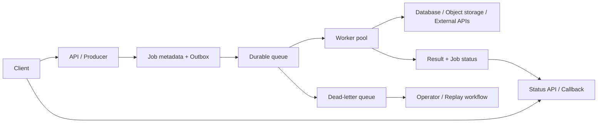
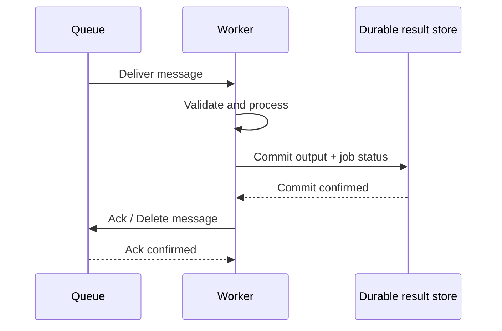
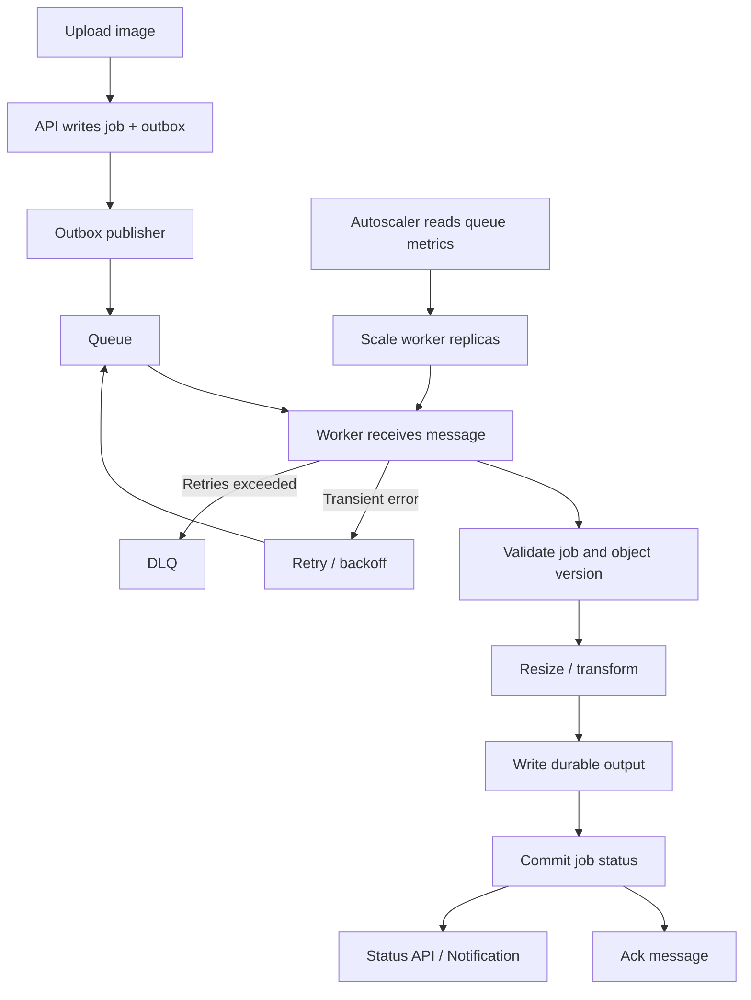

# Designing Queue-Scaling Asynchronous Workers

## Learning Objectives

After this lesson, you will be able to:

- Describe the architecture of producers, durable queues, worker pools, and result stores.
- Determine when to decouple processing from synchronous requests using queues.
- Design a safe message receive, process, commit, and acknowledge lifecycle when workers can crash or run duplicates.
- Choose appropriate visibility timeouts, leases, heartbeats, retries, backoff, and dead-letter queues.
- Estimate worker counts from backlog, message arrival rate, processing duration, and deadlines.
- Design autoscaling based on queue depth, oldest message age, throughput, and in-flight message counts.
- Tune concurrency, prefetch, and batch sizes to protect dependencies.
- Scale down and deploy new versions without losing in-progress work.
- Control ordering, fairness, idempotency, security, and costs.
- Monitor SLOs and handle situations such as growing queues, worker failures, or overloaded dependencies.

## 1. Why Do We Need Asynchronous Workers?

An HTTP request typically needs a fast response, whereas the work behind it may take several seconds or minutes. For example:

- Generating thumbnails and transcoding videos after users upload files.
- Sending emails, SMS, or push notifications.
- Aggregating large reports.
- Processing orders and updating fulfillment status.
- Running security scans or data analysis.
- Calling multiple external systems to complete a workflow.
- Generating embeddings or running batch inference.

If the API holds connections open for the entire processing duration, requests can time out, tie up connections, and increase load on the web tier. When downstream services slow down, synchronous requests can pile up and cascade failures across the whole system.

An asynchronous architecture separates request acceptance from work completion:

1. The API authenticates the request and records the job.
2. A message describing the work is pushed to a durable queue.
3. The API returns a job ID or an accepted status.
4. Workers pull messages, execute processing, and store results.
5. Clients query status or receive a callback/event upon completion.

Queues absorb load fluctuations. Workers can scale up when the backlog grows and scale down when the backlog shrinks. The API does not need to spawn a new worker per request.

### 1.1. High-Level Architecture



Components may span multiple services or reside on a single platform. Queues do not need to carry full large payloads; messages can simply hold a job ID and references to durable data.

### 1.2. When Should You Use a Queue?

| Need | Synchronous Processing | Asynchronous Worker |
|---|---|---|
| User feedback | Wait until completion | Return accepted status and job ID |
| Processing duration | Short, predictable | Long or variable |
| Load fluctuations | API must absorb load directly | Queue absorbs backlog |
| Retries | Typically tied to request/client | Can retry independently in workers |
| Scaling | Scale API by requests | Scale workers by backlog |
| Slow dependencies | Easily ties up connections and cascades errors | Can throttle consumption rate |
| Tracking | Request trace | Job ID, message ID, and attempt |

Not every operation belongs in a queue. If users need immediate results and the operation completes very quickly, synchronous request/response is simpler. Queues fit when delayed results are acceptable and load or lifecycle decoupling is needed.

## 2. Components and Responsibilities

A worker system can consist of the following components:

| Component | Responsibility |
|---|---|
| Producer | Authenticates requests, creates jobs, and publishes messages |
| Durable queue | Stores messages, delivers to consumers, and retains unacknowledged messages |
| Worker | Receives messages, executes business logic, and writes results |
| Result store | Persists outputs and job status durably |
| Coordinator/control plane | Manages retries, leases, scheduling, concurrency, and autoscaling |
| Dead-letter queue (DLQ) | Holds messages that have exceeded the retry policy |
| Scheduler/autoscaler | Increases or decreases worker count based on load and policies |
| Monitoring | Measures backlog, age, throughput, errors, duration, and cost |
| Operator/runbook | Investigates, replays, and resolves failed messages |

### 2.1. What Should a Message Contain?

A message should contain enough information for a worker to locate and process the work, without carrying huge payloads or long-lived secrets.

Example message:

```json
{
  "message_id": "msg-01JXYZ",
  "job_id": "job-20261122-0042",
  "job_type": "image.resize",
  "schema_version": 2,
  "tenant_id": "tenant-17",
  "input": {
    "object_key": "uploads/2026/11/photo-42.jpg",
    "object_version": "v8"
  },
  "requested_at": "2026-11-22T08:30:00Z",
  "deadline_at": "2026-11-22T08:45:00Z",
  "correlation_id": "req-7f13"
}
```

This is an illustrative structure. Real messages must be schema-validated and size-bounded. Workers should fetch payloads from object storage or databases by reference, verifying versions and access permissions before processing.

Useful fields:

- Unique message ID.
- Job ID stable across retries.
- Job type and schema version.
- Tenant or partition key if fairness/ordering is required.
- Input references and versions.
- Creation timestamp, deadline, and correlation ID.
- Non-sensitive metadata for routing.

Never put passwords, access tokens, or private keys in messages. Queues are typically persisted durably and can appear in logs, DLQs, or backups.

## 3. Choosing Queue Models and Delivery Semantics

Queue systems have varying semantics. Before designing workers, define how messages are delivered, acknowledged, retained, and redelivered.

### 3.1. Competing Consumers

Multiple workers read from a single queue. The queue dispatches messages to available workers; each worker processes one or more messages.

This model fits independent tasks and scales throughput by adding workers. However, it does not automatically guarantee completion order or global processing order.

If messages A and B have a dependency relationship, you cannot assume a worker finishes A before B simply because A was enqueued first.

### 3.2. At-Most-Once, At-Least-Once, and Exactly-Once

- **At-most-once:** a message is delivered at most once; if a worker or network fails, the message may be lost.
- **At-least-once:** a message may be redelivered until acknowledged or retention expires; workers may process duplicates.
- **Exactly-once:** the system guarantees an effect is committed once within defined semantic boundaries. This typically requires transactions, deduplication, or idempotency; never assume an entire workflow and every external API automatically execute once.

Many popular queues provide at-least-once delivery. Therefore, workers must be designed to tolerate duplicate deliveries.

### 3.3. Queues, Topics, and Streams

| Type | Model | Common Use Cases |
|---|---|---|
| Work queue | One message is successfully processed and acknowledged by one consumer | Sending emails, resizing images, order processing |
| Pub/sub topic | One event is distributed to multiple subscriptions | Multiple services reacting to the same event |
| Partitioned log/stream | Messages live in partitions and consumers read by offset | Event streaming, replay, and continuous processing |

A topic can feed multiple subscriptions, each with its own queue/offset. Streams typically have different retention and offset semantics from traditional queues. Do not use queue, topic, and stream interchangeably when designing acks, ordering, or replay.

### 3.4. Ordering and Partition Keys

If ordering is needed per entity—for example, all events for the same order must process sequentially—use a partition key or message group ID keyed on the order ID if the service supports it.

Keep in mind:

- Ordering is generally guaranteed only within a single partition or message group.
- A hot partition key can create a bottleneck.
- Multiple workers can process different keys in parallel.
- Retrying one message can block subsequent messages in the same group in some FIFO queues.
- Ordering does not replace version checks or business state validation.

Require ordering only at the narrowest necessary scope. Global ordering generally degrades parallelism.

## 4. Message Processing Lifecycle

A safe worker typically executes this sequence:

1. Receive a message from the queue.
2. Validate schema, job type, deadline, and input references.
3. Check whether the job has already completed previously.
4. Acquire a lease or processing right if the architecture requires a coordinator.
5. Execute business logic with an idempotency key.
6. Persist outputs and completion status durably.
7. Commit associated side effects or transactions.
8. Acknowledge the message (ack/delete/commit offset) after results are durable.
9. Record metrics and logs tagged with job ID, message ID, and attempt.

The critical point is the ordering of result commit vs. message acknowledgment. If you ack the message before saving results, the worker could crash in between and lose the job from the queue.

### 4.1. Ack After Commit

Common safe pattern:



If the worker dies after commit but before ack, the queue may redeliver the message. The next worker must recognize the job is already committed and return success without repeating side effects. This accepts at-least-once delivery while protecting business effects via idempotency.

### 4.2. Why You Cannot Rely on Ack Alone for Exactly-Once

Queues and databases are usually two independent systems. Without a shared distributed transaction, a worker cannot atomically commit to the database and ack the queue in every failure scenario.

There are two failure windows:

- Ack first, commit later: the message is lost if the worker crashes after ack.
- Commit first, ack later: the message is redelivered if the worker crashes between the two operations.

The standard choice is commit first, ack second, using idempotency/deduplication to handle redeliveries.

## 5. Idempotency and Preventing Duplicate Processing

An idempotent operation can be executed multiple times while producing the same final effect as executing it once, within defined bounds.

For example, instead of adding 100 points every time a message arrives, the worker records `"job X added 100 points"` with a unique key so a second execution does not add points again.

Techniques:

- Use a unique job ID or idempotency key.
- Enforce unique constraints in the database.
- Conditional inserts/updates.
- Transactions storing outputs and job status together.
- Deterministic output keys derived from job ID and version.
- Deduplication records with appropriate retention.
- Fencing tokens if a stale worker might keep running after its lease expires.

### 5.1. Database Transaction Pattern

Conceptual example:

```sql
BEGIN;

INSERT INTO processed_jobs(job_id, completed_at)
VALUES ('job-42', CURRENT_TIMESTAMP)
ON CONFLICT (job_id) DO NOTHING;

-- Execute business changes only if job_id was just inserted.
-- The application checks the inserted row count before executing side effects.

COMMIT;
```

This is PostgreSQL-style pseudo-SQL; actual business statements must execute inside the same transaction and run only if the deduplication insert wins the right to process. Never call non-rollbackable external APIs inside a transaction and assume the database can undo external side effects.

### 5.2. Transactional Outbox on the Producer

A common bug: the API writes a job to the database but fails to send the message to the queue, or sends the message successfully and then rolls back the database transaction. Job state and queue state diverge.

The transactional outbox solves this by writing both the job and an outbox event in the same database transaction. A separate publisher reads the outbox and sends events to the queue; after a successful send, it marks the event as published.

Flow:

1. The API opens a transaction.
2. Writes job metadata.
3. Writes an outbox event.
4. Commits the transaction.
5. The publisher reads unpublished events.
6. Publishes messages to the queue.
7. Marks the outbox events as sent.

The publisher can still send duplicates if it crashes after publishing but before marking sent. Consumers still require idempotency.

### 5.3. Side Effects on External Systems

If a worker calls payment, email, or partner APIs, pass an idempotency key supported by the target system when available. Otherwise, store intent/result state and design reconciliation workflows.

Exactly-once guarantees for an external API cannot be achieved solely by marking a message processed in the queue. Understand the target API's retry contract and transaction lookup capabilities.

## 6. Visibility Timeouts, Leases, and Heartbeats

In visibility-timeout queues, when a worker receives a message, it becomes temporarily invisible to other consumers. If the worker does not ack before the timeout expires, the message reappears.

Some systems use time-bounded leases or locks instead of visibility timeouts. Names differ, but the problem is identical: workers must renew processing ownership when work runs long.

### 6.1. Choosing a Visibility Timeout

Visibility timeout should be long enough for normal processing, including commit and ack, yet not so long that messages stay stuck for ages when a worker crashes.

If the timeout is too short:

- Messages can be redelivered while the first worker is still processing.
- Two workers may run the same job concurrently.
- Produces duplicate side effects and extra load.

If the timeout is too long:

- When a worker crashes, messages wait a long time before redelivery.
- Recovery time increases.
- Queue age and deadlines degrade.

### 6.2. Heartbeats / Visibility Extensions

For tasks with variable execution duration, workers can periodically extend visibility/leases.

Example rules:

- Send heartbeats at an interval significantly shorter than the lease duration.
- Renew only while the worker still owns the task and is making progress.
- Emit metrics for renewal counts and renewal failures.
- Abort writing outputs if ownership cannot be confirmed.
- Use fencing tokens or conditional commits to prevent a stale worker from writing results after the lease has been granted to a new worker.

A heartbeat should not be an unconditional timer. If the main process hangs while a heartbeat thread keeps running, messages can remain locked indefinitely. Tie heartbeats to actual progress, deadlines, and worker health.

### 6.3. Graceful Shutdown

When a Pod is terminated due to scale-down, rollout, or node drain:

1. The worker stops pulling new messages.
2. Completes in-progress messages if enough time remains within the termination grace period.
3. If unable to finish, halts safely and lets messages be redelivered.
4. Never acks uncommitted messages.
5. Closes connections and flushes telemetry.
6. Exits before the grace period expires.

If the queue supports negative acknowledgement or visibility release, the worker can explicitly return messages to the queue. Otherwise, allow the visibility timeout to expire. This choice must weigh the risk of a stale worker still running alongside idempotency protections.

## 7. Retries and Dead-Letter Queues

Not all errors should be retried. Retries help with transient failures but worsen permanent errors.

### 7.1. Error Classification

| Error Type | Examples | Handling |
|---|---|---|
| Transient | Network reset, brief timeout, 503 service unavailable | Retry with backoff |
| Throttling | API returns 429 or Retry-After | Lower concurrency, honor wait duration |
| Capacity | Worker out of RAM, queue cannot provision instances | Adjust resources or capacity |
| Data poison | Malformed payload schema or invalid record | Route to DLQ/quarantine; do not retry indefinitely |
| Permanent | Missing permissions, nonexistent resource, misconfiguration | Stop retrying and alert operations |
| Duplicate | Message redelivered after commit | Idempotency and ack |
| Dependency outage | Target database or API is down | Circuit breaker, backoff, and retry limits |

### 7.2. Exponential Backoff and Jitter

Reference formula:

\[
delay_n = \min(delay_{max}, base \times 2^n) + jitter
\]

Where `n` is the retry attempt number. Jitter prevents multiple workers from retrying at the exact same instant. When an API returns `Retry-After`, prioritize honoring that guidance.

Never retry continuously on a tight fixed interval when a dependency is overloaded. Retry storms amplify request rates, queue backlogs, and recovery time.

### 7.3. Dead-Letter Queues

A DLQ receives messages that exceed defined delivery counts or retry conditions. It helps:

- Isolate failing messages so they do not block the main queue.
- Inspect payloads, exceptions, and attempt histories.
- Fix data or code and replay in a controlled manner.
- Track error types and affected tenants.

A DLQ is not an indefinite storage bin. It needs retention policies, access control, encryption, alerting, and a remediation workflow.

### 7.4. Safe DLQ Replay

Before replaying:

1. Confirm the root cause has been fixed.
2. Verify schema and consumer version compatibility.
3. Determine whether messages already produced side effects.
4. Preserve original job IDs/idempotency keys when replaying the same business action.
5. Throttle replay rate to avoid overloading dependencies.
6. Monitor success, retry, and re-DLQ rates.
7. Audit who initiated the replay and why.

Never purge a DLQ just to make a queue dashboard drop to zero. Messages may hold valid work requiring recovery.

## 8. Designing Worker Pools and Concurrency

A worker process can handle one message at a time or multiple messages concurrently. High concurrency boosts throughput but also increases memory usage, connections, lock contention, and downstream load.

### 8.1. Concurrency per Worker

Suppose each Pod has 4 vCPUs and 8 GiB RAM. If one task uses 1 vCPU and 1 GiB RAM, theoretically several tasks could run concurrently, yet you still must reserve headroom for the runtime, caches, logging, and peak spikes.

Benchmark:

- CPU and memory per task.
- Database/API connection count.
- Disk I/O and network bandwidth.
- Processing duration p50/p95/p99.
- Lock contention and garbage collection.
- Number of in-flight messages.

Set concurrency according to real bottlenecks, not solely core counts.

### 8.2. Prefetch and Batch Receive

Workers can prefetch multiple messages to reduce round-trips to the queue. However, overly high prefetch locks messages inside busy workers, making the queue appear to have less backlog while actual wait times grow.

If a worker only processes 5 messages concurrently yet prefetches 100, 95 messages sit in memory or in-flight state unprocessed. This causes autoscalers watching only visible queue depth to underestimate load.

Keep prefetch close to useful concurrency, or monitor both in-flight counts and oldest message age. With batch receive, acknowledge messages individually per service semantics; one bad message does not necessarily require losing the others.

### 8.3. One Process or Multiple Pods?

| Model | Advantages | Trade-offs |
|---|---|---|
| One worker process, internal concurrency | Fewer Pods, low startup overhead, shared connection pools | One process crash affects multiple in-flight tasks |
| Multiple processes in one Pod | Utilizes multi-core CPU with process isolation | Shared resource limits, complex lifecycle |
| One worker per Pod | Clean resource isolation and rollouts | Higher scheduling and Pod overhead |
| One Pod with multiple worker threads | Efficient for I/O-bound tasks | Requires careful thread safety and memory control |

Choose based on isolation needs, startup overhead, CPU-bound vs. I/O-bound profile, and how the runtime handles shutdown.

## 9. Queue-Based Autoscaling

The goal of autoscaling is to provide enough workers to drain backlogs within SLOs without over-provisioning and overloading downstream systems.

Never scale solely on CPU. I/O-bound workers waiting on databases or APIs can show low CPU even as queues grow. Queue metrics reflect processing demand more directly.

Common signals:

- Visible backlog: messages waiting to be processed.
- Oldest message age: age of the longest-waiting message.
- Arrival rate: rate of incoming messages.
- Completion rate: rate at which workers finish jobs.
- In-flight/unacked: messages delivered but not yet acknowledged.
- Processing duration: time spent executing tasks.
- Deadline misses or queue wait SLOs.
- Worker utilization and dependency saturation.

### 9.1. Scaling by Backlog per Worker

A simple approach:

\[
N_{\text{workers}} =
\left\lceil
\frac{Backlog}{TargetBacklogPerWorker}
\right\rceil
\]

Example:

- Current backlog: 1,200 messages.
- Target: 40 queued messages per worker.
- Desired workers: 30.

Bound this with min/max replicas, quotas, node capacity, and downstream limits. This formula does not directly account for task duration or arrival rate; it works best when messages are relatively uniform.

### 9.2. Scaling by Arrival Rate and Service Time

You can estimate required workers from arrival rate and average service time:

\[
N \approx \frac{\lambda \times S}{U}
\]

Where:

- λ: arrival rate, in messages/second.
- S: average service time, in seconds/message.
- U: target utilization, less than 1 to retain headroom.

For example, if the system receives 20 messages/second, each takes 5 seconds on average, and you target 70% worker utilization:

\[
N \approx \frac{20 \times 5}{0.7} \approx 143
\]

If each worker processes 5 messages concurrently, the theoretical Pod count can be lower, though intra-Pod resource usage and contention must be accounted for. Use p95 service time or a safety factor when deadlines are strict; averages alone can underestimate capacity when long-tail tasks exist.

### 9.3. Backlog Is Not the Whole Story

Two queues with 1,000 messages each may require vastly different worker counts:

- Queue A holds 100 ms tasks.
- Queue B holds 60-second tasks.
- Queue C holds tasks calling a rate-limited API.
- Queue D holds messages past their deadlines.

Monitor oldest age and service time alongside backlog. If new messages arrive faster than completion rate, the queue will keep growing even at 100% worker utilization.

### 9.4. Scale Down with Hysteresis

Scale up quickly when backlog spikes, but scale down more slowly to prevent replica flapping.

Techniques:

- Cooldown periods after scaling up.
- Stabilization windows for scale-down.
- Minimum replicas for baseline capacity.
- Lower scale-down threshold compared to scale-up threshold.
- Scale down only when oldest age and in-flight counts stabilize.
- Drain workers before termination.

Scaling down too aggressively terminates Pods mid-task; messages get redelivered, raising duplicates and retries. Scaling down too slowly increases idle costs.

## 10. Scale-to-Zero and Worker Cold Starts

For sparse or batch-oriented workloads, scale-to-zero saves costs. When messages arrive in the queue, the autoscaler activates workers.

Consider:

- Polling interval or event activation delay.
- Pod creation and node provisioning time.
- Image pull, startup, and warm-up duration.
- Time messages wait in the queue before workers are ready.
- Autoscaler scale-from-zero limits.
- Whether queue metrics are still collected when zero workers exist.

Scale-to-zero is unsuitable if SLOs demand sub-second or few-second responses while provisioning new nodes takes minutes. Keep a small baseline worker or warm capacity to absorb cold starts.

### 10.1. Scale-to-Zero with KEDA

KEDA can monitor event/queue sources and create or adjust an HPA to scale workloads by metrics. Illustrative example using the RabbitMQ scaler:

```yaml
apiVersion: keda.sh/v1alpha1
kind: ScaledObject
metadata:
  name: image-worker
  namespace: processing
spec:
  scaleTargetRef:
    name: image-worker
  pollingInterval: 15
  cooldownPeriod: 120
  minReplicaCount: 0
  maxReplicaCount: 40
  triggers:
    - type: rabbitmq
      metadata:
        protocol: amqp
        queueName: image-resize
        mode: QueueLength
        value: "30"
        hostFromEnv: RABBITMQ_HOST
```

This example must be checked against your KEDA version and authentication setup. Secrets/connection strings should be supplied via a `Secret` or `TriggerAuthentication` per cluster mechanisms, not hardcoded in manifests. The target value represents queue length per scaler semantics, not a completion-time guarantee.

Key parameters to design:

- `pollingInterval`: how often KEDA checks triggers.
- `cooldownPeriod`: wait period before scaling back to min replicas after triggers go inactive.
- `minReplicaCount`: baseline capacity; setting 0 enables scale-to-zero.
- `maxReplicaCount`: worker ceiling protecting dependencies and budget.
- Trigger metric: queue length or equivalent backend metric.

KEDA does not automatically solve idempotency, retries, or graceful shutdown. Worker applications must still handle all of those.

### 10.2. HPA with External Metrics

You can use Horizontal Pod Autoscaler with external/custom metrics if the cluster has an appropriate metrics adapter. Example metrics include queue messages per worker or oldest message age.

HPA simply adjusts replicas based on the provided metric. Define metric type, target semantics, scrape delay, and zero-replica calculation behavior. For scale-to-zero, KEDA or an event-driven activation mechanism is often more practical than plain HPA depending on versions and setup.

## 11. Protecting Dependencies with Backpressure

Autoscalers can add workers faster than databases, partner APIs, or object storage can handle. If every worker opens connections and fires requests concurrently, queue backlog may shrink while downstream dependencies collapse.

Backpressure throttles consumption speed to match downstream capacity.

Mechanisms:

- Max replicas to cap total workers.
- Concurrency limits within each worker.
- Rate limits per dependency or tenant.
- Circuit breakers when dependencies fail.
- Retries with exponential backoff and jitter.
- Separate queues for workloads with distinct dependencies.
- Bulkheads so failures in one task type do not exhaust all workers.
- Pausing consumers when a dependency is overloaded.
- Reducing prefetch as in-flight counts climb.
- Token buckets or distributed semaphores when cluster-wide limits are needed.

### 11.1. Splitting Queues by Workload Type

If a single queue holds both lightweight image resizes and heavy video transcodes, shared workers can starve quick tasks when heavy jobs consume all capacity.

You can split by:

- Job type.
- Priority level.
- Tenant class.
- Dependency or resource profile.
- Separate queues for GPU vs. CPU tasks.

Splitting queues enables independent scaling and resource limits, at the cost of more components to operate and explicit routing/retry rules.

### 11.2. Fairness Across Tenants

One tenant submitting a massive batch can monopolize all workers. Mitigations include:

- Dedicated queues per tenant or tenant tier.
- Weighted fair scheduling.
- Per-tenant concurrency quotas.
- Producer rate limiting.
- Bounded priority classes to prevent starvation.
- Aging so long-waiting tasks gain priority over time.

Do not assign high priority to every tenant; if all messages are high priority, the policy loses meaning.

## 12. Guaranteeing Deadlines and Completion Times

A queue worker can have high throughput and still miss deadlines if messages wait too long or tasks have heavy long tails.

Distinguish:

- Enqueue-to-start latency: time from enqueue until a worker begins processing.
- Processing duration: time spent executing the task.
- Commit/ack duration: time to persist outputs and acknowledge.
- End-to-end completion: time from initial request to final output.
- Oldest message age: age of the longest-waiting message.
- Deadline miss rate: share of jobs finishing past their deadlines.

### 12.1. Estimating Backlog Drain Time

If the backlog has `B` messages, the worker pool completes `R` messages/second on average, and new messages arrive at `λ` messages/second (with `R > λ`), the approximate time to drain the backlog is:

\[
T_{\text{drain}} \approx \frac{B}{R-\lambda}
\]

For example, with a backlog of 6,000 messages, workers completing 50 messages/second, and producers sending 20 messages/second:

\[
T_{\text{drain}} \approx \frac{6000}{50-20}=200 \text{ seconds}
\]

If `R <= λ`, the backlog will not shrink. This is a simplified model assuming steady rates, uniform messages, and no retries or dependency bottlenecks.

### 12.2. Deadline-Aware Priority

When messages have deadlines, a worker system can:

- Prioritize closer deadlines.
- Separate queues by SLA.
- Bound wait times before spilling to overflow capacity.
- Drop or transition expired jobs per business policy.
- Reserve baseline capacity for high-priority tiers.

FIFO queues do not automatically implement earliest-deadline-first scheduling. If prioritization is required, choose queue types, partitions, or schedulers that support those semantics. Avoid wasting capacity on already-expired messages that delay still-valid jobs.

## 13. Deploying Workers on Kubernetes

A worker Deployment typically defines:

- Container image with code and dependencies.
- ServiceAccount/workload identity.
- Resource requests/limits.
- Environment/secret references for the queue.
- Appropriate liveness/readiness/startup probes.
- Graceful termination settings.
- Autoscaler driven by queue metrics.
- PodDisruptionBudget if baseline replicas must be protected.
- Node affinity/tolerations when workers need specialized compute.

Minimal example Deployment:

```yaml
apiVersion: apps/v1
kind: Deployment
metadata:
  name: image-worker
  namespace: processing
spec:
  replicas: 2
  selector:
    matchLabels:
      app: image-worker
  template:
    metadata:
      labels:
        app: image-worker
    spec:
      terminationGracePeriodSeconds: 90
      serviceAccountName: image-worker
      containers:
        - name: worker
          image: registry.example.com/media/image-worker:2.4
          env:
            - name: QUEUE_NAME
              value: image-resize
            - name: WORKER_CONCURRENCY
              value: "4"
            - name: RABBITMQ_HOST
              valueFrom:
                secretKeyRef:
                  name: queue-connection
                  key: host
          resources:
            requests:
              cpu: "1"
              memory: "1Gi"
            limits:
              cpu: "2"
              memory: "2Gi"
          lifecycle:
            preStop:
              exec:
                command: ["/app/worker", "drain"]
```

This illustrative manifest must be adapted to your runtime and signal-handling logic. The `preStop` command must exist inside the image and genuinely switch the worker into drain mode. Never assume Kubernetes automatically knows which messages a worker is currently processing.

### 13.1. Readiness and Liveness

Worker readiness does not have to mirror a web service. Workers usually do not receive Service traffic, yet they can still use readiness or internal health signals to indicate task acceptance capability.

- **Startup probe:** gives workers time to boot and load configs/models before being marked failed.
- **Liveness probe:** detects hung or unrecoverable processes.
- **Readiness/worker-ready signal:** indicates the worker is connected to the queue and ready to consume.
- **Drain state:** stops pulling new messages when preparing to shut down.

Probes must never mark a worker unhealthy simply because the queue is temporarily empty. Overly sensitive liveness probes trigger restart loops and increase duplicate deliveries.

### 13.2. Graceful Termination in Kubernetes

When a Pod receives SIGTERM:

1. Enter draining state.
2. Stop polling or accepting new messages.
3. Complete in-flight tasks if sufficient time remains.
4. Extend visibility/leases while finishing if needed.
5. If unable to complete in time, abort cleanly before grace period expiration without acking.
6. Flush logs/metrics and close connections.
7. Exit before Kubernetes sends SIGKILL.

`terminationGracePeriodSeconds` should exceed expected drain duration without being unbounded. For very long tasks, checkpointing or returning messages to the queue can be safer than waiting indefinitely for Pod exit.

### 13.3. PodDisruptionBudgets and Node Drains

A PodDisruptionBudget limits concurrent voluntary disruptions. It helps worker pools maintaining baseline capacity, though it does not prevent node crashes or all evictions.

If workers can scale to zero, a PDB does not replace graceful shutdown. When workers process retryable tasks, evaluate PDBs alongside queue semantics, visibility timeouts, and reserve capacity.

## 14. Updating Workers and Message Schemas

Producers and consumers may deploy at different times. Older messages can still sit in the queue when a new worker version rolls out.

Compatible design:

- Include `schema_version` in every message.
- Support at least all schema versions still within queue retention.
- Make field changes additive whenever possible.
- Never alter existing field semantics without versioning.
- Provide migration/replay steps for older messages.
- Inspect DLQs and queue backlogs before dropping support for old schemas.

### 14.1. Rolling Deployments

During a worker rollout:

- New Pods must become ready before old Pods are removed.
- Old Pods stop pulling new messages.
- In-flight tasks finish or return to the queue for redelivery.
- New images remain compatible with older queued messages.
- Do not change idempotency keys or output contracts mid-flight.
- Watch error rates, retries, and queue age throughout rollout.

If a new worker introduces a bug and corrupts processing, halt the rollout, preserve the queue, and replay from the DLQ or durable source after fixing. Never purge the queue as a shortcut for rolling back.

## 15. Security for Queues and Workers

Messages can carry business data and remain stored durably. Workers often hold credentials to databases, object storage, and external APIs, so privileges must be tightly scoped.

Principles:

- Use dedicated workload identities or service accounts per worker type.
- Grant consume access only to required queues.
- Separate publish, consume, purge, and queue administration permissions.
- Encrypt connections with TLS and encrypt stored messages per platform support.
- Never embed secrets in images, command lines, or messages.
- Retrieve secrets from a secret manager.
- Restrict network egress to required dependencies.
- Validate messages and verify tenant authorization inside workers.
- Bound payload sizes and guard against unsafe deserialization.
- Audit replay, purge, DLQ, and policy changes.
- Enforce retention and access controls on DLQs.

Do not blindly trust a tenant ID in a message just because a producer sent it. Workers must still verify which tenant owns the job and whether the current identity is authorized to act on that data.

## 16. Observability and SLOs for Queue Workers

CPU utilization alone cannot tell you whether a worker system is healthy. You need metrics covering queues, flow rates, outcomes, and dependencies.

| Group | Metrics | Meaning |
|---|---|---|
| Queue | Visible messages, in-flight/unacked, oldest age | Backlog and held messages |
| Flow | Enqueue rate, dequeue rate, completion rate | Inflow/outflow speeds |
| Worker | Active workers, busy slots, idle slots | Utilized capacity |
| Processing | Duration p50/p95/p99, timeouts | Execution latency |
| Reliability | Success, retry, duplicate, failure, DLQ rates | Processing reliability |
| Scaling | Desired/current replicas, scale events, provisioning delay | Autoscaling effectiveness |
| Dependency | DB latency, API 429/5xx, connection pools, storage errors | Downstream bottlenecks |
| Business | Job completion, deadline misses, output validation | Business outcomes |
| Cost | Worker-hours, queue cost, storage, data transfer | Operational cost |

### 16.1. Measure SLOs End-to-End

Illustrative SLO examples:

- 99% of high-priority jobs start processing within 30 seconds.
- 99% of image resizes finish within 3 minutes.
- Post-retry job failure rate below 0.1%.
- DLQ depth does not grow continuously.
- Zero loss of jobs acknowledged as accepted by the API.

Thresholds must derive from product requirements and real measurements. Never treat a queue depth of 0 as your sole SLO; a queue can be empty because producers stopped sending or consumers are failing silently.

### 16.2. Logs and Traces

Every log entry should carry these IDs:

- `job_id`.
- `message_id`.
- `correlation_id`/`trace_id`.
- `tenant_id` or tenant class if non-sensitive.
- `attempt_number`.
- `worker_id` and version.
- `queue_name`.
- `partition`/message group.
- Processing stage.

Never log sensitive payloads or secrets. Distributed traces should connect API enqueue, publisher, queue consumer, and dependency calls; queues must propagate trace context in an agreed format.

## 17. Cost and Worker Sizing

Worker cost depends on replica counts, resource requests, runtime duration, node pools, queue service usage, storage, and dependencies.

### 17.1. Estimating Workers by Throughput

If each worker averages `μ` messages/second and there are `N` workers, approximate theoretical throughput is:

\[
R = N \times \mu
\]

To shrink a backlog, `R` must exceed the arrival rate over the drain window. However, `μ` varies by message type, dependencies, and concurrency. Measure real throughput rather than extrapolating from single-task microbenchmarks.

### 17.2. Resource-Based Worker Sizing

For CPU-bound workers:

- Track CPU utilization, throttling, and task duration.
- Allocate enough CPU to prevent excessive throttling.
- Benchmark concurrency per core.

For I/O-bound workers:

- Track connection pools, network waits, and dependency latency.
- Concurrency can exceed CPU count, but total connections must be bounded.
- Avoid holding too many messages in-flight simultaneously.

For memory-heavy workers:

- Measure peak RSS and cgroup memory usage.
- Bound batch sizes and concurrent tasks.
- Prevent OOM kills that trigger mass message retries.

### 17.3. Scale-Up Speed and Cost Trade-Offs

Scaling up too slowly increases queue age and misses deadlines. Scaling up too aggressively can:

- Provision new nodes and incur cold-start overhead.
- Overload downstream dependencies.
- Increase timeout-driven retries.
- Drain the queue rapidly but leave idle capacity afterward.

Tune polling intervals, cooldowns, min/max replicas, and worker concurrency using production telemetry. For workloads with frequent short bursts, keeping a small baseline or warm capacity can be cheaper than repeatedly scaling from zero.

## 18. Practical Example: Asynchronous Image Processing

An application lets users upload photos and generates multiple thumbnail sizes.

Design:

- The API records upload metadata and an outbox event in the same transaction.
- A publisher sends a message with job ID, object key, and object version to the queue.
- A worker pool consumes from the queue.
- Workers verify tenant permissions and object version.
- Workers generate thumbnails per presets.
- Outputs are written to deterministic object keys keyed by job ID and preset.
- The database updates job status once outputs are verified.
- Workers ack messages after committing status.
- On transient failures, messages retry with backoff.
- Once retry limits are exceeded, messages route to a DLQ.
- An autoscaler scales workers based on queue length and oldest age.
- When backlog drops, workers drain and scale down.
- A status API reports `queued`, `processing`, `succeeded`, or `failed` to clients.

### 18.1. Processing Flow



If a worker dies after writing output but before acking, the message can be redelivered. Deterministic output keys and conditional commits let the retry recognize existing output, verify checksums, and ack without generating duplicate thumbnails.

### 18.2. Sizing Capacity for a Burst

Suppose:

- Normal traffic is 2 messages/second.
- During a campaign, producers surge to 30 messages/second for 10 minutes.
- One worker averages 3 messages/second at benchmarked concurrency.
- The goal is to prevent prolonged backlog growth.

Theoretical capacity of 10 workers is 30 messages/second, merely matching arrival rate. To both drain backlog and absorb fluctuations, higher capacity is needed—or you accept draining the queue after the burst. If you need to drain a 6,000-message backlog within 5 minutes while still receiving 30 messages/second, required throughput is:

\[
R \geq \lambda + \frac{B}{T}
= 30 + \frac{6000}{300}
= 50 \text{ messages/second}
\]

At 3 messages/second per worker, at least roughly 17 workers are needed under an ideal model. In practice, add a safety margin based on p95 duration, startup delay, and downstream capacity. If a dependency supports only 12 workers, throttle producers, extend completion windows, or improve per-worker throughput.

## 19. Incident Runbooks

### Queue Backlog Growing Continuously

1. Check enqueue rate vs. completion rate.
2. Inspect oldest message age and task duration.
3. Verify enough worker replicas exist and are ready.
4. Check queue visibility/in-flight counts and retry counts.
5. Inspect dependency latency, rate limits, and connection pools.
6. If downstream is healthy, scale workers within capacity limits.
7. If downstream is overloaded, lower concurrency and apply backpressure.
8. Check for data skew or abnormally heavy message types.

### Workers Not Receiving Messages

1. Check Pod status, logs, and readiness.
2. Verify queue endpoint, DNS, TLS, and authentication.
3. Check consume permissions and network policies.
4. Check consumer groups/subscriptions and queue bindings.
5. Verify whether messages are locked by other consumers or partition ownership.
6. Check autoscaler metrics and scale-to-zero activation.
7. Restore each component and verify messages begin draining.

### Duplicate Messages or Duplicate Side Effects

1. Identify message ID, job ID, and attempt number.
2. Verify ack happens after commit.
3. Check visibility timeouts and heartbeats.
4. Check whether stale workers keep executing after lease expiry.
5. Verify idempotency keys, unique constraints, and fencing.
6. Reconcile any side effects that occurred.
7. Fix the logic before replaying failed messages.

### Sudden DLQ Spike

1. Stop automatic replays if they are amplifying load.
2. Group messages by exception, schema version, and job type.
3. Identify whether the fault is code, data, permissions, or a dependency.
4. Fix the root cause and test on a sample message.
5. Replay in small rate-limited batches.
6. Track the re-DLQ rate.
7. Record audit logs and handle expired messages per policy.

## 20. Design and Operations Checklist

### Architecture and Messages

- [ ] Identify which jobs belong in asynchronous processing.
- [ ] Choose queue/topic/stream matching required semantics.
- [ ] Messages include IDs, schema versions, and stable input references.
- [ ] Payloads are size-bounded and contain no secrets.
- [ ] Durable result store and job status tracking exist.
- [ ] Transactional outbox is used when jobs are created inside business transactions.
- [ ] Ordering/partition keys are scoped only as broadly as needed.

### Workers and Reliability

- [ ] Outputs commit before message ack.
- [ ] Idempotency keys and deduplication are enforced.
- [ ] Visibility timeouts/leases cover task duration with heartbeats.
- [ ] Workers handle SIGTERM and graceful shutdown.
- [ ] Retries use backoff, jitter, and upper limits.
- [ ] DLQ, retention, and replay procedures exist.
- [ ] Timeouts across queue, workers, and dependencies are coordinated.
- [ ] External side effects have idempotency or reconciliation.

### Autoscaling and Capacity

- [ ] Metrics cover backlog, oldest age, and arrival/completion rates.
- [ ] Worker count calculations factor in service time and concurrency.
- [ ] Min/max replicas and quota limits are defined.
- [ ] Scale-up reacts fast enough for bursts.
- [ ] Scale-down uses stabilization windows and draining.
- [ ] Scale-to-zero/cold start impact is evaluated against SLOs.
- [ ] Prefetch does not hide backlog or hold messages too long.
- [ ] Backpressure protects dependencies and tenant fairness.

### Observability and Security

- [ ] Queue depth, age, in-flight counts, and throughput are tracked.
- [ ] Success, retry, duplicate, and DLQ metrics are tracked.
- [ ] End-to-end completion time and deadline misses are measured.
- [ ] Job/message/attempt IDs appear in logs and traces.
- [ ] Workload identities enforce least privilege.
- [ ] Queues, connections, and data are encrypted.
- [ ] Replay, purge, and admin operations are tightly access-controlled.
- [ ] Worker-hours and cost per completed job are monitored.

## 21. Common Misconceptions

- **Queues automatically guarantee jobs run only once.** At-least-once delivery can redeliver messages; workers still need idempotency.
- **Acking immediately upon receipt is safe.** If the worker crashes before committing, work can be lost.
- **Acking after commit eliminates all duplicates.** A worker can still crash before acking; redeliveries must be handled safely.
- **Longer visibility timeouts are always better.** Overly long timeouts delay recovery when a worker dies.
- **Shorter visibility timeouts are always better.** Overly short timeouts cause the same message to run concurrently on multiple workers.
- **Low CPU means workers are underutilized.** Workers may be blocked waiting on databases, networks, or rate limits.
- **A queue depth of 0 proves the system is healthy.** Producers may have stopped publishing or consumers may be holding messages in-flight.
- **Scaling on queue length alone is enough.** Task duration, oldest age, arrival rate, in-flight counts, and dependency capacity must also be considered.
- **Adding workers always shrinks the backlog faster.** Downstream systems can overload and cause total throughput to drop.
- **Scale-down can terminate workers at any time.** Workers must drain, stop pulling new messages, and avoid acking uncommitted work.
- **A DLQ is a dumping ground for failed messages.** It requires investigation, retention policies, and controlled replay.
- **Infinite retries make a system more reliable.** They can cause retry storms and keep broken messages circulating forever.
- **Scale-to-zero always saves money cleanly.** Cold starts can breach latency SLOs.
- **Full message payloads are always better.** Large payloads raise costs, data exposure risk, and schema coupling.
- **Rolling updates only require swapping the image.** New workers must remain compatible with queued old messages, and old workers must drain safely.

## 22. Self-Check Scenarios

**Scenario 1:** A worker successfully writes results to the database but crashes before acking the message. What happens, and how should the system be designed?

**Hint:** The queue may redeliver the message. The new worker must recognize via an idempotency key or unique record that the job already committed, then ack without repeating side effects.

**Scenario 2:** A queue has 10,000 messages, yet worker CPU is only 15%. Should you immediately increase replicas?

**Hint:** First inspect what workers are waiting on, processing duration, oldest age, dependency latency, and in-flight counts. If the database is rate limiting, adding workers may worsen the bottleneck.

**Scenario 3:** Messages average 20 seconds to process, while visibility timeout is 10 seconds. What risk arises?

**Hint:** Messages can become visible again before the first worker finishes, causing duplicate execution. Increase the timeout appropriately or use heartbeats/lease extensions with idempotency.

**Scenario 4:** An autoscaler scales workers down from 20 to 2 while several Pods are executing long tasks. What must be protected?

**Hint:** Stop accepting new messages, let in-flight tasks finish within the grace period or let the queue redeliver, never ack uncommitted work, and prevent stale workers from writing results after lease expiration.

**Scenario 5:** After upgrading consumers, all schema version 1 messages start landing in the DLQ. Can you purge the DLQ and move on?

**Hint:** No. Identify the schema change, restore backward compatibility or transform messages safely, test replay on a small batch, and keep an audit trail.

**Scenario 6:** One tenant sends 80% of all messages and consumes nearly every worker. What design keeps other tenants served?

**Hint:** Use per-tenant or tiered queues/partitions, per-tenant concurrency quotas, weighted fairness, producer rate limiting, and bounded priority policies.

## Conclusion

Queue-scaling asynchronous workers decouple request ingestion from execution, absorbing bursts and adjusting compute to backlog. A reliable design requires durable queues, versioned messages, idempotent workers, commit-before-ack semantics, appropriate visibility timeouts/leases, bounded retries, and DLQs with replay procedures. Autoscaling should combine queue depth, oldest message age, arrival rate, service time, and dependency capacity; scale-down must drain workers safely. Measure end-to-end completion times, deadline miss rates, duplicates, retries, and cost per completed job to tune concurrency, replicas, and backpressure against real load.
