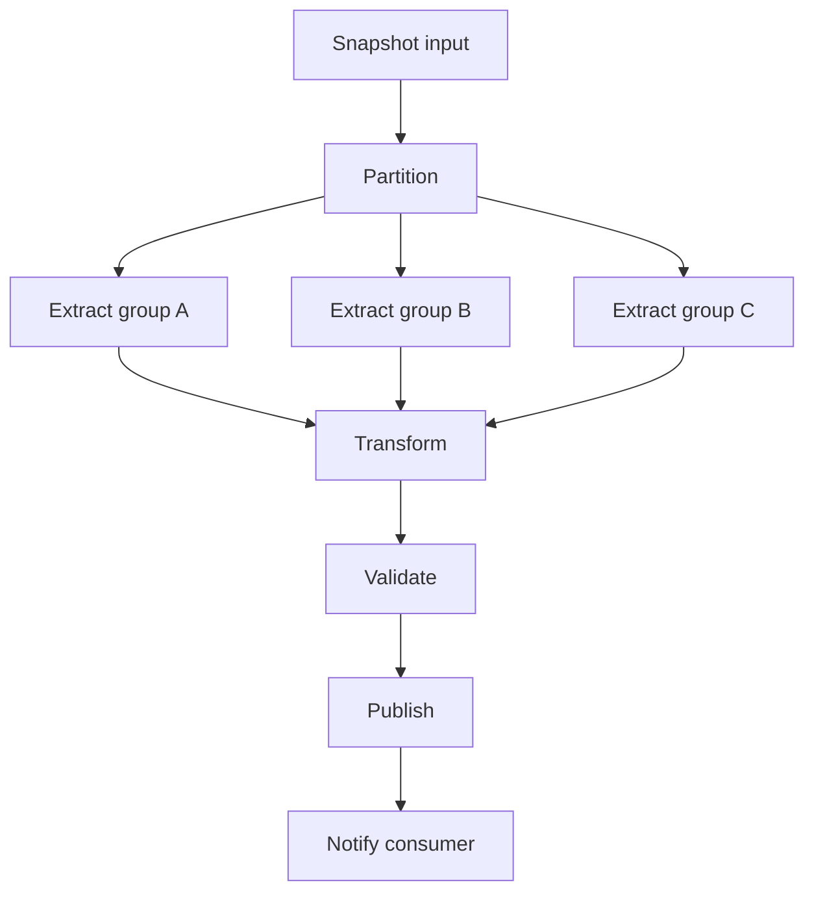

# Designing Deadline-Constrained Batch Data Processing

## Learning Objectives

After this lesson, you will be able to:

- Distinguish batch window, execution timeout, start deadline, completion deadline, and data freshness.
- Translate business requirements into SLOs for start times, completion times, and data freshness.
- Estimate batch completion feasibility from volume, throughput, critical path, and reserve time.
- Select scheduling policies based on deadlines, slack, priority, and fairness.
- Design admission control to accept, defer, reject, or degrade gracefully under capacity shortages.
- Partition batches into retryable, checkpointable, and recoverable partitions and stages.
- Coordinate CPU, memory, GPU, storage, and networking to meet deadlines.
- Implement schedules, timeouts, and concurrency on Kubernetes or batch schedulers.
- Handle late-arriving data, snapshots, watermarks, and partial results.
- Monitor deadline misses, queue age, throughput, and costs, and adjust capacity accordingly.

## 1. Deadlines in Batch Data Processing

Batch processing executes over a dataset or group of tasks within a defined time window. Examples:

- Generating daily revenue reports before 06:00.
- Aggregating logs and telemetry hourly.
- Computing month-end invoices prior to release time.
- Running forecasting models before markets or systems open.
- Syncing data between two systems during a maintenance window.
- Running backups or data transformations before handoff.

When deadlines exist, success is not merely "the job finished." Results must be ready early enough for downstream business steps to consume them.

A batch can succeed technically yet fail the business if it finishes past the deadline. Conversely, a batch finishing early on an overly stale data snapshot may also fail requirements.

### 1.1. Types of Deadlines

| Concept | Meaning | Example |
|---|---|---|
| Schedule time | Planned start time | 01:00 daily |
| Batch window | Data interval covered by a run | Data from 00:00 to 01:00 |
| Start deadline | Latest time the job may start | Must start before 01:15 |
| Execution timeout | Maximum runtime once started | Run no longer than 90 minutes |
| Completion deadline | Time by which results must be ready | Published before 03:00 |
| Data freshness deadline | Maximum acceptable data age | No older than 15 minutes |
| Workflow deadline | End deadline of a multi-stage pipeline | Report ready before 06:00 |

Explicitly specify whether a deadline applies to a task, a job, or the entire workflow. A 60-minute execution timeout does not guarantee a 03:00 completion deadline if the job only starts at 02:30.

### 1.2. Hard Deadlines vs. Soft Deadlines

A **hard deadline** is one where missing it causes severe consequences or renders the output worthless. For example, a pricing batch must finish before trading settlement closes.

A **soft deadline** is a target time; lateness remains acceptable within defined bounds. For example, an internal analytics report should arrive before 06:00, though 10 minutes late is tolerable.

Further classifications:

- **Firm deadline:** outputs delivered after the deadline hold zero value even if the job finishes.
- **Best-effort deadline:** aims to finish on time without an absolute guarantee.
- **SLA-based deadline:** deadline backed by measurable thresholds and compliance percentages over a window.

Never label something a hard deadline merely because users say "as soon as possible." Clarify the consequences of lateness, acceptability of late results, and policies under capacity shortages.

### 1.3. Batch Windows and Deadlines Are Not the Same

A batch window defines which data or work belongs to a run. A deadline defines when results must finish.

Example for daily report batch on day `D`:

- Input window: 00:00–23:59:59 UTC on day `D`.
- Data arrival grace period: wait an extra 20 minutes for late events.
- Processing start: 00:30 on day `D+1`.
- Completion deadline: 02:00 on day `D+1`.
- Publish deadline: 02:10 on day `D+1`.

Without distinguishing these milestones, the system may start before input data stabilizes or publish before validation finishes.

## 2. Translating Business Requirements into SLOs

A requirement like "the batch must finish before 06:00" is insufficient for compute design. Clarify:

- Which timezone governs timestamps?
- Which time interval of data does the batch process?
- Is late-arriving data allowed?
- Does the deadline apply to raw output or validated, published output?
- How many runs happen per day?
- When delayed, are partial results acceptable?
- What percentage of runs must meet the deadline?
- Can the system burst capacity temporarily?

### 2.1. Defining Deadline SLOs

Examples:

- 99% of daily batches complete validation before 05:45.
- 100% of invoice batches must publish before 06:00 or trigger an incident procedure.
- 95% of hourly data batches start within 3 minutes of scheduled time.
- Published data has freshness within 20 minutes of the committed watermark.

An SLO should specify:

1. Measurement target: task, job, partition, batch run, or workflow.
2. Start and end milestones.
3. Timezone and clock-skew handling.
4. Success criteria.
5. Measurement window and compliance target.
6. Handling of canceled, skipped, and partial runs.

Do not measure only process exit time. Measure until results are committed, validated, and visible to consumers.

### 2.2. End-to-End Time Budget

Total elapsed time from batch eligibility to published output can include:

\[
T_{total} =
T_{queue} + T_{provision} + T_{startup} +
T_{compute} + T_{validate} + T_{publish}
\]

Where:

- \(T_{queue}\): scheduler or queue wait time.
- \(T_{provision}\): time to provision VM/node/container capacity.
- \(T_{startup}\): image pull, configuration, and runtime startup.
- \(T_{compute}\): data processing execution time.
- \(T_{validate}\): schema, checksum, and business invariant validation.
- \(T_{publish}\): metadata commit, pointer swap, or consumer notification.

If the deadline is 90 minutes after scheduled start, you cannot allocate all 90 minutes to compute. Reserve budget for queueing, provisioning, validation, and publishing.

### 2.3. Use Percentiles Instead of Averages Alone

Batch durations are typically skewed due to heavy data days, retries, stragglers, or slow dependencies.

- p50 shows a typical run.
- p90/p95 captures the majority of runs.
- p99 reveals tail latency and rare slow runs.
- Maximum helps post-incident investigation, though single anomalies can skew it.

Sizing for hard deadlines must inspect p95/p99 and peak load scenarios. Sizing solely on average duration leaves the system short on capacity during data spikes.

## 3. Estimating On-Time Completion Feasibility

Before admitting a batch, estimate whether it can complete within the remaining time.

Key inputs:

- Count of records, files, bytes, or work units.
- Average and distribution of processing cost per unit.
- Worker count and concurrency per worker.
- Resource profile of each worker.
- Queue, provisioning, and startup times.
- Dependency throughput and rate limits.
- Sequential stages and critical path.
- Reserve time for retries.
- Validation and publish durations.
- Remaining time to deadline.

### 3.1. Basic Throughput Model

With `W` workers, each averaging `μ` units/second, theoretical throughput is:

\[
R = W \times \mu
\]

If a batch has `N` data units, approximate ideal compute time is:

\[
T_{compute} \approx \frac{N}{W \times \mu}
\]

Example:

- 12 million records.
- One worker processes 20,000 records/second.
- 20 workers.

Theoretical throughput is 400,000 records/second; compute time is roughly 30 seconds. This is only an illustrative calculation. Reading inputs, writing outputs, data skew, retries, and database limits can make real elapsed time much longer.

### 3.2. Model with Intra-Worker Concurrency

If each Pod runs `C` concurrent tasks, each averaging `μt`, theoretical throughput across `W` Pods is:

\[
R = W \times C \times \mu_t
\]

Never assume raising `C` scales throughput linearly. Concurrent tasks contend for CPU, RAM, file descriptors, connection pools, or disk I/O. Benchmark at realistic concurrency levels.

### 3.3. Dependency Bottlenecks

If workers can sustain 100,000 records/second while the source database permits only 30,000 records/second, total system throughput cannot exceed that bottleneck.

An approximate model:

\[
R_{effective} = \min(R_{compute}, R_{storage}, R_{network}, R_{dependency})
\]

When pipelines have sequential stages, workflow duration is not just total work divided by worker count. A single slow stage can dominate the entire pipeline.

### 3.4. DAGs and Critical Path

A batch workflow often has multiple stages with dependencies:



Branches can run in parallel, yet downstream stages must wait for mandatory dependencies. The critical path is the longest-duration path through the DAG. Adding workers to branches off the critical path will not make the workflow finish sooner.

If stage A takes 10 minutes, parallel stages B/C take 40 minutes, and stage D takes 15 minutes, ideal total time is roughly 65 minutes plus overhead—not the sum of all branches.

### 3.5. Preliminary Feasibility Condition

You can estimate:

\[
T_{required} =
T_{queue} + T_{provision} + T_{startup} +
T_{critical} + T_{validate} + T_{publish} + T_{reserve}
\]

Where `T_reserve` is buffer for retries, data variance, and tail latency.

If:

\[
T_{required} > T_{deadline\ remaining}
\]

then the batch is infeasible under the current configuration. The system must add capacity, change processing strategy, reduce scope per policy, or raise an early late-risk alert.

Never wait until after the deadline passes to discover a job could not finish.

## 4. Slack, Lateness, and Deadline-Aware Scheduling

**Slack** is remaining margin after subtracting estimated remaining processing time from time until deadline.

\[
Slack = Deadline - Now - EstimatedRemainingTime
\]

Example:

- 50 minutes until deadline.
- 35 minutes estimated remaining work.
- Slack is 15 minutes.

Small slack indicates minimal safety buffer. Negative slack means that under current estimates, the job will miss its deadline unless capacity increases or scope changes.

**Lateness** is completion time minus deadline. Positive values indicate lateness:

\[
Lateness = CompletionTime - Deadline
\]

**Tardiness** is usually defined as the non-negative portion of lateness:

\[
Tardiness = \max(0, CompletionTime - Deadline)
\]

These metrics distinguish jobs finishing early, on time, and how late misses are.

### 4.1. Earliest Deadline First (EDF)

EDF prioritizes jobs with the nearest deadline. It is simple and effective when multiple jobs carry different deadlines.

Advantages:

- Easy to understand.
- Prioritizes imminent deadlines.
- Suits independent task sets with fairly predictable durations.

Limitations:

- Long jobs may occupy capacity right before closer deadlines arrive.
- Does not natively account for critical paths or DAG dependencies.
- Can starve far-deadline jobs if new near-deadline jobs keep arriving.
- Does not automatically enforce multi-tenant fairness.
- Cannot guarantee deadlines when resource constraints and provisioning delays exist.

### 4.2. Least Laxity First (LLF)

LLF prioritizes the job with the smallest slack/laxity:

\[
Laxity_i = Deadline_i - Now - RemainingWork_i
\]

LLF considers both deadline and remaining execution time. A job with a later deadline that needs substantial work may need to start before a short job with a closer deadline.

However, `RemainingWork` estimates can be inaccurate. When task durations vary, LLF can constantly reorder priorities and cause thrashing/preemption overhead. For non-preemptible batches, use slack for alerting and admission prioritization rather than continually preempting running workers.

### 4.3. Priority by Business Impact

A practical policy typically combines:

- Deadline.
- Slack.
- Business criticality.
- Tenant or customer tier.
- Cost of delay.
- Resource requirements.
- Fairness and quota limits.

Example:

| Group | Deadline | Impact of Delay | Policy |
|---|---|---|---|
| Invoice close | Hard | Very high | Reserved capacity, high priority |
| Daily report | Soft | Medium | EDF within standard tier |
| Analytics backfill | Non-urgent | Low | Run on spare capacity |
| Data repair | Incident-driven | Potentially high | Time-bounded priority with audit |

Never use uncalibrated numeric priority numbers without clear definitions. Define who can assign priorities, cap top tiers, and prevent tenants from marking every job as urgent.

## 5. Admission Control: Should We Accept the Batch?

Admission control decides whether a batch enters execution right now. Its goal is to avoid accepting more work than capacity can handle, which causes all batches to miss deadlines together.

A batch submission should include:

- Job ID and owner.
- Input snapshot/version.
- Resource profile.
- Deadline and timezone.
- Estimated work/duration.
- Priority and business impact.
- Retry policy.
- Output contract.
- Data classification and access scope.

### 5.1. Admission Decisions

| Decision | When Used | Behavior |
|---|---|---|
| Accept | Sufficient capacity or capacity plan exists | Enqueue for execution |
| Defer | Capacity temporarily tight, but deadline has slack | Schedule for a later start |
| Reject | Cannot meet deadline or policy | Return reason and require revised deadline/scope |
| Accept with degradation | Partial or lower-fidelity output permitted by contract | Record explicit bounds and tag output |
| Preempt lower priority | Urgent job arrives and policy permits | Safely pause or defer lower-priority job |

Never unilaterally return partial results if consumers expect complete data. Degradation must be pre-approved in the business contract.

### 5.2. Slack-Based Admission

A simple rule:

- If slack exceeds a safe threshold, accept.
- If slack is small but reserve capacity exists, accept with elevated priority.
- If slack is negative, flag as at-risk and seek remediation.
- If no feasible path exists, reject or propose a new deadline.

Include queue wait and provisioning times. If a job needs a GPU node taking 8 minutes to provision, never omit those 8 minutes from admission estimates.

### 5.3. Capacity Reservation

Critical batches may require pre-reserved capacity:

- Dedicated node pools or VM capacity.
- Reserved namespace/tenant quotas.
- Reserved concurrency for specific job classes.
- Dedicated queues/partitions.
- Dedicated GPU or memory-heavy pools.
- Warm capacity to eliminate cold starts.

Reservations raise idle costs, so reserve them only for workloads with strict deadlines or high business impact. You can combine soft quotas with shared pools backed by scheduled guaranteed capacity.

## 6. Splitting Batches into On-Time Partitions and Tasks

Partitioning directly impacts deadlines by governing parallelism, overhead, and retry cost.

### 6.1. Choosing Partition Size

Partitions too large:

- Individual tasks may exceed execution timeouts.
- Retries waste significant completed work.
- One heavy partition becomes a straggler.
- Hard to adjust capacity mid-run.

Partitions too small:

- Increases scheduler and worker startup overhead.
- Generates excessive metadata, objects, and queue messages.
- Raises orchestration costs.
- Can flood dependencies with tiny requests.

Size partitions based on expected runtime, startup overhead, retry cost, and data balance.

### 6.2. Data Skew and Stragglers

If one partition takes 40 minutes while others finish in 5 minutes, the batch will miss its deadline even with spare aggregate CPU capacity.

Mitigations:

- Measure duration per partition.
- Estimate cost by bytes, records, or data characteristics.
- Sub-partition hot keys if logic permits.
- Use dynamic work queues for uneven tasks.
- Reserve time for tail tasks and validation.
- Consider speculative execution only when outputs are idempotent and dependencies tolerate extra load.

Never split data groups whose records must be processed sequentially or inside a single transaction. Preserving business invariants outranks worker count.

### 6.3. Static Partitions vs. Dynamic Queues

| Criterion | Static Partition | Dynamic Queue |
|---|---|---|
| Assignment | Pre-assigned | Workers pull next task when free |
| Duration predictability | High when data is uniform | Flexible when durations vary |
| Load balancing | Depends on partition map | Better as workers pull next unit |
| Coordination | Simpler | Requires queues, leases, and acks |
| Deadlines | Easy to estimate on steady workloads | Suits variable task arrivals/times |
| Retries | Retry specific partition | Requeue task per semantics |
| Cost | Lower metadata overhead | Extra queue and coordination overhead |

You can combine both: define deterministic snapshot partitions, then dispatch partition IDs via a queue so idle workers pick up the next slice.

## 7. Multi-Stage Workflow Scheduling

A batch is rarely a single process. It often spans extract, transform, aggregate, validate, publish, and notify stages.

### 7.1. Defining Explicit Dependencies

Each stage needs:

- Input and output contracts.
- Mandatory upstream dependencies.
- Resource requests.
- Estimated duration.
- Timeouts and retries.
- Internal stage deadline.
- Success conditions.
- Recovery behavior if rerun.

Internal deadlines are calculated backward from the final deadline. For example, if publish needs 5 minutes, validation 10 minutes, and aggregate 20 minutes, upstream stages must finish early enough to preserve downstream budget.

### 7.2. Backward Scheduling

Starting from the final deadline, subtract each stage's duration:

| Stage | Estimated Duration | Must Finish By |
|---|---:|---|
| Publish | 5 minutes | 06:00 |
| Validate | 10 minutes | 05:55 |
| Aggregate | 20 minutes | 05:45 |
| Transform | 45 minutes | 05:25 |
| Extract | 20 minutes | 04:40 |
| Provision + startup | 10 minutes | 04:20 |

This table illustrates backward scheduling; stage milestones must align with real dependencies and durations. Add reserve buffers for retries and tail latency rather than packing stages back-to-back.

### 7.3. Fan-Out and Fan-In

Fan-out splits work into parallel tasks; fan-in waits for mandatory tasks before aggregating.

Questions to answer:

- Must all partitions finish?
- Can non-critical partitions be skipped?
- Is there a minimum data completeness threshold?
- If one partition fails, can it be retried independently?
- Can partitions publish incrementally or only as a combined result?
- Does fan-in have enough capacity before the deadline?

If a mandatory partition fails, never mark the workflow complete simply because 99% of tasks succeeded.

## 8. Late-Arriving Data, Watermarks, and Snapshots

Deadline-constrained batches typically process data generated over a time interval. Data can arrive late due to networks, offline devices, producer retries, or slow upstream systems.

Distinguish:

- **Event time:** when the event actually occurred.
- **Ingestion time:** when the system received the data.
- **Processing time:** when the batch processes the data.
- **Watermark:** event-time boundary at which the pipeline assumes sufficient data has arrived per policy.
- **Late arrival:** data arriving after the watermark or after the batch started.

### 8.1. Wait for Data or Hold the Deadline?

There is a trade-off between completeness and timeliness:

- Waiting longer captures more late data but shrinks processing time.
- Starting earlier protects deadlines but risks missing records.
- Rerunning affected partitions can issue post-publish corrections.
- Publishing partial results must be explicitly tagged.

A policy might specify: wait up to 15 minutes for late data, freeze the snapshot, run the batch, and handle any later arrivals via correction jobs.

### 8.2. Consistent Snapshots

Every partition in a run must read the exact same dataset version or logical snapshot. If partition A reads at 01:00 and partition B reads at 01:30 against a mutating source, results become inconsistent.

Practices:

- Take a snapshot or record a watermark.
- Store dataset versions in a run manifest.
- Pass the exact version to every worker.
- Never change input references across retries.
- Separate correction runs from original runs.
- Track lineage from outputs back to input snapshots.

## 9. Retries, Checkpoints, and Recovery Under Deadlines

Retries improve completion odds on transient failures, yet every retry consumes remaining deadline time.

### 9.1. Error Classification

| Error Type | Examples | Handling |
|---|---|---|
| Transient | Network reset, storage timeout | Retry with backoff |
| Capacity | Insufficient nodes or quotas | Defer, scale, or shift pools |
| Data poison | Schema mismatch record | Quarantine or dead-letter |
| Permanent | Missing permissions, bad config | Stop retrying and alert |
| Resource | OOM, disk full, CPU timeout | Resize or split tasks |
| Dependency | Overloaded database/API | Backpressure, circuit breakers |
| Interruption | Spot/Preemptible instance reclaimed | Checkpoint and resume |

### 9.2. Retry Budgets

Never retry infinitely. Define a retry budget by:

- Maximum attempt count.
- Maximum total retry time.
- Remaining time to deadline.
- Retryable error classes.
- Backoff and jitter.
- Minimum time needed for validation/publishing.

If only 3 minutes remain before the deadline and a task needs at least 10 minutes, retrying will not hit the deadline. Transition to at-risk status, take an approved degraded path, or raise an incident.

### 9.3. Checkpointing

Checkpoints persist committed progress so workers can resume safely after interruptions.

A checkpoint should record:

- Run ID and partition ID.
- Input snapshot/version.
- Processed offset/cursor.
- Committed output generation.
- Schema and code version.
- Checksum.
- Timestamp and status.
- Recovery metadata.

Never write a checkpoint before its corresponding output is durably committed. On resume, workers must verify the checkpoint matches the input snapshot and code version.

### 9.4. Retries Can Cause Duplicates

A worker can write output and crash before reporting success. On retry, another worker may reprocess the slice. Require:

- Idempotency keys per run/partition/version.
- Attempt-isolated output paths.
- Conditional commits or manifest pointers.
- Fencing tokens if a stale worker might still be running.
- Publishing only a single valid generation.

A tight deadline is never an excuse to skip idempotency. Duplicate outputs can make reconciliation slower and push the batch even further behind.

## 10. Preemption and Selecting Compute Capacity

Deadline-constrained batches can use elastic or interruptible capacity. Match compute pools to interruption tolerance.

### 10.1. On-Demand vs. Interruptible Capacity

| Capacity Type | Advantages | Risks | Suitable Workloads |
|---|---|---|---|
| On-demand/regular | Higher availability per service terms | Higher cost | Hard deadlines, hard-to-recover tasks |
| Spot/Preemptible | Lower compute cost | Can be reclaimed anytime | Checkpointable, retryable tasks |
| Reserved capacity | Long-term capacity planning | Can pay for idle capacity | Critical scheduled batches |
| Warm pool | Cuts provisioning/startup delay | Ongoing idle cost | Tight deadlines with predictable load |

You can use a hybrid approach: run most partitions on Spot/Preemptible instances while keeping an on-demand pool to finish stragglers as the deadline nears. Ensure outputs are idempotent and checkpoints are frequent enough.

### 10.2. When Not to Use Spot

- Tasks cannot be safely checkpointed or retried.
- Interruptions lose hard-to-reconstruct state.
- Deadlines are too tight to absorb re-provisioning delays.
- Workloads depend on scarce GPU/instance types.
- Cost of missing the deadline outweighs compute savings.

When using Spot, pre-test interruption handlers, checkpoints, retry policies, and on-demand capacity fallbacks.

## 11. Compute Resources for Deadline-Constrained Batches

Choose CPU, RAM, storage, network, and accelerators around the true bottleneck.

### 11.1. CPU-Bound

Symptoms:

- Sustained high CPU utilization.
- Task duration drops as cores increase up to a plateau.
- Minimal I/O wait.
- CPU throttling when limits are tight.

Actions:

- Benchmark worker and core counts.
- Set appropriate CPU requests/limits.
- Avoid oversubscription causing context switching.
- Optimize algorithms or vectorization.
- Check sequential bottlenecks per Amdahl's Law.

### 11.2. Memory-Bound

Symptoms:

- OOMs or memory pressure.
- High GC/heap pressure.
- Rising swap or page faults.
- Large partitions causing memory spikes.

Actions:

- Shrink batch sizes.
- Stream records instead of loading whole datasets into RAM.
- Increase memory or split partitions.
- Track peak memory, not just average.
- Prevent concurrent tasks from creating synchronized memory spikes.

### 11.3. I/O and Network-Bound

Symptoms:

- Low CPU with long task durations.
- Rising storage latency or queue depth.
- Saturated network throughput.
- Database/API rate limits.

Actions:

- Co-locate workers near data sources.
- Optimize file formats and batch requests.
- Use versioned caches.
- Cap concurrency to protect downstream systems.
- Scale IOPS/bandwidth when storage or network is the real bottleneck.

### 11.4. GPU/Accelerator-Bound

GPU batches require evaluating:

- GPU model and VRAM.
- Compute capability and driver/runtime compatibility.
- Batch size and model memory footprint.
- GPU utilization and data-loader throughput.
- GPUs per node and topology.
- GPU node provisioning latency.
- Sharing policies (MIG/time-slicing) if enabled.

With tight deadlines, waiting for GPU capacity can exceed actual compute time. Check queue wait times and reserved capacity rather than benchmarking solely on an already-warm GPU.

## 12. Autoscaling by Deadline and Backlog

Autoscaling should reflect both remaining work volume and remaining time.

Signals:

- Queue depth/backlog.
- Oldest task age.
- Arrival rate.
- Completion rate.
- Estimated remaining work.
- Slack/deadline risk.
- Worker utilization.
- Provisioning delay.
- Dependency saturation.
- Pending Pod/instance counts.

### 12.1. Scaling by Backlog

A simple estimate:

\[
W_{needed} =
\left\lceil
\frac{Backlog}{TargetBacklogPerWorker}
\right\rceil
\]

Works well when tasks are relatively uniform. When task durations vary widely, raw backlog counts can mislead.

### 12.2. Scaling by Remaining Work and Deadline

With `B` units of remaining work, `μ` throughput per worker, and `T` remaining processing time, theoretical minimum workers:

\[
W_{needed} \geq \frac{B}{\mu \times T}
\]

Add a safety margin and cap by downstream capacity. If required workers exceed maximum capacity, raise a deadline-risk alert rather than attempting unbounded scaling.

### 12.3. Scale-Up and Scale-Down

- Scale up early when forecasted slack drops below threshold.
- Use warm capacity when provisioning delays are significant.
- Bound max workers by quotas and downstream capacity.
- Scale down near batch completion only after running tasks drain.
- Never terminate workers holding uncheckpointed state.
- Prevent autoscaler flapping on noisy metrics.

Scaling on CPU alone fails for I/O-bound batches. Combine queue age, remaining work, and service time to forecast deadlines.

## 13. Deploying Deadline-Constrained Batches on Kubernetes

Kubernetes Jobs and CronJobs fit many batch workloads. However, they are not real-time schedulers; understand their scheduling, retry, timeout, and concurrency semantics.

### 13.1. Jobs and `activeDeadlineSeconds`

A Job can configure:

- **completions:** target number of successful completions.
- **parallelism:** maximum Pods running concurrently.
- **backoffLimit:** retry count per Job semantics.
- **activeDeadlineSeconds:** maximum duration the Job may remain active.
- **ttlSecondsAfterFinished:** retention duration after Job completion.
- **completionMode Indexed:** assigns completion indexes for task arrays.

Example:

```yaml
apiVersion: batch/v1
kind: Job
metadata:
  name: daily-report
  namespace: batch
spec:
  completions: 48
  parallelism: 12
  completionMode: Indexed
  backoffLimit: 3
  activeDeadlineSeconds: 5400
  ttlSecondsAfterFinished: 86400
  template:
    spec:
      restartPolicy: Never
      containers:
        - name: report-worker
          image: registry.example.com/analytics/report:3.2
          env:
            - name: RUN_ID
              value: "daily-2026-11-22"
            - name: DEADLINE_UTC
              value: "2026-11-22T06:00:00Z"
          resources:
            requests:
              cpu: "2"
              memory: "4Gi"
            limits:
              cpu: "4"
              memory: "8Gi"
```

This manifest illustrates 48 completions with up to 12 parallel Pods and a 90-minute active deadline. That deadline caps how long Kubernetes keeps the Job active—it does not guarantee the scheduler starts at a specific wall-clock time. Account for queueing before Pods schedule and any external validation/publish steps in the workflow.

### 13.2. CronJobs and Schedules

CronJobs create Jobs on a schedule. Key fields:

- **schedule:** cron expression.
- **timeZone:** timezone when supported by the cluster version.
- **concurrencyPolicy:** behavior when a new run is due while the previous Job is still active.
- **startingDeadlineSeconds:** grace window for creating missed scheduled Jobs.
- **suspend:** pauses Job creation.
- **successfulJobsHistoryLimit** and **failedJobsHistoryLimit:** retained historical Jobs.

Example:

```yaml
apiVersion: batch/v1
kind: CronJob
metadata:
  name: hourly-aggregation
  namespace: batch
spec:
  schedule: "5 * * * *"
  timeZone: "Etc/UTC"
  concurrencyPolicy: Forbid
  startingDeadlineSeconds: 300
  successfulJobsHistoryLimit: 3
  failedJobsHistoryLimit: 5
  jobTemplate:
    spec:
      activeDeadlineSeconds: 2400
      backoffLimit: 2
      template:
        spec:
          restartPolicy: Never
          containers:
            - name: aggregate
              image: registry.example.com/data/aggregate:1.8
              args: ["--window", "previous-hour"]
```

This runs at minute 5 every hour UTC, skips the new run if the previous Job is still active, and allows creating delayed Jobs within a 5-minute window. `Forbid` can skip a scheduled window if the previous run overruns; monitor missed schedules and maintain a backfill procedure.

### 13.3. Choosing `concurrencyPolicy`

| Policy | Behavior | When Appropriate |
|---|---|---|
| Allow | Permits overlapping scheduled Jobs | Windows are independent and capacity suffices |
| Forbid | Skips new run while prior Job is active | Overlapping runs are unsafe |
| Replace | Replaces running Job with new Job | Only when aborting the prior run is safe and valid |

`Replace` can interrupt in-progress batches. `Forbid` does not automatically backfill skipped windows. `Allow` can pile up backlogs or corrupt data if jobs are non-idempotent. Choose according to data contracts and deadlines.

### 13.4. CronJob Is Not a Real-Time Clock

The CronJob controller may create Jobs late due to control-plane load, controller downtime, or too many missed schedules. A scheduled minute does not guarantee a Pod starts at that exact second.

When deadlines are strict:

- Use tested schedulers and pre-allocated capacity.
- Track scheduled time vs. actual start time.
- Alert on missed schedules.
- Design idempotency to tolerate duplicates.
- Use a workflow controller or batch platform when complex dependencies and deadlines exist.
- Never treat CronJob as a hard real-time system.

### 13.5. Job Timeouts and Workflow Deadlines

`activeDeadlineSeconds` bounds how long a Job runs; it does not understand business deadlines measured from the end of a batch window. Pass the business deadline into the application so workers can check remaining time and stop accepting tasks when safe completion is impossible.

A workflow may span multiple Jobs. Each Job needs its own timeout, and the coordinator must enforce the end-to-end deadline across the whole DAG.

## 14. Batch Schedulers and Cloud Services

Beyond Kubernetes, batches can run on HPC schedulers or managed cloud batch services.

### 14.1. HPC Schedulers

Schedulers like Slurm manage job queues, partitions, resource requests, priorities, and wall-time limits. Operators must:

- Declare CPU, memory, GPU, and wall time.
- Select appropriate partitions/queues.
- Monitor job priority and queue wait times.
- Define preemption and requeue policies.
- Checkpoint long-running jobs.
- Forecast wait times before nodes are allocated.

Wall-time limits bound runtime after a job starts, not completion deadlines. Schedulers can hold jobs in queues during resource shortages; include queue wait in your time budget.

### 14.2. Managed Cloud Batch

Cloud batch services typically provide:

- Job queues and priorities.
- Job definitions or container images.
- Compute environments/node pools.
- Retry strategies.
- Timeouts or attempt durations.
- Array jobs.
- Elastic compute environment scaling.
- Job logs and status tracking.

Field names and semantics differ by provider. Verify whether timeouts count from submit time, start time, or per attempt; verify provisioning delays and max vCPU/GPU limits.

### 14.3. Comparing Deployment Models

| Model | Advantages | Things to Watch |
|---|---|---|
| Kubernetes Job/CronJob | Aligns with existing container workloads and clusters | Scheduling delays, quotas, controller semantics |
| HPC scheduler | Specialized resource topology and job queues | Queue wait, partition policies, wall-time limits |
| Managed cloud batch | Automatically scales compute environments | Provisioning delays, quotas, provider-specific timeouts |
| Workflow orchestrator | Manages DAGs, retries, and dependencies | Orchestrators do not replace compute capacity |
| Queue workers | Flexible per backlog and task | Must design deadlines, fairness, and commits yourself |

## 15. Partial Results, Degraded Mode, and Business Decisions

As a deadline approaches, the system may lack time to finish 100% of the data. Establish policies beforehand.

Strategies:

- Publish partial results clearly labeled as partial.
- Serve the latest prior snapshot tagged with data freshness.
- Skip non-essential data groups per policy.
- Run a fast approximate path first, followed by a full path later.
- Trigger a post-deadline correction run.
- Escalate to manual review.
- Fail closed if incomplete results would cause financial or safety errors.

### 15.1. Distinguishing Partial vs. Complete

Outputs need metadata indicating:

- Run ID.
- Input snapshot/watermark.
- Expected partition count.
- Completed partition count.
- Failed/skipped partitions.
- Data freshness.
- Validation status.
- Published timestamp.
- Completeness flag.
- Degradation reason, if degraded.

Never write incomplete outputs under a `final` filename if consumers have no way to tell them apart.

### 15.2. Correction Runs

When late data arrives after a batch publishes:

1. Record the late arrival event.
2. Identify affected partitions.
3. Run a correction task against the updated input version.
4. Validate the delta.
5. Publish a new version or adjustment record.
6. Preserve lineage linking back to the prior run.

Never silently overwrite historical outputs if consumers require auditing or reproducibility.

## 16. Security and Integrity for Batch Processing

Batch jobs often touch large datasets with broad access. Deadlines never justify bypassing least privilege.

Principles:

- Assign dedicated workload identities/service accounts per job type.
- Grant read access only to required inputs and write access only to target outputs.
- Separate job execution permissions from scheduler and queue administration permissions.
- Never embed secrets in images, manifests, or command lines.
- Use secret managers with rotation.
- Encrypt data in transit and at rest.
- Audit changes to schedules, priorities, resource limits, and deadlines.
- Record approvals for changes to hard deadlines or degraded-mode policies.
- Verify image digests and dependencies.
- Protect integrity of manifests, checkpoints, and output metadata.

For multi-tenant jobs, enforce tenant authorization inside workers; a tenant ID inside a queue message does not prove authorization by itself.

## 17. Monitoring and Deadline Alerting

Monitor both compute health and business progress.

| Group | Metrics | Meaning |
|---|---|---|
| Schedule | Scheduled time, actual start, missed runs | Start latency |
| Queue | Queue depth, oldest age, wait time | Queued backlog |
| Execution | Duration p50/p95/p99, active tasks | Runtime performance |
| Progress | Completed/total partitions, remaining work | Completion progress |
| Deadline | Slack, at-risk count, deadline misses, tardiness | On-time likelihood |
| Resource | CPU, memory, I/O, network, GPU, throttling | Bottlenecks |
| Reliability | Retries, failures, checkpoints, interruptions | Stability |
| Data | Watermarks, late arrivals, freshness, validation | Input/output quality |
| Cost | Worker-hours, idle capacity, cost per run | Operational cost |

### 17.1. Slack-Based Alerting

An example policy:

- Warning when slack drops below 30 minutes.
- Critical when slack drops below 10 minutes.
- Incident when estimated completion passes the deadline.
- Alert when queue age grows faster than drain rate.
- Alert when a critical-path stage exceeds its time budget.
- Alert when provisioning delays spike abnormally.

Thresholds are examples only; calibrate against actual runtimes and business impact.

### 17.2. Forecasting Completion Time

Estimate:

\[
EstimatedCompletion =
Now + QueueWaitEstimate + ProvisioningEstimate +
RemainingExecutionEstimate + FinalizationEstimate
\]

Compare against the deadline to assign status:

- On track: reserve remains.
- At risk: low reserve.
- Predicted miss: estimated completion exceeds deadline.
- Missed: deadline has actually passed.

Update forecasts continuously as backlog, throughput, or dependencies shift. An initial estimate at job start is inadequate for multi-hour workflows.

## 18. Practical Example: Reporting Batch Due Before 06:00

A system generates daily revenue reports. Outputs must be ready for operations before 06:00 UTC.

Requirements:

- Input is the prior day's transaction data.
- Wait up to 15 minutes for late events.
- 120 partitions split by region and tenant group.
- Reports must be validated and published before 06:00.
- If a mandatory partition fails, the report must not be marked complete.

Time budget design:

| Activity | Budget |
|---|---:|
| Finalize watermark and snapshot | 15 minutes |
| Queue/provision/startup | 10 minutes |
| Extract + transform | 70 minutes |
| Aggregate | 20 minutes |
| Validate | 10 minutes |
| Publish + notify | 5 minutes |
| Reserve | 10 minutes |
| Total | 140 minutes |

Starting at 03:40, a 140-minute budget puts completion at 06:00. However, the reserve must not be treated as normal compute time; it exists for retries and variance.

### 18.1. Scheduling and Capacity

- Take a fixed input snapshot at the watermark.
- Forecast runtimes from the p95 of the past 7–14 days.
- Size partitions so transform completes within the 70-minute budget.
- Use a priority queue for report batches.
- Reserve baseline capacity for critical workflows.
- Scale workers based on remaining work and slack.
- Cap concurrency to match database throughput.
- Run aggregation only after mandatory partitions complete.
- Validate record counts, checksums, and business totals.
- Publish via versioned pointer swap once validation passes.

### 18.2. When the Batch Is at Risk of Missing Deadline

If at 05:00 there are 40 partitions left estimated at 50 minutes:

- Recompute remaining slack against validation/publish windows.
- Inspect bottlenecks and downstream headroom.
- Scale up workers if dependencies have spare capacity.
- Sub-partition skewed data groups if possible.
- If still infeasible, raise an at-risk notice and apply pre-approved partial/degraded policies.
- Never skip validation just to hit the clock.

## 19. Runbooks for At-Risk Batches

### Job Did Not Start on Schedule

1. Inspect schedule controller and missed runs.
2. Check queue wait and scheduler events.
3. Verify quotas, node capacity, and resource requests.
4. Check image pulls, secrets, and dependencies.
5. Recompute the time budget and slack.
6. Activate reserve capacity pools per policy if needed.
7. Mark status at-risk and notify the owner.

### Throughput Lower Than Expected

1. Compare arrival/remaining work against completion rate.
2. Check CPU, memory, I/O, network, and throttling.
3. Identify dependency rate limits or contention.
4. Compare partition durations to spot data skew.
5. Increase concurrency only if dependencies can absorb it.
6. Shrink batch sizes or split tasks where helpful.
7. Continuously update estimated completion time.

### Task Interrupted or OOM

1. Identify the affected partition and attempt.
2. Inspect the last committed checkpoint.
3. Verify input snapshot and code version.
4. Adjust resource requests or partition size.
5. Retry within the retry budget.
6. Check prior attempt outputs and idempotency.
7. Recompute deadline risk after retry.

### Deadline Missed

1. Preserve run metadata and existing outputs.
2. Identify the delaying stage and root cause.
3. Determine whether partial outputs are permitted for use.
4. Notify owners/consumers per SLA.
5. Execute retry, correction run, or manual remediation.
6. Never publish a `complete` status if validation failed.
7. Document tardiness, root cause, and follow-up actions.

## 20. Common Misconceptions

- **Execution timeout equals completion deadline.** Timeouts usually start when the job begins running; completion deadlines include queue wait and publishing.
- **A succeeded job means it finished on time.** Always compare completion time against the deadline.
- **CronJob triggers at the exact scheduled minute.** Controllers can create Jobs late; CronJob is not a real-time scheduler.
- **`Forbid` automatically catches up missed runs.** It prevents overlaps; track missed schedules and backfill separately.
- **More parallelism always meets deadlines faster.** Dependencies can bottleneck and total throughput can drop.
- **Average duration suffices for sizing.** Tail latency, skew, and retries require reserve buffers.
- **Low queue depth means the batch is safe.** Tasks may already be leased and stuck in-flight or waiting on dependencies.
- **All partitions finishing right at the deadline means you can publish immediately.** Validation and publishing still require time budget.
- **Spot is always cheaper for batches.** Interruptions, retries, and deadline misses can raise total cost.
- **Partial results can substitute for complete results.** Only when consumer contracts and business policies allow it.
- **A watermark guarantees zero late data.** It is simply a pipeline policy boundary and assumption.
- **Many retries help meet deadlines.** Retries can burn through all slack and pile extra load on dependencies.
- **Scaling down never hurts running batches.** Pods can be terminated mid-work; drain and checkpoint properly.
- **Deadlines only belong in the scheduler.** Applications and workflow coordinators also need deadlines to stop accepting work or enter degraded mode.
- **No alerts means the job is on track.** Compute predicted completion and monitor pipeline metrics actively.

## 21. Deadline-Constrained Batch Design Checklist

### Before Accepting a Job

- [ ] Classify hard, soft, or firm deadline.
- [ ] Define timezone, batch window, and input snapshot.
- [ ] Define success through validation and publishing.
- [ ] Estimate work volume and p50/p95/p99 durations.
- [ ] Budget queue, provisioning, startup, and finalization time.
- [ ] Identify critical path and dependency bottlenecks.
- [ ] Compute slack and admission control decision.
- [ ] Define priority, fairness, and quotas.
- [ ] Define partial-result and correction-run policies.
- [ ] Choose regular, reserved, warm, or interruptible capacity.

### During Execution

- [ ] Track queue age and actual start time.
- [ ] Track remaining work and completion rate.
- [ ] Continuously update predicted completion and slack.
- [ ] Monitor critical-path stages and stragglers.
- [ ] Monitor CPU, memory, disk, network, and GPU.
- [ ] Bound concurrency to dependency capacity.
- [ ] Retry only within the retry budget.
- [ ] Checkpoint and commit outputs safely.
- [ ] Alert at-risk before the deadline is missed.
- [ ] Drain workers cleanly on scale-down or rollouts.

### Upon Completion

- [ ] Verify all mandatory partitions completed.
- [ ] Check snapshot/watermark and data freshness.
- [ ] Validate schemas, checksums, and business invariants.
- [ ] Publish outputs via versioned generation/pointers.
- [ ] Record completion time and deadline compliance.
- [ ] Record partial/degraded status if applicable.
- [ ] Clean up temporary resources per retention rules.
- [ ] Compute cost per run and cost per output.
- [ ] Document causes of any delays and update sizing models.

## 22. Self-Check Scenarios

**Scenario 1:** A batch must finish at 06:00. Compute takes an estimated 70 minutes, queue/provisioning 10 minutes, validation/publish 15 minutes, and reserve 10 minutes. What is the latest time it should start?

**Hint:** Total budget is 105 minutes. Latest start is roughly 04:15 to preserve full budget and reserve, assuming accurate estimates and no other sequential dependencies.

**Scenario 2:** A job has a 02:00 deadline, current time is 01:20, and remaining execution estimate is 50 minutes. What is the slack?

**Hint:** 40 minutes remain until the deadline while 50 minutes of work remain, so slack is negative 10 minutes. The current configuration predicts a miss unless capacity rises or scope legitimately shrinks.

**Scenario 3:** A CronJob uses `concurrencyPolicy: Forbid`. The previous run overruns past the next scheduled time. What can happen?

**Hint:** The next scheduled run may be skipped because the prior Job is still active. Alert on missed schedules and prepare backfill/reconciliation for skipped windows.

**Scenario 4:** A batch has processed 95% of partitions, but one mandatory partition failed. Should you publish the report as complete to hit the deadline?

**Hint:** Only if the business contract allows partial results and the output is explicitly tagged with completeness status. If the partition is mandatory, fail the run or follow an approved degraded workflow.

**Scenario 5:** Doubling worker count produces zero throughput gain while database latency spikes. What should you do?

**Hint:** The database is the bottleneck. Reduce concurrency, apply backpressure, optimize queries, or scale database capacity; stop blindly adding workers.

**Scenario 6:** A batch running on Spot experiences an interruption 20 minutes before the deadline. What decision must be made?

**Hint:** Check the last checkpoint, capacity re-provisioning time, and remaining work. If it can resume within the retry budget, fail over to reserve capacity; otherwise update to predicted miss and invoke the defined business policy.

## Conclusion

Designing deadline-constrained batch processing begins with clearly defining the batch window, input snapshot, start time, and completion deadline. Build a time budget across queueing, provisioning, startup, compute, validation, and publishing; estimate durations using throughput, critical paths, and tail latency; then use slack, priority, and admission control to admit or adjust workloads. Partitions, checkpoints, retries, and output commits must support recovery without corrupting results. Autoscaling must incorporate backlog, remaining work, service times, and dependency limits, while Kubernetes CronJobs and batch schedulers only provide scheduling and timeout primitives with specific semantics. Track predicted completion, deadline misses, data freshness, and cost per run to catch risks early and deliver results true to business contracts.
