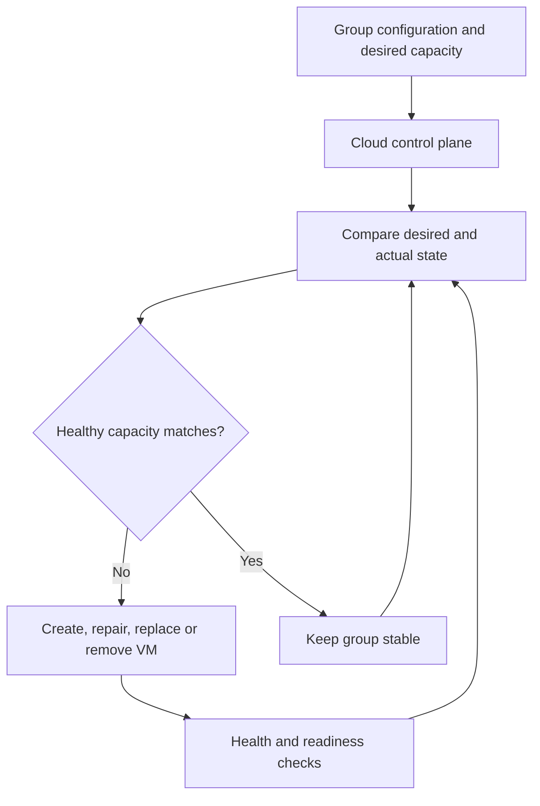

# Comparing Managed Instance Groups and Autoscaling Mechanisms

## Context: Managing a VM Group Instead of Operating Individual Machines

A web service may require multiple VMs running the same application version. When load increases, the system needs more machines; when load drops, the system can reclaim machines to save costs. If administrators manually create, configure, health-check, and delete each VM, the workflow quickly becomes unmanageable. Cloud providers offer managed instance groups to declare the desired state and let the control plane maintain that group.

A managed instance group typically combines a machine definition (image, instance type/size, network, identity, disks, and startup configuration), a set of member VMs, a desired count policy, and a health check/repair mechanism. Autoscaling adjusts member count based on metrics, schedules, or forecasts. Groups can also support distribution across availability zones, image version replacements, rolling updates, and replacement of unhealthy machines.

In the **CLOUD_CORE_SERVICES_COMPUTE** module, this topic helps you choose compute operating models across clouds. Service names differ, yet they solve the same set of problems: maintaining a consistent VM fleet, scaling capacity up or down to meet demand, and recovering when instances become unhealthy.

## 1. What Is a Managed Instance Group?

A managed instance group is a collection of VMs controlled by a shared configuration or template and a control plane. Operators declare the count, machine type, image, network, metadata, health checks, and policies; the service manages creating, replacing, distributing, or reclaiming members.

A group typically includes these properties:

- **Instance template/model:** describes the configuration of new VMs.
- **Desired capacity:** the count or capacity the group needs to maintain.
- **Minimum/maximum capacity:** lower and upper bounds.
- **Membership:** the list of instances currently belonging to the group.
- **Health check/autohealing:** detects unhealthy machines and replaces or repairs them.
- **Scaling policy:** conditions for increasing or decreasing capacity.
- **Update policy:** how instances are replaced when the image or configuration changes.
- **Placement policy:** distributes instances across zones, subnets, or fault domains.

The control plane continuously reconciles actual state against desired state. If desired capacity is 6 but only 5 healthy instances remain, the group manager can create another instance. If a new configuration is deployed, the update policy determines whether instances are replaced in batches or all at once.

### 1.1. Desired State and the Reconciliation Loop

Managed instance groups operate on the concept of desired state:



Reconciliation enables self-healing when a VM is accidentally deleted or fails. However, an instance in the `running` state should not be treated as proof that the application is ready. You need health checks at the right layer, an idempotent startup process, and proper registration/deregistration with the load balancer.

### 1.2. How a Managed Group Differs from a Standalone VM

| Aspect | Standalone VM | Managed Instance Group |
|---|---|---|
| Lifecycle | Operators create/delete each machine manually | Control plane manages membership |
| Configuration | Can drift across machines | New instances are created from a shared template/model |
| Recovery | Requires custom procedures | Can automatically replace unhealthy machines |
| Scaling | Usually requires custom automation | Built-in policies and capacity boundaries |
| Rolling update | Coordinated manually | Has update policies or instance refresh |
| Zone distribution | Operators choose placement | Has group-level distribution options |
| Best suited for | Specialized machines, admin tasks, single-instance workloads | Stateless fleets or services needing variable capacity |

A managed group does not mean every instance is always identical. Some platforms allow multiple instance types/sizes or flexible configurations; stateful settings can also preserve certain attributes across replacements. You need to understand which parts are managed by the template and which parts can differ among members.

## 2. Equivalent Services Across Popular Clouds

The three service families commonly used to manage VM fleets are:

| Cloud | Managed Group Service | Primary Configuration Model | Common Autoscaling |
|---|---|---|---|
| AWS | Amazon EC2 Auto Scaling Groups (ASG) | Launch Template, desired/min/max capacity, health checks, and scaling policies | Target tracking, step/simple, scheduled, predictive; can combine mixed instances |
| Microsoft Azure | Virtual Machine Scale Sets (VMSS) | VM profile/model, orchestration mode, instance count, upgrade policy, and health extension | Azure Monitor metric/schedule autoscale; optional additional automation per workload |
| Google Cloud | Compute Engine Managed Instance Groups (MIG) | Instance template, zonal/regional group, target size, autohealing, and update policy | Autoscaler based on supported metrics, schedules, and certain predictive modes per configuration |

Names and feature sets are not strictly one-to-one equivalents. Each service has its own limits, capacity calculation methods, health check semantics, zone behaviors, update strategies, and state retention capabilities. When comparing them, evaluate using the same workload, same region/zone, same VM class, and same SLO requirements.

### 2.1. AWS EC2 Auto Scaling Groups

An EC2 Auto Scaling Group (ASG) manages a set of EC2 instances. A Launch Template describes the instance configuration such as AMI, instance type, key/role, network interfaces, security groups, storage mapping, and user data. The ASG maintains desired capacity within minimum/maximum bounds and can distribute instances across multiple Availability Zones.

Commonly used capabilities:

- **Target tracking:** adjusts capacity to keep a metric near a target, such as average CPU utilization or a custom metric.
- **Step/simple scaling:** scales up/down based on alarms and defined adjustment steps.
- **Scheduled scaling:** sets desired/min/max on a known schedule.
- **Predictive scaling:** uses historical metrics to forecast demand and pre-provision capacity; suitable for workloads with clear periodic cycles.
- **Health checks:** based on EC2 status and can integrate with load balancer health checks.
- **Instance refresh:** replaces instances in batches when updating a launch template or AMI.
- **Mixed instances policy:** combines multiple instance types and purchasing options according to a capacity/cost strategy.
- **Warm pools:** keeps pre-initialized instances in an appropriate state to reduce scale-out time for certain workloads.

An ASG can combine On-Demand and Spot capacity via policy. Spot capacity can be reclaimed; workloads must handle interruptions and must not depend on a specific instance. Features, distribution ratios, and behavior can vary by instance type, region, and configuration.

### 2.2. Azure Virtual Machine Scale Sets

Virtual Machine Scale Sets (VMSS) manage a group of VMs that can scale and upgrade according to a model. VMSS integrates with Azure networking, load balancing, monitoring, and Azure Monitor autoscale. The orchestration mode affects how instances are managed:

- **Uniform:** manages the fleet under a uniform model, suited for VM groups created and upgraded as a single unit.
- **Flexible:** allows more flexible management of VM members, combining individual VM management capabilities with scale set orchestration within supported scope.

Commonly used capabilities:

- Autoscale based on Azure Monitor metrics, schedules, or profiles.
- Instance count with capacity limits.
- Distribution across Availability Zones or fault domains per configuration.
- Rolling upgrade/upgrade policies and health monitoring.
- Scale-in policies and scale-in protection for instances when needed.
- Combining Spot VMs for interruptible workloads.

VMSS offers multiple orchestration, upgrade, and health extension choices. Verify compatibility across orchestration mode, availability zones, disks, load balancers, extensions, and autoscale rules; do not assume every feature behaves identically across all modes.

### 2.3. Google Compute Engine Managed Instance Groups

A Managed Instance Group (MIG) manages VMs created from an instance template. A MIG can be zonal or regional. Regional MIGs support distributing instances across multiple zones in a region to reduce single-zone dependency, subject to configured limits and policies.

Commonly used capabilities:

- Autoscaling based on CPU utilization, load balancing serving capacity, or supported Cloud Monitoring metrics.
- Autoscaling schedules to increase capacity during expected time windows.
- Autohealing based on health checks and repair policies.
- Rolling updates with `maxSurge`/`maxUnavailable` levels or corresponding rollout options.
- Proactive instance redistribution in certain regional MIG configurations.
- Stateful MIG configuration for certain workloads needing to preserve stateful disks or metadata per instance.

A zonal MIG is suitable when a workload is tied to one zone or needs specific placement; a regional MIG is suitable when distributing capacity across multiple zones in a region. Stateful configurations have limitations and do not turn a MIG into an automated HA database; the application must still manage replication, consistency, and recovery.

## 3. Components to Standardize When Comparing

Do not compare solely by product names or feature counts. Establish a single requirements model and examine how each provider handles each part.

### 3.1. Images and Instance Templates

A template/model should explicitly declare:

- Pinned image/OS version or image family.
- Instance type/size, CPU architecture, memory, and accelerators if needed.
- Boot/data disks, encryption, and IOPS/throughput.
- VPC/subnet, NIC, security group/NSG/firewall, and public/private IP.
- Machine identity/instance profile/service account.
- Startup scripts, extensions, or bootstrap agents.
- Labels/tags, monitoring agents, and logging configuration.
- Metadata/secret references—never embed secrets directly in the template.

Images should be immutable by version or digest. If using an image alias that always points to the latest build, creating instances in the same group at two different times could yield two different OS/app versions. For controlled rollouts, build a new image, test it, and explicitly update the template/model.

### 3.2. Capacity Model

Groups typically have:

- `min`: minimum instance count or capacity floor.
- `desired`: currently requested instance count.
- `max`: upper limit.
- `target`: the target the autoscaler tries to achieve based on metrics or schedules.

Not all providers use the same terminology or calculation rules. Some systems count instances; some support weighted capacity when multiple VM sizes are mixed. When using weighted capacity, understand whether `desired capacity` is measured in instance counts or capacity units.

### 3.3. Load Balancers and Service Discovery

New VMs must be added to the traffic serving path only after the application is ready. Typical flow:

1. Group creates the VM from the template.
2. Bootstrap installs/starts the application and agents.
3. Instance registers with the target pool/backend/service discovery.
4. Readiness/health check confirms it can serve traffic.
5. Load balancer begins sending traffic.

During scale-in or instance replacement, the instance must stop receiving new requests and drain existing connections before termination. If the group deletes the VM before the load balancer completes its deregistration delay, in-flight requests may be dropped.

## 4. Health Checks, Autohealing, and Instance Replacement

Autoscaling and autohealing are two distinct functions:

- **Autoscaling** changes capacity count based on demand.
- **Autohealing** replaces or repairs unhealthy instances so the group reaches its desired state.

A group can have enough instances in count yet still fail to serve traffic if all instances are unhealthy. Conversely, an instance can be unhealthy while the autoscaler sees no need to increase count because desired capacity is met; autohealing is what handles that case.

### 4.1. Health Check Layers

| Check Layer | Examples | What It Detects | Limitations |
|---|---|---|---|
| Infrastructure/host | VM status, host/system check | Host, hypervisor, or VM-level faults | Does not prove the application is ready |
| Guest/agent | Agent heartbeat, service process | Inactive agent or service | May still report healthy when the app is not serving properly |
| Application | HTTP `/health`, readiness endpoint | App cannot accept requests | Endpoint must be designed to avoid improper coupling to every downstream |
| Load balancer | Target/backend health | Instance fails to respond on actual traffic path | Can be affected by network/routing and thresholds |
| Business synthetic | Sample request, test transaction | Business flow is broken | Consumes resources and must avoid real side effects |

Health checks should reflect the ability to accept work. Liveness answers whether a process needs restarting; readiness answers whether an instance should receive traffic. Do not conflate the two if a temporary downstream dependency failure could cause the entire fleet to be replaced at once.

### 4.2. Autohealing and Replacement Loops

When health checks fail enough times to hit the threshold, the group manager can terminate the instance and launch a new one. If the root cause is a shared configuration error in the image or startup script, every new instance will also fail, creating a continuous replacement loop.

To avoid loops:

- Test the image/template before updating the entire fleet.
- Use limited rollouts and rollback capability.
- Set thresholds/grace periods long enough for normal startup.
- Distinguish slow startup from genuine application failure.
- Alert when unhealthy instance rates or replacement counts spike abnormally.
- Retain a known good version for recovery.

### 4.3. Bootstrap Must Be Idempotent

New VMs may be recreated multiple times. Startup scripts/extensions must run repeatedly without breaking:

- Do not create duplicate users, firewall rules, or configuration files on each run.
- Install packages at pinned versions.
- Fetch secrets via workload identity and a secret manager.
- Do not write unique business data onto the boot disk.
- Include timeouts, bounded retries, and bootstrap logging.
- Report readiness only after the application is genuinely ready.

Do not place manual steps or password prompts inside automated bootstrapping; this can leave new instances stuck in an unready state.

## 5. Autoscaling Mechanisms

Autoscaling adjusts group capacity based on one or more signals. The goal is not merely adding VMs when CPU is high; it is provisioning enough capacity before SLOs are impacted and reclaiming capacity when it is no longer needed.

### 5.1. Metric-Based Reactive Scaling

Reactive scaling observes current metrics and scales capacity up or down. Metrics can include:

- CPU utilization or CPU queue/run queue.
- Memory utilization if collected and supported.
- Request rate, concurrent requests, or latency.
- Load balancer requests per instance/serving capacity.
- Queue depth or age of the oldest message.
- Custom metrics such as pending jobs per worker.

CPU is an easy signal to use, but it does not always reflect demand. An API might violate latency SLOs due to a slow database while CPU remains low; workers might need to scale on queue age rather than CPU.

### 5.2. Target Tracking

Target tracking attempts to maintain a metric near a target value. For example, keeping average CPU around 55% or queue backlog at 20 jobs per worker. The autoscaler calculates required capacity from the metric and adjusts gradually.

Advantages:

- Less manual calculation of individual scale-up/scale-down steps.
- Suitable for fluctuating loads with a relatively stable relationship between capacity and the metric.
- Can automatically add capacity when the metric exceeds target and remove it when below target.

Limitations:

- The metric must be representative and updated quickly enough.
- Setting the target too high leaves insufficient headroom; setting it too low creates excessive idle capacity.
- Scaling cannot exceed provider quotas or available capacity.
- If the metric is skewed during startup/warm-up, the autoscaler may overreact or react too slowly.

### 5.3. Step Scaling and Threshold Rules

Step scaling uses alarm thresholds and adjustment amounts per metric band. For example:

| Metric | Illustrative Action |
|---|---|
| CPU below 25% for 15 minutes | Remove 1 instance, if still above min |
| CPU between 60% and 75% | Add 1 instance |
| CPU between 75% and 90% | Add 2 instances |
| CPU above 90% | Add 3 instances and alert on capacity |

Thresholds require hysteresis and stabilization periods to prevent oscillation. If you scale out when CPU exceeds 60% and immediately scale in when CPU drops below 60%, the group can continuously add and remove instances as the metric fluctuates.

### 5.4. Scheduled Scaling

Scheduled scaling fits workloads with predictable schedules, such as batch jobs at 01:00, storefronts opening at 08:00, or traffic rising during business hours. You can set min/desired/max or capacity profiles per time window.

Scheduled scaling helps prepare capacity before load arrives rather than waiting for metrics to spike before launching VMs. Account for:

- Time zones, holidays, and special calendars.
- Boot, bootstrap, and warm-up durations.
- Whether jobs can run late or overlap.
- Whether scheduled profiles conflict with reactive policies.
- How to recover if a scheduled action is missed.

### 5.5. Predictive Scaling

Predictive scaling uses historical metrics or forecasting models to pre-provision capacity ahead of expected demand increases. It works well when workloads have sufficiently stable recurring cycles, such as weekday traffic patterns.

A forecast is not a guarantee that demand will match history. Unusual events, marketing campaigns, or product changes can invalidate predictions. Combine a predictive baseline with reactive scaling to handle deviations and bursts.

### 5.6. Scaling by Queue Backlog

For queue-processing workers, appropriate metrics include backlog per worker or age of the oldest message. For example:

\[
\text{backlog per worker}=\frac{\text{visible pending messages}}{\text{active workers}}
\]

If a queue has 12,000 messages and 20 workers, the average backlog is 600 messages/worker. If the target is 100 messages/worker, target capacity is roughly 120 workers, within max limits and downstream quotas.

The age of the oldest message often reflects deadlines better than queue depth alone. A queue with many fresh messages might not be late yet; a queue with few messages where one has been waiting 30 minutes may already be breaching deadlines.

### 5.7. Scale-Out and Scale-In Are Asymmetric

Scale-out needs to be fast to protect latency/throughput. Scale-in must be cautious to avoid interrupting in-flight requests, jobs, or sessions. Scale-in policies should coordinate:

- Connection draining and deregistration delays.
- Graceful application shutdown.
- Workers stopping new job intake before termination.
- Termination protection or scale-in protection for instances holding special work.
- Cooldown/stabilization windows and sufficiently stable metric durations.

Do not select instances for scale-in solely by age or creation order if workloads hold state, caches, or long-running jobs without a draining mechanism.

## 6. Stabilizing Capacity Adjustments and Avoiding Oscillation

Autoscalers have inherent latency from metric aggregation, alarm evaluation, control plane APIs, quota checks, VM provisioning, image booting, and application warm-up. A sound policy must account for this total delay.

### 6.1. Cooldown and Stabilization Windows

A cooldown or stabilization window restricts consecutive scaling decisions so metrics have time to reflect the effect of the previous scaling action. Exact names and semantics differ by provider.

For example, if a new VM takes 4 minutes to become Ready, you should not scale out again every 30 seconds just because CPU remains high while new VMs are not yet serving traffic. You may need larger scale-out steps or metrics that account for pending capacity/demand.

### 6.2. Warm-Up and Initialization Time

A new instance only adds useful capacity after:

1. The VM is provisioned.
2. OS boot and cloud-init/custom scripts finish.
3. The application is installed/loaded and started.
4. Secrets, network routes, and dependencies are connected.
5. Health/readiness checks succeed.
6. The instance is registered with the load balancer/backend.

Measure `time_to_ready`, not just `VM provisioning time`. If an application takes 7 minutes to become Ready, reactive CPU-based autoscaling triggered after CPU is already high may arrive too late. Scheduled/predictive scaling or queue buffering can help.

### 6.3. Hysteresis and Min/Max Bounds

Min capacity maintains an HA baseline; max capacity caps costs and protects dependencies. Scale-out thresholds should be separated from scale-in thresholds to prevent flapping. For example, scale out when queue age exceeds 60 seconds, but scale in only when age stays below 10 seconds continuously for 10 minutes.

Choose min/max based on:

- SLOs and capacity needed when losing a zone or several instances.
- Peak demand and load ramp-up rate.
- Quotas, instance availability, and downstream limits.
- Budget and maximum acceptable spend.
- Scale-out time and drain duration.

### 6.4. Scale-In Protection and Instance Selection

Some groups let you protect instances from scale-in or configure policies that pick which instances to remove. This is useful for workers running long jobs, instances holding expensive warm caches, or members that must stay temporarily.

Protection should not become permanent. Define timeouts, ownership, and a mechanism to clear protection once the job finishes; otherwise, the autoscaler may fail to scale down and the group will stay over-provisioned.

## 7. Distribution Across Zones and Fault Domains

Managed groups can distribute VMs across multiple availability zones or fault domains within a region. The goal is to reduce risk when a zone or rack fails and maintain capacity when part of the infrastructure is unavailable.

### 7.1. Zonal vs. Regional Groups

- **Zonal group:** instances are created in a single zone. Placement control and binding to zonal resources are straightforward, but a zone outage can take down the entire group.
- **Regional/multi-zone group:** instances are distributed across multiple zones in a region per policy. It can keep serving during a zone failure if enough capacity remains and dependencies are also fault-tolerant.

A regional group does not automatically make an application multi-zone HA. Databases, storage, load balancers, NAT, DNS, and secret services must also be evaluated. If all VMs span multiple zones while the database sits in a single zone, the database remains a single point of failure.

### 7.2. Even Distribution and Capacity Imbalance

A group may try to distribute instances evenly, but quotas or capacity shortages in one zone can skew distribution. Monitor healthy instance counts and capacity per zone, not just total instance count.

For example, if a group desires 9 VMs across 3 zones, the target is 3 VMs/zone. If zone C runs out of capacity, the group might only launch 6 VMs or redistribute depending on provider/policy. When evaluating HA, plan for the remaining zones taking the full load.

### 7.3. Capacity After Losing a Zone

Suppose each VM safely handles 500 requests/second, peak workload is 2,000 requests/second, and the group has 6 VMs split evenly at 2 VMs/zone across 3 zones. Losing one zone leaves 4 VMs with a nominal capacity of 2,000 requests/second. That is barely enough, leaving no headroom for another instance failure or a traffic spike.

If you want 30% headroom after losing a zone, the remaining capacity must be:

\[
\text{required capacity}=\frac{2,000}{0.70}\approx2,858\text{ req/s}
\]

At 500 req/s per VM, at least 6 VMs must remain, meaning a minimum initial group of 9 VMs if evenly distributed across 3 zones and one zone can fail. This example assumes linear throughput; benchmark to verify actual capacity.

### 7.4. Zone Rebalancing and Disruption

Some groups support redistributing instances when a zone loses capacity or becomes imbalanced. Rebalancing can create and delete VMs, causing membership and connection churn. You need to:

- Have sufficient surge capacity or accept temporary under-capacity.
- Configure connection draining before deleting instances.
- Ensure the application does not store unique state on local disks.
- Monitor capacity per zone and rebalance frequency.
- Avoid policies that continuously move instances and cause churn.

## 8. Rolling Updates and Machine Version Replacement

When the image, startup script, or instance type changes, the managed group must transition members to the new configuration. Rolling updates replace a subset of instances in batches so the service retains serving capacity.

### 8.1. Rollout Parameters

- **Max surge:** maximum extra instances allowed during an update.
- **Max unavailable:** maximum instances allowed to be temporarily unavailable.
- **Health/ready gate:** proceed only after new instances pass health checks.
- **Pause/canary:** pause after a small batch to observe behavior.
- **Rollback:** revert to the previous template/image if errors increase.

If a group has 10 VMs and max unavailable is 2, a rollout can temporarily reduce capacity to 8 VMs. If peak demand requires all 10 VMs, this policy can breach SLOs. Max surge preserves capacity by creating new VMs before terminating old ones, though it requires quota and budget for the temporary extra capacity.

### 8.2. Immutable Image Updates

The workflow should build a new image rather than patching VMs manually:

1. Build the image from source and pinned packages.
2. Scan for vulnerabilities, check licenses, and verify security configuration.
3. Run boot, readiness, and smoke tests.
4. Update the template/model to the new image.
5. Roll out in batches/canary while watching error rate, latency, and saturation.
6. Halt the rollout/roll back if health or SLOs degrade.
7. Once complete, verify the entire group is running the desired version.

### 8.3. Drift and Out-of-Template Changes

If an administrator SSHs into a VM and modifies packages or config files directly, that instance drifts from the template. When the group replaces the instance, manual changes are lost. Manage configuration through images, IaC, and configuration management; curb drift with policies, audits, and fixing issues via the source of truth.

## 9. Stateful Workloads and Managed Group Limitations

Managed groups work best for stateless or replaceable VMs. Stateful workloads require careful evaluation:

- Database nodes with data disks, replica identities, and fixed membership.
- Workers with local state or uncheckpointed jobs.
- Caches holding regenerable data that require long warm-up times.
- Licenses bound to host, machine identity, or MAC address.
- Workloads requiring stable public or private IPs.

Some providers offer stateful instance group features that preserve disks/IPs/metadata across recreates or support instance protection. These features have specific scope and limits; they do not replace database replication, backups, or quorum management.

### 9.1. Stateful Disks and Local Disks

Boot disks can usually be recreated from an image; data disks can be preserved or detached/reattached per policy. Host-attached local/ephemeral disks can be lost when an instance terminates. Never place unique data on ephemeral disks if the group can autoheal or scale in.

### 9.2. Sessions and Caches

If sessions live only in VM memory, subsequent requests might hit another VM or the instance could be scaled in. Use an external session store, use sticky sessions only when necessary, and recognize that affinity does not guarantee an instance lives forever.

Caches can be warmed again from the source of truth. If cache warm-up takes a long time, consider min capacity, warm pools, or staggered rollouts to avoid cold-starting the entire fleet simultaneously.

### 9.3. Safe Scale-In for Workers

Workers need to:

1. Stop accepting new jobs when selected for scale-in.
2. Finish the current job or checkpoint and release the lease.
3. Persist processing state durably.
4. Close connections and exit within the termination grace period.
5. Allow jobs to be safely reassigned if the worker is terminated mid-flight.

Without checkpointing/idempotency, scale-in can cause lost or duplicated business side effects. Autoscaling mechanisms must align with batch processing semantics.

## 10. Detailed Cross-Provider Mechanism Comparison

The table below is a conceptual comparison framework. Feature names and support conditions vary by region, instance family, orchestration mode, and configuration. Before deploying, check the documentation and billing details of the exact service and API version you are using.

| Capability | AWS EC2 ASG | Azure VMSS | Google Compute Engine MIG |
|---|---|---|---|
| Instance definition | Launch Template | VMSS model/profile | Instance template |
| Desired/min/max | Yes | Yes | Yes |
| Reactive autoscaling | Target tracking, step/simple | Azure Monitor autoscale rules | MIG autoscaler on supported metrics |
| Scheduled scaling | Yes | Autoscale profile/schedule | Autoscaling schedule per supported config |
| Predictive scaling | Yes for eligible metrics/workloads | Typically predictive autoscale profiles/automation depending on service | Predictive autoscaling mode in supported cases |
| Multi-zone | Distributed across Availability Zones | Zone-spanning/fault-domain per mode and config | Regional MIG across multiple zones |
| Health/repair | EC2/ELB health checks and replacement | Health extension/application health and repair per mode | Autohealing policy with health check |
| Rolling update | Instance refresh | Upgrade policy/mode | MIG rolling update policy |
| Mixed VM types | Mixed instances policy | Size/instance flexibility options per config and orchestration | Some MIGs support instance flexibility per supported feature |
| Spot/preemptible | Spot Instances in group | Spot VMs in scale set per config | Spot VMs in MIG per config |
| Warm capacity | Warm pools | Pre-provision/standby options depending on service design | Can hold target/min capacity or use pre-warm solutions per architecture |
| Stateful behavior | Instance protection/lifecycle hooks and custom design | Flexible orchestration, protection, and disk behavior per mode | Stateful MIG configuration for selected attributes |

Do not interpret "Yes" as meaning features behave identically. For example, health checks may be evaluated at the VM layer on one provider and via an application health extension on another; rolling updates may use different surge/unavailable parameters; mixed instance flexibility may have specific constraints.

### 10.1. AWS: What to Verify

- Which Launch Template version the ASG uses when launching new instances.
- Health check type and grace period to avoid replacing machines before the app finishes booting.
- AZ distribution, capacity rebalance, and Spot interruption behavior.
- Instance refresh preferences: minimum healthy percentage, max healthy percentage, checkpoints, and rollback.
- Warm pool states and the cost of pre-provisioned capacity.
- Lifecycle hooks for draining or running pre-termination steps.
- Weighted capacity if the group mixes different instance types.

### 10.2. Azure: What to Verify

- Whether VMSS orchestration mode is Uniform or Flexible and its impact on lifecycle.
- Autoscale rules, metric aggregation, cooldown, min/max, and scheduled profiles.
- Upgrade mode (automatic, manual, or rolling per config) and health extensions.
- Availability zone/fault domain behavior for the SKU and region.
- Scale-in policies, instance protection, and Spot eviction handling.
- Disk retention, NIC/IP behavior, and extensions when instances are recreated.

### 10.3. Google Cloud: What to Verify

- Zonal vs. regional MIG and distribution policy.
- Autoscaler metrics, target utilization, initialization period, and predictive/scheduled configuration.
- How autohealing health checks differ from load balancer health checks.
- Rolling update policy, surge/unavailable settings, and canary/version targets.
- Instance flexibility, reservations, and capacity availability.
- Stateful configuration for disks/metadata/IPs and behavior during recreate.

## 11. Costs of Managed Groups and Autoscaling

Managed groups rarely incur costs solely for running VMs. Total cost also depends on storage, networking, load balancers, monitoring, image/build pipelines, licenses, reserved capacity, and temporary surge capacity during rollouts.

### 11.1. Cost Components

| Component | Cost Examples | What to Watch |
|---|---|---|
| VM compute | vCPU/RAM/GPU runtime | Instance-hours, family, OS/licensing, purchase option |
| Disk | Boot/data volumes, provisioned IOPS | Whether volumes persist after VM deletion |
| Network | Public IP, NAT, egress, cross-zone traffic | Traffic across zones, regions, and the Internet |
| Load balancing | LB hourly runtime, capacity/processed units | Backend count, traffic volume, and rules |
| Monitoring | Metrics, log ingestion, retention | Log volume when autoscaling creates many instances |
| Image/artifacts | Image registry, snapshots, build storage | Old image versions and retention policies |
| Commitment | Reservations, savings/committed spend | Unused commitments and coverage |
| Rollout capacity | Surge/warm pool/standby | Temporary cost spikes during updates or scale-out readiness |

### 11.2. Min Capacity Is Both an Availability and Cost Decision

Min capacity maintains a baseline number of VMs even during low load. Setting min too low may fail to handle sudden spikes or a zone loss; setting min too high creates idle spend.

For example, a workload needs at least 4 VMs for normal traffic and must survive losing one zone with even distribution across 3 zones. If each zone holds 2 VMs, losing one zone leaves 4 VMs; to guarantee 4 VMs for baseline, total min must be 6 VMs. If min were only 4 VMs distributed 2-1-1, losing the zone with 2 VMs leaves only 2 VMs and risks capacity shortage.

Min capacity should be calculated from failure scenarios, not just average utilization. For stateless apps, the autoscaler can launch new machines after a zone outage, but provisioning time may violate SLOs; therefore, enough baseline capacity must already exist in the surviving zones.

### 11.3. Max Capacity and Budgets

Max capacity acts as a guardrail for quotas, cost, and pressure on dependencies. If max is too low, the system throttles or builds queue backlogs; if max is too high, a traffic spike or faulty metric can trigger a massive bill and overload the database.

Set max based on:

- Compute budget and ancillary costs.
- Quotas for instances, IPs, disks, vCPUs, and regional capacity.
- Maximum throughput of databases, caches, queues, and APIs.
- SLOs and backlog age.
- Rate limits of external services.

When hitting max, alert and define behavior: reject requests, hold in queue, return 429/503, or extend processing time. Do not let the system silently grow an unbounded backlog.

### 11.4. Scale-Out Can Increase Cost Before Delivering Value

If a new VM takes 6 minutes to boot and warm its cache, aggressive CPU-based scale-out can spin up many machines that incur compute charges before serving any traffic. Track pending capacity, time-to-ready, and the effectiveness of each scaling event.

Warm pools or higher min capacity can lower latency, but they keep resources ready and create baseline spend. Compare the cost of warm capacity against the cost of delayed requests, backlogs, and SLO breaches.

### 11.5. Spot/Preemptible and Mixed Instance Policies

Spot/preemptible capacity suits batch jobs, stateless workers, or workloads capable of checkpointing/retrying. It is unsuitable for standalone nodes holding unreplicated state or uninterruptible tasks.

When using multiple instance types:

- Choose types with comparable performance for the workload.
- Avoid assuming one instance count equals uniform capacity when sizes differ.
- Use weighted capacity or per-capacity-unit metrics if supported by the provider.
- Diversify types/zones to reduce capacity shortage risk.
- Handle interruption notices and drain before VM reclamation.
- Keep an On-Demand baseline if SLOs require guaranteed stable capacity.

## 12. Autoscaling Design Example for a Stateless API

Suppose an API receives variable traffic throughout the day. Each warmed-up VM safely handles about 400 requests/second at target latency. Expected peak is 2,400 requests/second. The system spans 3 zones and must survive losing one zone without waiting for new scale-out.

### 12.1. Calculating Baseline Capacity

To maintain 30% headroom after losing one zone, remaining capacity must be at least:

\[
\frac{2,400}{0.70}\approx3,429\text{ req/s}
\]

At 400 requests/second per VM, 9 VMs must remain. Even distribution across 3 zones might initially suggest 12 VMs (4 per zone) leaving 8 VMs upon losing a zone; however, 8 VMs only deliver 3,200 requests/second, below 3,429. At least 10 VMs must remain; for near-even distribution, you can choose 15 VMs (5 per zone), leaving 10 VMs if one zone fails.

This is an estimate based on assumed throughput. Actual benchmarks, cache hit rates, dependencies, and CPU/memory pressure can alter per-VM capacity.

### 12.2. Illustrative Policy

| Parameter | Starting Value | Rationale |
|---|---:|---|
| Min | 15 VMs | Retains capacity for the defined failure scenario |
| Desired | 15 VMs | Baseline for assumed peak/HA; tune to actual profile |
| Max | 30 VMs | Caps quotas, dependency pressure, and budget |
| Scale-out signal | Requests/VM or combined CPU | Closely tracks demand and saturation |
| Target | 65% target utilization | Keeps headroom to absorb bursts |
| Scale-in | Low metric continuously for 10-15 min | Prevents churn and allows draining |
| Health check | VM + application readiness | Detects both infrastructure and app failures |
| Rollout | Surge, canary, and health gate | Preserves capacity during updates |

These values are a starting point for testing, not a universal optimal configuration. In practice, a min of 15 may be too expensive if peaks are rare; scheduled/predictive scaling can lower the baseline if SLOs allow pre-provisioning before traffic rises.

### 12.3. Scale-Out Flow

1. Request rate per VM rises and exceeds the target.
2. Autoscaler computes new desired capacity within max limits.
3. Group requests VMs across zones per distribution policy.
4. Instances boot from the pinned image and fetch configs/secrets via workload identity.
5. Application health check confirms Ready.
6. Load balancer adds backends and begins routing traffic.
7. Metrics are re-evaluated after warm-up/stabilization.

If a zone lacks capacity, the group may not reach desired count immediately. Alert on capacity shortfalls and have tested fallback instance types/zones.

## 13. Batch Worker Example Using Queue Backlog

A worker group processes messages. Each VM averages 20 messages/second. The queue has 18,000 pending messages; the maximum backlog target is 300 messages/worker. Estimated target capacity:

\[
\frac{18,000}{300}=60\text{ workers}
\]

If 20 workers are currently running, the group needs to scale up to around 60 workers to bring backlog/worker back to target—provided downstream databases/APIs have enough capacity. If downstream can only sustain 40 concurrent workers, max must be capped accordingly, and queue age must either be accepted or addressed by increasing dependency throughput.

### 13.1. Worker Design

- Stateless workers with stable job/message identifiers.
- Checkpoint or ACK only after the business effect is durably persisted.
- Idempotency keys prevent duplicate side effects if a worker is terminated.
- Shutdown hook stops polling new jobs and drains in-flight jobs.
- Lease/visibility timeout exceeds normal processing time, with heartbeats if needed.
- DLQ and retry policies for poison messages.

### 13.2. Scale-In

When the backlog shrinks, the autoscaler lowers desired capacity. Before termination, the worker must stop polling, finish the current job or checkpoint and release the lease. If a job exceeds the termination grace period, the message must be safely reassigned. Scale-in protection can shield workers handling special jobs, but it must automatically clear on completion so the group does not hold capacity indefinitely.

## 14. Selection Process Across AWS, Azure, and Google Cloud

To pick a managed group service, compare workloads and operational requirements rather than counting features in marketing tables.

### Step 1: Identify the Workload

- Stateless API, web tier, queue worker, batch job, cache node, or database node?
- Continuous runtime or scheduled bursts?
- Local state, host-bound licenses, or fixed IPs?
- Can it tolerate termination and retries?

### Step 2: Define SLOs and Failure Scenarios

- Availability targets and latency/throughput objectives.
- Must it survive losing a VM, host, zone, or region?
- RTO/RPO if an instance or zone fails.
- Boot/warm-up and drain durations.

### Step 3: Standardize the Capacity Model

- Baseline/min capacity.
- Peak/max capacity.
- Benchmark capacity per VM.
- Headroom after losing a zone.
- Quotas, reserved capacity, and instance availability.

### Step 4: Choose Scaling Signals

- CPU/memory if they reflect saturation.
- Requests per instance or latency for API-serving workloads.
- Queue depth/age for asynchronous workloads.
- Scheduled/predictive for periodic demand.
- Combine multiple metrics if a single signal is insufficient.

### Step 5: Evaluate Lifecycle

- Health checks and autohealing.
- Rolling updates, canaries, surge, and rollbacks.
- Scale-in protection, lifecycle hooks, and draining.
- Stateful disk/IP/metadata behavior.
- Spot interruptions and mixed instance support.

### Step 6: Calculate Total Cost

Include VMs, disks, IPs, LBs, NAT, egress, logs, monitoring, licenses, warm capacity, rollout surge, and commitments. Compare costs at identical throughput/SLO and failure scenarios.

### Step 7: Pilot and Validate

- Create the group in a test environment.
- Ramp load and observe time-to-ready.
- Stop a VM and verify autohealing.
- Simulate a zone loss in a controlled environment.
- Roll out a new image and test rollback.
- Test scale-in while requests/jobs are actively running.
- Reconcile billing and metrics after testing.

## 15. How to Read an Autoscaling Policy

A good autoscaling policy clearly specifies signals, targets, rates of change, limits, and capacity shortfall behavior. Conceptual example configuration:

```yaml
group:
  min_capacity: 6
  desired_capacity: 9
  max_capacity: 24

scale_out:
  metric: requests_per_healthy_instance
  target: 350
  evaluation_window: 2m
  cooldown: 3m

scale_in:
  metric: requests_per_healthy_instance
  target_below: 180
  stabilization_window: 15m
  drain_before_terminate: true

health:
  startup_grace: 6m
  readiness_path: /ready

placement:
  zones: [zone-a, zone-b, zone-c]
  rebalance: enabled
```

This is pseudoconfiguration to illustrate intent; it is not a schema that can be loaded directly into AWS, Azure, or Google Cloud. Each provider uses its own resource/API structures and time units.

When reviewing a policy, ask:

- Is the metric calculated across healthy instances or all instances?
- Are booting instances included in the denominator?
- Are evaluation windows and cooldowns long enough relative to time-to-ready?
- Does scale-in protect running jobs and drain connections?
- Do min/max apply to instance counts or weighted capacity?
- When quotas run out, how does the autoscaler report errors and hold backlogs?
- Does the policy conflict with scheduled scaling or manual desired capacity overrides?

## 16. Security and Governance of Managed Groups

Because groups create and replace VMs automatically, all security settings must be encoded in templates, images, or automated policies. A new instance must receive the right identity, network rules, secrets, and logging on its very first boot.

### 16.1. Instance Identity and Least Privilege

- Use instance profiles/managed identities/service accounts instead of static access keys.
- Grant read access only to the secrets/configs and dependencies the workload requires.
- Separate control-plane permissions for managing the group from runtime permissions of the application.
- Rotate credentials without manual intervention on individual VMs.
- Audit changes to launch templates, VMSS models, instance templates, and scaling policies.

### 16.2. Network Boundaries

- Place VMs in appropriate subnets and open only required ports.
- Route ingress through load balancers; avoid public IPs on every instance unless required by the architecture.
- Restrict egress per dependency and control NAT/firewalls.
- Protect health and admin endpoints from untrusted access.
- Inspect inter-zone network paths and cross-zone transfer costs.

### 16.3. Image Supply Chain

- Build images from approved base images.
- Pin package and runtime versions.
- Scan for CVEs and licenses before publishing.
- Sign/verify image provenance if supported by the pipeline.
- Reference immutable versions/digests in templates.
- Maintain a process to replace faulty images and revoke vulnerable versions.

### 16.4. Policy as Code

Use IaC and policy engines to enforce:

- Mandatory min/max bounds and owner tags.
- Mandatory disk encryption.
- Blocking unapproved public IPs or overly permissive ingress rules.
- Allowing images only from approved registries/projects.
- Requiring health checks and monitoring.
- Restricting instance families, GPUs, or Spot usage by environment.
- Requiring multi-zone deployment for high-criticality workloads.

## 17. Common Anti-Patterns

**Comparing only service names.** ASG, VMSS, and MIG share similarities, but their semantics for updates, health, stateful behavior, and capacity are not identical. Compare by workload and failure scenario.

**Autoscaling solely on CPU.** Low CPU does not guarantee system health; queue age, request latency, connection pools, or downstream throttling may be the true bottleneck. Pick metrics tied to service objectives.

**Setting min to 1 for multi-zone production services.** One instance provides zero zone-fault tolerance and may lack capacity during restarts. Calculate baseline from HA objectives.

**Setting a huge max without budget/quota guardrails.** Faulty scaling can inflate costs and overwhelm databases/APIs. Bound capacity by dependencies and budget.

**Scaling in the moment metrics dip.** Oscillating metrics or long-running requests can get VMs terminated mid-work. Use stabilization windows, draining, and time-bounded protection.

**Treating a running VM as healthy.** A VM may finish booting while the app is not Ready or cannot reach dependencies. Check health at the appropriate layer.

**Using autohealing to fix broken images.** If the image/template is defective, replacements repeat the same failure. Test images, use canaries, and roll back before wide rollouts.

**Applying manual updates to individual VMs.** New instances launched from the template lose manual edits and introduce drift. Manage via images/IaC/configuration management.

**Ignoring surge capacity during rollouts.** Updates may require temporary VMs beyond desired count; if quotas run out, rollouts stall or capacity drops. Plan quotas and budget ahead.

**Putting entirely stateful workloads in stateless groups.** Termination can destroy local state or identities. Use persistent storage, replication, and appropriate lifecycle policies.

**Assuming multi-zone groups automatically guarantee HA.** Databases, networks, storage, LBs, and dependencies can still be concentrated in one zone. Audit the entire request/data path.

**Using Spot for unretryable work.** Spot/preemptible VMs can be reclaimed. Use them only when workers support checkpointing, idempotency, and interruption handling.

## 18. Comparison and Implementation Checklist

### Group Model

- [ ] Selected the right group service: EC2 ASG, Azure VMSS, or Google MIG.
- [ ] Defined zonal/regional placement and fault domains.
- [ ] Template/model pins image, size, disks, network, identity, and bootstrap.
- [ ] Desired/min/max calculated from workload and failure scenarios.
- [ ] Tags/labels, owners, and cost centers applied.

### Autoscaling

- [ ] Scaling metrics reflect actual demand or backlog.
- [ ] Targets, evaluation windows, cooldowns, and stabilization measured.
- [ ] Scheduled/predictive policies match workload cycles if needed.
- [ ] Min/max protect SLOs, dependencies, and budgets.
- [ ] Scale-out accounts for provisioning, bootstrap, and time-to-ready.
- [ ] Scale-in includes draining, graceful shutdown, and time-bounded protection.
- [ ] Behavior when hitting quotas/max is monitored and covered by a runbook.

### Health, Rollout, and Resilience

- [ ] Infrastructure health and application readiness are separated.
- [ ] Autohealing includes grace periods and replacement-loop alerts.
- [ ] Canary/rolling updates, surge/unavailable limits, and rollback are configured.
- [ ] Tested losing an instance and losing a zone.
- [ ] Remaining capacity after failure meets targets with headroom.
- [ ] Stateful disks, local disks, IPs, and licenses have clear lifecycles.
- [ ] Workers implement checkpointing/idempotency and stop safely on scale-in.

### Cost, Security, and Operations

- [ ] Accounted for VMs, disks, IPs, LBs, NAT, egress, logs, monitoring, and commitments.
- [ ] Accounted for warm pools, min capacity, and surge capacity.
- [ ] Spot used only for interruption-tolerant workloads.
- [ ] Instance identity follows least privilege; no static keys embedded.
- [ ] Images use immutable versions, scanned and tested.
- [ ] Dashboards track capacity per zone, unhealthy instances, scale events, and time-to-ready.
- [ ] Alerts configured for stuck autoscalers, quota shortages, max reached, and cost anomalies.
- [ ] Runbooks exist for scale-out, scale-in, autohealing, rollouts, and rollbacks.

## 19. Conclusion

Managed instance groups maintain a VM fleet at desired state, synchronize configurations, replace failed machines, and adjust capacity without operating individual instances manually. AWS EC2 Auto Scaling Groups, Azure Virtual Machine Scale Sets, and Google Compute Engine Managed Instance Groups offer comparable capabilities around templates, desired/min/max bounds, health checks, autoscaling, and rollouts, while differing in orchestration modes, placement, health semantics, stateful behavior, and policy details. Choosing the right group requires evaluating the workload, demand-reflective metrics, boot/warm-up times, failure domains, quotas, downstream capacity, and total cost. Effective autoscaling combines rapid scale-out with safe scale-in, layered health checks, multi-zone headroom, rollback-capable rolling updates, and explicit state lifecycles. Benchmarking and game-day testing in each cloud will reveal which configuration satisfies your system's SLOs and budget.
