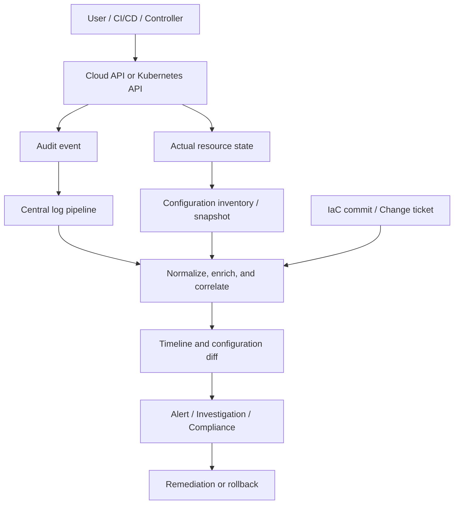
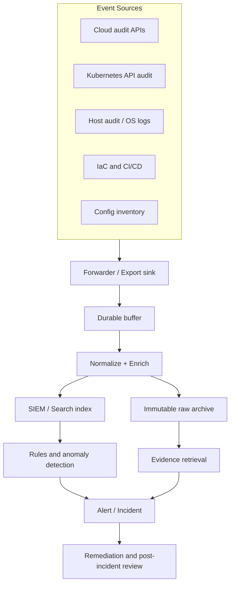

# Audit Logs and Compute Configuration Change Traceability

## Learning Objectives

After this lesson, you will be able to:

- Distinguish audit logs, operational logs, metrics, traces, and configuration version history.
- Identify audit sources to collect when governing VMs, containers, Kubernetes, autoscaling, storage, and accelerators.
- Read a configuration change event and identify who performed it, which resource was affected, when, from where, and what the outcome was.
- Correlate human identities, assumed roles, service accounts, pipelines, and automated controllers.
- Reconstruct before/after state using request events, configuration snapshots, IaC plans/applies, and inventories.
- Design audit policies for the Kubernetes API server and log retention pipelines from cloud providers.
- Detect out-of-band changes, drift between desired state and actual state, and security-weakening actions.
- Protect the integrity, accessibility, and retention of audit logs.
- Query, alert on, and investigate compute change incidents along an evidence-backed timeline.
- Build an auditable change governance process while controlling costs and sensitive data exposure.

## 1. Why Audit Compute Configuration Changes?

Compute infrastructure changes constantly. A VM can change its instance type, disks, network interfaces, or security groups. A Kubernetes node can receive taints, labels, or version upgrades. A Deployment can change its image, CPU/memory limits, or replica count. Autoscalers and controllers can also adjust capacity automatically.

If you only know the current state, operations teams struggle to answer:

- Who changed the configuration?
- When did the change happen and through which UI, API, CLI, or pipeline?
- Which resources were impacted?
- What were the before and after values?
- Was the change approved?
- Was it executed by a human, CI/CD, or an automated controller?
- Did the change cause an outage, cost spike, or widened access?
- How can the prior state be restored?

Audit logs record governance- and security-relevant actions. Combined with configuration snapshots, IaC history, inventory, and telemetry, audit logs reconstruct how a change unfolded and what impact it had.

Real-world scenarios:

- A VM suddenly switches to a more expensive instance type.
- A security group opens administrative ports to the Internet.
- A node pool scales up instance counts during off-peak hours.
- A container's memory limit is raised, starving the node of RAM.
- A user edits an autoscaling policy, causing excessive scaling.
- A GPU node has its driver or MIG configuration altered.
- A Persistent Disk is migrated to a different storage tier.
- A service account is granted instance management permissions.

Auditing does more than support post-incident investigations. It also aids cost control, compliance, change management, and detecting baseline drift.

### 1.1. Change Traceability Lifecycle



Audit events describe actions; snapshots describe resource state at a point in time; IaC or change tickets describe intent. These three sources complement one another.

## 2. Distinguishing Audit Logs from Other Logs and Telemetry

Not every log is an audit log. Picking the wrong data source leaves blind spots during investigations.

| Data Type | Primary Question | Example |
|---|---|---|
| Audit log | Who did what to which resource and what was the outcome? | API changing machine type, updating a Deployment |
| Operational/application log | What did a component execute or what error occurred? | kubelet reporting a container restart |
| Metric | At what level is the resource operating? | CPU utilization, memory pressure |
| Trace | Which components did a request traverse and how long did it take? | API request calling scheduler then database |
| Configuration snapshot | What configuration did the resource have when captured? | VM type, disks, tags, network |
| IaC history | How did desired configuration change in source control? | Terraform commit and plan |
| Change record | Who requested, approved, and deployed which change? | Compute maintenance ticket |

For example: rising CPU utilization is a metric, but it does not reveal who raised a CPU limit. Application logs report timeouts, but do not prove who changed an instance type. Audit events capture API mutations, while snapshots show actual before and after configurations.

### 2.1. Control Plane vs. Data Plane

**Control plane** is the resource management layer: creating, modifying, or deleting VMs, node pools, disks, network policies, Deployments, or autoscaling rules. Most configuration change events originate here.

**Data plane** is where workloads execute and serve traffic: processes inside VMs, containers, applications, disk I/O, or network packets. The data plane has its own operational logs, metrics, and traces.

A control-plane change can cause a data-plane impact. For example, an API call changing disk type is an audit event; subsequent I/O latency spikes are metrics. During investigations, align both timelines to establish correlation.

### 2.2. Audit Events Do Not Always Contain Full Before/After State

An API event may capture request parameters and response metadata, yet not every service stores complete old and new configurations. Some operations only log a resource ID or operation name.

Therefore, supplement with:

- Before/after or periodic snapshots.
- Resource inventory and configuration history.
- IaC plans, apply logs, and commit hashes.
- Change tickets and approvals.
- Controller or autoscaler events.
- API responses or post-mutation resource states.

Never infer old values solely from new values. If no snapshot or event explicitly records old/new values, document the evidence gap.

## 3. Audit Scope in Compute

Scope should cover every layer capable of altering compute capacity, cost, availability, and security boundaries.

| Resource Group | Changes to Track | Risk Without Traceability |
|---|---|---|
| VM/instance | Machine type, image, zone, metadata, lifecycle | Downtime, drift, cost spikes |
| CPU/memory | vCPU, RAM, resource requests/limits | Throttling, OOM, overprovisioning |
| Disk/storage | Disk type, size, IOPS, encryption, attach/detach | Data loss, cost spikes |
| Network | NIC, subnet, routes, firewall, public IP | Unintended exposure, connectivity loss |
| Identity | IAM roles, service accounts, policies, keys | Privilege escalation |
| Instance group/node pool | Min/max size, templates, rollouts, autoscaler | Mis-scaling, capacity shortages |
| Kubernetes | Deployment, StatefulSet, DaemonSet, Pod, quotas | Unintended workload changes |
| Container runtime | Runtime class, image, security context | Execution and compatibility risks |
| GPU/accelerator | Device plugins, drivers, MIG, sharing policies | Device loss, performance, and cost |
| Host/OS | Kernel, packages, startup scripts, systemd units | Drift and uncontrolled changes |
| Backup/recovery | Snapshot policies, retention, restore config | Inability to recover properly |
| Scheduling | Priority, affinity, taints, tolerations | Workloads landing on wrong nodes or starvation |

### 3.1. Classifying Changes by Impact

Changes can be classified across three dimensions:

- **Availability:** can cause downtime, restarts, drains, or capacity loss.
- **Security:** can open permissions, public exposure, alter encryption, or modify audit policies.
- **Cost:** can increase machine sizes, replica counts, GPU-hours, disk, or network transfer.

A single change can span multiple categories. For instance, raising a node pool's max size affects cost while also expanding attack surface and capacity.

## 4. Structure of a Useful Audit Event

A normalized event should contain enough fields for querying, cross-referencing, and correlation.

| Field | Meaning |
|---|---|
| `event_id` | Unique identifier of the event |
| `event_time` | Timestamp when the source recorded the action |
| `ingest_time` | Timestamp when the log system received the event |
| `actor` | Principal performing the action |
| `actor_type` | Human, service account, role, controller, or pipeline |
| `source_ip` | Source IP if provided by the audit source |
| `user_agent` | Tool or client sending the request |
| `action` | Operation or API method |
| `resource_type` | Type of resource |
| `resource_id` | Full identifier of the resource |
| `project/account/subscription` | Administrative scope containing the resource |
| `region/zone` | Resource location |
| `request_id/correlation_id` | Key linking related events |
| `result` | Success, denied, failed, or equivalent status |
| `change_id` | Ticket, pipeline run, or release ID |
| `before/after` | Old/new values if evidence exists |
| `source` | Cloud provider, Kubernetes API, host audit, or IaC |
| `severity` | Impact level per internal policy |

### 4.1. Normalized Event Example

```json
{
  "event_id": "evt-7c3a91",
  "event_time": "2026-11-22T09:14:32Z",
  "ingest_time": "2026-11-22T09:14:35Z",
  "source": "cloud-control-plane",
  "actor": "user:engineer@example.invalid",
  "actor_type": "human",
  "assumed_role": "ComputeChangeOperator",
  "action": "compute.instances.update",
  "resource_type": "virtual_machine",
  "resource_id": "projects/prod-a/zones/zone-1/instances/api-07",
  "region": "region-1",
  "source_ip": "203.0.113.24",
  "user_agent": "terraform/1.x",
  "request_id": "req-91b2",
  "change_id": "CHG-2048",
  "result": "SUCCESS",
  "change": {
    "machine_type": {
      "before": "standard-4",
      "after": "standard-8"
    }
  }
}
```

This is an illustrative normalized schema, not a raw payload from any cloud provider. Emails, IPs, and resource names use sample data. In real systems, never fabricate an `actor` or `before` value when the source omits it; leave it `null` or mark it unavailable.

### 4.2. Event Time vs. Ingest Time

These two timestamps differ:

- **Event time:** when the source service recorded the operation.
- **Ingest time:** when the pipeline received the log.

Differences stem from buffering, export delays, network outages, or clock skew. When building timelines, prioritize event time from trusted sources while retaining ingest time to detect lag. Synchronize clocks using NTP or time synchronization services on hosts and self-managed systems.

### 4.3. Human Actor or Automation?

A single change may traverse multiple identities:

1. An engineer signs in via SSO.
2. The engineer assumes a deployment role.
3. A CI/CD runner uses a workload identity.
4. Terraform or a deployment controller calls the cloud API.
5. An autoscaler or operator further modifies nodes.

Audit logs may display only the final role or service account. To attribute back to the initiator, retain session names, identity federation subjects, pipeline runs, commit hashes, and correlation IDs.

Never conclude "person A did this" solely because an assumed role happens to include their name. Verify the full identity chain and request origin.

## 5. Cloud Provider Audit Log Sources

Each cloud provider offers its own audit service. Field names and before/after capture vary, but the general principle is collecting management/control-plane events across organizations, accounts, or projects.

### 5.1. AWS CloudTrail

AWS CloudTrail records API activity and certain administrative events for an AWS account. Management events are useful for tracing operations across EC2, Auto Scaling, EBS, IAM, VPC, and other services. Data events are a separate category and may require additional per-service configuration.

Common fields in a CloudTrail event:

- `eventTime`: event timestamp.
- `eventSource`: service generating the event.
- `eventName`: API operation.
- `userIdentity`: identity invoking the API.
- `sourceIPAddress`: source address.
- `userAgent`: client/tool.
- `requestParameters`: recorded request parameters.
- `responseElements`: partial response if present.
- `errorCode`/`errorMessage`: error details.
- `requestID`: request ID.
- `awsRegion`: region.

For example, modifying an EC2 attribute logs the API operation, identity, and request parameters. However, not every API includes full prior state. You may need to cross-reference AWS Config or snapshot inventories to construct a diff.

### 5.2. Azure Activity Log

Azure Activity Log captures subscription-level control-plane events and Azure resource management operations. It helps trace creating, modifying, and deleting VMs, VM Scale Sets, disks, network interfaces, and policies.

Common fields:

- `eventTimestamp`: event timestamp.
- `caller`: identity invoking the operation.
- `operationName`: operation executed.
- `resourceId`: resource ID.
- `resourceGroupName`: resource group.
- `subscriptionId`: subscription.
- `status`/`subStatus`: outcome.
- `correlationId`: correlation key.
- `callerIpAddress`: source IP if present.
- `properties`: supplemental metadata.

Activity Log answers who called which operation on which resource and its outcome. For detailed configuration history or before/after values, combine it with resource change history, deployment history, Azure Policy, or appropriate snapshots.

### 5.3. Google Cloud Audit Logs

Google Cloud Audit Logs provide audit log categories for project and organizational activity. Commonly referenced types include:

- **Admin Activity:** administrative operations changing resource configuration or metadata.
- **Data Access:** data reads/writes; logging availability and config vary by service.
- **System Event:** changes performed by managed Google systems.
- **Policy Denied:** requests rejected by policy.

Common payload fields:

- `protoPayload.authenticationInfo`: authenticated identity.
- `protoPayload.methodName`: invoked method.
- `protoPayload.resourceName`: target resource.
- `protoPayload.request`: recorded request.
- `protoPayload.response`: response if present.
- `protoPayload.status`: status.
- `protoPayload.requestMetadata.callerIp`: source IP if recorded.
- `serviceName`: service generating the event.
- `timestamp`: event timestamp.

Admin Activity and System Event logs are especially helpful for distinguishing user/automation requests from platform-initiated changes. Verify Data Access settings, sinks, retention, and access permissions per organizational audit mandates.

### 5.4. Comparing Cloud Audit Sources

| Platform | Primary Audit Source | Used to Trace |
|---|---|---|
| AWS | CloudTrail | API calls, identity, region, request/response metadata |
| Azure | Activity Log | Control-plane operations, caller, resource ID, status, correlation |
| Google Cloud | Cloud Audit Logs | Admin Activity, System Event, Data Access, and Policy Denied |
| Kubernetes | API server audit log | User/service account, verb, object, request/response stage |
| Linux host | `auditd`/`journald`/system logs | File changes, commands, or host activity per policy |

Service names do not guarantee logs are exported or centrally retained. Verify sources, scopes, enabled event types, and retention periods.

## 6. Auditing in Kubernetes

The Kubernetes API server is the control point for many cluster configuration changes. Audit logging records API server requests according to policy.

Operations of interest:

- Creating/updating/deleting Deployments, StatefulSets, DaemonSets, and Jobs.
- Modifying Pod templates, images, CPU/memory requests/limits.
- Modifying Node labels, taints, and annotations.
- Modifying ResourceQuotas, LimitRanges, and PriorityClasses.
- Editing HorizontalPodAutoscalers, ClusterAutoscaler-related resources, or custom autoscaling objects.
- Modifying RuntimeClasses, StorageClasses, and PersistentVolumes.
- Modifying RBAC, ServiceAccounts, and admission policies.
- Container `exec`/`attach`/`port-forward` access.
- Modifying device plugin or GPU operator configurations.

### 6.1. Audit Stages

Kubernetes audit events can be emitted at different stages:

- `RequestReceived`: API server receives the request.
- `ResponseStarted`: response begins for long-running requests.
- `ResponseComplete`: request finishes.
- `Panic`: request terminates due to panic.

A single request can emit multiple events across stages. Choose stages appropriately to avoid duplicates or missing data. For many systems, `ResponseComplete` is useful for completed operations; long-running requests may need different handling.

### 6.2. Audit Levels

Primary levels:

| Level | Logged Content | When to Use |
|---|---|---|
| `None` | Do not log matching events | Drop unneeded noise |
| `Metadata` | User, verb, resource, timestamp, and metadata; no request/response bodies | Track access while limiting sensitive data |
| `Request` | Metadata and request body | Investigate changes needing request payloads |
| `RequestResponse` | Metadata, request body, and response body | Detailed evidence needed; must guard sensitive data |

Do not default to `RequestResponse` for every API. Request/response payloads can contain Secrets, tokens, internal annotations, or sensitive configs. Select levels per resource and operation.

### 6.3. Audit Policy Example

The illustrative policy below prioritizes logging metadata-only for Secrets, request bodies for selected compute changes, and metadata for standard read operations. Rules are evaluated in order; the first matching rule sets the level.

```yaml
apiVersion: audit.k8s.io/v1
kind: Policy
omitStages:
  - RequestReceived
rules:
  - level: Metadata
    resources:
      - group: ""
        resources: ["secrets"]

  - level: Request
    verbs: ["create", "update", "patch", "delete"]
    resources:
      - group: ""
        resources: ["nodes", "pods", "persistentvolumes"]
      - group: "apps"
        resources: ["deployments", "statefulsets", "daemonsets"]
      - group: "batch"
        resources: ["jobs", "cronjobs"]
      - group: "autoscaling"
        resources: ["horizontalpodautoscalers"]
      - group: "storage.k8s.io"
        resources: ["storageclasses"]
      - group: "scheduling.k8s.io"
        resources: ["priorityclasses"]

  - level: Metadata
    verbs: ["get", "list", "watch"]

  - level: Metadata
```

This is a starting point for discussion, not a complete policy for every cluster. Add API groups/resources matching your CRDs and Kubernetes version. Production policies should also cover RBAC, admission configurations, node resources, and custom operators. Never log Secret bodies just to get complete diffs.

### 6.4. Audit Backends and Transport

The Kubernetes API server can write audit events to a log file or send them to a webhook backend. In managed Kubernetes environments, configuration options and log access depend on the provider.

Ensure:

- Audit policies are managed as reviewed infrastructure configuration.
- File backends enforce rotation and size limits.
- Webhook backends have retries, buffering, and delivery monitoring.
- Logs ship to centralized storage.
- Loss of log sink connectivity triggers an alert.
- Sample events are verified after every policy update.
- Audit log read permissions are separated from cluster admin rights.

If an audit sink stalls or a policy is overly broad, logs can drop or costs can spike. Monitor ingestion rates and dropped events.

## 7. Tracking Changes on Linux Hosts and Container Nodes

Cloud control-plane audits do not record every action inside a host. To trace OS or runtime changes, host-level sources may be needed:

- Linux audit subsystem (`auditd`) for rule-based syscall/file access.
- systemd journal and service logs.
- Package manager history.
- Configuration management agents.
- File integrity monitoring.
- Container runtime logs.
- SSH/session recording per policy.
- Host inventory and image build metadata.

Changes worth tracking:

- Modifying `kubelet` or container runtime configuration files.
- Changing GPU drivers.
- Changing kernels or modules.
- Modifying systemd units and startup scripts.
- Installing new packages or binaries.
- Modifying firewall/route files.
- Changing mounts, `fstab`, or disk configurations.
- Changing file permissions and privileged users/groups.

`auditd` can log activity by configured syscalls and paths, though overly broad rules generate heavy volume and hurt performance. Prioritize critical config files, privileged commands, and investigable changes.

### 7.1. Host Auditing Does Not Replace Cloud Auditing

If someone changes a machine type via the cloud API, `auditd` inside the VM may never see it. Conversely, if an admin SSHes into a VM and edits a systemd unit, cloud control-plane audits will not capture file contents.

Combine sources along responsibility boundaries:

- Cloud audit for resource management APIs.
- Kubernetes audit for cluster APIs.
- Host audit for actions inside the OS.
- IaC/CI logs for desired changes and pipelines.
- Configuration snapshots for actual state.

## 8. Tracing Before/After and Configuration Diffs

An audit event may report "UpdateInstance" succeeded without always carrying the entire prior configuration. To build reliable diffs, assemble an evidence chain.

### 8.1. Sources for Constructing Diffs

1. API request parameters: values requested by the client.
2. API response: outcome returned by the service.
3. Configuration history: field-level changes stored by the service.
4. Before/after snapshots: resource config at two points in time.
5. IaC plan: intended changes prior to apply.
6. IaC state or inventory: applied state.
7. Change ticket: purpose and approver.

Never treat an IaC plan as proof that actual state changed. Applies can fail or succeed partially. Cross-check audit events and post-apply state.

### 8.2. VM Diff Example

```json
{
  "resource_id": "vm-prod-api-07",
  "observed_at": "2026-11-22T09:20:00Z",
  "changes": [
    {
      "field": "machine_type",
      "before": "standard-4",
      "after": "standard-8",
      "source": "configuration-snapshot"
    },
    {
      "field": "boot_disk.size_gb",
      "before": 100,
      "after": 200,
      "source": "provider-change-event"
    }
  ],
  "correlation": {
    "audit_request_id": "req-91b2",
    "change_id": "CHG-2048",
    "iac_commit": "a1b2c3d4"
  }
}
```

This diff illustrates recording the evidence source per field. If a `before` value comes only from an earlier snapshot, record the snapshot timestamp. Never attribute every field to the same source when data sources differ.

### 8.3. Diffs for Kubernetes Workloads

For Deployments, inspect:

- `spec.replicas`.
- Image and image digest.
- `command`/`args`.
- CPU/memory requests and limits.
- Environment variable references.
- Volume mounts.
- `securityContext`.
- `nodeSelector`, affinity, tolerations.
- `serviceAccountName`.
- `runtimeClassName`.
- GPU extended resource limits.

Pod runtime state can shift due to rollouts or scheduling without every change originating directly from a user. Correlate Deployment revisions, ReplicaSets, Pod owner references, and audit events to find the origin.

### 8.4. Desired State vs. Actual State

- **Desired state:** configuration declared in Git/IaC or manifests.
- **Actual state:** live configuration on the cloud API or cluster.
- **Observed state:** state captured by inventory/controllers at observation time.

Drift occurs when actual state diverges from desired state. Yet not every difference is unauthorized drift: autoscalers, controllers, or admission webhooks may adjust fields by design.

Define which fields are human-managed, which are controller-managed, and which may vary dynamically. Otherwise, alerting systems will fire continuously on legitimate changes.

## 9. Combining Auditing with Infrastructure as Code and CI/CD

IaC creates a reviewed change history, but does not replace audit logs. Audit logs record actual control-plane operations; source control records intent and proposed configuration.

A sound workflow:

1. An engineer opens a pull request modifying Terraform or Kubernetes manifests.
2. CI runs formatting, validation, policy checks, and planning.
3. Reviewers approve the diff and risk.
4. The pipeline uses a short-lived workload identity to apply.
5. The cloud provider/Kubernetes API emits audit events.
6. The pipeline records commit SHA, run ID, and change ID.
7. Inventory captures actual post-apply state.
8. Systems reconcile actual against desired state.
9. Alerts trigger on out-of-band changes or unapproved drift.

### 9.1. Linking Commits to Audit Events

Pass non-sensitive metadata in requests or resource tags/labels when supported by the platform:

- `change_id`.
- `pipeline_run_id`.
- `git_commit_sha`.
- `deployment_version`.
- `owner`/`team`.
- `environment`.
- `reason`.

Not every API accepts arbitrary metadata. Where a change ID cannot ride inside the request, store the mapping between pipeline run, principal, request ID, and resource ID in your change record system.

### 9.2. Distinguishing Human Changes from Controller Changes

An autoscaler can adjust node counts without manual intervention. An operator can update replicas or Pod templates based on a custom resource. Audit events may display only the controller's service account.

To classify accurately:

- Maintain a catalog of valid service accounts and workload identities.
- Tag resources with owner and controller type.
- Correlate events with autoscaler/operator logs.
- Compare actions against policies and configured thresholds.
- Alert when automation acts outside permitted bounds.

Never exempt service accounts from auditing. Automation can also be compromised or misconfigured.

## 10. Detecting Configuration Drift

Drift detection compares desired state against actual state periodically or event-driven.

Approaches:

- Run periodic IaC plans in read-only/refresh mode.
- Collect inventory snapshots and compare fields.
- Use cloud configuration management/compliance rules.
- Use Kubernetes GitOps controllers to reconcile manifests.
- Trigger actual-state queries from audit change events.
- Use file integrity monitoring for host configurations.

### 10.1. Classifying Drift

| Drift Type | Example | Handling |
|---|---|---|
| Approved drift | Change backed by ticket and approval | Update desired state or close ticket |
| Emergency drift | Direct fix to restore service | Document reason, post-review, and sync IaC |
| Controller-managed | Autoscaler updating replica or node counts | Define owner and policy for the field |
| Unauthorized drift | Opening firewall or elevating permissions without approval | Alert, investigate, and revert |
| Temporary drift | Temporary rollout or scaling | Apply grace window and dynamic baseline |
| Unknown drift | Origin unidentifiable | Preserve evidence, open incident, and investigate |

Do not auto-revert every drift. An emergency change may be actively protecting production; use risk-based policies and verification before remediation.

### 10.2. Drift by Field Ownership

A single resource can have different fields managed by different controllers. For example:

- GitOps manages image and resource requests.
- HPA manages replica counts.
- Cluster autoscaler manages node counts.
- Operators manage specialized fields.

If one system continuously overwrites another's fields, a reconciliation loop occurs. Define per-field ownership, use server-side apply/field managers or equivalents, and exclude dynamic fields from inappropriate diffs.

## 11. Detecting High-Risk Changes

Not all updates carry equal risk. Build rules based on resource, field, actor, environment, and timing.

### 11.1. Examples of Alert-Worthy Rules

| Change | Risk | Suggested Priority |
|---|---|---|
| Opening SSH/RDP from the Internet | Expanded attack surface | Critical/High |
| Disabling disk encryption | Loss of data protection | High |
| Attaching public IP to a sensitive VM | Unintended exposure | High |
| Elevating IAM/service account privileges | Privilege escalation | Critical/High |
| Disabling audit logging or altering sinks | Loss of visibility | Critical |
| Sudden spike in node pool max size | Cost/capacity surge | Medium/High |
| Switching to a more expensive instance type | Cost increase | Medium |
| Removing resource limits or setting excessively high | Noisy neighbor/OOM/cost | Medium/High |
| Adding `privileged` or broad `hostPath` to a Pod | Host compromise risk | High |
| Changing GPU driver/MIG layout | Accelerator workload disruption | Medium/High |
| Deleting backup/snapshot policies | Reduced recoverability | High |
| Changing to an untrusted image source | Supply-chain risk | High |

Actual priority depends on environment, data classification, and exposure. A development change may have lower impact than production, yet still requires logging for reconciliation.

### 11.2. Rules Need Context

For example, "increasing replicas" is not inherently bad. An autoscaler adding replicas within bounds is normal; a user multiplying replicas 20x while upgrading machine types may indicate an anomaly.

A strong rule combines:

- Resource ID and environment.
- Changed field and magnitude of change.
- Actor type and actor permissions.
- Change ID/approval.
- Timing and maintenance windows.
- Source IP, user agent, and access location where permitted.
- Baselines and historical behavior.
- Operation outcome and resulting resource state.

## 12. Querying Audit Logs and Building Timelines

An investigation workflow should start from a specific resource or incident, then expand across request IDs, actors, time windows, and dependencies.

### 12.1. Investigation Steps

1. Identify the affected resource ID or cluster/node/workload.
2. Bound the time window before and after the incident began.
3. Search for resource change events within that window.
4. Extract actor, operation, source IP, user agent, and request ID.
5. Look up change tickets, pipeline runs, and commit SHAs.
6. Compare before/after snapshots or configuration diffs.
7. Check events from controllers/autoscalers.
8. Correlate operational logs and metrics to assess impact.
9. Verify current state and any applied remediation.
10. Preserve evidence and state conclusions with confidence levels.

### 12.2. Illustrative SQL Query

Assuming audit events are normalized into an `audit_events` table:

```sql
SELECT
    event_time,
    actor,
    action,
    resource_id,
    result,
    request_id,
    change_id
FROM audit_events
WHERE resource_id = 'projects/prod-a/instances/api-07'
  AND event_time >= TIMESTAMP '2026-11-22 08:00:00'
  AND event_time <  TIMESTAMP '2026-11-22 10:00:00'
ORDER BY event_time ASC;
```

Timestamp syntax and table names depend on the query engine. This query illustrates filtering by resource and time, not a ready-to-run query across all platforms.

### 12.3. Finding Changes Without a Change ID

A rule can search for successful production mutations lacking a change ID:

```sql
SELECT
    event_time,
    actor,
    action,
    resource_id,
    source,
    request_id
FROM audit_events
WHERE environment = 'production'
  AND result = 'SUCCESS'
  AND action_category = 'CONFIG_MUTATION'
  AND (change_id IS NULL OR change_id = '')
ORDER BY event_time DESC;
```

Some legitimate automation may not use change tickets. Allowlist by verified service identity and cross-reference deployment/autoscaler events. Do not treat a missing change ID alone as conclusive proof of unauthorized activity.

### 12.4. Correlating with Telemetry

After identifying a change event, cross-check:

- CPU/memory utilization and throttling.
- Container restarts, `OOMKilled`, and node pressure.
- Request latency, error rates, and throughput.
- Disk latency, IOPS, and queue depth.
- Network errors, connection resets, and packet drops.
- GPU utilization, VRAM, and driver errors.
- Autoscaler desired/current replicas and pending Pods.

If metrics shift right after a config event, that indicates temporal correlation—not automatic proof of causation. Check concurrent changes and dependencies.

## 13. Storing Audit Logs and Protecting Integrity

Audit logs are only valuable if they can be trusted and accessed during investigations. People authorized to modify compute must not be able to erase tracks of their own changes.

### 13.1. Storage Architecture

A common architecture:

1. Audit sources emit events.
2. Log sinks/exporters ship events outside the source account/project/cluster.
3. Ingestion pipelines validate schema, timestamps, and sources.
4. Events are normalized and enriched.
5. Raw originals are stored in immutable or append-only storage.
6. Searchable copies are indexed into SIEM/log analytics.
7. Retention policies transition older data to appropriate storage tiers.
8. Alerts fire when log delivery or ingestion fails.

Keep a copy outside the workload's normal administrative scope. If both logs and compute resources sit in the same account under the same admin rights, an attacker can delete both resources and evidence.

### 13.2. Tamper and Deletion Protection

Controls:

- Enable immutable retention or object lock where supported by the platform.
- Use a dedicated log storage bucket/account/project.
- Separate permissions for log writing, reading, and deleting.
- Enable appropriate versioning and retention locks.
- Record access logs for the audit system itself.
- Use checksums or hash chains to detect unintended tampering.
- Replicate logs to a security account or independent administrative domain.
- Alert whenever audit trails, export sinks, or retention policies are modified.

Hash chains help detect tampering when checkpoint hashes are protected independently. Simply computing a hash and storing it alongside the log under the same admin rights cannot stop someone with permission to alter both.

### 13.3. Retention and Cost

Retention must satisfy legal, contractual, investigative, and internal requirements. No single day count fits every organization.

Tiering options:

- Hot: recent data requiring fast queries.
- Warm: data queried regularly with higher latency tolerance.
- Archive: long-term storage for compliance or rare investigations.

Balance retention duration, indexing costs, volume, retrieval speed, and legal hold mandates. Never delete logs during an active incident, legal hold, or evidence preservation mandate.

## 14. Access Permissions and Sensitive Data in Audits

Audit logs can contain emails, IPs, resource paths, commands, metadata, request bodies, or tenant details. Overly broad `RequestResponse` logging can inadvertently capture tokens, passwords, Secrets, or personal data.

Principles:

- Log bodies only with clear justification and narrow scope.
- Redact or strip credentials, tokens, and secrets.
- Restrict access by investigative role.
- Require MFA and audit log querying/exporting actions.
- Encrypt in transit and at rest.
- Align retention with data classification.
- Never route sensitive audit logs to unapproved workspaces or channels.
- Separate compute administration from audit sink administration.
- Log all reads, exports, replays, or deletions of logs.

Never use audit logs as a backup store for full secret configurations. The goal is tracing actions and metadata needed for investigations, not duplicating credentials.

## 15. Alerting When the Audit Pipeline Breaks

A system might show zero anomalous events either because nothing changed or because the log pipeline broke. Always distinguish these two states.

Monitor:

- Event counts by source and account/project.
- Ingestion lag between event time and ingest time.
- Delivery failures and retries.
- Dropped events or queue backlogs.
- Audit sink permission errors.
- Last successful export job timestamp.
- Unexpected drops in log volume to zero.
- Modifications to audit policies or retention.
- Host clock drift.
- Parser/schema failures.

Generate synthetic events or run periodic checks via approved test actions in an isolated environment. Never inject fake changes into production purely to test logs without a safe procedure.

### 15.1. Log Coverage Matrix

Maintain a table of audit sources and collection health:

| Source | Scope | Periodic Check |
|---|---|---|
| Cloud management audit | Account/project/subscription | Latest event, sink, and retention |
| Kubernetes API audit | Cluster | Audit policy, backend, and dropped events |
| Host audit | Node/VM | Agent health, loaded rules, and forwarding |
| IaC/CI/CD | Repository/pipeline | Commits, approvals, plan/apply artifacts |
| Configuration inventory | Compute resource | Snapshot freshness and diffs |
| Identity provider | SSO/role federation | Sessions, MFA, and identity chains |

A coverage matrix catches resource groups or node pools not yet wired into the log pipeline.

## 16. Configuration Change Incident Investigation Workflow

When an alert fires, the goal is preserving evidence, scoping impact, and recovering safely.

### 16.1. Runbook

1. Open an incident and record the detection time.
2. Identify affected resources, project/account/cluster, and environment.
3. Preserve raw audit events along with request IDs.
4. Inspect actor, identity chain, source IP, and user agent.
5. Check change ID, approvals, pipeline runs, and commits.
6. Capture an actual-state snapshot and compare against baseline.
7. Inspect events from controllers, autoscalers, and operators.
8. Cross-reference metrics/logs/traces to determine impact.
9. Assess whether the actor, role, or resource must be isolated.
10. Choose remediation: rollback, apply desired state, or manual emergency fix.
11. Verify post-remediation state and record a new audit event.
12. Document the timeline, evidence, root cause, and preventive actions.

Never delete resources or alter log policies mid-investigation before preserving evidence. If emergency changes are made to stop ongoing harm, record who performed them, why, when, and before/after states.

### 16.2. Investigation Example: Unexpected VM Upsize

Scenario: compute billing spikes and an API VM suddenly has double the CPU capacity.

Evidence to gather:

- Audit event for the instance update API call.
- Actor and assumed role.
- Source IP/user agent.
- Request parameters and response.
- Before/after VM snapshots.
- IaC plan/apply history.
- Change ticket.
- CPU/memory metrics and billing timeline.
- Autoscaler or automation events if present.

Possibilities:

- Approved change not yet synced back to IaC.
- CI/CD applied to the wrong workspace or environment.
- User edited directly via the console.
- Automation executed an erroneous policy.
- Compromised credentials used improperly.

Conclusions must rest on the identity chain and corroborating evidence. Seeing only a pipeline role is insufficient to identify the underlying commit or human initiator.

### 16.3. Investigation Example: Kubernetes Resource Limit Change

Scenario: Pods start getting OOM-killed right after a rollout.

Check:

- Audit events for Deployment patch/update.
- Request body and user identity.
- ReplicaSet revisions and Pod templates.
- Deployed commit/manifest.
- Before/after CPU/memory limits.
- Container restart reasons and OOM events.
- Whether mutating admission webhooks or operators modified resources.

If the Deployment manifest stayed unchanged yet Pod templates differ, inspect mutating admission webhooks and controllers. Do not assume every Pod modification came directly from the deployer.

## 17. Governance: Change Approvals and Management

Audit logs record what happened; change management defines what is permitted to happen.

A solid change record contains:

- Unique Change ID.
- Requester and approver.
- Objective and rationale.
- Target resources/scope.
- Fields planned to change.
- Execution window.
- Testing plan.
- Rollback plan.
- Pipeline/run ID.
- Outcome and post-change verification.

### 17.1. Change Categories

- **Standard change:** repeatable, low-risk, follows pre-approved procedure.
- **Normal change:** requires review/approval scaled to risk.
- **Emergency change:** requires rapid action to restore service or halt an incident; requires post-review and record reconciliation.

Do not require manual approvals for every autoscaler adjustment if pre-approved by policy. Instead, define bounds, limits, and valid automation identities, then audit each action.

### 17.2. Separation of Duties

Separate roles so a single person cannot propose, approve, deploy, and erase the audit trail for the same change.

Example:

- Developer proposes IaC change.
- Reviewer approves.
- CI/CD role executes.
- Security/audit role reads logs.
- Storage admin manages retention locks.

In smaller teams, apply risk-tiered approval rules and independent post-hoc reviews for emergency changes.

## 18. Integrating Auditing with Policy and Compliance

Audit events serve as evidence for requirements such as:

- Who holds permission to modify compute.
- Which resources were made public.
- Whether encryption was disabled.
- Whether instance images match approved lists.
- Whether workloads enforce policy-compliant resource limits.
- Whether audit logging is enabled and retained for the required period.
- Whether production changes have tickets and approvals.
- Whether anomalous IAM or service account changes occurred.

Distinguish **control evidence** from a **compliance conclusion**. An event proving an API was invoked does not by itself prove the entire control operated effectively. Define scope, completeness, retention, access controls, and evidence-testing procedures.

## 19. Reference Architecture for an Audit Pipeline



A strong pipeline requires:

- Clearly identified event sources with verified coverage.
- Durable buffering to withstand brief disruptions.
- Normalized schemas that still preserve raw events.
- Parser versions and event provenance.
- Separate-privilege immutable archives.
- Search indexes governed by retention and access policies.
- Risk-tiered alerts.
- Runbooks and evidence retrieval workflows.
- Monitoring of the audit pipeline itself.

Do not keep only normalized records. Raw events verify parsers, field mappings, and original context during investigations.

## 20. Operational Metrics for Auditing and Change Tracking

| Category | Metric | Purpose |
|---|---|---|
| Coverage | Percentage of accounts/projects/clusters with active audit sources | Detect blind spots |
| Freshness | Time from event generation to ingest | Detect log lag |
| Completeness | Dropped events, delivery errors, parser failures | Detect data loss |
| Integrity | Checksum/retention lock/versioning status | Protect evidence |
| Access | Read/export counts, policy modifications | Monitor misuse |
| Change governance | Percentage of mutations backed by change ID/approval | Evaluate process adherence |
| Drift | Unresolved drift count and drift age | Manage actual vs. desired |
| Risk | High-risk changes by actor/resource | Detect anomalies |
| Response | Time to identify actor and resource | Measure investigation efficiency |
| Cost | Log ingest, index, archive, and query costs | Optimize operations |

Set SLOs for the audit pipeline—such as the percentage of events ingested within a target window and time to detect when a source stops logging. Concrete thresholds must reflect organizational architecture and mandates.

## 21. Common Mistakes

- **Treating audit logs as application logs.** Audits focus on administrative actions, actors, and resources; application logs describe software behavior.
- **Assuming current state reveals who made a change.** You need events, identity chains, and change history.
- **Assuming every cloud API event contains before/after state.** Many events capture only requests or metadata; supplement with snapshots/config history.
- **Treating an IaC plan as proof a change applied.** Plans express intent; verify apply outcomes and actual state.
- **Assuming role names identify individuals.** Trace sessions, federation subjects, pipeline runs, and correlation IDs.
- **Exempting automation from auditing.** Controllers and service accounts can malfunction or be compromised.
- **Enabling audit logs only at the cloud provider.** Kubernetes APIs, hosts, and CI/CD have distinct event boundaries.
- **Assuming `RequestResponse` is always better than `Metadata`.** Bodies can leak secrets and sensitive data.
- **Assuming zero events means zero changes.** Audit policies, sinks, or ingestion may be broken.
- **Relying solely on log file hashes against tampering.** Hashes and checkpoints must be protected independently.
- **Auto-reverting all drift blindly.** Can undo emergency fixes or controller-managed fields.
- **Relying on queue backlogs or CPU metrics alone to explain changes.** Combine audits, snapshots, IaC, and telemetry.
- **Assuming a valid change ticket proves actual state matches.** Verify API results and configuration snapshots.
- **Assuming longer log retention is always better.** Retention must balance evidentiary needs, privacy, and cost.

## 22. Self-Check

**Scenario 1:** A VM changes from a 4-vCPU machine type to 8 vCPUs. The cloud audit event lists only the operation and request parameters, without the old config. How do you reconstruct before/after?

**Hint:** Locate configuration snapshots prior to the event timestamp, resource history, or inventory; compare against post-change snapshots and preserve timestamps/sources for every field. Never guess old values from the new request.

**Scenario 2:** Audit logs show a service account modified the node pool max size. Can you conclude the autoscaler made the change?

**Hint:** Not yet. Check the service account owner, workloads/pods using that identity, pipeline runs, controller logs, and correlation IDs. One automation identity may be shared across multiple components.

**Scenario 3:** A Kubernetes audit policy logs `RequestResponse` for all resources and the log sink begins storing Secret data. What should be adjusted?

**Hint:** Lower the audit level for Secrets to `Metadata` or an appropriate rule, strip sensitive bodies, tighten access controls, review retention, and assess whether already-exported data requires security incident handling.

**Scenario 4:** An IaC plan shows zero changes, yet the actual VM type differs from source control. What could explain this?

**Hint:** Possible manual drift, stale state, resources managed outside the workspace, or controller/automation edits. Refresh inventory, inspect state, review audit events, and verify ownership before remediation.

**Scenario 5:** Production shows no new audit events for 30 minutes despite continuous deployments. Is this a good sign?

**Hint:** No. Inspect source health, sink permissions, export jobs, ingestion lag, dropped events, parsers, and policies. Silence can indicate lost logs.

**Scenario 6:** An autoscaler scales nodes from 10 to 30 during peak load. How do you distinguish a legitimate scale from an unauthorized change?

**Hint:** Cross-reference the actor/service account, autoscaler events, min/max policies, load metrics, change windows, and node pool config. If within approved bounds, classify as a controller-managed change; if outside policy, open an incident.

## Conclusion

Audit logs and compute configuration change traceability establish the actor, operation, resource, timestamp, and outcome of administrative actions. To reconstruct reliable before/after state, combine cloud audits, Kubernetes API audits, host audits, IaC history, change records, and configuration snapshots. Systems must preserve raw events, normalize data with clear provenance, protect logs from tampering or deletion, restrict access, and alert on pipeline disruptions. During investigations, link identity chains, request IDs, change IDs, and telemetry while distinguishing human changes from authorized controllers. A sound audit process detects drift, reduces security risk, controls costs, and provides clear operational evidence for compute governance.
