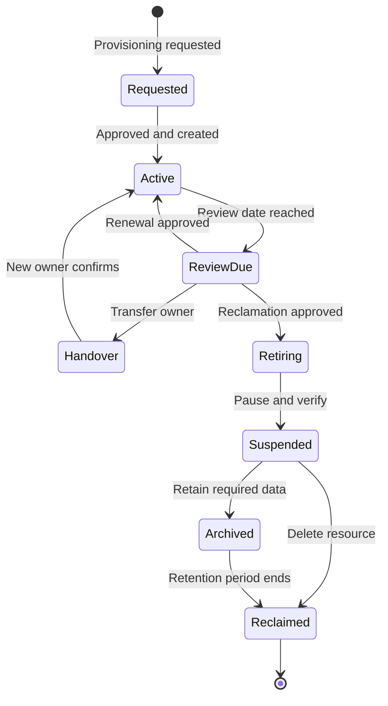

# Resource Expiration, Handover, and Reclamation Processes

Cloud compute resources are often provisioned quickly for experiments, project runs, batch data processing, or application environments. Without explicit expiration dates and accountable owners, virtual machines, node pools, GPUs, container services, and functions can keep running long after the need ends. The result is rising costs, a wider attack surface, and uncertainty for operations teams over which resources can be safely stopped.

Expiration, handover, and reclamation processes help organizations manage the resource lifecycle from provisioning through retirement. The process must answer who owns the workload, when it must be re-evaluated, who takes over when ownership changes, which data must be retained, which components must be shut down, and what evidence confirms reclamation is complete.

This lesson belongs to the **Compute Resource Governance** chapter of the **CLOUD_CORE_SERVICES_COMPUTE** module. Its contents apply to virtual machines, containers, orchestration clusters, serverless functions, and accelerators such as GPUs. After this lesson, you will be able to:

- Establish expiration dates and renewal policies for compute resources.
- Identify owners, approvers, and recipients during handovers.
- Distinguish expiration, suspension, archiving, transfer, and full reclamation.
- Execute controlled workflows for inventorying, dependency assessment, backup, shutdown, and deletion.
- Revoke access permissions, network addresses, storage volumes, and associated configurations.
- Retain audit evidence and verify post-retirement costs.

## 1. Why Do Resources Need Expiration Dates?

A cloud resource can be spun up in minutes yet persist for months without reminders and reclamation mechanisms. Common scenarios include:

- A VM used to test a build keeps running after the team finishes testing.
- GPUs reserved for a training run are never released once the job completes.
- A staging environment created for a short-term project keeps holding nodes, load balancers, and volumes.
- A container service or node pool with no remaining workloads keeps maintaining config and standby capacity.
- Functions, event source mappings, or provisioned concurrency remain active after a business flow is replaced.
- Resources created by staff who switched teams or left the organization lose an active owner.

An expiration date turns a temporary resource into a manageable commitment. At that milestone, the system requires the owner to confirm one of several decisions: renew, hand over, suspend pending review, archive, or reclaim. Expiration does not necessarily mean immediate deletion; it is a mandatory checkpoint to re-evaluate need and risk.

A solid process balances three goals: freeing unneeded resources, avoiding accidental deletion of user-serving workloads, and preserving data or evidence required by policy.

## 2. Lifecycle Scope and Resource States

The lifecycle can be modeled using explicit states. Exact state names vary by governance tool, yet state meanings and transition rules must remain consistent.



| State | Meaning | Required Action |
|---|---|---|
| Requested | Resource creation requested | Define purpose, owner, estimated cost, and lifespan |
| Active | Actively in use | Monitor health, cost, owner, and expiration date |
| Review due | Evaluation deadline reached | Send reminders, inspect usage and ongoing need |
| Handover | Responsibility transfer underway | Hand over operations, data, permissions, and docs |
| Retiring | Retirement decision approved | Freeze non-essential changes, plan dependency handling |
| Suspended | Stopped or isolated for verification | Verify impact, data, connections, and retention rules |
| Archived | Only retained data or configs remain | Track retention period, access rights, and recoverability |
| Reclaimed | Resource reclaimed | Save evidence, confirm zero unintended costs or access |

Not every resource passes through every state. A test VM might be stopped, verified, and deleted; a production system might require handover to a new owner before eventual retirement. States must reflect reality—never mark `Reclaimed` merely because a deletion API call was sent.

## 3. Identifying Owners and Required Information

Every compute resource needs an owner accountable for its purpose and renewal decisions. Depending on the organization, the owner may be an individual, product group, or service team. The billing account or the person who clicked "create" is not automatically the business owner.

Minimum governance metadata should include:

| Field | Purpose | Example |
|---|---|---|
| `owner` | Accountable team or individual | `team-orders` |
| `technical_contact` | Technical incident responder | `orders-platform-oncall` |
| `service` | Service or workload using the resource | `order-api` |
| `environment` | Environment | `dev`, `staging`, `prod` |
| `cost_center` | Cost-tracking unit | `CC-420` |
| `created_at` | Creation timestamp | `2026-11-01T09:00:00Z` |
| `expires_at` | Re-evaluation timestamp | `2026-12-01T00:00:00Z` |
| `data_classification` | Associated data classification | `internal` |
| `lifecycle_policy` | Applicable lifecycle policy | `temporary-30d` |
| `change_reference` | Related ticket or request | `OPS-1842` |

Metadata can be stored via tags/labels, resource metadata, a CMDB, or an asset management system. Not all platforms support tagging uniformly across every resource type. If child resources lack tag support, track relationships via resource groups, projects, namespaces, or central inventory.

Consistent tag example:

```text
owner=team-orders
service=order-api
environment=staging
cost_center=CC-420
expires_at=2026-12-01
lifecycle_policy=temporary-30d
change_reference=OPS-1842
```

Never put passwords, tokens, personal data, or sensitive details in tags. Tags can appear in cost reports, management APIs, or audit logs and should be treated as broadly visible metadata.

### Defining Responsibilities

- **Business/service owner:** confirms whether the workload is still needed, criticality, and successor.
- **Technical owner:** supplies dependency maps, deployment workflows, shutdown steps, and recovery steps.
- **Cloud/platform operations:** inspects resources, executes actions within granted permissions, and verifies outcomes.
- **Security/data owner:** verifies access rights, data retention, deletion rules, and audit obligations.
- **Cost owner/FinOps:** verifies costs, budgets, and post-reclamation savings.
- **Approver:** approves renewals, transfers, or reclamation proportional to impact.

For small workloads, one person may wear multiple hats. For production or sensitive data, require an independent reviewer prior to deletion to reduce mistakes.

## 4. Setting Lifespans and Renewal Policies

Expiration dates should reflect real purpose, not a one-size-fits-all default. Multi-day sandboxes, multi-week sprint test environments, and long-lived production environments have distinct lifespans.

A policy might classify as follows:

| Resource Group | Sample Review Period | Renewal Conditions |
|---|---|---|
| Personal sandbox | 7 days | Owner confirms active testing; no sensitive data |
| Team development environment | 30 days | Active ticket or milestone exists |
| Staging/UAT | 30–60 days or per release cycle | Testing schedule and accountable owner exist |
| Research GPU/job | Per job duration or reservation | Queued workload and approved budget exist |
| Production | Periodic review per service cycle | Owner, SLO, budget, and operations plan exist |

These milestones are illustrative examples for policy design. Production should never be auto-deleted simply because an `expires_at` tag passed. Production review dates typically trigger reviews of owners, contracts, reservations, or demand with a dedicated approval workflow.

### Multi-Stage Reminders

Sample reminder schedule for temporary resources:

1. 14 days prior: send the owner a resource list and recent spend.
2. 7 days prior: ask the owner to choose renew, hand over, or reclaim.
3. 2 days prior: remind owner and technical contact; escalate if unanswered.
4. At expiration: transition state to `Review due`, open a ticket, and apply approved policy.
5. Past due: execute automated actions strictly within policy limits; critical resources require explicit confirmation.

Renewal requests should specify justification, new expiration date, approver, and ticket reference. Never renew indefinitely by simply bumping the expiration date. If a resource repeatedly requires renewals, consider promoting it to a long-lived workload tier with an official budget and owner.

## 5. Review Workflow When Resources Expire

Upon expiration, owners and operations must verify whether the resource remains active and what dependencies rely on it.

### Step 1: Inventory and Verify Identity

Gather resource ID, resource type, region/zone, project/account, owner, service, environment, creation time, expiration date, status, network config, volumes, snapshots, IP addresses, reservations, and cost. Check for missing or conflicting tags. If no owner can be identified, route to the orphan-resource investigation workflow; never guess solely from the resource name.

### Step 2: Check Activity and Dependencies

Inspect CPU, memory, network, request, job, connection, and log metrics over a representative time window. A low-CPU machine could still be a standby node, bastion, scheduler, or recovery system. Check:

- Which clients, services, or workloads call this resource?
- Do any DNS records, load balancer targets, firewall rules, routes, or service discovery entries reference it?
- Do any scheduled jobs, queue consumers, crons, pipelines, or event triggers depend on it?
- Are there associated volumes, snapshots, backups, secrets, certificates, or encryption keys?
- Are reservations, committed use discounts, licenses, or quotas held for this resource?

Never use low CPU or brief request inactivity alone as proof a resource is unneeded.

### Step 3: Select Action

The owner selects one of:

- Renew and keep the current owner.
- Hand over to a new owner or service team.
- Time-bound suspension for further verification.
- Archive data/configurations and reclaim compute.
- Full reclamation once zero ongoing need and retention obligations are confirmed.

### Step 4: Approve and Plan

Document exact resource IDs, execution window, executor, approver, dependencies, backup plan, rollback plan, and completion criteria. For production, require a change record, internal notifications, and an appropriate maintenance window.

### Step 5: Execute and Verify

Execute in the approved sequence, watch for errors, and verify dependent services remain healthy. If undocumented dependencies surface, halt immediately, restore required state, and update inventory before resuming.

## 6. Handing Over Resources to a New Owner

Handover transfers operational accountability and management rights. Simply editing an `owner` tag does not complete a handover if the recipient lacks permissions, documentation, or knowledge to handle incidents.

A handover package should include:

- **Scope:** resource IDs, accounts/projects, regions, environments, and inter-resource relationships.
- **Purpose:** who the workload serves, criticality, SLOs, and operating hours.
- **Architecture:** connectivity diagrams, dependencies, ingress/egress, storage, queues, databases, and integrations.
- **Operations:** how to deploy, restart, scale, back up, restore, monitor, and troubleshoot incidents.
- **Security:** roles, policies, service accounts, secret references, certificates, network rules, and required access rights.
- **Cost:** cost center, budget, reservations, licenses, and spend trends.
- **Lifecycle:** next review/expiration date, renewal policy, backup owner, and open tickets.
- **Data:** data classification, storage locations, retention periods, backups, and deletion obligations.

### Handover Sequence

1. Current owner initiates a handover request naming the new owner and effective date.
2. New owner confirms scope, criticality, documentation, and acceptance of responsibility.
3. Technical owner checks access permissions, dashboards, alerts, runbooks, and operational readiness.
4. Transfer permissions following least privilege; use organization-managed groups or roles rather than sharing personal accounts.
5. Update tags/metadata, CMDB, on-call rotations, cost center, renewal schedule, and contact lists.
6. Run an operational check with the new owner participating—such as viewing metrics, running health checks, or rehearsing a non-disruptive recovery drill.
7. Both outgoing and incoming owners confirm completion; the system records timestamps and handover evidence.

Never hand over resources by sharing passwords or private keys. Revoke the outgoing owner's personal credentials per IAM policy; workload credentials should belong to a service identity and rotate whenever warranted or upon exposure risk. If resources hold sensitive data, the data owner must verify the new owner's read/write scope.

## 7. Controlled Compute Resource Reclamation

Reclamation involves more than deleting a virtual machine. You must address workloads, storage, networking, identities, schedules, automation configs, and associated financial commitments.

### Phase A: Preparation

- Confirm the reclamation request and approvals commensurate with criticality.
- Verify owner, service, environment, and every resource ID in scope.
- Identify dependencies, job schedules, event sources, DNS, load balancers, and traffic.
- Identify data to retain, backups, snapshots, retention periods, and storage destinations.
- Check encryption keys, secrets, certificates, licenses, and reservations.
- Prepare a rollback plan and verification hold window.

### Phase B: Stop Accepting New Work

Depending on workload type, deregister from load balancers, stop consuming messages, disable schedules, shift traffic, drain connections, or enter maintenance mode. Wait for in-flight requests and jobs to finish within allowed timeouts. For asynchronous workers, inspect queue backlogs and retry/DLQ mechanics before stopping consumers.

### Phase C: Back Up and Archive

Back up data required by policy. Verify backups are restorable, properly encrypted, and assigned an accountable owner. Archive infrastructure configs, manifests, image references, deployment artifacts, audit logs, and runbooks if environment reconstruction may be needed. Snapshots do not automatically substitute for tested backups; snapshots may share dependencies on the same account, region, or encryption keys.

### Phase D: Stop and Observe

Stop the workload or scale to zero replicas where appropriate. Monitor error rates, alerts, requests, queues, network flows, and downstream system metrics. If errors appear or callers still hit the workload, identify the caller and restore per plan. The observation window must span long enough to catch periodic jobs and relevant business cycles.

### Phase E: Delete and Release

After confirmation, delete compute resources strictly within scope. Next, audit volumes, disks, snapshots, images, load balancers, static IPs, NICs, firewall rules, DNS records, service accounts, IAM roles/policies, keys, secrets, event triggers, autoscaling groups, node pools, reservations, and licenses. Delete only components verified not to be shared or used by other workloads.

### Phase F: Verify Completion

Confirm resource IDs no longer exist or show released status via platform APIs. Verify no targets, schedules, or triggers recreate the resources; inspect bills/cost reports after the billing data refresh cycle. Update inventory, ticket status, owner records, evidence, and completion timestamp.

## 8. Reclamation Differences by Compute Type

| Resource Type | Checks Before Stopping | Frequently Overlooked Components |
|---|---|---|
| Virtual machine | Processes, services, mounts, IPs, DNS, load balancers, backups, and cron jobs | Detached disks, snapshots, NICs, static IPs, reservations, and monitoring agents |
| Kubernetes node pool | Pod placement, disruption budgets, DaemonSets, autoscalers, and remaining capacity | PersistentVolumes, load balancers, node images, autoscaler configs, and cluster add-ons |
| Container service | Desired count, deployments, running tasks/jobs, service discovery, and queues | Registry images, secrets, log groups, target groups, scheduled tasks, and network interfaces |
| GPU/accelerator | Running jobs, checkpoints, input/output data, and reservations | Storage capacity, quotas, licenses, scheduler queues, and dedicated nodes |
| Serverless function | Triggers, aliases, API integrations, event source mappings, concurrency, and schedules | Log retention, permissions, event rules, provisioned concurrency, secrets, and layers/packages |
| Batch/temporary worker | Job states, retries, checkpoints, outputs, and schedules | Queues, artifacts, temporary buckets, dead-letter queues, and orchestration schedules |

### Example: Reclaiming a Test Virtual Machine

Suppose a development team owns a VM `vm-loadtest-07` in staging that expires after a load-testing cycle. The workflow might proceed as follows:

1. Confirm the owner is `team-orders`, the test ticket is closed, and no scheduled runs remain.
2. Inspect metrics, logs, DNS, security groups, load balancer targets, and connections to the VM over a representative window.
3. Confirm test data contains nothing requiring retention; if logs or benchmark results must be kept, export them to an approved repository.
4. Remove the VM from target groups or traffic entry points, stop the workload, and monitor for client errors.
5. Stop the VM per platform procedures; after the observation window, delete the VM and approved temporary disks.
6. Check whether snapshots, static IPs, NICs, dedicated rules, DNS entries, and reservations are still needed.
7. Update the ticket and inventory, recording resource IDs, timestamps, approver, executor, and cost verification results.

Never delete an entire resource group/project simply because one VM expired. A resource group may hold shared networks, logs, secrets, or other active workloads. Explicitly enumerate deletion scope and check dependencies before acting.

## 9. Controlled Lifecycle Automation

Automation assists with expiration reminders, detecting missing owners, classifying resources, and filing tickets. Destructive actions like deleting disks or production workloads require policies and safeguards commensurate with risk.

### Detecting Resources Missing Metadata

A periodic job can scan for resources missing `owner`, `service`, `environment`, or `expires_at` and route them to a triage queue. Never auto-assign ownership based solely on the creator if that person may have changed teams. Unowned resources should receive an `owner-review-required` state and route to cloud governance for triage.

### Expiration Policies

Conceptual policy definition example:

```yaml
lifecycle:
  policy: temporary-30d
  review_before_days: [14, 7, 2]
  on_expiry: require-owner-decision
  allowed_decisions:
    - renew
    - handover
    - suspend-for-review
    - archive-and-reclaim
  auto_reclaim:
    enabled: false
    environments:
      - sandbox
    require_owner_tag: true
    require_expiry_tag: true
    require_approval: true
```

This illustrates a policy model, not a universal cloud provider schema. When implementing, map fields onto your organization's policy engine, scheduler, tags, workflow engine, or CMDB.

### Safety Principles for Automation

- Run in inventory/dry-run mode before executing mutating actions.
- Limit automation strictly to approved resource types and environments.
- Re-check owner, expiration, state, and dependencies at execution time—not solely from stale scan results.
- Maintain allowlists protecting shared, production, backup, security, and recovery resources.
- Require independent approvals for deleting data or critical resources.
- Log every decision: which resource was evaluated, which conditions matched, who approved, and what action executed.
- Maintain an emergency automation kill switch and recovery runbook in case of erroneous deletion.

Auto-stopping a fully tagged sandbox may be appropriate. Auto-deleting a volume solely because its attached VM expired risks data loss if the volume serves another workload or carries independent retention. Policies must distinguish replaceable compute from data carrying retention mandates.

## 10. Audit Evidence and Cost Verification

A process is complete only when you can answer who decided, who executed, which resources were affected, how data was handled, and what verification showed.

Reclamation records should retain:

- Ticket/change ID and justification for retirement or transfer.
- Resource ID, account/project, region, and resource type.
- Previous owner, new owner if applicable, approver, and executor.
- Dependency check results and list of associated components.
- Backup/snapshot IDs, retention, storage location, and restore test results if required.
- Timestamps for draining traffic, stopping, deleting, and verifying.
- Confirmation of revoked IAM, secrets, certificates, network rules, and admin rights.
- Inventory status and cost reconciliation results.

Billing data can lag behind actual deletions. Over subsequent billing cycles, verify that compute charges drop and no residual fees remain from disks, snapshots, IPs, load balancers, licenses, or reservations. A reservation/commitment may continue billing even after resources are deleted; handle it per separate commitment terms and purchasing policies.

Measure program effectiveness via metrics such as valid owner coverage, expiration date coverage, overdue unremediated resources, mean time from expiration to decision, renewal counts, reclaimed resources, estimated cost savings, and incidents caused by erroneous reclamation. Savings metrics must state the calculation method and timeframe clearly to avoid double-counting or treating list prices as realized savings.

## 11. Practical Exercise

A project team owns the following resources: two staging VMs, one shared Kubernetes node pool, one experimental GPU machine, one event-processing function, and one volume holding benchmark results. The project concludes at month-end. Draft an expiration, handover, and reclamation plan.

Tasks:

1. Build an inventory containing resource ID, type, owner, service, environment, cost center, expiration date, and data classification.
2. Flag the shared node pool and identify other namespaces/workloads using it.
3. Check whether the GPU machine has running jobs or checkpoints to save; determine wait time for job completion.
4. Check whether the function has active triggers, event source mappings, aliases, or schedules.
5. Decide how long to retain the benchmark volume, who may read it, and how to verify backups.
6. Separate resources to hand over to operations from resources to reclaim.
7. Sequence traffic draining, stopping, archiving, deletion, and verification; define stop conditions if unknown dependencies appear.
8. Identify approvers, executors, evidence to retain, and post-reclamation cost reconciliation steps.

Deliverables should include the inventory, decision matrix, operational checklist, rollback plan, and sample evidence record. Never choose to delete the shared node pool or volume before fully confirming dependencies and retention mandates.

## 12. Operational Checklist

**At provisioning**

- [ ] Owner, technical contact, service, environment, and cost center are defined.
- [ ] Expiration date or review cycle fits the workload type.
- [ ] Purpose, ticket reference, budget, and data classification are recorded.
- [ ] Backup, retention, and data owner responsibilities are defined.

**At expiration or handover**

- [ ] Owner confirms renewal, handover, suspension, archiving, or reclamation.
- [ ] Metrics, logs, job schedules, triggers, and dependencies have been checked.
- [ ] New owner has confirmed scope and holds required permissions.
- [ ] Runbooks, dashboards, alerts, backups, costs, and renewal schedules are handed over.
- [ ] Outgoing owner's permissions are adjusted or revoked per IAM policy.

**At reclamation**

- [ ] Approval and exact list of resource IDs are in place.
- [ ] Dependencies, traffic, queues, schedules, and running workloads have been checked.
- [ ] Retained data is backed up/archived with a clear owner and retention policy.
- [ ] New work intake is halted, connections drained, and systems observed per plan.
- [ ] Compute deleted and associated disks, IPs, NICs, snapshots, networking, IAM, secrets, and triggers audited.
- [ ] Confirmed no stray resources or automation recreate components unexpectedly.
- [ ] Inventory, tickets, and audit evidence are updated.
- [ ] Costs reconciled after billing refresh cycles.

Effective compute lifecycle governance starts with clear owners and lifespans, continues through confirmed renewal or handover decisions, and concludes with controlled reclamation backed by audit evidence. When processes account for dependencies, data, access rights, and costs together, organizations reclaim unneeded capacity while protecting active workloads.
