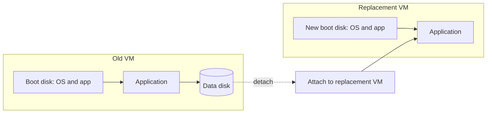

# Attaching a Data Disk and Verifying Data During Machine Replacement

## Context: Replacing a VM While Data Must Persist

A VM may fail, require an OS upgrade, or be replaced by a new instance with better specifications. If an application stores all data on the VM's boot disk, replacing the machine can cause data loss or prolong recovery time. A common design pattern is to separate the **boot disk** containing the OS and software from the **data disk** containing application data, then attach the data disk to the replacement VM.

A data disk independent of the VM lifecycle enables faster recovery, but detach/attach operations must be performed in the right order. Filesystems must be closed safely, the volume must be accurately identified, the filesystem must not be accidentally formatted, and the application must start only after the data is mounted and verified. Simply attaching the volume to a new VM does not prove the data is consistent or immediately usable by the application.

In the **CLOUD_CORE_SERVICES_COMPUTE** module, this lab applies to VMs across clouds—specifically AWS EBS, Azure Managed Disks, and Google Persistent Disk. The objective is to replace a compute instance while preserving the data volume, verifying data integrity, and maintaining a rollback plan.

## 1. Distinguishing Boot Disk and Data Disk

The **boot disk** contains the bootloader, operating system, packages, and configurations needed for the VM to boot. The **data disk** stores data that must persist independently of the VM, such as uploaded files, application data, database files, or batch data.

| Criterion | Boot disk | Data disk |
|---|---|---|
| Purpose | Boot the OS and runtime | Store application data |
| Lifecycle | Typically tied to VM/image lifecycle | Can persist across multiple VM replacements |
| Machine replacement | Can create a new boot disk from an image | Detach from the old machine and attach to the new machine |
| Backup | Image/snapshot per OS policy | Snapshot/backup per data and application requirements |
| Mount | System filesystems | Dedicated mount point such as `/srv/appdata` or a drive letter |
| Main risks | VM fails to boot | Data loss, attaching the wrong disk, inconsistent filesystem |

Not every cloud automatically deletes or retains boot/data disks identically when terminating a VM. Check delete-on-termination, disk retention, and snapshot policies before deleting a machine.

### 1.1. Simple Architecture



The data disk remains the exact same volume; the new VM provides fresh compute and a new boot disk. If the volume is created from a snapshot instead of detaching/attaching the existing volume, it represents a point-in-time copy at snapshot creation and may require synchronizing changes made after the snapshot.

### 1.2. When Should You Separate a Data Disk?

Suitable when:

- Data must survive VM recreation or upgrades.
- Periodic machine replacement or autohealing workflows exist.
- Data backups/retention need to be decoupled from OS images.
- Compute size/type needs to change without migrating all data.
- A volume needs to be restored onto another machine within a supported failure domain.

A data disk is not a substitute for backups. If a volume is accidentally deleted, logically corrupted, encrypted by ransomware, or written with bad application data, a detached/reattached volume can still lose data. Independent snapshots/backups and restore testing are required.

## 2. Understanding Block Storage Attachment Limits

Cloud block storage is typically provisioned as volumes that can be attached to VMs. However, attachment capabilities depend on disk type, zone, region, VM family, protocol, and mode.

### 2.1. Zone and Region Scope

- Many zonal disks can only attach to VMs in the same availability zone.
- Some services support regional disks or synchronous replication across zones; scope and performance differ from zonal disks.
- Disks generally cannot attach directly across regions; snapshot/copy/restore may be required.
- Some services support cross-zone migration or replication under specific conditions.

Conceptual examples:

| Provider | Common block disk service | Items to verify |
|---|---|---|
| AWS | Amazon EBS | Volume AZ, volume type, Multi-Attach support, encryption/KMS permissions |
| Azure | Managed Disks | Disk SKU, zone, shared disk support, max shares, and VM compatibility |
| Google Cloud | Persistent Disk | Zonal/regional disk, access mode, machine type, and multi-writer support |

Service names do not guarantee identical attachment features. Before creating a replacement VM, verify zone/region, disk type, encryption keys, attachment limits, interface/protocol, and identity permissions.

### 2.2. Single-Attach vs. Multi-Attach

Most standard volumes allow only one VM to attach in read/write mode at a time. Some volume types support multi-attach or shared disks, but they usually require cluster-aware filesystems/applications and impose restrictions on OS, protocol, VM type, or node count.

Do not attach a standard filesystem to multiple VMs for concurrent writes. Filesystems like ext4 or XFS do not automatically become shared cluster filesystems when a volume is multi-attached. If multiple nodes need concurrent writes, use a solution with proper cluster locking, fencing, and cluster filesystems, or move to shared file storage/databases.

### 2.3. Disk Identity and Device Names

Device names like `/dev/sdf`, `/dev/sdb`, or `/dev/nvme1n1` can change depending on the VM, drivers, attachment order, or instance type. Do not write automation that relies solely on transient device names.

Identify volumes using:

- Cloud volume ID in the control plane.
- Serial/WWN exposed to the guest OS if provided by the provider/driver.
- Filesystem UUID or PARTUUID after verifying the right volume.
- Standardized custom labels and inventory mapping.

A filesystem UUID is not a cloud volume ID. Snapshots/clones can produce a filesystem UUID identical to the source volume; mounting by UUID in that situation could pick the wrong volume. Verify serial/volume ID first, then handle duplicate UUIDs via a controlled procedure.

## 3. Preparing Before Replacing the VM

Before detaching a volume, clearly identify what data is being written, which applications use the disk, and how to recover if attachment fails.

### 3.1. Inventory and Ownership

Record the following details:

- Current VM: instance ID, zone/region, OS, boot image, and state.
- Data volume: volume ID, zone/region, size, type, encryption, key ID, and attachment.
- Filesystem: filesystem type, UUID, partition table, LVM/RAID if present.
- Mount point: e.g., `/srv/appdata`, `/var/lib/postgresql`, or drive `D:`.
- Applications and processes holding open files on the volume.
- Owner, environment, backup policy, retention, and RPO/RTO.
- Replacement VM: zone/region, OS version, architecture, drivers, and attach/decrypt permissions.

Do not infer a volume solely from its display name. Use the volume ID returned by the cloud control plane and cross-check it against the serial inside the guest OS.

### 3.2. Checking Backups and Recoverability

Before replacing the machine:

1. Confirm the latest snapshot/backup succeeded and has appropriate retention.
2. Check whether the volume is encrypted and the new VM has permission to use the encryption key.
3. Determine whether the snapshot is crash-consistent or application-consistent.
4. If it hosts a database, follow the database's backup/checkpoint/quiesce procedure.
5. If requirements are strict, test restoring the snapshot to a test volume and verify the data.
6. Record snapshot timestamp, volume ID, checksums/manifest, and the rollback runbook.

A block-level snapshot may only reflect block state at capture time. For databases or applications writing multiple interrelated files, an unquiesced snapshot may require log recovery or crash recovery upon mount.

### 3.3. Quiescing Applications and Flushing Data

Do not detach a volume while applications are still writing data. Conceptual procedure:

1. Stop accepting new requests/jobs.
2. Drain in-flight requests and jobs.
3. Stop writers/consumers or switch the application to maintenance mode.
4. Perform checkpoint/flush per application/database guidelines.
5. Close processes holding file descriptors on the volume.
6. Run `sync` and unmount the filesystem.
7. Confirm the volume has no remaining mounts or open handles.

For databases, stop the service via the service manager or use the database's native backup/quiesce mechanism. Do not merely run `sync` and assume the database is consistent; `sync` flushes kernel dirty data to the block device, which does not replace the application's checkpoint/transaction protocol.

## 4. Inspecting the Data Disk on Linux Before Detach

The commands below are examples for Linux. Actual device names must be determined on the target machine.

### 4.1. Viewing Disks, Mounts, and Filesystems

```bash
# View disks, partitions, filesystems, UUIDs, and mount points
lsblk -o NAME,PATH,SIZE,TYPE,FSTYPE,UUID,PARTUUID,MOUNTPOINTS,MODEL,SERIAL

# View mounted filesystems
findmnt

# Inspect block devices and UUIDs
sudo blkid

# View processes using the mount point
sudo fuser -vm /srv/appdata
```

Cross-check capacity, filesystem, UUID, serial, and mount point against inventory. Do not pick a disk solely because it matches the expected size; the boot disk or another volume could have the same capacity.

### 4.2. Stopping the Application and Unmounting

Example for an application writing to `/srv/appdata`:

```bash
sudo systemctl stop myapp
sudo systemctl status myapp --no-pager

# Verify no processes are using the mount point
sudo fuser -vm /srv/appdata

# Flush data and unmount
sudo sync
sudo umount /srv/appdata

# Verify the mount point is unmounted
findmnt /srv/appdata
```

If `umount` reports target busy, do not reflexively run `umount -f`. Find the process, shell with its working directory inside the mount, container bind mount, or open file descriptor. Stop the workload properly and unmount again. A force detach can corrupt the filesystem or cause application data loss.

### 4.3. Checking LVM or RAID if Present

A volume may contain an LVM physical volume, logical volume, or RAID member instead of a direct filesystem on a partition. Check first:

```bash
sudo pvs
sudo vgs
sudo lvs -a -o +devices
cat /proc/mdstat
```

If using LVM/RAID, follow the proper deactivate/assemble procedure per configuration before detaching. Do not run `mkfs` or create a new partition table on a device containing LVM/RAID metadata.

## 5. Detaching the Data Disk from the Old VM

Once applications are stopped, filesystems are unmounted, and inventory is verified, detach via the cloud control plane or provider API/CLI.

### 5.1. Detach Sequence

1. Open the management page for the old VM and verify the instance ID.
2. Open the list of attached disks/volumes and verify volume ID, device mapping, zone, and encryption key.
3. Check delete-on-termination or disk deletion options on VM deletion; configure appropriate retention.
4. Confirm the application is stopped and the mount point is unmounted inside the guest OS.
5. Detach the correct data disk from the old VM.
6. Wait for the detach status to complete in the control plane.
7. Verify the volume still exists, has no remaining attachments, and was not deleted.

The status name may be `available`, `unattached`, or equivalent. Proceed only when the provider confirms detach completion. If the operation is still in a detaching state, do not start the new VM with the same volume.

### 5.2. Things to Avoid

- Do not detach the boot disk if the goal is only to move the data disk.
- Do not force-detach a volume with active I/O without evaluating crash recovery.
- Do not delete the old volume when deleting the replacement or source VM.
- Do not create a new filesystem on a volume that already holds data.
- Do not attach the same read/write filesystem to two VMs if the disk/filesystem type does not support cluster sharing.
- Do not modify encryption keys or snapshot lifecycles mid-migration without verifying decrypt/restore capability.

### 5.3. Provider Differences

**AWS EBS:** Verify the volume ID and Availability Zone; standard EBS volumes must attach to an EC2 instance in the same AZ. Check `DeleteOnTermination`, encryption/KMS key permissions, and volume status. Multi-Attach applies only to specific volume/instance types and requires supporting applications/filesystems.

**Azure Managed Disks:** Verify disk resource, region/zone, disk SKU, VM compatibility, and `maxShares` if using shared disks. Certain detach/attach operations may require VM deallocation depending on disk type/configuration. Check encryption set/key access and disk state.

**Google Persistent Disk:** Verify disk resource, zonal or regional scope, access mode, and machine type. Zonal disks require the VM to be in the same zone; regional disks have separate replication/attachment semantics. Multi-writer is used only when disk type, machine type, and filesystem/workload meet requirements.

Menu names and specific rules change across service versions. Use volume ID as the cross-reference key, check status in the control plane, and read warnings before confirming operations.

## 6. Creating or Preparing the Replacement VM

The replacement VM is typically launched from a tested image, with an OS and drivers compatible with the filesystem on the data disk.

### 6.1. Compatibility Checks

- Same region and zone if the volume is zonal.
- OS supports the existing filesystem (ext4, XFS, NTFS, or specialized filesystems).
- CPU architecture and storage/network drivers match the image.
- Instance has sufficient CPU, RAM, network, and IOPS/throughput for the workload.
- VM identity has permission to attach volumes, read encryption keys, and access required secrets.
- Security groups/NSGs/firewalls and routes allow the application to reach dependencies.
- Backup agents, monitoring, antivirus/EDR, and logging are installed at the proper versions.

### 6.2. Separating Boot Disk from Data Disk

Create the new VM with a boot disk from the standard image. Do not restore the data disk onto the boot disk unless that is a tested design. Keep the original data volume ID if moving the volume directly, or clearly record the snapshot ID/version if creating a replacement volume from a snapshot.

If using a snapshot to create a new disk:

- Verify the snapshot belongs to the right source volume and point in time.
- Check that the snapshot is complete and no longer pending.
- Verify the KMS/Key Vault/Cloud KMS key and decrypt permissions.
- Determine whether database logs must be restored or events replayed after the snapshot.
- Record the new volume ID and link it to the source snapshot in the change record.

### 6.3. Granting Encryption and Identity Permissions

Encrypted disks may require permissions to use a customer-managed key (CMK), even when the user has permission to attach volumes. Verify permissions for both the operator/control plane and the identity the cloud service uses to attach/decrypt.

Principles:

- Grant least-privilege permissions for the new VM to use the exact key.
- Do not broaden the key policy merely to fix an attach error.
- Confirm the key is still enabled and not scheduled for deletion.
- Verify backups/snapshots can be decrypted using the current key.
- Record key ID/rotation state for future recovery.

## 7. Attaching the Data Disk to the New VM

Once the replacement VM is in an appropriate state and the volume is fully detached, attach the right volume to the new VM via the control plane.

### 7.1. Attach Sequence

1. Verify the VM ID and zone/region of the new VM.
2. Verify volume ID, size, type, encryption, and attachment state.
3. Choose a device mapping if required by the provider; record the mapping in the change record.
4. Attach the volume in the read/write mode appropriate for the workload.
5. Wait for the control plane to confirm attachment completion.
6. Inside the guest OS, scan for the new disk and identify it via serial/volume metadata.
7. Verify partitions, filesystem UUID, and capacity before mounting.

Do not rely on `/dev/sdX` names recorded from the old VM. The new guest OS may assign the volume a different device name.

### 7.2. Linux: Identifying the New Volume

```bash
# Refresh block device list
sudo udevadm settle
lsblk -o NAME,PATH,SIZE,TYPE,FSTYPE,UUID,PARTUUID,MOUNTPOINTS,MODEL,SERIAL

# Inspect filesystem metadata
sudo blkid

# Check kernel logs for the new device
sudo dmesg --ctime | tail -n 80
```

If the volume does not appear, check cloud attach status, drivers, OS/provider-specific SCSI/NVMe rescan, and system logs. Do not run `partprobe`, `mkfs`, or `wipefs` until you are certain of the right device and understand its partition layout.

### 7.3. Checking Partitions and Filesystems

Assume the volume is identified as `/dev/nvme1n1` with partition `/dev/nvme1n1p1`; this is an example only. On volumes without a partition table, the filesystem may sit directly on the device.

```bash
sudo lsblk -f /dev/nvme1n1
sudo blkid /dev/nvme1n1 /dev/nvme1n1p1
sudo file -s /dev/nvme1n1
```

Results must match the inventory: filesystem type, UUID, partition layout, and size. If `blkid` does not recognize a filesystem, stop and investigate; never initialize a new filesystem on a volume containing data.

### 7.4. LVM Cases

If the volume contains LVM, verify PV/VG/LV and avoid accidentally activating a volume group with the same name as another disk on the new VM:

```bash
sudo pvscan
sudo vgscan
sudo vgchange -ay <volume-group>
sudo lvs -a -o +devices
```

Replace the volume group name in the example with the verified value. If a snapshot/clone produces a duplicate PV UUID or VG UUID alongside an attached original, handle it using LVM clone procedures and do not alter metadata without a backup.

## 8. Safely Mounting the Filesystem on Linux

Mount only after confirming the right volume, partition, filesystem, and consistency state. Create the mount point if it does not exist:

```bash
sudo mkdir -p /srv/appdata

# Mount using the verified filesystem UUID
sudo mount UUID=<filesystem-uuid> /srv/appdata

# Verify the actual mounted device
findmnt -o SOURCE,TARGET,FSTYPE,OPTIONS /srv/appdata
df -hT /srv/appdata
lsblk -f
```

Replace `<filesystem-uuid>` with the UUID obtained from `blkid` after cross-checking the volume ID/serial. Never use the literal placeholder in real commands.

### 8.1. Checking Read-Only First When in Doubt

If the volume was restored from a snapshot, shows signs of an unclean filesystem, or needs inspection before allowing application writes, you can mount it read-only in a verification environment:

```bash
sudo mount -o ro UUID=<filesystem-uuid> /mnt/data-check
findmnt /mnt/data-check
```

For filesystems requiring journal replay at mount time, read-only may not reflect the full state the application expects; depending on the filesystem, specialized inspection modes may be needed. Do not use options that skip recovery or force mounts to mask errors. If the filesystem requires repair, unmount it and use the appropriate filesystem tool after taking a snapshot/backup.

### 8.2. Duplicate UUIDs When Creating Volumes from Snapshots/Clones

If the new volume is a clone of an existing volume, the filesystem UUID may be identical. In that case `mount UUID=...` can select the wrong device or cause ambiguity. Check serial/volume ID and device mappings first.

If both copies must coexist independently, after confirming it is a clone and having a snapshot/backup, generate a new filesystem UUID using the appropriate tool:

```bash
# ext2/3/4: filesystem must be unmounted
sudo tune2fs -U random /dev/<verified-partition>

# XFS: filesystem must be unmounted
sudo xfs_admin -U generate /dev/<verified-partition>
```

These commands alter filesystem identification metadata. Never run them on an active source volume or before verifying it is a clone. If using LVM, inspect and resolve duplicate PV/VG UUIDs via the dedicated procedure; changing the filesystem UUID does not resolve LVM conflicts.

### 8.3. Fixing Permissions and Ownership After Mount

Filesystems store numeric UIDs/GIDs. If the new VM uses different user/group IDs than the old VM, files may show numeric owners or the application may fail with `Permission denied`.

```bash
ls -ln /srv/appdata
getent passwd appuser
getent group appgroup
stat -c '%u:%g %a %n' /srv/appdata
```

Compare expected UIDs/GIDs before modifying permissions. Do not blindly run `chown -R` or `chmod -R 777` across large data volumes; doing so can alter millions of files, break the permission model, and lengthen recovery time. Create users/groups with matching UIDs/GIDs or adjust only the identified scope.

### 8.4. Configuring Persistent Mounts Across Reboots

Once the temporary mount is verified, add an entry to `/etc/fstab` using the UUID:

```fstab
UUID=<filesystem-uuid>  /srv/appdata  xfs  defaults  0  0
```

The example above assumes an XFS filesystem; the fsck pass number is `0` because XFS has its own recovery mechanism and `fsck.xfs` does not perform ext-style checks. If the volume uses ext4, change the filesystem type to `ext4` and typically use pass number `2` for data filesystems. Dump/fsck fields must match the OS and filesystem.

Before rebooting, validate the configuration:

```bash
sudo findmnt --verify --verbose
sudo mount -a
findmnt /srv/appdata
```

Do not arbitrarily add `nofail` to a mandatory data disk. If the mount fails while the OS boots anyway and the application writes into `/srv/appdata` on the root disk, the application may write new data to the wrong filesystem. When the real volume is mounted later, those newly written files become hidden, causing confusion or operational data loss.

If a data disk is mandatory, configure the service to depend on the mount point—for example, systemd `RequiresMountsFor=/srv/appdata`—and let the service fail closed when the mount is absent. Use `nofail` only for truly optional volumes where the application safely handles missing data.

### 8.5. Checking the Filesystem Before Repairing

If mounting fails or kernel logs show I/O errors:

1. Stop the application and unmount the volume.
2. Create a snapshot/clone for investigation if possible.
3. Verify the exact filesystem type and device.
4. Run the appropriate inspection tool in an unmounted state.
5. Review the output and decide whether repair or backup restoration is needed.

Example ext4 check:

```bash
sudo e2fsck -fn /dev/<verified-partition>
```

Example XFS check:

```bash
sudo xfs_repair -n /dev/<verified-partition>
```

These are non-destructive check modes for their respective tools. If actual repair is required, use the official filesystem commands/options after securing a backup and approval. Never run `fsck`/`xfs_repair` on a filesystem mounted read-write.

## 9. Windows: Bringing the Disk Online and Assigning a Drive Letter

On Windows Server, a volume may appear in Disk Management as Offline, Read-only, or without a drive letter. Before making changes, verify disk number, size, serial/unique ID, and partitions.

### 9.1. Identifying the Disk

Open PowerShell with appropriate privileges:

```powershell
Get-Disk | Format-Table Number, FriendlyName, SerialNumber, UniqueId, Size, OperationalStatus, IsOffline, IsReadOnly
Get-Partition | Format-Table DiskNumber, PartitionNumber, DriveLetter, Type, Size
Get-Volume | Format-Table DriveLetter, FileSystem, FileSystemLabel, Size, HealthStatus
```

Cross-check the disk against the volume ID/serial from the cloud control plane. The disk number may differ from the old VM; do not use the old disk number as a unique identifier.

### 9.2. Bringing the Existing Disk Online

After verifying the right disk holding the data and confirming the volume detached cleanly:

```powershell
$disk = Get-Disk -Number 2
Set-Disk -Number $disk.Number -IsOffline $false
Set-Disk -Number $disk.Number -IsReadOnly $false
Get-Partition -DiskNumber $disk.Number
```

`2` is an illustrative number only. Never run `Initialize-Disk`, `Clear-Disk`, `New-Partition`, or `Format-Volume` on a disk already holding data. If Windows prompts to Initialize disk, click Cancel and re-verify disk identity/partition table before proceeding.

### 9.3. Assigning a Drive Letter

If the partition already exists without a drive letter, verify the right partition and assign an unused letter:

```powershell
$partition = Get-Partition -DiskNumber 2 -PartitionNumber 1
Set-Partition -InputObject $partition -NewDriveLetter 'D'
Get-Volume -DriveLetter D
```

Replace drive letter `D` and the disk/partition numbers in the example with verified values. If the volume uses mount folders or Storage Spaces, follow the corresponding Windows design.

### 9.4. Checking NTFS and Access Permissions

- Check volume label, filesystem, size, and health status.
- Check ACL/NTFS permissions on the application directory.
- Verify the service account on the new VM has necessary read/write permissions.
- If using BitLocker or other encryption, verify key protectors/recovery keys per policy.
- Do not format the volume or run write-enabled repairs without a backup and condition assessment.

For shared disks in a Windows Failover Cluster, adhere to cluster ownership and CSV protocols; never bring a disk Online simultaneously across nodes outside cluster procedures.

## 10. Verifying Data After Attachment

After mounting or assigning a drive letter, do not start the application immediately. First verify the right volume, data presence, filesystem health, and appropriate permissions.

### 10.1. Checking Metadata and Capacity

Linux:

```bash
findmnt -o SOURCE,TARGET,FSTYPE,OPTIONS /srv/appdata
df -hT /srv/appdata
lsblk -f
sudo blkid
stat /srv/appdata
```

Windows:

```powershell
Get-Volume -DriveLetter D | Format-List *
Get-Partition -DriveLetter D | Format-List *
Get-Disk | Format-Table Number, SerialNumber, UniqueId, Size, OperationalStatus
```

Verify:

- Volume ID/serial matches the change record.
- Size, filesystem, and partition layout are accurate.
- Mount point/drive letter matches the location expected by the application.
- Volume is not accidentally mounted read-only or with wrong options.
- No I/O errors, filesystem errors, or disk warnings appear in system logs.

### 10.2. Checking Structure and Data Samples

Do not merely check that the directory exists. Cross-check business indicators:

- Key directories/partitions are present.
- Latest files have reasonable timestamps and sizes.
- Application manifests, metadata, or markers match previous runs.
- Record/file counts are within expected ranges.
- No abnormal temporary files or lock files left over from an interrupted previous run.
- UID/GID or ACL matches the new service account.

Linux:

```bash
sudo find /srv/appdata -maxdepth 2 -type d -print | head -n 80
sudo find /srv/appdata -maxdepth 2 -type f -printf '%TY-%Tm-%Td %TH:%TM %s %p\n' | sort | tail -n 40
du -sh /srv/appdata
```

PowerShell:

```powershell
Get-ChildItem D:\AppData -Force | Select-Object Mode, Length, LastWriteTime, Name
Get-ChildItem D:\AppData -File -Recurse | Measure-Object -Property Length -Sum
```

For very large volumes, avoid recursively scanning all files before evaluating I/O impact. Use manifests or selective sampling first, then run integrity scans during a maintenance window.

### 10.3. Verifying Checksums

If a checksum manifest was generated when the data was consistent, verify after attachment:

```bash
cd /srv/appdata
sha256sum -c SHA256SUMS
```

If no manifest exists, generate checksums before replacing the machine once the workload is quiesced, and store the manifest independently of the volume being moved. After attachment, recompute and compare. Never store the sole copy of the manifest on the data disk itself, because if the volume is corrupted or swapped accidentally, the evidence is lost too.

Checksums confirm the byte contents of checked files, but do not prove business logic validity. For databases, additional native integrity checks, recovery logs, and count verification queries are required.

### 10.4. Verifying Database Data

If the data disk holds database files:

1. Verify the database server version is compatible with the data directory.
2. Verify directory ownership, file modes, and path configuration.
3. Check available backups/WAL/binlog or transaction logs.
4. Start the database per the product runbook and inspect recovery logs.
5. Wait for recovery to complete and verify primary/replica/quorum state if applicable.
6. Run native integrity checks or reconciliation queries as recommended by the database.
7. Verify row counts, sequences/LSNs, latest transactions, and critical business invariants.

Do not copy or edit database files while the database is running unless explicitly supported by the product. Never delete WAL, redo logs, transaction logs, or lock files merely because they look old; they may be needed for crash recovery.

Example application-level PostgreSQL verification after the service starts:

```bash
sudo -u postgres pg_isready
sudo -u postgres psql -d appdb -c 'SELECT now(), pg_is_in_recovery();'
sudo -u postgres psql -d appdb -c 'SELECT count(*) FROM critical_table;'
```

These check only connectivity and basic state; select additional queries/integrity procedures suitable for your PostgreSQL version and replication architecture. Avoid running heavy queries on production merely for preliminary verification.

### 10.5. Testing the Application Before Opening Traffic

- Run the service in maintenance/read-only mode if available.
- Verify config paths, secrets, connection strings, and service identity.
- Run smoke tests reading data and writing tests into a permitted test area.
- Confirm logs show no permission errors, missing files, or schema mismatches.
- Check health/readiness endpoints and dependencies.
- Open traffic via canary or incrementally while monitoring error rates/latency.

Do not allow the application to write to the volume until you have verified it is the right environment's data and no old VM is still using the volume.

## 11. Verifying Consistency and Preventing Split-Brain

When replacing a VM, a major risk is the old VM and new VM writing to the same data concurrently or two separate volume copies being opened for writes at once.

### 11.1. Single Writer for Standard Volumes

For single-writer volumes, the workflow must ensure:

- The old VM stopped the application and unmounted the volume.
- The control plane confirmed the volume detached from the old VM.
- The new VM is the sole read/write attachment.
- If the old VM remains alive for rollback, it cannot auto-start the application or remount the volume.
- Permissions/automation will not reattach the volume back to the old VM during recovery.

If the old VM must be kept, shut it down or isolate its network/services, clearly mark its maintenance state, and control startup permissions. Do not rely on the old VM "looking stopped" if the control plane still reports an attachment.

### 11.2. Fencing and Ownership

In systems with multiple workers/VMs, use leases, locks, or fencing tokens at the application/storage layer to reject stale writers. Cloud disk attachment controls prevent some concurrent attachments but do not replace writer authorization at the database or cluster level.

For database clusters, use quorum, replication protocols, and fencing as prescribed by the product. Never attach a primary's data directory disk to another VM and start the database as an independent primary without a formal failover procedure.

### 11.3. Snapshots/Clones Are Not the Same Volume

If creating a new disk from a snapshot, the new VM receives a data copy as of the snapshot time. Both the original and cloned volumes can coexist and be writable. Clearly establish:

- Which volume is the source of truth.
- Whether any delta writes occurred after the snapshot.
- How deltas will be synchronized (replication/log replay/application sync).
- When to switch the writer and block writes on the source.
- How to roll back without writing to both copies in parallel.

Do not shift traffic to a clone merely because it mounted successfully; check the snapshot timestamp and data written after the snapshot.

## 12. Updating Startup Configuration and Auto-Mount

After manual verification, configure the new VM to mount the right volume after reboot and start the application only when the data disk is ready.

### 12.1. Linux systemd Dependencies

Example service override:

```ini
[Unit]
RequiresMountsFor=/srv/appdata

[Service]
ExecStartPre=/usr/bin/test -d /srv/appdata
```

`RequiresMountsFor` instructs systemd to pull the required mount units into the dependency chain. `ExecStartPre` here only checks that the mount path exists; to guarantee the exact volume, add a reviewed script checking the mount source/UUID. Do not check only for directory existence, because the directory may reside on the root filesystem if the data disk failed to mount.

Example source verification script:

```bash
#!/usr/bin/env bash
set -euo pipefail

expected_uuid="<filesystem-uuid>"
actual_source="$(findmnt -n -o SOURCE --target /srv/appdata)"
actual_uuid="$(blkid -s UUID -o value "$actual_source")"

test "$actual_uuid" = "$expected_uuid"
```

This is an example that must be tested against how `findmnt` returns the source in your real environment (device paths may be symlinks, mappers, or LVM logical volumes). With LVM, verify mapping to the correct PV/volume ID, not only the filesystem UUID.

### 12.2. fstab and Boot Behavior

For mandatory data disks, mount configuration must make behavior explicit when the volume is missing or unattached. If the service cannot operate safely without the disk, let the mount/service fail visibly and trigger an alert. Avoid configurations where the service silently writes to an empty directory on the boot disk.

For optional disks, `nofail` or short timeouts can allow the VM to boot even when the disk is absent, but the application must check presence and avoid writing erroneously into a fallback mount point.

### 12.3. Windows Service Dependencies

On Windows, use Task Scheduler, service dependencies, or a startup script that checks volume identity before launching the application. The script should verify drive letter/volume unique ID, filesystem, and data directories. Do not check only `Test-Path D:\AppData`, because if the disk is not attached, a folder on a system volume could share the same name.

## 13. Cutover and Rollback Procedures

Cutover is the point when the application shifts to the new VM. Rollback must be prepared before allowing the new VM to write data.

### 13.1. Step-by-Step Cutover

1. Announce maintenance and block new requests/jobs.
2. Drain running work; stop applications/databases per runbook.
3. Flush, checkpoint, unmount, and verify no writers remain on the old VM.
4. Create snapshots/backups as required and record volume ID/source version.
5. Detach the data disk and wait for detach completion.
6. Launch the replacement VM from the tested image in the appropriate zone.
7. Attach the volume, identify the device, and verify the filesystem.
8. Mount/assign drive letter and verify permissions, checksums, and database recovery.
9. Run smoke tests in restricted mode; do not open broad traffic yet.
10. Confirm owner/application sign-off and switch writer authority to the new VM.
11. Open traffic incrementally, monitor metrics/logs, and reconcile data.
12. Keep the old VM isolated for the defined rollback window, then retire per policy.

### 13.2. Rollback Conditions Before New Writes

If the new VM has not yet written business data, rollback is generally simpler:

- Stop the app on the new VM.
- Unmount the data disk.
- Detach the volume from the new VM.
- Reattach the volume to the old VM or a recovery VM within zone/region constraints.
- Mount and re-verify the filesystem before starting the app.

Never attach a read/write volume to both machines simultaneously if the disk/filesystem type does not support it. Never start the old VM before confirming the volume has detached from the new VM.

### 13.3. Rollback After the New VM Has Written Data

Once the new VM has accepted writes, reverting to the old VM risks losing post-cutover changes. One of these strategies is needed:

- Replicate deltas back to the source/old VM before switching the writer.
- Take a fresh snapshot and restore it onto the rollback VM.
- Use database replication/failback protocols.
- Perform reconciliation or business compensation for newly generated data.

Do not simply detach the volume and reattach it to the old VM if the old VM holds a different older data copy or if database log/format changed. Identify the source of truth and recovery point before acting.

### 13.4. Cutover Completion Criteria

- Exact volume ID is attached to the exact VM.
- No unexpected old attachments/writers remain.
- Filesystem mounts cleanly with no I/O or filesystem errors.
- Critical data and checksums/manifests match.
- Database recovery completes and business invariants hold.
- Application reads/writes to the right mount point/drive.
- Health checks, logs, latency, and error rates meet thresholds.
- New post-cutover backup/snapshot is created per schedule.
- Change record captures VM ID, volume ID, snapshot ID, UUID, timestamp, and approver.

## 14. Cloud Provider CLI Operation Examples

The commands below illustrate control-plane operations. Replace placeholders with verified resource IDs, and select the right subscription/project/account and zone/region. Run detach commands only after the guest OS has stopped applications and unmounted the volume.

### 14.1. AWS EBS

```bash
# Detach volume from old EC2 instance
aws ec2 detach-volume --volume-id vol-0123456789abcdef0

# Wait for volume to return to available state
aws ec2 wait volume-available --volume-ids vol-0123456789abcdef0

# Attach to replacement EC2 instance in the same Availability Zone
aws ec2 attach-volume \
  --volume-id vol-0123456789abcdef0 \
  --instance-id i-0123456789abcdef0 \
  --device /dev/sdf

aws ec2 wait volume-in-use --volume-ids vol-0123456789abcdef0
```

Device name `/dev/sdf` is the requested mapping at the control plane; on Nitro instances, the guest OS may display the device under a different NVMe name. After attaching, use `lsblk`, `blkid`, serial, and volume ID for actual identification.

### 14.2. Azure Managed Disk

```bash
# Detach disk from old VM
az vm disk detach \
  --resource-group <resource-group> \
  --vm-name <old-vm> \
  --name <managed-disk-name>

# Attach existing disk to replacement VM
az vm disk attach \
  --resource-group <resource-group> \
  --vm-name <new-vm> \
  --name <managed-disk-name> \
  --lun 0
```

LUN `0` is an example only; choose an available LUN compatible with the VM configuration. Inspect disk resource, zone, SKU, encryption, and disk state via Azure CLI/portal before and after the operation.

### 14.3. Google Persistent Disk

```bash
# Detach disk from old VM
gcloud compute instances detach-disk <old-vm> \
  --disk=<disk-name> \
  --zone=<zone>

# Attach disk to replacement VM within compatible zone scope
gcloud compute instances attach-disk <new-vm> \
  --disk=<disk-name> \
  --zone=<zone> \
  --device-name=<device-name>
```

If the disk is regional or uses a special access mode, parameters and attach conditions may differ. Check `gcloud compute disks describe` and the instance zone before running.

CLI commands may require additional IAM permissions and recent CLI versions. Read outputs, verify resource IDs and statuses after each step; do not repeatedly run detach/attach simply because a client command timed out without checking actual state.

## 15. Hands-On Lab: Moving a Data Disk to a Replacement VM

### 15.1. Objectives and Assumptions

Practice in a lab environment with test data:

- The old VM runs Linux and an application writing to `/srv/appdata`.
- The data disk contains an XFS or ext4 filesystem.
- The new VM is created in a zone compatible with the disk.
- The volume has a clear ID and backup/snapshots enabled.
- The application can be stopped during a maintenance window.

Do not use production volumes or unique data without tested backups. Device commands below are examples; re-verify device paths on each VM.

### 15.2. Recording Initial State

On the old VM:

```bash
lsblk -f
findmnt /srv/appdata
df -hT /srv/appdata
sudo blkid
```

Record in the change record: volume ID, VM ID, zone, filesystem UUID, filesystem type, mount point, used space, and snapshot ID. Create a test file with known content or a checksum manifest to verify after the move.

### 15.3. Stopping Workload and Detaching

```bash
sudo systemctl stop myapp
sudo fuser -vm /srv/appdata
sudo sync
sudo umount /srv/appdata
findmnt /srv/appdata
```

If `findmnt` still shows a mount or `fuser` shows active processes, stop and resolve dependencies before detaching. Create a snapshot per policy, then detach the data disk via the control plane and wait for completion.

### 15.4. Attaching to the New VM and Mounting

In the control plane, attach the right volume ID to the new VM. On the new VM:

```bash
sudo udevadm settle
lsblk -o NAME,PATH,SIZE,TYPE,FSTYPE,UUID,PARTUUID,MODEL,SERIAL
sudo blkid
```

Compare volume ID/serial and UUID against the change record. If they match, mount onto a verification mount point:

```bash
sudo mkdir -p /mnt/data-check
sudo mount -o ro UUID=<filesystem-uuid> /mnt/data-check
findmnt /mnt/data-check
df -hT /mnt/data-check
```

If the read-only mount succeeds and data checks pass, unmount and mount read-write onto the primary mount point:

```bash
sudo umount /mnt/data-check
sudo mkdir -p /srv/appdata
sudo mount UUID=<filesystem-uuid> /srv/appdata
```

If the filesystem requires journal recovery or reports errors, stop and follow inspection/repair procedures; do not force-mount just to continue the lab.

### 15.5. Verifying Data and Starting the Application

```bash
findmnt /srv/appdata
df -hT /srv/appdata
cd /srv/appdata
sudo sha256sum -c SHA256SUMS
sudo ls -ln /srv/appdata
```

After checksums/metadata pass, verify ownership and application configuration. Run the application in maintenance mode or smoke test, inspect logs, and read sample business records/files. Open traffic only after the owner confirms data accuracy.

### 15.6. Reboot Testing

Add the `/etc/fstab` entry by UUID and configure mount-dependent services. Verify with `findmnt --verify`, `mount -a`, then reboot the VM in the lab. After rebooting, verify:

- The volume is attached properly.
- The mount point uses the exact filesystem UUID.
- The service does not start before the data disk.
- The application reads the right data and does not create an empty data folder on the boot disk.
- Logs show no I/O, permission, or mount timeout errors.

## 16. Troubleshooting

| Symptom | Possible cause | Resolution |
|---|---|---|
| Volume cannot attach | Wrong zone, attach limit, incompatible VM, or stale attachment | Check volume ID, zone, detach state, and disk type |
| New VM does not see device | Attach incomplete, driver/rescan needed, or different mapping | Check control plane, `dmesg`, `lsblk`, rescan per OS/provider |
| Device path differs from old VM | Different attach order/driver | Use verified serial/volume ID, UUID/PARTUUID |
| Filesystem unrecognized | Wrong device/partition selected or metadata error | Halt writes; verify volume/partition and backups |
| Mount reports non-unique UUID | Clone/snapshot retained original UUID | Verify clone, regenerate filesystem UUID if needed, and update fstab |
| Mounted read-only | Volume/FS set read-only, filesystem error, or policy | Check mount options/kernel logs and inspect filesystem offline |
| `umount` reports busy | Process, shell, container bind mount, or open file handle | Locate processes and stop cleanly; do not force-unmount arbitrarily |
| Permission denied | Different UID/GID/ACL on the new VM | Match identities, directory permissions, and service account |
| Application sees an empty directory | Data disk unmounted, wrong mount point, or wrong volume mounted | Stop app, verify `findmnt` and source UUID/volume ID |
| Database fails to start | Wrong version/path/ownership or recovery log requires handling | Read database logs and follow product recovery procedure |
| Checksum mismatch | Stale snapshot, changed data, copy error, or corruption | Do not open traffic; identify source of truth and restore/reconcile |
| Encryption/key error | VM identity/operator lacks key permission or key disabled | Check key policy, identity, and key state |
| Old VM still writes data | App not stopped, stale writer, or attachment not released | Isolate old VM, fence, and verify single writer |

## 17. Runbook When Post-Attach Data Is Incorrect

If the volume attached but data is missing, wrong, or the filesystem reports errors:

1. Stop the application on the new VM and block new traffic/jobs.
2. Do not run format, partition, write-enabled repair, or file cleanup.
3. Record VM ID, volume ID, snapshot ID, device, UUID, timestamp, and error logs.
4. Verify the right volume is attached and no other writer exists.
5. Check the filesystem in non-writing mode if supported by tools.
6. Compare manifests/checksums and snapshot timestamps against the baseline.
7. If corruption is suspected, create a snapshot/clone for investigation before repairing.
8. Determine whether filesystem repair, database recovery, log replay, or snapshot restore is needed.
9. If rolling back, stop the new writer and detach safely before reattaching the volume to the old VM.
10. After recovery, run integrity checks and business reconciliation before opening traffic.

If it is unclear which data copy is newest, do not choose a volume based on individual file timestamps alone. Use application logs, database LSN/transaction logs, snapshot metadata, and change records to establish the source of truth.

## 18. Pre- and Post-VM Replacement Checklist

### Before Detach

- [ ] Verified VM ID, volume ID, zone/region, device mapping, and mount point.
- [ ] Distinguished boot disk from data disk.
- [ ] Checked snapshots/backups, encryption keys, and retention.
- [ ] Stopped accepting requests/jobs and drained workloads.
- [ ] Database/application checkpointed or shut down per runbook.
- [ ] Filesystem unmounted with no remaining open handles.
- [ ] Recorded UUID, filesystem type, size, serial, and checksum/manifest.
- [ ] Confirmed no writers remain on the old VM and volume retention is verified.

### When Attaching to the New VM

- [ ] New VM is in the right zone/region and compatible with disk type/OS/drivers.
- [ ] Encryption key and identity permissions verified.
- [ ] Control plane confirmed old detach completed before new attach.
- [ ] Device identified by volume ID/serial, not merely device name.
- [ ] Partition, filesystem, UUID, and size match inventory.
- [ ] Did not initialize, format, or write new metadata onto the existing volume.

### After Mount and Cutover

- [ ] Mount source/UUID is accurate and mount options are appropriate.
- [ ] UID/GID/ACL and service account have required permissions.
- [ ] Checksums/manifests, metadata, and business data pass verification.
- [ ] Database recovery and integrity checks completed.
- [ ] Service depends on the mount and fails closed if a mandatory data disk is missing.
- [ ] Only one writer exists; old VM is isolated.
- [ ] Smoke tests, health checks, and canary passed before opening traffic.
- [ ] New backups, change records, and rollback plan updated.

## Conclusion

Separating the data disk from the boot disk lets you replace VMs while preserving data, but safety relies on quiescing applications, flushing and unmounting filesystems, detaching the right volume, attaching within supported zone/region bounds, identifying devices by volume ID/serial, and mounting by verified UUID. On the new VM, verify the filesystem, permissions, checksums, database recovery, and business invariants before opening traffic. Auto-mount configurations must force applications to fail closed when mandatory data disks are absent to prevent accidentally writing onto the boot disk. Snapshots/backups, single-writer controls, rollback, and reconciliation complete the replacement workflow; a successful attach operation is only one step in data recovery.