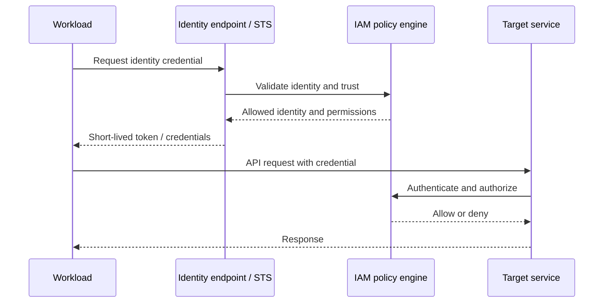
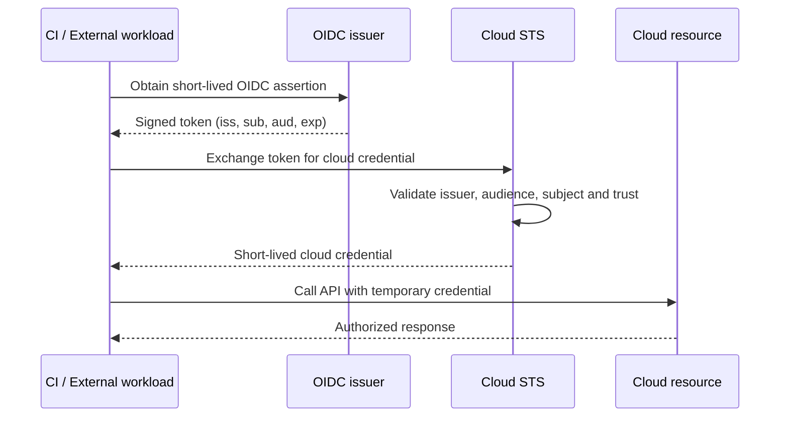

# Assigning Workload Identities to Access Services Without Static Keys

## 1. Why Do Workloads Need Their Own Identity?

A compute workload frequently needs to call other services to read configuration, download data, write results, emit logs, decrypt volumes, or invoke APIs. For example, a VM processing reports needs to read objects in storage; a pod needs to write messages to a queue; a function needs to access a database or secret manager. The target service must identify which workload is calling and what that workload is permitted to do.

Legacy deployments often placed access keys, client secrets, passwords, or service account key files inside images, environment variables, or configuration files. Static keys can persist for a long time, get copied across machines, and be difficult to revoke when exposed. If an image is shared accidentally or a container is compromised, those credentials can grant access to resources far beyond the original workload.

**Workload identity** provides an identity for an application or compute resource. The platform authenticates that identity based on execution location, resource-attached configuration, or a federation protocol. The workload obtains short-lived credentials when needed; the target service verifies the credentials and policies before permitting the action.

The goal is for a workload to prove who it is without carrying long-lived secret keys. This does not mean bypassing authentication, authorization, or key management on the platform. The system still requires trust relationships, token issuers, audiences, subjects, policies, and auditing.

In the **CLOUD_CORE_SERVICES_COMPUTE** module, workload identity is part of the security configuration when deploying VMs, containers, and serverless functions. Assigning the right identity enables workloads to access required services, reduces the risk of credential exposure, and supports controlled compute migration and scaling.

After this lesson, learners will be able to:

- Distinguish user identity, machine identity, workload identity, and credentials.
- Explain the risks of static access keys and service account keys.
- Describe how workloads retrieve short-lived credentials from metadata services or identity endpoints.
- Design trust relationships and federation using OIDC/SAML where appropriate.
- Compare EC2 instance roles, Azure Managed Identities, and Google attached service accounts.
- Assign identities to workloads on Kubernetes and serverless platforms.
- Design least-privilege permissions and test denied access.
- Protect tokens, metadata endpoints, federation subjects, and the identity lifecycle.
- Audit identity usage, handle rotation/revocation, and troubleshoot issues.

## 2. Foundational Concepts

### 2.1. Identities and Credentials Are Different

An identity is a recognized entity in the system—for example, a VM's role, an application's managed identity, or a service account attached to a workload. A credential is the proof used to authenticate that identity—such as an access token, temporary access key, certificate, or signed assertion.

A single workload identity can authenticate with many credentials over its lifetime. Short-lived credentials are reissued upon expiration; the identity and policies can remain unchanged. Revoking an identity's permissions may block new credential issuance, while previously issued credentials might remain valid until they expire or are rejected by the target system.

### 2.2. Types of Identities

| Type | Represents | Examples |
|---|---|---|
| Human/user identity | Users or administrators | Employee accounts, admin groups |
| Machine identity | Machines or devices | VMs, nodes, appliances, host certificates |
| Workload identity | Running applications or processes | API services, queue workers, scheduled functions |
| Service identity | Platform-managed service identities | IAM roles, managed identities, service accounts |
| Federated identity | Identities trusted via another issuer | OIDC subject for CI or a Kubernetes service account |

A VM can have a machine identity at the host layer and multiple workload identities at the application layer. Avoid assuming that every process on the same VM should share a single overly broad identity.

### 2.3. Authentication vs. Authorization

**Authentication** verifies who the workload is. **Authorization** determines what the workload is allowed to do on which resources.

For example, a function may authenticate successfully via its execution role yet still lack permission to read a specific bucket. That is an authorization error, not a credential retrieval error. When troubleshooting, separate failures to obtain a token from failures where a valid token is denied by policy.

### 2.4. Static Credentials vs. Short-Lived Credentials

| Criterion | Static credentials | Short-lived credentials |
|---|---|---|
| Lifecycle | Can persist long-term until rotated/revoked | Clear expiry, frequently reissued |
| Distribution | Often stored or passed as secrets to workloads | Retrieved via identity endpoint, SDK, or federation |
| Exposure risk | Can be abused for a long time if unrevoked | Shorter window of usability |
| Rotation | Requires updating secrets and restarting/reloading | SDKs/runtimes usually auto-refresh when configured properly |
| Scope | Easily shared across multiple workloads | Can bind dedicated policies per workload |
| Operations | Prone to secret drift and stale copies | Requires managing trust, issuers, token expiry, and clocks |

Short-lived credentials are not automatically safe if tokens are logged, granted overly broad permissions, or stolen while still valid. Combine them with least privilege, token protection, and usage monitoring.

## 3. Workload Identity Provisioning Architecture

### 3.1. General Flow

A typical flow consists of these steps:

1. The platform or identity provider identifies the workload.
2. The workload requests credentials via an SDK, metadata service, or token exchange endpoint.
3. The identity system verifies the workload and trust relationship.
4. Short-lived credentials are issued with the appropriate audience/scope.
5. The workload sends the credentials to the target service.
6. The target service validates the token and checks IAM/resource policies.
7. The credentials expire; the workload retrieves fresh credentials when needed.



This is a logical model. Each cloud may combine the identity endpoint, STS, and policy engine into different services.

### 3.2. Binding Identity to Workloads

Identity must be bound to the proper execution boundary:

- VM: instance profile, managed identity, or attached service account.
- Kubernetes pod: service account mapped/federated to a cloud identity.
- Serverless function: execution role or service identity attached to the function.
- Container platform: task identity, managed identity, or service account for the revision/task.
- CI/CD runner: federated identity based on repository, branch, workflow, or job claims.

Avoid using the node or host identity for all workloads running inside it when the platform offers dedicated pod/container identities. If every pod can retrieve the node's credentials, permission boundaries between applications weaken.

### 3.3. Tokens and Important Claims

With OIDC/JWT, tokens may contain claims such as:

- `iss` (issuer): the system issuing the token.
- `sub` (subject): the principal identity, such as a service account or workload.
- `aud` (audience): the intended recipient of the token.
- `exp` and `iat`: expiration time and issued-at time.
- `nbf`: not-before timestamp if used.
- Additional claims: repository, branch, namespace, service account, environment, or workflow.

Federation trust must restrict issuer, subject, and audience. Validating the token signature alone is insufficient: a validly signed token originating from an unauthorized repository, namespace, or workflow must still be rejected.

### 3.4. Audience and Confused Deputy

Audience indicates which recipient a token was issued for. If a token can be accepted across unrelated services, the risk of token misuse rises.

Request only the audience expected by the target service. Do not accept overly broad audiences without a clear reason. In federation, the audience is typically the identifier of the token exchange service or trust configuration; use the exact value required by the provider.

Confused deputy occurs when a service with broad permissions is tricked by a less-trusted workload into acting on its behalf using elevated privileges. Binding subject, audience, tenant, and resource scope helps mitigate this risk.

## 4. Why Avoid Static Keys?

### 4.1. Keys Can Be Copied

Access keys or service account keys are often stored in secret files, environment variables, CI variables, image layers, or developer machines. Every copy is a potential leak point. Shared keys also make it hard to trace which workload performed an action.

### 4.2. Rotation Creates Transition Gaps

When rotating keys, teams often must update secrets in multiple places, redeploy workloads, and revoke old keys. If one worker or older image is missed, the old credential stays active. If revoked too early, un-updated workloads suffer outages.

### 4.3. Credentials Can Be Embedded in Images

Deleting a secret from a Dockerfile or final filesystem does not remove it from earlier layers. Images copied to another registry may carry exposed credentials with them. For VM images, key files may remain inside snapshots or backups.

### 4.4. Hard to Attribute Actions to a Specific Workload

If multiple applications share one key, audit logs only show that the key was used, not necessarily which specific pod or function used it. Dedicated workload identities tie policies and audit trails to a clearer service or execution boundary.

### 4.5. Replacement Goals

- Use identities bound to VMs, pods, tasks, functions, or CI jobs.
- Obtain short-lived credentials from the platform or STS.
- Grant least-privilege permissions by resource and action.
- Never store long-lived secrets in source code, images, or user data.
- Maintain an audit trail identifying which identity accessed which resource.

## 5. VM Identity Across Clouds

### 5.1. AWS EC2 Instance Profile and IAM Role

In AWS EC2, an IAM role is attached to an instance via an instance profile. The EC2 Instance Metadata Service provides temporary security credentials for that role; the AWS SDK retrieves and refreshes credentials via the default credential provider chain.

Design workflow:

1. Create an IAM role dedicated to a workload or group of workloads sharing the same function.
2. Write a trust policy allowing the EC2 service to assume the role.
3. Attach the role to an instance profile and the instance.
4. Grant permission policies allowing only required actions/resources.
5. In the application, use the SDK credential chain rather than reading access keys from files.
6. Monitor CloudTrail and review permissions over time.

Condensed trust policy example:

```json
{
  "Version": "2012-10-17",
  "Statement": [
    {
      "Effect": "Allow",
      "Principal": { "Service": "ec2.amazonaws.com" },
      "Action": "sts:AssumeRole"
    }
  ]
}
```

The trust policy above only permits EC2 to assume the role. It grants no permissions to read buckets or write logs; those permissions belong in separate permission policies. Restrict resources, conditions, and role attachments to match the actual environment.

### 5.2. Using the AWS SDK Credential Chain

Applications should let the SDK locate credentials using the environment-appropriate default mechanism. When running on EC2, the SDK retrieves temporary credentials from the instance profile; when running locally, developers can use SSO/profiles per organizational procedures.

Do not write code that manually reads `AWS_ACCESS_KEY_ID`/`AWS_SECRET_ACCESS_KEY` and bakes them into production configs. Also never copy developer credential caches into images.

### 5.3. Azure Managed Identity

Azure Managed Identity provides platform-managed identities for VMs and supported compute services. There are two main types:

- **System-assigned identity:** Bound to the resource lifecycle; when the resource is deleted, the corresponding identity is deleted as well.
- **User-assigned identity:** An independent identity resource that can be attached to multiple authorized resources.

Workflow:

1. Enable system-assigned identity or create a user-assigned identity.
2. Assign Azure RBAC roles at the minimal required scope.
3. Use the Azure Identity SDK/`DefaultAzureCredential` suitable for the environment.
4. Obtain a token for the exact resource/audience.
5. Access the target service and monitor sign-in/audit logs.

Illustrative C# example using the SDK:

```csharp
using Azure.Identity;
using Azure.Security.KeyVault.Secrets;

var credential = new DefaultAzureCredential();
var client = new SecretClient(
    new Uri("https://example-vault.vault.azure.net/"),
    credential);

KeyVaultSecret secret = await client.GetSecretAsync("orders-api-config");
```

This example uses `DefaultAzureCredential` to select credentials based on the environment. On Azure compute, configure the appropriate identity so the SDK uses Managed Identity. In production, avoid unintended fallback to developer credentials; configure explicit credential chains per SDK/version and test the actual identity.

### 5.4. Google Cloud Attached Service Account

Compute Engine VMs can have a service account attached. The metadata server issues short-lived access tokens for the service account; applications use Google client libraries or Application Default Credentials (ADC) to obtain credentials.

Workflow:

1. Create a dedicated service account for the workload.
2. Attach the service account to the VM at creation or via configuration update.
3. Grant IAM roles on the required resources.
4. Use ADC/client libraries instead of downloading JSON keys.
5. Check audit logs and effective permissions.

Do not use the default service account with broad Editor permissions if the workload only needs to read a single bucket. Inspect both IAM roles and OAuth access scopes on the VM configuration; scopes do not replace IAM policies.

### 5.5. VM Identity Comparison Table

| Aspect | AWS EC2 | Azure VM | Google Compute Engine |
|---|---|---|---|
| Identity attached to VM | IAM role via instance profile | System/user-assigned Managed Identity | Attached service account |
| Credential issuance | Temporary credentials via IMDS/SDK | Token via Managed Identity endpoint/SDK | Access token via metadata server/ADC |
| Authorization | IAM identity/resource policies | Azure RBAC and data-plane access policies | IAM roles/resource policies |
| Refresh | SDK/provider chain fetches fresh credentials | SDK fetches fresh tokens | ADC/client library refreshes tokens |
| Key risks | IMDS access, overly broad roles | Identity assignment and RBAC scope | Default service account and broad permissions |

Service names and capabilities vary by VM type/region. Check the documentation for the compute type in use and verify that the SDK actually selects the intended identity.

## 6. Workload Identity on Kubernetes

### 6.1. Why Shouldn't All Pods Use the Node Identity?

Kubernetes nodes typically need an identity to pull images, attach volumes, or interact with the control plane. If every pod on a node can retrieve the node's credentials, an untrusted pod could abuse permissions belonging to other workloads.

Workload identity federation maps a pod's Kubernetes service account to a cloud identity. The pod receives a cluster-issued OIDC token; the cloud STS/identity provider validates issuer, subject, and audience, then issues short-lived credentials.

### 6.2. Kubernetes ServiceAccount

A ServiceAccount represents a workload inside a namespace. Pods use the service account specified in `spec.serviceAccountName`. Projected tokens can be issued with appropriate audiences and expirations; avoid unbounded or long-lived tokens.

Example:

```yaml
apiVersion: v1
kind: ServiceAccount
metadata:
  name: report-worker
  namespace: analytics
```

A Kubernetes ServiceAccount by itself does not grant cloud permissions. You must configure platform-specific federation/annotations/bindings and cloud permission policies.

### 6.3. AWS EKS: IRSA and EKS Pod Identity

EKS supports models for granting AWS credentials to pods, including IAM Roles for Service Accounts (IRSA) and EKS Pod Identity. Both aim to scope permissions per workload rather than sharing the node role.

With IRSA:

1. The EKS cluster has an OIDC issuer.
2. An IAM OIDC provider is configured for that issuer.
3. The IAM role trust policy restricts `sub` to a specific service account/namespace and `aud` as required.
4. The Kubernetes ServiceAccount is annotated with the role ARN.
5. Pods using that service account obtain temporary credentials via the AWS SDK web identity token flow.

Annotation example:

```yaml
apiVersion: v1
kind: ServiceAccount
metadata:
  name: report-worker
  namespace: analytics
  annotations:
    eks.amazonaws.com/role-arn: arn:aws:iam::123456789012:role/report-worker-role
```

The Role ARN is a placeholder. The trust policy must restrict the exact OIDC issuer, subject like `system:serviceaccount:analytics:report-worker`, and required audience. Do not use wildcard subjects across all namespaces without clear justification.

EKS Pod Identity uses associations between cluster/namespace/service account and an IAM role along with the corresponding agent/provider flow. Choose one mechanism based on cluster architecture; verify EKS version, agent, SDK, and workload support before deploying.

### 6.4. Azure AKS: Microsoft Entra Workload ID

AKS Workload ID uses the cluster's OIDC issuer and a federated identity credential in Microsoft Entra ID. Trust is bound to the issuer, the Kubernetes service account subject, and the audience.

A typical flow:

1. Enable OIDC issuer and workload identity on AKS.
2. Create a user-assigned managed identity or supported Entra application.
3. Create a federated identity credential pointing to the issuer, subject, and audience.
4. Annotate the Kubernetes ServiceAccount with the client ID.
5. Add the label `azure.workload.identity/use: "true"` to the pod template as required by the configuration.
6. Grant Azure RBAC/data-plane roles to the managed identity.
7. Use the Azure Identity SDK to acquire tokens.

ServiceAccount example:

```yaml
apiVersion: v1
kind: ServiceAccount
metadata:
  name: report-worker
  namespace: analytics
  annotations:
    azure.workload.identity/client-id: "00000000-0000-0000-0000-000000000000"
```

Pod template label example:

```yaml
apiVersion: apps/v1
kind: Deployment
metadata:
  name: report-worker
  namespace: analytics
spec:
  selector:
    matchLabels:
      app: report-worker
  template:
    metadata:
      labels:
        app: report-worker
        azure.workload.identity/use: "true"
    spec:
      serviceAccountName: report-worker
      containers:
        - name: app
          image: example.invalid/report-worker:v1
```

This is an illustrative Deployment; the image is a placeholder. The label must reside in `spec.template.metadata.labels` of the Pod template, while `serviceAccountName` sits in the Pod spec. The client ID in the ServiceAccount example is a placeholder. The federated credential must match the exact issuer, subject `system:serviceaccount:analytics:report-worker`, and configured audience.

### 6.5. Google Kubernetes Engine: Workload Identity Federation

GKE Workload Identity Federation lets Kubernetes workloads access Google Cloud APIs using an identity bound to a Kubernetes ServiceAccount or linked to an IAM service account per supported configuration. Modern models can use principals directly representing Kubernetes service accounts and grant IAM bindings on resources; some architectures use IAM service account impersonation.

General steps:

1. Enable Workload Identity Federation for the cluster/node pool per GKE guidelines.
2. Identify the project/cluster workload identity pool.
3. Create a Kubernetes ServiceAccount for the workload.
4. Grant IAM roles to the KSA principal or configure IAM service account linkage per the chosen model.
5. Configure required annotations/associations if using service account impersonation.
6. Use ADC and Google client libraries inside the pod.

Example annotation when linking a KSA to an IAM service account in the KSA-to-GSA model:

```yaml
apiVersion: v1
kind: ServiceAccount
metadata:
  name: report-worker
  namespace: analytics
  annotations:
    iam.gke.io/gcp-service-account: report-worker@sample-project.iam.gserviceaccount.com
```

This example applies to the KSA-to-GSA linkage model. With direct Workload Identity Federation principals, IAM bindings and principal URIs differ; do not apply this annotation blindly. Follow the Workload Identity mode enabled on the cluster.

### 6.6. Comparing Kubernetes Models

| Platform | Common mechanism | Trust constraints | Credentials inside pod |
|---|---|---|---|
| Amazon EKS | IRSA or EKS Pod Identity | OIDC issuer, namespace, service account, audience/association | AWS temporary credentials |
| Azure AKS | Microsoft Entra Workload ID | OIDC issuer, subject, audience | Entra access token |
| Google GKE | Workload Identity Federation | Workload pool principal/KSA, or KSA-to-GSA association | Google access token via ADC |

Do not fall back to attaching node credentials to pods as a default workaround. When workloads need cloud API access, issue dedicated identities per service account and verify namespace boundaries.

## 7. Workload Identity for Containers and Serverless

### 7.1. Container Task Identity

Some container platforms issue identities at the task, app, or revision level. For example, container tasks can receive dedicated roles, Azure Container Apps can use managed identities, and Cloud Run assigns a service identity to each service.

When designing:

- Bind identities to specific services/tasks.
- Do not share one administrative role across all containers.
- Grant permissions by resource and operation.
- Use SDKs supporting the platform's credential provider.
- Verify the actual identity inside new tasks/revisions after deployment.

### 7.2. AWS Lambda Execution Role

Lambda functions use an execution role to access AWS services. The role is configured on the function; the Lambda runtime supplies temporary credentials to the execution environment. Permission policies define which buckets, logs, or queues the function can access.

Create roles per function or group of functions sharing the same trust boundary. Avoid attaching a single broad role across an entire application if functions perform distinct tasks.

### 7.3. Azure Functions Managed Identity

Azure Functions can use system-assigned or user-assigned managed identities depending on the hosting plan and configuration. Applications use the Azure Identity SDK to acquire tokens for Storage, Key Vault, or other services. Assign roles at the required scope and verify plan/runtime support.

### 7.4. Google Cloud Run and Cloud Functions Identity

Cloud Run services or functions can run under an attached service account. Runtime credentials/ADC let the application obtain tokens without downloading JSON keys. The service account should have least-privilege permissions on target resources.

Do not place JSON service account keys in environment variables or images when the runtime natively supports attached service identities.

### 7.5. Identities for Scheduled Jobs

Scheduled jobs also need dedicated identities. Do not use the credentials of the person who created the schedule or an administrative account to run background tasks. Attach an execution identity to the scheduler target or job runtime, grant scoped read-input/write-output permissions, and audit every run.

## 8. Federation with OIDC/SAML for External Workloads

### 8.1. When Is Federation Needed?

Federation fits when workloads run outside the cloud yet need access to cloud resources—for example:

- CI/CD runners on GitHub Actions or other build systems.
- Workloads running in self-managed Kubernetes clusters.
- Jobs running on another cloud.
- Partner systems needing scoped resource access.
- On-premises machines calling cloud APIs.

Instead of generating long-lived access keys and storing them in CI secrets, the workload obtains an assertion from its existing identity provider. The cloud STS/identity service validates the assertion and issues short-lived credentials.

### 8.2. OIDC Token Exchange

An OIDC identity provider issues an ID token or signed JWT. The workload sends the token to the Security Token Service or federation endpoint. The provider validates issuer, signature, audience, subject, expiration, and trust conditions, then issues credentials for the role/service identity.



The token assertion and the cloud credential are two separate things. The assertion proves identity from the issuer; the cloud credential is issued after federation trust validation succeeds.

### 8.3. Trust Conditions

A trust policy should constrain:

- The exact, trusted issuer.
- The audience matching the token exchange/provider.
- A specific subject—such as repository/workflow/branch or namespace/service account.
- Short token lifetime and valid time bounds.
- Additional claims such as environment, organization, project, or protected branch if supported by the provider.
- Assumed role having only necessary permissions.

Avoid trusting all subjects from a public issuer. If tokens from any repository can assume a production role, an untrusted repository could become a path into production resources.

### 8.4. SAML Federation

SAML can also federate between an identity provider and the cloud. A SAML assertion carries subject and attributes; the cloud validates issuer, audience, recipient, validity window, and trust mapping, then issues configured permissions/credentials.

OIDC is often more convenient for modern workloads and CI because JWT claims are easy to constrain. SAML remains suitable for enterprise identity providers or existing setups. Choose the protocol based on both sides' capabilities and security requirements.

### 8.5. Federation Is Not Arbitrary Token Forwarding

Do not forward one service's raw token to another service if the audience is not intended for the recipient. Use token exchange or on-behalf-of flows designed for that purpose. Avoid storing assertions long-term in artifacts or logs.

## 9. CI/CD Example Without Static Access Keys

### 9.1. Release Flow

An image build and cloud deploy pipeline can:

1. CI runner receives an OIDC token from the CI identity provider.
2. Cloud STS validates issuer, audience, repository, and branch.
3. STS issues short-lived credentials for the deploy role.
4. Pipeline pushes the image to the registry or updates the deployment.
5. Credentials expire shortly afterward.

Build/push roles and deploy roles should be separated if they have different permissions. Pull requests from forks must never receive production deploy permissions.

### 9.2. AWS AssumeRoleWithWebIdentity

AWS STS supports web identity federation. An IAM role trust policy can constrain the OIDC provider and claims like `aud`/`sub`. The CI runner fetches a token from the OIDC provider, and the SDK/CLI exchanges the web identity token for temporary role credentials.

Conceptual trust policy example:

```json
{
  "Version": "2012-10-17",
  "Statement": [
    {
      "Effect": "Allow",
      "Principal": {
        "Federated": "arn:aws:iam::123456789012:oidc-provider/token.actions.githubusercontent.com"
      },
      "Action": "sts:AssumeRoleWithWebIdentity",
      "Condition": {
        "StringEquals": {
          "token.actions.githubusercontent.com:aud": "sts.amazonaws.com",
          "token.actions.githubusercontent.com:sub": "repo:example-org/orders-api:ref:refs/heads/main"
        }
      }
    }
  ]
}
```

Account ID, organization, repository, branch, and OIDC provider are examples. Use the CI provider's actual claims, restrict protected branches/environments, and grant only required deployment permissions.

### 9.3. Azure Federated Identity Credential

Azure Entra workload federation can trust OIDC tokens from CI. A federated identity credential binds issuer, subject, and audience to a supported application or user-assigned managed identity. The pipeline uses workload identity federation login flows to acquire tokens; no static client secret is required.

Subject can typically bind to repository, branch, or environment depending on the CI provider. Use exact job claims and avoid broad wildcards unless necessary.

### 9.4. Google Cloud Workload Identity Federation

Google Cloud Workload Identity Federation allows external identity providers to map to principals in a workload identity pool. The provider verifies issuer and attribute conditions; principals can be granted IAM roles directly or impersonate a service account by design.

Components:

- Workload identity pool.
- OIDC/SAML or supported provider.
- Attribute mapping from claims to standard attributes.
- Attribute conditions restricting issuer subject/project/repository.
- IAM bindings for the principal or service account.
- Credential configuration for SDK/CLI.

Do not generate JSON service account keys for CI when federation meets requirements. Verify claim mappings, audience, and impersonation permissions.

## 10. Designing Least-Privilege Permissions

### 10.1. Identify Business Actions

Do not start from pre-built broad role lists. List the actions the workload must perform:

| Workload | Action | Resource | Expected least-privilege permission |
|---|---|---|---|
| Report worker | Read input | Report bucket/prefix | Read objects under prefix |
| Report worker | Write output | Output bucket/prefix | Write objects under prefix |
| API service | Read configuration | Specific secret | Read required secret/version |
| Queue consumer | Receive and acknowledge messages | Specific queue | Receive/delete or ack as appropriate |
| Backup job | Read snapshot metadata | Specific volume/snapshot | Describe/read snapshot |
| CI deploy job | Update service | Specific cluster/project/resource | Deploy action in approved environment |

Avoid granting wildcard permissions across an entire account/subscription/project when the workload only needs one resource.

### 10.2. Separating Identities by Environment

Development, staging, and production should have separate identities or trust boundaries. Never allow a development CI branch to assume a production role. Separate cloud accounts/projects/subscriptions when stronger isolation is needed.

### 10.3. Separating Build, Deploy, and Runtime Identities

- Build identity: reads source/dependencies and pushes artifacts.
- Deploy identity: updates workloads or releases.
- Runtime identity: accesses resources while the application runs.

If one credential can build images, deploy clusters, and read production data, a compromise at one stage can impact the entire system. Separating identities limits blast radius.

### 10.4. Permission Boundaries and Conditions

Use conditions on resource tags, namespaces, projects, regions, environments, or request contexts where supported by the provider. Check both identity policies and resource policies; effective permissions may be constrained by permission boundaries, organization policies, SCPs, or explicit deny rules.

### 10.5. Negative Permission Testing

Besides verifying valid operations succeed, test operations that must be denied:

- Reading another bucket.
- Writing to production from a staging identity.
- Reading another service's secrets.
- Assuming another role.
- Accessing out-of-scope regions/resources.
- Using a federation token from an unauthorized branch/repository.

A denied result is critical evidence that policies do not grant excessive permissions.

## 11. Protecting Tokens and Identity Endpoints

### 11.1. Tokens Are Bearer Credentials

Many access tokens are bearer tokens: anyone holding a valid token can use it within its permitted scope and lifetime. Never log tokens, embed them in exception messages, command histories, or telemetry labels.

### 11.2. Protecting Metadata Endpoints

Metadata endpoints typically reside on link-local addresses or internal hostnames. SSRF can trick an application into querying the endpoint to steal tokens. Use provider protections, validate input URLs, restrict proxying to metadata, and grant least privilege to identities.

For containers, ensure pods that do not need node metadata cannot access node credentials. Use network controls, runtime settings, and cluster workload identity integrations.

### 11.3. Token Lifetime and Refresh

Choose token lifetimes that are short yet sufficient for valid tasks. SDKs should auto-refresh tokens before expiry. If the application caches tokens manually, handle expiry, clock skew, refresh failures, and concurrent refreshes.

Never cache tokens indefinitely. Never share tokens across different workloads or tenants.

### 11.4. Minimal Audience and Scope

Request tokens for the exact target API/resource. A token for Storage must not be reused as a token for Key Vault if audiences differ. With OAuth scopes, request only needed scopes; with cloud IAM, final permissions must still be enforced by resource policies.

### 11.5. Clock Synchronization

JWTs and signed assertions depend on `iat`, `nbf`, and `exp` timestamps. Clock skew can cause tokens to be rejected or create invalid validation windows. Synchronize VM/node clocks using managed time services and monitor clock drift.

### 11.6. Do Not Pass Tokens Through Logs or Queues

Queues should carry business identifiers or references, not access tokens. If another worker needs credentials, that worker should use its own identity. Tokens inside messages can linger in retention, DLQs, logs, or unintended replays.

## 12. Identity Lifecycle: Creation, Changes, and Revocation

### 12.1. Provisioning

Create identities alongside deployment definitions or IaC. Attach owner, purpose, environment, and contact info. Review trust policies and permission policies before applying.

### 12.2. Granting Permissions and Changes

All changes to trust conditions or permissions should be reviewed like code changes. Record who made the change, which resources are affected, and effective timestamps. Avoid manual permission edits outside IaC.

### 12.3. Credential Refresh

SDKs/provider agents should fetch new credentials before old ones expire. Applications must handle refresh errors and retry with backoff; never keep using expired tokens or fall back uncontrollably to static keys.

### 12.4. Revocation

When a workload is compromised:

1. Identify the identity and credentials currently in use.
2. Restrict or detach permission policies.
3. Update trust relationships to block new credential issuance.
4. Revoke sessions/tokens if supported by the platform; otherwise wait for the shortest expiry and block at the resource policy if needed.
5. Stop or isolate the compromised workload.
6. Inspect audit logs and anomalous activity.
7. Create a clean identity or redeploy the workload.

Detaching a role from a VM or deleting a federated credential prevents new issuance, but does not always immediately invalidate already-issued tokens. Understand token lifetimes and revocation capabilities on each provider.

### 12.5. Deprovisioning

When deleting a workload, remove unused role bindings, federated credentials, service account mappings, and policies. Check whether resource policies still reference the old principal. Retain audit records per policy.

## 13. Observing and Auditing Workload Identity

### 13.1. Logs and Audit Events

Record:

- Principal/workload identity.
- Accessed resource and action.
- Timestamp, region/project/account, and relevant source context.
- Allow/deny outcome.
- Federation issuer, subject, and audience at a safe detail level where possible.
- Request ID/correlation ID.

Never log raw tokens, private keys, or secrets. For investigations, use token IDs, hashes, or non-sensitive request metadata per platform capabilities.

### 13.2. Detecting Anomalous Behavior

Monitor for:

- Identities accessing out-of-baseline resources.
- Spikes in AccessDenied or AssumeRole/token exchange calls.
- Federated subjects from unfamiliar branches/repositories.
- Production workloads requesting credentials from development environments.
- Dormant identities suddenly making API calls.
- A role used from unusual regions or execution contexts.
- Broad permissions newly granted without a change record.

### 13.3. Identity Inventory

Maintain an identity catalog with owner, workload, environment, permission scope, trust issuer, token lifetime, and last review date. Find orphaned identities or unused policies. Automate comparisons between IaC and live state to detect drift.

## 14. Troubleshooting

### 14.1. Workload Fails to Obtain Credentials

Check:

1. Is the identity attached to the right VM/pod/function/task?
2. Is the metadata/identity endpoint reachable?
3. Is the OIDC issuer/provider registered and trusted?
4. Do `iss`, `sub`, `aud`, `exp`, and claim mappings match?
5. Does the node/pod suffer from clock drift or network restrictions?
6. Is the SDK using the right credential provider chain?
7. Do runtime/agent/SDK versions support the identity mechanism?

### 14.2. Token Acquired, but API Returns AccessDenied

Authentication may succeed while authorization fails. Check action, resource ARN/ID, role bindings, data-plane permissions, resource policies, conditions, deny rules, organization policies, and scope/audience.

Do not resolve this by granting account-wide Owner/Administrator permissions. Identify the exact missing permission and grant it at the smallest scope.

### 14.3. Federation Returns Invalid Audience

Compare the audience inside the assertion against the audience expected by the cloud/trust provider. Check OIDC provider settings, client ID, or token exchange audience. Do not replace it with a wildcard audience to bypass the error.

### 14.4. Federation Subject Mismatch

Inspect the actual `sub` claim, including namespace, service account, repository, branch, or environment. A single `/`, namespace name, or different ref can cause the trust policy to reject it. Use verified token claims from the issuer; do not guess the subject.

### 14.5. Token Expired or Refresh Failure

Check clocks, token lifetime, SDK refresh logic, proxies, DNS, and permission to call the token endpoint. If the application holds tokens in globals or custom caches, verify multiple threads do not race during refresh. Use official SDKs whenever possible.

### 14.6. Workload Uses the Wrong Identity

The SDK credential chain may pick environment variables or credential files before the platform-attached identity. Inspect provider chain precedence, config files, environment variables, and runtime agents. Remove legacy static credentials from the deployment once the intended identity is confirmed working.

### 14.7. Pod Obtains Node Credentials

Check whether pods can reach the node's metadata endpoint, whether network policies and hop-limit/IMDS settings are appropriate, and whether workload identity integration is functioning. Isolate pods with unneeded privileges and rotate/revoke credentials if exposure is evident.

## 15. End-to-End Design Examples

### 15.1. VM Reading Input and Writing Output in Object Storage

A report-processing VM needs to read `input/reports/` and write `output/daily/`.

**Design:** Attach a dedicated role/managed identity/service account for the report worker. Policies allow only reading the input prefix and writing the output prefix. The application uses the cloud SDK credential provider, with no access keys in the image.

**Testing:** Reading input succeeds; writing output succeeds; attempting to read another bucket or delete objects must be denied.

### 15.2. Pod Accessing Only Its Own Service Secret

A pod `analytics/report-worker` needs to read one configuration secret.

**Design:** Create a dedicated Kubernetes ServiceAccount; use IRSA, AKS Workload ID, or GKE Workload Identity Federation; trust only that namespace/service account; grant read permission on that exact secret.

**Testing:** Pods with the right service account obtain tokens; pods in another namespace cannot assume the identity; pods cannot read secrets belonging to other services.

### 15.3. Serverless Function Publishing Messages

An order-event function needs to publish messages to a queue.

**Design:** Attach a dedicated execution identity to the function, granting publish permission only to the target queue. The SDK uses runtime short-lived credentials. Never embed queue access keys in environment variables.

**Testing:** The function publishes to the target queue; publishing to another queue is denied; audit logs identify the exact function identity.

### 15.4. CI Deploying Production via OIDC Federation

A release pipeline from a protected branch needs to update a production service.

**Design:** The CI provider issues an OIDC token; the cloud trust policy constrains issuer, audience, repository, and branch/environment. STS issues short-lived credentials for the deploy role; the role can update only approved resources. Pull requests from forks cannot assume the role.

**Testing:** The release workflow succeeds; workflows from other branches, repositories, or forks are denied; no cloud access keys are stored in CI secrets.

## 16. Common Mistakes

- **Using one identity for all workloads:** Increases blast radius and blurs audit trails.
- **Treating identity as credential:** Identities persist longer, whereas credentials are issued per session with expiry.
- **Leaving static keys in images:** Secrets persist inside layers, snapshots, and copies.
- **Putting secrets in user data/metadata:** Bootstrap data can be read or leaked into logs.
- **Trusting an entire OIDC issuer:** Untrusted workloads could assume roles.
- **Failing to restrict subject:** Unrelated branches/repositories/namespaces could gain production access.
- **Overly broad audience:** Tokens could be misused across services.
- **Granting overly broad roles:** Compromised workloads gain access to excessive resources.
- **Using node identity for all pods:** Breaks isolation boundaries between workloads.
- **Not checking SDK credential chains:** Applications may continue using legacy keys.
- **Testing only allowed actions:** Fails to uncover excessive permissions.
- **Assuming revoking an identity invalidates tokens instantly:** Issued tokens may stay valid until expiry.
- **Logging tokens for debugging:** Creates additional copies of sensitive credentials.
- **Missing owners/expiry on federation trusts:** Stale trusts survive long after repositories or workloads are deleted.
- **Not separating build/deploy/runtime roles:** One faulty pipeline or process can compromise all permissions.

## 17. Workload Identity Implementation Checklist

### Identity Design

- [ ] Every workload has a clear identity and owner.
- [ ] No static access keys/service account keys are used when short-lived identities are supported.
- [ ] VMs, pods, tasks, and functions use execution-level identities.
- [ ] Build, deploy, and runtime identities are separated by function.
- [ ] Development, staging, and production have appropriate trust boundaries.

### Federation and Credentials

- [ ] Issuers are verified and trusted.
- [ ] Subject/namespace/repository/branch/environment constraints are explicitly scoped.
- [ ] Audience matches the token exchange and target service.
- [ ] Tokens have expiries and SDK refresh is tested.
- [ ] Tokens are never logged or placed in queues, images, or artifacts.
- [ ] Metadata endpoints are protected against SSRF and unintended access.

### Authorization

- [ ] Policies restrict actions and resources following least privilege.
- [ ] Resource policies, IAM policies, and deny conditions are reviewed.
- [ ] Both allowed operations and operations that must be denied are tested.
- [ ] Broad admin privileges are never granted just to resolve AccessDenied errors.
- [ ] Pods cannot access node credentials unless explicitly needed.

### Operations and Auditing

- [ ] SDKs use the intended credential provider chain.
- [ ] Audit logs capture token exchanges and API accesses.
- [ ] An inventory of identities, owners, and review schedules is maintained.
- [ ] Procedures exist to revoke trusts, roles, and credentials during incidents.
- [ ] Token validity windows after revocation are understood.
- [ ] IaC manages identities/trusts/policies and detects drift.

## 18. Conclusion

Workload identity enables VMs, containers, Kubernetes pods, serverless functions, and CI jobs to prove who they are when accessing services. Instead of distributing long-lived access keys or service account keys, workloads obtain short-lived credentials from metadata services, managed identity endpoints, or federation flows. Cloud providers verify identities and trust relationships before issuing credentials; target services enforce permission policies.

Secure design requires dedicated per-workload identities, trusts constrained by issuer/subject/audience, least-privilege permissions, and token protection throughout the lifecycle. On VMs, use instance roles, managed identities, or attached service accounts; on Kubernetes, use service-account federation; on serverless, use execution identities; and for CI or external workloads, use OIDC/SAML federation. Finally, auditing, negative permission testing, expiry management, and revocation procedures reduce credential exposure risk while maintaining compute operability.