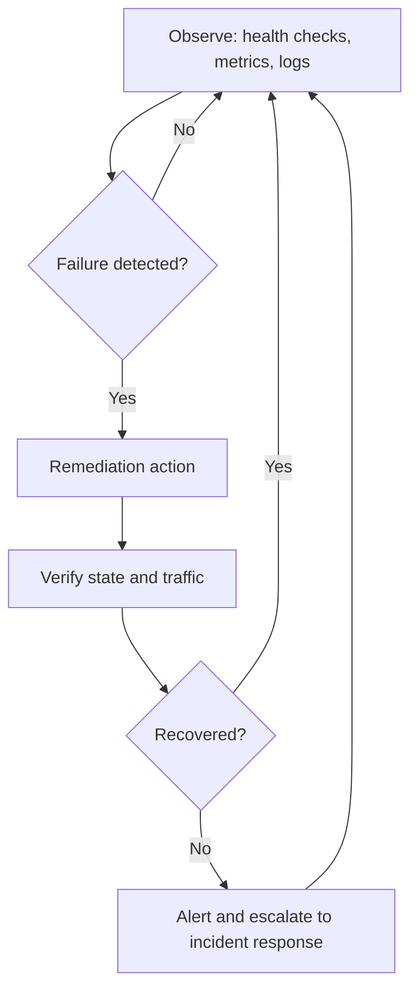
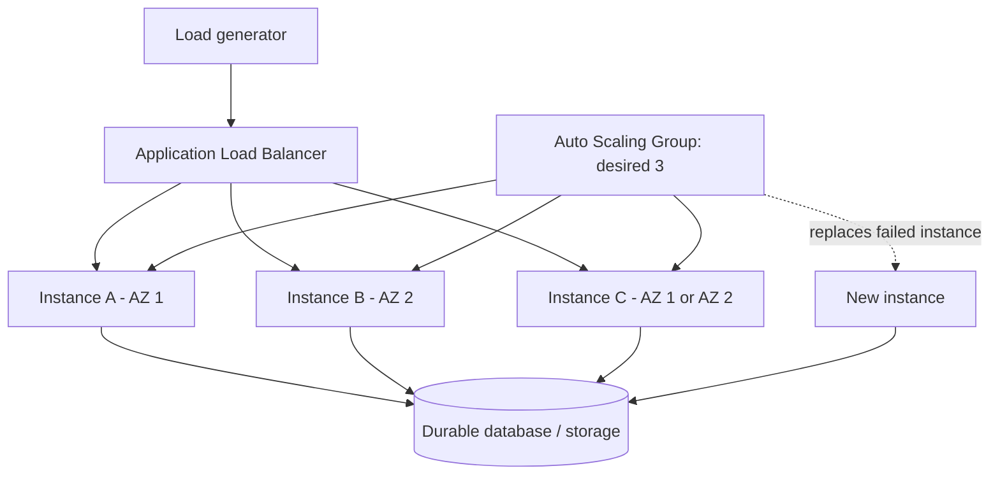

# Simulating Machine Failures and Verifying Self-Healing Mechanisms

A system running multiple virtual machines or nodes is truly fault-tolerant only when it can detect a failed component, shift traffic to healthy components, and restore sufficient serving capacity within target timeframes. Enabling Auto Scaling or running multiple replicas does not by itself prove that a system self-heals. You must inject a controlled failure, observe how each layer responds, and confirm that users continue receiving service within committed limits.

This lesson belongs to the **Deployment and Operations Labs** chapter in the **CLOUD_CORE_SERVICES_COMPUTE** module. It guides you through simulating virtual machine or node failures, verifying health checks, load balancers, instance replacement mechanisms, workload rescheduling, and traffic recovery. Examples use AWS Auto Scaling Groups and Kubernetes; the same principles apply to Managed Instance Groups, Virtual Machine Scale Sets, or equivalent container orchestration platforms.

After this lesson, learners will be able to:

- Distinguish process failures, virtual machine failures, node failures, and availability zone failures.
- Describe the observe, detect, remediate, and verify loop of self-healing mechanisms.
- Prepare a test environment with sufficient capacity, health checks, and monitoring before injecting failures.
- Simulate losing an instance or worker node and observe the replacement process.
- Measure detection time, recovery time, failed request rates, and remaining capacity.
- Identify limits of self-healing for stateful data, dependencies, and wide-scale failures.

## 1. Which Layers Participate in Self-Healing?

Self-healing is a system's ability to detect an unhealthy state and automatically execute recovery actions according to predefined policies. A basic loop comprises four steps: observe, detect, act, and verify.



Remediation actions depend on the failure layer:

| Layer | Symptom | Possible actions | What to verify |
|---|---|---|---|
| Application process | Process exits, deadlocks, or health endpoint fails | Supervisor restarts process; container runtime restarts container | New process is genuinely ready and not crash-looping |
| Container or Pod | Container stops, Pod deleted, or no longer Ready | Deployment/ReplicaSet creates replacement Pod; scheduler places Pod on a node with capacity | Ready replica count recovers and Service has healthy endpoints |
| Virtual machine | Instance terminated or health check fails | Auto Scaling Group/Managed Instance Group launches another instance | New instance enters InService, registers target, and serves requests |
| Worker node | Node disconnects or enters NotReady state | Scheduler reschedules workloads; node group or node repair replaces machine | Workloads redistribute and cluster capacity recovers |
| Availability zone | Multiple instances or network paths fail together | Load balancer routes traffic to healthy zone; machine group scales in healthy zones | Remaining capacity handles load and cross-zone dependencies function |

These layers coordinate but do not replace each other. Kubernetes can create a new Pod when one fails, yet not every cluster configuration automatically provisions a new VM when a node dies. An Auto Scaling Group can replace a VM, yet cannot fix application logic bugs or restore lost data. Clearly define which component is responsible at each layer.

## 2. Defining Test Conditions and Success Criteria

Before simulating a failure, write down clearly what must be proven. For example: when one instance in a three-machine group is unexpectedly terminated, the load balancer stops sending requests to that instance, the Auto Scaling Group launches a replacement instance, the new instance passes health checks, and total capacity returns to the desired level.

Choose measurable criteria:

- **Detection time:** Time from when the failure begins until the system marks the component unhealthy.
- **Mitigation time:** Time from detection until traffic is shifted away from the failing component or workloads are rescheduled.
- **Recovery time:** Time from when the failure begins until capacity or service returns to target state.
- **Availability during test:** Percentage of successful requests across the entire failure and recovery window.
- **Error budget consumed:** Count or rate of failed requests compared to service targets.
- **Remaining capacity:** Number of healthy instances/replicas and CPU, memory, and connection pool usage during the outage.
- **Data integrity:** Verification that data written before, during, and after the failure is neither lost nor unexpectedly duplicated.

Example criteria for a test web service:

| Metric | Illustrative target |
|---|---|
| Desired instance count | 3 instances across at least 2 Availability Zones |
| Healthy instances during 1-machine loss | At least 2 instances continue serving requests |
| Machine replacement time | No more than 8 minutes in the lab environment |
| Successful requests | At least 99% during the test window |
| Capacity recovery | Returns to 3 InService and healthy instances |
| Data | Zero loss of acknowledged records |

These figures are illustrative examples for building the lab. Real SLOs must reflect application characteristics, health check timings, startup durations, load, and platform limits. Never use a single test run to assert that all failures or all zones will recover in the exact same time.

## 3. Preparing a Safe Environment

Experiments should run inside a dedicated lab account, project, or subscription. Use a stateless service reproducible from tested images or artifacts; any data that must persist should reside in durable storage or a database with proper backup and recovery mechanisms.

Before injecting failures, verify these conditions:

1. You have necessary admin access and know how to halt the lab.
2. You have accurately identified the machine group, instances, nodes, and load balancer belonging to the test environment.
3. Desired capacity, minimum, and maximum capacity are properly configured; quotas and resources remain available across Availability Zones.
4. Health checks probe the right application, right port, and right readiness endpoint.
5. Images, launch templates, or node images can provision replacement machines without manual steps.
6. Logs, metrics, events, and dashboards are active before injecting the failure.
7. At least one client sends continuous requests to observe impact.
8. Initial state is saved and a plan exists to restore configuration after testing.

Never attempt to terminate production machines, shared nodes, or machines holding sole copies of data. In shared multi-team environments, confirm scope and testing windows following organizational operations procedures. Stop testing immediately if workloads outside the lab scope are impacted.

### Sample Lab Architecture



The load balancer distributes requests across healthy targets. The Auto Scaling Group maintains instance count at desired capacity. When an instance is lost, the group detects the missing member and launches a new machine. The new machine must start the application, register as a target, and pass health checks before receiving traffic. Recovery time includes both machine provisioning and application readiness time.

## 4. Lab A: Simulating a Failed VM with an AWS Auto Scaling Group

This lab uses an Auto Scaling Group (ASG) with desired capacity 3, minimum 2, maximum at least 4, attached to an Application Load Balancer target group. The group spans at least two Availability Zones. The application serves a `/health` endpoint and can log request IDs for observation.

### Step 1: Inspect Initial State

Set environment variables matching resources in your lab account. The example below uses Bash and AWS CLI; replace group names and ARNs with real values.

```bash
export AWS_REGION=ap-southeast-1
export ASG_NAME=compute-lab-asg
export TARGET_GROUP_ARN=arn:aws:elasticloadbalancing:ap-southeast-1:123456789012:targetgroup/compute-lab/abcdef1234567890
export SERVICE_URL=https://compute-lab.example.com/health

# View Auto Scaling Group configuration and capacity
aws autoscaling describe-auto-scaling-groups \
  --auto-scaling-group-names "$ASG_NAME" \
  --region "$AWS_REGION" \
  --query 'AutoScalingGroups[0].[MinSize,DesiredCapacity,MaxSize,AvailabilityZones]' \
  --output table

# View status of each instance in the group
aws autoscaling describe-auto-scaling-groups \
  --auto-scaling-group-names "$ASG_NAME" \
  --region "$AWS_REGION" \
  --query 'AutoScalingGroups[0].Instances[*].[InstanceId,LifecycleState,HealthStatus,AvailabilityZone]' \
  --output table

# View load balancer target status
aws elbv2 describe-target-health \
  --target-group-arn "$TARGET_GROUP_ARN" \
  --region "$AWS_REGION" \
  --query 'TargetHealthDescriptions[*].[Target.Id,TargetHealth.State,TargetHealth.Reason]' \
  --output table

# Send a request to verify the application
curl -fsS "$SERVICE_URL"
```

Begin only when three instances are InService with health status Healthy and the target group reports all expected targets healthy. If targets are not yet healthy, fix the health check or application before simulating a failure; starting from an unstable state makes test results hard to interpret.

### Step 2: Run Background Load and Record Baseline

Send steady requests to the URL through the load balancer for several minutes. You may use your organization's load testing tool or a simple loop in a lab environment:

```bash
for i in $(seq 1 120); do
  curl -sS -o /dev/null \
    -w "request=$i status=%{http_code} total=%{time_total}\n" \
    "$SERVICE_URL"
  sleep 1
done
```

Record HTTP 2xx, 5xx, timeout rates, latency, and which targets receive traffic. Log instance counts, target health, CPU, memory, and application logs. A baseline distinguishes test-induced errors from pre-existing errors.

### Step 3: Select One Lab Instance to Fail

Retrieve an instance ID from the ASG list, and double-check the group name and environment tags. Never guess an ID. Save the ID of a healthy InService member:

```bash
export FAILED_INSTANCE_ID=i-0123456789abcdef0

aws ec2 describe-instances \
  --instance-ids "$FAILED_INSTANCE_ID" \
  --region "$AWS_REGION" \
  --query 'Reservations[0].Instances[0].[InstanceId,State.Name,Placement.AvailabilityZone,Tags]' \
  --output json
```

Cross-check the instance ID against the ASG output and lab tags before proceeding. The lab aims to simulate abrupt machine loss, so terminate the instance in the lab account:

```bash
aws ec2 terminate-instances \
  --instance-ids "$FAILED_INSTANCE_ID" \
  --region "$AWS_REGION"
```

This command deletes the specified virtual machine. Run it only after confirming it is a test instance, the application stores no unique data on local ephemeral disks, and at least two healthy instances remain serving. Never run this command on instances outside the lab scope.

### Step 4: Observe Failure Detection and Replacement

Monitor ASG and target group status while clients continue sending requests:

```bash
# Observe instances and lifecycle states
aws autoscaling describe-auto-scaling-groups \
  --auto-scaling-group-names "$ASG_NAME" \
  --region "$AWS_REGION" \
  --query 'AutoScalingGroups[0].Instances[*].[InstanceId,LifecycleState,HealthStatus,AvailabilityZone]' \
  --output table

# Check recent ASG launch/terminate activities
aws autoscaling describe-scaling-activities \
  --auto-scaling-group-name "$ASG_NAME" \
  --region "$AWS_REGION" \
  --max-items 20 \
  --query 'Activities[*].[StartTime,StatusCode,Description,Cause]' \
  --output table

# Check target group
aws elbv2 describe-target-health \
  --target-group-arn "$TARGET_GROUP_ARN" \
  --region "$AWS_REGION" \
  --output table
```

Expected observations:

1. The terminated instance leaves the serving instance list or is recorded as terminated.
2. The ASG detects capacity below desired capacity and launches a replacement instance.
3. The new instance progresses through lifecycle states, starts the application, and registers with the target group.
4. The target group routes requests only to targets passing health checks.
5. InService instance counts and healthy target counts return to target levels.

Do not equate `running` with `healthy`. A VM can be running before the application opens its port, finishes loading configuration, or connects to its database. Consider an instance ready only when application health checks succeed and the load balancer marks the target healthy.

### Step 5: Verify Service Across the Entire Failure Window

Correlate client logs with load balancer and application metrics. Determine whether any requests failed right at termination, how long errors persisted, and whether latency returned to baseline once the new target became healthy. Record termination start time, ASG launch start time, new instance InService time, target healthy time, and full capacity recovery time.

If a few requests fail during the transition window, analyze the cause: open connections to the lost target, slow health check detection, client retries, timeouts, or application unready state. The goal is to measure real impact against the defined SLO, not to assume failover is always zero-error.

## 5. Lab B: Simulating a Failed Worker Node in Kubernetes

Kubernetes can recover Pods managed by a Deployment or StatefulSet when a Pod is deleted or a node becomes unavailable. However, provisioning a new node is typically handled by a node group, cluster autoscaler, or platform node auto-repair mechanism. Both layers must be verified.

### Step 1: Prepare a Multi-Replica Workload

Deploy a stateless application in a test namespace, with at least three replicas and enough nodes for the scheduler to reschedule Pods if one node is lost. Condensed Deployment example:

```yaml
apiVersion: apps/v1
kind: Deployment
metadata:
  name: web-lab
  namespace: resilience-lab
spec:
  replicas: 3
  selector:
    matchLabels:
      app: web-lab
  template:
    metadata:
      labels:
        app: web-lab
    spec:
      containers:
        - name: web
          image: nginx:1.27
          ports:
            - name: http
              containerPort: 80
          readinessProbe:
            httpGet:
              path: /
              port: http
            initialDelaySeconds: 3
            periodSeconds: 5
          livenessProbe:
            httpGet:
              path: /
              port: http
            initialDelaySeconds: 10
            periodSeconds: 10
```

Apply the manifest in the created and verified lab namespace:

```bash
kubectl apply -f web-lab.yaml
kubectl rollout status deployment/web-lab -n resilience-lab
kubectl get pods -n resilience-lab -o wide
kubectl get nodes -o wide
```

In real environments, spread replicas across nodes or zones using topology spread constraints/anti-affinity. If all three Pods sit on the same node, losing that node wipes out every replica at once. Also ensure the cluster has spare CPU, memory, and quotas to reschedule Pods.

### Step 2: Distinguish Pod Deletion from Machine Loss

You can delete a Pod to verify the ReplicaSet creates a new Pod:

```bash
kubectl delete pod <pod-name> -n resilience-lab
kubectl get pods -n resilience-lab -o wide --watch
```

This only tests Pod recovery by the controller. It does not prove self-healing when a virtual machine or node fails. To simulate node loss, use a lab cluster with a managed node group, identify a worker node's instance ID from node and infrastructure info, and terminate that exact instance in the test node group. Watch the Node transition to `NotReady`, Pods undergo toleration/eviction handling, and the node group provision a replacement machine. Node loss detection time can be longer than deliberate Pod deletion.

Do not use `kubectl drain` to claim you simulated a dead machine: drain is a controlled maintenance operation where the scheduler is notified upfront and Pods are gracefully evicted. Drain remains useful for testing workload mobility during node maintenance, but differs from abrupt failure.

### Step 3: Observe Controller and Scheduler

```bash
# Watch nodes and Ready state
kubectl get nodes -o wide --watch

# Watch Pods and nodes running Pods
kubectl get pods -n resilience-lab -o wide --watch

# View latest events in the namespace
kubectl get events -n resilience-lab --sort-by=.lastTimestamp

# View Deployment status and replica count
kubectl describe deployment web-lab -n resilience-lab
```

When a node is lost, Kubernetes takes time to detect missed heartbeats, mark the node `NotReady`, and evict Pods per policy. New Pods can run only if suitable nodes with sufficient resources exist. If the node group fails to create a replacement machine, inspect desired size, autoscaling limits, subnets/IPs, quotas, launch template, and node bootstrap errors.

## 6. Health Checks Decide When to Remove and Readmit Traffic

Overly sensitive health checks can evict a healthy instance during a brief load spike; overly lenient health checks can keep sending traffic to a broken application. Design checks to match the goal.

| Check type | Question to answer | Example |
|---|---|---|
| Liveness | Is the process alive and able to continue? | Internal HTTP endpoint confirming the process is not wedged |
| Readiness | Is the instance eligible to receive new requests? | Config loaded, port open, and mandatory dependencies reachable |
| Startup | Has the application finished starting up? | Allows slow-initializing apps time before liveness applies |
| VM/instance health | Is the virtual machine infrastructure healthy? | System status check and instance status check |
| Load balancer target health | Does the target accept requests per probe protocol and path? | HTTP `/health` on the right port |

Readiness should reflect request-serving capability, while avoiding checking every optional dependency on each probe if a minor outage could evict all instances. For mandatory dependencies such as a primary database, explicitly define whether the application runs in degraded mode or must stop taking traffic.

In AWS Auto Scaling, the health check type can typically be EC2 or include ELB. Using only EC2 health checks allows a machine to pass infrastructure checks even when the application is broken at the HTTP layer. If you want the ASG to replace instances based on load balancer target health, configure ELB health checks properly on both the ASG and target group. Set a health check grace period long enough for normal startup; too long delays detecting fresh failures, while too short can terminate instances before they finish initializing.

In Kubernetes, readiness probes govern whether a Pod is considered ready to receive traffic through a Service; liveness probes can trigger container restarts; startup probes protect slow-starting apps from being marked failed prematurely by liveness probes. Probes must verify the right state with appropriate timeouts, periods, and failure thresholds.

## 7. Verifying Data and State After Machine Replacement

Replacing compute does not automatically restore data. A new instance may lack files written to the old instance's ephemeral disk. A new container may launch on another node without prior local data. Therefore, services must decouple compute lifecycle from data lifecycle.

- Critical data should live in databases, object storage, or volumes with proper backup/replication policies.
- When using instance-attached block volumes, define detach/reattach behavior, zone constraints, and recovery procedures upon instance loss.
- For StatefulSets, verify PersistentVolumeClaims, volume topology, fencing, and attach times onto new nodes.
- In-memory data or local caches must be regenerable or treated as ephemeral when a process/node disappears.
- For message processing, use timely acknowledgements, idempotency, and bounded retries to avoid lost or duplicate processing.

After machine replacement, run test read/write checks, verify records committed prior to the outage still exist, and reconcile event counts. For stateful workloads, run dedicated labs for volume failures, database failovers, or quorum loss; a stateless VM termination test does not prove data recovery for stateful systems.

## 8. Analyzing Results and Diagnosing When Self-Healing Fails

If no replacement instance or Pod appears, check in order:

1. **Did the management layer detect the failure?** Inspect health status, node conditions, ASG activities, or controller events.
2. **Is desired capacity maintained?** Check min/desired/max, replica count, node group size, and scale-in policies.
3. **Are sufficient resources available to recreate?** Check quotas, subnet IPs, per-AZ capacity, CPU/memory, node selectors, and taints/tolerations.
4. **Are the image and startup config valid?** Check launch template, image version, bootstrap scripts, secrets, IAM roles, and startup logs.
5. **Can health checks pass?** Check port, path, protocol, security groups, readiness, and grace period.
6. **Is traffic reaching healthy targets?** Check listeners, target groups, Service endpoints, and DNS.
7. **Are dependencies available?** Check databases, queues, internal DNS, storage, credentials, and connection limits.

| Symptom | Possible cause | Investigation approach |
|---|---|---|
| ASG does not launch a new instance | Desired capacity dropped, max too low, or activity failed | Check desired/min/max and scaling activities |
| New instances terminate repeatedly | Wrong health check, app crashes, or bootstrap error | Inspect lifecycle, EC2 status, target health, and startup logs |
| New instance running but gets no traffic | Target not registered or not yet healthy | Check target group, listener, port, and health path |
| Pod stays Pending after node failure | Cluster out of resources or scheduling constraints unmet | Check `kubectl describe pod`, events, taints, affinity, and quotas |
| Node NotReady with no new node | Node group not maintaining capacity or auto-repair unconfigured | Check node group, ASG, autoscaler, and bootstrap errors |
| Requests still fail after compute recovers | Dependencies, data, or connection pools still failing | Check traces, databases, queues, retries, and app state |
| New Pod runs but data disappeared | Data lived on ephemeral filesystem or volume not reattached | Check PVC, volume lifecycle, backups, and storage paths |

If replacement machines fail repeatedly, do not leave the controller looping indefinitely without alerts. Configure alarms for launch failures, instance churn, surging Pod restarts, unavailable replicas, and recovery times exceeding SLOs. When thresholds breach, escalate to incident response to avoid generating costs and hammering struggling dependencies.

## 9. Extending Experiments: Process Failures and Zone Failures

After testing single-machine failure, run smaller- or larger-scope experiments in the lab environment:

| Experiment | How to simulate | Observations to verify |
|---|---|---|
| Process crash | Stop the app process inside a test container | Supervisor/container restarts; readiness drops traffic then recovers |
| Pod deletion | Delete a Pod managed by a Deployment | ReplicaSet creates a new Pod; Service updates endpoints |
| Instance termination | Terminate one instance in the lab ASG | ASG launches replacement; load balancer removes failed target |
| Node loss | Stop or terminate a lab worker node | Node condition changes, workloads reschedule, and node group restores capacity |
| Single AZ unavailable | In a dedicated simulation environment, block capacity in one AZ or use controlled fault injection | Traffic shifts to another AZ; remaining capacity serves load |
| Dependency failure | Use a mock endpoint or test dependency returning errors/timeouts | Circuit breakers, retries, and degraded mode operate as designed |

Testing zone failures carries a wider blast radius than single-machine failures. Run them only in environments designed for fault testing, with blast-radius limits and a stop plan. Never arbitrarily block shared subnets, routes, or services to simulate an AZ failure. When using cloud fault-injection services, scope resources via tags, roles, and duration; review expected impacts and stop conditions beforehand.

## 10. Measuring and Documenting Experiment Reports

Each test run should produce a record containing:

| Field | Details to save |
|---|---|
| Experiment ID | Unique test identifier |
| Scope | Account/project, region, cluster, ASG, node, or lab workload |
| Hypothesis | Which mechanism is expected to detect and recover the fault |
| Initial state | Capacity, replicas, health, load, and dependency states |
| Fault injection | Which instance/Pod/node, timestamp, and simulation method |
| Detection | First timestamp when health check/controller detected the fault |
| Mitigation | Timestamp when traffic shifted and replacement instance/Pod started running |
| Verification | Timestamp when target turned healthy, replica Ready, and requests stabilized |
| Impact | Failed requests, latency, data integrity, and incurred cost |
| Conclusion | PASS/FAIL, SLO variance, and follow-up actions |

Example timeline table:

| Milestone | Timestamp | Meaning |
|---|---|---|
| T0 | 10:00:00 | Injected fault on test instance |
| T1 | 10:00:35 | ASG or health check detected fault |
| T2 | 10:01:10 | Failing target stopped receiving new requests |
| T3 | 10:02:20 | Replacement instance became InService |
| T4 | 10:03:05 | New target became healthy and began serving requests |
| T5 | 10:03:30 | Capacity and error rate returned to target |

Timestamps above only illustrate logging format, not default AWS or Kubernetes timings. Calculate `detection time = T1 - T0`, `mitigation time = T2 - T0`, and `recovery time = T5 - T0`. Compare results against agreed targets and archive relevant dashboards, logs, events, and traces.

## 11. Cleanup and Restoring Initial State

Once completed:

1. Confirm desired capacity, min/max, replica counts, and node group sizes return to initial settings.
2. Verify no unexpected test instances, unhealthy targets, or Pending Pods remain.
3. Restore health check settings, alarms, and load generators if modified for the lab.
4. Stop load generators and fault-injection tools.
5. Inspect test data, volumes, snapshots, and logs per retention policies.
6. Confirm test requests through the service endpoint succeed and dashboards show no lingering test alerts.
7. Record outcomes, recovery durations, deviations, and improvements before closing.

When using time-billed resources, delete or stop unneeded lab resources per environment guidelines. Do not delete databases, volumes, or logs needed as test evidence.

## 12. Self-Healing Verification Checklist

- [ ] Clearly defined the simulated fault and lab resource scope.
- [ ] Established baselines for capacity, health, latency, error rate, and data.
- [ ] At least one healthy workload copy and spare capacity exist.
- [ ] Health checks distinguish a running machine from a genuinely ready application.
- [ ] Verified the controller or machine group has a policy to replace failed components.
- [ ] Injected failure on exactly one test component and recorded start timestamp.
- [ ] Load balancer or Service stopped sending requests to the unhealthy target.
- [ ] Replacement instance/node/Pod was created or rescheduled as designed.
- [ ] New target or replica passed health/readiness checks before receiving traffic.
- [ ] Request success rate, latency, and capacity returned to target.
- [ ] Committed data remained intact; retries caused no unintended duplicate side effects.
- [ ] Tested alerts for slow recovery or inability to provision new capacity.
- [ ] Restored configuration and cleaned up test resources.
- [ ] Archived experiment report, measurements, logs, events, and improvement actions.

A self-healing test passes only when the system accurately detects the fault, recovers at the right layer, routes traffic back to healthy components, and preserves data per commitments. Recording real timings and impacts reveals gaps between planned configuration and the true fault tolerance of your compute services.