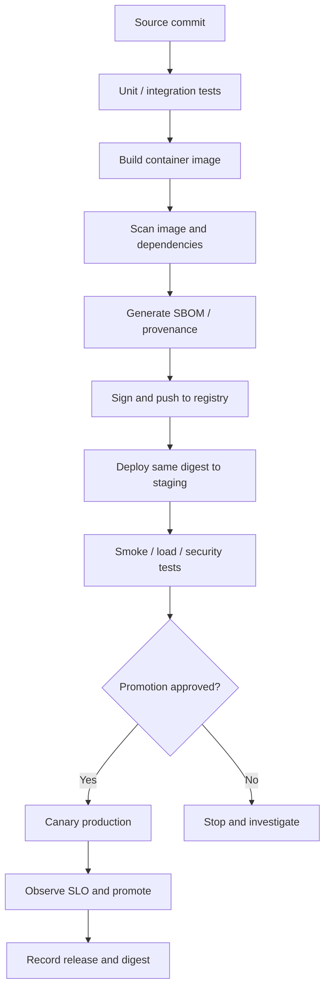

# Migrating an Application from Virtual Machines to Managed Containers

In this capstone project, you will migrate an application running on virtual machines (VMs) to a managed container platform. The objective is to produce reproducible images, deploy declaratively, manage configuration and secrets securely, control resources, self-heal when containers fail, and release new versions without logging into individual machines for manual installation.

Moving from VMs to containers is not simply packaging an application directory into an image. The application may depend on host configuration, local files, cron, systemd, firewall rules, fixed IP addresses, OS libraries, or helper processes. These dependencies must be discovered and addressed before migrating the workload. You also need to clearly define what is being migrated: typically, start with the stateless application tier; databases, queues, and storage can continue running on VMs or existing services in the initial phase.

## 1. Objectives and Deliverables

Assume you are handed a web/API application running on one or more VMs. The application handles HTTP requests, reads/writes data to a database, writes logs, and may run background workers. Your task is to move the application tier onto a managed container platform while preserving business compatibility and maintaining the ability to roll back if cutover fails.

After the capstone, you need to deliver:

1. Workload inventory and current architecture diagram (as-is).
2. List of OS, network, storage, identity, database, and scheduled task dependencies.
3. Migration scope decision, target platform selection, and rationale.
4. Dockerfile/multi-stage build and verified image.
5. Runtime configuration separated from the image; secrets supplied via a secure mechanism.
6. Manifests or deployment specifications for the managed container platform.
7. CI/CD pipeline that builds, scans, signs, and deploys images by digest.
8. Health checks, resource requests/limits, autoscaling, and graceful shutdown.
9. Testing, cutover, rollback, and post-deployment observability plans.
10. Cost comparison, risks, limitations, and acceptance criteria.

## 2. Project Scope and Assumptions

To practice independently, use the following reference model and replace figures with real data where available:

| Attribute | Initial Assumption |
|---|---|
| Application | `orders-api`, a Java application providing an HTTP API |
| Current platform | 2 Linux application VMs behind a load balancer |
| Database | Separate relational database; not migrated in this phase |
| Files | Uploads and business documents reside in object storage or shared storage; verify in practice |
| Runtime | JRE 21, application artifact as a JAR |
| Traffic | Has baseline and peak load; measure request rate/concurrency before sizing |
| Target | Managed Kubernetes or managed container platform with health checks, rollouts, and autoscaling |
| Availability | Multiple replicas distributed across platform-supported failure domains |
| Release | CI builds image; CD deploys per environment and by digest |

These are illustrative assumptions, not strict requirements for Java, Kubernetes, or VM count. For .NET, Node.js, Python, or native binary applications, substitute the corresponding runtime/build stage. If a workload requires Windows services, kernel modules, GPU drivers, or special host access, verify target platform support before containerizing.

### In Scope

- Migrating application processes from VMs to containers.
- Managing container lifecycle via a managed platform.
- Connecting to existing databases and auxiliary services.
- Managing configuration, secrets, logging, metrics, rollouts, and rollbacks.
- Load, resilience, and operational testing.

### Out of Scope by Default

- Migrating the database to a managed database in the same wave.
- Rewriting the entire application into microservices.
- Major business schema changes.
- Changing public API protocols.
- Migrating all organizational VMs, networks, and storage simultaneously.

Bounding scope isolates containerization risk from database migration or architectural refactoring risk. Follow-on projects can tackle those areas once the application tier stabilizes.

## 3. Selecting a Managed Container Platform

"Managed containers" can refer to several types of services. Do not assume every workload must run on Kubernetes.

| Option | Platform Provides | Team Still Manages | When to Consider |
|---|---|---|---|
| Managed Kubernetes | Control plane, API, and partial operational integrations | Worker/node pools depending on service, workloads, networking, storage, policies, upgrades, and observability | Multiple workloads needing flexible scheduling, Kubernetes ecosystem, and platform extensibility |
| Managed container service | Control plane/orchestration and part of task/container execution infrastructure | Images, task sizing, networking, identity, scaling, logging, and deployment policies | Container applications needing simpler operations than a general-purpose cluster |
| Managed application/container platform | Abstracted runtime, routing, scaling, and partial deployment | Application, configuration, dependencies, quotas, secrets, data, and observability | Teams wanting to focus on the application and accepting platform constraints |
| VMs running self-managed container runtime | Basic VM/compute only | OS, runtime, scheduler, patching, HA, upgrades, and many other components | Suitable only when host control is required or for specific technical reasons |

Evaluate at least the following questions:

- Does it support the required CPU architecture, OS/runtime, and networking?
- Can it deploy multiple replicas, health checks, and rolling updates?
- Are there limits on runtime duration, memory, CPU, ephemeral disk, or connection counts?
- Does it support private networking, service identity, secret integration, and encryption?
- Can workloads run across multiple zones/failure domains?
- Are autoscaling and quotas aligned with peak load?
- Does it provide required logs/metrics/traces and audit trails?
- Who is responsible for node patching, control plane upgrades, and image protection?
- How do costs break down across control plane, workers, load balancers, storage, networking, logging, and support?

If the application has only a few simple services, a managed container service can reduce complexity compared to Kubernetes. If the organization already operates a mature Kubernetes platform with shared workloads, deploying onto the existing cluster may make more sense. Base the decision on actual requirements and operational capability.

## 4. Assessing Existing VMs (As-Is Assessment)

Before building images, gather the application's actual configuration and behavior. Do not rely solely on outdated documentation; inspect running processes, files, network connections, schedulers, and telemetry in the live environment.

### Application Inventory

| Category | Questions to Answer | Evidence |
|---|---|---|
| Process | What are the startup command, user, PID, workers/threads, and child processes? | systemd unit, process list, startup script |
| Runtime | Which JDK/JRE, native libraries, locale, timezone, and OS packages are needed? | Package inventory, runtime version, dependency scan |
| Config | Where are config files, environment variables, and JVM arguments located? | Config files, service definition, deployment scripts |
| Secret | How are passwords, tokens, private keys, and certificates provisioned and rotated? | Secret inventory, vault/keystore integration |
| Network | Which inbound/outbound ports, DNS, proxies, firewalls, and allowlists are needed? | Firewall rules, flow logs, connection inventory |
| Storage | Which files must persist across restarts; which are only cache/tmp? | Mount table, directory usage, application behavior |
| Database | How are connection pools, drivers, TLS, transactions, and migrations configured? | DB config, metrics, schema migration history |
| Scheduler | Which cron jobs/systemd timers or batch tasks run on the VM? | crontab, timer units, scheduler inventory |
| Observability | Which logs, metrics, tracing, alerts, and agents are active? | Monitoring config, dashboards, log pipeline |
| Recovery | How are backups, restores, failover, and rollbacks currently handled? | Runbooks, backup policy, DR tests |

### Reference Linux Inspection Commands

```bash
# Processes and services
ps -eo pid,ppid,user,comm,args --sort=pid
systemctl status orders-api
systemctl cat orders-api

# Listening ports and connections
ss -lntup
ss -tpn

# Filesystems and mounts
df -hT
findmnt
du -xhd1 /var /opt 2>/dev/null

# Schedulers and packages
crontab -l
systemctl list-timers --all
dpkg-query -W 2>/dev/null | head
rpm -qa 2>/dev/null | head
```

These commands are for reference only; operating systems and permissions may vary. Never include outputs containing secrets, tokens, personal data, or sensitive information in project documentation. Run read commands with appropriate privileges and save sanitized results.

### Creating a Dependency Map

Classify dependencies into:

- **Required at startup:** valid configuration, certificates, DNS, database connection if the application cannot boot without it.
- **Required for serving requests:** database, identity provider, internal services.
- **Optional/degradable:** telemetry endpoints, recommendation services, or integrations that do not affect core requests.
- **Operational:** log collectors, metrics endpoints, secret providers, registries, and deployment control plane.

The dependency diagram should document protocol, port, connection direction, timeout, authentication, owner, and behavior when a dependency is unreachable. This becomes input for network policies and readiness semantics.

## 5. Classifying State Before Containerization

A VM often holds both application binaries and runtime-generated data. Containers must clearly separate state because any container instance can be replaced at any time.

| Data on VM | Classification | Handling During Migration |
|---|---|---|
| JAR/binaries and runtime dependencies | Artifact | Package into the image |
| Environment configuration files | Configuration | ConfigMap/external config file or platform configuration |
| Passwords/tokens/private keys | Secret | Secret manager, workload identity, or secret mount |
| Logs | Telemetry | stdout/stderr or collector; ship to centralized system |
| Regenerable cache | Ephemeral state | Memory, tmpfs, or bounded ephemeral storage |
| Uploaded files/documents | Business data | Object storage or appropriate persistent storage |
| Database data | Persistent state | Keep current database in phase 1 or migrate separately |
| Job checkpoints | Recovery state | Durable database/queue/object storage |
| PID/socket/temp files | Runtime ephemeral | Recreated inside container; do not migrate as business data |

If the application writes uploads to `/opt/orders/uploads` on the VM, baking that directory into the image creates unsynchronized copies. Move it to object storage or a persistent volume with appropriate semantics, then update the application to read/write through an explicit interface.

## 6. Preparing the Application for Containers

Before building the image, verify that the application meets these principles:

- Runs the main process in the foreground and exits with meaningful exit codes.
- Does not depend on a fixed VM hostname/IP.
- Reads configuration from environment variables or files mounted outside the image.
- Receives secrets via a dedicated mechanism, never baked into source or images.
- Logs to stdout/stderr or uses a clearly designed agent/volume.
- Exposes readiness/liveness/startup signals matching application semantics.
- Handles SIGTERM and closes in-flight requests/connections gracefully.
- Does not store unique business data in the container's writable layer.
- Can run multiple replicas without local state conflicts or duplicate singleton schedulers.
- Enforces timeouts, retries, and bounded connection pools for dependencies.

### Handling Singletons and Scheduled Tasks

If the VM currently runs a nightly cron job, scaling the application from 2 to 5 replicas could run that cron job 5 times. Extract scheduled tasks into a Job/CronJob or dedicated scheduler, use distributed locks/idempotency where needed, and enforce exact single execution per business key.

If the application holds local in-memory sessions, consider an external session store, stateless tokens, or sticky sessions only when justified. Sticky sessions do not survive VM/container loss and can hinder scaling and failover.

## 7. Containerizing with Multi-Stage Builds

Example with Java/Maven: the build stage uses the JDK and Maven; the runtime stage contains only the JRE and the packaged JAR.

```dockerfile
# syntax=docker/dockerfile:1.7
FROM maven:3.9-eclipse-temurin-21 AS build
WORKDIR /workspace

COPY pom.xml mvnw ./
COPY .mvn/ .mvn/
RUN chmod +x mvnw \
    && ./mvnw -B -ntp dependency:go-offline

COPY src/ src/
RUN ./mvnw -B -ntp package -DskipTests \
    && mkdir -p /out \
    && cp target/orders-api.jar /out/app.jar

FROM eclipse-temurin:21-jre
WORKDIR /app
COPY --from=build --chown=10001:10001 /out/app.jar /app/app.jar
USER 10001:10001
EXPOSE 8080
ENTRYPOINT ["java", "-jar", "/app/app.jar"]
```

The artifact name `target/orders-api.jar` must match the actual build output. In production, pin base images by approved version/digest, run tests before packaging releases, and scan images. `EXPOSE` is metadata only; it does not open firewalls or publish ports automatically.

Create an appropriate `.dockerignore`:

```text
.git
.idea
.vscode
**/target
**/build
*.log
*.tmp
.env
.env.*
*.pem
*.key
secrets/
```

Do not exclude files required for the build. Do not include `application-prod.yml`, credentials, or private keys in the build context unnecessarily. Use BuildKit secret mounts for credentials required while fetching private dependencies.

### Local Build and Test

```bash
docker build -t orders-api:local .
docker image inspect orders-api:local
docker run --rm -p 8080:8080 \
  -e APP_PROFILE=local \
  orders-api:local
```

Verify that the process runs as non-root, listens on the expected port, serves endpoints properly, logs to stdout/stderr, and stops cleanly on SIGTERM. Never use production secrets locally.

## 8. Configuration and Secret Management

The exact same image must run across development, staging, and production via externalized configuration.

Example non-sensitive configuration:

```yaml
server:
  port: 8080
application:
  profile: production
  requestTimeout: 3s
database:
  host: orders-db.internal
  port: 5432
  name: orders
```

The example above illustrates structure only; passwords and credentials must never be stored in this file. Secrets should be delivered via a secret manager, workload identity, or platform-supported secret mount. Prefer short-lived identities over long-lived access keys whenever possible.

Rules:

- Separate non-sensitive config from secrets.
- Never commit secrets to Git, Dockerfiles, image labels, or build arguments.
- Never log the entire environment/config on startup.
- Scope secret read permissions to the service identity.
- Establish a rotation/revocation process and verify the app picks up new secrets.
- Never share credentials across dev/staging/prod.

If the platform mounts secrets as files, verify file permissions, reload behavior, and the application's ability to consume updated versions. If secrets are read only at startup, rotation may require a controlled restart.

## 9. Stateless Container Design and Externalizing Data

Managed container platforms can create, stop, or replace container instances at any time. Stateless applications should externalize state:

- Databases hold transactional and business data.
- Object storage holds uploads, exports, and artifacts.
- Queues hold pending work.
- Shared session stores or stateless tokens hold sessions by design.
- Caches are regenerable and use TTLs.
- Checkpoints are stored durably so batches/workers can resume.

If a persistent volume is required, determine access modes, zone affinity, backups, restores, performance, and Pod rescheduling behavior. A persistent volume does not automatically make a workload HA; the storage backend and attach semantics have their own failure domains.

In the initial phase, keeping the database on the existing VM reduces change scope. Once application containers stabilize, you can run a separate database migration with consistency, replication, backup, and rollback testing.

## 10. Health Checks and Graceful Shutdown

Three signals generally need to be separated:

| Signal | Purpose | Behavior on Failure |
|---|---|---|
| Startup | Has the application finished starting? | Platform keeps retrying within the startup window; exceeding threshold triggers restart |
| Readiness | Can this instance accept business traffic? | Stops routing traffic to unready instances |
| Liveness | Is the process still capable of operating? | Platform may restart the container |

Do not make liveness depend on every external service. If the database temporarily drops connections and liveness fails across all replicas, the system can trigger a restart storm. Readiness can check mandatory dependencies to stop receiving requests when the service cannot function.

Upon receiving SIGTERM, the application should stop accepting new requests, mark itself not-ready, drain in-flight requests, close connection pools, and exit before the termination grace period. Otherwise, rollouts can drop requests or leave partial transactions.

## 11. Reference Deployment Manifest

The following example describes a Deployment running three replicas. This is an illustrative configuration for managed Kubernetes; adjust namespace, image digest, resource profile, probe paths, secret references, network policies, and storage for your actual environment.

```yaml
apiVersion: apps/v1
kind: Deployment
metadata:
  name: orders-api
  namespace: production
  labels:
    app.kubernetes.io/name: orders-api
    app.kubernetes.io/component: api
spec:
  replicas: 3
  revisionHistoryLimit: 5
  selector:
    matchLabels:
      app.kubernetes.io/name: orders-api
  strategy:
    type: RollingUpdate
    rollingUpdate:
      maxSurge: 1
      maxUnavailable: 0
  template:
    metadata:
      labels:
        app.kubernetes.io/name: orders-api
    spec:
      terminationGracePeriodSeconds: 45
      securityContext:
        runAsNonRoot: true
        runAsUser: 10001
        runAsGroup: 10001
        seccompProfile:
          type: RuntimeDefault
      containers:
        - name: api
          image: registry.example.com/commerce/orders-api@sha256:REPLACE_WITH_VERIFIED_DIGEST
          ports:
            - name: http
              containerPort: 8080
          env:
            - name: APP_PROFILE
              value: production
            - name: DB_PASSWORD_FILE
              value: /var/run/secrets/database/password
          resources:
            requests:
              cpu: 500m
              memory: 768Mi
            limits:
              cpu: "2"
              memory: 1536Mi
          startupProbe:
            httpGet:
              path: /health/startup
              port: http
            periodSeconds: 5
            timeoutSeconds: 2
            failureThreshold: 30
          readinessProbe:
            httpGet:
              path: /health/ready
              port: http
            periodSeconds: 5
            timeoutSeconds: 2
            failureThreshold: 3
          livenessProbe:
            httpGet:
              path: /health/live
              port: http
            periodSeconds: 10
            timeoutSeconds: 2
            failureThreshold: 3
          securityContext:
            allowPrivilegeEscalation: false
            readOnlyRootFilesystem: true
            capabilities:
              drop: ["ALL"]
          volumeMounts:
            - name: tmp
              mountPath: /tmp
            - name: database-secret
              mountPath: /var/run/secrets/database
              readOnly: true
      volumes:
        - name: tmp
          emptyDir: {}
        - name: database-secret
          secret:
            secretName: orders-database-credentials
```

`REPLACE_WITH_VERIFIED_DIGEST` is a placeholder, not a valid deployable image reference. The `orders-database-credentials` Secret must be created or synced by a secret manager integration; never put passwords in manifests. `emptyDir` here is strictly for temporary files; business data must never be stored there.

Readiness/liveness paths must be implemented by the application with accurate semantics. Resource requests/limits are example values; size them using load tests and memory profiles. `readOnlyRootFilesystem` may require additional writable mounts for `/tmp`, cache directories, or runtime files actually needed by the application.

### Service and Autoscaling

```yaml
apiVersion: v1
kind: Service
metadata:
  name: orders-api
  namespace: production
spec:
  selector:
    app.kubernetes.io/name: orders-api
  ports:
    - name: http
      port: 80
      targetPort: http
  type: ClusterIP
---
apiVersion: autoscaling/v2
kind: HorizontalPodAutoscaler
metadata:
  name: orders-api
  namespace: production
spec:
  scaleTargetRef:
    apiVersion: apps/v1
    kind: Deployment
    name: orders-api
  minReplicas: 3
  maxReplicas: 12
  metrics:
    - type: Resource
      resource:
        name: cpu
        target:
          type: Utilization
          averageUtilization: 65
```

HPA requires Metrics Server or a compatible metrics source and sufficient node capacity to schedule new Pods. CPU targets do not always reflect bottlenecks; for I/O-bound APIs, consider request concurrency, queue length, or custom metrics. Do not set `maxReplicas` beyond database and downstream capacity.

### Pod Disruption Budget

```yaml
apiVersion: policy/v1
kind: PodDisruptionBudget
metadata:
  name: orders-api
  namespace: production
spec:
  minAvailable: 2
  selector:
    matchLabels:
      app.kubernetes.io/name: orders-api
```

A PDB helps prevent voluntary disruptions from dropping available Pods below a threshold. It does not protect against all node/zone failures and does not replace capacity planning, topology spread, or fault-tolerant application design.

## 12. Networking and Connectivity to Existing Systems

During the transition phase, containers may need to reach databases, caches, message brokers, or APIs still running on VMs. Build a network flow matrix before changing firewall rules:

| Source | Destination | Port/Protocol | Purpose | Controls |
|---|---|---|---|---|
| Managed container workload | Existing database | DB TCP port | Queries/transactions | Private route, SG/firewall, TLS, DB identity |
| Managed container workload | Secret manager | HTTPS | Retrieve secrets/runtime credentials | Workload identity and egress policy |
| Load balancer/ingress | Container service | HTTP/TLS per architecture | Forward requests | TLS termination, security groups/network policies |
| Container workload | Logging/metrics endpoint | HTTPS or agent protocol | Telemetry | Egress allowlist and authentication |
| CI/CD runner | Container registry | HTTPS | Push/pull images | Short-lived credentials and repository permissions |

Do not widen firewalls with "allow all" just to get containers connected. Define source identity, destination, port, TLS, DNS, and routing path. If the container platform uses NAT or egress gateways, account for connection limits and network charges.

Ensure database allowlists accept the managed platform's new source ranges/identities. Do not rely on ephemeral Pod IPs as long-term identities. Use network identity or security group/service identity as supported by the platform.

## 13. Container Workload Security

Baseline controls:

- Run processes as a non-root user.
- Drop unnecessary Linux capabilities and disable privilege escalation.
- Use a read-only root filesystem when compatible with the application.
- Limit CPU, memory, ephemeral storage, and process counts where supported by the platform.
- Never mount the Docker socket or host filesystem without an approved need.
- Use least-privilege workload identities/service accounts.
- Scan base images and dependencies; generate SBOMs and sign images.
- Deploy by verified digest.
- Restrict ingress/egress and enforce namespace/tenant isolation.
- Rotate secrets/certificates and audit access permissions.

Containers are not an absolute security boundary. Patch hosts/runtimes per the shared responsibility model, update base images, secure the registry, and constrain workload privileges. If the platform manages worker nodes, clarify what the provider owns versus what the customer must still manage.

## 14. CI/CD: Build Once, Promote by Digest

The pipeline should separate artifact building from environment deployment:



Key rules:

1. Build from an explicit commit with locked dependencies.
2. Run tests before publishing the image.
3. Scan the image and generate SBOM/provenance.
4. Sign the artifact and push it to a private registry.
5. Record the digest, source commit, build ID, and scan results.
6. Deploy the exact same digest across staging, canary, and production.
7. Never rebuild an image during promotion just to change environment; inject config/secrets at deploy time.
8. Require approvals, rollout status tracking, and a rollback reference.

Human-readable tags like `1.4.2` are helpful for people, whereas digests are immutable content identifiers suited to guaranteeing the verified artifact is deployed. Registry retention policies must preserve enough versions for rollback.

## 15. Testing Before Shifting Traffic

Do not only test whether the container starts. Verify business behavior, performance, security, and recovery.

| Test Category | Scope | Example Criteria |
|---|---|---|
| Functional | API, transactions, validation, integration | Results match VM baseline |
| Configuration | Missing/invalid config, secret rotation, env separation | Clear fail-fast behavior; no secret leakage |
| Health | Startup, readiness, liveness, and shutdown | No traffic before readiness; proper draining |
| Network | DB, DNS, TLS, egress, ingress, and timeouts | Only permitted flows succeed |
| Load | Baseline, peak, burst, and soak | Meets SLO with planned headroom |
| Resilience | Container kill, node drain, dependency outage | Recovers within target; zero lost transactions |
| Security | Image scan, non-root, policies, secret access | No critical policy violations |
| Deployment | Rolling update, canary, rollback | No disruption beyond threshold |
| Data | Uploads, files, transactions, duplicate requests | Data remains consistent with no lost files |
| Operations | Logs, metrics, alerts, runbooks | On-call can identify faults and owners |

### Comparing VMs and Containers Under Identical Load

Run the same request set and test data across both environments. Compare:

- p50/p95/p99 latency and throughput.
- Error rates, timeouts, and connection failures.
- CPU/memory utilization, throttling, and GC behavior.
- Startup/readiness time and scale-out duration.
- Database connections, query latency, and pool wait times.
- Compute, network, logging, and platform costs over the same period.

Do not compare a warm-cache VM against a freshly booted container and conclude containers are slower. Document cache state, replica count, resource limits, JVM flags, network paths, and warm-up time.

## 16. Phased Migration Plan

### Phase 1 — Discover and Baseline

- Identify the service owner, business owner, SLOs, RTO/RPO, and traffic profile.
- Inventory VMs, processes, packages, configs, secrets, ports, volumes, crons, and agents.
- Build the dependency map and classify data/state.
- Measure baseline latency, throughput, resource usage, and cost.
- Identify hard constraints and select the target platform.

**Gate:** dependencies and ownership are clear; baseline metrics and migration scope are approved.

### Phase 2 — Containerize and Local Validation

- Update the application to accept external config, log to stdout/stderr, and shut down gracefully.
- Create a multi-stage Dockerfile and `.dockerignore`.
- Separate durable files from the container filesystem.
- Build, scan, and run local smoke tests on the image.
- Verify non-root execution, health endpoints, and dependency connectivity.

**Gate:** image builds reproducibly, functions properly, and contains no secrets.

### Phase 3 — Platform Foundation

- Provision namespaces/projects, networking, identity, registry access, and secret integration.
- Configure resource quotas, policies, logging, monitoring, and the deployment pipeline.
- Standardize manifests/service definitions and rollback references.
- Verify capacity, autoscaling, and failure domains.

**Gate:** target environment meets security, network, observability, and operational readiness requirements.

### Phase 4 — Staging Deployment and Testing

- Deploy by image digest.
- Run functional, integration, load, security, and resilience tests.
- Compare results against the VM baseline.
- Tune resources, probes, timeouts, connection pools, and rollout settings.
- Rehearse rollback.

**Gate:** acceptance criteria are met and runbooks are validated.

### Phase 5 — Production Canary

- Deploy one replica or a small traffic percentage as supported by the platform.
- Keep the VM path ready to serve the remaining traffic.
- Monitor latency, errors, database load, saturation, and business metrics.
- Increase traffic incrementally once thresholds stabilize.

**Gate:** no SLO violations, no data errors, and verified rollback capability.

### Phase 6 — Controlled Cutover and Decommission

- Shift traffic according to plan.
- Monitor closely post-cutover.
- Keep VMs in standby or reduced capacity during the agreed rollback window.
- After the rollback window closes, verify backups, dependencies, and costs before decommissioning.

**Gate:** workload is stable, owner signs off, and recovery procedures are confirmed.

## 17. Choosing a Migration Strategy

| Strategy | Approach | Pros | Risks/Conditions |
|---|---|---|---|
| Rehost container runtime on VM | Install a container runtime on VMs and run containers | Minimal platform change | Still self-managing VMs/OS/orchestration; misses full benefits of managed platforms |
| Replatform to managed containers | Package app and deploy on a managed platform | Reduces host management, standardizes rollouts and scaling | Must adapt to network, storage, identity, and runtime constraints |
| Strangler/incremental | Migrate service by service, route by route, or component by component | Reduces blast radius and enables iterative learning | Temporarily operates two environments; complex routing and data consistency |
| Big-bang cutover | Shift all traffic at once | Ends coexistence quickly | High risk; hard to roll back if data/schema has changed |

For applications with many dependencies, starting with replatform/incremental migration for the application tier is usually best. There is no need to migrate the database simultaneously if doing so increases risk and is not a mandatory goal.

## 18. Traffic Cutover and Managing Coexistence

While VMs and containers run side by side, determine:

- How the load balancer/API gateway routes traffic by percentage or header/path.
- Whether both versions share the same API contract and schema.
- Whether both can safely read/write the database concurrently.
- Whether scheduled tasks could run redundantly in both environments.
- Whether sessions/caches are shared or transitioned properly.
- Whether webhooks/event consumers could receive duplicates.
- How traffic, errors, and business outcomes are tracked per version.

A canary progression might step traffic from 1% → 5% → 25% → 50% → 100%, though actual ratios depend on traffic volume and routing capabilities. At each step, wait for an adequate observation sample and verify p95/p99 latency, error rate, database connections, queue lag, and business invariants.

Never run two consumers processing the same event source without idempotency or partition ownership. Never run cron jobs on both VMs and containers during coexistence unless tasks are idempotent or protected by a distributed lock.

## 19. Rollback and Data Handling

Rollback must be designed before cutover. A baseline plan includes:

1. Retaining the last known-good VM image/config/version.
2. Recording the container image digest and manifests of the new release.
3. Ensuring database schemas remain compatible with both versions throughout the rollback window.
4. If only routing changed, shifting traffic back to VMs and verifying health.
5. If incompatible data changes occurred, executing a reverse migration or forward-fix; do not assume shifting traffic is sufficient.
6. Inspecting queues, duplicate events, sessions, and in-flight transactions.
7. Logging timestamps, data state, and decisions by the incident commander/owner.

Prefer expand-and-contract for schemas: add compatible fields, deploy code that reads/writes both old and new schemas, shift traffic, and remove old fields only after the rollback window closes. Avoid destructive migrations alongside the initial compute migration whenever possible.

## 20. Post-Migration Observability and Operations

The container platform needs telemetry at both the application and platform levels.

### Metrics

- Request rate, error rate, p50/p95/p99 latency.
- Replica count, ready replicas, restart count, and rollout status.
- CPU/memory usage, throttling, OOM kills, and ephemeral storage.
- Database connection pool usage, query latency, and downstream errors.
- Queue depth, oldest message age, and worker throughput if workers exist.
- Autoscaling events, pending Pods/tasks, and node capacity.

### Logs and Traces

- Structured logs to stdout/stderr with timestamp, service, environment, version, and correlation ID.
- Never log passwords, tokens, cookies, or unnecessary personal data.
- Propagate trace context across APIs and messages whenever possible.
- Tag release ID/image digest to correlate errors with deployments.
- Apply appropriate retention and access controls.

### Alerts and Runbooks

Alerts should reflect SLOs and impact symptoms: rising error rates, p99 breaches, unready replicas, restart loops, OOMs, database saturation, or queue age exceeding SLAs. Every critical alert needs an owner, severity, runbook, and verification steps.

## 21. Sizing, Autoscaling, and Cost

Do not copy VM specifications verbatim into container requests/limits. VMs may have been overprovisioned for CPU/RAM for years; containers must be sized based on metrics and cgroup constraints.

Sizing workflow:

1. Measure the VM's CPU/memory working set under baseline, peak, and soak tests.
2. Break down heap memory, native memory, caches, thread stacks, and runtime overhead.
3. Set requests high enough for the scheduler to allocate capacity, and limits suitable for validated peaks.
4. Check CPU throttling and OOM behavior.
5. Measure startup time, readiness latency, and scale-out delay.
6. Set min/max replicas based on SLOs and downstream capacity.
7. Factor in node/compute, load balancer, storage, networking, logging, and managed platform fees.

Total cost comparison:

| Component | Current VM | Managed Container |
|---|---|---|
| Compute | VM instance hours, OS/licenses | Pod/task allocation and worker/node capacity if billed separately |
| Platform | Hypervisor/VM management | Control plane/platform fee if applicable |
| Storage | Boot/data disks, snapshots | Persistent volumes, ephemeral storage, image registry |
| Network | LB, IPs, egress, cross-zone | Ingress/LB, NAT, service networking, egress |
| Observability | Agents, log/metric backends | Container log/metric/trace ingestion and retention |
| Operations | Patching, deployment, HA, on-call | Image maintenance, platform config, quotas, policies, on-call |
| Migration | Potentially low in current state | Building, testing, parallel run, training, and decommissioning |

Managed containers are not automatically cheaper than VMs. They can reduce manual labor and improve utilization, but platform fees, worker headroom, load balancers, logging, and networking costs may rise. Compare under equivalent load, SLOs, retention, and analysis periods.

## 22. Capstone Acceptance Criteria

A migration is ready for cutover only when agreed criteria are satisfied. Example:

| Category | Sample Acceptance Criteria |
|---|---|
| Artifact | Image has version/digest, scan results, and provenance; contains no secrets |
| Functional | Business test suite passes with results equivalent to the VM baseline |
| Security | Non-root, least privilege, externalized secrets, restricted ingress/egress |
| Reliability | Container restarts lose no data; replicas recover within target |
| Latency | p95/p99 stays within agreed SLO under representative load |
| Capacity | Peak test achieves target throughput with no sustained OOM/throttling beyond thresholds |
| Deployment | Rolling/canary deployment and rollback rehearsed successfully |
| Data | No lost/duplicated transactions; durable files and checkpoints |
| Observability | Logs, metrics, traces, and alerts operational; owners/runbooks assigned |
| Cost | TCO and unit economics within approved budget or explicitly justified |

Numbers must be defined by the workload owner. Do not arbitrarily apply a generic p95 or availability target across all applications.

## 23. Risks and Mitigations

| Risk | Symptoms | Mitigation |
|---|---|---|
| Missed host dependencies | Container lacks libraries, files, or permissions | Inventory, dependency testing, and runtime behavior comparison |
| Lost local state | Uploaded files/sessions/checkpoints vanish after restart | Externalize state, use persistent storage, and run restore tests |
| Secrets exposed in image | Secret scan or image layers contain credentials | Use secret manager, rotate/revoke, and rebuild clean artifact |
| Database overload | Connection spikes after scale-out | Pool limits, concurrency caps, proxies, and load testing |
| Misconfigured probes | Restart loops or traffic routed to unready instances | Separate startup/readiness/liveness and test failure modes |
| Incorrect CPU/memory sizing | Throttling, OOMs, or excessive cost | Profiling, request/limit tuning, and soak testing |
| Duplicate scheduled tasks | Emails/billing/reports executed multiple times | Separate scheduler, distributed locks, and idempotency |
| Incompatible rollback | Old code cannot read new schema | Expand-and-contract, compatibility testing, and backups |
| Incorrect egress/network path | DB/API timeouts or unexpected cost spikes | Flow matrix, private routing, and network cost review |
| Team skill gaps | Incidents unresolved, slow rollouts | Training, managed support, runbooks, and clear ownership |

## 24. Deliverable-Driven Execution Plan

| Stage | Activities | Deliverables for Review |
|---|---|---|
| A. Discover | Assess VMs, dependencies, state, and baseline | `assessment.md`, dependency diagram, baseline metrics |
| B. Design | Select target platform, security/network, and migration strategy | ADR, target architecture, risk register |
| C. Package | Dockerfile, `.dockerignore`, config schema, and image | Source changes, image digest, SBOM/scan results |
| D. Deploy | Manifests, service, probes, resources, secret integration | Rendered manifests, deployment record |
| E. Automate | CI build/scan/sign and CD promote/rollback | Pipeline definition, release metadata |
| F. Validate | Functional, load, resilience, security, and data tests | Test report and acceptance matrix |
| G. Cutover | Canary, traffic shift, monitoring, and rollback readiness | Cutover runbook, decision log |
| H. Operate | Dashboards, alerts, owners, cost review, and decommission | Runbooks, dashboard links, TCO comparison |

Each deliverable needs an owner and status. If a step cannot be executed due to missing permissions or services, document the blocker, impact, and workaround; never mark it passed based on assumptions.

## 25. Sample Cutover Runbook

**Before Cutover**

- Confirm release digest, manifests, and configs are approved.
- Confirm database connectivity, secrets, DNS, TLS, and network policies.
- Verify Ready replica count and autoscaling capacity.
- Verify dashboards, alerts, on-call coverage, and incident channel.
- Confirm the old VM version can still receive traffic during the rollback window.
- Pause or lock duplicate scheduled tasks between VMs and containers.
- Verify backups and schema compatibility.

**During Cutover**

1. Route a small portion of traffic to containers.
2. Inspect p95/p99 latency, 4xx/5xx errors, business transactions, and database load.
3. Step up traffic according to the defined schedule.
4. Monitor replica readiness, restarts, OOMs, queue lag, and network errors.
5. Halt the rollout if any hard threshold is breached.

**After Cutover**

- Monitor closely during the hypercare window.
- Reconcile request/transaction counts and data integrity.
- Record actual cost and resource utilization.
- Decommission VMs only after the owner confirms the rollback window has elapsed.
- Update inventory, service catalog, runbooks, and architecture diagrams.

### Sample Rollback Triggers

- Error rate exceeds threshold across consecutive measurement windows.
- p95/p99 breaches SLO and does not recover after approved scaling/adjustments.
- Data corruption, duplicate transactions, or lost files occur.
- Container restart loops, OOMs, or unready replicas cause capacity shortfall.
- Database/downstream becomes overloaded by connections/concurrency from the new workload.
- Required security controls or audit evidence fail to operate.

Rollbacks must be triggered per the runbook and agreed decision authority. If schemas or data changed incompatibly, execute the corresponding recovery plan rather than merely routing traffic back to VMs.

## 26. Common Mistakes

- **Packaging an entire VM into one container:** drags along unnecessary packages, services, and state. Define process boundaries and package only what needs to run.
- **Keeping data in the container filesystem:** data is lost when instances are replaced. Externalize state or use persistent storage with proper semantics.
- **Baking production config/secrets into images:** images cannot be safely promoted and secrets are duplicated. Separate config/secrets from artifacts.
- **Copying VM sizing to containers:** leads to overprovisioning or OOM/throttling. Measure the working set and tune requests/limits.
- **Running cron on every replica:** tasks execute multiple times. Extract the scheduler or use leader election/locks/idempotency.
- **Checking the database in liveness probes:** a database outage forces all Pods to restart. Separate liveness and readiness.
- **Ignoring SIGTERM:** rollouts sever active requests and transactions. Drain connections and shut down gracefully.
- **Deploying by tag instead of digest:** the same tag can point to different contents. Record and deploy verified digests.
- **Opening firewalls too broadly:** migration works but expands the attack surface. Use a flow matrix and least privilege.
- **Scaling workers without bounds:** databases suffer connection storms. Enforce concurrency caps and backpressure.
- **Big-bang cutover all at once:** large blast radius and painful rollback. Use canary/staged rollouts when architecture allows.
- **Decommissioning VMs immediately after deploy:** loses rollback paths and evidence. Wait for the rollback window to close and get owner sign-off.
- **Comparing compute prices alone:** misses platform, logging, networking, storage, and labor costs. Compare TCO and unit economics.

## 27. Capstone Completion Checklist

**Assessment and Design**

- [ ] Workload owner, SLOs, RTO/RPO, and traffic baseline are documented.
- [ ] VM processes, runtime, configs, secrets, network, storage, crons, and monitoring are inventoried.
- [ ] Dependency map and state classification are complete.
- [ ] Target platform is selected based on requirements and operational capability.
- [ ] Migration strategy, risk register, and hard constraints are defined.

**Container and Platform**

- [ ] Multi-stage Dockerfile and `.dockerignore` are reviewed.
- [ ] Image runs non-root, contains no secrets, and is identified by digest.
- [ ] Config/secrets are externalized with a rotation plan.
- [ ] Durable data does not rely on the writable layer.
- [ ] Startup/readiness/liveness semantics are properly configured.
- [ ] Resource requests/limits, autoscaling, and capacity plans are in place.
- [ ] Network flows, IAM, TLS, and policies are verified.

**Delivery and Validation**

- [ ] CI runs tests, build, scan, SBOM/provenance, and image signing per policy.
- [ ] CD promotes the same digest across environments.
- [ ] Functional, integration, load, resilience, security, and data tests pass.
- [ ] Canary/rolling deployment and rollback are rehearsed.
- [ ] No unintended duplicate scheduled tasks or consumers exist.

**Operations and Closure**

- [ ] Dashboards, alerts, logs, traces, and runbooks are ready.
- [ ] Owner/on-call and shared responsibilities are defined.
- [ ] TCO and unit economics are compared against the VM baseline.
- [ ] Cutover has a defined rollback window and stop conditions.
- [ ] Data, dependencies, and transactions are reconciled post-cutover.
- [ ] VMs are decommissioned only after owner sign-off and rollback window closure.
- [ ] Inventory, service catalog, and operational documentation are updated.

## 28. Learning Outcome Evaluation Criteria

A submission meets requirements when the practitioner can explain and demonstrate:

1. Why a managed container platform was chosen over continuing on VMs or selecting another managed option.
2. Which dependencies were discovered on the VMs and how each was handled.
3. Why images must not contain environment config, secrets, or durable data.
4. How resource requests/limits, probes, replicas, and autoscaling were set from measurements.
5. How CI/CD guarantees that the verified artifact is the one deployed.
6. How existing databases and networks were kept operating cleanly during coexistence.
7. How failures are detected, evidence preserved, rollbacks executed, and data reconciled.
8. How costs and operational capabilities changed after migration.

Reviewers should require evidence from rendered manifests, image digests, scan reports, test reports, dashboards, cutover runbooks, and cost comparisons. A clean design without executed tests or rollback evidence is insufficient to declare a migration production-ready.

Migrating an application from VMs to managed containers changes how software is packaged, deployed, recovered, and operated. Success depends on understanding the existing workload, separating artifacts from config and state, standardizing images and deployments, testing on the target platform, and shifting traffic in observable increments. By preserving data integrity, SLOs, and a rollback path throughout the migration, organizations can reduce host-management overhead and establish a more consistent compute foundation for future releases.
