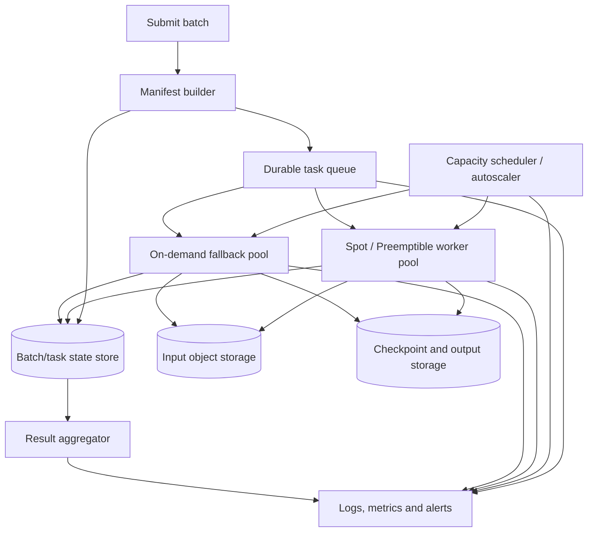
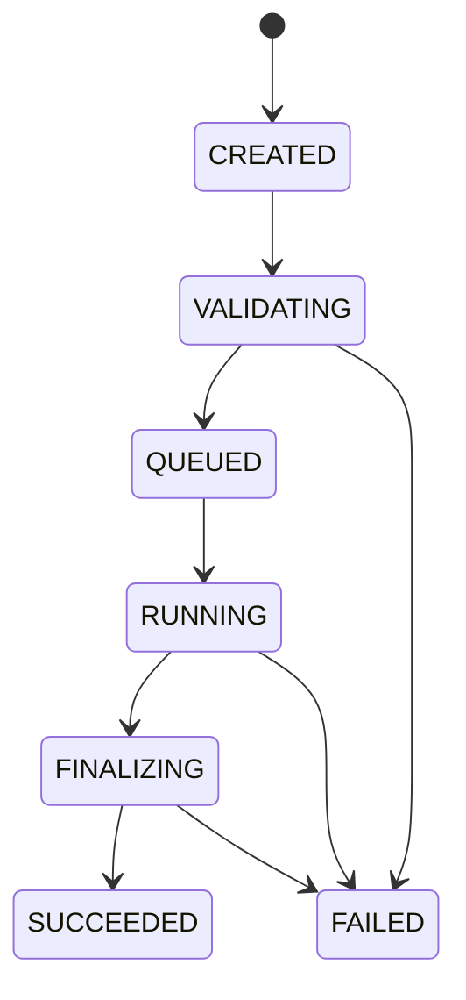
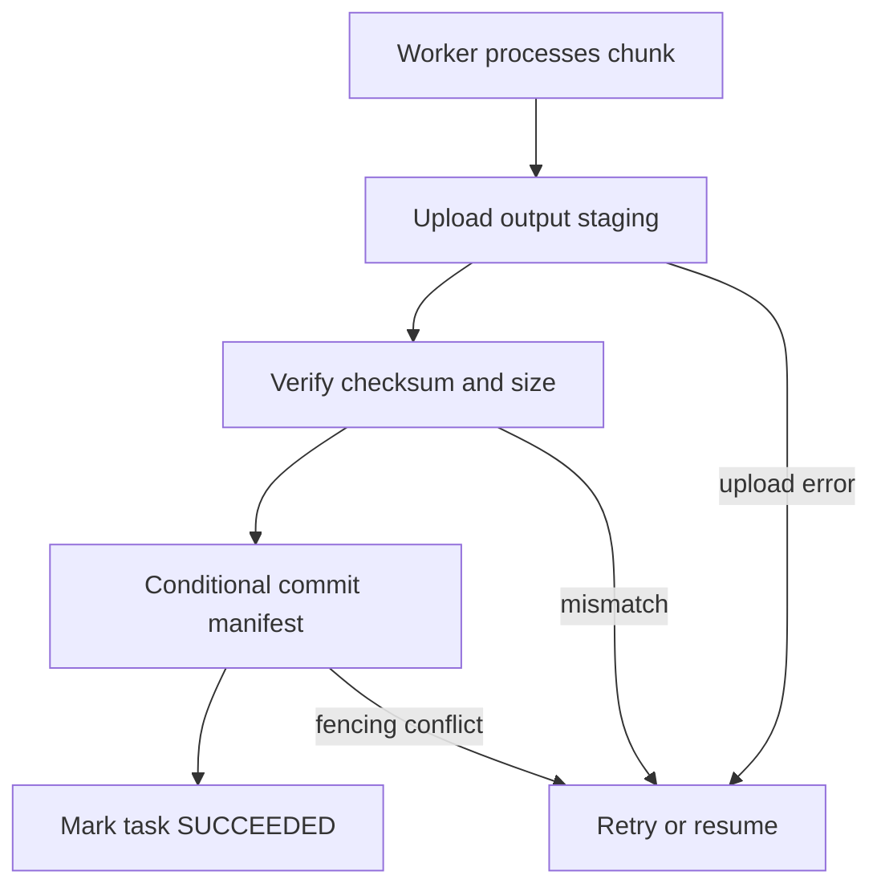

# Running a Batch System on Preemptible Capacity

Batch systems process a finite amount of work in batches: video transcoding, data analytics, report generation, image processing, simulations, or ETL steps. These workloads can often be split into independent tasks and do not require immediate user-facing responses. As a result, they are strong candidates for running on low-cost, reclaimable capacity such as Spot, Preemptible, or interruptible VMs.

The primary challenge is that instances can be terminated before finishing. A well-designed batch system treats interruption as a normal operating condition: tasks are kept small, state is persisted durably, workers can resume from checkpoints, results are committed idempotently, and the scheduler can redistribute work. The system also needs stable capacity for the control plane, queues, and non-interruptible operations, plus a fallback mechanism when Spot capacity is insufficient.

This capstone guides you through designing and implementing a batch system capable of running on preemptible capacity across clouds. The goal is to build a pipeline that scales horizontally, tolerates abrupt worker termination, controls costs, and proves correctness through failure testing.

## 1. Capstone Problem Statement

Build a system that processes a large set of input data files. Each file is partitioned into independent units; workers process each partition and write output to object storage. The system must complete the entire batch even when multiple Spot workers are reclaimed, restarted, or execute the same task repeatedly.

### Reference Scenario

A data team needs to process 50,000 files per day. Each file must be validated, normalized, and transformed into one or more outputs. Workload volume spikes overnight. The target completion window is 4 hours; individual tasks run between 2 and 10 minutes. Tasks may be retried if a worker is lost, but must never produce duplicate outputs or mark the batch complete while tasks remain unfinished.

| Attribute | Example Requirement |
|---|---|
| Input | Object storage, manifest listing input files |
| Volume | 50,000 files/batch |
| Processing unit | Small partitions with stable IDs |
| Task duration | 2–10 minutes |
| Compute | CPU workers; scalable across multiple compatible instance types |
| Capacity | Spot/Preemptible preferred, with bounded on-demand fallback |
| Durability | Inputs, checkpoints, task state, and outputs stored outside workers |
| Correctness | Safe retries, idempotent outputs, zero lost tasks |
| Completion target | Finishes within 4 hours under reference load |
| Cost target | Lower compute cost than running 100% on-demand |

These numbers illustrate the design. In real deployments, measure actual processing times, data sizes, interruption rates, and regional/provider pricing.

### Expected Outcomes

- Submit a batch and track status through completion.
- Partition tasks and distribute them via a queue or scheduler.
- Run workers on preemptible capacity.
- Have workers checkpoint periodically and handle shutdown/interruption signals.
- Manage in-flight tasks with leases/heartbeats and support redistribution.
- Ensure retries do not create duplicate side effects.
- Shift to alternate pools or apply controlled fallback when Spot capacity is scarce.
- Provide metrics, logs, dashboards, and alerts for backlog, interruptions, retries, and costs.
- Run intentional worker-termination tests to prove recovery capability.

## 2. Overall Architecture

A batch system can be split into a control plane and a worker data plane.

- **Control plane:** accepts batches, builds manifests, splits tasks, manages state, decides retries, handles autoscaling, and reports results.
- **Worker data plane:** pulls tasks, processes data, writes checkpoints and outputs.
- **Durable services:** queues, database/state store, object storage, registries, logging, and metrics.
- **Compute pools:** Spot/Preemptible pools as primary capacity; on-demand pools for the control plane or fallback.



The control plane and state store should run on durable services or stable capacity. Never place the sole queue coordinator on a Spot VM: if reclaimed, the system could lose coordination right when worker recovery is needed.

### Processing Flow

1. A user submits a batch with an input manifest and processing parameters.
2. The manifest builder validates inputs, generates a batch ID, and splits work into tasks with stable IDs.
3. Task metadata is written to the state store; ready tasks are enqueued.
4. The scheduler observes backlog, deadlines, Spot availability, and quotas, then scales worker pools.
5. A worker claims a task, acquires a lease, reads input, and resumes from a valid checkpoint if one exists.
6. The worker processes in chunks, writes durable checkpoints/outputs, and reports progress.
7. Upon completion, the worker commits results idempotently and marks the task succeeded.
8. The aggregator verifies all tasks and generates a batch summary.
9. If a worker is reclaimed, the lease expires or the task is retried; another worker resumes execution.

## 3. Choosing the Unit of Work and Partitioning

Interruption tolerance depends heavily on task granularity. Overly large tasks increase wasted rework; overly small tasks create queue, scheduler, metadata, and startup overhead.

### Choosing Task Size

Balance:

- Processing duration per task.
- Worker startup and input download time.
- Checkpoint frequency.
- Probability of worker preemption during the task.
- Overhead of creating, receiving, and committing messages.
- Parallelism potential and ordering dependencies.
- Overall batch deadline.

If a task normally takes 8 hours, a mid-run interruption wastes substantial compute. Split it into 5–10 minute chunks or checkpoint progress periodically. If a task takes only a few seconds, queue and checkpoint overhead may exceed compute time; bundle multiple records into micro-batches.

### Partitions Must Have Stable Identifiers

A task ID should never depend on the order in which workers claim tasks. Derive IDs from batch ID, input object version, and partition index.

Example:

```text
batch_id      = batch-20261122-001
input_version = manifest-sha256-...
partition_id  = part-000042
task_id       = batch-20261122-001:part-000042
```

When the same manifest is resubmitted, the system can recognize the existing batch or create a new one according to an idempotency key. Never generate random task IDs on retries, as doing so complicates duplicate detection.

### Immutable Manifests

The manifest should specify the input list, version/ETag/checksum, partition boundaries, processor version, and processing parameters. Never let a running batch read a manifest that is silently mutated mid-flight. If inputs or logic must change, create a new batch version.

## 4. Batch and Task State Model

The state store is the source of truth for progress. The queue only distributes work; never rely on empty queue depth alone as proof that a batch is complete.

### Batch States



### Task States

| State | Meaning | Common Transitions |
|---|---|---|
| `PENDING` | Created but not yet claimed by a worker | `LEASED`, `CANCELLED` |
| `LEASED` | Worker currently holds a lease | `RUNNING`, `PENDING`, `FAILED` |
| `RUNNING` | Actively processing | `CHECKPOINTED`, `SUCCEEDED`, `RETRY_WAIT` |
| `CHECKPOINTED` | Durable progress exists for resuming | `LEASED`, `SUCCEEDED` |
| `RETRY_WAIT` | Waiting for retry delay | `PENDING`, `FAILED` |
| `SUCCEEDED` | Output committed and verified | Terminal state |
| `FAILED` | Exhausted retries or permanent error | Terminal state, requires action |
| `CANCELLED` | Canceled by request | Terminal state |

State transitions must be guarded by conditional updates/transactions. An old worker must not overwrite a new worker's state after its lease expires.

### Reference Task Record

```json
{
  "task_id": "batch-20261122-001:part-000042",
  "batch_id": "batch-20261122-001",
  "status": "RUNNING",
  "attempt": 2,
  "lease_owner": "worker-spot-a17",
  "lease_expires_at": "2026-11-22T23:10:00Z",
  "fencing_token": 7,
  "checkpoint_uri": "s3://batch-state/checkpoints/part-000042.json",
  "input_uri": "s3://batch-input/data-042.parquet",
  "processor_version": "sha256:..."
}
```

This example illustrates schema structure only; adapt fields and types to your database/state store. Lease expirations must use UTC timestamps and consistent clock rules.

## 5. Leases, Heartbeats, and Fencing Tokens

A worker may lose connectivity or be reclaimed before notifying the coordinator. The scheduler must detect abandoned tasks and reassign them after a timeout.

### Leases

A lease grants time-bounded ownership to process a task. When claiming a task, the worker records `lease_owner` and `lease_expires_at`. The worker sends periodic heartbeats to extend the lease. If heartbeats stop and the lease expires, the coordinator can return the task to a retryable state.

A lease does not prove the old worker actually stopped. A worker may suffer a network partition and keep running while a new worker claims the task. That is why fencing tokens are required.

### Fencing Tokens

Each time a task is claimed, the coordinator issues a monotonically increasing token. Output commits are accepted only if the token matches the latest issued token. A stale worker holding a lower token is rejected if it attempts to write results after ownership moved on.

### Heartbeat Rules

- Send heartbeats frequently enough relative to lease duration to detect disconnected workers promptly.
- Apply timeouts and jitter so workers do not heartbeat simultaneously.
- Stop heartbeating once a worker hits a permanent failure.
- During shutdown, stop claiming new tasks and write final state/checkpoints.
- Set lease duration longer than normal network/runtime hiccups, yet short enough that failed tasks do not stall excessively.

## 6. Checkpointing and Resuming

Checkpoints persist enough progress for a new worker to continue without restarting the entire task. Checkpoints must reside on durable storage independent of preemptible instances.

### Checkpoint Contents

- Task ID, batch ID, and partition ID.
- Input version/checksum.
- Processor version and processing parameters.
- Offset, cursor, record index, or completed chunk.
- URI of intermediate outputs.
- Output checksum and size.
- Fencing token or corresponding generation.
- Timestamp and schema version.

### Safe Checkpoint Writes

1. Process a small chunk.
2. Write intermediate output to object storage under a key scoped by task/chunk/version.
3. Verify upload completion and checksum integrity.
4. Write checkpoint metadata via conditional update.
5. Only then treat the chunk as committed.

Never update the checkpoint before intermediate output is durable. If a worker dies between upload and metadata commit, the output may become orphaned, but the task can safely re-run. A cleanup job can reclaim unreferenced artifacts after retention expires.

### Periodic Checkpointing

Checkpointing too often increases I/O and cost; checkpointing too rarely increases lost work upon preemption. Choose intervals by elapsed time, record count, or output size.

A reasonable starting point is setting the checkpoint interval significantly shorter than expected task duration and interruption windows, then benchmarking actual overhead versus lost work. No single interval suits every workload.

### Resume Validation

A new worker must verify that a checkpoint matches the input version, processor version, and schema. If code changed incompatibly, do not blindly resume from an old checkpoint; migrate the checkpoint or re-run the task under the new version.

## 7. Idempotency and Committing Output

Spot interruptions often result in at-least-once execution: a task may run multiple times. The system must guarantee accurate final output despite repeated delivery.

### Idempotent Output

- Use deterministic object keys scoped by batch/task/output version.
- Use conditional writes or transactions to prevent overwriting newer results.
- Write outputs to a staging key, verify checksums, then publish a manifest/commit marker.
- Transition the task to `SUCCEEDED` only after outputs are durable and verified.
- Use idempotency keys for external side effects.

### Atomic Publish Pattern

A safe pattern writes outputs to an isolated staging prefix and then commits a small manifest marking valid output.



Do not let downstream consumers read arbitrary files in the staging prefix as official output. Only objects referenced by a committed manifest count as valid results.

### External Side Effects

If a task calls payment APIs, sends emails, or updates external systems, object storage idempotency is not enough. Use downstream-supported idempotency keys, transactional outboxes, or workflow state to prevent duplicate side effects.

## 8. Handling Interruptions and Shutdown

Interruption notices may give workers a brief window to shut down. Notice lead times, signals, and guarantees vary across providers and capacity types. Designs must never depend solely on receiving a notice.

### Shutdown Sequence

1. Mark the worker `DRAINING` so the scheduler stops assigning new work.
2. Stop polling/claiming new tasks.
3. If a task is in flight, finish the current chunk if time allows.
4. Save checkpoints/outputs safely.
5. Update task state or let the lease expire if insufficient time remains to commit.
6. Flush required logs and metrics.
7. Exit the process before the termination deadline if possible.

### Signal Handling Pseudocode Example

```python
import signal
import threading

shutdown_requested = threading.Event()

def request_shutdown(signum, frame):
    shutdown_requested.set()

signal.signal(signal.SIGTERM, request_shutdown)
signal.signal(signal.SIGINT, request_shutdown)

def run_task(task):
    progress = load_valid_checkpoint(task)
    for chunk in task.chunks_from(progress):
        if shutdown_requested.is_set():
            save_checkpoint_atomically(task, progress)
            return "INTERRUPTED"

        result = process_chunk(chunk)
        persist_chunk_output(task, chunk, result)
        progress = chunk.next_offset
        save_checkpoint_atomically(task, progress)

    commit_task_output(task, progress)
    return "SUCCEEDED"
```

This is pseudocode. Real workers must handle races between shutdown and commit, check fencing tokens before writing, enforce storage timeouts, and avoid starting a new checkpoint if insufficient time remains. Signal handlers should do minimal work; perform I/O on a safe control thread.

### Never Rely Solely on Interruption Notices

Instances can vanish abruptly due to host failures, network partitions, or other incidents. Lease expiry, heartbeats, periodic checkpointing, and idempotency are the foundational recovery mechanisms. Notices only reduce the amount of lost work.

## 9. Selecting and Diversifying Spot Capacity Pools

A capacity pool is typically defined by zone, instance family/type, size, and hardware attributes. If the scheduler requests only one instance type in a single zone, launch success drops whenever that pool runs dry.

### Diversification

- Specify multiple instance types with comparable performance.
- Span multiple zones within a region if data residency/locality allows.
- Support multiple families/architectures if binaries and images are compatible.
- Set capability constraints for GPUs, memory, local disks, or instruction sets.
- Avoid binding exclusively to whichever single pool is cheapest at job creation time.

### Allocation Strategy

Providers offer strategies that select pools by capacity availability, price, or a balanced trade-off across pools. For deadline-driven batches, prioritize capacity availability and completion time over chasing the lowest spot price alone. Strategy names and semantics vary by provider.

### Example Pool Policy

```yaml
worker_pool:
  capacity_type: interruptible
  allowed_zones:
    - zone-a
    - zone-b
    - zone-c
  instance_families:
    - general-purpose
    - compute-optimized
  min_vcpu: 4
  min_memory_gib: 16
  max_workers: 200
  fallback:
    enabled: true
    max_on_demand_workers: 20
    trigger: backlog_deadline_risk
```

This is a conceptual configuration, not a provider-specific deployment schema. Map it to the corresponding node group, scale set, instance fleet, or autoscaling policy.

### Verifying Compatibility

Instance type diversification helps only if the workload runs properly on all selected types. Verify CPU architecture, memory, network throughput, local disks, GPU drivers, container images, and native dependencies. If distinct profiles exist, create separate queues or worker classes.

## 10. Scheduler, Autoscaling, and Fallback

The scheduler must balance three factors: batch deadlines, backlog size, and allocatable capacity. Scaling solely on worker CPU is insufficient because a queue can hold a huge backlog while zero workers are running.

### Input Metrics

- Queue depth and oldest message age.
- Task counts in `PENDING`, `RUNNING`, and `RETRY_WAIT`.
- Average and p95 task processing times.
- Batch deadline and remaining time.
- Active, draining, starting, and failed workers.
- Spot launch success/failure and interruption rates.
- On-demand fallback utilization.
- Dependency saturation such as storage throughput or database connections.

### Estimating Required Workers

A simple estimation formula:

\[
N_{workers} \approx \frac{N_{tasks} \times T_{task}}{T_{remaining} \times U}
\]

Where `N_tasks` is remaining tasks, `T_task` is average processing time, `T_remaining` is time left until deadline, and `U` is target utilization (less than 1 to preserve headroom). Clamp the result by quotas, dependency capacity, and maximum worker limits.

Example: 12,000 tasks remaining, averaging 4 minutes/task, 120 minutes left, target utilization 0.8. Initial estimate is 500 workers. This reflects theoretical compute capacity only; factor in startup time, task dispatch, storage throughput, retries, and provider limits.

### Fallback Policy

Do not dump the entire backlog onto on-demand immediately after a few failed Spot launches. Base fallback on deadline risk and budget:

- Try multiple compatible Spot pools first.
- Apply backoff when providers report insufficient capacity.
- Reserve on-demand for the control plane and a baseline worker floor if needed.
- Increase on-demand fallback only when backlog age or deadline risk breaches thresholds.
- Enforce maximum fallback workers and budget caps.
- Scale down fallback as Spot capacity recovers.

### Avoiding Autoscaling Oscillation

Scaling out too aggressively can trigger launch storms; scaling in too fast can prematurely terminate active workers. Use cooldowns, stabilization windows, drain periods, and per-cycle step limits. Workers must enter `DRAINING` before termination.

## 11. Queues, Retries, and Poison Tasks

The queue buffers work between producer and workers. You can use a managed queue, message broker, or scheduler database, provided delivery semantics are explicit.

### Delivery Semantics

Many queues provide at-least-once delivery. A message may be redelivered if a worker commits output but acknowledgment fails or visibility expires. Therefore:

- Consumers must be idempotent.
- Acknowledge only after output/state commits succeed.
- Visibility timeouts/leases must match processing durations or heartbeats.
- Retries must be bounded and use backoff.
- Poison tasks must route to a DLQ or terminal error state.

### Retry Policy

Error classification:

| Error Type | Examples | Action |
|---|---|---|
| Transient | Network timeouts, throttling, temporary storage errors | Retry with backoff and jitter |
| Capacity | Spot pool out of instances | Try alternate pools, wait, or fallback per policy |
| Interruption | Worker reclaimed | Resume from checkpoint on a new worker |
| Input permanent | Corrupted file, invalid schema | Mark data error; do not retry indefinitely |
| Code permanent | Processor bug or incompatible version | Pause batch/partition, fix code, launch new run |
| Dependency overload | Database/storage saturation | Reduce concurrency, open circuit breaker, retry later |

### Dead-Letter Queue

The DLQ holds tasks exceeding retry limits. Each record needs task ID, batch ID, attempt count, error fingerprint, processor version, and checkpoint reference. Never include secrets or sensitive payloads in DLQ metadata.

Before redriving, fix the root cause, verify dependency capacity, and inspect prior outputs. Redrive in bounded batches/rates to avoid re-triggering the incident.

## 12. Storing Inputs, Checkpoints, and Outputs

Spot workers must be treated as disposable compute. Durable data belongs on independent storage.

### Input Storage

- Input objects should remain immutable during a batch or carry explicit versions/checksums.
- Manifests store URI, version, size, and checksum.
- Workers read only the exact pinned version.
- If inputs reside in another region, account for network egress and latency.

### Checkpoint Storage

- Keep checkpoints small and schema-versioned.
- Use conditional updates or generations to prevent overwrites.
- Set retention long enough for the batch window and retries.
- Enforce encryption, access controls, and auditing.
- Clean up completed task checkpoints after retention expires.

### Output Storage

- Write staging outputs isolated per task/attempt/chunk.
- Verify checksums and sizes.
- Commit final manifests using conditional writes.
- Retain previous outputs until the new batch is verified if rollback is needed.
- Apply lifecycle policies to temporary artifacts and expired outputs.

### Local Disk

Local NVMe/ephemeral disks can accelerate scratch processing, but never serve as the sole store for checkpoints or outputs. If a worker is reclaimed, local disks may vanish. When using local scratch space, size capacity, cleanup, and upload time prior to commit.

## 13. Security and Supply Chain

Batch workers may handle sensitive data and scale rapidly. Minimize privileges and protect artifacts.

### Workload Identity

- Assign a dedicated role/service account per worker class.
- Grant read access only to required input prefixes and write access to required output/checkpoint prefixes.
- Never grant account/project administrative permissions to workers.
- Prefer short-lived credentials or workload identities.
- Revoke privileges when the batch or worker pool ends.

### Images and Code

- Use scanned images pinned by digest.
- Sign artifacts or verify provenance per policy.
- Keep secrets out of images, startup scripts, and user data.
- Keep base images and dependencies patched.
- Record `processor_version` in task, checkpoint, and output manifests.

### Network

- Restrict egress to required storage, queues, registries, and dependencies.
- Use private endpoints where appropriate.
- Enforce TLS in transit and encryption at rest.
- Do not expose workers to public inbound traffic unnecessarily.

### Data Handling

- Never write sensitive payloads to logs.
- Use synthetic or de-identified data in test environments.
- Set retention and deletion policies for inputs, outputs, and checkpoints.
- Separate permissions to read business results from worker operations permissions.

## 14. Observability and Operations

A batch system requires visibility across batches, tasks, workers, and capacity pools.

### Log Fields

- `batch_id`, `task_id`, `partition_id`.
- `worker_id`, `capacity_type`, `instance_type`, `zone`.
- `attempt`, `lease_owner`, `fencing_token`.
- `processor_version`, `input_version`, `checkpoint_version`.
- `started_at`, `checkpoint_at`, `completed_at`.
- `status`, `error_code`, `error_fingerprint`.
- `interruption_reason` if provided by the cloud platform.

Avoid using high-cardinality identifiers like `task_id` or `worker_id` as metric labels; keep them in logs and traces to avoid cardinality explosions.

### Key Metrics

| Category | Metrics | Meaning |
|---|---|---|
| Batch | Submitted, completed, failed, completion duration | Track overall batch outcomes |
| Queue | Depth, oldest age, enqueue/dequeue rates | Detect backlogs |
| Task | Pending/running/retry/succeeded/failed | Visibility into task state distribution |
| Worker | Active, starting, draining, lost | Track actual capacity |
| Spot | Launch failures, interruption rate, lost compute time | Evaluate pool health and risk |
| Checkpoint | Count, bytes, duration, resume success | Measure overhead and recovery efficacy |
| Dependency | Storage latency/throttles, DB saturation | Spot non-compute bottlenecks |
| Cost | Spot/on-demand spend, cost per completed task | Validate economic efficiency |

### Suggested Alerts

- Oldest queue age breaches deadline threshold.
- Batch shows zero progress over an interval.
- DLQ grows rapidly or permanent task failures appear.
- Spot launch failures rise across multiple pools.
- Interruption rate spikes and lost compute time breaches threshold.
- Checkpoint or resume failures increase.
- On-demand fallback exceeds budget.
- Storage throttling or network egress slows workers.

### Interruption Runbook

1. Inspect interruption metrics/events and affected pools/zones.
2. Identify lost workers/tasks via lease expirations or heartbeat timeouts.
3. Verify latest checkpoints and fencing tokens.
4. Return tasks to retry/resume without deleting committed outputs.
5. Scale alternate pools or trigger fallback per deadline/budget policy.
6. Monitor queue age, retries, and dependency saturation.
7. After batch completion, calculate lost work and cost per success.

## 15. Cost and Efficiency Estimation

Spot instances have low hourly rates, but true cost includes interruptions, reprocessing, checkpointing, storage, networking, and operations.

### Cost Model

\[
C_{total} = C_{compute} + C_{retry} + C_{checkpoint} + C_{storage} + C_{network} + C_{operations}
\]

Compare against an on-demand baseline for the same workload, deadline, and completion criteria.

### Cost per Completed Task

\[
C_{task} = \frac{C_{total}}{N_{successful\ tasks}}
\]

If Spot is cheap per hour but interruption rates, retries, or deadline misses are high, cost per completed task may lose its advantage.

### Illustrative Example

Suppose a batch requires 1,000 useful compute hours. Assumed on-demand rate is 1.00 unit/hour. Spot rate is 0.35 units/hour; interruptions cause 12% compute rework. Checkpointing/storage/networking add 30 units; an on-demand control plane costs 40 units.

- Full on-demand: approximately 1,000 units.
- Useful Spot compute: 1,000 × 0.35 = 350 units.
- Compute rework: 120 × 0.35 = 42 units.
- Checkpointing/storage/networking: 30 units.
- Control plane: 40 units.
- Illustrative total: 462 units.

Nominal savings are roughly 53.8% compared to the 1,000-unit baseline. This is not an actual price quote; calculate using real billing data, pool pricing, machine performance, and operational costs.

### Sensitivity Analysis

Model at least these scenarios:

- Low, medium, and high interruption rates.
- Spot capacity unavailable for 15, 30, or 60 minutes.
- Checkpoint overhead doubled.
- Throttled storage/network throughput.
- On-demand fallback running 10%, 25%, or 50% of the time.
- Batch volume doubled or halved.

Select strategies based on total cost and deadline adherence, not headline discount percentages alone.

## 16. Phased Implementation

### Phase 1: Build a Resumable Workload

- Create manifests and stable task IDs.
- Split inputs into independent partitions.
- Build workers that read versioned inputs.
- Store checkpoints and outputs outside instances.
- Implement idempotency keys and atomic commits.
- Test mid-task worker restarts.

Do not optimize for Spot yet. First prove that tasks can safely re-run on an ordinary worker.

### Phase 2: Add Queue and State Coordinator

- Provision the batch/task state store.
- Set up the queue or scheduler.
- Implement leases, heartbeats, and fencing tokens.
- Implement retries, poison task handling, and DLQ.
- Build an aggregator to verify batch completion.

### Phase 3: Run Workers on Spot

- Build a scanned worker image pinned by digest.
- Configure multiple compatible instance types and zones.
- Add interruption handlers and draining.
- Enable periodic checkpointing.
- Monitor launch failures and interruptions.

### Phase 4: Add Autoscaling and Fallback

- Scale on backlog, oldest age, and deadlines.
- Enforce max workers and dependency concurrency limits.
- Enable Spot pool diversification.
- Add budget-capped on-demand fallback.
- Add cooldowns and graceful scale-in.

### Phase 5: Observe and Optimize

- Build batch, task, worker, and capacity dashboards.
- Measure cost per completed task.
- Run failure injection tests.
- Tune task sizes and checkpoint intervals.
- Refine fallback thresholds and pool policies.

## 17. Scheduler and Worker Pseudocode Examples

### Scheduler

```python
def schedule_batch(batch_id):
    batch = state_store.get_batch(batch_id)
    pending = state_store.count_tasks(batch_id, status="PENDING")
    running = state_store.count_tasks(batch_id, status="RUNNING")
    oldest_age = queue.oldest_message_age(batch_id)

    remaining_seconds = max(1, batch.deadline_epoch - now_epoch())
    required = estimate_workers(
        pending_tasks=pending,
        average_task_seconds=batch.average_task_seconds,
        remaining_seconds=remaining_seconds,
        target_utilization=0.80,
    )

    desired = min(required, batch.max_workers)
    spot_capacity = capacity_provider.available_estimate(batch.pool_policy)
    request_spot_workers(min(desired, spot_capacity))

    if deadline_at_risk(batch, pending, running, oldest_age):
        fallback = min(
            batch.max_on_demand_workers,
            max(0, desired - spot_capacity),
        )
        request_on_demand_workers(fallback)
```

This pseudocode illustrates logic flow. `available_estimate` may not exist or be accurate in provider APIs; capacity is often confirmed only upon launch requests. The scheduler must handle launch failures and reconcile desired capacity against actual outcomes.

### Worker

```python
def consume_task(message):
    task = parse_message(message)
    lease = coordinator.claim(task.task_id, worker_id)
    if lease is None:
        acknowledge_duplicate_or_stale(message)
        return

    checkpoint = checkpoint_store.load_latest(task.task_id)
    progress = validate_checkpoint(task, checkpoint)

    try:
        for chunk in task.iter_chunks(start=progress):
            if shutdown_requested():
                checkpoint_store.save(task, chunk.start_offset, lease.token)
                coordinator.release_for_retry(task.task_id, lease.token)
                return

            output = process(chunk)
            output_store.write_staging(task, chunk, output, lease.token)
            checkpoint_store.commit(task, chunk.next_offset, lease.token)
            coordinator.heartbeat(task.task_id, lease.token)

        output_store.publish_manifest(task, lease.token)
        coordinator.mark_succeeded(task.task_id, lease.token)
        acknowledge(message)
    except RetryableError:
        coordinator.schedule_retry(task.task_id, lease.token)
        raise
    except PermanentError as error:
        coordinator.mark_failed(task.task_id, lease.token, error.code)
        acknowledge_or_dead_letter(message)
```

Implement this pseudocode with proper transactions/conditional writes. In particular, output publishing, state updates, and queue acknowledgments rarely share a single distributed transaction; designs must tolerate crashes between steps using idempotency and reconciliation.

## 18. Testing and Failure Injection Plan

A batch succeeding with zero faults proves nothing about interruption resilience. Intentionally inject faults at multiple stages.

### Functional Tests

- Submit a valid manifest and verify the exact expected task count is created.
- Resubmit with the same idempotency key and verify no duplicate batch is created.
- Verify output checksums and manifests.
- Confirm the aggregator reports `SUCCEEDED` only when all required tasks commit.

### Interruption Tests

1. Kill a worker before any checkpoint exists.
2. Kill a worker immediately after staging upload but before checkpoint commit.
3. Kill a worker after checkpoint commit but before queue acknowledgment.
4. Kill a worker during heartbeat/lease renewal.
5. Drop network connectivity to the state store temporarily.
6. Reclaim an entire Spot pool and verify tasks redistribute to other pools.
7. Allow an old worker to continue after its lease expires to test fencing tokens.

### Capacity and Dependency Tests

- Simulate Spot launch failures in one zone.
- Simulate quota exhaustion.
- Throttle object storage or restrict throughput.
- Trigger a sudden queue backlog spike.
- Force dependencies to return throttling/timeouts.
- Trigger on-demand fallback and verify budget caps.

### Correctness Tests

- A task delivered multiple times yields only one valid final output commit.
- Stale workers cannot overwrite results from newer workers.
- Resuming from a checkpoint produces identical output to running from scratch.
- Permanently failing tasks do not retry endlessly.
- Batches never report complete while pending/running/failed tasks remain unresolved.

## 19. Acceptance Criteria

| Criterion | How to Prove | Expected Result |
|---|---|---|
| Batch submission | Submit manifest and inspect state | Batch ID, stable task IDs, and valid states created |
| Horizontal scaling | Increase task count and observe workers | Workers scale with backlog within configured limits |
| Spot execution | Inspect capacity type/instance metadata | Workers genuinely run on preemptible capacity pools |
| Checkpointing | Kill worker mid-task and resume | Resumes cleanly from a valid checkpoint |
| Idempotency | Deliver the same task multiple times | Zero duplicate outputs or side effects |
| Lease safety | Old worker writes after lease expiry | Fencing token rejects stale commit |
| Interruption recovery | Reclaim workers while tasks run | Tasks retry/resume and batch continues |
| Fallback | Make Spot capacity unavailable | On-demand fallback scales within configured cap |
| Dependency protection | Generate large backlog | Concurrency/rate limits protect storage/database |
| Observability | Inspect dashboards and logs | Can trace batch/task/worker and failure causes |
| Cost | Compare baseline vs. actual | Cost per completed task calculated and variance explained |
| Completion | Run full batch | Aggregator reports success only after outputs are verified |

Specific thresholds such as completion time, savings percentage, retry limits, and fallback caps must be defined prior to testing based on project requirements.

## 20. Common Design Pitfalls

- **Running an entire batch on one Spot instance:** preemption wipes all progress without checkpoints.
- **Storing checkpoints only on local disk:** data vanishes when the instance is reclaimed.
- **Tasks too large:** high lost work and long resume times.
- **Tasks too small:** queue, scheduler, and checkpoint overhead overwhelm compute.
- **Missing idempotency:** retries create duplicate outputs or side effects.
- **Acking before committing output:** messages disappear before results are durable.
- **Leases without fencing:** old and new workers concurrently overwrite outputs.
- **Relying blindly on interruption notices:** host/network failures provide no shutdown window.
- **Single Spot pool:** capacity shortages delay the batch.
- **Uncapped fallback:** negates cost savings when Spot capacity tightens.
- **Scaling blindly on queue depth:** overwhelms storage or databases.
- **Unbounded retry storms:** failing dependencies amplify load and cost.
- **Marking batches done when queue is empty:** in-flight messages or failed tasks may remain incomplete.
- **Omitting processor/input versions:** stale checkpoints get applied to mismatched code or data.

## 21. Capstone Deliverables

A complete implementation should deliver:

1. Architecture diagram covering control plane, worker pools, and durable services.
2. Manifest schema and partition/task ID rules.
3. Batch/task state machine.
4. Worker image/source and build/sign/scan process.
5. Checkpoint/resume and idempotent output implementation.
6. Lease, heartbeat, fencing, and retry/DLQ policies.
7. Capacity pool policy with Spot diversification and on-demand fallback.
8. Autoscaling rules, quotas, and dependency concurrency limits.
9. IAM/network/storage policies.
10. Dashboards, log schemas, alerts, and interruption runbooks.
11. Test report covering failure injection and correctness results.
12. Cost report comparing on-demand, Spot-only, and hybrid fallback.

### What the Cost Report Should Present

- Total Spot and on-demand compute hours.
- Interruption count and total lost compute time.
- Resume/retry counts and checkpoint overhead.
- Storage/network/logging costs.
- Total batch duration and task completion rate.
- Cost per completed task.
- Comparison against an on-demand baseline at the same SLO.
- Data limitations and calculation assumptions.

## 22. Post-Capstone Extensions and Improvements

Once the baseline design is stable, you can extend it with:

- Multiple worker classes for CPU, memory, and GPU tasks.
- Priority queues and deadline-aware scheduling.
- Batch packing to cut overhead for short tasks.
- Predictive scaling based on history and batch schedules.
- Multi-region execution with data locality and replication.
- Adaptive checkpoint intervals driven by interruption/lost-work metrics.
- Spot diversification based on measured performance rather than SKU alone.
- Workflow orchestration for cross-stage dependencies.
- Team/environment quota and budget governance.
- Fair-share scheduling when multiple batches compete for capacity.

Do not add complexity before metrics justify the need. Measure every enhancement against completion time, correctness, and cost per completed task.

## 23. Implementation Checklist

**Workload and Data:**

- [ ] Input manifest is immutable and includes version/checksum.
- [ ] Tasks are small enough and carry stable IDs.
- [ ] Processor version is recorded with tasks/checkpoints.
- [ ] Outputs commit using the staging/manifest pattern.

**Resilience:**

- [ ] Checkpoints reside on durable storage.
- [ ] Leases, heartbeats, and fencing tokens are implemented.
- [ ] Workers handle shutdown/interruption signals and tolerate sudden loss.
- [ ] Retries enforce backoff, bounds, and a DLQ.
- [ ] Outputs and side effects are idempotent.

**Capacity:**

- [ ] Multiple compatible Spot pools/zones/types are configured.
- [ ] Quotas and maximum worker limits are explicit.
- [ ] On-demand fallback has a budget cap.
- [ ] Autoscaling considers backlog, oldest age, and deadlines.
- [ ] Scale-in enforces draining and stabilization.

**Operations and Security:**

- [ ] Worker images are scanned, pinned by digest, and versioned.
- [ ] Workload identities follow least privilege.
- [ ] Network egress and storage access are restricted.
- [ ] Metrics/logs/alerts cover batches, tasks, workers, and Spot pools.
- [ ] Runbooks exist for interruptions, DLQ, quotas, and dependency overload.

**Validation:**

- [ ] Workers were terminated at multiple points mid-task.
- [ ] Duplicate delivery and fencing were tested.
- [ ] Spot capacity unavailability and fallback were tested.
- [ ] Dependency throttling and retry storms were tested.
- [ ] Final outputs and batch completion were verified.
- [ ] Cost per completed task was calculated against the baseline.

## Conclusion

Running batch systems on preemptible capacity requires designing interruptions into the job lifecycle from day one. Split workloads into tasks with stable IDs, store checkpoints and outputs on durable storage, use leases/heartbeats/fencing to block stale workers, and ensure idempotent retries. The scheduler must diversify Spot pools, scale on backlog and deadlines, protect dependencies, and apply bounded on-demand fallback for critical work. Declare a batch complete only once every task has committed valid output. Finally, failure injection tests and cost per completed task provide the proof that the system is both resilient and economical.
