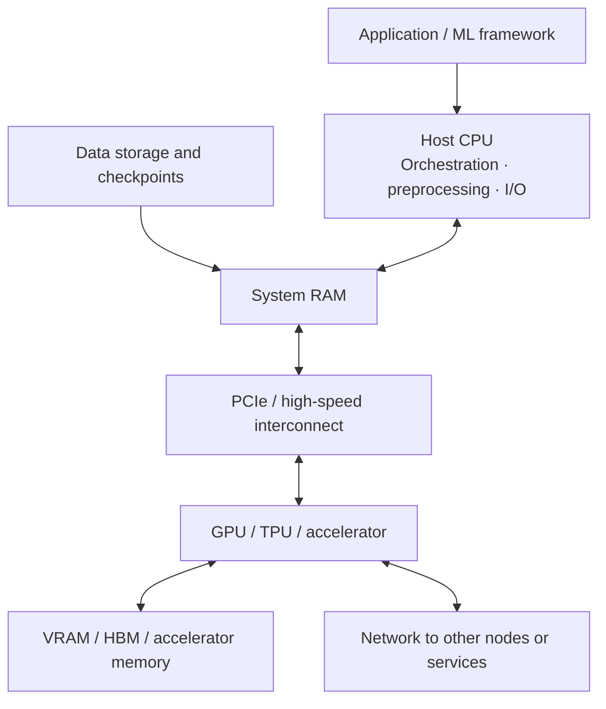

# GPUs, TPUs, and Specialized Accelerators for Compute

CPUs are well suited for many types of tasks with complex control flow, but they are not the most efficient choice for every computation. Workloads such as machine learning model training, image and video processing, scientific simulation, matrix analysis, or parallel data processing can require thousands of similar operations executed simultaneously. GPUs and specialized accelerators are designed to handle such workloads with high throughput.

In a cloud environment, users can rent GPU-attached virtual machines, bare-metal servers with accelerators, TPU clusters, or accelerated inference services. Each option has a different architecture, memory, software stack, resource-sharing model, and cost structure. Selecting an accelerator should start from the algorithm and workload, then map those requirements to hardware, frameworks, memory capacity, interconnect, and operational capabilities.

## 1. Why Do We Need Accelerators?

CPUs typically have a relatively small number of cores, with each core designed to handle diverse instruction types, conditional branches, and workflows. CPUs feature large caches, branch predictors, and fast responsiveness for sequential tasks. GPUs have many smaller processing units organized to perform a large number of operations simultaneously on independent or similarly structured data.

For example, a program might need to apply the same transformation to millions of pixels. A CPU can process them across several parallel threads; a GPU can distribute the pixels into a very large number of work items running across groups of processing units. For large matrix multiplications, accelerators also include dedicated hardware blocks for matrix operations and low-precision arithmetic.

GPUs do not replace CPUs. In an accelerated system, the CPU typically handles the operating system, process orchestration, control logic, data preparation, and kernel launches. The GPU or accelerator performs the heavy parallel computation. If data is not prepared in time, is copied back and forth too frequently, or the algorithm contains many sequential branches, the GPU may not be utilized effectively.

## 2. How Does a GPU Work?

### Parallel Processing Architecture

A GPU (Graphics Processing Unit) was originally developed for graphics processing, where many pixels, geometric vertices, and transformations can be computed in parallel. Modern GPUs are widely used for graphics, simulation, data analytics, and AI.

A GPU typically contains multiple processing clusters, such as a Streaming Multiprocessor (SM) on some architectures or a Compute Unit (CU) on others. Each cluster contains multiple execution units, registers, schedulers, and caches. A program submits kernels to the GPU; a kernel is executed by many threads, organized into blocks and hardware execution groups such as warps or wavefronts depending on the architecture.

The SIMT (Single Instruction, Multiple Threads) model is commonly used to describe how a GPU runs multiple threads in groups. Threads within the same group typically execute the same instruction stream on different data. If threads follow different conditional branches, the hardware may have to execute the branches sequentially or reduce execution unit utilization. This phenomenon is commonly known as branch divergence.

### GPU Memory

GPUs have their own dedicated memory, typically GDDR or HBM depending on the tier. This memory provides high bandwidth to feed the compute units. HBM commonly appears on accelerators built for high-performance computing and AI; exact capacity and bandwidth vary by model.

Beyond global memory, a GPU also has storage levels such as registers, shared memory or local memory, as well as caches. Data placed close to compute units can be accessed faster, though the capacity of these regions is small and must be used judiciously. For matrix or tensor kernels, data layout, tile size, and data reuse can significantly affect performance.

GPU memory (VRAM) is separate from host RAM in many configurations. A model may fit in host RAM but not in VRAM; when that happens, the framework must split batches, shard the model, offload part of the data to RAM, or use multiple GPUs. Offloading can increase data transfer overhead and reduce throughput.

### Tensor Cores and Matrix Operations

Many modern GPUs include dedicated hardware units for matrix or tensor operations, such as Tensor Cores in some NVIDIA GPUs and corresponding matrix acceleration blocks on other platforms. These units accelerate matrix multiply-accumulate operations, which often represent the bulk of computation in deep learning.

Accelerators can support multiple numeric formats such as FP32, TF32, FP16, BF16, FP8, or INT8. Lower-bit formats generally enable higher throughput and reduced memory footprint, but may affect numerical accuracy. Precision selection must be based on hardware support, framework, model, and output quality requirements. You should not assume every workload can switch to INT8 or FP8 without evaluating accuracy loss.

## 3. GPUs, TPUs, and Other Types of Accelerators

### General-Purpose GPUs

General-purpose GPUs can run many types of kernels and work with a wide variety of frameworks, libraries, and workloads. They are commonly used for:

- Deep learning training and inference.
- Image and video processing, 3D graphics, and rendering.
- Physics simulation, computational fluid dynamics, and scientific computing.
- Parallel data analytics, matrix processing, and certain cryptographic workloads.

The advantage of GPUs is their broad software ecosystem and relatively flexible programmability. However, real-world performance depends on GPU architecture, VRAM, memory bandwidth, supported precisions, drivers, runtime, and kernel libraries. Two GPUs with the same VRAM capacity can still differ vastly in processing speed.

### TPUs

TPU (Tensor Processing Unit) refers to a family of specialized processors developed by Google to accelerate tensor operations and machine learning workloads. TPUs are designed around matrix multiplications and related operations; several generations use a systolic array architecture to stream data rhythmically through compute elements, achieving high throughput for suitable operations.

TPUs are typically used through cloud infrastructure and supporting software ecosystems, such as XLA and compatible frameworks. Suitability depends on the framework, operators, data types, tensor shapes, and compilation support. A workload with many unsupported operators, custom operations, or dependencies on GPU-specific libraries may be difficult to port to TPUs.

A TPU is not simply a "faster GPU." General-purpose GPUs and TPUs have different designs, ecosystems, scheduling mechanisms, compatibility profiles, and allocation models. You should benchmark the actual target workload on both platforms if you want to compare them.

### NPUs and AI Accelerators

NPU (Neural Processing Unit) is a general term for processors optimized for neural network operations. NPUs appear in mobile devices, personal computers, edge devices, and some server platforms. An NPU can optimize power efficiency and latency for supported models, operators, and precisions.

NPUs are often useful when running on-device inference, processing data near its source, or reducing power consumption. Limitations can include small memory capacity, a limited set of supported operators, model conversion requirements, and proprietary runtimes. A model that runs on a GPU will not necessarily run unmodified on every NPU.

### FPGAs

An FPGA (Field-Programmable Gate Array) is a logic circuit that can be reconfigured after manufacturing. Engineers can design custom hardware pipelines tailored to specific algorithms, data streams, or protocols. FPGAs can achieve low latency and good power efficiency for stable workloads with a suitable structure.

In return, FPGA development typically requires hardware design expertise, HDL, or specialized synthesis tools. Development, testing, and maintenance time can be higher compared to deploying software on GPUs. FPGAs are suitable when you need deterministic pipelines, specialized device interfacing, or stream processing with tight latency bounds.

### ASICs and Fixed-Function Accelerators

An ASIC (Application-Specific Integrated Circuit) is a chip designed for a specific set of functions. When a workload matches its intended design, an ASIC can achieve high throughput and strong power efficiency. On the other hand, programmability is less flexible than a GPU or FPGA; changing algorithms may require new hardware or vendor support.

Some AI accelerators are ASICs purpose-built for matrices and tensors. Dedicated video encoders/decoders, signal processors, or data compression engines are also examples of fixed-function acceleration.

### DPUs, IPUs, and SmartNICs

DPU (Data Processing Unit), IPU (Infrastructure Processing Unit), and SmartNIC are terms for devices that offload infrastructure tasks such as networking, storage, encryption, packet inspection, or virtualization. They can reduce load on the host CPU and improve data center scalability.

These devices are not direct replacements for GPUs in model training. They accelerate data paths and infrastructure services, freeing up CPU and GPU resources for the primary workload.

### High-Level Comparison Table

| Processor Type | Suitable Workloads | Strengths | Limitations to Note |
|---|---|---|---|
| CPU | General logic, sequential tasks, orchestration, and system processing | Flexible, strong branch handling, broad ecosystem | Lower throughput than accelerators for large parallel computations |
| GPU | Graphics, tensors, matrices, simulation, and AI | Massive parallelism, diverse library ecosystem, multiple precisions | Requires kernel and data tuning; VRAM is limited |
| TPU | Tensors and ML workloads compatible with the TPU ecosystem | Accelerates tensor operations at large scale | Depends on framework, compiler, and supported operators |
| NPU | On-device or edge AI inference | Power efficient; can reduce latency and data transfer | Limited models, operators, memory, and runtime support |
| FPGA | Custom hardware data pipelines and algorithms | Reconfigurable, low latency for matching designs | Complex development and maintenance |
| ASIC | Specialized functions, high volume and stable workloads | High power efficiency and throughput for specific targets | Low flexibility; vendor and chip lifecycle dependency |
| DPU / SmartNIC | Networking, storage, encryption, and infrastructure tasks | Offloads processing from the host CPU | Does not replace tensor compute accelerators |

## 4. How CPUs and Accelerators Collaborate in a System

An accelerated node typically consists of a host CPU, RAM, one or more accelerators, on-accelerator memory, storage devices, and internal interconnects. The CPU orchestrates the workload and handles work unsuitable for offloading; the accelerator executes parallel kernels; data is transferred between host RAM and accelerator memory over an interconnect such as PCIe or a platform-supported high-speed link.



The diagram illustrates a simple node. In a multi-accelerator cluster, there are also interconnects between accelerators within the same machine and high-speed networking between nodes. Specific technology names, bandwidth, and topology depend on the provider and hardware generation.

### Data Transfer Overhead

A kernel can run very fast while the overall application remains slow if data must be continuously copied between host RAM and VRAM. Steps such as preprocessing, image decoding, tokenization, file reading, and tensor conversion can become bottlenecks on the CPU or storage.

To reduce data transfer overhead, you can:

- Group multiple items into an appropriate batch size to reduce kernel launch and data transfer frequency.
- Keep repeatedly used data in accelerator memory when capacity allows.
- Use multi-threaded data loaders and prefetching to prepare the next batch while the GPU is computing.
- Choose data formats and layouts well suited to the kernels.
- Measure CPU time, copy time, and kernel time separately before optimizing.

### Connecting Multiple Accelerators

Training large models may require multiple GPUs or multiple nodes. Accelerators can be connected via an intra-node bus, high-speed GPU-to-GPU links, or high-speed inter-node networking. Link bandwidth and latency affect gradient communication, synchronization, and tensor distribution.

Common parallelism techniques include:

- **Data parallelism:** each accelerator processes a portion of the batch; gradients or states must be synchronized across devices.
- **Model parallelism:** parts of the model are split across multiple accelerators when the model does not fit in one device's memory or to increase throughput.
- **Pipeline parallelism:** the model is divided into stages, and micro-batches flow through each stage sequentially.
- **Tensor parallelism:** individual tensor operations, such as large matrix multiplications, are split across multiple accelerators.

When adding more GPUs, throughput does not necessarily scale linearly. Synchronization, data transfers, load imbalance, and batch size constraints can reduce scaling efficiency. You should measure scaling efficiency and communication wait time rather than merely counting accelerators.

## 5. Which Workloads Should Use Accelerators?

### Machine Learning Model Training

Training repeatedly executes forward passes, loss computation, backward passes, and weight updates. Large matrix and tensor operations are highly parallelizable, making them a good fit for GPUs or TPUs. Large models may require multiple accelerators, large HBM capacity, and high-speed inter-device interconnects.

Factors to evaluate include model size, batch size, sequence length, precision, optimizer, activation memory, and distribution strategy. Selecting a GPU solely by theoretical peak compute can be misleading if the model is memory-bound or communication-bound.

### Inference

Inference is the process of using a trained model to generate predictions or responses. For inference, latency and throughput depend on batch size, input size, concurrent requests, model architecture, and memory limits.

For large language models, key metrics include time to first token, token generation speed, concurrent request count, and KV cache usage. Larger batches can increase throughput but may also raise per-request latency and consume more memory. GPUs, TPUs, or NPUs are suitable depending on model size, precision, runtime, and latency targets.

### Graphics, Video, and Image Processing

GPUs support rendering, ray tracing, visualization, image processing, video transcoding, and computer vision pipelines. Some video tasks can use dedicated encode/decode blocks instead of occupying shader or tensor units. When selecting an instance, determine whether the workload uses GPU compute, graphics APIs, or codec engines, as different GPU models do not share the same capabilities.

### HPC and Scientific Simulation

Physics simulation, computational fluid dynamics, computational chemistry, and certain linear algebra algorithms can leverage GPUs. Speedup depends on the parallelizable fraction of computation, numerical precision, memory bandwidth, and inter-node communication. Some HPC applications remain heavily CPU-dependent or require specialized libraries.

### Workloads That Do Not Necessarily Need GPUs

Small APIs, low-load background jobs, branch-heavy applications, database- or network-bound workloads, and tiny batches may run more efficiently on CPUs. If most of the time is spent waiting on I/O, adding a GPU usually only increases cost. Profile the workload to identify what computation can actually be offloaded and how much time can be saved.

## 6. Accelerator Memory and How to Estimate Capacity

VRAM/HBM capacity is often one of the most critical constraints when choosing a GPU. An accelerator with high compute throughput that lacks enough memory to hold the model, batch, and intermediate states cannot run the intended workload.

### Inference: Weights, Activations, and KV Cache

Rough estimate of weight memory:

\[
\text{Weight memory} \approx
\text{Number of parameters} \times \text{Bytes per parameter}
\]

For example, a 7-billion-parameter model stored in FP16/BF16 (2 bytes per parameter) requires approximately:

\[
7 \times 10^9 \times 2 = 14 \times 10^9\text{ bytes}
\]

That is about 14 GB in decimal units, or roughly 13 GiB. This covers only the weights. Runtime overhead, activations, kernel workspaces, memory fragmentation, and KV cache all require additional capacity. Therefore, you cannot conclude that a 16 GiB GPU will reliably run this model under every configuration.

The KV cache of a transformer model grows with the number of retained tokens, layers, concurrent requests, attention heads, and head dimension. You can use an approximate formula for key and value cache:

\[
\text{KV bytes} \approx
2 \times L \times B \times T \times H_{kv} \times D_h \times S
\]

Where:

- \(L\): number of layers in the model.
- \(B\): total number of sequences holding cache (depends on batch size and concurrency).
- \(T\): number of cached tokens per sequence.
- \(H_{kv}\): number of key/value heads.
- \(D_h\): dimension per head.
- \(S\): bytes per cache element; the factor of 2 accounts for both key and value.

This is a simplified estimate; MQA/GQA architectures, sliding windows, quantization, paged attention, and runtime cache management can alter actual usage.

### Training: More Than Just Weights

During training, memory usage can include weights, gradients, optimizer states, activations retained for the backward pass, and workspaces. With mixed precision and optimizers like Adam, memory per parameter can be several times the size of the weights in FP16/BF16. Exact figures depend on the framework, optimizer, master weight storage, gradient accumulation, activation checkpointing, and sharding.

To reduce memory usage, you can use mixed precision, activation checkpointing, gradient accumulation, optimizer state sharding, tensor/model parallelism, or offload part of the state to host RAM. Each technique involves trade-offs in compute time, communication, complexity, and compatibility.

### Beyond Capacity: Bandwidth and Locality

A workload can be memory-bandwidth-bound even when GPU compute units sit idle. Distinguish between:

- **Capacity:** whether there is enough space for weights, activations, cache, and batches.
- **Bandwidth:** the rate at which data is read/written between memory and compute units.
- **Latency:** the wait time for a single memory access.
- **Locality:** whether data is reused in caches or memory regions close to execution units.

When comparing accelerators, look at HBM/VRAM capacity, memory bandwidth, caches, peer-to-peer access capability, and host interconnect. Identical memory capacity does not mean identical performance.

## 7. Choosing GPUs or Accelerators in the Cloud

Accelerator specification pages usually list the GPU name, device count, memory, compute units, supported precisions, and interconnects. You should read these alongside host CPU, RAM, storage, networking, and allocation model specs.

| Criterion | Questions to Answer |
|---|---|
| Accelerator model and generation | Does it support the required frameworks, kernels, and precisions? |
| Accelerator count | Is one device enough for memory and throughput, or is multi-GPU needed? |
| VRAM/HBM | Do the model, batch, activations, KV cache, or dataset fit? |
| Memory bandwidth | Does the workload frequently read/write large tensors? |
| Tensor/matrix throughput | Do the specs apply to the workload's actual precision? |
| Interconnect | Do you need peer-to-peer communication, NVLink, or high-speed inter-node networking? |
| Host CPU and RAM | Are they sufficient for preprocessing, data loaders, and feeding the accelerator? |
| Storage | Can datasets and checkpoints be read/written fast enough? |
| Drivers and runtime | Are driver, CUDA/ROCm, XLA, or library versions compatible? |
| Tenancy and isolation | Shared GPU, vGPU, passthrough, or hardware partitioning? |
| Availability and quota | Is the device available in the target region/zone, what is the quota, and are there provisioning limits? |
| Billing | Is billing per device, per instance, per runtime hour, reserved capacity, or usage-based? |

### Full GPU, Passthrough, and Shared GPU

A virtual machine can be provisioned with a GPU in several ways:

- **PCIe passthrough:** the PCIe device or function is assigned directly to the VM. This typically gives the VM near-native hardware access to the GPU, though device sharing and VM live migration may be restricted.
- **vGPU:** a single physical GPU is shared across multiple VMs through a GPU virtualization layer. Resources, memory, features, and performance are allocated according to provider profiles or policies.
- **GPU partitioning:** some GPUs support splitting a device into independent hardware partitions. For example, MIG technology on certain NVIDIA GPUs divides a GPU into instances with dedicated compute and memory slices. Supported features and partition counts depend on the model.
- **Bare metal:** workloads run on a physical server with GPUs, suitable when deeper hardware control or topology control is needed. The provider may still manage firmware and the physical platform.

Do not assume that "1 GPU" on a pricing table always means a full physical GPU. Check the model, profile, allocated memory, sharing level, and feature limitations.

### Multi-GPU Configurations

When using multiple GPUs, verify the number of visible devices inside the VM, how they are interconnected, and the host CPU NUMA topology. Two GPUs inside the same machine can communicate faster than two GPUs across separate machines, depending on the interconnect and hardware generation. If the framework does not support distribution or the workload lacks sufficient parallelism, adding GPUs may not yield proportional gains.

## 8. Software and Ecosystem

Accelerators require compatible drivers, runtimes, compilers, and libraries. Common components include:

- CUDA and cuDNN/cuBLAS libraries in the NVIDIA GPU ecosystem.
- ROCm and corresponding libraries on supported AMD GPUs.
- XLA and related runtimes for TPU workloads and certain other accelerator platforms.
- Frameworks such as PyTorch, TensorFlow, or JAX; support depends on version and backend.
- Inference runtimes such as ONNX Runtime, TensorRT, or other specialized engines depending on the device.

Not every framework version supports every GPU/TPU generation. An application may require matching compiler, driver, and library versions. Before choosing an instance, verify the compatibility matrix across the cloud provider, framework, and OS image.

### Containers and Accelerator Orchestration

Containers package application libraries, but host-level drivers and device plugins are still typically managed by the node or platform. In Kubernetes, accelerators can be exposed via device plugins or provider-integrated mechanisms; the scheduler allocates declared device counts or resources to Pods.

A Pod requesting 1 GPU does not automatically mean it receives a 1/4 GPU slice or a proportional share of memory. Allocation behavior depends on driver, device plugin, vGPU, or partitioning support. Check how the platform represents the resource, Pod startup behavior, and isolation guarantees between workloads.

For TPUs or other accelerators, specific resource types, topologies, and workload launch mechanisms may be required. Do not assume GPU manifests can be used unchanged across every accelerator.

## 9. Performance, Benchmarking, and Monitoring

FLOPS or TOPS figures on spec sheets only reflect compute capability under specific conditions and precisions. They are not application completion speeds. Actual performance depends on the model, kernels, batch size, memory bandwidth, data pipeline, precision, interconnect, and software stack.

Key metrics to measure include:

- **Throughput:** images/sec, samples/sec, tokens/sec, requests/sec, or training steps per hour.
- **Latency:** time to complete a task, especially p50, p95, and p99.
- **Time to first token:** for generative models, time from receiving a request to emitting the first token.
- **Accelerator utilization:** device utilization; inspect alongside memory utilization and kernel activity.
- **Memory usage:** VRAM/HBM used, peak memory, fragmentation, and OOM risk.
- **Host utilization:** CPU, RAM, network, and storage; these resources can starve the accelerator of data.
- **Scaling efficiency:** incremental throughput gained when adding accelerators relative to the resource increase.
- **Cost per unit:** cost per token, request, epoch, image, or completed unit of work.

### Example Observation Commands

For NVIDIA GPUs on Linux, `nvidia-smi` displays devices, memory, and utilization. Some systems support periodic queries:

```bash
# GPU overview, temperature, power, and memory
nvidia-smi

# Periodic monitoring
nvidia-smi -l 1

# Query specific metrics in CSV format
nvidia-smi --query-gpu=name,utilization.gpu,utilization.memory,memory.total,memory.used,power.draw --format=csv
```

For AMD GPUs, some environments provide `rocm-smi` or equivalent tools in the ROCm suite. TPUs and other accelerators have their own platform-specific monitoring tools. Available metric names and query capabilities depend on the model, driver, and permissions inside the VM.

### Controlled Benchmarking Process

1. Use the exact model version, data, framework, and precision planned for deployment.
2. Start up and run warm-up iterations to eliminate effects of compilation, caching, or runtime initialization.
3. Measure across multiple batch sizes and concurrency levels, not just a single configuration.
4. Record throughput, p95/p99 latency, peak memory, GPU utilization, and host CPU usage.
5. Test under sustained load long enough to detect throttling, thermal limits, or power caps.
6. For multi-GPU setups, measure scaling efficiency and inter-device communication overhead.
7. Calculate cost per unit of work and repeat measurements to quantify variance.

## 10. Cost and Operational Models

Accelerators generally cost more than standard CPU instances. Billing may be per device hour, instance hour, GPU type, vGPU profile, reserved cluster, or request/token-based inference service. Account for startup time, model loading time, quota wait time, data storage, and checkpoints.

For training, a GPU with a higher hourly rate can still be more economical if it significantly shortens time to completion. For inference, a useful metric is cost per request or per million tokens at the required latency and quality targets. Compare across the same workload and quality criteria.

Cost optimization strategies include:

- Right-sizing the GPU and VRAM; avoid renting oversized devices for the model and concurrency level.
- Tuning batch sizes to boost throughput while keeping latency within limits.
- Shutting down or scaling GPU nodes to zero when idle, if startup time permits.
- Using spot/preemptible capacity for batch or training jobs with checkpointing and preemption recovery.
- Optimizing precision, quantization, and kernels after validating output quality.
- Separating CPU preprocessing, storage, and inference to identify which components truly need accelerators.
- Tracking quotas, utilization history, and GPU idle time percentages.

## 11. Security and Reliability When Using Accelerators

GPUs and accelerators are shared resources or directly attached devices, so both security and resilience must be considered.

- **Tenant isolation:** review partitioning, vGPU, passthrough, and memory-sharing boundaries. Do not assume a vGPU profile provides the same isolation as a dedicated physical device.
- **Drivers and firmware:** update per provider recommendations; check vulnerabilities and compatibility before upgrading in production.
- **Device access permissions:** restrict which containers and users can access device nodes; avoid granting overly broad privileges to workloads that do not need them.
- **Data protection:** secure input data, model weights, checkpoints, and outputs; use encryption in transit and access controls on storage.
- **Software supply chain:** pull images, drivers, and libraries from trusted sources; verify versions and artifact integrity.
- **Resilience:** save checkpoints periodically, test recovery, design retries, and handle node or accelerator failures.
- **Monitoring:** track temperature, power draw, hardware errors, ECC errors if available, memory, and device health.

GPUs do not inherently provide high availability. A single machine with multiple GPUs remains a single point of failure if the entire workload depends on that host. For critical services, distribute replicas or workers across multiple nodes and availability zones as supported by the service.

## 12. Accelerator Selection Workflow

1. **Identify the computation to accelerate.** Use a profiler to find kernels or processing steps taking the most time. Confirm the workload has enough parallelism and data can be fed to the accelerator efficiently.
2. **Define functional requirements.** Clarify required frameworks, models, operators, precisions, libraries, graphics APIs, or codecs.
3. **Estimate memory.** Account for weights, activations, KV cache, batches, workspaces, and headroom. For training, include gradients and optimizer states.
4. **Choose a suitable architecture.** Compare general-purpose GPUs, TPUs, NPUs, FPGAs, or ASICs based on workload, programmability, and ecosystem.
5. **Inspect node and interconnects.** Verify host CPU, RAM, VRAM/HBM, PCIe or interconnect, networking, storage, and multi-device topology.
6. **Check cloud and operational factors.** Verify region/zone availability, quotas, tenancy, drivers/runtime, orchestration, SLAs, and billing.
7. **Benchmark end-to-end.** Measure from data read to output completion, not just kernel time. Check latency, throughput, quality, and cost.
8. **Design operations.** Set up autoscaling, checkpointing, monitoring, driver updates, security, and recovery procedures.

### Platform Selection Examples

| Scenario | Option to Try First | What to Verify |
|---|---|---|
| Training popular deep learning models with broad framework support | General-purpose GPU | VRAM, precision, libraries, interconnect, and scalability |
| Large tensor workloads well aligned with the TPU ecosystem | TPU | XLA, operators, framework, topology, and runtime cost |
| Small inference at the edge prioritizing power efficiency | NPU | Runtime, supported operators, memory, and end-to-end latency |
| Stream data processing with fixed pipelines and tight latency | FPGA | Development tooling, data rate, latency, and team expertise |
| High-volume, stable algorithms with specialized functions | ASIC | Flexibility, vendor dependency, and product lifecycle |
| Offloading host networking, storage, or encryption | DPU / SmartNIC | Offload features, platform integration, and CPU reduction |
| Standard APIs or primarily I/O-bound workloads | CPU first | Does a profiler confirm an accelerator resolves the actual bottleneck? |

## 13. Common Misconceptions

- **"GPUs are always faster than CPUs."** GPUs have an advantage on suitable parallel computations; sequential, branch-heavy, or I/O-bound tasks may not run faster.
- **"More FLOPS means a faster application."** FLOPS depend on precision and theoretical conditions. Memory, kernels, data pipelines, communication, and software determine end-to-end performance.
- **"If a GPU has enough VRAM for the weights, it can run the model."** You also need room for activations, KV cache, workspaces, batches, and runtime memory.
- **"A TPU is a type of GPU."** TPUs are specialized tensor accelerators with their own architecture and ecosystem.
- **"One GPU in the cloud is always a dedicated physical device."** Services may use passthrough, vGPU, or hardware partitioning; check the profile and policies.
- **"Adding GPUs always speeds up training proportionally."** Synchronization, interconnects, load imbalance, and batch limits can reduce scaling efficiency.
- **"Low GPU utilization means the GPU is weak."** The cause may be CPU preprocessing, storage, networking, overly small batches, or kernels waiting for data.

## Conclusion

GPUs suit a wide range of parallel workloads with a general-purpose ecosystem; TPUs accelerate tensor operations within compatible ecosystems; NPUs, FPGAs, ASICs, and DPUs address specialized workloads. Accelerator effectiveness depends on algorithm fit, memory capacity and bandwidth, precision, interconnects, software, and operational readiness. Measure workloads end-to-end, estimate memory, verify compatibility, and compare cost per unit of work before selecting a cloud configuration.
