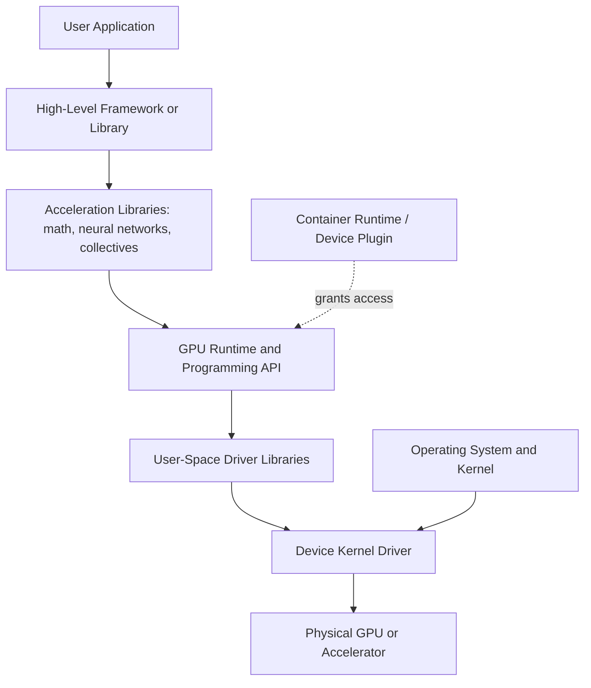

# Drivers, Runtimes, and Accelerator Library Compatibility

A virtual machine with a GPU is not guaranteed to run accelerated applications right after provisioning. An application requires a compatible chain of components: the physical GPU, device driver, runtime, compute libraries, and the framework used by the program. If even a single link has an incompatible version or fails to support the right GPU architecture, the program may fail to detect the device, fail to load libraries, or run with poor performance.

In cloud compute architectures, GPUs and accelerators are high-value specialized resources. Choosing the right driver, runtime, and libraries ensures stable deployment of AI, deep learning, graphics, simulation, and parallel compute workloads while reducing troubleshooting time when updating images, containers, or framework versions.

## 1. Layers in the GPU Stack

A GPU application typically traverses multiple software layers. Names and packaging may vary across NVIDIA CUDA, AMD ROCm, Intel oneAPI, and other platforms, but the general roles are similar.



| Component | Role | Examples |
|---|---|---|
| GPU or accelerator | Executes parallel kernels and handles specialized operations | NVIDIA GPU, AMD GPU, other accelerators |
| Kernel driver | Communicates with the device, manages memory, and dispatches commands at OS level | NVIDIA kernel module, AMD `amdgpu` |
| Driver API and user-space libraries | Provides interfaces for runtimes or applications to interact with the driver | CUDA Driver API, `libcuda.so` library |
| Runtime | Manages contexts, memory, streams, kernel launches, and common operations | CUDA Runtime, HIP runtime, Level Zero |
| Acceleration libraries | Provides hardware-optimized algorithms | cuDNN, cuBLAS, NCCL, rocBLAS, MIOpen, RCCL |
| Framework | Provides high-level APIs for models and applications | PyTorch, TensorFlow, JAX, graphics frameworks |
| Container and scheduler | Exposes devices into the execution environment and allocates resources to workloads | NVIDIA Container Toolkit, Kubernetes device plugin |

Drivers, runtimes, and libraries are not a single monolithic concept. The driver connects software with the device and OS; the runtime provides the execution environment; acceleration libraries implement specific operations; frameworks combine these components into APIs that developers use.

## 2. What Does a GPU Driver Do?

The driver is the software layer that enables the operating system and programs to control the GPU. On Linux, a driver typically consists of a kernel module and user-space libraries. On Windows, drivers are installed via vendor packages and integrate with the OS graphics driver model.

A driver can handle tasks such as:

- Detecting devices and exposing GPU metadata.
- Allocating, mapping, and managing device memory regions.
- Creating contexts, accepting commands, and coordinating execution.
- Managing interrupts, synchronization, and CPU-GPU communication.
- Providing interfaces for runtimes, libraries, and management tools.
- Delivering bug fixes, performance improvements, and security updates.

Drivers are typically tied to specific operating systems, kernel versions, and hardware generations. When upgrading a kernel, some environments require rebuilding the driver module or installing a matching driver package. If the module is not loaded, the GPU may appear in hardware listings while remaining unusable by the runtime.

### Host Driver vs. Container Driver

For GPU containers, the low-level driver is typically installed on the **host**. Containers use device interfaces and user-space driver libraries injected by the container runtime according to configuration. Container images usually package the runtime and application libraries; they should not ship an independent kernel driver intended to replace the host driver.

This allows multiple containers to share the node's driver, but it also introduces compatibility requirements between the host driver and libraries inside the image. Updating an image to a newer runtime while the node still runs an overly old driver can prevent the application from starting or disable certain features.

## 3. Runtimes and Acceleration Libraries

The **runtime** is the layer providing APIs for an application to use the device without manually managing every low-level operation. Runtimes typically support device discovery, context creation, memory allocation, data transfers, stream creation, synchronization, and kernel invocation.

**Acceleration libraries** supply optimized operations or algorithms. Examples in the CUDA ecosystem include:

- `cuBLAS` provides linear algebra operations on GPUs.
- `cuDNN` provides optimized primitives for deep learning.
- `NCCL` supports collective communication and synchronization across multiple GPUs.
- `cuFFT` provides Fast Fourier Transforms.

In the ROCm ecosystem, corresponding components may include the HIP runtime, rocBLAS, MIOpen, and RCCL. Library names and feature parity do not necessarily map one-to-one between the two platforms.

A framework may call the runtime directly or call specialized libraries to execute operations. For example, a deep learning framework may use cuDNN for convolutions, cuBLAS for matrix multiplications, and NCCL when distributing a model across multiple GPUs. Therefore, checking only the driver and runtime is not enough; you must verify the exact libraries the framework actually loads.

## 4. What Is Compatibility?

Compatibility is the ability of components in the stack to work together on the chosen hardware and operating system. No single version number represents the entire stack. Verify at least the following relationships:

| Relationship | What to Verify |
|---|---|
| GPU and driver | Does the driver support the exact GPU model, architecture, and features? |
| Driver and OS | Does the driver support the current OS version, kernel, and boot mode? |
| Driver and runtime | Does the driver meet the minimum version required by the runtime? |
| Runtime and libraries | Were the acceleration libraries built for a compatible runtime/ABI? |
| Framework and libraries | Does the installed framework build support the exact CUDA/ROCm version and related libraries? |
| Framework and GPU architecture | Does the build include machine code or intermediate code suited to the running GPU architecture? |
| Host and container | Does the container runtime pass the required devices, driver interfaces, and permissions into the container? |
| Multi-GPU | Do the driver, runtime, communication libraries, and network topology support the planned GPU count and interconnect? |

An application only runs properly when all required relationships are satisfied. Installing a newer toolkit version does not automatically upgrade the host driver; updating a driver does not guarantee an older framework can load newer libraries.

## 5. CUDA and the Relationship Between Driver and Toolkit

CUDA is NVIDIA's parallel computing platform. Within the CUDA stack, distinguish between **CUDA Toolkit**, **CUDA Runtime**, and **NVIDIA driver**.

- CUDA Toolkit is the developer suite, which may include the `nvcc` compiler, headers, development libraries, debugging tools, and profilers.
- CUDA Runtime provides high-level APIs for applications to manage devices and execute kernels.
- NVIDIA driver provides the interface for the OS and runtime to communicate with the GPU.

A machine running precompiled applications does not necessarily need the full CUDA Toolkit installed. If the program and image already contain the needed runtime libraries, the host environment may only need a compatible host driver. Conversely, a machine used to compile CUDA code needs the appropriate development toolkit.

### 5.1. Backward Compatibility and Minor Version Compatibility

Newer NVIDIA drivers can generally run applications built with older toolkits within supported compatibility bounds. NVIDIA also provides minor-version compatibility within certain CUDA families, allowing applications in the same major family to run on drivers meeting a specified minimum version.

These mechanisms have limits. New features may require a newer driver; applications using certain new APIs or capabilities may not run purely via minor-version compatibility. Forward compatibility via compatibility library packages also applies only under GPU, OS, and platform conditions published by the vendor.

Because minimum driver thresholds change across CUDA releases and platforms, consult the official compatibility matrix for the exact toolkit and driver. Do not take an old version table and apply it to every GPU or every release.

### 5.2. SASS, PTX, and GPU Architecture

CUDA code can be compiled into native machine code for one or more specific GPU architectures (commonly called SASS), or into PTX, an intermediate representation. When needed, the driver can use a JIT compiler to translate PTX into machine code matching the GPU at runtime.

This leads to several scenarios:

- Binaries containing SASS for the current architecture can generally execute directly on supported GPUs.
- Binaries containing SASS only for another architecture may lack suitable code to execute.
- PTX can improve compatibility with newer GPUs, provided the driver understands that PTX version and the GPU supports the required features.
- JIT compilation can increase initial startup time and generate compiled code caches.

When packaging applications, target the architectures matching your deployment GPUs. Do not merely verify successful compilation on a dev machine and assume the binary will run across every GPU generation.

### 5.3. Interpreting Output from `nvidia-smi` Correctly

The `nvidia-smi` command is commonly used to inspect drivers and GPUs:

```bash
nvidia-smi
```

`Driver Version` shows the active driver version. The `CUDA Version` field in the output typically indicates the maximum CUDA version the driver reports supporting under its compatibility rules; it **does not prove** that the CUDA Toolkit of that version is installed on the machine.

To check the toolkit compiler on a development machine, run:

```bash
nvcc --version
```

The two commands answer different questions. A machine can have a recent driver and no `nvcc`; that can still be sufficient to run containers or applications packaged with an appropriate runtime.

## 6. ROCm and Other Acceleration Platforms

AMD ROCm is a software stack for GPU computing. Depending on configuration, the stack may include the `amdgpu` kernel driver, ROCm user-space components, HIP runtime, math libraries, and ROCm-built frameworks.

Common components include:

- **ROCm platform:** a collection of software components for developing and running GPU applications.
- **HIP:** a programming model and runtime providing GPU compute APIs; it can assist in porting some CUDA code to AMD environments, though not all source code or libraries port unchanged.
- **rocBLAS:** linear algebra library.
- **MIOpen:** primitives library for deep learning workloads.
- **RCCL:** multi-GPU collective communication library.

ROCm compatibility depends on the combination of GPU, ROCm version, Linux kernel, Linux distribution, driver, and framework version. A ROCm release may support only a specific set of GPUs or OSes. Consult the official support matrix before choosing images and installing packages.

Platforms such as Intel oneAPI/Level Zero have their own runtimes, drivers, and libraries. The general principle remains identical: verify the exact device, driver, runtime, libraries, and framework against the vendor's version matrix.

## 7. Deep Learning Framework and Library Compatibility

Frameworks typically publish packages built for specific CUDA or ROCm combinations. Some binary packages bundle a subset of user-space libraries; other environments rely on externally installed libraries. Packaging varies by framework, version, OS, and installation method.

For example, with PyTorch, you can inspect compatibility from Python:

```python
import torch

print("PyTorch:", torch.__version__)
print("CUDA build:", torch.version.cuda)
print("CUDA available:", torch.cuda.is_available())

if torch.cuda.is_available():
    print("GPU:", torch.cuda.get_device_name(0))
    print("Capability:", torch.cuda.get_device_capability(0))
    print("cuDNN:", torch.backends.cudnn.version())
```

`torch.version.cuda` reports the CUDA version that the PyTorch build was compiled against; it is not the output of `nvcc --version` and does not mean that toolkit is necessarily installed on the system path. `torch.cuda.is_available()` confirms the framework can initialize CUDA in the current environment, though it does not prove every operation or optional library works properly.

For TensorFlow, JAX, or other frameworks, follow the verification steps documented for that exact version. Never install a framework package from a random online command without verifying the Python version, OS, CPU architecture, driver, CUDA/ROCm version, and accompanying libraries.

### ABI and Shared Libraries

Beyond version numbers, pay attention to the ABI (Application Binary Interface), shared library versions, and language runtimes. A C/C++ extension compiled against a different ABI or system library can fail to load even when the GPU driver is completely compatible.

On Linux, errors such as `cannot open shared object file`, `undefined symbol`, or Python module load failures can indicate missing libraries, wrong library paths, or ABI mismatches. Tools like `ldd`, `readelf`, and `ldconfig -p` help inspect dynamic dependencies. Verify which libraries are actually loaded in the process rather than only checking installed package lists.

## 8. GPUs in Containers and Kubernetes

Containers package an application alongside the runtime and library versions it requires. However, because the GPU is a host device, containers must be granted access through the container runtime and corresponding integration mechanisms.

A common NVIDIA setup consists of:

1. Host runs an NVIDIA driver compatible with the GPU and kernel.
2. NVIDIA Container Toolkit is configured with Docker or the corresponding container runtime.
3. Image contains the framework, CUDA user-space runtime, and required application libraries.
4. When launching a container, the runtime injects the GPU device and required driver libraries into the container environment.
5. Application detects the device and runs the workload.

An example command to run a GPU test container looks like:

```bash
docker run --rm --gpus all <cuda-image> nvidia-smi
```

`<cuda-image>` is an image chosen for the required runtime and framework versions. This syntax only works when the host driver is installed and the container runtime is configured for GPU support. Do not embed an arbitrary driver inside the image to override the host driver.

### 8.1. Kubernetes Device Plugins

In Kubernetes, a vendor's device plugin advertises GPU resources to kubelet so the scheduler can place Pods on nodes with matching devices. For NVIDIA, resources are commonly requested as `nvidia.com/gpu`.

Example Pod requesting one GPU:

```yaml
apiVersion: v1
kind: Pod
metadata:
  name: gpu-worker
spec:
  restartPolicy: Never
  containers:
    - name: worker
      image: example/gpu-worker:1.0
      resources:
        limits:
          nvidia.com/gpu: 1
```

The example assumes nodes already have compatible drivers, runtimes, and device plugins installed. Declaring `nvidia.com/gpu: 1` does not install drivers automatically or turn a CPU-only node into a GPU node. For AMD or other accelerators, resource names and plugins differ.

In multi-node environments, manage driver and plugin versions uniformly per node pool. Use node labels, taints, and tolerations to place GPU workloads only on properly prepared nodes. With shared GPUs, MIG, or device partitioning mechanisms, verify how the platform advertises resources and enforces isolation boundaries.

## 9. Selecting Images and Managing Versions

A GPU image should be chosen based on a verified framework and version combination. Before using an image in production, document:

- Base OS and CPU architecture of the image.
- Framework version and Python or language runtime version.
- CUDA/ROCm version the framework was built for or depends on.
- Versions of libraries such as cuDNN, NCCL, rocBLAS, or MIOpen.
- Minimum host driver version required.
- GPU architectures supported by the binaries.
- How the container runtime exposes devices and driver libraries into the container.

Prefer official images or tested internal images, pin specific version tags, and use digests when exact reproducibility is needed. The `latest` tag may point to a different combination on the next pull, causing unexpected environment drift.

When upgrading, upgrade one layer at a time according to a tested plan. For instance, if a new framework requires a newer CUDA runtime, first verify the host driver meets the requirement; then test libraries, models, and critical operations. Do not upgrade drivers across an entire production node pool at once without a rollback plan and representative workload validation.

## 10. Pre-Deployment Compatibility Checklist Workflow

You can use the following workflow to validate a new GPU workload:

1. **Identify target hardware.** Record GPU model, architecture, VRAM capacity, device count, GPU interconnect capability, and multi-GPU requirements.
2. **Choose OS and kernel.** Verify OS version, kernel, and CPU architecture are supported by the driver.
3. **Select driver.** Match driver version against GPU, OS, and application runtime requirements.
4. **Select runtime/toolkit.** Determine the runtime needed at execution time and the toolkit needed at compile time; these requirements can differ.
5. **Verify acceleration libraries.** Check cuDNN, cuBLAS, NCCL, or equivalent library versions and ABI dependencies.
6. **Select framework build.** Install the exact framework package supporting the chosen runtime, Python version, and GPU architecture.
7. **Validate container environment.** Confirm host driver, container runtime, device plugin, and device access permissions.
8. **Run minimal smoke test.** Detect the GPU, allocate VRAM, run a small operation, synchronize, and verify results.
9. **Run representative workload.** Measure throughput, latency, VRAM, temperature, GPU utilization, and multi-GPU communication if applicable.
10. **Freeze and document configuration.** Record image digests, driver/runtime/framework versions, node configurations, and test results for reproducibility.

## 11. Diagnosing Common Errors

| Symptom | Possible Causes | Troubleshooting Direction |
|---|---|---|
| `nvidia-smi` fails to run or sees no GPUs | Driver not installed, kernel module not loaded, device not attached to VM, or kernel error | Check PCI devices, kernel modules, driver logs, and GPU passthrough configuration |
| `nvidia-smi` works, but framework sees no GPU | CPU-only framework build, missing user-space libraries, container lacks GPU access, or version mismatch | Check framework build, runtime, container runtime config, and environment variables |
| Insufficient driver version error | Host driver is older than required by runtime/framework | Cross-check minimum driver requirement; upgrade via a tested process |
| Missing `libcuda.so`, `libcudart.so`, or other libraries | Missing library, wrong library path, or image lacks required runtime | Inspect dynamic linker, installed packages, and actually loaded libraries |
| `undefined symbol` error | ABI or library version mismatch | Check dynamic dependencies, framework version, and acceleration library versions |
| Kernel fails to run on newer GPU generation | Binary lacks matching machine code or PTX is unsupported by driver | Check build target architectures, compiler version, and JIT capability |
| Container sees GPU, but Pod stays unscheduled | Device plugin has not registered resources, no node has available GPUs, or invalid request | Inspect node capacity, plugin health, taints/tolerations, and resource requests |
| Only specific operations fail | Specialized library or specific feature incompatibility | Create a minimal reproducer per library; check versions and GPU architecture |
| Lower performance than expected | Data not on GPU, CPU preprocessing bottleneck, bandwidth limit, or unoptimized kernels | Profile CPU/GPU, memory transfers, utilization, and synchronization time |

### Basic Inspection Commands on Linux

```bash
# View NVIDIA GPUs and driver
nvidia-smi

# Check loaded driver kernel modules
lsmod | grep -E 'nvidia|amdgpu'

# View PCI details of accelerator devices
lspci | grep -Ei 'vga|3d|display'

# Check CUDA compiler if toolkit is installed
nvcc --version

# Check dynamic libraries required by a binary
ldd ./gpu-app
```

For ROCm, tools like `rocminfo`, `rocm-smi`, and `hipcc --version` inspect devices, status, and the toolchain. Command names or capabilities may vary by version. Combine command outputs with kernel logs and release-specific installation documentation.

## 12. Driver Security and Operations

GPU drivers run at high privilege levels and interact directly with the kernel. Consequently, driver management is part of infrastructure security.

- Install drivers from trusted sources following organizational package/image management processes.
- Monitor driver security advisories and known bugs.
- Test new drivers on a canary node or small group before broad rollout.
- Verify Secure Boot requirements, module signing, and module rebuild mechanisms during kernel upgrades.
- Restrict GPU device access and node admin privileges; avoid granting privileged mode to containers unless necessary.
- Pin images and library versions to minimize uncontrolled changes.
- Monitor temperature, power consumption, VRAM, hardware errors, and GPU reset events.

Newer drivers can fix bugs or support newer GPUs, yet they can also alter behavior for older runtimes or frameworks. Manage upgrades against a compatibility matrix and keep a rollback path to a known-good version.

## 13. Example: Deploying an AI Workload on a Cloud GPU

Suppose a team wants to run an inference service on a VM with an NVIDIA GPU packaged as a container. A deployment workflow can proceed as follows:

**Step 1: Choose VM type.** Confirm GPU model, VRAM, GPU count, host CPU, RAM, network bandwidth, and storage limits match model size. If multiple GPUs are needed, verify PCIe/NVLink topology or equivalent interconnect.

**Step 2: Prepare the host.** Select an OS image supported by the cloud provider and driver. Install the NVIDIA driver per image or provider instructions; reboot if required. Verify with `nvidia-smi`.

**Step 3: Choose container image.** Select a framework image with CUDA runtime and library versions compatible with the host driver. Record the image digest, not just a mutable tag.

**Step 4: Grant device access to container.** Configure NVIDIA Container Toolkit and run the container with GPU access. Run `nvidia-smi` inside the container to confirm the device is visible.

**Step 5: Verify the framework.** Run a script confirming the framework detects the GPU, prints the device name, and executes a small matrix multiplication. Proceed to run the actual model to verify libraries and GPU architecture.

**Step 6: Monitor under load.** Observe GPU utilization, VRAM, CPU preprocessing, latency, throughput, and driver errors. Set alerts for device resets or near-full VRAM.

**Step 7: Manage changes.** When upgrading the framework or CUDA runtime, test on a canary VM. If a driver upgrade is needed, re-validate all images and workloads before modifying production node pools.

This workflow separates host, container, and application issues. If `nvidia-smi` fails on the host, fix the driver or device attachment first. If the host sees the GPU but the container does not, inspect the container runtime. If the container sees the GPU but the framework does not, inspect the framework build and user-space libraries.

## 14. Pre-Production Checklist for GPU Workloads

- [ ] Identified GPU model, architecture, VRAM, and multi-GPU requirements.
- [ ] Driver supports the exact GPU, OS, and kernel.
- [ ] Distinguished between driver version, CUDA/ROCm runtime, and development toolkit.
- [ ] Required acceleration libraries are compatible with runtime and framework.
- [ ] Framework build supports the exact Python version, OS, and GPU architecture.
- [ ] Checked ABI and actual dynamic libraries loaded.
- [ ] Host has a matching driver and container runtime is configured to expose GPUs.
- [ ] Kubernetes device plugin or equivalent device allocation mechanism works properly.
- [ ] Executed tests for GPU detection, memory allocation, and representative operations.
- [ ] Measured throughput, latency, VRAM, and performance under realistic load.
- [ ] Established a driver/runtime update process and rollback plan.
- [ ] Restricted device access permissions and configured hardware/driver error monitoring.

## 15. Conclusion

Drivers, runtimes, acceleration libraries, and frameworks are distinct layers in the GPU stack. The driver connects software with the device and OS; the runtime manages execution; acceleration libraries supply optimized operations; frameworks combine them to build applications. Compatibility depends simultaneously on the GPU, driver, kernel, runtime, libraries, framework, ABI, and how devices are exposed to containers.

When deploying in the cloud, identify hardware first, cross-check the provider's version matrix, pin images, and test the full path from host to framework. Managing drivers, runtimes, and libraries as a unified configuration keeps GPU workloads stable, reproducible, and safer to operate.
