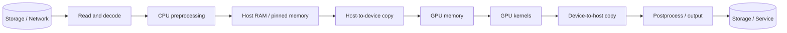
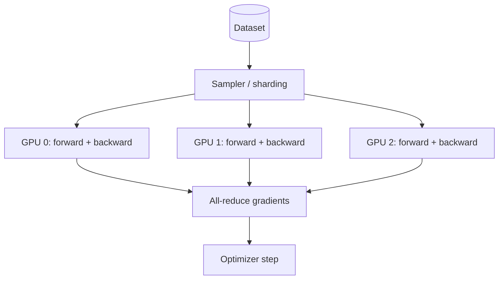

# Measuring Accelerator Utilization and Identifying Data-Feeding Bottlenecks

A GPU or accelerator workload achieves strong performance only when the entire pipeline supplies data fast enough to keep the device continuously busy. A GPU may have thousands of compute cores, yet if the CPU decodes data slowly, storage cannot keep up with reads, batches are too small, or PCIe transfers are serialized, the device will frequently sit waiting. Conversely, a GPU constantly reporting high utilization does not automatically mean the system achieves high throughput: kernels may be memory-bandwidth-bound, performing uncoalesced accesses, or executing excessive overhead operations.

Within the scope of **CLOUD_CORE_SERVICES_COMPUTE**, operators must measure CPU, memory, networking, storage, and security configurations alongside workload deployment. For GPUs and accelerators, measurement must go beyond the GPU utilization percentage: you must observe the pipeline from data source to device memory, kernel execution time, compute unit utilization, memory bandwidth, data transfers, and synchronization. These skills help select appropriate GPU configurations, scale the true bottleneck, maintain availability, and control costs.

## Learning Objectives

After this lesson, you will be able to:

- Describe the data pipeline of a GPU workload from storage, preprocessing, and data transfer to kernels and outputs.
- Distinguish between GPU utilization, compute occupancy, memory usage, memory bandwidth, and application throughput.
- Collect metrics from devices, CPU, storage, networking, and frameworks to locate where a workload is stalling.
- Use appropriate monitoring tools and profilers to find slow kernels, serialized data transfers, or under-provisioned data loaders.
- Apply batching, prefetching, pinned memory, asynchronous copies, and pipeline optimizations backed by measured evidence.
- Evaluate performance across throughput, latency, resource efficiency, and cost per unit of work.

## 1. Why Measure the Entire Pipeline?

GPUs are designed to process massive volumes of data in parallel. However, a GPU does not fetch business data directly from object storage, databases, or dataset files on its own. An application typically comprises multiple stages:

1. Reading data from disk, object storage, network, or queues.
2. Decoding, parsing, decompressing, and transforming data on the CPU.
3. Assembling batches and transferring data from host memory to device memory.
4. Executing kernels on the GPU or accelerator.
5. Copying results back to the host if needed, post-processing, and writing outputs.
6. Repeating for the next batch.



If one stage is slower than the rest, it limits the speed of the entire pipeline. For example, suppose the GPU takes only 20 ms to process a batch while the data loader takes 50 ms to read and preprocess it. If the two stages run sequentially, total time per batch is roughly 70 ms; cutting kernel time from 20 ms to 10 ms only lowers total time from 70 ms to 60 ms. Optimizing data preparation from 50 ms down to 15 ms has a much larger impact.

Therefore, the first question when GPU utilization is low is not "Do we need more GPUs?" but "What is the GPU waiting on?". And the question when utilization is high is "Is the device doing useful work or bottlenecked on another resource?".

## 2. Measurement Concepts to Distinguish

### 2.1. GPU Utilization

GPU utilization typically indicates the percentage of time during a sampling interval that at least one kernel is active or processing work on the GPU, depending on driver and tool definitions. This metric helps reveal whether the device is frequently idle or busy.

However, utilization is not the percentage of peak compute capacity consumed. A tiny kernel can drive reported GPU utilization high while occupying only a tiny fraction of compute units. A bursty workload may be smoothed over the sampling interval, causing the average number to hide short idle gaps.

For instance, `GPU-Util` in `nvidia-smi` is an activity metric reported by the driver over a sampling window. Measurement methods, update intervals, and granularity depend on the device and driver. Do not directly compare numbers from two tools that use different definitions.

### 2.2. Compute Occupancy

Occupancy in the CUDA context is typically the ratio of active warps on a streaming multiprocessor (SM) to the maximum number of warps that the SM can support. Occupancy is affected by registers per thread, shared memory per block, threads per block, and hardware limits.

High occupancy can help hide memory latency by keeping plenty of warps ready to run. Yet maximum occupancy is not a goal in itself. A kernel can achieve strong performance at moderate occupancy if each thread performs substantial useful work or uses per-thread resources efficiently. Forcing occupancy higher by restricting registers can trigger register spilling and slow the kernel down.

### 2.3. Compute Throughput and Specialized Unit Utilization

Compute throughput measures work completed per unit of time, such as images/sec, tokens/sec, samples/sec, or FLOP/s. Some GPUs have multiple execution paths such as CUDA cores, Tensor Cores, ray tracing cores, or video decode engines. Other accelerators may provide matrix engines or NPU cores.

Overall GPU utilization does not reveal how busy each specialized unit is. To verify whether a kernel uses Tensor Cores, use a profiler with the corresponding metrics and inspect data types, matrix dimensions, algorithms, alignment, and library configuration.

### 2.4. Memory and Bandwidth

Do not conflate memory metrics into a single concept:

- **Memory capacity used:** the amount of VRAM/HBM currently allocated or consumed. It reflects space occupied, not read/write speed.
- **Memory bandwidth:** the volume of data read/written across device memory per second. This is a critical metric for memory-bound workloads.
- **Cache hit/miss:** the proportion of data served from caches versus fetched from farther memory, depending on architecture and tooling.
- **Host RAM usage:** CPU memory used for datasets, batches, caches, and preprocessing workers.
- **Pinned host memory:** host RAM locked to support efficient DMA transfers; overusing it can starve the operating system of available memory.

Near-full VRAM can trigger allocation failures, force smaller batch sizes, or compel frameworks to adopt different memory strategies. Yet using only 40% of VRAM does not mean 60% of memory bandwidth remains free; a kernel can saturate memory bandwidth with a small memory footprint.

### 2.5. Data Transfer and Synchronization

With discrete GPUs, data usually travels over PCIe or NVLink between host and device. Transfer duration depends on payload size, topology, bandwidth, copy count, and overlap with computation. Synchronous calls such as waiting for results on the host can serialize the pipeline and leave the device idle.

Key metrics to observe include:

- Host-to-device (H2D) and device-to-host (D2H) throughput.
- Copy engine wait time and transfer count.
- PCIe/NVLink utilization if platform metrics support it.
- CPU-GPU synchronization time, event wait time, and inter-kernel gaps.
- Inter-GPU traffic in distributed workloads.

## 3. Metric Suite to Collect

Measuring a GPU workload requires multiple metric groups. Collecting GPU utilization alone without CPU, storage, and network metrics makes root-cause analysis difficult.

| Group | Metrics to Observe | Questions to Answer |
|---|---|---|
| Device | GPU utilization, clocks, power, temperature, throttling, hardware errors | Is the GPU continuously busy? Is it thermally or power throttled? |
| Compute units | SM/compute engine active, Tensor Core activity, occupancy, warp stalls | Are kernels utilizing the required compute capabilities? |
| VRAM/HBM | Memory used/free, bandwidth, cache behavior, allocation failures | Is the device running out of capacity or bottlenecked on read/write speed? |
| Host CPU | Per-core CPU utilization, run queue, context switches, thread count | Does the CPU have enough threads to read, decode, and feed batches? |
| Host memory | Available RAM, page faults, swap, pinned memory | Is the host short on RAM or under memory pressure? |
| Storage | IOPS, throughput, read latency, queue depth, cache hits | Is the dataset being read fast enough? |
| Network | Throughput, packet loss, RTT, retransmissions, per-NIC bandwidth | Is data from object storage or other nodes arriving slowly? |
| Pipeline/framework | Data loader time, batch wait, H2D/D2H, kernel time, queue depth | Which stage introduces idle gaps between batches? |
| Application | Samples/s, tokens/s, requests/s, p50/p95/p99 latency, error rate | What performance do end users actually experience? |
| Cost | GPU-hours, CPU-hours, storage/network costs, cost per job/token/sample | Is each unit of work consuming excessive resources? |

Collect metrics simultaneously over the same time window and tag them with job, model, dataset, batch size, node, GPU ID, and software versions. Synchronizing timestamps across nodes helps correlate events in multi-GPU or multi-machine workloads.

### 3.1. Collecting Device Metrics via CLI Tools

For NVIDIA GPUs, `nvidia-smi` provides quick device status checks:

```bash
nvidia-smi
nvidia-smi --query-gpu=name,utilization.gpu,utilization.memory,memory.used,memory.total,temperature.gpu,power.draw,clocks.sm --format=csv
nvidia-smi dmon -s pucm
```

Supported queries vary by GPU and driver version. Check the list of fields supported by your device; unsupported fields may return `N/A`. In the query above, `utilization.memory` reflects how often the memory controller was active during the sampling interval, not the percentage of VRAM capacity used; use `memory.used` and `memory.total` to track capacity. `dmon` is useful for observing trends over time, though it remains sampled data and does not replace kernel-level profiling.

For AMD GPUs, use `rocm-smi` or ROCm monitoring tools; to analyze kernels and compute activity, use profilers like `rocprof` or the analysis tool matching your ROCm version. For other accelerators, use vendor-provided tools and verify metric definitions before adding them to shared dashboards.

### 3.2. Collecting Node-Level Metrics

On GPU nodes, inspect CPU, RAM, disk, and NICs concurrently. Common Linux commands include:

```bash
top
vmstat 1
iostat -xz 1
sar -n DEV 1
```

`top` identifies resource-heavy CPU threads and processes; `vmstat` shows run queues, swap, and I/O wait; `iostat` shows disk latency and queue depth; `sar` monitors network interface traffic. These tools require appropriate system packages and metric access permissions on the node.

In Kubernetes or managed container services, combine metrics from nodes, Pods/containers, and devices. Identify which workload is using the GPU, what requests/limits are set, whether multiple containers contend for the GPU, and whether device plugins/operators report allocation errors.

## 4. Understanding Data-Feeding Bottleneck Patterns

### 4.1. Storage-Bound: Reading Data from Source Too Slowly

If a dataset resides on block storage, a shared filesystem, or object storage, read speed may fall below GPU processing speed. Common symptoms:

- Recurring GPU idle gaps between batches.
- Rising storage read latency or queue depth; throughput hits volume or network limits.
- CPU threads stuck in I/O wait; data loaders fail to assemble batches on time.
- Warm cache runs are dramatically faster than cold dataset reads.

Remediation involves examining file sizes, dataset sharding, concurrent read requests, caching, data formats, storage locality, and IOPS/throughput limits. With object storage, many tiny files inflate request and metadata overhead; packing data into shards reduces overhead when frameworks read sequentially.

Do not blindly increase reader worker counts. If storage is already saturated, adding workers deepens queues and increases cost without improving throughput.

### 4.2. CPU Preprocessing-Bound: CPU Cannot Feed Data Fast Enough

Steps such as JPEG/PNG decoding, decompression, tokenization, augmentation, JSON parsing, or format conversion can consume heavy CPU. The GPU stalls if data loaders cannot finish batches in time.

Symptoms:

- Low GPU utilization or periodic dips aligned with batch boundaries.
- One or a few CPU cores pinned at 100% even when total node CPU utilization looks modest.
- Data loader/preprocessing time exceeds kernel time.
- Adding workers initially helps throughput, then plateaus or degrades due to context switching and RAM/I/O contention.

Remediation:

- Profile decoding, augmentation, tokenization, and collation individually to find CPU hotspots.
- Size worker counts based on the CPU cores actually allocated to the container/VM, not the host's physical core count.
- Use optimized decoding/vectorized libraries; cache preprocessed outputs if data is static.
- Eliminate repetitive format conversions; perform them once during dataset preparation when practical.
- Pin workers and processes near the NUMA/memory node aligned with the GPU when topology matters.
- Check for container CPU throttling and cloud instance CPU limits.

### 4.3. Host-to-Device Transfer-Bound: Copies Take Too Long

Once a batch sits in host RAM, the application must copy tensors to GPU memory. Many small copies incur high overhead. Synchronous copies can also block the CPU or GPU streams.

Actions to test:

- Combine data into sensible batch sizes to cut down small transfers.
- Use pinned memory when supported by framework and hardware, keeping capacity bounded.
- Use non-blocking/asynchronous copies and separate streams to overlap copies with compute.
- Prefetch the next batch while the GPU processes the current batch.
- Keep tensors on the device across steps if reused, avoiding repeated round-trips.
- Minimize unnecessary D2H copies; transfer only required outputs to the host or write directly where supported.

Not every workload benefits from pinned memory or asynchronous copies. If payloads are tiny, kernels are extremely short, or synchronization happens elsewhere, changes may not improve total runtime. Measure timelines before and after optimization.

### 4.4. Network-Bound: Data Over the Network Cannot Keep Up

Workloads may read datasets from object storage, receive batches over the network, or exchange tensors between nodes. Bottlenecks can sit at NIC bandwidth, RTT, packet loss, retransmissions, NAT, storage service limits, or network topology.

Symptoms:

- Network throughput approaches NIC or provisioned link limits.
- Elevated RTT/retransmissions and high storage/network read latency.
- GPUs across multiple nodes sit idle together while data loading or collective communication lags.
- Performance improves when datasets are co-located near nodes or cached locally.

Check compute and storage placement, NIC types, effective bandwidth, MTU, DNS, routing, connection counts, egress limits, and QoS policies. For distributed training, distinguish dataset-loading traffic from gradient-synchronization traffic over NVLink/InfiniBand/Ethernet.

### 4.5. Kernel-Bound or Compute-Bound

If the GPU stays busy and kernels fill most of the timeline, the workload may be compute-bound. However, being kernel-bound does not automatically mean "we need a bigger GPU." Kernels might be unoptimized, use suboptimal data types, trigger many tiny launches, suffer branch divergence, or lack parallelism.

Inspect:

- Kernel duration and per-batch throughput.
- Utilization of compute units and specialized blocks like Tensor Cores.
- Operation counts, data types, tile sizes, and parallelism degree.
- Warp stalls, register pressure, occupancy, and kernel launch overhead.
- Opportunities for optimized libraries, fused kernels, mixed precision, or graph capture where applicable.

If kernels genuinely approach the compute ceiling for the workload, upgrading to a more capable GPU or splitting across multiple GPUs can help. Measure communication and synchronization overhead when scaling out.

### 4.6. Memory-Bound: Data Inside the GPU Moves Too Slowly

A kernel can exhibit high utilization yet low throughput because it continuously waits on data from HBM/VRAM. Such workloads typically have low arithmetic intensity: relatively few operations per byte read or written.

Analysis steps:

- Measure memory bandwidth and compare against theoretical/practical device limits.
- Inspect coalesced accesses, cache locality, and redundant memory reads/writes.
- Reduce intermediate tensors or avoid materializing unnecessary arrays.
- Use fused operations or tiling to reuse data inside caches/shared memory.
- Review dtypes and tensor sizes; compress or lower precision only when output quality permits.

### 4.7. Synchronization-Bound: Pipeline Serialization

A synchronization call or synchronous copy can force the CPU to wait on the GPU or the GPU to wait on data. When the timeline shows regular gaps after each kernel, inspect where the framework calls synchronize, pulls scalars back to host, prints tensors, allocates memory, or waits on queues.

Helpful principles:

- Avoid synchronizing after every operation unless results are needed immediately.
- Fuse or batch many small operations when launch overhead dominates.
- Use streams and events to express asynchronous dependencies explicitly.
- Do not copy intermediate results from device to host mid-pipeline if subsequent steps can stay on device.
- Check allocators and garbage collection if allocations/frees introduce pauses.

## 5. Distinguishing Low Utilization, High Utilization, and Good Performance

Never set a single utilization threshold as a universal target across all workloads. A low-latency inference service may handle small individual requests, yielding low average GPU utilization while still meeting requirements. A training job can keep the GPU busy nearly continuously yet remain inefficient if most of its time is spent waiting on memory or running suboptimal kernels.

| Observation | Possible Interpretation | What to Check Next |
|---|---|---|
| Low GPU utilization, high CPU | Preprocessing or data loader is CPU-bound | Per-core CPU, data wait time, worker count, throttling |
| Low GPU utilization, low CPU, high storage latency | Slow data reads or pipeline waiting on I/O | IOPS, throughput, queue depth, cache hits, file sizes |
| Low GPU utilization, high network or high RTT | Slow remote reads or inter-node communication | NIC throughput, retransmissions, storage endpoint, collectives |
| GPU utilization oscillates per batch | Sequential batch loading and compute; missing prefetch/overlap | CPU, copy, kernel timelines, and batch wait times |
| High GPU utilization, low throughput | Inefficient kernels, memory-bound, throttling, or underusing specialized units | Kernel profiler, memory bandwidth, clocks, power, thermals, occupancy |
| VRAM near full, OOM | Batch/model/intermediate tensors exceed capacity | Allocation timeline, peak memory, activations, caches, fragmentation |
| Low VRAM usage, high memory bandwidth | Kernels may be memory-bound despite spare capacity | HBM throughput, access patterns, arithmetic intensity |
| High GPU utilization, high throughput, latency on target | Device is likely well utilized | Check p95/p99, error rates, thermals, power, and cost per unit |
| One GPU busy, another idle in multi-GPU | Imbalanced work distribution or synchronization | Sharding, rank timing, data partitioning, communication topology |

Rows in this table are diagnostic hypotheses, not automatic conclusions. Always correlate concurrent metrics and profiler traces to confirm.

## 6. Profiling Tools and How to Use Them

Continuous monitoring answers "What is happening over time?". Profilers answer "Which code or kernel is consuming time?". The two tool types complement each other.

### 6.1. System Profilers

System profilers capture multi-component timelines covering CPU threads, CUDA APIs, kernels, copy engines, synchronization, and inter-device communication. On NVIDIA platforms, Nsight Systems is commonly used to locate inter-kernel gaps, CPU preparation overhead, H2D/D2H transfers, and synchronization stalls. You can start with:

```bash
nsys profile -o gpu-pipeline --trace=cuda,nvtx,osrt python train.py
```

Exact trace flags and capture capabilities depend on Nsight Systems, CUDA, and OS versions. Afterward, open the report in the Nsight Systems UI or export reports to inspect the timeline.

When reading timelines, look for patterns such as:

- Long CPU gaps before submitting kernels.
- GPU idle gaps between batches.
- H2D copies serialized with kernels when they could overlap.
- One stream waiting on another stream or excessive event synchronization.
- One rank in a distributed job lagging behind the rest.

### 6.2. Kernel Profilers

Kernel profilers drill into individual kernels: execution time, instructions, registers, occupancy, memory throughput, caches, warp stalls, and compute unit usage. On NVIDIA platforms, Nsight Compute analyzes CUDA kernels. Pick a representative kernel and collect targeted metrics; avoid enabling every counter at once if collection severely distorts runtime.

Basic command example:

```bash
ncu --set basic --target-processes all -o kernel-report python train.py
```

During analysis, start with a specific question: is the kernel limited by compute, memory, instruction throughput, launch overhead, or latency? Then select deeper metric groups. Metric names and sections may vary by GPU architecture and tool version.

### 6.3. Framework-Level Profilers

Framework profilers link GPU activity back to operations in the model. PyTorch example:

```python
import torch
from torch.profiler import profile, ProfilerActivity, record_function

activities = [ProfilerActivity.CPU]
if torch.cuda.is_available():
    activities.append(ProfilerActivity.CUDA)

with profile(
    activities=activities,
    record_shapes=True,
    profile_memory=True,
    with_stack=True,
) as prof:
    for step, batch in enumerate(loader):
        with record_function("train_step"):
            loss = train_step(batch)
        if step == 10:
            break

print(prof.key_averages().table(sort_by="self_cuda_time_total", row_limit=20))
prof.export_chrome_trace("trace.json")
```

This snippet illustrates profiler structure. Column names and CUDA activity details depend on the PyTorch version; when using other accelerators, select activities supported by the backend. For long jobs, limit step counts and profiled regions to curb overhead and trace file size.

### 6.4. Timing Kernels Accurately

Measuring CPU wall time around CUDA calls may only capture command submission time because kernels launch asynchronously. To measure elapsed time on the GPU, use CUDA events:

```python
import torch

start = torch.cuda.Event(enable_timing=True)
end = torch.cuda.Event(enable_timing=True)

# Warm up before measuring to exclude context initialization and autotuning.
for _ in range(10):
    run_gpu_step()

torch.cuda.synchronize()
start.record()
for _ in range(100):
    run_gpu_step()
end.record()
torch.cuda.synchronize()

elapsed_ms = start.elapsed_time(end)
print(f"Average GPU timeline per step: {elapsed_ms / 100:.3f} ms")
```

This measures the interval between two events in a stream. If `run_gpu_step()` performs copies or uses multiple streams, place events and synchronize the relevant streams/dependencies to capture the intended scope. Also measure end-to-end wall-clock time on the host when the target is user-perceived latency.

### 6.5. Monitoring Accelerators in Cloud Environments

In the cloud, device metrics may be exported via agents, exporters, or provider monitoring services. Verify:

- Does the agent have permission to read GPU metrics and match the driver/runtime?
- Are metrics collected at device, node, VM, container, or job level?
- Can GPU UUIDs/PCI bus IDs be mapped to workloads, Pods, or instances?
- Is the sampling interval fast enough to catch brief stalls?
- Are alerts configured when temperature, power, memory, or ECC errors cross thresholds?
- Do logs/profiles contain sensitive data, filenames, or request payloads that require protection?

Do not leave heavy continuous profiling enabled on every production job without assessing overhead. Use lightweight continuous metrics and run targeted profiling when anomalies appear or during benchmarking.

## 7. Optimizing the Data-Feeding Pipeline

Once a bottleneck is confirmed, apply the matching remedy. Optimizing one stage can shift the bottleneck to the next stage; therefore, re-measure the full pipeline after every change.

### 7.1. Batching

Larger batches typically increase parallelism and amortize per-sample overhead, but raise memory requirements and can increase latency. Too-small batches underutilize the GPU; too-large batches cause OOMs, lengthen batch assembly waits, or hurt multi-request serving.

Choose batch size by benchmarking against targets:

- Training: samples/sec throughput, gradient stability, peak VRAM, and epoch duration.
- Batch inference: requests/sec, p95/p99 latency, and memory limits.
- Generative inference: tokens/sec, time-to-first-token, inter-token latency, batch composition, and KV cache.

With dynamic batching, measure batch formation time and wait time for the first request in a batch; higher throughput can come with higher latency.

### 7.2. Prefetching and Pipeline Overlap

Prefetching prepares the next batch before the GPU needs it. The goal is to overlap reading/preprocessing/copying with compute so the device does not wait sequentially on every stage.

```mermaid
gantt
    title Sequential Pipeline vs. Overlapped Pipeline (Illustration)
    dateFormat X
    axisFormat %s
    section Sequential
    Read batch 1      :a1, 0, 2
    Copy batch 1      :a2, 2, 3
    Compute batch 1   :a3, 3, 6
    Read batch 2      :a4, 6, 8
    Copy batch 2      :a5, 8, 9
    Compute batch 2   :a6, 9, 12
    section Overlapped
    Read batch 1      :b1, 0, 2
    Copy batch 1      :b2, 2, 3
    Compute batch 1   :b3, 3, 6
    Read batch 2      :b4, 3, 5
    Copy batch 2      :b5, 5, 6
    Compute batch 2   :b6, 6, 9
```



The diagram illustrates the principle only. Real overlap depends on copy engine count, streams, runtime asynchronicity, pinned memory, and data dependencies. If copying the next batch writes into memory still used by the current kernel, use events or synchronization primitives to prevent race conditions.

### 7.3. Pinned Memory and Asynchronous Copies

Pinned memory is host RAM locked so the operating system will not page it out to swap while in use. DMA transfers from pinned regions are faster than from pageable memory in many scenarios. Frameworks typically expose pinned-memory options in data loaders.

PyTorch example:

```python
from torch.utils.data import DataLoader

loader = DataLoader(
    dataset,
    batch_size=128,
    num_workers=4,
    pin_memory=True,
    persistent_workers=True,
    prefetch_factor=2,
)

for inputs, labels in loader:
    inputs = inputs.to("cuda", non_blocking=True)
    labels = labels.to("cuda", non_blocking=True)
    train_step(inputs, labels)
```

`non_blocking=True` enables asynchronous copies when memory conditions and the backend permit. Tune `num_workers`, `prefetch_factor`, and `persistent_workers` to your dataset, allocated CPUs, RAM capacity, and worker startup cost. Overusing pinned memory strains system RAM; do not enable every flag blindly without measuring.

### 7.4. Optimizing Data Formats and Layout

Data formats for images, video, text, or tensors affect reading, decoding, and preprocessing times. Directions to test:

- Choose formats suited to access patterns: sequential, random, sharded, or record-based.
- Reduce tiny-file counts if metadata/request overhead dominates.
- Preprocess CPU-heavy steps offline when they do not vary per epoch or request.
- Store normalized data if converting formats on every run creates overhead.
- Lay out data for sequential access and cache locality while preserving randomness needed for model quality.
- Place caches near compute when reuse gains outweigh storage and cache sync costs.

Do not compress data solely to shrink storage if decompression turns the CPU into a bottleneck. Compare total read + decompress + transfer time against uncompressed storage.

### 7.5. Keeping Data on Device When Possible

If consecutive steps reuse the same tensor, keeping it on the GPU avoids repeated H2D/D2H transfers. Perform preprocessing, transformations, and post-processing on device when libraries support it and data sizes fit.

However, keeping too many intermediate tensors raises peak VRAM. Track tensor lifetimes, gradients, activation checkpointing, memory pools, and framework allocator caching. Freeing a Python variable does not necessarily lower driver-reported VRAM immediately because allocators often hold blocks for reuse.

## 8. Designing Reliable Measurements and Benchmarks

Benchmarks must reflect realistic workloads and allow clean before/after comparisons. A short test lacking warm-up or measuring only kernel time can produce misleading conclusions about production performance.

### 8.1. Standardize Test Conditions

Record the following for every run:

- Model/application, code revision, framework, CUDA/ROCm, driver, and library versions.
- Accelerator model, device count, VRAM, topology, and cloud instance type.
- CPU, RAM, storage, network, and VM/container resource limits.
- Sample dataset or requests, batch size, sequence length, image resolution, and preprocessing steps.
- Precision/dtype, worker count, prefetch settings, pinned memory, and stream counts.
- Cache state, warm-up duration, iteration count, and concurrent device load.

Hold conditions constant when comparing. Changing GPU type, batch size, worker count, and precision simultaneously makes it impossible to attribute which change caused the difference.

### 8.2. Warm-Up, Repetition, and Percentiles

Frameworks often need to initialize contexts, load kernels, compile graphs, or autotune before reaching steady state. Run warm-up iterations first, then measure multiple iterations. Report averages alongside dispersion or p50/p95/p99 rather than cherry-picking the single fastest run.

For training, measure both step time and epoch time. For inference, measure per-request throughput and latency; do not conflate batch average latency with per-request latency when product SLOs govern individual user response times.

### 8.3. Measuring End-to-End and Stage by Stage

Record at least:

```text
T_total = T_read + T_preprocess + T_H2D + T_kernel + T_D2H + T_postprocess
```

This simple sum applies to a sequential pipeline. When stages overlap, total time approximates the critical path of the timeline rather than the sum of all individual durations. Profilers help identify which operations actually sit on the critical path.

Key performance formulas:

```text
Throughput = completed units of work / elapsed time

GPU-hours per job = allocated GPUs × runtime (hours)

Cost per unit = total workload cost / completed units of work

Data supply rate = samples or bytes made ready for GPU / second
```

Define units of work clearly: images, tokens, samples, batches, video frames, or inference requests. When comparing two configurations, hold output quality and latency targets constant.

### 8.4. Analyzing Accelerator Efficiency

A configuration with lower utilization can still be superior if it finishes the same workload faster, consumes fewer GPU-hours, or meets latency targets better. Conversely, high utilization with low throughput can drive high cost per unit of work.

For example, two configurations processing the same one million images:

| Configuration | GPUs | Duration | GPU-hours | Average Throughput |
|---|---:|---:|---:|---:|
| A | 1 | 2 hours | 2 | ~139 images/sec |
| B | 2 | 1.2 hours | 2.4 | ~231 images/sec |

Configuration B finishes sooner yet consumes more GPU-hours. If meeting a tight deadline is the priority, B may be worth choosing; if minimizing cost within a looser deadline is the priority, A may fit better. Use actual pricing for each GPU type alongside node, storage, network, and provisioning wait times to compute cost per image.

## 9. Bottlenecks in Multi-GPU Workloads

Scaling from one GPU to multiple GPUs introduces data distribution and synchronization steps. Performance will not scale linearly if one GPU lags, data is unevenly partitioned, or inter-GPU communication becomes the critical path.

### 9.1. Data Parallelism and Gradient Synchronization

In data-parallel training, each GPU processes a slice of the batch. After forward/backward passes, GPUs typically synchronize gradients via collective operations such as all-reduce.



If one rank reads data slowly or takes longer on its batch, other ranks wait at the collective. This is the straggler effect. Track per-rank step times, all-reduce duration, interconnect bandwidth, and sample balance.

### 9.2. Topology and Data Paths

GPUs communicate over NVLink/NVSwitch, PCIe, or inter-node networks. Bandwidth and latency vary by topology. Co-locating frequently communicating GPUs on the same node can outperform cross-network transfers, depending on scheduler placement and platform configuration.

When benchmarking multi-GPU setups, record GPU UUIDs, bus IDs, topology, NUMA nodes, NICs, and interconnect types. Run standalone collective benchmarks to establish communication ceilings before optimizing the model.

### 9.3. Balancing Inputs Across Ranks

If each GPU receives unequal work, some ranks finish early and stall waiting for slower ranks. Balance data distribution by sample size or compute cost—especially with variable sequence lengths, differing image resolutions, or irregular graph sizes.

Measure sample counts, token counts, data loader times, and step times per rank. Dynamic batching or bucketing can reduce timing skew, provided samplers and synchronization logic remain sound.

## 10. Diagnostic Example: GPU Waiting on the Data Loader

Suppose a single-GPU image training job shows the following measurements during a steady benchmark window:

| Metric | Observed Value |
|---|---:|
| Average GPU utilization | 38% |
| GPU memory used | 7 GB / 24 GB |
| Step time | 120 ms |
| GPU kernel time | 35 ms |
| Read + decode + augmentation time | 70 ms |
| CPU | One core near 100%, other cores low |
| Storage read latency | Low, no signs of saturation |

The numbers show plenty of free VRAM, unsaturated storage, and one heavily loaded CPU core. A reasonable hypothesis is that preprocessing or a single data loader worker is bottlenecking the pipeline. Profile decoding/augmentation in detail and check whether workers are pinned to a single core.

A controlled experiment:

1. Hold GPU, model, dataset, batch size, and precision constant.
2. Measure baseline with the current worker count.
3. Increase workers step by step while monitoring per-core CPU, RAM, storage throughput, and GPU utilization.
4. Test caching or offline preprocessing for CPU-heavy decoding/augmentation steps.
5. Enable prefetching and pinned memory if the profiler reveals H2D gaps.
6. Re-measure throughput, step time, and cost per epoch; stop when gains no longer justify added resource cost.

Suppose after optimization, preprocessing drops to 25 ms, copies/overlap are largely hidden, and kernels remain 35 ms. End-to-end step time drops substantially. However, if adding workers spikes RAM usage or saturates storage, dial back accordingly. The goal is shortening the pipeline's critical path, not pushing any single metric to 100%.

## 11. Operations and Monitoring Checklist

**Before Benchmarking**

- [ ] Document accelerator type, driver, runtime, framework, instance type, and resource limits.
- [ ] Define workload, dataset, batch size, dtype, worker count, and latency/throughput targets.
- [ ] Include warm-up iterations and measure both end-to-end and per-stage metrics.
- [ ] Synchronize timestamps and tag metrics with job, node, device, model, and version.

**During Execution**

- [ ] Monitor GPU utilization, clocks, power, temperature, and throttling.
- [ ] Track VRAM capacity and memory bandwidth separately.
- [ ] Monitor per-core CPU, RAM, swap, worker counts, and CPU throttling.
- [ ] Monitor storage IOPS/throughput/latency and network throughput/RTT.
- [ ] Record data loader, H2D/D2H, kernel, synchronization, and queue wait times.
- [ ] For multi-GPU jobs, track per-rank timings and interconnect collectives.

**Upon Detecting Anomalies**

- [ ] Formulate a bottleneck hypothesis before changing configurations.
- [ ] Run system and kernel profilers over a tightly scoped window.
- [ ] Change only one group of variables per experiment to isolate impact clearly.
- [ ] Re-measure throughput, latency, output quality, GPU-hours, and cost per unit.
- [ ] Record results, configurations, and the decision to roll back or keep changes.

**Cloud Operations**

- [ ] Verify GPU quotas, instance types, drivers, and accelerator availability in the target region.
- [ ] Configure alerts for GPU errors, thermal/power anomalies, OOMs, ECC errors, or hung jobs.
- [ ] Secure access to profiles, logs, and sample data; avoid logging sensitive request contents in traces.
- [ ] Use autoscaling or scheduling suited to model and data initialization times.
- [ ] Track costs across GPUs, CPUs, storage, networking, and accelerator idle time.

## 12. Conclusion

Measuring GPU performance requires looking across the entire data path. GPU utilization shows whether the device was active during a sampling window, but it does not prove compute units are maxed out, memory is unbottlenecked, or the pipeline is efficient. Combine device, CPU, RAM, storage, network, copy engine, kernel, and end-to-end metrics to pinpoint where workloads wait.

Once a bottleneck is identified, apply the fix matching the root cause: improve data reads if storage-bound, optimize decoding/augmentation if CPU-bound, use batching and prefetching when pipelines starve, reduce copies or synchronization when transfers lie on the critical path, and optimize kernels when compute or memory bandwidth is the limit. After every change, re-measure throughput, latency, quality, and cost to confirm real-world gains.

## Glossary to Remember

| Term | Meaning |
|---|---|
| GPU utilization | GPU activity ratio as defined by the tool's sampling interval and methodology. |
| Occupancy | Ratio of active warps to the maximum warps an SM can support in CUDA. |
| Throughput | Number of work units completed per unit of time. |
| Latency | Time required to complete a single request or unit of work. |
| VRAM/HBM | High-capacity memory attached directly to a GPU or accelerator. |
| Memory bandwidth | Volume of data memory can read/write per unit of time. |
| H2D / D2H | Data transfers from host to device / from device to host. |
| Pinned memory | Page-locked host RAM supporting efficient DMA transfers. |
| Prefetch | Preparing data ahead of when the workload needs it. |
| Data loader | Component that reads, transforms, and assembles input batches for a model. |
| Kernel | Program executed on a GPU/accelerator to perform parallel computation. |
| System profiler | Tool recording timelines of CPU, GPU, copies, synchronization, and system activity. |
| Kernel profiler | Tool analyzing a kernel's performance and hardware resource usage. |
| Arithmetic intensity | Number of operations executed per byte of data moved. |
| Straggler | Process or rank lagging behind the rest and causing the system to wait. |
| GPU-hours | Number of GPUs multiplied by usage duration in hours. |
