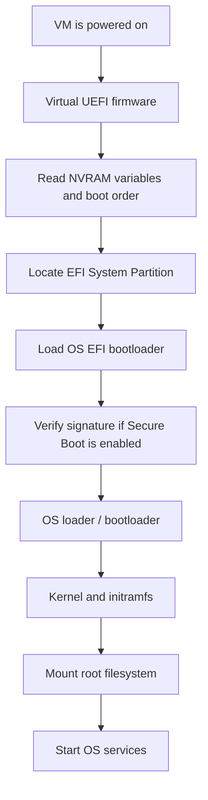

# UEFI, Secure Boot, and the Virtual Machine Boot Chain

## Learning Objectives

After this lesson, you will be able to:

- Describe the role of UEFI in the virtual machine boot process and distinguish UEFI from legacy BIOS.
- Explain the boot chain from firmware, the EFI System Partition, and the boot manager to the OS loader and kernel.
- Explain how Secure Boot establishes trust using digital signatures, keys, and allowed/forbidden signature databases.
- Distinguish Secure Boot from Measured Boot, TPM, and disk encryption.
- Prepare, verify, and troubleshoot common boot errors when building images or deploying VMs in the cloud.

## 1. Why Care About the Boot Process?

A virtual machine (VM) can only run an operating system after the virtual firmware initializes the hardware, locates a boot program, and transfers control to the OS bootloader. This process typically happens very quickly and is easy to overlook. However, an incompatible firmware mode, boot partition layout, or bootloader signature can prevent a VM from booting even when the system disk contains all its data intact.

In cloud environments, the firmware and part of the hardware devices are virtualized. The provider determines which firmware modes, security devices, and boot features can be enabled for each VM type. User-created images must also match those settings. Therefore, when selecting an image, converting a machine from BIOS to UEFI, or enabling Secure Boot, you must verify the operating system, disk layout, bootloader, and platform support together.

Three key concepts to understand:

- **UEFI (Unified Extensible Firmware Interface):** a modern firmware interface responsible for initializing the pre-OS environment, managing boot entries, and loading EFI programs.
- **Secure Boot:** a mechanism that validates digital signatures or cryptographic hashes of EFI programs before firmware allows them to execute. Its goal is to prevent untrusted boot code from replacing legitimate components.
- **Boot chain:** the sequence of components authenticated and executed in turn to transition from firmware to the operating system. The level of verification at each link depends on the firmware, bootloader, and OS policies.

## 2. UEFI and Legacy BIOS

BIOS (Basic Input/Output System) is the traditional firmware style on personal computers. BIOS performs basic hardware checks and initialization, then looks for boot code in the initial area of a storage device, typically the Master Boot Record (MBR). Because the initial boot code has limited size and capability, it usually chains to a bootloader located elsewhere on the disk.

UEFI provides a more structured boot environment. The firmware can read partition tables, access an EFI System Partition, and execute EFI programs formatted as executable files. It also stores boot entries and certain settings in NVRAM variables. UEFI supports Secure Boot via signature verification mechanisms.

| Criterion | Legacy BIOS | UEFI |
|---|---|---|
| How boot code is found | Executes initial boot code on the device | Reads boot entries and loads EFI programs from the appropriate partition |
| Common boot layout | MBR and chained bootloader | GPT and EFI System Partition (ESP) |
| Boot entry management | Usually relies on on-disk code and device order | Uses boot entries in NVRAM variables, optionally with fallback paths |
| Boot program interface | Small, firmware-dependent boot code | EFI applications with standardized format and interface |
| Secure Boot | No standard UEFI Secure Boot mechanism | Can verify signatures of EFI programs |
| Current usage | Legacy OSes and images | Most modern VM deployments, if supported by the platform |

UEFI and GPT usually go together on newer systems, but do not assume that simply changing the partition table converts the boot mode. A BIOS-installed image may lack an EFI System Partition or an EFI bootloader. Conversely, a UEFI image may fail to boot when the VM is configured in BIOS mode.

In the cloud, provider terminology may be UEFI, UEFI boot, Gen 2, or a similar firmware option. Exact names and limitations vary across platforms. Check the documentation for the machine type and image in use before creating a VM.

## 3. Components in the UEFI Boot Chain

A typical UEFI boot chain includes the following components:

1. **UEFI Firmware:** initializes virtual CPUs, memory, and required devices; reads firmware settings, boot order, and security variables.
2. **EFI System Partition (ESP):** the EFI system partition on disk, typically using a FAT32 filesystem. This partition holds boot managers and EFI programs.
3. **OS EFI Bootloader:** the UEFI Boot Manager in firmware uses BootOrder and Boot#### entries to select an EFI application on the ESP. That application is typically shim/GRUB on Linux or Windows Boot Manager on Windows.
4. **OS Loader and Kernel:** the boot manager passes boot parameters and loads the operating system kernel along with required components.
5. **Initramfs or early boot environment:** on many Linux distributions, initramfs provides drivers and utilities to locate, unlock, or mount the root partition.
6. **Operating System:** the kernel initializes services and hands off to the system init process such as systemd.

High-level diagram:



This diagram illustrates the common flow. Some operating systems add intermediate layers, multiple partitions, or custom verification steps. Firmware may try the next boot entry if an entry does not exist or cannot execute.

### 3.1. EFI System Partition and Boot Entries

The ESP is a partition dedicated to storing EFI boot programs. On x86-64 machines, common paths include:

- Linux: **\EFI\ubuntu\shimx64.efi**, **\EFI\ubuntu\grubx64.efi**, or similar paths depending on the distribution.
- Windows: **\EFI\Microsoft\Boot\bootmgfw.efi**.
- x86-64 fallback boot path: **\EFI\BOOT\BOOTX64.EFI**.

Directory and file names vary by distribution, CPU architecture, and installation method. ARM64 systems use EFI program names matching that architecture, such as **BOOTAA64.EFI** for the fallback path. Never copy an x86-64 bootloader to an ARM64 VM or vice versa.

Firmware typically uses **Boot####** entries in NVRAM to determine which EFI file to execute. The **BootOrder** variable defines the sequence to try. If entries are lost after migration or image creation, the firmware may fail to find the bootloader even though the files still exist on the ESP. Some firmware implementations may attempt the fallback path; this behavior depends on the implementation.

### 3.2. How Do Linux and Windows Traverse the Boot Chain?

**Linux example:**

- UEFI firmware selects shim or GRUB from the ESP.
- If shim is used, the firmware verifies shim's signature against certificates stored in the firmware's trust database.
- Shim verifies the next bootloader, usually GRUB, according to the distribution's policy.
- GRUB loads the kernel and initramfs. With the distribution's Secure Boot configuration, a properly signed kernel is verified before execution.
- The kernel initializes the system, uses initramfs to locate and mount the root partition, and starts the init process.

Shim and Machine Owner Key (MOK) are how some Linux distributions extend the trust model. Administrators can enroll an organization's key to verify organization-signed components. Exactly how the kernel, initramfs, and modules are verified differs by distribution and configuration; do not assume every file loaded after GRUB is directly verified by the firmware.

**Windows example:**

- Firmware verifies and executes Windows Boot Manager (bootmgfw.efi).
- Windows Boot Manager reads the Boot Configuration Data (BCD), then invokes the Windows OS Loader (winload.efi).
- The OS Loader checks and loads OS components in accordance with Windows security policy.
- The Windows kernel proceeds to initialize drivers and services.

The common thread is that the firmware initiates the trust chain, and then the OS boot manager and loader continue their own verification steps. Secure Boot does not mean the firmware understands every internal component of the operating system.

## 4. How Does Secure Boot Authenticate Boot Programs?

Secure Boot is an enforcement policy at the firmware stage. When enabled, the firmware checks each EFI program before execution against allowed digital signatures, certificates, or hashes. If a program is untrusted or revoked, the firmware can refuse to run it and move to another boot entry or halt the boot process.

The goal is to ensure that the critical early links of the boot chain originate from trusted sources. This reduces the risk of bootkits or malware tampering with the bootloader before the operating system and standard protection tools are active.

### 4.1. Key Variables and Databases

UEFI Secure Boot typically uses four critical groups of security variables:

| Component | Role |
|---|---|
| PK (Platform Key) | Platform key, establishing the authority that manages the firmware's Secure Boot policy |
| KEK (Key Exchange Key) | Set of keys authorized to update trust databases such as db and dbx |
| db (signature database) | Contains certificates, keys, or hashes authorized to execute |
| dbx (forbidden signature database) | Contains revoked signatures or hashes that must be rejected |

You can visualize the management flow as follows:

- The entity holding platform administration rights manages the PK.
- Keys in KEK are authorized to update the allowed list and revocation list according to firmware policy.
- Firmware compares the signature or hash of an EFI application against db and dbx.
- An entry present on the forbidden list must be rejected even if that signature was previously trusted.

These names and key management workflows are part of the general UEFI standard. In cloud VMs, the provider typically manages the firmware and default key set. Whether you can view, modify, or inject custom keys into firmware depends on the platform, VM type, and key management features offered by the provider.

### 4.2. Digital Signatures and the Chain of Trust

Digital signatures verify that an EFI program comes from a trusted publisher and that its contents have not been altered since signing. Firmware usually verifies signatures against configured certificates or hashes. Certificates may form a chain from a signing certificate up to a trusted CA.

Illustrative example for a Linux VM:

1. Firmware holds the certificate of an accepted CA.
2. Firmware verifies the signature of shim.
3. Shim verifies the signature of GRUB or the next component per shim policy.
4. GRUB or the distribution's mechanism verifies the kernel before transferring control.
5. The kernel may enforce additional lockdown policies and require kernel modules to be signed.

Not every distribution implements the chain identically. Consult the Secure Boot documentation for the specific OS, especially when using custom kernels, third-party drivers, or self-compiled bootloaders.

### 4.3. How Far Does Secure Boot Protect?

Secure Boot protects the boot stage by restricting which EFI programs are allowed to execute. It does not automatically:

- Encrypt data on disk or protect snapshots and backups.
- Verify every application, script, or file executed after the OS has booted.
- Prevent privileged users from installing malicious software after logging in.
- Replace security updates, access controls, firewalls, or monitoring.
- Prove that a VM has not been compromised merely because Secure Boot is enabled.

If you need to protect data at rest, use disk encryption and proper key management. If you need to verify boot state remotely, consider TPM and Measured Boot.

## 5. Secure Boot, Measured Boot, and TPM

These three mechanisms relate to boot security but solve different problems.

| Mechanism | How It Works | Primary Outcome |
|---|---|---|
| Secure Boot | Verifies EFI programs before allowing execution | Blocks untrusted boot components from running per policy |
| Measured Boot | Measures and records hashes of boot components into TPM Platform Configuration Registers (PCRs) | Produces evidence of what was loaded |
| TPM / vTPM | Provides cryptographic functions, key storage, and PCRs; vTPM emulates a TPM for VMs | Supports measurement, key protection, and state attestation |

Secure Boot focuses on **controlled execution**. Measured Boot focuses on **recording state**. The TPM provides storage and processing for measurements, keys, and cryptographic operations.

Measured Boot does not necessarily block a component with a new or unknown hash. It records measurements so another component, such as an attestation service, can evaluate them. In a remote attestation workflow, a management system can require the VM to present TPM evidence, compare PCRs against expected policy, and only then grant access to sensitive resources.

Some cloud platforms provide vTPM or VM state measurement and attestation features. Availability, activation methods, and supported VM types vary by provider. Enabling Secure Boot does not mean vTPM or remote attestation is automatically enabled as well.

## 6. UEFI and Secure Boot in Cloud Environments

On physical servers, administrators can directly access firmware settings. In the cloud, firmware is part of the virtualization platform and is controlled by the provider. Users typically choose the boot mode or security features via VM configuration, machine type, or image metadata.

When preparing a VM, verify the following points:

- **Firmware type:** the VM must support UEFI if the image was installed for UEFI. Some machine families or VM generations support only one specific mode.
- **Secure Boot capability:** not all VM types, operating systems, or cloud regions support the same feature set.
- **Image format:** the image must contain a valid ESP, an architecture-matching bootloader, and a compatible OS configuration.
- **Firmware key set:** understand which default keys the provider uses, whether customization is permitted, and how certificates are updated.
- **NVRAM state:** boot entries and Secure Boot variables may be stored in a separate firmware state area. How they are copied during cloning or image creation depends on the platform.
- **Recovery capability:** maintain snapshots, pre-change images, or a procedure to attach the disk to a rescue VM if a bootloader update prevents the VM from booting.

### 6.1. Preparing a UEFI Image with Secure Boot

A reference workflow:

1. Select a VM type and base image that support UEFI and Secure Boot.
2. Install the operating system in UEFI mode; verify the ESP is created and mounted properly.
3. Use a bootloader signed by the OS publisher and trusted by the firmware key set.
4. Update the operating system, bootloader, and signature databases according to the publisher's guidance.
5. Create the custom image following the cloud's process; confirm the image preserves the partition structure and bootloader.
6. Launch a test VM with Secure Boot enabled, inspect the boot console, and verify Secure Boot status inside the guest.
7. Test kernel, bootloader, and driver updates in a test lifecycle before promoting the image to production.

For Linux with custom-compiled kernels or modules, the organization needs a signing and key distribution process. If using MOK, enroll the key using the method supported by the distribution. For Windows, use boot components and drivers that satisfy the OS signing policy. Never replace system bootloaders with files downloaded from unknown sources.

### 6.2. Creating an Image from a Running VM

When capturing an image from an installed VM, maintain consistency across:

- Firmware mode of the source VM and target VM.
- Partition table and ESP.
- EFI files and bootloader configuration.
- OS configuration, initramfs, and storage/network drivers.
- Secure Boot policy and keys accepted by the target firmware.

Not all platforms copy NVRAM state or firmware variables the same way during image capture. Some platforms initialize fresh firmware state for the target VM; others expose specific options or limits. Always test a VM launched from the new image rather than merely confirming that the source VM still boots.

## 7. Checking UEFI and Secure Boot Status

You can inspect status from within the operating system, combined with the console and VM configuration on the cloud side.

### Linux

The following commands are commonly useful on Linux systems with the corresponding tools installed:

```bash
# Check whether the machine booted in UEFI mode
if [ -d /sys/firmware/efi ]; then
  echo "UEFI mode"
else
  echo "Legacy BIOS mode"
fi

# Check Secure Boot status (if mokutil is installed)
mokutil --sb-state

# View UEFI boot entries (requires appropriate privileges and efibootmgr)
sudo efibootmgr -v

# Check disk partitions and filesystems
lsblk -f

# Search for Secure Boot-related messages in the kernel log
dmesg | grep -i -E 'secure boot|secureboot|lockdown'
```

Meaning and limitations:

- **/sys/firmware/efi** is normally present when Linux has booted via UEFI.
- **mokutil --sb-state** reports the Secure Boot state observed by the system; the utility may not be pre-installed.
- **efibootmgr -v** displays boot entries and EFI paths if the firmware exposes the UEFI variable interface to the guest.
- **lsblk -f** helps identify the ESP and filesystems. Combine with parted or fdisk if you need to inspect the partition table.
- Kernel logs may indicate whether Secure Boot or lockdown is recognized, but they do not replace verifying individual component signatures.

Do not run commands that modify NVRAM variables or change boot order in production without a recovery plan. Altering boot entries can prevent the VM from locating its bootloader.

### Windows

In PowerShell running with appropriate privileges:

```powershell
# Check whether firmware supports querying Secure Boot
Confirm-SecureBootUEFI

# Read Secure Boot state information from firmware
Get-SecureBootUEFI -Name SecureBoot
```

Confirm-SecureBootUEFI can fail if the machine is running in legacy BIOS mode, the firmware does not support the required interface, or access permissions are insufficient. Therefore, cross-check in-guest output against the boot mode configured in the cloud console.

## 8. Troubleshooting Common Boot Errors

| Symptom | Possible Cause | Troubleshooting Direction |
|---|---|---|
| VM reports no bootable device found | Wrong firmware mode, missing ESP, invalid boot entry, or wrong boot order | Check UEFI/BIOS setting, partition table, ESP, and BootOrder |
| Secure Boot rejects bootloader | Bootloader lacks a trusted signature or its certificate was revoked | Verify bootloader source and signature; check db/dbx per platform capabilities |
| Linux bootloader runs but kernel fails to load | Unsigned custom kernel or kernel not trusted by bootloader | Check the distribution's Secure Boot policy and kernel signing process |
| VM fails after a kernel update | Initramfs missing storage/network drivers, incompatible new kernel, or unsigned module | Inspect console logs, test older kernel via boot menu, rebuild initramfs per distro docs |
| Image runs on source VM but fails to boot on new VM | Different architecture, firmware type, NVRAM state, or virtual device drivers | Compare source/target VM configurations and test image in a staging VM |
| Windows fails to start OS after boot changes | Corrupted BCD, Windows Boot Manager, or partition configuration | Use Windows recovery tools and inspect ESP/BCD from a rescue environment |

### Controlled Troubleshooting Workflow

1. Collect error messages from the console, serial console, or provider boot diagnostics.
2. Identify whether the failure occurs at firmware, boot manager, OS loader, or after the kernel begins running.
3. Verify boot mode, VM architecture, ESP, and boot entries.
4. Confirm provenance, signatures, and revocation status of the bootloader/kernel against OS documentation.
5. If needed, attach a copy of the disk to a compatible rescue VM to inspect files and configuration. Keep the original disk or a snapshot before editing.
6. Try booting from a known-good image or snapshot, then fix the image in a test environment.
7. Document changes to firmware, bootloader, keys, and image version so results remain reproducible.

Do not immediately disable Secure Boot upon encountering an error without identifying the root cause. If disabling it is needed as a diagnostic step, perform it on a test VM with a snapshot under controlled change management, and re-enable it once the fault is identified. Some platforms do not allow changing this state after a VM has been created.

## 9. Operational Scenarios to Watch Out For

### Custom Kernels or Bootloaders

Self-compiled kernels or internal bootloaders may not be accepted by default firmware key sets. Organizations must define who holds signing keys, how private keys are protected, how certificates are distributed, and how revocation works if a key is compromised. Signing keys must never be stored directly inside images or source code repositories.

### Updating Certificates and Revocation Lists

Certificates can expire or be revoked. Firmware can also receive db or dbx updates to block vulnerable components. A bootloader that previously ran may be rejected after a revocation list update. Test images against current firmware versions and key policies before broad rollout.

### Cloning and Migrating VMs

When cloning or migrating a VM, know whether firmware state is copied. If the new VM receives a different key set or NVRAM state, existing boot entries may become invalid. Image creation workflows should be tested on the exact target VM type and deployment region.

### Protecting Data and Secrets

Secure Boot only authenticates boot components according to policy. To protect data, combine disk encryption, key management, snapshot access controls, secret protection, and administrative access controls. If using TPM/vTPM to seal keys, review backup, recovery, and VM configuration change procedures because keys may be bound to TPM state or boot measurements.

## 10. Practical Example: Releasing a Linux Image for Multiple VMs

An operations team needs to build a standard Linux image to deploy dozens of VMs running internal services. The team wants to enable Secure Boot to reduce the risk of unauthorized bootloader replacement.

An appropriate workflow:

- Select a base image and VM type that support UEFI Secure Boot.
- Install the OS using UEFI, verifying the ESP and the distribution's bootloader.
- Standardize the kernel, drivers, and update packages; keep the publisher-signed bootloader.
- If internal kernel modules are required, establish a module-signing workflow and distribute certificates via the mechanism supported by the distribution.
- Create a new image version, tag the version, and record metadata for kernel, bootloader, firmware mode, and Secure Boot status.
- Launch a test VM from the image, enable Secure Boot, and confirm the VM boots successfully.
- Test a kernel update and reboot; confirm required modules load and the service passes health checks.
- Only after tests pass should the image be released to the next group of VMs.

If the test VM fails to boot, the operations team should check whether the error occurs before or after the boot manager runs. If firmware rejects shim, inspect signatures and the firmware key set. If shim runs but GRUB or the kernel is rejected, check the distribution's chain of trust. If the kernel runs but cannot find the root filesystem, investigate initramfs and storage drivers instead of arbitrarily changing Secure Boot settings.

## 11. Common Misconceptions

- **UEFI means Secure Boot.** UEFI is the firmware interface; Secure Boot is a security policy that can be supported and enabled within a UEFI environment.
- **Secure Boot encrypts the disk.** Secure Boot authenticates boot components. Data encryption requires separate mechanisms such as volume encryption and key management.
- **Enabling Secure Boot guarantees the VM is secure.** It mitigates a specific class of boot-stage risks, but does not replace patching, access controls, monitoring, and runtime protection.
- **Every file on the ESP is verified by firmware.** Firmware typically verifies the EFI application it directly loads. Subsequent components must be checked by the bootloader or OS according to their own policies.
- **Cloning an image always preserves NVRAM.** Firmware state during cloning depends on the provider and image creation method.
- **Disabling Secure Boot fixes all boot errors.** Failures may stem from wrong architecture, corrupted ESP, boot order, missing drivers, or broken initramfs. Turning off a security mechanism does not fix those root causes.
- **Measured Boot and Secure Boot are the same.** One enforces authentication prior to execution; the other measures and records state for evaluation.

## 12. Self-Check

**Scenario 1:** A Linux image was installed for UEFI, but the new VM is configured to boot via BIOS. The VM reports no bootable device found. What should you check first?

**Hint:** Check the VM's firmware mode and the image's partition layout. A UEFI image requires an ESP and appropriate EFI bootloader; changing the boot mode alone does not create missing components.

**Scenario 2:** After enabling Secure Boot, the firmware refuses to run a bootloader compiled by the development team. What is the most likely cause?

**Hint:** The bootloader was not signed with a key trusted by the firmware, or the signature is no longer valid. Establish a signing process and enroll the key according to platform capabilities.

**Scenario 3:** An organization wants to know whether a VM booted with the exact approved bootloader version. Is enabling Secure Boot alone sufficient?

**Hint:** Secure Boot enforces execution per signature policy, but does not provide remote status attestation on its own. Measured Boot, TPM/vTPM, and a remote attestation process may be needed to collect and verify measurements.

**Scenario 4:** A VM has Secure Boot enabled, yet data on its volume can still be read if a snapshot is shared with improper permissions. Is this a contradiction?

**Hint:** No. Secure Boot protects the boot chain; snapshot access permissions and volume encryption belong to a different layer of data protection.

## Conclusion

UEFI provides a modern firmware environment for VMs to locate and execute EFI programs. Secure Boot validates those boot components against key sets and trust policies, helping protect the boot chain from unauthorized code. When deploying in the cloud, align firmware mode, ESP, bootloader, image architecture, keys, and VM type capabilities. Measured Boot and TPM can add state measurement and attestation; disk encryption and runtime protections still need to be implemented separately.
