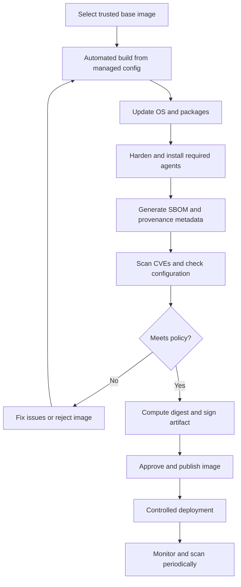

# Checking Image Vulnerabilities, Integrity, and Provenance

A machine image is the foundation for creating virtual machines in the cloud. An image typically contains the operating system, bootloader, drivers, system libraries, management agents, and part of the initial configuration. If an image contains vulnerabilities, has been altered without authorization, or lacks clear provenance, every virtual machine created from that image can inherit the same risks.

Therefore, image management must answer three distinct questions: does the image contain vulnerable components; has the image's content been modified unexpectedly; and does the organization have trustworthy evidence of where the image was built, how it was built, and who approved it? These three questions correspond to **vulnerability checking**, **integrity**, and **provenance**. Combining them into an end-to-end process for building, inspecting, signing, publishing, and updating images makes cloud compute infrastructure more reproducible, controllable, and secure to operate.

## 1. Virtual Machine Images and the Scope to Protect

A machine image is a template used to launch virtual machines. Depending on the platform, an image may be called a machine image, VM image, AMI, managed image, or an image inside an image gallery. An image typically includes:

- The operating system and system packages.
- Bootloader, kernel, and boot configuration.
- Drivers, monitoring agents, management agents, and security tools.
- Libraries, runtimes, and foundational software.
- Baseline network, logging, update, and system policy configurations.
- Configuration files or initialization scripts permitted for packaging by the organization.

An image may be built from a provider's standard image, a marketplace image, an internal image, or a snapshot of a running virtual machine. These sources offer different levels of trust and control. A snapshot reflects machine state at a point in time, but does not automatically prove the machine was patched, properly configured, or free of secrets.

This lesson focuses on virtual machine and operating system images. Container images follow a similar inspection process for SBOM, vulnerabilities, signatures, and provenance, though distribution mechanisms, filesystem layers, and runtimes have distinct differences.

## 2. Distinguishing Vulnerabilities, Integrity, and Provenance

These three concepts are related, but cannot substitute for one another:

| Concept | Question to Answer | Common Evidence |
|---|---|---|
| Vulnerability checking | Does the image contain packages, kernel, or configs with known weaknesses? | Vulnerability scan results, package list, CVEs, configuration reports |
| Integrity | Does the image match the exact approved content without modification? | Hash/digest, digital signature, signature verification, write access controls |
| Provenance | Where was the image built, by what process, from what inputs, and who approved it? | Build metadata, SBOM, build attestation, pipeline history, and publisher identity |

An image may have no known CVEs yet still carry embedded malware. A validly signed image can still contain outdated software packages. A digest can confirm two copies are identical, but cannot tell you who produced that content. Therefore, all three control groups must be combined.

## 3. Checking Vulnerabilities in Images

**Vulnerability scanning** is the process of comparing software and configurations in an image against vulnerability databases, security policies, and configuration benchmarks. Scanners typically detect the operating system, package manager, package names, versions, libraries, and selected configuration files.

Results may reveal:

- OS packages at versions affected by a CVE.
- Kernels or system components missing security fixes.
- Runtimes, libraries, or agents on unsupported versions.
- Unnecessary services installed or enabled by default.
- Weak configurations such as SSH permitting direct root login, weak passwords, or overly broad file permissions.
- An image using an operating system version that has reached end of support.

### 3.1. CVEs and Severity Levels

CVE (Common Vulnerabilities and Exposures) is an identifier for a publicly disclosed vulnerability. A scan result may include a CVSS score or severity rating such as Critical, High, Medium, and Low. CVSS helps describe technical severity, but does not by itself reflect full risk in a specific environment.

When prioritizing remediation, also consider:

- Can the vulnerability be exploited over the network or only from a local account?
- Is the affected service or component actually enabled and reachable?
- Are active exploits occurring in the wild, or is public exploit code available?
- Does the VM hold sensitive data, high privileges, or sit in a critical network zone?
- Has the OS vendor released a patch or advisory?
- Are there verified temporary mitigations available?

Do not prioritize remediation solely by CVSS score. A high-score vulnerability in a component that is neither installed nor reachable may pose lower actual risk than a vulnerability actively exploited on a public-facing service.

### 3.2. Pay Attention to Backported Patches

Some Linux distributions backport security fixes into their maintained package versions without necessarily bumping upstream version numbers in an obvious way. Consequently, scanners that only compare version strings may report false positives if they do not understand the distribution's backport rules.

When verifying findings, cross-check the distribution's official security advisories, package releases, and patch status. Never assume a package is safe merely because its version number looks newer; conversely, do not manually upgrade packages outside supported channels if doing so breaks system dependencies.

### 3.3. Image Scanning vs. Scanning Running Machines

Scanning an image before release catches issues before VMs are provisioned. Scanning running machines detects post-launch changes, such as manually installed packages, missing patches, or configuration drift.

These two activities complement each other:

- **Image scanning:** evaluates packaged contents at build time.
- **Instance scanning:** evaluates the actual state of the machine after launch and throughout its lifecycle.

An image that passed at build time can still become vulnerable weeks later when a new CVE is disclosed. Conversely, a manually patched machine may diverge from the standard image and become hard to reproduce. Schedule periodic scans and maintain an image rebuild mechanism to roll out patches.

## 4. SBOM: Knowing What an Image Contains

An SBOM (Software Bill of Materials) is an inventory of software components contained within a product or image. For a virtual machine image, an SBOM can list OS packages, libraries, runtimes, applications, and version details.

An SBOM helps organizations:

- Identify which images are affected when a new CVE emerges.
- Trace packages with origins or licenses requiring review.
- Compare components between two image releases.
- Support audits and software supply chain incident investigations.
- Identify unmaintained or unnecessary packages.

Common formats include SPDX and CycloneDX. The chosen format should align with the organization's scanners, asset management systems, and integration requirements.

An SBOM is only useful when it accurately reflects actual contents. Generate it from the built artifact or from the image's package database/filesystem, store it alongside the image version and build timestamp, and regenerate it on every rebuild. An SBOM is not a certification that an image is secure; it is input data for risk analysis.

## 5. Integrity: Hashes, Digests, and Digital Signatures

Integrity ensures the image used matches the exact version that was inspected and approved. Two common mechanisms are hashes/digests and digital signatures.

### 5.1. Hashes and Digests

A hash is a value computed from data. Given identical content and algorithm, the resulting digest is identical; altering the data changes the digest. SHA-256 is a commonly used cryptographic hash algorithm.

Example computing the SHA-256 of a downloaded image file on Linux:

```bash
sha256sum ./golden-image.raw
```

On PowerShell:

```powershell
Get-FileHash -Algorithm SHA256 .\golden-image.raw
```

Digests help detect when content differs from what was recorded. However, if an attacker can replace both the image and the file recording the digest, comparing them provides no trustworthy proof. Digests must be stored in an access-controlled system and tied to an approval workflow.

### 5.2. Digital Signatures

A digital signature binds an image's digest or metadata to the publisher's private key. Recipients use the public key or a trusted certificate to verify the signature. If the image is modified after signing, verification fails.

Basic workflow:

1. Build the image and compute its digest.
2. Generate metadata describing the image, version, source inputs, and inspection results.
3. Use a protected signing key to sign the digest or artifact/attestation in the chosen format.
4. Publish the image alongside its signature and supporting evidence.
5. Prior to deployment, verify the signature, signer identity, trust policy, and digest.

A valid signature proves the artifact matches what was signed by that identity within the trust model. It does not prove the image is vulnerability-free. If the signing key is compromised or the signing identity is uncontrolled, a signature may be cryptographically valid yet operationally untrustworthy.

### 5.3. Protecting Signing Keys

Private keys must be protected using a key management service or controlled signing mechanism. Restrict key usage by pipeline identity, environment, and release role. Log signing operations, rotate keys per policy, and maintain procedures to revoke or distrust compromised keys.

Never place private keys, access tokens, or cloud credentials inside an image. Images are copied across environments and may be used by multiple teams; packaged secrets are hard to revoke and easily exposed through snapshots or backups.

## 6. Image Origin and Provenance

**Image provenance** is verifiable information about the origin and creation process of an image. Provenance answers:

- Which base image or artifact did this image start from?
- Which OS version and package repositories were used?
- Which pipeline, scripts, and configurations produced the image?
- Where, when, and under which identity did the build occur?
- Did scanning, configuration checks, and approvals succeed?
- Is the final artifact the exact one published by that build?

A solid provenance record is typically tied to the image digest and may include:

- Base image name and version, along with ID or digest if provided by the platform.
- Commits for configuration code, build scripts, and tool versions.
- List of repositories and package sources.
- Build timestamp, pipeline run ID, and workload identity executing the build.
- SBOM, scan reports, and configuration check results.
- Identity of the person or group approving the release.
- Signatures and attestations protecting the metadata.

Provenance can be represented using standards or formats such as in-toto attestations and SLSA provenance. Organizations do not need to adopt every standard simultaneously; what matters is defining required data, verification methods, and evidence storage.

### Marketplace Images and Provider Images

Marketplace images can accelerate deployment, but require checking the publisher, OS, version, update date, support terms, and security update delivery method. "Verified" badges or branding on a marketplace must be understood per the platform's verification criteria; they do not replace reviewing image contents and internal requirements.

Cloud-provider-published images typically carry publisher and version metadata. Organizations still need to verify image ID, region, CPU architecture, support status, and update schedule. When building internal images from a base image, record the source ID to trace inheritance lineage.

## 7. Golden Images and Secure Build Workflows

A **golden image** is a standard image selected, configured, tested, and approved by the organization to serve as the foundation for virtual machines. It reduces configuration differences across environments, simplifies patching, and supports auditing.

An image build workflow may include the following steps:



Principles to apply:

- Build images via repeatable pipelines with version control and audit logs.
- Use base images from approved sources, prioritizing supported releases.
- Update packages from trusted repositories and verify repository signatures where supported.
- Install only required software to minimize attack surface.
- Disable unnecessary default services, ports, and accounts.
- Never embed secrets, private keys, tokens, or personal data in images.
- Generate SBOM, scan, and check configurations prior to signing.
- Store digests, signatures, provenance, and approval results alongside the image version.
- Restrict permissions to create, edit, share, and delete images in the cloud account.

## 8. Hardening and OS Configuration Checks

Vulnerability scanning focuses on known software flaws; hardening focuses on configurations that reduce the attack surface. Both activities must work together.

Basic hardening items:

| Item | Checks |
|---|---|
| Accounts and authentication | Remove unnecessary default accounts, restrict privileged logins, use SSH keys or managed identity mechanisms |
| System services | Disable unnecessary daemons, services, and ports |
| SSH/RDP | Restrict access sources, configure strong authentication, enable logging, and manage access rights |
| Firewall | Apply host firewalls and security groups following least privilege |
| File permissions | Check permissions on configuration files, keys, logs, and system directories |
| Updates | Enable or configure security update workflows and define reboot handling when needed |
| Logging | Enable system logs, time synchronization, and forward logs to centralized storage |
| Encryption | Enable volume/snapshot encryption as required and protect keys with KMS or equivalent service |
| Boot integrity | Evaluate Secure Boot and boot chain verification mechanisms if supported by the platform |
| Management agents | Install agents only from trusted sources; verify permissions and update mechanisms |

Baselines like CIS Benchmarks can serve as configuration check references, but select a profile appropriate to the OS and machine role. Blindly enforcing every recommendation without testing can break services or block management tools. Record exceptions with rationale, approver, and review expiration dates.

## 9. Secure Boot, Measured Boot, and Boot-Time Integrity

Image integrity must be considered both at rest and when the machine boots.

**Secure Boot** verifies signatures of components in the boot chain against trusted key policies. It helps prevent unauthorized boot components from executing in supported configurations. Whether Secure Boot can be enabled depends on the hypervisor, VM type, virtual firmware, and operating system.

**Measured Boot** records cryptographic measurements of boot components into protected storage such as a TPM or vTPM. These measurements can be used to evaluate boot state or support remote attestation when supporting infrastructure is present.

These two mechanisms serve different roles: Secure Boot enforces execution rights along a chain of trust; measured boot records state for external evaluation. They complement each other, but do not guarantee the running OS cannot be exploited after boot. Patching, runtime protection, and machine monitoring remain essential.

## 10. Publishing, Distributing, and Controlling Image Access

Once an image passes inspection, publish it in a way that prevents unintended changes.

- Assign a clear version, such as `ubuntu-app-2026.11.22-v3`, and record the corresponding image ID/digest.
- Store images in a controlled project, subscription, or account.
- Grant image creation rights only to authorized pipelines and operations teams.
- Grant image usage or sharing permissions only to required environments.
- Verify digest/signature before copying an image to another region or account.
- Track copies and old images to prevent accidental deployment of stale versions.
- Mark expired images or revoke them from the approved list when risks arise.

Images can be copied across regions, accounts, or subscriptions. Verify metadata, digests, and signatures after copying; some platforms assign a different ID to copies even when logical content is identical. A content digest is a stronger comparison anchor than display names or mutable IDs, provided the platform exposes a trustworthy digest.

Never allow users to arbitrarily share images containing internal data, pre-configured accounts, or sensitive information. Prior to release, clean logs, caches, shell history, temporary credentials, and build-machine data.

## 11. Updating Images and Managing Lifecycle

An image is an artifact with a lifecycle. A once-compliant image can become unsafe when the OS reaches end of support or new CVEs emerge. Define both scheduled and event-driven rebuild policies.

Events that can trigger a rebuild:

- A critical security patch is disclosed.
- The OS or a foundational package approaches end of support.
- Drivers, agents, or runtimes release necessary fixes.
- Scanners detect vulnerabilities exceeding policy thresholds.
- Hardening standards or compliance requirements change.
- Build scripts or package sources are updated.

An update workflow should build a new image with a new version, re-run scans and checks, and publish through the approval workflow. Avoid manually editing a published image and reusing the same version name; that breaks traceability and complicates investigations.

### Replacing Running Machines

Once a new image is approved, organizations can provision new machines from that image and migrate workloads appropriately. For stateless services, replace via rolling deployment or blue/green strategies. For stateful machines, design backups, data synchronization, recovery verification, and maintenance windows prior to machine replacement.

Not every patch requires immediately creating a new image; some environments have live-patching workflows. However, if patching live machines, manage configuration drift and ensure the next standard image includes the patch, otherwise newly launched machines will revert to a vulnerable state.

## 12. Handling Findings and Security Exceptions

Not all scanner findings carry the same certainty or remediation path. A handling workflow should include:

1. **Confirm finding:** check package, version, OS, advisory, and affected conditions.
2. **Assess risk:** evaluate exploitability, exposure, data sensitivity, and workload privileges.
3. **Select action:** upgrade package, swap base image, disable component, apply mitigating config, or isolate temporarily.
4. **Test:** confirm applications and agents still function after the change.
5. **Re-scan:** run scanners and configuration checks after remediation.
6. **Document:** record evidence, assignee, timestamp, and outcome.

If immediate patching is not possible, exceptions must specify an owner, rationale, impact scope, compensating controls, expiration date, and review schedule. Never allow exceptions to persist indefinitely simply because the image is already used in production.

## 13. Example Image Inspection Pipeline

The following example illustrates pipeline logic. Actual scanner commands, signing tools, and provenance systems depend on the organization's stack.

```text
1. Fetch base image from an approved source
2. Build image from scripts managed in version control
3. Update OS and packages
4. Apply hardening and install required agents
5. Generate SBOM tied to the build version
6. Scan for CVEs and check configuration compliance
7. If thresholds violated: halt release, create remediation ticket
8. If passing: compute digest and generate provenance attestation
9. Sign digest/attestation using a protected key
10. Obtain approval from authorized person or policy gate
11. Publish image to controlled registry
12. Verify signature prior to deployment
13. Monitor image and instances post-release
```

A release policy might require zero Critical vulnerabilities, no unmitigated actively exploited vulnerabilities, an OS within its support window, a recent scan close to release time, a valid signature, and complete provenance. Specific thresholds should reflect organizational risk tolerance and deployment environment.

## 14. Common Mistakes

**Scanning only once when creating the image.** CVE databases evolve continuously; published images can acquire new risks. Scan on both a schedule and event triggers.

**Believing a signature equals security.** A signature proves the artifact matches signed content and signer identity, not that it is free of vulnerabilities. Scanning and configuration checks are still mandatory.

**Storing only the image name.** Names or tags can be reassigned. Record IDs, digests, versions, and provenance metadata.

**Failing to verify the base image source.** An internal image can inherit vulnerabilities or weak configs from an upstream image. Record lineage and scan both base and final images.

**Baking secrets into the image.** Secrets can be copied across environments or leaked via snapshots. Fetch secrets at runtime from a secret management service with least privilege.

**Ignoring packages unrecognized by scanners.** Manually installed software, static binaries, or internal applications may not appear in package databases. Combine SBOMs, inventories, and filesystem checks.

**Patching production machines directly without updating the golden image.** Existing machines may become safer while new machines still boot from the stale image. Feed patches back into the build pipeline.

**Over-sharing images.** Broad sharing permissions can expose internal software or accidentally packaged data. Control permissions and clean images before release.

## 15. Pre-Release Image Checklist

- [ ] Base image comes from an approved publisher or source.
- [ ] OS and packages remain within their support lifecycle.
- [ ] Security patches are applied and relevant advisories checked.
- [ ] Vulnerability scan completed and findings above thresholds resolved or covered by valid exceptions.
- [ ] Hardening verified against an appropriate baseline.
- [ ] Secrets, credentials, logs, and sensitive data removed from the image.
- [ ] SBOM generated and linked to the exact image version/digest.
- [ ] Base image, commit, pipeline, package sources, and build identity recorded.
- [ ] Digest computed, artifact or attestation signed, and signature verified.
- [ ] Signing keys are protected and publishing permissions restricted.
- [ ] Image published with a clear version in a controlled registry.
- [ ] Image sharing and usage permissions scoped to need.
- [ ] Schedules established for re-scanning, rebuilding, deprecation, and replacement.
- [ ] Launched a test machine from the image and verified post-boot configuration.

## 16. Conclusion

Vulnerability checking tells you whether an image has vulnerable components or configurations; integrity checking confirms the image has not been altered relative to the approved artifact; provenance establishes where, how, and under whose identity the image was built. SBOMs, digests, digital signatures, attestations, scans, and hardening provide complementary evidence to govern all three aspects.

A secure image process must start from a trusted base source, automate builds, apply updates and hardening, generate SBOMs, scan for vulnerabilities, sign, and publish under strict control. After deployment, continue scanning instances, tracking changes, and rebuilding when new patches or requirements emerge. This approach ensures virtual machines are created consistently, remain traceable, and reduce the risk of inheriting flaws from outdated or untrusted images.
