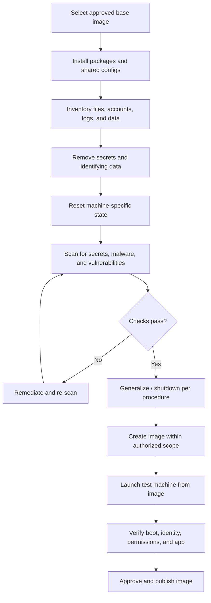
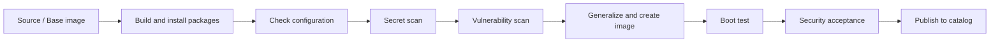

# Removing Secrets and Identifying Data Before Creating an Image

A machine image is typically used as a template to create multiple virtual machines or identical runtime environments. An image may contain the operating system, runtimes, libraries, monitoring agents, and application configurations. If an image is captured from a machine that has previously operated in production or testing, it may also inadvertently carry passwords, SSH keys, access tokens, private certificates, command history, logs, or user data.

A secret placed into an image can be copied to every machine created from that image. If the image is shared, exported externally, or stored in a registry with overly broad permissions, the blast radius grows even wider. Therefore, before capturing an image, you must inventory and remove secrets and identifying data, verify the results, and control image access permissions and lifecycle.

After this lesson, you will be able to:

- Identify the types of secrets and identifying data that may exist on a source machine.
- Explain why simply deleting files does not guarantee data is removed from an image.
- Execute a workflow to prepare, sanitize, and verify an image before capture.
- Design runtime secret provisioning using workload identity or a secret management service.
- Respond properly when sensitive information is discovered to have leaked into an image or its copies.

## 1. Why Sanitize Before Creating a Machine Image?

When creating an image, the platform typically captures the disk state of a source machine at a point in time. Files and configurations remaining on disk can become part of the image, including data unnecessary for new machines. For example, a machine used to install applications and run tests may have logged into management systems, downloaded sample data, executed commands containing tokens, or written connection details into logs.

The image may then be used to:

- Launch multiple virtual machines within the same project.
- Share across teams or cloud accounts.
- Replicate to other regions for deployment closer to users.
- Store in an image catalog or long-term repository.
- Export as a file for transfer to another environment.

If a private key or token is stored in an image, every copy may carry the exact same credentials. If customer data or logs containing personal information reside in the image, new machines may receive that data despite having no need for it. This creates security, privacy, compliance, and asset governance risks.

Image sanitization is part of securing the software and infrastructure supply chain. It must be performed prior to image creation, paired with automated scanning and sharing access controls.

## 2. Distinguishing Secrets, Identifying Data, and Machine Configuration

Not every piece of configuration is a secret. Classify data to determine what must be removed, what can be kept, and what must be regenerated on the next boot.

### Secrets

Secrets are data that allow an individual or system to authenticate, access resources, or decrypt data. Examples include:

- User account passwords, administrative passwords, and database passwords.
- SSH, TLS, PGP private keys, or software signing keys.
- API keys, access tokens, refresh tokens, and OAuth client secrets.
- Cloud access keys, service account keys, and workload or service account credentials.
- Digital certificates accompanied by private keys, keystores, and truststores containing sensitive material.
- Kubeconfig or config files containing tokens and certificates with cluster access.
- `.env` files, application configs, or scripts containing passwords, connection strings, or secret keys.
- Active session cookies, browser profiles, or credential caches.

A value not named `password` can still be a secret. For instance, a database connection string may embed a username and password; a token inside a URL or debug header can also grant access.

### Identifying Data and Sensitive Operational Data

Identifiers can link information to a person, organization, account, or system. Depending on context, they may constitute personal data or internal information requiring protection:

- Full names, emails, phone numbers, usernames, and employee IDs.
- Customer IDs, tenant IDs, cloud account numbers, or project IDs.
- IP addresses, hostnames, internal domains, machine names, and network diagrams.
- Directory paths containing usernames, organization names, or customer names.
- Logs containing requests, session IDs, IP addresses, emails, request payloads, or transaction data.
- Sample databases, dumps, uploaded files, and support bundles taken from live environments.
- Access histories, browser histories, recent files, and lists of connected hosts.

A resource ID or IP address is not necessarily an authentication secret. However, they can expose system architecture, organizational identity, or facilitate reconnaissance. Evaluate them against your organization's data policy and threat model.

### Machine-Unique Identity State

Some data is neither a secret nor personal data, yet should not be cloned verbatim across multiple machines:

- Machine-specific SSH host keys and certificates.
- Machine ID, hostname, cloud-init instance state, and agent registration data.
- DHCP leases, static network addresses, routes, or DNS settings specific to the source machine.
- Monitoring agent IDs, configuration management registration IDs, or machine-bound software license IDs.
- Metadata caches, session state, and service state tied to the old instance.

If these values are copied, multiple machines may assume the same identity. That causes confusion during inventory, monitoring, certificate issuance, policy enforcement, or incident investigation.

## 3. Common Locations Containing Sensitive Data

When inspecting a source machine, do not check only a single `secrets` directory. Secrets and identifying data can be scattered across multiple layers.

| Location | Examples of Data to Inspect | Common Remediation |
|---|---|---|
| User home directories | `.ssh`, `.aws`, `.azure`, `.config`, `.kube`, `.docker`, `.git-credentials` | Remove credentials that do not belong in the image; keep sanitized sample configs only if genuinely needed |
| Shell and terminal history | `.bash_history`, `.zsh_history`, PowerShell history, temporary scripts | Clear history containing sensitive commands; never use command history to store secrets |
| Application configurations | `.env`, YAML/JSON/TOML, properties files, connection strings | Move secrets to a secret manager; retain only non-sensitive configuration |
| Keys and certificates | SSH private keys, TLS private keys, keystores, PFX/P12 files | Never bake environment-specific private keys; provision appropriate certs at runtime |
| Logs and reports | `/var/log`, application logs, crash dumps, support bundles | Inspect contents, strip real data, retain necessary audit logs in a protected log store |
| Caches and temporary data | `/tmp`, package caches, browser caches, build caches | Delete unnecessary data; check whether caches hold private artifacts or tokens |
| System state data | `/etc/machine-id`, cloud-init state, SSH host keys, DHCP leases | Reset per OS and platform guidelines prior to capturing the image |
| Windows profiles and registry | Credential Manager, PowerShell history, user profiles, certificate store | Remove credentials and user data; run the appropriate generalize procedure |
| Application data | Database dumps, uploaded files, test fixtures taken from production | Remove or replace with approved synthetic data |

The paths above are common examples only. Every operating system, distribution, agent, and application has its own locations. Use a checklist tailored to the base image and actually installed software.

## 4. Principles for Secure Image Design

A good image should contain the components needed to boot and run the workload while avoiding data tied to a specific person, account, or machine.

Key principles:

1. **Build from a clean source:** prioritize approved base images and repeatable build processes. Avoid turning a long-running production machine into a template.
2. **Never bake secrets:** never store passwords, API keys, tokens, private keys, or cloud credentials inside the image, build scripts, metadata, or image layers.
3. **Provision secrets at runtime:** use IAM roles, workload identities, or a secret manager so workloads retrieve the exact secrets needed at startup.
4. **Keep shared config, generate unique identities:** hostnames, machine IDs, SSH host keys, and agent registration state must be initialized uniquely for each instance.
5. **Use safe sample data:** test using synthetic data or data anonymized according to an approved process.
6. **Reduce attack surface:** install only necessary packages, services, tools, and accounts; disable unused services.
7. **Automate and verify:** perform builds, secret scans, vulnerability scans, and configuration checks before publishing an image.
8. **Control permissions and lifecycle:** restrict who can create, share, copy, use, or delete images; track versions and owners.

Do not place secrets inside an image on the grounds that "only internal teams have access." Images can be copied, downloaded, attached to other machines, or retained longer than expected. Image access permissions must be protected, yet the design should still assume image contents can be read by anyone granted read access.

## 5. Pre-Capture Sanitization Workflow

The workflow must fit the operating system and image management tooling. A general flow can follow these steps:



### Step 1: Define Image Source and Purpose

Document which operating system, workload, and environment the image targets, along with who owns it. Verify the base image source, signature or checksum if available, version, update date, and support policy. Install only required packages.

If the image serves multiple environments, keep shared configuration inside the image and supply environment-specific configuration at deployment time. For example, an API image can contain the runtime and agents, while database endpoints, domain names, tenants, and access permissions are injected at runtime.

### Step 2: Inventory Data on the Source Machine

List users and groups, home directories, service accounts, keys, certificates, configuration files, environment variables, command history, logs, caches, temporary data, and registered management software. Inspect hidden files, build directories, backup files, and archive contents as well.

Search using a secret-scanning tool across multiple patterns, but do not rely solely on regexes. A random string can be a token even without an obvious variable name; a password may be encoded or split across multiple parts in config. Combine automated scanning with scoped manual inspection.

### Step 3: Remove Secrets and Switch to Runtime Provisioning

Remove unnecessary credentials from the source machine, configurations, and scripts. If an application needs to access cloud services, assign a workload identity or instance role with least privilege. If passwords or tokens are needed for external services, fetch them from a secret manager at runtime and bound lifetimes wherever possible.

For example, a safer application configuration may contain only the secret name or a reference to the secret:

```yaml
application:
  database:
    host: orders-db.internal.example
    name: orders
    credentials_source: secret-manager
    secret_reference: production/orders/database
```

This is an illustrative configuration. `secret_reference` is a reference name, not the secret content itself. The workload identity must be granted permission to read the corresponding secret in the target environment.

### Step 4: Remove Identifying Data and Unnecessary Operational Data

Remove customer data, transaction data, uploaded files, logs containing personal data, and dumps that do not belong to the image's purpose. If test data must remain, replace it with synthetic data or data anonymized per policy.

Not all logs should be deleted. Audit logs or data required for investigations may need to be retained for a defined retention period. In that case, ship the logs to a centralized system with access controls and retention policies, then clean local copies from the image. Do not erase audit trails required for compliance or investigative obligations.

### Step 5: Reset Machine-Specific State

Prepare new machines to receive unique identities. Depending on the platform, delete or reset the machine ID, SSH host keys, cloud-init state, DHCP leases, static hostname, agent registration data, and caches bound to the old instance. On Windows, run the supported generalize workflow, such as the system preparation tool appropriate for the Windows version and the provider's image capture process.

Do not arbitrarily delete system files just because their names look special. Follow the OS and cloud provider instructions to avoid rendering the image unbootable or stripping essential configuration.

### Step 6: Scan and Verify

Run secret detection tools, package vulnerability scanners, security configuration checks, and leftover file sweeps. Confirm there are no shared credentials, customer data, login histories, or source-machine identifiers that must be freshly generated.

If a scanner flags findings, triage false positives vs. true positives with evidence. Do not simply suppress alerts by adding broad exceptions. Exceptions require justification, narrow scope, an approver, and a review expiration date.

### Step 7: Generalize, Shut Down, and Capture the Image

Execute the generalize or cleanup step using the OS's tooling. Shut down the machine following the provider's image capture procedure to avoid flushing incomplete writes. Create the image with clear naming, version, provenance, build date, owner, and approval status.

### Step 8: Launch a Test Machine from the Image

Create a test instance from the newly published image. Confirm the machine boots, generates unique identifiers, receives runtime configuration, retrieves secrets using the proper identity, connects to required services, and carries no data from the source machine. Check boot logs, access permissions, and update capability.

## 6. Inspection Examples on Linux

The commands below are illustrative aids for inventorying. Adjust paths, permissions, and tools to match your distribution and organizational standards. Run on an approved build machine, and back up or snapshot before making major system changes.

### Checking Common Locations

```bash
# List home directories to define inspection scope
ls -la /home

# Check common directories that may contain credentials
find /home -maxdepth 4 \
  \( -name '.ssh' -o -name '.aws' -o -name '.azure' \
     -o -name '.kube' -o -name '.docker' \) -print

# Check environment config files, printing filenames only
find /opt /srv /etc -type f -name '.env' -print 2>/dev/null

# Check common shell history files
find /home -maxdepth 3 \
  \( -name '.bash_history' -o -name '.zsh_history' \) -print
```

Do not use `cat`, `grep`, or similar commands to print full credential contents into terminal logs or CI records. If contents must be inspected, use tooling capable of redacting sensitive values and restrict who can view the output.

### Secret Scanning

You can integrate a secret scanner into the build pipeline. The example below shows invoking a hypothetical scanning tool; replace the command name and flags with the tool approved by your organization:

```bash
# Illustrative example; replace secret-scanner with your actual tool
secret-scanner scan --path /image-root --redact --fail-on-findings
```

Scan results must be stored in an access-controlled location. Result records should list paths, finding types, severity, and remediation status without recording raw secret values.

### Cleaning Identifying Data

Commands to reset machine ID, SSH host keys, cloud-init, and agent registrations vary by OS and platform. Use a standardized script tested for the exact base image. Do not copy a generic deletion command from another environment into a production pipeline without testing its impact.

`rm` only removes filesystem references to a file; it does not guarantee bytes have vanished from blocks, snapshots, or backups. On SSDs, thin-provisioned disks, copy-on-write filesystems, and cloud storage, file-overwriting commands also do not guarantee physical erasure of old data. A safer approach is to rebuild from a clean base image, keep sensitive data out of the build process altogether, and manage encryption/storage per policy.

## 7. Image Preparation Examples on Windows

Windows machines can store credentials in Credential Manager, certificate stores, user profiles, PowerShell history, the registry, logs, and temporary folders. An image captured from a machine that was joined to a domain or signed into admin tools may carry machine-specific state.

Checklist before creating a Windows image:

- Inspect user accounts, profiles, and files in Desktop, Downloads, Documents, and AppData.
- Review Credential Manager, credentials saved in applications, browser profiles, and PowerShell history.
- Inspect the certificate store, private keys, PFX/P12 files, SSH keys, and cloud CLI credentials.
- Check environment variables, config files, deployment scripts, and application logs.
- Remove personal data, dumps, test files containing real data, and unnecessary caches.
- Run the supported generalize workflow for the Windows version and cloud service in use.
- Launch a test machine from the image and verify SID/identifiers, hostname, certificates, agents, and access permissions are generated properly for the new instance.

Do not arbitrarily delete registry keys, certificate stores, or system folders from a generic list. Some components are required for booting or system registration. Follow the official standardization procedure and test the image after creation.

## 8. Why Deleting Secrets After Exposure Is Not Enough

Suppose an API token was written into a config file, and the file was later deleted before capturing the image. Depending on the storage system, old data may still linger in unallocated blocks, snapshots, backups, caches, or image layers. If the token was ever committed to Git or included in a build artifact, deleting the file in a newer version does not remove the token from past history.

When a secret is discovered to have leaked into an image or pipeline, treat it as a credential exposure incident:

1. **Revoke or rotate the secret:** invalidate the old token/key, issue a new credential, and update workloads that need it. Deleting a file does not invalidate an active credential.
2. **Assess scope:** identify which images, snapshots, copies, registries, accounts, and environments received the data.
3. **Restrict access:** lock sharing or download permissions on the affected image during investigation; preserve necessary evidence per incident response procedures.
4. **Rebuild from a clean source:** fix the pipeline, strip sensitive data, and re-scan the entire new artifact.
5. **Handle old copies:** revoke, deprecate, delete, or quarantine affected images and snapshots per retention policy and investigative needs.
6. **Check for unauthorized use:** review authentication logs and resource activity using authorized security tools.
7. **Prevent recurrence:** add secret scanning, pre-release checks, least privilege, and runtime secret injection workflows.

If the image was shared outside the organization, assume recipients may have copied it. Revoking image access permissions cannot retract downloaded copies; rotating credentials and assessing exposed data remain mandatory.

## 9. Managing Secrets After the Image Is Created

An image should contain code and non-sensitive configuration. Secrets are provisioned based on the workload's identity at runtime.

### Using Workload Identity or Instance Roles

Instead of storing access keys in files, assign an identity to the instance, container, or workload. The platform issues temporary credentials tied to that identity. Permissions should be scoped by action, resource, and required duration.

For example, an order-processing service only needs permission to read one secret and write to one queue. Do not grant full cloud account administrative permissions to the instance just to perform those two tasks.

### Using a Secret Manager

A secret manager stores and distributes passwords, tokens, certificates, or keys according to policy. Applications authenticate using workload identity; read permissions are scoped by secret and environment. Rotation, audit logging, and secret versioning can be enabled depending on the service.

Never log secrets at startup. If an application needs to report configuration status, log only the secret name or success/failure status—never the value.

### Separating Configuration by Environment

Dev, test, staging, and production should each have distinct secrets. A shared image can be used across multiple environments, while identities and secrets are provisioned per deployment target. Avoid packaging a production credential into an image used for testing.

## 10. Automating Image Checks in the Pipeline

An image pipeline can enforce security checks before allowing publication. Steps should be automated so every version adheres to the same standard.



Example conceptual pipeline definition:

```yaml
image_pipeline:
  base_image: approved-linux-base
  steps:
    - install_required_packages
    - apply_os_updates
    - apply_baseline_configuration
    - remove_build_credentials
    - reset_machine_specific_state
    - scan_secrets:
        fail_on_unapproved_findings: true
        redact_output: true
    - scan_vulnerabilities:
        enforce_policy: true
    - create_image
    - boot_test:
        verify_unique_machine_identity: true
        verify_runtime_secret_injection: true
  publish:
    require_approval: true
    record_source_and_version: true
```

This is an illustrative example, not syntax for a specific CI tool. A real pipeline must integrate with your organization's image builder, secret scanner, vulnerability scanner, approval system, and image catalog.

### Release-Blocking Criteria

Do not release an image if any of the following issues remain:

- Valid secret findings that are unresolved or lack an approved exception.
- Customer data or personal data that does not belong to the image's purpose.
- Private keys or source-machine identifiers that would be cloned across instances.
- Vulnerabilities exceeding policy thresholds or packages of unknown provenance.
- Test machines fail to boot, fail to receive unique identifiers, or fail to retrieve required configuration.
- Missing traceability for image source, version, owner, or approver.

Exceptions require scope, justification, compensating controls, an approver, and an expiration date. Never turn exceptions into a permanent bypass for checks.

## 11. Post-Release Image Governance

Pre-capture sanitization is only part of the lifecycle. Images must be managed as versioned artifacts with clear ownership.

- Assign consistent names and versions; record base image, commit or build ID, packages, build date, and approver.
- Allow only authorized teams to create, share, and delete images.
- Scope access permissions by project or environment; restrict public images unless clearly justified.
- Track aging images, end-of-support images, and images affected by newly disclosed vulnerabilities.
- Define retention periods and revocation workflows for images no longer permitted for use.
- When critical security patches arrive, build a new image and replace instances using a safe deployment workflow.
- Store build evidence, scan results, and approval history in an access-controlled system.

Never edit a published image directly to hide changes. Build a new version from reproducible sources, re-scan, and publish through the workflow. This ensures you can determine the exact image running in every environment.

## 12. Common Mistakes

**Deleting only the `.env` file.** Secrets may still linger in shell history, logs, backup files, build layers, snapshots, or Git history. Scan the entire scope and rotate exposed credentials.

**Using a single SSH private key across all machines.** If the key is compromised on one instance, every machine sharing that key can be affected. Each person or workload needs its own identity, and host keys must be generated uniquely per machine.

**Putting production data into an image for testing.** Real data can get replicated to inappropriate environments. Use synthetic data or data anonymized according to policy.

**Believing `rm` or `shred` always erases data cleanly.** Snapshots, copy-on-write, SSDs, and block storage can retain older copies. Prefer rebuilding from a clean source and rotating any credential that ever appeared.

**Deleting all logs before capturing an image.** Some logs are needed for auditing or investigations. Ship required logs to a protected central store, then strip unnecessary local copies from the image.

**Ignoring machine identifiers.** Duplicate machine IDs, SSH host keys, or agent IDs cause confusion and security bugs. Generalize the image and test new machines after boot.

**Assuming private images do not need sanitization.** Anyone with read access to the image can access the data inside. Access restrictions and keeping secrets out must be enforced together.

## 13. Pre-Capture and Pre-Release Image Checklist

### Before Capturing the Image

- [ ] Defined purpose, environment, owner, and base image source.
- [ ] Inventoried accounts, home directories, credentials, keys, certificates, and secrets.
- [ ] Checked config files, environment variables, scripts, shell history, and build artifacts.
- [ ] Checked logs, crash dumps, caches, backups, temporary files, and application data.
- [ ] Removed personal data, customer data, and unnecessary identifying information.
- [ ] Migrated required secrets to IAM/workload identity or a secret manager.
- [ ] Reset machine-specific state per OS and cloud provider instructions.
- [ ] Executed secret scan, vulnerability scan, and configuration checks.
- [ ] Preserved necessary audit logs in a controlled centralized system.

### After Creating the Image

- [ ] Launched a test machine and confirmed successful boot.
- [ ] Confirmed hostname, machine ID, SSH host keys, and agent identity are uniquely generated.
- [ ] Confirmed the workload receives the right configuration and secrets at runtime.
- [ ] Confirmed the image contains no credentials or data from the source machine.
- [ ] Verified image access permissions, sharing scope, version, and metadata.
- [ ] Archived scan results, provenance details, and release approvals.
- [ ] Scheduled updates, deprecation, and deletion of older images.

## 14. Self-Check

1. Why can a machine image amplify the blast radius when an access token is placed inside it?
2. Distinguish between secrets, identifying data, and machine-unique identifiers. Give an example of each.
3. Which locations on Linux or Windows commonly store credentials outside application configuration files?
4. Why might deleting a file containing a token before creating an image fail to eliminate the risk if the token appeared in snapshots or Git history?
5. Why must machine IDs and SSH host keys be generated uniquely for each instance?
6. Explain how to provision secrets to a workload at runtime using IAM/workload identity and a secret manager.
7. When a private key is discovered inside a shared image, what actions must be taken beyond deleting the image?
8. Which checks in a pipeline should block image publication?

A secure image is built from a clean source, contains no credentials or unnecessary identifying data, generates unique identities for each instance, and is verified prior to release. When secrets are provisioned at runtime, an image can be reused across multiple environments without carrying the access privileges of a specific machine or person.
