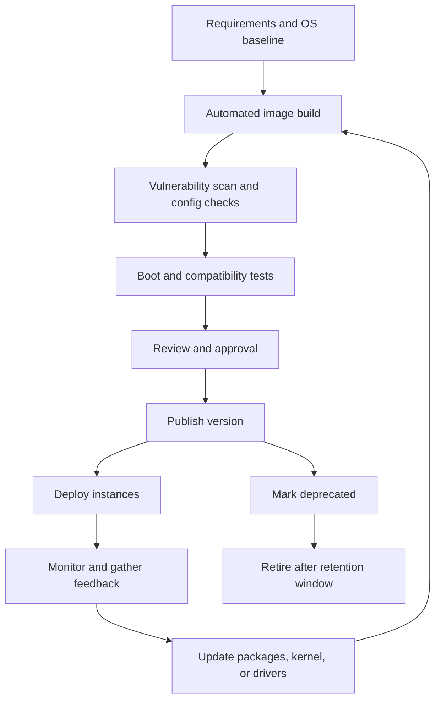

# Managing Image Lifecycle and Compatibility Across Machine Family Changes

A machine image is a template used to create virtual machines or cloud servers with a pre-prepared operating system, boot configuration, and software components. A well-managed image ensures new machines share a consistent environment, shortens deployment time, and supports recovery when needed. However, an image does not exist independently of virtual hardware: changing the machine family can change the CPU architecture, boot mode, storage devices, network interfaces, GPUs, and virtualization features the operating system must support.

Therefore, image management must cover both the release lifecycle and compatibility verification. When upgrading the operating system, updating drivers, or migrating workloads to a new instance family, the operations team must know where the image was built from, what components it contains, which configurations it was tested on, and how to roll back.

## 1. What Is a Machine Image?

A machine image is a deployment template that may contain the operating system, bootloader, kernel, drivers, management agents, system libraries, and foundational software. Depending on the platform, an image may include one or more disk images along with metadata describing CPU architecture, boot mode, virtualization type, access permissions, and device configuration.

When creating an instance from an image, the cloud uses the image to initialize the system disk and set up the boot environment. Next, the platform attaches CPU, memory, networking, and other devices according to the selected instance type. Thus, the image determines the initial software state, while the instance type determines resources and part of the virtual hardware the OS will detect.

### Distinguishing Images, Snapshots, Backups, and Templates

Terms may be used differently by providers, so understand the primary purpose of each type:

| Concept | Purpose | Notable Characteristics |
|---|---|---|
| Machine image | Create new machines with a standard OS and software configuration | May include multiple disks and boot metadata; typically tested for reuse |
| Disk snapshot | Record the state of a volume at a point in time | May capture only a single volume; application consistency depends on snapshot method |
| Backup | Recover data or systems after failures, accidental deletion, or incidents | Requires retention policies, restore verification, and copy protection |
| VM template | Virtual machine configuration blueprint in a virtualization platform | May contain disks, metadata, device settings, or deployment details |
| Container image | Package filesystem and metadata for a container | Not a machine image; typically shares the host kernel |

A machine image can be created from a snapshot, but not every snapshot is a bootable image. Backups also do not fully replace standard images: backups serve to restore data state, whereas standard images serve to recreate clean machine environments. For stateful systems, you typically combine tested images with consistent data backups.

## 2. Standard Images and Management Principles

### Golden Images

A golden image is a standard image approved by the organization for use within a defined deployment scope. It typically contains:

- A supported operating system and release.
- Tested security patches and platform updates.
- Kernel, bootloader, and drivers required for the target cloud environment.
- Monitoring, configuration management, logging, and security agents.
- Base packages, public CA certificates, and secure default configurations.
- Initialization configurations so instances receive unique hostnames, keys, network addresses, and metadata at boot.

Golden images should minimize pre-installed software. Every extra package increases attack surface, update time, and conflict risk. Include only shared components with a clear justification; environment-specific application configuration can be supplied during deployment.

### Immutable Images

In the immutable infrastructure model, a published image is never edited directly. When OS or agent updates are needed, the pipeline builds a new image version, tests it, and deploys it to replace old instances. This approach ensures every machine launched from the same version starts from a traceable initial state.

Never log into a shared standard image and edit it manually. Manual edits cause instances carrying the same image name to have different states, complicating incident response. If an emergency fix is needed on a running instance, document the change and feed it back into the build workflow so the next image includes the same fix.

### Separating Shared Components from Environment-Specific Parts

Images should contain shared, stable, verifiable components. Environment-dependent values such as production endpoints, tokens, passwords, private keys, subnet settings, or instance identity information must be provisioned at deployment time using configuration management and secrets mechanisms.

Never embed credentials into images, startup scripts, public metadata, or container layers. Images can be copied across accounts, projects, or regions; packaged secrets propagate across every copy and are very hard to revoke completely.

## 3. The Image Lifecycle

A common workflow spans stages from defining requirements through retirement:



### Defining the Baseline

Before building, agree on the operating system, release, CPU architecture, boot mode, compliance requirements, software packages, agents, and security configurations. Baselines should be expressed as code or version-controlled configuration so pipelines can reproduce them.

### Automated Builds

Pipelines typically launch a temporary build machine, install the OS or pull a trusted base image, apply patches, install packages, configure agents, clean temporary data, and output a new image. Tools like Packer or provider image builders can automate this workflow. Pin source versions, packages, and scripts so outputs are reproducible.

Do not build images relying on unversioned package repositories when strict reproducibility is required. Use internal repositories, verified artifacts, or package metadata snapshots to know exactly what was installed.

### Testing and Approval

New images must pass checks for boot, access, agents, logging, security configurations, vulnerabilities, patchability, and compatibility with target instance types. Automated tests should run before marking an image ready for production.

### Release and Promotion

An image can progress through channels such as development, test, staging, and production. Each environment should reference a specific ID or version. Once an image is approved, promotion simply updates status or moves an alias pointing to that image under controlled workflow; avoid rebuilding separate images for each environment without technical justification.

### Deprecation and Retirement

When a new version is available, older images can be marked deprecated to block new instance creation outside approved exceptions. After a transition period, the image can be retired. Before deletion, identify whether any instances, launch templates, autoscaling groups, pipelines, backups, or documents still reference it.

Do not delete an image merely because a newer one exists. Retaining several prior versions for an appropriate period supports incident investigation and rollback. Retention duration must balance rollback needs, storage costs, and security requirements.

## 4. Naming, Versioning, and Metadata

Image names should help operators identify the OS, version, architecture, and purpose. An example convention:

```text
<team>-<os>-<os-version>-<arch>-<purpose>-<release>

platform-ubuntu-24.04-x86_64-web-2026.11.22.1
platform-ubuntu-24.04-arm64-worker-2026.11.22.1
```

Do not rely solely on names like `latest`, `production`, or `ubuntu-current` as deployment identifiers. Aliases can be used for convenience, but deployment systems must record the actual ID/version consumed so deployments can be reproduced or rolled back.

Metadata should record at minimum:

| Field | Contents |
|---|---|
| Image ID and version | Unique identifier and release version |
| OS and release | Operating system, version, and support channel |
| Architecture | x86_64, arm64, or other supported architecture |
| Boot mode | BIOS/legacy or UEFI; Secure Boot if applicable |
| Kernel and bootloader | Kernel version, initramfs, and bootloader |
| Drivers | Storage, network, and GPU drivers with corresponding versions |
| Packages | Package list, versions, and installation sources |
| Build provenance | Pipeline, commit, and person or service account that built the artifact |
| Security result | Vulnerability scan, hardening, and test outcomes |
| Compatibility | Verified instance families, device types, and environments |
| Lifecycle | Creation date, review date, deprecation date, and support deadline |

If an image is published for multiple architectures, build a separate artifact per architecture and reflect it clearly in naming, metadata, and pipelines. You cannot turn an x86_64 image into arm64 merely by changing a metadata label.

## 5. Security Across the Image Lifecycle

An image is the starting point for every instance created from it. A misconfiguration or vulnerable package can replicate across hundreds of machines. Therefore, security must be embedded directly into the pipeline.

### Updates and Vulnerability Scanning

- Use trusted OS and package sources; verify signatures or checksums where provided by the platform.
- Apply security patches according to risk policy and remediation SLAs.
- Scan packages, kernels, libraries, and configurations before release.
- Define handling for unpatched vulnerabilities: remove packages, disable features, apply compensating controls, or block release.
- Store scan results tied to the image version for auditing.

### OS Hardening

A hardening baseline may include disabling unnecessary services, restricting ports and protocols, configuring host firewalls, enabling auditing/logging, restricting sudo privileges, setting password or SSH policies, enabling SELinux/AppArmor as required, and protecting kernel settings. Hardening must fit the machine role without breaking required agents or services.

### Secrets and Identity

Never store private keys, passwords, tokens, cloud credentials, or private certificates inside an image. When launching instances, use instance-attached identities/roles, a secret manager, or short-lived credential issuance. SSH keys and machine identity artifacts must be generated or provisioned uniquely per instance.

### Image Signing and Verification

Where supported by the platform, sign images or artifact manifests to verify provenance and integrity. Deployment pipelines should accept only images with valid provenance and passing check statuses. Signing does not replace vulnerability scanning; it verifies that the artifact came from the proper source and was not altered outside the process.

### SBOM and Traceability

A Software Bill of Materials (SBOM) lists packages and software components inside an image. An SBOM helps identify affected images when a new library vulnerability is disclosed. Store SBOMs per image version and link them to scan results, commits, and build pipelines.

## 6. OS and Virtual Hardware Compatibility

An image may boot cleanly on one machine family yet fail or lose functionality on another. Root causes usually involve CPU architecture, firmware, boot mode, drivers, virtual devices, or kernel-supported features.

### CPU Architecture: x86_64 and arm64

Images contain bootloaders, kernels, libraries, and binaries compiled for one CPU architecture. An x86_64 image cannot run directly on an arm64 instance as a native image, and vice versa. Switching architectures requires building a matching image, installing architecture-appropriate packages, and verifying all dependent binaries.

Components to check when moving from x86_64 to arm64 or vice versa:

- Does the OS release provide images and packages for the target architecture?
- Do applications, runtimes, agents, native libraries, and extensions have compatible binaries?
- Do container images have multi-architecture manifests or only a single platform?
- Does commercial software, driver, or kernel module code support the target architecture?
- Are there dependencies on specific CPU instruction sets such as AVX2 or AVX-512?
- Do performance or numerical behaviors change significantly after recompiling or switching runtimes?

For Java applications or VM-based languages, bytecode may be architecture-independent, yet the JVM, native libraries, JNI, APM agents, codecs, or cryptographic libraries still need matching builds. Never conclude an application is compatible merely because its source code is CPU-agnostic.

### BIOS, UEFI, and Secure Boot

Different instance families or virtualization platforms may support different boot modes. An image installed for legacy BIOS may fail to boot on UEFI-only machines if it lacks an EFI partition and appropriate bootloader. Conversely, UEFI images require proper partition layouts and boot entries.

Secure Boot verifies signatures of boot-chain components per platform policy. Third-party kernel modules or drivers lacking proper signatures may be blocked when Secure Boot is enabled. Before changing machine families, check boot mode, EFI System Partition, bootloader, kernel signing, and Secure Boot support of the image.

### Storage Drivers and Root Device

Instance generations may change virtual storage controllers, device presentation, or volume types. Linux needs the right drivers built into the kernel or initramfs to detect the root disk early enough during boot. Windows needs corresponding boot-start drivers to access the system volume.

If an image lacks drivers for the new device, the instance may fail to find the root volume and stall at initramfs, a boot error screen, or an unreachable state. Before switching machine families, verify controller types, drivers, initramfs, boot-start drivers, and device naming rules.

### Network Drivers and Interface Names

Newer instance families may use different virtual NICs, speeds, or specialized drivers. The OS may assign different interface names after a device change—for example, changing from `eth0` to a PCI-path-based name. Firewall rules, routing, network managers, or startup scripts hardcoded to old interface names can break connectivity.

Check NIC drivers, offload capabilities, MTU, queues, MAC addresses, interface names, and how the platform assigns IP addresses. If the cloud provides a dedicated network agent, ensure the agent version is compatible with the target machine family.

### CPU Features and Kernel Modules

Newer-generation CPUs or different architectures may expose different instruction sets, virtualization extensions, and cryptographic features. Binaries compiled with overly high CPU requirements may fail to execute on older machine families. Conversely, moving to a newer family may cause applications to select different optimization paths or exhibit altered performance.

Out-of-tree kernel modules, GPU drivers, security modules, or low-level monitoring software must be tested against the new kernel version and target CPU architecture. If using DKMS or kernel-install module building, verify modules compile cleanly in the image and after each kernel update.

## 7. Compatibility When Changing Instance Families

Changing instance families typically aims to scale CPU, RAM, network bandwidth, or storage performance, or to reduce costs. Even within the same provider, two families may use different CPU generations, NICs, storage controllers, GPUs, and hypervisor capabilities.

### Changes to Inspect

| Component | Potential Differences | Risk if Image Is Incompatible |
|---|---|---|
| CPU architecture | x86_64 to arm64 or vice versa | Fails to boot or binaries fail to execute |
| CPU generation | Instruction sets, feature flags, NUMA, and per-core performance | Application crashes or unexpected performance |
| Firmware / boot | BIOS to UEFI, Secure Boot, or boot chain changes | Bootloader not found or kernel blocked |
| Storage controller | NVMe, virtio, SCSI, or platform-specific controller | Root disk undetected, boot failure, or device order change |
| Network interface | NIC model, driver, queues, offload, and interface naming | Network loss, low throughput, or firewall applied to wrong interface |
| GPU / accelerator | Model, driver, VRAM, runtime, and PCIe topology | Driver fails to load, frameworks fail to detect device |
| RAM / NUMA | Node count, locality, and memory allocation behavior | Higher latency or applications fail to use RAM efficiently |
| Local ephemeral disk | Capacity, device naming, and data lifecycle changes | Ephemeral data loss or broken mount scripts |
| Metadata / cloud agent | Metadata endpoints, agents, and initialization behavior changes | Fails to retrieve config, keys, or instance details |

### Compatibility Matrix

Prior to production cutover, build a matrix showing which image versions have been tested on which families. For example:

| Image | Old x86_64 Family | New x86_64 Family | arm64 Family |
|---|---|---|---|
| `web-ubuntu-24.04-x86_64-v3` | PASS | TEST REQUIRED | NOT COMPATIBLE |
| `web-ubuntu-24.04-arm64-v1` | NOT COMPATIBLE | NOT COMPATIBLE | PASS |

Statuses in the table must be based on actual test results. `TEST REQUIRED` means the image has not yet been verified on that family; `NOT COMPATIBLE` means known constraints prevent using the image as-is. Never assume PASS merely because two machine families have the same vCPU count or RAM capacity.

### Pre-Change Verification

1. Identify the exact source and target families, including CPU architecture and device types.
2. Verify the image supports the boot mode, root disk, NIC, and accelerators of the target family.
3. Confirm the OS release remains supported and the kernel includes required drivers.
4. Check management, monitoring, backup, and security agents, plus cloud-init or sysprep tools.
5. Check OS and commercial software licensing when changing core counts, sockets, or architecture.
6. Confirm data on local/ephemeral disks is backed by durable storage.
7. Launch a test instance from the current image on the target family and test boot, networking, storage, and applications.
8. Measure performance and cost under representative load before broad rollout.

## 8. Preparing Images for Safe Reuse

### Linux: cloud-init and Machine State

Cloud-init is commonly used to configure instances on first boot. It can set hostnames, users, SSH keys, packages, mounts, and startup scripts from metadata. When preparing a standard image, clean state that would cause new instances to be mistaken for the old machine—such as machine IDs or completed cloud-init data—according to distribution and provider guidelines.

For example, before capturing a Linux image, a standardization workflow may need to inspect:

```bash
# Check cloud-init status
cloud-init status --long

# View current machine ID
cat /etc/machine-id

# Check block devices and filesystems
lsblk -f

# Check boot configuration and kernel
uname -a
```

The commands above are for inspection. Deleting the machine ID, resetting cloud-init, or cleaning SSH host keys must follow the image capture procedure for your specific OS and cloud platform. Never run state-cleanup commands on a production machine serving live traffic.

### Windows: Sysprep and Drivers

For Windows, Sysprep is commonly used to prepare the OS before capturing an image, stripping machine-specific identifiers and enabling specialization when a new instance boots. Check activation status, Windows licensing, agents, boot-critical drivers, and applications that require unique machine identities.

Do not capture a Windows machine with incomplete updates or a pending reboot if disallowed by provider procedures. After Sysprep, validate the new image by launching a test machine and confirming specialization, networking, activation, and domain join work properly.

### Drivers and Agents

Drivers should come from trusted sources with versions verified against the kernel or OS release. For multi-family images, compatible drivers for multiple device types can be pre-installed if they do not conflict; if drivers depend on specialized hardware, split images by family. Cloud, monitoring, and security agents must initialize a new identity on every instance to avoid duplicate IDs.

## 9. Migrating to a New Machine Family

Changing an instance family is an infrastructure change that can affect boot, networking, performance, and cost. A safe process separates testing from production cutover.

### Testing Phase

- Pick a representative instance and clone the environment from the published image.
- Attach the new family and verify boot as well as console/serial access if available.
- Confirm root disk, filesystems, mounts, NICs, routes, DNS, firewall, and agents.
- Run application health checks, smoke tests, and inspect OS logs.
- Run benchmarks with production-like data, measuring CPU, RAM, network, disk, and latency.
- Test backups, snapshots, monitoring, shutdown, and reboot.

### Phased Rollout

For stateless services, launch a new group of instances from the verified image, add them to the load balancer, verify health, and gradually shift traffic. Keep the old group during the observation window so traffic can be shifted back if errors occur.

For stateful systems, define data synchronization, write ownership cutover timing, consistency guarantees, and maintenance windows. Never simultaneously launch two machines attached to a single volume configured for single-writer access. Use migration or replication workflows suited to the storage system and database.

### Rollback

Rollback must be designed before cutover. A plan may include:

1. Retaining the old image version and old instance family configuration during the rollback window.
2. Preserving the ability to shift traffic or scale the old instance group back up.
3. Ensuring new data remains readable by the old application version, or having a consistent data recovery plan.
4. Defining rollback triggers, decision owners, and decision deadlines.
5. Testing rollback in staging before applying in production.

Note: changing an instance family cannot always be reversed simply by switching the machine type back. If the migration altered data formats, schemas, boot volumes, or CPU architectures, plan compatibility and recovery accordingly.

## 10. Automating Image Build and Release Pipelines

A solid pipeline builds and tests images following the exact same process on every release. Typical steps:

```yaml
stages:
  - validate-source
  - build-image
  - security-scan
  - compatibility-test
  - publish-candidate
  - approve
  - promote

image:
  os: ubuntu-24.04
  architecture: x86_64
  purpose: web
  version: 2026.11.22.1
  source_revision: git-commit-sha

checks:
  - boot-test
  - ssh-or-ssm-access
  - cloud-agent-health
  - storage-and-network-driver
  - vulnerability-scan
  - hardening-policy
  - application-smoke-test
```

This is an illustrative structure, not configuration syntax for a specific tool. In real pipelines, pin base image and package versions, protect secrets, record build logs, store SBOMs, generate manifests, and publish only when all mandatory checks pass.

### Minimum Automated Checks

| Check Group | Contents | Pass Criteria |
|---|---|---|
| Artifact | Image has ID, version, metadata, and provenance | Source and version are traceable |
| Boot | Instance launches and boots cleanly on target family | OS becomes ready within expected time |
| Access | Access via approved management mechanism | No credentials embedded in image |
| Storage | Root disk, filesystems, and mounts function | No unexpected driver or mount errors |
| Network | NICs, routes, DNS, firewall, and network agents | Connectivity complies with policy |
| Security | Vulnerability scan and hardening | No release-blocking findings |
| Observability | Agents report metrics, logs, and status | Instance is uniquely identified |
| Compatibility | Boot and smoke tests on chosen family | No virtual hardware or application errors |
| Recovery | Snapshots/backups and rollback workflow | Recoverable within defined targets |

## 11. Common Errors and Troubleshooting

| Symptom | Possible Cause | Troubleshooting Direction |
|---|---|---|
| Instance cannot find boot volume | Missing storage driver in initramfs or boot-start driver | Check target family's controller, drivers, and boot settings |
| Bootloader fails to run after family change | Incompatible BIOS/UEFI or EFI partition | Verify boot mode, boot entries, and Secure Boot |
| Linux boots but loses network connectivity | Changed NIC driver, interface name, or network agent | Inspect `ip link`, drivers, routes, firewall, and cloud agent |
| Windows halts on boot error after controller change | Missing boot-start storage driver | Prepare and test drivers before changing devices |
| ARM64 instance fails to run application | Binaries or native dependencies built only for x86_64 | Build artifacts and images for arm64; check native libraries |
| GPU not detected | Driver/runtime mismatch with kernel or GPU model | Check driver version, runtime, device assignment, and logs |
| Duplicate agent identities across instances | Image contains machine ID or agent ID captured from source machine | Reset state per capture instructions and generate fresh identity at boot |
| New instance missing logs or metrics | Agent failed to start, expired credentials, or blocked endpoint | Check bootstrap, IAM, DNS, networking, and agent health |
| Performance drops after changing family | Different CPU generation, NUMA, NIC, storage, or burst limits | Benchmark each resource and compare against the prior baseline |
| Rollback fails to restore application | Schema or data changed incompatibly | Design backward-compatible migrations and consistent backups |

Do not troubleshoot boot errors by changing multiple drivers and boot settings at once. Preserve console logs, record each change, test one hypothesis at a time on a test instance, and update the image pipeline once the root cause is found.

## 12. Lifecycle Management and Machine Family Change Checklist

Before releasing an image:

- [ ] Clear owner, purpose, OS release, CPU architecture, and version.
- [ ] Automated build from verified sources and packages.
- [ ] Contains no secrets, SSH private keys, or build-machine identifiers.
- [ ] Kernel, bootloader, storage drivers, NIC drivers, and agents are compatible with target families.
- [ ] Vulnerability scan, hardening results, and SBOM recorded.
- [ ] Tested boot, access, networking, storage, and observability.
- [ ] Provenance, manifest, and approval status recorded.
- [ ] Review expiration, deprecation timeline, and old-version retention policy defined.

Before changing an instance family:

- [ ] Confirmed target family and CPU architecture.
- [ ] Verified boot mode, Secure Boot, and device drivers.
- [ ] Verified compatibility for applications, native libraries, containers, and agents.
- [ ] Checked networking, storage, local disks, and accelerators.
- [ ] Tested boot, reboot, health checks, and benchmarks in a test environment.
- [ ] Checked backups, replication, stateful data, and volume attachment permissions.
- [ ] Prepared rollout, monitoring, rollback plan, and assigned owner.
- [ ] Compared performance, SLA, and total cost after switching.

## Conclusion

A standard image is the foundation for creating consistent, secure, and reproducible instances. Managing the image lifecycle requires automating builds, testing, security scanning, versioning, promotion, deprecation, and retention of prior versions. When changing instance families, verify CPU architecture, boot mode, kernel, storage and network drivers, accelerators, agents, and native software. Test on the target family, roll out in waves, and prepare a rollback plan tied to actual data state. This discipline allows you to take advantage of newer machine families while keeping operational risks under control.
