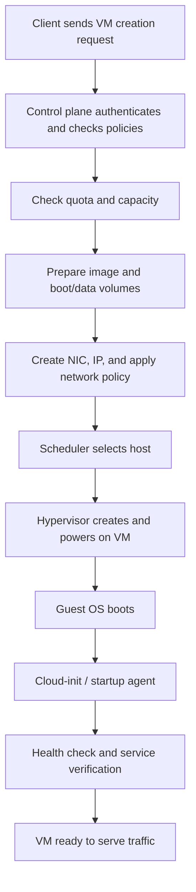

# Creating a Virtual Machine and Understanding Provisioning Lifecycle States

## Context: From VM Creation Request to Application Readiness

A virtual machine (VM) is a virtualized compute environment with its own CPU, memory, storage devices, and network interfaces configured according to what the platform provides. When an operator sends a VM creation API request or selects **Create instance**, the virtual machine does not necessarily appear and start running immediately. The platform needs to validate the request, locate sufficient capacity, create disks and network interfaces, place the VM onto a host, boot the operating system, and then bring the VM to a usable state.

That process is called **provisioning**. Throughout this process, the control plane records and orchestrates resource states; the hypervisor and host execute the VM; and the guest operating system boots and runs the application. Understanding each stage helps operators know when a VM has been created, when the machine is powered on, and when the service inside it is truly ready.

In the **CLOUD_CORE_SERVICES_COMPUTE** module, knowledge of the VM lifecycle connects the selection of CPU/RAM, images, storage, networking, and security with application deployment, availability, and operational costs.

## 1. Information to Prepare Before Creating a VM

A VM creation request typically consists of the following groups of information. Field names and configuration methods may vary across cloud providers.

| Group | Information to Select | Purpose |
|---|---|---|
| Image | Operating system, version, CPU architecture, image ID | Defines the boot disk contents and initial environment |
| Compute shape | vCPU count, RAM, instance family, GPU if needed | Specifies the compute capacity allocated to the VM |
| Placement | Region, availability zone, host group, or placement policy | Determines deployment scope and fault domain |
| Boot storage | Size, volume type, encryption, deletion behavior when deleting the VM | Provides the operating system disk and I/O characteristics |
| Data storage | Additional volumes, mount points, snapshot or backup policy | Stores application data independently of the VM lifecycle when needed |
| Network | VPC/VNet, subnet, NIC, IP, routes, and DNS | Connects the VM to other networks and services |
| Security | Security group/firewall, IAM role, key pair, or login method | Controls administrative access and network traffic |
| Initialization | User data, cloud-init, startup script, or configuration management | Installs packages, creates users, and initializes the application |
| Operations | Tags, name, monitoring, logging, backup, and start/stop schedule | Manages, monitors, and controls costs |

### 1.1. Selecting the Image and Compute Configuration

An image is the template for the VM's initial operating system and software. You must select an image that matches the CPU architecture, operating system version, licensing requirements, patching policy, and application supportability. Custom images should have a clear provenance and be updated and tested before widespread use.

The compute shape determines the vCPU count, RAM capacity, and hardware characteristics. Choosing a shape that is too small can cause CPU or memory exhaustion under load; choosing one that is too large increases costs and may cause waste. For workloads requiring GPUs, local NVMe, high-speed networking, or large memory, you must select the appropriate instance family that supports those features.

### 1.2. Selecting Networking and Security

The VM must be attached to the appropriate VPC/VNet and subnet. You need to determine whether the VM requires a public IP or only a private IP, along with routes to backend services, DNS, and outbound connectivity. Security groups or firewalls should only open the required ports to the appropriate traffic sources. For example, a web server may accept HTTPS from the Internet, whereas SSH/RDP ports should only be allowed from an administrative network or a private access solution.

For administration, prioritize revocable identity and access mechanisms, key pairs, or session management services. Attach an IAM role/service identity to the VM when the application needs to call cloud APIs, granting only least-privilege permissions. Credentials should not be embedded directly in the image or initialization configuration where multiple components could read them.

### 1.3. Selecting the Boot Volume and Data Volumes

The boot volume contains the operating system. Choose enough capacity for the operating system, logs, packages, and application software. Data volumes should be separated when data must persist across VM replacements, when independent snapshots/backups are needed, or when storage performance needs to be tuned separately.

Clearly define the **delete on termination** policy or equivalent option. Some platforms may automatically delete the boot volume when the VM is deleted, while data volumes can be retained if configured appropriately. Snapshots do not completely replace backups whose restore capability has been tested.

## 2. Provisioning Workflow for a Virtual Machine

Providers implement this internally in different ways, but the logical flow typically includes the following steps:

1. **Request submission:** a user, CLI, SDK, API, or pipeline submits the VM configuration and a request ID/idempotency key if the API supports it.
2. **Authentication and policy check:** the control plane verifies identity, resource creation permissions, project, region, allowed images, and security policies.
3. **Quota and capacity check:** verifies vCPU/RAM/instance/volume/IP quotas and finds a pool/host matching the shape and placement constraints.
4. **Storage preparation:** creates or selects the boot volume, applies encryption, attaches data volumes if specified, and prepares the image.
5. **Network preparation:** creates or attaches NICs, allocates IP addresses, and applies routes, security groups/firewalls, and network policies.
6. **VM placement onto a host:** the scheduler selects a host; the hypervisor creates the virtual machine definition and attaches CPU, RAM, and virtual devices.
7. **Booting:** the hypervisor powers on the VM, virtual firmware starts, the bootloader loads the kernel, and the guest operating system begins booting.
8. **Guest initialization:** cloud-init or a startup agent applies user data, configures the hostname, users, packages, monitoring agents, and the application.
9. **Readiness verification:** the system or operator verifies that the VM is running, the operating system is ready, required services respond, and health checks pass.



Some steps may run in parallel or be abstracted away by the provider. The diagram illustrates common dependencies rather than a mandatory API sequence across all clouds.

## 3. Common States in the VM Lifecycle

VM states represent provisioning progress or the machine's power state. Exact names depend on the provider; one platform may use `PROVISIONING`, while another uses `BUILD`, `PENDING`, or `STARTING`. Therefore, it is important to understand the meaning of each state and read the documentation of the API in use.

| Conceptual State | Meaning | Ongoing Activity or Appropriate Action |
|---|---|---|
| `REQUESTED` / `PENDING` | Request has been accepted and is waiting to be processed | Monitor the operation ID, quota, scheduler, and queue |
| `SCHEDULING` / `PLACEMENT` | Searching for a suitable host or pool | Check capacity, zone, and placement constraints if prolonged |
| `PROVISIONING` / `BUILD` | Creating the VM and attaching resources | Monitor volume, NIC, image, and provisioning events |
| `BOOTING` / `STARTING` | VM has been created and is booting | Wait for firmware, bootloader, and guest OS startup |
| `RUNNING` / `ACTIVE` | Platform considers the VM powered on and executing on the hypervisor | Verify guest OS, agent, network, and application |
| `STOPPING` / `SHUTTING_DOWN` | Shutdown operation is in progress | Wait for guest shutdown or forced stop to complete |
| `STOPPED` / `SHUTOFF` | VM is powered off, though storage and configuration resources may still exist | Can be started again; check costs of retained resources |
| `REBOOTING` / `RESTARTING` | VM is restarting | Wait for VM to return to running state and verify services |
| `DELETING` / `TERMINATING` | Deleting the VM and releasing associated resources | Monitor detachment of NICs, volumes, and IP reclamation |
| `DELETED` / `TERMINATED` | VM resource has been deleted | Check for any remaining independent resources and ongoing charges |
| `ERROR` / `FAILED` | Creation or lifecycle operation failed | Read reason, events, and operation logs; identify partially created resources |

The states in the table are conceptual names for learning purposes. Not every API exposes all of these states or uses these exact strings. Some platforms distinguish provisioning state from power state; for example, a VM may already be provisioned while powered off.

### 3.1. Resource State Differs from Power State

A common mistake is treating `RUNNING` as proof that the application is ready. `RUNNING` usually indicates that the hypervisor is running the VM. The guest operating system may still be booting, applying updates, waiting to mount filesystems, waiting for network configuration, or the application may not have opened its service port yet.

You should monitor at least three layers of state:

- **Provisioning state:** whether the cloud resource has been created, is being created, or failed.
- **Power state:** whether the VM is powered on, powered off, or transitioning power states.
- **Guest/application health:** whether the operating system, agents, and internal services are functioning properly.

For example, the control plane may report the VM as `ACTIVE` and the hypervisor may report the machine as running, yet HTTP health checks still fail because the application has not finished database migrations. In that case, you need to wait or troubleshoot at the guest/application layer instead of creating another identical VM.

### 3.2. State Transitions Are Not Always Instantaneous

VM creation APIs are usually asynchronous operations. The API may return an operation ID or a resource in a `PENDING` state before completion. Clients should query the operation/resource status or subscribe to events instead of assuming the operation finished immediately after receiving an HTTP success response.

State updates may lag due to distributed systems and synchronization mechanisms. A read immediately after submitting a request may still see the previous state. Use reasonable timeouts, backoff when polling, and stop when reaching terminal states such as `RUNNING`, `FAILED`, or `TERMINATED` depending on the operation.

## 4. Initializing the OS and Application with cloud-init

After the VM powers on, the guest OS needs to be configured. Cloud-init or similar tools typically read user data/metadata to configure the hostname, users, packages, configuration files, and startup commands. This is a critical step so that newly created VMs can automatically join the system.

Example of a simple Linux cloud-init user data configuration:

```yaml
#cloud-config
package_update: true
packages:
  - nginx
write_files:
  - path: /var/www/html/index.html
    permissions: "0644"
    content: |
      <!doctype html>
      <html>
        <head><title>Compute VM</title></head>
        <body><h1>VM is ready</h1></body>
      </html>
runcmd:
  - [systemctl, enable, --now, nginx]
```

This example installs Nginx and creates a test page. Real-world user data should be managed as code, tested against the target image, and designed to run safely on re-initialization if the platform may execute it repeatedly.

Do not place long-lived credentials in user data. User data can often be retrieved via management APIs, the metadata service, or initialization logs. Use a secret manager, VM-attached identities, or short-lived credential issuance mechanisms instead.

## 5. Verifying VM Readiness

Before placing a VM into service, verify it across multiple layers:

1. **Cloud resource:** Does the VM have an ID, the right region/zone, the right flavor, and are volumes and NICs attached?
2. **Power state:** Is the VM in a running state? Are there any boot events or hypervisor errors?
3. **Guest OS:** Has the operating system finished booting, are filesystems mounted, is system time accurate, and is the agent connected?
4. **Network:** Are the IP, routes, DNS, security groups, and connectivity to dependencies correct?
5. **Application:** Are processes running, are ports listening, does the health endpoint return a healthy response, and are logs free of errors?
6. **Observability:** Are CPU/RAM/disk/network metrics, logs, and alerts being sent to the monitoring system?

For example, once the VM has a private IP, you can test connectivity from a machine in the same network, and then verify the application endpoint through the load balancer. A successful ping only proves part of the network path; it does not prove that the HTTP application or database is ready.

Health checks should reflect actual serving capability. You can separate:

- **Liveness:** whether the process is alive and not hung to the point of needing a restart.
- **Readiness:** whether the application is ready to receive traffic and essential dependencies are satisfied.
- **Startup check:** allows an application with a long initialization time to finish starting before regular liveness/readiness checks apply.

Avoid overly heavy health checks or checks that depend on every external service, as a flaky dependency could cause many VMs to be marked unhealthy simultaneously.

## 6. Post-Creation Lifecycle Operations

### 6.1. Start and Stop

**Start** powers back on a stopped VM. The platform may need to find a host, restore device configurations, and attach volumes. Starting can fail if capacity is no longer available, quotas or reservations changed, a volume is faulty, or network configuration is invalid.

**Stop** shuts down the guest OS and halts VM execution. Whenever possible, request a graceful OS shutdown so data is flushed and services stop cleanly. A hard stop can be equivalent to pulling the power plug, increasing the risk of inconsistent filesystems or application data.

A VM in the `STOPPED` state typically retains its boot volume, data volumes, reserved IPs, or reservations depending on the platform. Therefore, stopping a VM does not mean all costs drop to zero. Check billing policies for compute, storage, IPs, and reservations.

### 6.2. Reboot and Rebuild

**Reboot** restarts an existing VM, usually preserving its configuration and volumes. A reboot can be a soft operation inside the guest OS or a forced operation by the hypervisor. Verify that applications start automatically after a reboot and that data has been durably written.

**Rebuild** on some platforms recreates the boot disk contents from an image while keeping certain attributes or other volumes. Exact semantics vary widely by provider. Before rebuilding, clearly determine which volumes will be overwritten and which data will be preserved.

### 6.3. Resize and Configuration Changes

Resize changes vCPU, RAM, or instance type. Some platforms require stopping the VM first; others support changing certain resources while running. Resizing may require moving to a new host, so suitable capacity must exist and there may be a period of interruption.

Before resizing, check image/driver compatibility, OS limits, NUMA, GPU, local disk, licensing, and quota for the new instance type. After the change, verify that the guest OS recognizes the full CPU/RAM and that application performance behaves as expected.

### 6.4. Delete and Resource Cleanup

Delete/terminate removes the VM object and releases compute capacity. However, standalone volumes, snapshots, public IPs, load balancers, DNS records, or backups may still persist. Clearly confirm the retention/deletion policy for each resource before executing.

Before deleting a VM with important data, verify that backups or snapshots are restorable, inspect data on data volumes, and record necessary information for auditing. After deletion, re-check the list of associated resources to avoid unexpected charges.

## 7. Troubleshooting Provisioning Failures

When a VM gets stuck in `PENDING`, `PROVISIONING`, or `BOOTING`, identify the exact slow step before submitting another creation request. Repeated requests can spawn duplicate VMs or volumes if the initial request was only slow to respond.

| Symptom | Common Causes | How to Check |
|---|---|---|
| Request rejected immediately | IAM, policy, quota, or invalid configuration | API error, permissions, quota, image ID, region, and parameters |
| Prolonged `PENDING` | Queue, quota, capacity, or scheduler | Operation status, scheduler events, pool/zone, and quota |
| Prolonged `PROVISIONING` | Volume, NIC, or image creation, or slow backend storage | Volume/NIC events, image availability, and control-plane logs |
| `BOOTING` but not transitioning to `RUNNING` | Faulty image, bootloader, filesystem, or driver | Console logs, serial output, boot diagnostics, and volume status |
| `RUNNING` but unable to SSH/RDP | IP, route, firewall, key, guest agent, or access service | Security rules, routes, DNS, console, and guest authentication logs |
| `RUNNING` but application not responding | Application not started, missing dependency, or config error | System logs, application logs, ports, health endpoint, and dependencies |
| Delete does not complete | Attached volume, snapshot task, or remaining dependency | Operation events, attachments, snapshots, and dependent resources |

Recommended diagnostic workflow:

1. Record the VM ID, request/operation ID, timestamp, region/zone, and requested configuration.
2. Check the current state and event history; identify the last completed transition.
3. Read the reason/error code and corresponding logs from the control plane, storage, network, or hypervisor.
4. If the VM has booted, access the console/serial log to distinguish guest OS errors from cloud resource errors.
5. Check user data/cloud-init, networking, firewalls, keys, and application dependencies.
6. Retry only when you know the previous operation failed or the API supports idempotency; otherwise, inspect partially created resources first.
7. After fixing the issue, verify health checks and monitor metrics before putting the VM into service.

## 8. Automating VM Creation Safely

In production environments, VMs should be described using Infrastructure as Code or controlled pipelines so configurations can be reviewed, repeated, and audited. A conceptual declaration example:

```yaml
vm:
  name: web-01
  image: linux-lts-approved
  region: region-a
  zone: zone-1
  shape:
    vcpu: 2
    memory_gib: 4
  boot_volume:
    size_gib: 40
    encrypted: true
    delete_with_vm: true
  network:
    subnet: private-app-subnet
    public_ip: false
    security_policy: web-app-only
  identity:
    service_role: web-read-config
  initialization:
    user_data: cloud-init/web.yaml
  monitoring:
    metrics: enabled
    logs: enabled
```

This is a provider-neutral illustrative structure, not a manifest directly applicable to a specific provider. When translating it to actual Terraform, CLI, or API calls, use the exact schema and resource names of the target platform.

Several important automation principles:

- Use idempotency keys or check resources by ID/tag so retries do not create unintended duplicates.
- Wait for operations to complete using polling with backoff or events; set timeouts and handle failure states explicitly.
- Separate configuration from credentials; retrieve sensitive values from a secret manager using a least-privilege identity.
- Attach tags/labels for owner, environment, application, cost center, and resource expiration.
- Add VMs to a load balancer only after readiness checks succeed.
- Record outputs such as VM ID, IP, image version, and operation ID for operations.
- Have a cleanup procedure for partially created resources when a pipeline fails.

## 9. Availability and Cost in the VM Lifecycle

A single VM is a single unit of failure. If an application requires high availability, deploy multiple VMs across different fault domains, use load balancers and health checks, and synchronize data or use storage services with appropriate redundancy. Placing two VMs on the same host or in the same zone can expose both to the same infrastructure outage.

The VM lifecycle also directly impacts cost:

- Running VMs typically incur compute charges based on machine type and usage duration.
- Stopped VMs may still incur charges for boot/data volumes, snapshots, reserved IPs, and reservations.
- Deleted VMs with orphaned standalone volumes or IPs can still incur charges.
- VMs oversized for the workload cause waste; undersized VMs cause slowness, errors, and may require more horizontal scale-out.
- Development/test environments can use automated off-hours shutdown schedules where appropriate.

Track resource age, CPU/RAM utilization, storage capacity, costs by tag, and backup status. Clear lifecycle policies help reclaim unneeded resources while protecting data that must be retained.

## 10. Common Misconceptions

**A successful VM creation API response means the VM is ready.** The API may only confirm that the request was accepted. You must monitor the operation and check guest/application health.

**`RUNNING` means the application is working properly.** This is usually the VM's power state. The operating system and application may still be booting or experiencing errors.

**Stop is the same as delete.** Stop turns off compute but usually retains configuration and certain billable resources. Delete/terminate removes the VM; standalone volumes or IPs may still persist.

**Reboot is always as safe as restarting an application.** A reboot affects the entire guest OS and can interrupt all processes; a hard reboot also risks unflushed data.

**Deleting a VM deletes all related data.** Behavior depends on volume, snapshot, and standalone resource policies. Always check retention/deletion options before terminating.

**Retrying VM creation is always harmless.** If the previous request is still processing after a client timeout, retrying may create duplicate VMs. Use idempotency and check the operation/resource before resubmitting.

## Conclusion

Creating a VM is an asynchronous workflow involving authentication, quota and capacity checks, storage/network preparation, host placement, guest OS booting, and application initialization. States such as `PENDING`, `PROVISIONING`, `BOOTING`, `RUNNING`, `STOPPED`, `DELETING`, and `ERROR` describe progress across different layers; exact names depend on the platform. Operators need to distinguish provisioning state, power state, and application health, then verify each layer before putting a VM into service. Proper lifecycle management ensures reliable deployments, protects data, and controls compute, storage, and network costs.
