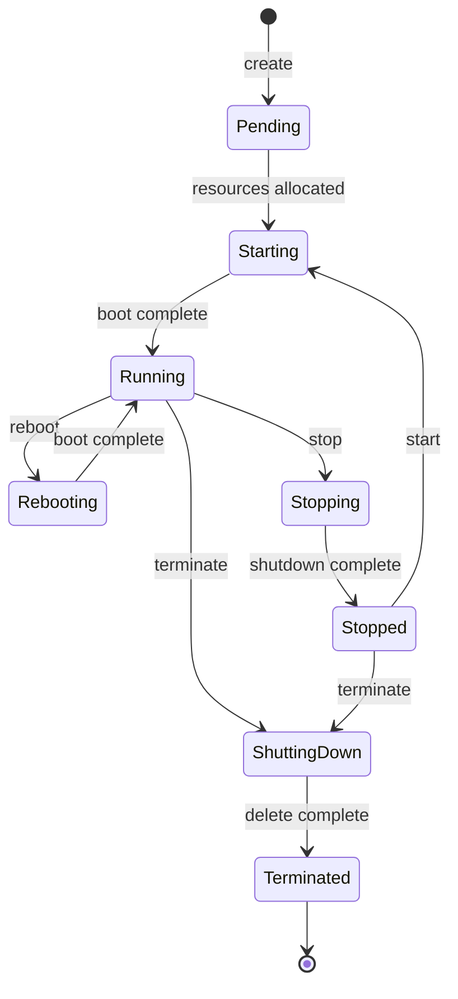

# Start, Stop, Reboot, Terminate, and Their Impact on Data and Network Addresses

A virtual machine (VM) has a lifecycle consisting of multiple states and administrative operations. Start brings a stopped VM back into operation; stop requests the VM to shut down and releases part of its compute resources; reboot restarts the operating system; terminate deletes the VM from the platform. These operations may look simple, yet they can affect data on disks, IP addresses, network connectivity, costs, and service recovery.

Before performing an operation, you need to know where data resides, which disks will be deleted with the VM, which IP addresses are ephemeral or static, and whether the application can tolerate interruption. Exact behavior depends on the cloud provider, VM type, disk type, network interface configuration, and account policies. Therefore, always inspect resource attributes in the specific service you are using rather than inferring from command names alone.

## 1. Common States in the VM Lifecycle

A VM typically transitions through states such as creating, starting, running, stopping, stopped, and deleting. State names may differ across platforms, though their operational meaning is usually similar.

| State | Meaning | What to Pay Attention To |
|---|---|---|
| Pending / Provisioning | The platform is allocating CPU, RAM, NICs, and disks | The VM is not ready to receive traffic |
| Starting | The VM is booting firmware, bootloader, and OS | May need to wait for cloud-init, agents, and application initialization |
| Running | The VM has been provisioned and is active | The application still needs health checks to confirm readiness |
| Rebooting | The operating system or VM is restarting | Existing connections may be temporarily dropped |
| Stopping | The platform is executing the VM shutdown request | Do not assume data has flushed or the VM has fully stopped yet |
| Stopped / Deallocated | The VM is powered off; some compute resources may be released | Disks and some network resources may still incur charges |
| Shutting down / Terminating | The platform is deleting the VM | Do not rely on the VM or disks deleted with it as the sole copy of data |
| Terminated / Deleted | The VM has been deleted and cannot be started again from the same resource | Recovery depends on snapshots, backups, and disk retention policies |

The diagram below illustrates a simplified lifecycle. Some platforms include additional states such as hibernate, suspended, failed, or platform-specific intermediate states.



The `Running` state only indicates that the VM is running from the control plane's perspective. The application may not be ready yet because it is still loading data, running migrations, starting workers, or waiting to connect to dependent services. Orchestration systems should use application-level health checks before adding the VM to a load balancer.

## 2. Start: Powering On a Stopped VM

Start requests the cloud to reallocate compute resources and boot the VM from its system disk. The operating system boots just as it does after power-on. Services configured to auto-start will run again; bootstrap scripts or cloud-init may be invoked depending on the image's state and configuration.

When starting a VM, verify:

- The VM transitions to `Running` without resource allocation errors.
- The root disk and data disks are properly attached and filesystems mount successfully.
- NICs are active, and routes, DNS, and firewalls are correct.
- Cloud agents, monitoring, logging, and remote management mechanisms are connected.
- The application starts successfully and connects to databases, queues, and dependent services.
- Health checks pass before receiving traffic.

Start does not guarantee that the application will restore the exact state it had before stopping. In-memory processes were lost when the VM powered off; in-flight tasks must be recovered by the application from durable storage or re-queued.

## 3. Stop: Shutting Down a VM and Releasing Compute

Stop requests the operating system to shut down gracefully if the platform can deliver a shutdown signal. The OS has an opportunity to stop services, flush caches to disk, and unmount filesystems. Once the VM has stopped, the provider typically releases physical CPU and RAM so standard compute billing stops; disks, static IPs, snapshots, backups, licenses, or network resources may still incur charges.

### Graceful Stop vs. Force Stop

Graceful stop gives the OS time to handle the shutdown signal. Applications can complete in-flight requests, close connections, write checkpoints, and sync data. This is the method to use in normal operations.

Force stop or hard stop cuts off the VM without ensuring the OS completes shutdown. This is analogous to pulling the power cord: data already written to disk usually remains, but data in RAM, caches, or buffers may be lost. Filesystems or databases may require recovery upon restart. Use this only when the VM is hung or cannot shut down normally, and verify data consistency afterward.

### How Stop Differs from Suspend and Hibernate

- **Stop:** shuts down the operating system; RAM contents are not preserved to resume execution. The VM performs a fresh boot on start.
- **Suspend:** some platforms retain VM state in memory or save state via a proprietary mechanism; resources and charges may still be retained.
- **Hibernate:** RAM state is written to storage so the session can resume upon start. This feature requires support from the image, OS, instance type, and platform; it typically requires sufficient disk space and has specific limitations.

Hibernate does not replace backups. It saves execution state to resume the VM, whereas backups protect data against accidental deletion, disk corruption, or zone outages. Do not rely on hibernate as the sole copy of data.

## 4. Reboot: Restarting the OS or VM

Reboot restarts the operating system on a running VM. Under normal circumstances, the platform retains the allocated compute resources and the VM returns to the running state after the OS finishes booting. Reboot is commonly used after kernel updates, system configuration changes, or resolving software issues.

### Rebooting from Inside the OS vs. from the Control Plane

Rebooting from inside the OS uses the operating system's shutdown/restart mechanism. For example, on Linux:

```bash
# Graceful reboot
sudo systemctl reboot

# Graceful shutdown
sudo systemctl poweroff
```

Rebooting from the cloud control plane sends a request to the hypervisor or guest agent. If the guest does not respond, some platforms allow a hard reboot. A hard reboot can be equivalent to a power reset and carries the risk of losing data not yet flushed to disk.

A reboot usually preserves attached disks, NICs, and IP addresses, though this should still be verified per platform. Reboot is not stop/start; it typically does not release compute and does not necessarily allocate a new physical host. If the goal is to move to a new host or recover compute capacity after hardware issues, stop/start or a provider-supported migrate/repair operation may be required.

### When Is a Reboot Needed?

- Kernel or system component updates that require a restart.
- OS configuration changes that only take effect after a reboot.
- Recovering a hung service when VM resource changes are not yet needed.
- Testing auto-start behavior and configuration persistence across reboots.

Before rebooting production, drain traffic from the VM, wait for in-flight requests to complete, verify sufficient capacity on other nodes, and monitor health checks after the machine returns.

## 5. Terminate: Deleting a VM

Terminate instructs the platform to delete the VM from the control plane. Once completed, the VM no longer exists in a state that can be started or rebooted. Associated resources may be retained or deleted depending on policies, such as root disks, data disks, NICs, dynamic IP addresses, static IPs, snapshots, placement reservations, and metadata.

The most important rule is **never assume all disks are kept or all disks are deleted on terminate**. Behavior depends on the `delete on termination` attribute, volume type, boot configuration, and service policy. A data volume may persist after the VM is deleted if configured to be retained; the root volume may be deleted automatically. Check each volume individually before terminating.

### How Terminate Differs from Stop

| Criterion | Stop | Terminate |
|---|---|---|
| Can the same VM be started again | Usually yes | No |
| CPU and RAM | Usually released once stopped | Released upon deletion |
| Root disk | Usually retained for restarting | May be kept or deleted per policy |
| Standalone data disk | Usually persists unless detached/deleted | May be kept or deleted depending on configuration |
| Dynamic IP address | May be reclaimed or changed on restart | Usually released when the VM/NIC is deleted |
| Static IP address | May remain reserved or attached to NIC | May require separate disassociation or release |
| Purpose | Temporarily pause operation | End the VM resource lifecycle |

### Protecting Against Accidental Termination

For critical VMs, enable termination protection or delete protection if supported by the platform. Use IAM policies to restrict delete operations to specific roles, require approvals, attach environment classification tags, and record audit logs. Protection mechanisms do not replace backups: authorized users can still disable protection or delete resources through administrative workflows.

Before terminating, verify the exact VM ID, environment, owner, load balancer membership, volumes, IPs, backups, scheduled jobs, and dependent resources. For stateful workloads, confirm that write leadership has been transferred or the application has been stopped cleanly.

## 6. Where Does Data Persist After Each Operation?

Impact on data depends on the storage type. Distinguish between RAM, root disk, persistent data volumes, local/ephemeral disks, and external storage services outside the VM.

### RAM and Process State

RAM is volatile memory. On stop or terminate, RAM contents are lost; running processes, TCP connections, in-memory sessions, and data not yet flushed to storage are also lost. Reboot also stops processes and reinitializes RAM. If long-running tasks must resume after a reboot, the application must write checkpoints or persist state to a durable system.

### Root Volume and Data Volumes

The root volume contains the OS and is typically the boot disk. Data volumes hold application or database data. With persistent block storage, data generally persists independently of the compute lifecycle if the volume is not deleted. Volumes may need to be detached from an old VM and attached to a new VM according to platform rules.

Volume snapshots typically capture block state at a point in time. If an application is actively writing data, a snapshot may only be crash-consistent rather than application-consistent. For databases, use freeze mechanisms, checkpoints, native backups, or supported snapshot workflows to ensure consistent recovery.

### Local Ephemeral Disk / Instance Store

Local ephemeral disks reside on storage tied to the host or instance lifecycle. They can offer low latency and high throughput, but should not be treated as the sole durable storage copy. Data may be lost on terminate, host change, stop/start, or hardware failure; some platforms preserve data across reboots but do not guarantee it across other operations. Always read the guarantees for the specific instance type.

Place caches, scratch data, temporary files, or regenerable data on ephemeral disks. Critical data must be synchronized to persistent volumes, object storage, or backed-up databases.

### Typical Impact Matrix

| Data / Resource Type | Reboot | Stop then Start | Terminate |
|---|---|---|---|
| RAM and processes | Lost | Lost | Lost |
| Persistent root volume | Usually preserved | Usually preserved | Follows volume deletion policy |
| Persistent data volume | Usually preserved | Usually preserved | Preserved or deleted per configuration |
| Local ephemeral disk | Often preserved, platform-dependent | May be lost or preserved depending on platform | Usually deleted or no longer guaranteed |
| Independent snapshots/backups | Preserved | Preserved | Preserved unless deleted separately |
| Logs stored only on the VM | May remain on persistent disk | May remain on persistent disk | Lost if disk is deleted; still at risk if stored only locally |

This table describes common behavior, not a universal guarantee across all clouds. Before critical operations, check provider documentation and the actual attributes of each volume.

## 7. IP Addresses and Network Connectivity

Network addresses may be bound to a VM, network interface, subnet, or static IP resource. When a VM stops or is deleted, each address type behaves differently.

### Private IP

Private IPs are used within a private network/VPC/VNet. If the address is bound to a network interface that exists independently of the VM, it is usually retained across VM stop/start. If the interface is deleted or the address is dynamically allocated for the VM's lifecycle, it may be reclaimed and reassigned.

On terminate, if the NIC is deleted, the private IP attached to that NIC is usually released back to the subnet pool. If the NIC is retained, the private IP may remain reserved and can be attached to another VM according to platform rules.

### Dynamic Public IP

Dynamic public IPs are typically allocated from a provider pool and bound to a VM or NIC for a period of time. Some clouds reclaim dynamic public IPs on stop/deallocate and assign a different address on start. Consequently, clients connecting directly to the old IP may lose access after stop/start.

Avoid hard-coding dynamic public IPs into application configs, DNS records, or external firewalls. When a stable address is needed, use a static/reserved IP or place the service behind a load balancer, gateway, or stable DNS name.

### Static / Reserved Public IP

A static or reserved IP is an address dedicated to an account or project that can be attached to and detached from VMs/NICs following provider workflows. It usually persists across reboots and stop/start as long as the reservation is not released. When terminating a VM, a static IP may remain reserved and continue incurring charges if not disassociated or released.

Before deleting a VM, decide whether to move the IP to a replacement machine, keep it for future use, or release it. Avoid leaving unattached static IPs incurring charges.

### DNS and Caching

DNS records may point to a public IP, private IP, or load balancer. When an IP changes, the record must be updated. DNS resolvers and clients may cache records according to their TTL; thus DNS changes do not take effect everywhere immediately. For systems requiring fast cutover, lower TTL ahead of a maintenance window if appropriate and use health checks/load balancers to route traffic.

### Network Impact by Operation

| Component | Reboot | Stop/Start | Terminate |
|---|---|---|---|
| Private IP on persistent NIC | Usually preserved | Usually preserved | IP released if NIC is deleted |
| Dynamic public IP | Usually preserved | May change or be reclaimed | Usually released |
| Static/reserved IP | Usually preserved | Usually preserved if reservation remains | Reservation may remain; separate disassociate/release required |
| TCP connections and sessions | Dropped | Dropped | Dropped |
| DNS cache | Unchanged if IP does not change | May become stale if IP changes | Record must be updated if endpoint changes |

These IP behaviors are typical; verify the specific cloud policy, NIC type, and IP configuration. IPv6, secondary addresses, and interface-assigned IPs may have separate rules.

## 8. Costs During Start, Stop, and Terminate

Stopping a VM usually reduces or stops compute charges once the deallocated/stopped state is confirmed. However, remaining resources may continue to incur charges:

- Persistent block volumes and snapshots.
- Static/reserved public IPs or dedicated network resources.
- Backups, object storage, and log archives.
- Software licenses or term-committed reservations.
- Dedicated hosts or reserved capacity not released with the VM.
- Certain management services, monitoring, or network gateways.

Terminating reduces compute charges and charges for resources automatically deleted with the VM. If volumes, static IPs, snapshots, or backups are retained, they can still incur costs. Therefore, terminate does not automatically reduce all related costs to zero.

For dev/test environments, you can schedule off-hours stops and pre-workday starts. Ensure databases, queues, scheduled jobs, and dependent services can handle the period when the VM is stopped. Do not stop a machine based solely on low CPU utilization if it serves as a leader, scheduler, NAT, bastion, or stateful component.

## 9. Safe Lifecycle Management for Stateless and Stateful Applications

### Stateless Applications

Stateless applications do not store unique critical state in memory or on the local disk of a single VM. Sessions, uploaded files, and business data are stored in databases, object storage, shared caches, or external services.

For stateless VMs, the replacement workflow is usually simpler:

1. Remove the VM from the load balancer or mark it not to receive new traffic.
2. Wait for in-flight requests to finish and drain connections.
3. Create or start a replacement VM from a tested image.
4. Verify health checks, access permissions, and connectivity to dependent services.
5. Shift traffic to the new VM.
6. Monitor errors and latency before terminating the old VM.

### Stateful Applications

Stateful applications have data or state tied to a specific VM, such as databases, queues, file servers, or storage nodes. Before stopping, rebooting, or terminating, verify:

- Whether healthy replicas or standby nodes exist.
- Whether data has been flushed and checkpointed.
- Whether the database has completed transactions, checkpoints, or a clean shutdown.
- Whether volumes can be detached safely and whether unmounting is required first.
- Whether the replacement machine can mount the volumes with the right filesystem, drivers, and permissions.
- Whether there is a risk of split-brain if two nodes simultaneously hold write privileges.

For databases, use native failover or backup mechanisms provided by the database engine. A standalone block storage snapshot taken while a database is actively writing may not be sufficient for application-level recovery.

## 10. Recommended Operational Procedures

### Before Stop or Reboot

1. Confirm the VM ID, environment, owner, and reason for the operation.
2. Check system health and remaining capacity.
3. Drain traffic or pause new scheduled tasks.
4. Wait for active requests, batch jobs, and transactions to complete.
5. Write checkpoints, flush data, and verify backups as required.
6. Record current IPs, NICs, volumes, mounts, and state for post-startup comparison.
7. Perform a graceful stop/reboot and monitor state until completion.

### After Start or Reboot

1. Wait for the control plane to report the VM as `Running`.
2. Check console logs and OS boot status.
3. Verify volumes, filesystems, NICs, routes, IPs, and DNS.
4. Verify cloud agents, monitoring, logging, and security controls are active.
5. Check databases, queues, and dependencies.
6. Run application-level health checks or smoke tests.
7. Return the VM to the load balancer and monitor metrics, logs, error rates, and latency.

### Before Terminate

1. Confirm this is the target VM to delete and no dependent workloads remain.
2. Migrate traffic, write leadership, schedulers, or IP addresses to replacement resources if needed.
3. Check the root volume, data volumes, and delete-on-termination attributes.
4. Verify backups/snapshots are accessible and restore-tested when data is critical.
5. Save required logs, metadata, configurations, image IDs, and audit information.
6. Decide whether to keep, detach, snapshot, or delete each volume; decide whether to keep or release static IPs.
7. Check termination protection and approval permissions.
8. Terminate the VM, wait for completion, then inventory remaining resources and costs.

## 11. Automating the VM Lifecycle

Start/stop/reboot/terminate operations are often triggered via console, CLI, API, or orchestration systems. In large environments, use Infrastructure as Code and controlled automation to avoid targeting the wrong machine manually.

Example pseudo-workflow for a maintenance stop:

```yaml
maintenance:
  target: vm-by-tag
  pre_checks:
    - verify_owner_and_environment
    - verify_redundancy_and_capacity
    - drain_load_balancer
    - wait_for_active_jobs
    - verify_backup_or_checkpoint
  action:
    type: graceful_stop
  post_checks:
    - wait_for_stopped_state
    - verify_volume_inventory
    - verify_ip_and_network_policy
```

This is a logical illustration, not syntax for a specific cloud provider. Production workflows require timeouts, bounded retries, audit logging, partial-failure handling, and safe abort mechanisms when pre-checks fail.

### Idempotency and State Control

Automation should inspect the current state before issuing commands. Starting an already running VM or stopping an already stopped VM may return errors or different results depending on the API. Idempotent design ensures re-running a workflow does not cause unintended changes.

Do not issue a terminate command because of a single failed health check. Distinguish application errors, guest OS errors, host errors, network errors, and control plane errors. For delete operations, require explicit resource identity verification and dedicated safeguards.

## 12. Common Issues and Diagnostics

| Symptom | Possible Causes | Diagnostic Steps |
|---|---|---|
| VM fails to transition to Running | Insufficient quota, zone capacity, disk error, or instance config | Check activity/event logs, quota, volume status, and provisioning errors |
| VM is Running but SSH/RDP is unreachable | OS still booting, firewall, routes, IP, or agent failure | Check console output, serial logs, security groups, and network routes |
| Application fails after reboot | Service not set to auto-start or dependency not ready | Check systemd/service manager, application logs, and health checks |
| Root disk fails to mount | Driver, filesystem, or initramfs issue | Check boot logs, `lsblk`, `blkid`, `dmesg`, and mount configuration |
| Public IP changes after stop/start | IP is dynamic and was reclaimed | Check the new IP, DNS, external firewalls, and client configs |
| Unable to attach volume to new VM | Volume still attached, zone mismatch, or device limit | Check attachments, zone, encryption keys, and volume limits |
| Data lost after terminate | Root/ephemeral volume deleted per policy | Check snapshots, backups, and delete-on-termination attributes |
| Charges continue after stop | Disks, static IPs, reservations, or dedicated hosts still exist | Inventory resources and check pricing per service |
| Long database recovery after force stop | Unfinished transactions or unflushed buffers | Monitor recovery logs, verify backups, and check consistency |

During investigations, preserve control plane event logs, console output, OS logs, and operation timestamps. Compare resource state before and after to distinguish lifecycle-operation issues from application or network faults.

## 13. Pre-Lifecycle Operation Checklists

**Stop or reboot**

- [ ] Confirmed exact VM, environment, and owner.
- [ ] Drained traffic and handled in-flight jobs.
- [ ] Identified data in RAM, persistent disks, and ephemeral disks.
- [ ] Verified backups/checkpoints according to criticality.
- [ ] Checked replicas, capacity, and recovery capability.
- [ ] Recorded current IPs, NICs, volumes, and health checks.

**After start or reboot**

- [ ] VM and OS booted successfully.
- [ ] Volumes, filesystems, and mounts are correct.
- [ ] IPs, routes, DNS, and firewalls are correct.
- [ ] Agents, logging, and monitoring are operational.
- [ ] Application and dependencies are healthy before receiving traffic.

**Terminate**

- [ ] Confirmed no workloads or dependencies still require the VM.
- [ ] Checked deletion attributes of root/data volumes.
- [ ] Backups or snapshots are usable for recovery.
- [ ] Decided whether to keep or release static IPs.
- [ ] Checked termination protection and approval permissions.
- [ ] Inventoried volumes, NICs, IPs, snapshots, and reservations after deletion.

## Conclusion

Start returns a stopped VM to service; stop shuts down the OS and usually releases compute; reboot restarts the operating system; terminate ends and deletes the VM resource. RAM and processes do not survive stop or restart operations, while persistent disks, ephemeral disks, NICs, and IP addresses follow their own lifecycle rules. Before every operation, verify data locations, volume deletion policies, IP types, cost impacts, and application recovery paths. For production systems, drain traffic, verify backups, execute step by step, and validate health afterward to reduce the risk of downtime or data loss.
