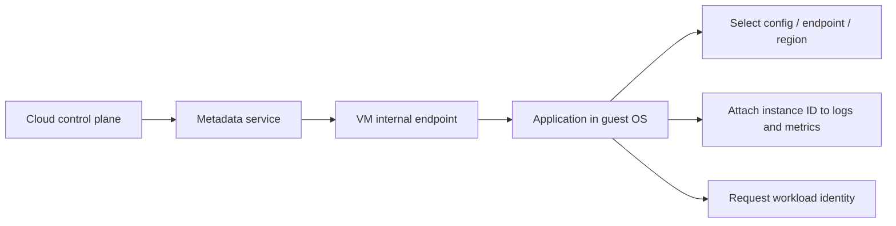
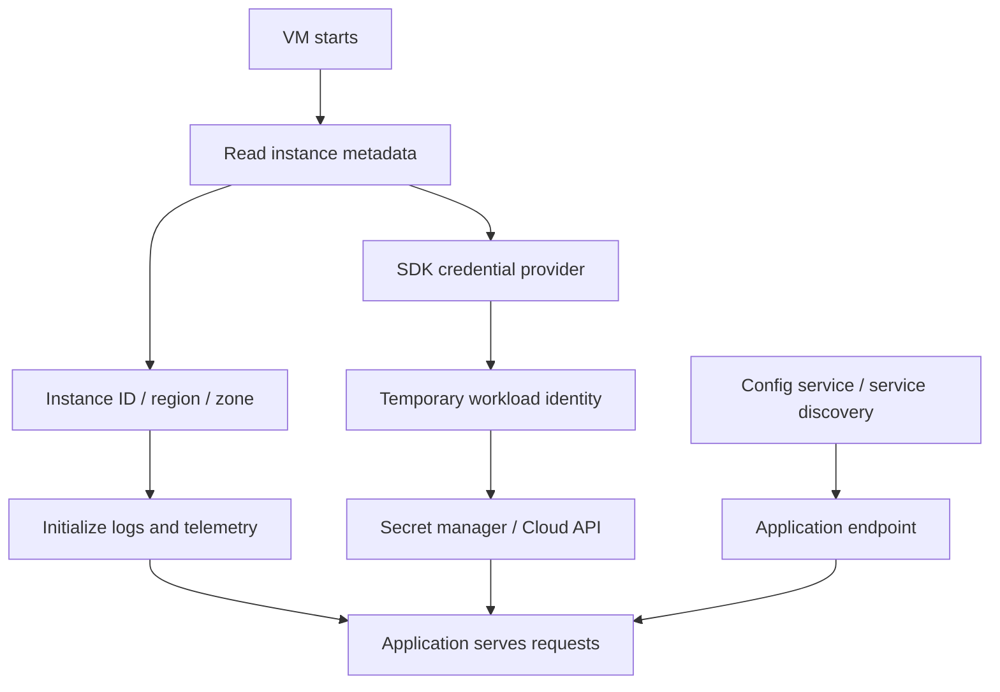

# Virtual Machine Metadata and How Applications Recognize Their Runtime Environment

An application running on a virtual machine often needs information about its current environment: the machine ID, deployment region, zone, instance type, network addresses, or the service identity assigned to the machine. If these values are baked into static configurations, operations teams have to edit configs and cut a new release every time an image moves, an instance is replaced, or a workload deploys to another region.

Cloud platforms provide an **instance metadata service** so virtual machines can read control-plane-managed information via an internal endpoint. Applications can use metadata to recognize their runtime environment, choose appropriate endpoints, label logs, adjust behavior by zone, or obtain workload identity tokens. It is important to understand what data is exposed, how to access it, and its trust boundaries to avoid creating hard dependencies or introducing security risks.

## 1. What Is Virtual Machine Metadata?

**Instance metadata** is the set of information describing a virtual machine and its infrastructure environment that the cloud provider exposes to the guest operating system. Virtual machines typically access this data over a special internal address, usually a link-local IP address or an internal hostname routed by the platform to the metadata service.

Metadata may contain:

- **Instance identity:** instance ID, resource ID, or platform-assigned machine name.
- **Location:** region, availability zone, zone, or fault domain.
- **Machine configuration:** instance type, architecture, and certain CPU and memory attributes.
- **Networking:** private IP addresses, network interfaces, subnets, or published routing information.
- **Image and initialization:** source image ID, boot information, or initialization data permitted by the platform.
- **Workload identity:** information about the role, managed identity, or service account attached to the machine.
- **Verifiable identity data:** signed/audience-scoped identity documents or tokens, depending on the platform.

Not every provider exposes the same set of fields. Some attributes may change when a machine is stopped/started, resized, attached to new network interfaces, or moved to a different configuration. Applications should read the exact metadata API and version supported by the platform.

## 2. How Does the Metadata Service Work?

When creating a virtual machine, the control plane knows which project or account the machine belongs to, which image it uses, which region/zone it resides in, and which resources are attached to it. The provider's hypervisor or network infrastructure exposes a metadata endpoint to the guest OS. Processes inside the VM send HTTP requests to this endpoint and receive text or JSON responses.



Common characteristics of a metadata service:

- The endpoint is reachable only from the VM environment or networks permitted by the platform.
- The protocol is typically internal HTTP, requiring no public Internet access.
- Some platforms require specific headers or tokens to mitigate forged requests.
- The API usually uses versioned paths so providers can add new fields while preserving compatibility.
- Metadata can be read by multiple processes within the guest OS; access is not automatically isolated per application.

The metadata service is not a general-purpose configuration database. It primarily supplies platform-managed information about the machine and identity. Business configurations such as service cluster names, feature flags, or internal service endpoints should be managed through proper configuration mechanisms.

## 3. Distinguishing Instance Metadata, User Data, Tags, and Secrets

These concepts often appear side by side in cloud management interfaces, yet serve distinct purposes:

| Data Type | Purpose | Examples | Notes |
|---|---|---|---|
| Instance metadata | Describes the machine and environment provided by the platform | Instance ID, zone, machine type | Usually generated and managed by the platform |
| User data / startup data | Custom data or scripts supplied at initialization | Agent install scripts, bootstrap configs | Readable from inside the VM; never place secrets here |
| Tags / labels | Labels resources for search, classification, billing, or automation | `environment=production` | Not an authentication mechanism and should never hold passwords/tokens |
| Secret | Credentials requiring protection | API keys, database passwords | Retrieve from a secret manager using workload identity and least privilege |
| Runtime configuration | Application settings that vary by environment | Service URLs, feature flags | Should be managed via a config service or deployment system |

Some platforms allow the metadata service to return user data or tags. Sharing the same access endpoint does not give them the same trust level or purpose. User data can be modified by whoever created the VM and may contain scripts; applications should not execute retrieved content without verifying its source and policy.

## 4. Metadata Fields Commonly Used by Applications

### 4.1. Instance ID and Identification Information

The instance ID is useful for distinguishing individual machines in logs, traces, metrics, and inventory systems. When a VM is replaced, the new instance usually gets a different ID even if it uses the same image and application configuration.

For example, an application can include `instance_id`, `region`, and `zone` in logs so operations teams know which machine handled a request. Never use the instance ID as a secret or standalone authentication proof; it is an identifier, not a credential.

### 4.2. Region, Zone, and Failure Domain

Applications can use the region to choose an endpoint close to where they run, and the zone to tag telemetry or prefer local data reads. Distributed systems can use the zone in placement algorithms or load balancing.

Do not infer the zone solely from instance names or IP addresses. Read the topology fields published by the provider. The meaning of zone and failure domain can vary across platforms.

### 4.3. Machine Type and Hardware Configuration

Some applications adjust worker counts, thread pools, or cache sizes based on CPU count, memory, or accelerator type. Metadata can provide the machine type or configuration attributes, though applications must check availability and never assume every field is always present.

In many cases, reading OS-level information such as available CPUs and available RAM directly is more reliable for sizing processes, because containers or cgroups may enforce lower limits than the full VM configuration. Machine-type metadata describes the instance configuration, whereas an application should size itself to the resources the process is actually permitted to use.

### 4.4. Network Interfaces and IP Addresses

Metadata can provide private IP addresses, network interfaces, or subnets. These fields are helpful for diagnostics and certain network setups, though addresses may change when changing NICs, IP configurations, or replacing instances.

For service-to-service communication, prefer DNS, service discovery, or load balancers instead of pinning VM IP addresses. Read IPs from metadata only when an application genuinely needs its own host address or when the platform requires it.

## 5. Metadata Services on Popular Cloud Platforms

All major platforms provide a metadata endpoint, though request authentication and API paths differ. The following examples illustrate reading basic fields; verify the documentation for your exact provider, VM type, and API version before using in production.

### 5.1. AWS EC2 Instance Metadata Service

AWS EC2 exposes the Instance Metadata Service (IMDS) at IPv4 address `169.254.169.254`. Use **IMDSv2**, where the application fetches a session token via HTTP PUT and passes that token in a header when reading metadata.

Example retrieving the instance ID on Linux:

```bash
TOKEN=$(curl -sS -X PUT \
  "http://169.254.169.254/latest/api/token" \
  -H "X-aws-ec2-metadata-token-ttl-seconds: 21600")

curl -sS \
  -H "X-aws-ec2-metadata-token: $TOKEN" \
  "http://169.254.169.254/latest/meta-data/instance-id"
```

Commonly used metadata paths:

| Path | Information |
|---|---|
| `/latest/meta-data/instance-id` | Instance ID |
| `/latest/meta-data/instance-type` | Instance type |
| `/latest/meta-data/placement/availability-zone` | Availability Zone |
| `/latest/dynamic/instance-identity/document` | Instance identity document in JSON format |
| `/latest/meta-data/iam/security-credentials/` | Role name attached via the instance profile |

IMDSv2 tokens have a lifetime; applications must handle token expiration and fetch a new token. Do not log tokens or expose them to processes that do not need metadata access.

### 5.2. Azure Instance Metadata Service

The Azure Instance Metadata Service uses the internal endpoint `http://169.254.169.254/metadata/instance`. Requests must include the `Metadata: true` header and the `api-version` query parameter.

Example retrieving instance details in JSON:

```bash
curl -sS \
  -H "Metadata: true" \
  "http://169.254.169.254/metadata/instance?api-version=2021-02-01"
```

The response may contain compute details such as VM ID, name, size, region, zone, and network details depending on machine type and API version. Azure also provides a metadata endpoint for managed identities; applications should use official SDKs or identity endpoints to acquire tokens for the required resource/audience.

### 5.3. Google Cloud Compute Engine Metadata Server

Google Cloud provides a metadata server via hostname `metadata.google.internal` or internal address `169.254.169.254`. Requests require the `Metadata-Flavor: Google` header.

Example reading instance details:

```bash
curl -sS \
  -H "Metadata-Flavor: Google" \
  "http://metadata.google.internal/computeMetadata/v1/instance/?recursive=true"
```

Commonly used paths:

| Path | Information |
|---|---|
| `/computeMetadata/v1/instance/id` | Instance ID |
| `/computeMetadata/v1/instance/name` | Instance name |
| `/computeMetadata/v1/instance/zone` | Zone resource path |
| `/computeMetadata/v1/instance/machine-type` | Machine type resource path |
| `/computeMetadata/v1/instance/service-accounts/default/` | Default service account details |

Google Cloud's metadata server also provides an endpoint issuing access tokens for the service account attached to the VM. Applications should use official authentication libraries to manage and refresh tokens.

## 6. How Should Applications Recognize Their Runtime Environment?

There are several ways for an application to determine which VM or cloud it is running on. Choose the approach suited to the goal rather than relying on a single signal.

### 6.1. Use SDKs and Credential Provider Chains

If an application needs to call cloud APIs, the preferred method is usually the provider's official SDK. The SDK can automatically discover workload identity via instance role, managed identity, or service account, and handle token acquisition and refresh.

For example, an AWS application using the SDK can obtain region and credentials via the provider chain. The application does not need to manually query credential metadata paths and manage token lifecycles. On Azure, use Azure Identity and managed identity; on Google Cloud, use Application Default Credentials and the VM-attached service account.

### 6.2. Read Metadata When Instance Attributes Are Needed

If an application needs the instance ID, zone, or machine type, it can call the metadata endpoint at startup. Encapsulate metadata access in a small dedicated module that sets timeouts, parses responses, and exposes strongly typed data to the rest of the application.

Do not let every component make independent HTTP calls to the metadata server. Centralizing access simplifies testing, caching, restricting allowed fields, and handling errors consistently.

### 6.3. Use Explicit Deployment Configuration

If an application only needs to know `environment=production`, `service=checkout`, or `deployment_ring=canary`, environment variables or configs injected by the deployment system are usually a better fit than metadata. These values are operational decisions and may not exist in standard provider metadata.

Never treat calling the metadata server as the sole test for whether an application is running in the cloud. A failed request could result from a blocked endpoint, a booting VM, or a mocked test environment. Support explicit configuration and handle metadata unavailability gracefully.

## 7. Example Reading Metadata in a Python Application

The following example demonstrates retrieving the instance ID from AWS IMDSv2. The code sets a short timeout, checks HTTP errors, and never logs the token:

```python
import requests

METADATA_BASE = "http://169.254.169.254/latest"


def get_aws_instance_id() -> str:
    token_response = requests.put(
        f"{METADATA_BASE}/api/token",
        headers={"X-aws-ec2-metadata-token-ttl-seconds": "60"},
        timeout=1.5,
    )
    token_response.raise_for_status()
    token = token_response.text

    metadata_response = requests.get(
        f"{METADATA_BASE}/meta-data/instance-id",
        headers={"X-aws-ec2-metadata-token": token},
        timeout=1.5,
    )
    metadata_response.raise_for_status()
    return metadata_response.text.strip()


if __name__ == "__main__":
    try:
        print("instance_id:", get_aws_instance_id())
    except requests.RequestException:
        # Deployment configuration can be used, or record that metadata is unavailable.
        print("instance metadata unavailable")
```

In production applications, inject an HTTP session, configure bounded retries, and cache immutable fields. Avoid aggressive retries when the endpoint is unreachable, as that can slow down startup or create unnecessary load.

## 8. Metadata and Workload Identity

One of the most important functions of a metadata service is enabling VMs to obtain identities to call cloud services without embedding long-lived access keys inside images or configuration files.

Examples:

- AWS attaches an IAM role via an instance profile; applications retrieve temporary credentials using the SDK's credential provider mechanism.
- Azure attaches a managed identity to a VM; applications request access tokens for the required resource or scope.
- Google Cloud attaches a service account to a VM; applications obtain short-lived tokens via the metadata server or SDK.

Temporary credentials expire and are refreshed periodically. Access permissions are governed by IAM policies, role assignments, or service account permissions. Therefore:

- Grant only the minimum permissions required by the workload.
- Separate roles across development, staging, and production environments.
- Avoid attaching a single broad-privilege role to every VM in a project.
- Use official SDKs to refresh credentials and handle expiration errors.
- Never write access tokens or credentials to logs, traces, crash dumps, or HTTP responses.
- Revoke or update permissions in the control plane when a workload no longer needs access.

Because the metadata endpoint can issue credentials with access to cloud resources, metadata access must be treated as an important security boundary, especially on VMs running code from multiple sources or multi-tenant containers.

## 9. Security Risks of the Metadata Service

### 9.1. SSRF and Unintended Metadata Access

SSRF (Server-Side Request Forgery) occurs when an attacker tricks an application into sending a request to an attacker-controlled destination. If the application can reach the metadata endpoint, an SSRF vulnerability can be exploited to read instance information or credentials.

Risk scenarios include:

- A backend API accepts a user-supplied URL and fetches its content without filtering the target address.
- A proxy or fetch service permits access to link-local addresses.
- An application parses URLs without validating redirects, DNS resolution, or the resolved target IP address.
- Untrusted containers can reach the metadata endpoint of the underlying node or host VM.

### 9.2. Mitigations

- **Use metadata versions with request protection.** On AWS, require IMDSv2 and disable IMDSv1 if workloads support it.
- **Limit hops.** Configure an appropriate metadata response hop limit, usually the lowest value supported by the architecture; on AWS, a hop limit of 1 helps restrict certain access paths from containers across network hops.
- **Control SSRF.** Allow the application to reach only required hostnames/schemes/ports; block link-local and private IP ranges when the feature does not require them.
- **Validate redirects and DNS.** Do not inspect only the input URL string; verify the resolved destination IP address after DNS resolution and after redirects.
- **Isolate workloads.** Do not run untrusted code on the same VM as workloads holding broad cloud permissions. Use separate VMs/node pools or sandboxes when isolation is needed.
- **Minimize IAM permissions.** Assume metadata credentials could be exposed and restrict their permissions to limit blast radius.
- **Protect logs and sensitive data.** Never write tokens, sensitive user data, or full metadata responses to public logs.

Mandatory headers in IMDSv2 and required headers in Azure/GCP help validate legitimate requests according to each platform's mechanism, but they do not replace SSRF controls and least-privilege IAM. An application legitimately permitted to query metadata can still be tricked into forwarding unintended requests.

### 9.3. Do Not Put Secrets in User Data or Custom Metadata

User data can usually be read by processes inside the VM and may persist in launch history or snapshots. Never put database passwords, private keys, access tokens, or long-lived credentials into user data, tags, or custom metadata. Use a secret manager and grant access via workload identity.

## 10. Caching, Timeouts, and Reliability When Reading Metadata

Although the metadata service sits close to the VM and responds quickly, applications must still handle network errors, timeouts, API version mismatches, or missing fields.

Key principles:

- Read only the fields actually needed.
- Use short timeouts and bounded retries with backoff.
- Cache static fields such as instance ID or zone for the process lifetime when appropriate.
- Never cache access tokens past expiration; prefer SDK-managed refresh.
- Handle missing fields or unsupported API versions explicitly.
- Do not make the metadata server a hard dependency on every business request if the information can be read once at startup.
- Provide a clean fallback when running locally, in CI, or in container environments without a metadata service.

For fields that can change during a VM's lifecycle—such as network interfaces or IP addresses—avoid caching indefinitely. Clearly define refresh intervals based on platform and application behavior.

## 11. Metadata in Containers and Orchestrated Environments

Containers running on a VM may see part of the host's metadata endpoint if network namespaces and network policies permit it. While useful for infrastructure agents, this can also allow untrusted containers to steal node details or node credentials.

In Kubernetes, Pods should generally obtain Pod-specific details via the Downward API, environment variables, or platform APIs. For example, a Pod can receive its Pod name, namespace, and labels through the Downward API without querying the host VM's metadata.

For workload identity in Kubernetes, prefer platform-native mechanisms such as IAM Roles for Service Accounts / Pod Identity on AWS, Workload Identity on Google Cloud, or Workload Identity Federation / appropriate managed identity integration on Azure. These grant identity per service account and avoid sharing node-level credentials.

In serverless environments, providers typically abstract away VMs and underlying infrastructure metadata. Applications should rely on the runtime context, environment variables, and identity providers exposed by the serverless platform rather than assuming a VM metadata endpoint is reachable.

## 12. Verifying Instance Identity and Trust Boundaries

Some platforms provide signed identity documents or tokens that prove a workload belongs to a specific instance or project. If a receiving service must verify caller identity, use attestation mechanisms or signed tokens according to the provider's guidance.

Never grant access based solely on an `instance-id` string self-reported by an application in an HTTP header. Clients can spoof that string. The receiving service must verify the token/signature, issuer, audience, expiration, and required claims before mapping the identity to authorized permissions.

Standard metadata is data readable by the guest OS. If the guest OS or a privileged process is compromised, an attacker can read or forge data within the guest's control. Therefore, metadata is useful for configuration and environment discovery, whereas critical authorization decisions must rely on verifiable authentication mechanisms.

## 13. Design Example: Multi-Region Application on VMs

Suppose an API service runs across multiple VMs in two regions and multiple zones. The application needs to include the instance ID in logs, select the nearest service endpoint, and use VM identity to read secrets.

A sound design looks like this:

1. At startup, a metadata module reads the instance ID, region, and zone via the provider's API.
2. The application attaches these fields to logs and metrics for troubleshooting, without using them as credentials.
3. Service endpoints come from deployment configuration or service discovery; region acts only as a signal for choosing the nearest endpoint.
4. The cloud SDK uses the VM-attached role/managed identity/service account to obtain temporary credentials.
5. The application fetches secrets from the secret manager using permissions scoped to only the required secrets.
6. If the metadata service is temporarily unavailable at startup, the application follows policy: starting with explicit config for optional fields, or failing fast if identity is a mandatory security requirement.
7. Monitoring alerts when required metadata is missing, credential refresh fails, or the application runs in an unexpected region/zone.



This design separates machine metadata, authentication identity, and business configuration. When replacing a VM or moving regions, the application acquires fresh metadata and identity without baking credentials or static IPs into the image.

## 14. Common Mistakes When Using Metadata

**Treating metadata as the sole configuration source.** Metadata does not hold every value an application needs. Distinguish infrastructure metadata from business configuration and secrets.

**Hardcoding one provider's endpoints or paths.** This makes applications hard to port across environments. Encapsulate metadata access behind a provider adapter and support explicit config in development.

**Using instance ID for authentication.** An ID can be spoofed if passed simply as a string. Use signed identity tokens or verifiable attestation mechanisms.

**Using IMDSv1 when IMDSv2 is available.** Unauthenticated tokenless requests increase SSRF exposure. Enforce IMDSv2 and test all agents before disabling the legacy version.

**Putting secrets in user data or tags.** Those values can be read or copied. Use a secret manager with least privilege.

**Allowing containers to reach host metadata.** Containers may harvest node credentials if the endpoint is reachable. Use dedicated workload identities and restrict network paths.

**Omitting timeouts or retrying infinitely.** Applications can hang on startup or flood requests. Use short timeouts, bounded retries, and clear fallbacks.

**Logging entire metadata responses.** Responses may include internal details or tokens. Log only necessary, non-sensitive fields.

## 15. Implementation Checklist

- [ ] Identified the exact metadata fields the application actually needs.
- [ ] Selected the right API version and endpoint for the provider.
- [ ] Enabled appropriate metadata request protection, such as AWS IMDSv2.
- [ ] Separated instance metadata, user data, tags, application configuration, and secrets.
- [ ] Used official SDKs/credential providers for workload identity.
- [ ] Scoped IAM roles, managed identities, or service accounts to least privilege.
- [ ] Implemented timeouts, bounded retries, caching, and handling for missing fields.
- [ ] Ensured the application can still run locally, in CI, or in environments without metadata when appropriate.
- [ ] Enforced controls against SSRF, redirects, and link-local address access.
- [ ] Prevented containers from accessing host metadata/credentials beyond approved needs.
- [ ] Confirmed tokens, credentials, and sensitive data never appear in logs or images.
- [ ] Tested instance replacement, zone/region changes, and temporary metadata unavailability.
- [ ] Verified identity tokens/attestation whenever metadata is used to prove identity.

## 16. Conclusion

The metadata service provides information about the instance and cloud environment so applications can recognize where they are running, enrich telemetry, choose appropriate configurations, and obtain workload identities. AWS IMDS, Azure IMDS, and Google Cloud Metadata Server each have their own endpoints, headers, and access mechanisms; applications must use the platform's proper API and version.

Use metadata for infrastructure details, SDKs or workload identities for authentication, and config/secret managers for business settings and sensitive data. Protecting metadata endpoints against SSRF, scoping workload permissions, handling timeouts, and testing across VM changes keep applications reliable throughout the virtual machine lifecycle.
