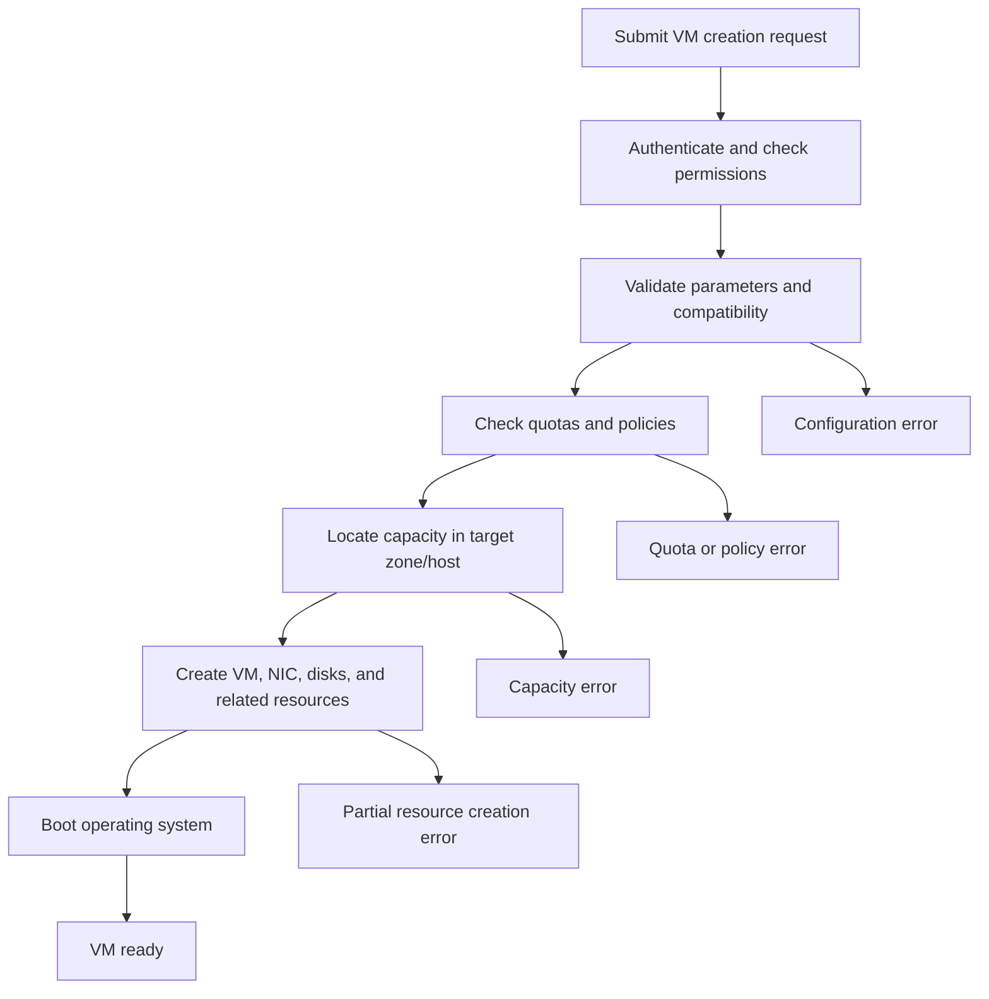

# Handling Provisioning Failures Caused by Insufficient Capacity, Quotas, or Invalid Configuration

## Learning Objectives

After this lesson, you will be able to:

- Distinguish insufficient capacity errors, quota exceeded errors, and invalid provisioning configurations.
- Identify the scope and stage where failures occur during virtual machine (VM) creation.
- Read error codes, region/zone details, machine types, and quotas to diagnose root causes.
- Choose appropriate remedies, ranging from controlled retries, changing zones or machine types, to requesting quota increases and fixing configurations.
- Design resilient provisioning workflows that prevent duplicate resources and control costs.

## 1. Why Can a VM Creation Request Fail?

When submitting a VM creation request, the cloud platform must validate numerous conditions before delivering a working machine. The system authenticates permissions, validates configuration, checks resource limits, locates physical capacity, creates associated resources, and boots the operating system. Failing even a single condition can cause the operation to fail.

Three common failure categories during provisioning are:

- **Insufficient capacity:** the platform lacks sufficient matching hardware capacity at the requested location. For example, a zone is temporarily out of capacity for a specific machine series or GPU type.
- **Quota exceeded:** the request would push total resource usage past the limit granted to the account, project, subscription, or another scope. For example, a project has exhausted its vCPU quota for a machine family.
- **Invalid configuration:** request parameters are invalid or incompatible. For example, selecting a machine type unsupported in the target zone, an image with the wrong CPU architecture, or an unsupported device combination.

Each category requires a different response. Blindly retrying does not create physical capacity, increase quotas, or fix invalid parameters. The first step is classifying the root cause accurately using the error code, detailed message, and failing stage.

Beyond these three categories, requests can also fail due to missing permissions, organization policies, API rate limits, control-plane network errors, or dependent services. Identify those separately to avoid mistaking them for capacity errors.

## 2. Understanding the VM Provisioning Process

A typical provisioning flow can be illustrated as follows:



This is a conceptual model. Actual order, step counts, and error reporting vary by provider. One platform may check quotas earlier, while another validates dependent resources mid-provisioning. VM creation is also typically asynchronous: the API may accept the request first and later report failure in an operation or deployment record.

A VM may pass through states such as **Creating**, **Provisioning**, **Starting**, **Running**, or **Failed**. State names depend on the platform. Therefore, a successful HTTP response or receiving an operation ID does not prove the VM was created successfully. Monitor the operation to its terminal state and inspect the resource status.

### Resources Involved in a Provisioning Request

In addition to VM CPU and RAM, creating a machine typically requires several other resources:

- vCPUs and memory on a compatible host or host group.
- Accelerators such as GPUs or FPGAs if requested by the configuration.
- Boot disk, data disks, storage type, and throughput/IOPS.
- Network interfaces, subnets, IP addresses, and network rules.
- Placement groups, host groups, reservations, or affinity/anti-affinity rules.
- Security features such as vTPM, Secure Boot, confidential computing, or encryption.
- Access permissions for images, keys, secrets, and related services.

A request may have sufficient CPU and RAM yet still fail because a subnet ran out of IP addresses, public IP quota was exhausted, or a disk type is unsupported in that zone. When investigating, pinpoint the exact resource that was rejected.

## 3. Distinguishing the Three Main Error Categories

| Criterion | Insufficient Capacity | Quota Exceeded | Invalid Configuration |
|---|---|---|---|
| Nature | Cannot find matching physical capacity in requested location | Requested resources exceed permitted limits | Unsupported parameters or resource combinations |
| Common scope | Region, zone, machine type, accelerator, or host group | Account, project, subscription, region, family, or resource type | Config fields, image, machine type, zone, disk, network, or features |
| Behavior | May be temporary and fluctuate with load or time | Persists until usage drops or quota is adjusted | Consistently reproducible with the same parameters |
| Resolution | Controlled retry, pick another zone or machine type, use reservations | Release resources or request a quota increase | Fix parameters or select a supported combination |
| Should you retry immediately? | Possibly, if confirmed transient and retries are bounded | Usually no; retrying does not raise quotas | No; fix configuration first |

### 3.1. Insufficient Capacity

Capacity is the actual physical infrastructure the provider can allocate to a request at a given location and time. Capacity may depend on:

- Region or zone.
- Machine family and instance size.
- CPU architecture, CPU generation, or specific host requirements.
- GPUs, accelerators, GPU memory, and interconnect topology.
- Placement groups, dedicated hosts, or affinity requirements.
- Network bandwidth or storage types coupled with the configuration.

For example, a zone might still provision general-purpose VMs while temporarily lacking hosts for large GPU configurations. This is resource-specific capacity exhaustion, not necessarily full-zone exhaustion.

Capacity can change as the provider adds hosts, other customers release resources, or demand drops. However, there is no guarantee a retry a few seconds later will succeed. If a workload needs guaranteed capacity at a specific time, evaluate platform-supported reservation or capacity commitment mechanisms.

### 3.2. Quota Exceeded

A quota is an administrative limit on how many resources an account scope may consume. Quotas help control costs, protect shared capacity, and prevent a project from consuming beyond approved limits.

Quotas may apply to:

- Total vCPUs in a region.
- vCPUs per instance family or accelerator type.
- Number of VMs, disks, network interfaces, or public IPs.
- Provisioned storage capacity, volume counts, or throughput.
- IP addresses or network resources within a scope.
- Other cloud services created alongside VMs.

Quotas usually have explicit scopes. A project might have remaining quota in region A while exhausting quota in region B; total vCPU quota might remain while GPU-specific quota is exhausted. Quotas may also be set at the organization or subscription level and apply across child projects.

Distinguish **quota** from **usage**. Usage is the quantity currently counted against the limit; quota is the maximum allowed. Whether stopped VMs still count toward usage depends on each service's rules. Reservations, in-progress creations, or incomplete deletions can also affect how the platform calculates usage.

### 3.3. Invalid Configuration

Invalid configuration occurs when individual parameters or their combination fail service constraints. Examples:

- Selecting a VM size that does not exist or is unsupported in the region/zone.
- Selecting an ARM64 image with an x86-64 machine type, or vice versa.
- Using an image requiring UEFI when the machine configuration does not support that boot mode.
- Selecting a disk type or storage feature unavailable for the machine type.
- Requesting GPUs, Secure Boot, vTPM, or confidential computing in an unsupported combination.
- Setting boot disk capacity below the image's minimum requirement.
- Selecting a subnet in a different region or an incompatible network interface.
- Conflicting placement, affinity, or dedicated host settings.

Some cases emit messages resembling capacity errors when the root cause is a configuration constraint. For instance, a machine series not offered in the chosen zone might return a generic resource-unavailable message. Check the supported machine list and detailed error code.

## 4. Reading Error Messages and Identifying Scope

When provisioning fails, capture key details before retrying:

- Error code and full message.
- HTTP status or operation status if provided by the API.
- Request ID, correlation ID, operation ID, or deployment ID.
- Project/account/subscription and region/zone.
- Machine type, vCPU count, RAM, and accelerators.
- Image ID, architecture, firmware mode, and boot configuration.
- Disks, subnets, network interfaces, and additional features.
- Timestamp, attempt count, and recent changes.

Never rely solely on a short summary sentence. Error codes are usually far better for classification; the details payload often reveals which quota was exceeded, which zone lacked capacity, or which field was invalid.

The illustrative example below uses generic codes, not mandatory codes from any specific provider:

```json
{
  "error": {
    "code": "QUOTA_EXCEEDED",
    "message": "The requested vCPU count exceeds the regional family quota.",
    "details": {
      "scope": "project",
      "region": "region-a",
      "resource": "compute-family-vcpu",
      "requested": 16,
      "available": 8
    },
    "requestId": "example-request-id"
  }
}
```

In this example, the request asks for 16 vCPUs while the quota scope only has 8 remaining. The resolution is scaling down the request, freeing usage, or requesting a quota increase. Switching to another zone within the same quota scope will not help if the quota is enforced regionally.

### Common Error Signals

| Signal in Error | Category to Check First | What to Verify |
|---|---|---|
| Insufficient capacity, resource pool exhausted, capacity unavailable | Capacity | Zone, machine type, accelerator, reservations, and timing |
| Quota exceeded, limit reached, maximum allowed | Quota | Quota name, scope, current usage, and remaining allowance |
| Invalid parameter, unsupported configuration, incompatible image | Configuration | Invalid field, architecture, machine type, zone, and feature combination |
| Permission denied, not authorized, policy violation | Permissions/Policy | IAM role, service account, organization policy, and image/key permissions |
| Too many requests, throttled, rate limit exceeded | API Rate Limit | Request rate, Retry-After, and backoff mechanism |
| Address exhaustion, no available IP | Network capacity or IP quota | Subnet CIDR range, used IPs, and address quotas |

Actual error names vary. Confirm using the API's error code reference and operation records.

## 5. Handling Insufficient Capacity Errors

Once you confirm a capacity failure, verify scope before altering architecture.

### 5.1. Check Location and Machine Type

- Confirm the selected region and zone.
- Verify whether the machine type is offered in that zone.
- Check whether the configuration requires specific GPUs, CPU generations, dedicated hosts, or placement groups.
- Check existing reservations and which VM types can consume them.
- Determine whether the workload depends on the zone of a database, disk, subnet, or another service.

If the machine type is not offered in that zone according to the service catalog, this is a location availability issue rather than transient capacity exhaustion. Moving to a supported zone is the right fix.

### 5.2. Bounded Retries

If the provider confirms the capacity error may be transient, retry using exponential backoff and jitter. Increasing delays prevent multiple clients from hammering the API simultaneously:

\[
d_n = \min(d_{\max}, d_0 \times 2^n)
\]

Actual wait times can add random jitter to spread out retry attempts. If the API returns a suggested retry delay, follow that guidance first.

Principles:

- Retry only errors confirmed to be transient.
- Enforce limits on retry attempts and total retry duration.
- Log every attempt, error code, and request ID.
- Use an idempotency key or request tracking mechanism to avoid creating duplicate VMs.
- Stop retrying once limits are reached and switch to a fallback plan.

Do not retry indefinitely with the exact same configuration if the error message does not change and there is no sign of capacity freeing up.

### 5.3. Switching to Fallback Options

Prepare a fallback matrix prior to deployment:

| Order | Option | Conditions to Verify |
|---|---|---|
| 1 | Retry same zone and machine type after wait | Error is confirmed transient |
| 2 | Select a different zone in the same region | Disks, subnets, databases, and dependent services support the new zone |
| 3 | Select a different size in the same machine family | Application fits the new CPU/RAM and limits |
| 4 | Select an equivalent machine family | CPU architecture, drivers, performance, and image compatibility |
| 5 | Switch regions | Latency, data residency, data connectivity, quotas, and policy allow it |

Switching zones or regions can entail changes to subnets, IP addresses, firewalls, disks, and data placement. Do not declare fallback successful merely because VM creation succeeded; confirm the application still meets operational requirements.

### 5.4. Using Reservations for Predictable Capacity

For critical workloads with known launch schedules, capacity reservations or commitments reduce host-shortage risk. Verify:

- Which region, zone, machine type, and attributes the reservation covers.
- Reservation quantity and duration.
- How the reservation binds to VMs or VM groups.
- Pricing, billing terms, and release procedures.
- Whether the reservation guarantees the exact accelerators, hosts, or topology the workload requires.

A reservation does not increase quota. A request can hold a reservation yet still be rejected if quotas, permissions, or configurations fail validation.

## 6. Handling Quota Exceeded Errors

### 6.1. Identify the Exact Limit Hit

Open the service's quota/limits page or query the quota API. Check:

- The exact quota name.
- The resource type counted.
- The scope: organization, account, project, subscription, region, or family.
- Current limit, usage, and remaining allowance.
- Pending creations, reservations, or incomplete deletions.
- Whether the quota is adjustable or a hard limit.

Do not look solely at total vCPU quota. Some platforms simultaneously enforce total quotas, family quotas, and accelerator quotas. Any of the three can block a request.

### 6.2. Reclaim Unneeded Usage

If quota is exhausted, identify resources that can be reclaimed safely:

- Test VMs or old VMs no longer in use.
- Temporary disks, snapshots, or images per retention policy.
- Unattached public IPs and network interfaces.
- Unneeded accelerators or reservations.
- Leftover resources from failed deployments.

Check dependencies before deleting. An unattached disk might still hold critical data; a snapshot might be the only backup. Follow data lifecycle and resource ownership procedures.

Some quotas decrement usage only after deletion finishes and accounting syncs. Monitor deletion status rather than immediately re-submitting requests.

### 6.3. Requesting a Quota Increase

When legitimate demand exceeds current limits:

1. Identify the exact quota name and scope.
2. Estimate current demand, growth, and safety buffer.
3. Check whether the quota is self-service adjustable in the console or requires a support request.
4. Clearly specify region, resource type, requested quantity, and use case.
5. Track the request until the new limit takes effect.
6. Re-read the quota after approval, then retry provisioning.

Do not assume quotas increase immediately upon submission. Approvals may depend on usage history, regional capacity, service type, and provider policies.

### 6.4. Budgeting Quotas for Autoscaling

If VMs scale automatically with load, quotas must cover the maximum expected instance count. For example, an autoscaling group scaling from 4 to 20 VMs at 4 vCPUs each can require up to 80 vCPUs at peak—before counting other workloads sharing the same quota scope.

Budget based on peak concurrent demand:

\[
Q_{\text{needed}} =
Q_{\text{used}} +
Q_{\text{max\_scale}} +
Q_{\text{buffer}}
\]

This is a planning guideline, not an official quota formula for every provider. Follow each resource type's exact accounting rules and avoid double-counting resources already included in current usage.

## 7. Handling Invalid Configuration Errors

For configuration errors, isolate the invalid parameter or combination and fix it at the declaration source to prevent recurring failures.

### 7.1. Verify Machine Type and Location Compatibility

Cross-check the provider's support matrix:

- Is the machine type available in the region/zone?
- Does the machine type's CPU architecture match the image?
- Are GPUs/accelerators compatible with the machine series and drivers?
- Are the disk type, minimum size, and IOPS features supported?
- Are placement groups, dedicated hosts, and reservations compatible?
- Are Secure Boot, vTPM, and confidential computing supported on that machine type?

Never infer compatibility from similar naming. Different sizes within the same machine family can carry different limits.

### 7.2. Verify Image and Boot Configuration

An image can cause failures if:

- CPU architecture does not match.
- Firmware mode does not match.
- The image lacks storage or network drivers required by the VM type.
- The boot disk is smaller than the minimum required size.
- Bootloaders or signatures fail Secure Boot policies.
- The image is not shared with or permitted for the project creating the VM.

Review image metadata, OS documentation, and VM type requirements. When changing images, test booting on a small VM with the same firmware and network configuration before deploying to main environments.

### 7.3. Verify Networking and Storage

Provisioning failures can originate in dependent resources:

- Subnet has no available IP addresses.
- Network interfaces exceed limits or are unsupported.
- Invalid security groups, routes, or network policies.
- Disk type is unavailable in the zone.
- Boot disk lacks capacity or encryption references an inaccessible key.
- Provisioned IOPS/throughput exceeds disk or VM limits.

Distinguish subnet IP exhaustion from host capacity exhaustion. They require completely different fixes: one concerns network address ranges; the other concerns VM placement capacity.

### 7.4. Validate Configuration as a Whole

A VM may use individually valid values whose combination is unsupported. For example: a machine type supports GPUs but not the selected confidential computing feature; a UEFI image enables Secure Boot but the VM type lacks matching key support; an encrypted disk requires a key the service account cannot read.

Validate configurations using validation APIs, deployment previews, or template linters before submitting live provisioning requests. Pre-checks catch errors early, though they cannot guarantee capacity remains available at creation time.

## 8. Distinguishing Permission, Policy, and API Limit Errors

Several errors are easily confused with quota or capacity issues:

- **Permission/IAM:** the caller lacks permission to create VMs, attach disks, use images, or access keys. Fix by inspecting principals, roles, scopes, and permissions on related resources.
- **Organization policy:** policies may forbid specific machine types, regions, public images, IP addresses, or security features. Fix by reviewing policy evaluations and requesting admin adjustments when justified.
- **API throttling:** request rate exceeds rate limits. This is an API call frequency limit, not necessarily a VM count quota. Honor `Retry-After`, lower concurrency, and apply backoff.
- **Service dependency:** VM creation depends on an image, network, disk, or key management service experiencing an outage. Check service health and operation records.

Accurate classification ensures issues reach the right team and prevents unnecessary configuration changes.

## 9. Standard Diagnostic and Recovery Workflow

Apply this workflow whether provisioning manually, via API, or via Infrastructure as Code (IaC):

1. **Record the request.** Save the submitted configuration, timestamp, project/account, region/zone, request ID, and operation ID.
2. **Wait for operation completion.** For asynchronous APIs, track the operation to its terminal state before concluding success or failure.
3. **Classify the error.** Use the error code and details to distinguish capacity, quota, configuration, permissions/policy, or throttling.
4. **Determine scope.** Inspect region, zone, instance family, project/subscription, quota name, and dependent resources.
5. **Take appropriate action.** Capacity: bounded retry or fallback. Quota: free usage or request increase. Configuration: fix parameters. Permissions/policy: resolve IAM or policies.
6. **Check partially created resources.** Inspect VMs, disks, NICs, IPs, reservations, and related operations to prevent resource leaks or stray charges.
7. **Retry safely.** Use idempotency keys or deterministic resource naming to avoid duplicates.
8. **Verify outcome.** Confirm the VM is running, booted cleanly, network and disks are ready, health checks pass, and the application works.
9. **Document root cause and remediation.** Update runbooks, quota forecasts, fallback matrices, and alerts.

### Quick Decision Table

| Classification Result | First Action | When to Retry? |
|---|---|---|
| Transient capacity | Check zone/machine type and fallback options | After wait, with backoff and retry limit |
| Capacity due to machine unavailable in zone | Select a supported zone or machine type | After updating location/configuration |
| Quota exceeded | Check quota and usage; release or request increase | Once quota covers the request |
| Invalid configuration | Fix invalid field or combination | After validation passes |
| Permission/policy denied | Fix permissions or policy per procedure | Once permissions/policy take effect |
| API throttling | Reduce call rate and concurrency | Following `Retry-After` or backoff |

## 10. Real-World Example: Autoscaling Fails to Add VMs

A web service has an autoscaling group running 6 VMs of 4 vCPUs each. As traffic rises, the controller attempts to scale to 12 VMs. New provisioning requests fail one after another.

Operations collects the operation records and finds two distinct errors:

- Several requests report the instance family's vCPU quota is exhausted. Target total demand is 48 vCPUs, while current quota only allows 8 additional vCPUs.
- Several requests in a specific zone report no capacity for the chosen machine type.

Blindly retrying all requests will keep hitting quota failures and generating unnecessary API traffic. The right remediation workflow is:

1. Calculate total vCPUs required at maximum autoscaling size and check quotas for the exact region/family.
2. Lower the target VM count within current quota limits while waiting for limit adjustments.
3. Submit a quota increase request if forecasted load requires 12 VMs and the need is approved.
4. Prepare a fallback zone offering the same or a tested equivalent machine type.
5. Retry only capacity-failed requests after a wait, enforcing retry bounds and idempotency.
6. Monitor each VM's operation and verify health checks before registering with the load balancer.

This example shows autoscaling requires both quota headroom and a capacity strategy. Raising maximum instance count in an autoscaling config does not automatically raise quotas or guarantee hosts in a zone.

## 11. Automating to Reduce Provisioning Errors

A well-run platform catches most errors before calling the VM creation API and responds cleanly when runtime failures still occur.

### Pre-Provisioning Checks

- Validate template schemas and required fields.
- Verify image, CPU architecture, and firmware mode.
- Verify machine type and feature availability in the target zone.
- Read quotas and usage before large scale-outs.
- Check remaining subnet IPs, disk limits, and network limits.
- Check IAM, policies, and access to images/keys.
- Estimate peak VM counts for autoscaling or batch deployments.

Pre-checks are point-in-time snapshots. Quota usage and capacity can shift before provisioning finishes, so runtime error handling remains essential.

### Classified Retries

A controller can classify error codes and retry only transient categories:

```python
def handle_provisioning_error(error, attempt, max_attempts):
    if error.category == "INVALID_CONFIGURATION":
        return "FIX_CONFIGURATION"

    if error.category == "QUOTA_EXCEEDED":
        return "RELEASE_USAGE_OR_REQUEST_QUOTA"

    if error.category in ("PERMISSION_DENIED", "POLICY_DENIED"):
        return "FIX_ACCESS_OR_POLICY"

    if error.category == "THROTTLED":
        return "RETRY_WITH_RATE_LIMIT"

    if error.category == "CAPACITY_TEMPORARY":
        if attempt >= max_attempts:
            return "TRY_FALLBACK_OR_ESCALATE"
        return "RETRY_WITH_BACKOFF_AND_JITTER"

    return "INSPECT_OPERATION_AND_ESCALATE"
```

This is illustrative pseudocode. Real implementations must map provider-specific error codes to categories, honor `Retry-After`, enforce overall timeouts, and log request IDs.

### Avoiding Duplicate Resources

When a client times out, the cloud has not necessarily canceled the operation. The VM may still be provisioning while the response was lost in transit. Before resubmitting:

- Look up the operation ID or resource name already used.
- Use an idempotency token if supported by the API.
- Inspect the state of existing resources.
- Clean up partially created resources only after confirming no dependencies remain.
- Reconcile IaC state with actual cloud state before the next apply.

With Terraform or similar IaC tools, inspect provider diagnostics and operation details, then check state and live cloud resources. A failed apply may have left partial dependent resources behind; blindly re-running can trigger naming collisions or orphaned resources.

## 12. Designing to Minimize Failures in Production

- **Quota headroom:** plan around peak scaling, baseline workloads, and expected growth.
- **Zone/type fallbacks:** pre-test alternate VM, disk, network, and image combinations.
- **Capacity reservations:** consider them for critical workloads with fixed launch windows.
- **Bounded autoscaling:** set sensible min/max limits, monitor quota headroom, and avoid overly aggressive concurrent scale-outs.
- **Standardized images:** manage architecture, firmware, drivers, boot disks, and image versions in pipelines.
- **Observability:** record operation IDs, error codes, zones, families, retry counts, and provisioning latency.
- **Runbooks:** define actions per error category and escalation thresholds for cloud/platform teams.
- **Drills:** simulate low quota, zone capacity exhaustion, and misconfigurations in test environments to validate fallbacks.

These measures shorten recovery time and make failures predictable. They cannot completely eliminate provider capacity shortages or dependent service outages.

## 13. Common Misconceptions

- **Insufficient capacity means quota is exhausted.** Capacity is physical placement availability; quota is an allocated usage cap. A request may have plenty of quota yet find no available host.
- **Switching zones always bypasses quota limits.** If quotas are scoped by region or project, changing zones within the same scope does not increase available quota.
- **Retrying continuously will eventually create the VM.** Retries only help transient errors. Quota or invalid configuration errors require changing the underlying condition first.
- **Increasing quota guarantees capacity.** Higher quota permits higher usage; it does not guarantee the provider has hosts in the desired zone and machine type.
- **A successful API call means the VM is ready.** Track asynchronous operations to completion and verify final state, boot, networking, disks, and health checks.
- **Autoscaling raises quotas automatically.** Autoscaling merely requests more instances per policy; quotas remain governed separately.
- **Deleting any resource frees quota immediately.** Some resources take time to delete, carry dependencies, or are subject to retention policies.
- **Every "resource unavailable" error is a capacity issue.** It could be an unsupported machine type in that zone, an incompatible image, or a policy block. Read error details before switching zones.

## 14. Self-Check

**Scenario 1:** A project has ample vCPU quota, but creating a GPU VM in zone A fails with a capacity unavailable message. What should you do?

**Hint:** Verify whether that GPU/VM type is supported in zone A and check capacity or reservations. If transient, perform bounded retries; if still unavailable, try a pre-tested fallback zone or configuration. Unused quota does not guarantee GPU hosts are available.

**Scenario 2:** Creating an 8-vCPU VM fails because family quota only has 4 vCPUs left. Will retrying after 30 seconds resolve this?

**Hint:** Not if usage and quota remain unchanged. Downsize the request, reclaim usage, or request an increase for the exact family and region quota.

**Scenario 3:** An ARM64 image is paired with an x86-64 VM type and the API reports an incompatible configuration. How should you resolve it?

**Hint:** Use an image matching the architecture or a compatible VM type. Retrying the same configuration will not resolve the mismatch.

**Scenario 4:** The VM creation API times out, yet the console still shows the VM in a Creating state. Should you immediately submit a new VM creation request?

**Hint:** First look up the operation and resource name, wait for the terminal state, or confirm the operation failed. Use idempotency if available to avoid creating duplicate VMs.

## Conclusion

VM provisioning errors must be classified by root cause. Insufficient capacity requires checking location, machine type, and fallback options; exceeded quotas require reviewing usage, limit scope, and quota increases; invalid configurations require fixing parameters or selecting supported combinations. Capture error codes and operation IDs, handle each category appropriately, bound retries, prevent duplicate resources, and verify VM readiness before putting the machine into service.
