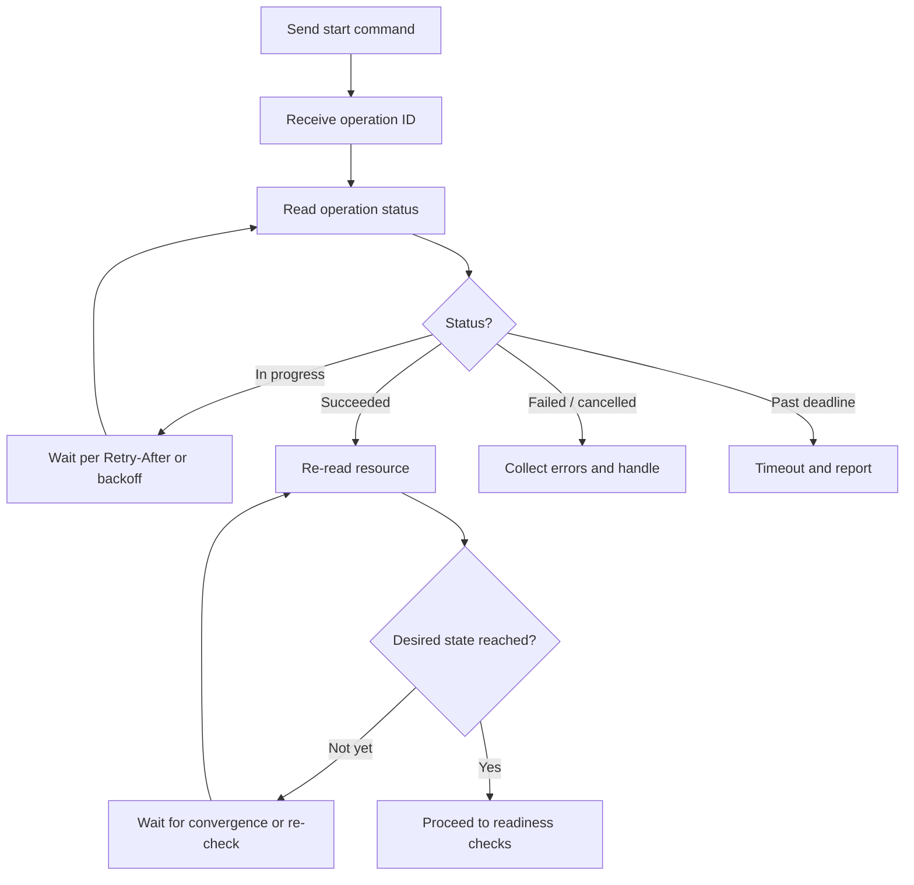

# Asynchronous Operations, Desired State, and Waiting for Machine Readiness

When creating, starting, stopping, or reconfiguring a virtual machine in the cloud, an API call rarely completes all work within a single request. The platform accepts the request, records the work to be performed, and executes it across the control plane and underlying infrastructure. A virtual machine may need time to allocate resources, attach disks, configure networking, boot the operating system, and run bootstrap steps.

Therefore, receiving a request-accepted response does not mean the virtual machine is ready. A reliable automation workflow must track asynchronous operations, define a desired state, wait for observed state to converge, and verify workload readiness conditions.

## 1. Why Are Virtual Machine Operations Typically Asynchronous?

A virtual machine operation can involve many components: resource schedulers, hypervisors, storage systems, virtual networking, identity services, the guest operating system, and bootstrap tools. These components execute work at different times. Management APIs usually return early so clients do not have to hold an HTTP connection open throughout the entire process.

For example, when submitting a VM creation request, the platform may:

1. Authenticate permissions, quotas, and request parameters.
2. Record the request and return an operation ID or operation resource.
3. Select a physical host and allocate CPU and RAM.
4. Create or attach volumes and configure NICs, IPs, and security rules.
5. Power on the VM and wait for hypervisor status reporting.
6. Wait for the OS to boot and finish cloud-init or bootstrap mechanisms.
7. Register agents, fetch configuration, and bring the application service into a serving state.

The duration of each step depends on the region, instance type, image, disk size, control plane load, network configuration, and workload. Consequently, a fixed `sleep` after a machine creation command does not guarantee readiness. Small machines might become ready sooner, while machines initializing large datasets may still be incomplete after that delay.

## 2. Distinguishing Request Acceptance from Work Completion

An asynchronous API typically exposes two layers of information:

- **Request response:** indicates whether the platform accepted, rejected, or synchronously processed part of the request.
- **Operation status:** indicates whether background work is pending, in progress, succeeded, failed, or cancelled.

Some APIs return HTTP `202 Accepted` along with an operation ID or URL to poll for results. Others may return a different status code and a progress resource. Consult the provider's API contract to see how to obtain the operation ID, terminal states, and error details.

Illustrative response example:

```json
{
  "operationId": "op-7f31a9",
  "status": "InProgress",
  "targetResource": "/virtual-machines/app-vm-01"
}
```

This is merely an illustrative structure, not a universal format across platforms. The client saves the operation ID, then polls the operation or associated resource until reaching a terminal state. Never treat `Accepted`, `Queued`, or `InProgress` as final success.

Operation status and VM status are also two separate concepts. An operation status of `Succeeded` usually indicates that the control-plane task finished according to the API contract. It does not necessarily prove the application inside the machine has opened its listening port, connected to the database, or passed health checks.

## 3. Understanding Desired State and Observed State

In infrastructure management, distinguish **desired state** from **observed state**:

- Desired state is what the operator or declarative system intends to achieve—for example, the machine must be `running`, have 4 vCPUs, and belong to a specific subnet.
- Observed state is what the platform currently reports at inspection time—for example, `starting`, `running`, or `stopped`.

A controller or workflow compares the two states and takes action to drive the resource toward the desired state. This is standard in declarative systems: users declare the target outcome, and the system executes steps to converge toward it.

For example, if the desired state is `running` while the machine is `stopped`, the workflow issues a start request. If the machine is `starting`, the workflow keeps waiting. If the machine is already `running`, the workflow does not send another start command. If the machine is `stopping`, the workflow waits for the active operation to complete before re-evaluating, per platform rules.

Exact state names vary across providers, though VM lifecycles generally share similar states:

| Common State | General Meaning | Workflow Action |
|---|---|---|
| `provisioning` / `creating` | Allocating resources | Track the machine creation operation |
| `starting` | Powering on the machine | Wait for state transition |
| `running` | Hypervisor is executing the VM | Proceed to check guest and application state if needed |
| `stopping` | Powering off the machine | Wait for stop completion before dependent actions |
| `stopped` / `deallocated` | Machine is stopped; billing/resource retention varies by platform | Can start or run supported operations |
| `restarting` | Rebooting the machine | Wait for machine to return and verify services |
| `deleting` | Deleting resources | Track until deletion completes |
| `failed` / `error` | Operation or resource encountered an error | Read error details; decide whether retry or intervention is needed |

Never assume all platforms use identical state names or transitions. For instance, `stopped` may differ from `deallocated`: the guest is not running, yet compute capacity may still be reserved and billed. Verify exact state semantics for the specific service you use.

## 4. Tracking Operations to a Terminal State

The basic procedure for waiting on an asynchronous operation consists of:

1. Submit the request and inspect the initial response.
2. Save the operation ID, resource ID, and start timestamp.
3. Query the operation periodically or listen for update events.
4. Continue waiting while status remains in progress.
5. Finish successfully when the operation reports a terminal success state.
6. Stop and handle errors if the operation fails, is cancelled, or exceeds the deadline.
7. Upon success, re-read the resource to confirm the desired state.

General flow example:



In some APIs, the operation endpoint itself transitions to a terminal state and supplies detailed error codes. In others, the operation finishes before the resource view fully reflects the change. Therefore, after operation success, re-read the resource and verify critical attributes such as power state, machine size, NICs, or volumes.

## 5. Controlled Polling: Intervals, Backoff, and Timeouts

Polling is when a client queries status periodically. The simplest approach is querying every few milliseconds, which generates unnecessary requests, loads the control plane, and risks hitting rate limits. A well-behaved waiter needs reasonable intervals and time bounds.

Core principles:

- If the API returns `Retry-After` or a recommended polling interval, honor that guidance first.
- Otherwise, use exponential backoff: gradually increase wait intervals between queries—for example, 1, 2, 4, 8 seconds—capped at a maximum delay.
- Add random jitter so multiple clients do not poll in lockstep.
- Set an overall deadline for the workflow; never wait indefinitely.
- Distinguish per-request timeout from overall operation timeout.
- Log operation ID, resource ID, final status, poll count, and elapsed wait time.
- Respect API rate limits and retry policies.

Waiter pseudocode example:

```python
deadline = monotonic_time() + total_timeout
delay = initial_delay

while monotonic_time() < deadline:
    operation = get_operation(operation_id)

    if operation.status == "Succeeded":
        break
    if operation.status in ("Failed", "Cancelled"):
        raise OperationError(operation.error)

    wait_for = operation.retry_after or delay_with_jitter(delay)
    sleep(min(wait_for, deadline - monotonic_time()))
    delay = min(delay * 2, maximum_delay)
else:
    raise TimeoutError(operation_id)
```

This is pseudocode illustrating the algorithm. `monotonic_time`, `get_operation`, `delay_with_jitter`, and exception types must be implemented using real libraries. Do not use wall-clock system time that can jump backward or forward to measure deadlines, as that skews wait durations.

A timeout does not mean the operation definitely failed. The client may time out while the platform continues processing. On timeout, retain the operation ID so you can inspect it later rather than blindly re-issuing machine creation or deletion requests.

## 6. Idempotency and Safe Retry Handling

In distributed networks, a client may send a request and receive no response due to a timeout or connection drop. You cannot tell for sure whether the server never received the request or received it and is still processing it. Immediately re-sending a VM creation command risks provisioning two identical machines.

An **idempotent** operation can be repeated without altering the final outcome beyond the initial execution. To retry safely:

- Use an idempotency key if supported by the API, reusing the same key for retries of the same intent.
- Assign deterministic names or resource IDs when appropriate and check existing resources before recreating.
- Save the operation ID once received and resume tracking that operation.
- Before retrying after a timeout, inspect resource or operation status to determine whether the previous request was accepted.
- Retry only transient errors such as rate limits or recoverable service errors, following API guidance.
- Never automatically retry configuration, permission, quota, or invalid parameter errors without fixing the root cause.

Not all operations are idempotent in the same way. A `start` command may simply converge the machine to running, whereas a snapshot creation or resource creation command may create a new resource on every invocation. Check the API contract and use proper deduplication mechanisms.

## 7. A `running` VM State Does Not Mean the Application Is Ready

This distinction is vital in automation. The `running` state usually means the hypervisor has powered on the VM. The guest OS may still be booting, configuring disks, acquiring network addresses, executing cloud-init, or starting services.

Readiness can be layered:

| Layer | Conditions to Verify | Example Signals |
|---|---|---|
| Infrastructure | Instance exists, power state matches, NICs and volumes attached | Resource describe API, operation succeeded |
| Operating system | Guest finished booting and is reachable | SSH/RDP, guest agent, serial console, or heartbeat |
| Bootstrap | Init scripts, agent registration, and config fetch completed | Cloud-init status, bootstrap logs, config management status |
| Application | Processes running and endpoints serving | Health endpoint, port check, or systemd service |
| Dependencies | Application connects to required services | Database, cache, queue, or dependent API checks |

A good health check reflects actual workload serving capability. A TCP port check only shows a process accepts connections; it does not prove requests are handled properly. For web applications, a readiness endpoint can verify initialization status and essential dependencies. Liveness and readiness also serve distinct purposes: liveness detects hung processes needing restart, whereas readiness determines whether an instance should receive traffic.

Avoid placing optional dependencies inside readiness checks. If a non-critical analytics service fails while the app can still serve core functionality, readiness should not necessarily fail. Define readiness criteria based on business requirements and how the load balancer or orchestrator consumes that signal.

## 8. Waiting on Multiple Machines and Workflow Orchestration

Systems often create or start multiple VMs. You can wait sequentially or track them in parallel. Sequential waiting is simple, though total duration approaches the sum of all machines. Parallel tracking shortens duration, but concurrency must be bounded to avoid exhausting quotas or overloading the control plane.

A multi-machine creation workflow might run as follows:

1. Submit creation requests for each machine with deterministic resource names.
2. Record the corresponding operation ID for each machine.
3. Track operations concurrently with a bounded concurrency limit.
4. As each operation finishes, re-read power state and resource configuration.
5. Wait for guest and bootstrap readiness per machine.
6. Add only machines passing readiness to the backend pool or allow them to receive traffic.
7. If a machine fails, record the machine and reason; apply the retry policy or halt the rollout.

Failure policies must be decided upfront. Some workloads require all machines to be ready before proceeding; others accept proceeding once a minimum threshold is healthy. For production rollouts, limit concurrent changes and maintain adequate serving capacity throughout.

## 9. Event-Driven vs. Polling

Beyond polling, platforms can emit events when operation states change. Events can be delivered via webhooks, message queues, event buses, or notification services. Event-driven tracking reduces polling traffic and helps workflows react faster.

| Tracking Approach | Advantages | Things to Watch |
|---|---|---|
| Polling | Simple to implement; self-recovers if one check is missed | Increases request volume; requires backoff and rate limiting |
| Event-driven | Reacts on state change; reduces repeated queries | Events may arrive duplicated, delayed, or out of order; requires auth and reconciliation |
| Hybrid | Events wake the workflow; polling confirms final state | Must manage both event subscriptions and waiters |

When using events, never assume each event arrives exactly once or strictly in order. Consumers should be idempotent, check event IDs or versions if provided, verify current resource state before taking critical actions, and run periodic reconciliation. Webhooks must be authenticated, least-privilege, and protected against replay per platform guidelines.

A practical pattern uses events to wake the workflow to re-check the operation, then reads authoritative state from the API. Thus, events serve as wake-up signals while resource state remains the source of truth for deciding next steps.

## 10. Example Workflow: Starting a Machine and Waiting for Application Readiness

Suppose a system must start `orders-api-01` after maintenance. Requirements: the machine must be running, bootstrap must complete, and the readiness endpoint must return healthy before the load balancer routes traffic.

The workflow can be described as:

```text
desired_state = RUNNING

current = describe_vm("orders-api-01")

if current.power_state == STOPPED:
    operation = start_vm("orders-api-01")
    wait_for_operation(operation.id, deadline=5 minutes)

wait_until(
    condition = vm_power_state("orders-api-01") == RUNNING,
    deadline = 2 minutes
)

wait_until(
    condition = guest_agent_connected("orders-api-01"),
    deadline = 5 minutes
)

wait_until(
    condition = http_readiness("https://orders-api-01/ready") == HEALTHY,
    deadline = 5 minutes
)

enable_backend("orders-api-01")
```

This illustrates logic, not directly executable commands. In real implementations, deadlines, endpoints, authentication, and states depend on SLOs, the provider, and application architecture. If the machine is already `RUNNING`, the workflow skips the start command and proceeds to readiness checks. If the start operation fails, the workflow never enables the backend. If the guest is up but readiness times out, keep the machine out of rotation and gather diagnostic logs.

The key takeaway is that each step verifies a concrete condition. Never use a single `sleep(60)` and assume both machine and application are ready.

## 11. Error Handling and Edge Cases

Asynchronous operations can fail at multiple points. Some errors appear immediately on request submission; others emerge mid-operation or during guest checks. Workflows must capture sufficient diagnostic context.

| Scenario | Possible Causes | How to Handle |
|---|---|---|
| Request rejected immediately | Invalid parameters, missing permissions, quota, or policy | Fix input or permissions; do not blindly retry |
| Operation runs unusually long | Capacity shortage, large image, slow volume, or busy control plane | Track progress, inspect events and deadlines; escalate if threshold exceeded |
| Operation reports failure | Provisioning, network, storage, or configuration error | Read error code and operation details; decide if step is retryable |
| Client times out with unknown result | Response lost while server continues processing | Use operation ID if available; read resource and idempotency key before retrying |
| Machine `running` but unreachable | Guest still booting, firewall, routes, or agent failure | Inspect console, networking, and guest agent |
| Guest healthy but app not ready | Bootstrap incomplete, missing secret, dependency failure, or app crash | Keep out of traffic; inspect logs and health checks |
| Duplicate or out-of-order events | Event delivery provides at-least-once semantics | Process idempotently and re-read authoritative state |
| Deadline exceeded | Operation or workload missed SLO | Stop waiting, save evidence, and trigger recovery procedure |

When an operation fails, never log only a generic message like "start VM failed". Record resource ID, operation ID, timestamp, status, error code, request correlation ID, and workflow step. Avoid logging secrets, tokens, or sensitive data.

## 12. Best Practices for Designing Waiters and Workflows

A reliable waiter should have the following properties:

- **Explicit conditions:** wait for a concrete state or health condition, not a guessed duration.
- **Finite deadlines:** enforce an overall timeout and report final status on expiration.
- **Selective retries:** retry only transient errors using backoff, jitter, and rate-limit compliance.
- **Idempotency:** safely resume after client restarts without creating duplicate resources.
- **Observability:** log operation ID, resource ID, attempt count, wait time, and errors.
- **Layered readiness:** verify infrastructure, guest, bootstrap, and application in logical order.
- **Recoverability:** define actions for failures, timeouts, or partial fleet readiness.
- **No premature traffic:** add a machine to the backend pool only after agreed readiness criteria pass.

Persist workflow state outside the waiting process if operations can outlive a worker or CI job. When a worker restarts, it can reload the operation ID and resume tracking. This helps for machine provisioning, fleet upgrades, backups, restores, and long configuration changes.

When designing timeouts, separate expected operation duration from maximum application recovery time. Deadlines must accommodate valid steps without letting workflows hang forever. Consider separate deadlines for provisioning, OS boot, bootstrap, and readiness to pinpoint where slowdowns occur.

## 13. Pre-Production Automation Checklist

- [ ] Confirmed whether the API returns an operation ID or equivalent tracking mechanism.
- [ ] Separated request-acceptance responses from terminal operation states.
- [ ] Mapped platform-specific machine states and their exact meanings.
- [ ] Defined desired state and how to re-read observed state.
- [ ] Configured polling to honor `Retry-After`, backoff, jitter, and rate limits.
- [ ] Set deadlines, timeouts, and handling for timeouts while operations remain active.
- [ ] Ensured safe retries via idempotency keys or pre-retry resource checks.
- [ ] Distinguished `running` power state from guest and application readiness.
- [ ] Configured proper health checks before routing traffic to the machine.
- [ ] Built event consumers resilient to duplicate, delayed, and out-of-order events.
- [ ] Included operation IDs, resource IDs, correlation IDs, and error codes in logs.
- [ ] Defined procedures for partial failures, rollbacks, or resuming workflows.

Managing asynchronous tasks properly makes VM lifecycle automation predictable and recoverable. When workflows track operations, reconcile observed state against desired state, and verify readiness layer by layer, systems avoid advancing prematurely, sending duplicate commands, or serving traffic on unready machines.
