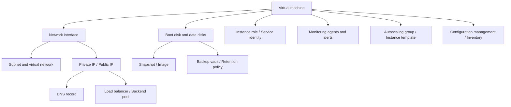
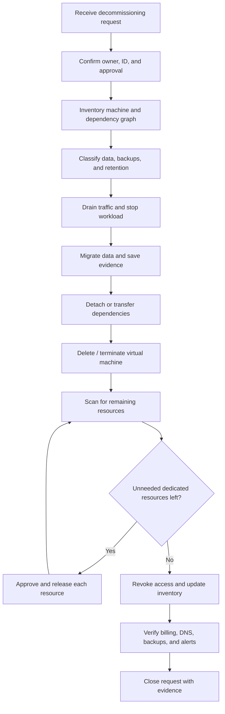

# Decommissioning Machines and Checking Remaining Dependent Resources

When a virtual machine no longer serves a workload, operations teams need to remove it from the system in a controlled manner. Deleting a VM terminates running processes and frees CPU/RAM capacity, yet it does not always delete associated resources. Data disks, snapshots, IP addresses, network interfaces, DNS records, load balancer configurations, backups, and monitoring resources may persist and continue generating charges or security risks.

**VM decommissioning** is the process of ending machine usage, handling its data and identity, detaching dependencies, releasing unneeded resources, and verifying the final state. This workflow must be grounded in actual dependency relationships to avoid accidentally deleting shared resources or disrupting other workloads.

After this lesson, you will be able to:

- Distinguish stop, deallocate, and delete/terminate according to platform behavior.
- Build an inventory of dependent resources before decommissioning a VM.
- Handle data, snapshots, backups, identities, and access permissions per policy.
- Detect orphaned resources left behind after a machine is deleted.
- Execute an approved, auditable decommissioning workflow with completion evidence.

## 1. Why Does Deleting a VM Not Guarantee Complete Decommissioning?

A virtual machine is usually just one node within a group of resources. An application may rely on the VM to run processes while also using dedicated disks for data storage, public IPs for inbound connections, network interfaces to attach to subnets, DNS for name resolution, and load balancers for traffic distribution.

When a VM is deleted, providers typically release certain resources directly tied to the machine's lifecycle. Resources created independently or configured with retention policies may remain. Exact behavior depends on the provider, resource type, options set at VM creation, and organizational policies.

For example, a staging VM is deleted, yet a 500 GiB data disk, three snapshots, a static IP address, and a backup still exist. The machine no longer runs the application, yet those resources still consume capacity, may incur charges, and still contain data requiring protection. If an IP or DNS record still points to the deleted machine, users may encounter errors or an address might later be reassigned unexpectedly.

Therefore, distinguish two outcomes:

- **The VM lifecycle has ended:** the instance is no longer running or no longer exists in inventory.
- **The workload and its dependencies are properly decommissioned:** traffic has been drained, data handled, access revoked, unneeded resources released, and retained resources have clear owners and expiration dates.

## 2. Distinguishing Stop, Deallocate, and Delete/Terminate

Providers use different terminology. Some platforms have a stopped state that still holds reserved compute capacity; some have a deallocate operation to release host capacity. Check service documentation and actual resource state before predicting costs or restartability.

| Operation | Typical Behavior | Resources That May Remain | When to Use |
|---|---|---|---|
| Stop / Shutdown | Shuts down OS or halts instance; some platforms retain host placement or allocated capacity | Persistent disks, static IPs, NICs, snapshots, configs, and certain ongoing charges | Temporary pause for maintenance or pending reuse |
| Deallocate | Stops instance and releases host compute capacity per platform semantics | Disks, static IPs, NICs, backups, snapshots, DNS, and independent dependencies | Longer pauses to save compute costs while preserving the environment |
| Delete / Terminate | Removes instance from inventory and ends the machine lifecycle | Retained disks, snapshots, IPs, NICs, DNS, backups, logs, IAM configs, or shared resources | Machine is no longer needed and decommissioning prep is complete |

Some platforms automatically delete the boot disk when deleting a machine while keeping data disks if a retain policy is set. Others allow choosing delete or retain per disk. Never infer from button labels or a `stopped` state alone; verify each resource's policy.

Before acting, answer three questions:

1. Might the machine need to start again, or is decommissioning approved?
2. Which data must be kept, backed up, transferred, or deleted?
3. Which resources are dedicated to this machine and which are shared with other workloads?

## 3. Mapping Dependent Resources

A virtual machine can connect to numerous direct and indirect resources. Inventory should trace outward from the instance to its dependencies, then verify whether each dependency is still used by anything else.



### Resource Groups to Inspect

| Group | Examples | Risk If Overlooked |
|---|---|---|
| Compute | VM instance, dedicated host, autoscaling group, launch template | Machine might be recreated automatically or continue holding capacity |
| Storage | Boot disk, data disk, local volume, file share | Ongoing charges; sensitive data persists |
| Data copies | Snapshots, machine images, backups, replicas | Data exists outside the machine and could be restored unexpectedly |
| Network | NICs, private IPs, public IPs, elastic IPs, routes, security groups | Stale configs, held IPs, attack surface, or broken connectivity for other workloads |
| Traffic management | Load balancer backends, target groups, health checks, NAT, gateways | Traffic keeps routing to old machine or unneeded components |
| Naming | DNS A/AAAA/CNAME, service discovery, reverse DNS | Domain points to stale or reassigned addresses |
| Identity | Instance profile, IAM role, service account, certificates, SSH keys | Excess permissions or orphaned credentials without clear owners |
| Operations | Monitoring, alerts, log groups, agent registrations, patch groups | False alerts, log storage costs, and inaccurate inventory |
| Automation | IaC state, configuration management, deployment pipelines, schedulers | Resources recreated or deleted out of band |
| Commercial | Reservations, commitments, licenses, support plans | Commitments or licenses keep billing even after instance stops |

Not every resource in the table should be deleted. Virtual networks, subnets, security groups, logs, or backups may be shared. The goal is identifying ownership and dependency strength so keep/delete decisions are well founded.

### Distinguishing Direct and Indirect Dependencies

Direct dependencies appear in instance configuration, such as boot disks or NICs. Indirect dependencies live in other services: DNS pointing to the machine's IP, target groups containing the instance, autoscaling groups referencing a launch template, or pipelines still deploying to that machine.

Check in both directions:

- Outward from the VM: which resources does the machine attach or consume?
- Inward from each resource: do any other machines or applications still reference this resource?

A disk sharing a name with the hostname is insufficient proof that it belongs solely to that machine. Cross-check resource IDs, attachments, tags, creation history, and referencing configurations.

## 4. Determining Ownership and State of Each Resource

An inventory should record at least the following fields:

| Field | Purpose |
|---|---|
| Resource ID and resource type | Unique identification to avoid name confusion |
| Region / zone / project / account | Defines administrative scope |
| Owner / application / environment | Identifies who is accountable and which workload is involved |
| Relationship to VM | Directly attached, indirectly referenced, or shared |
| Current state | Running, detached, deleted, retained, or unknown |
| Data classification | Contains sensitive data, personal data, or public data |
| Retention requirement | Retention period, legal hold, backup policy, or audit requirement |
| Cost estimate | Recurring or usage-based cost if retained |
| Decision and approver | Keep, transfer, delete, or investigate further; who approved |

Tags/labels help query inventory, yet are not sole proof of dependencies. Tags can be missing, wrong, or stale. Combine tags with attachments, resource references, audit logs, IaC configurations, and application owner confirmation.

If the owner of a disk, IP, or snapshot cannot be determined, place it on an investigation list and follow the organization's orphaned-resource governance workflow. Never delete solely because a resource looks idle.

## 5. Preparing Before Decommissioning a Machine

Decommissioning is an operational change that can affect users. Before deleting, confirm the machine truly serves no active workload and dependencies have been handled.

### Confirm Decision and Scope

- Identify instance ID, hostname, account/project, region, and environment.
- Confirm workload owner and approver.
- Check whether the machine belongs to an HA cluster, autoscaling group, cluster, or batch system.
- Confirm decommissioning timing, maintenance window, and expected impact.
- Check deletion protection, retention policies, legal holds, and change management procedures.

### Shift Traffic and Stop Work

For request-serving machines, remove the machine from load balancers or service discovery, wait for active connections to drain, and confirm remaining replicas can carry the load. For workers, stop accepting new jobs, finish or forward in-flight messages, and verify queues lose no data.

Never shut down a machine based solely on low CPU. The machine might run scheduled batch jobs, act as a standby, or perform infrequent tasks. Check schedulers, cron jobs, event triggers, queue consumers, and business calendars before stopping.

### Back Up and Verify Data

Classify data on the boot disk and data disks. Determine which data must move to another storage service, which snapshots or backups must be kept, retention periods, and who holds restore permissions. Confirm backups completed and can be restored as required.

A completed snapshot does not automatically guarantee application-consistent data. For databases or continuously writing systems, use application-consistent backup mechanisms, freeze/quiesce hooks, or supported backup tools.

### Record State and Evidence

Save inventory, critical configurations, image version, IPs, DNS, network rules, final metrics, and dependency check results. Record stop timestamp, operator, and change ticket ID. This evidence speeds troubleshooting if another component is later discovered to depend on the machine.

## 6. Handling Data and Protecting Information Before Deletion

VM disks can contain application data, logs, credentials, private keys, caches, and personal data. During decommissioning, determine what must be retained and what must be deleted per policy.

### Classify and Retain Required Data

- Business data needed going forward should be migrated to a storage system with proper ownership and access controls.
- Logs required for audits or investigations must be shipped to centralized log storage with clear retention periods.
- Backups and snapshots need defined purposes, owners, expiration dates, and restore access controls.
- Temporary data, caches, local credentials, and unneeded test files must be removed per procedure.

Do not blindly back up entire disks out of habit if images might hold tokens, private keys, or unnecessary personal data. A backup is a data copy subject to the same security, encryption, access control, and retention requirements.

### Secure Data Deletion

Deletion methods depend on storage type, encryption, and provider guarantees. On cloud block storage, snapshots, SSDs, and copy-on-write systems, deleting or overwriting files inside the OS does not necessarily erase all physical copies. Use provider-supported deletion/crypto-erase features or media sanitization procedures mandated by organizational policy.

If data is encrypted with a workload-specific key, revoking or destroying the key per policy can support cryptographic erasure. However, confirm no copies of the key exist elsewhere and understand the impact on data that must be retained. Never destroy keys while a legal hold or retention obligation remains active.

### Check Remaining Snapshots and Backups

After deleting a machine, snapshots and backups may persist under retention policies. List every copy originating from the machine, separating shared backups from machine-specific ones. Delete or schedule expiration once approved; never alter a shared backup policy just to handle a single machine.

## 7. Phased VM Decommissioning Workflow

The workflow below can be adapted to your platform and organizational policies. Each step should produce status and evidence for independent verification.



### Phase 1: Planning and Inventory

Verify the instance ID rather than relying solely on name. List disks, NICs, IPs, snapshots, backups, roles, certificates, target groups, DNS, monitoring, autoscaling, and IaC references. Record direct/indirect relationships and classify dedicated vs. shared resources.

### Phase 2: Workload Handover or Shutdown

Notify owners, coordinate the change window, drain traffic, stop schedulers and workers, and wait for active requests or jobs to finish. If needed, migrate data and tasks to replacement machines or services. Verify the system continues meeting SLOs after removing the machine from rotation.

### Phase 3: Data and Identity Handling

Complete backups/restore tests if required; ship retained logs; revoke credentials, certificates, keys, or tokens bound to the machine. Remove the machine from configuration management, patch management, endpoint protection, and inventory. Delete or reset machine-specific state per policy.

### Phase 4: Detaching Dependencies

Remove the instance from backend pools, target groups, autoscaling groups, or service discovery. Update DNS and wait an appropriate TTL window before releasing IPs whenever possible. Detach disks or NICs per procedure, then decide whether to keep, transfer, or delete them. Check whether security groups and network rules are still referenced by other resources.

### Phase 5: Deleting the Instance

After confirming no workloads or required dependencies remain, execute delete/terminate under the approved workflow. If deletion protection is enabled, verify approval before disabling protection. Record the operation outcome and the timestamp when the instance disappears from inventory.

### Phase 6: Residual Resource Scan

Re-query resources by instance ID, tags, attachments, and references. Verify disks are detached, IPs released, snapshots and backups decided, DNS no longer points incorrectly, target groups have no stale backends, alerts are unbound, and pipelines are not recreating the machine.

### Phase 7: Closing the Request

Check billing or cost explorer after sufficient delay for cost data to update. Confirm retained resources have owners and review dates. Update CMDB/inventory, operational docs, architecture diagrams, and tickets with final evidence.

## 8. Detecting Orphaned Resources After Machine Deletion

An **orphaned resource** is a resource that still exists without a valid workload or owner using it. Some resources may genuinely be unneeded; others may be staged for recovery or shared across workloads. Always verify before deleting.

### Common Symptoms

- Disks remaining in an unattached state for an extended period.
- Public IPs not attached to any NIC or load balancer.
- Snapshots lacking a clear parent image, backup policy, or owner.
- NICs detached from any instance yet still sitting in a subnet.
- DNS records pointing to released IPs or non-existent hostnames.
- Target groups or backend pools still listing deleted machine addresses.
- Alerts monitoring hostnames no longer present in inventory.
- Log groups or backup vaults still growing or holding capacity with no matching workload.
- Security groups, firewall rules, or IAM roles with no clear references.

### How to Inspect

1. Filter resources by status and age—such as unattached disks or unassociated IPs.
2. Query reference relationships via provider APIs and internal inventory.
3. Cross-check tags, owner, application, environment, creation date, and audit logs.
4. Check IaC configurations and pipelines to see if the resource is managed elsewhere.
5. Contact owners or operations teams when purpose is unclear.
6. Place eligible resources onto a deletion proposal list with ID, rationale, cost, and risk.
7. Delete only after approval and re-verifying no new dependencies arose.

Never bulk-delete all unattached disks or old snapshots. A disk might be intentionally detached for recovery; an old snapshot might be a pre-upgrade checkpoint or subject to long-term retention.

## 9. Checking Each Dependency Group

### Disks, Snapshots, and Images

- Confirm whether the boot disk was configured to auto-delete with the VM.
- Determine whether data disks hold data to retain or transfer.
- Check snapshots, derived images, and cross-region copies.
- Verify backup vaults, policies, and recovery points originating from the machine.
- Confirm encryption keys and restore permissions align with retention requirements.

### IPs, NICs, DNS, and Load Balancers

- Check whether private IPs are dynamic or static; release static IPs only when no dependencies remain.
- Check whether public/elastic IPs are tied to machines, NATs, gateways, or other endpoints.
- Remove the instance from backend pools and health checks; confirm zero traffic reaches the machine.
- Update DNS A/AAAA/CNAME records and service discovery; account for TTL and DNS caching.
- Check whether NICs, routes, firewalls, and security groups are shared.

### Identity and Certificates

- Revoke instance roles, service account bindings, or machine-specific permissions.
- Rotate credentials if they could have been stored on the machine or in backups.
- Revoke certificates bound to the hostname or workload when no longer used.
- Delete SSH keys or user access only when not shared across other machines.
- Deregister agents and revoke identity keys from management systems.

### Monitoring, Logs, and Automation

- Remove targets from dashboards, alerts, synthetic checks, and service discovery.
- Retain audit logs per retention policy; delete temporary logs per policy.
- Remove machine-specific patch schedules, backup jobs, or schedulers.
- Update inventory, CMDB, IaC state, and deployment documentation.
- Confirm autoscaling groups, orchestration controllers, or pipelines do not recreate the instance.

## 10. Preventing Accidental Recreation or Deletion

A common mistake is manually deleting a machine in the portal while IaC configurations still declare it. The next pipeline run may recreate the machine. Conversely, deleting a resource in IaC can cascade into deleting disks or networks used by another workload if relationships and lifecycle policies are unclear.

Practices that keep control tight:

- Use a single authoritative source of desired state, such as approved IaC or provisioning systems.
- Update declarative configuration before or alongside the decommissioning workflow to avoid portal-vs-code drift.
- Review change plans before applying; inspect which resources will be destroyed or replaced.
- Use deletion protection, resource locks, or policies for critical and shared resources.
- Separate resources with independent lifecycles—especially data disks, backups, and shared networking.
- Tag owner, application, environment, cost center, and expiration date.
- Set alerts for ownerless resources or resources unattached past a threshold.
- Require secondary approval for deleting data, snapshots, or shared resources.

For example, in Terraform, destroy protection can guard critical data resources:

```hcl
resource "example_managed_disk" "orders_data" {
  name = "orders-data"
  size = 500

  lifecycle {
    prevent_destroy = true
  }
}
```

This illustrates the IaC lifecycle concept; replace resource types and schemas with your actual provider. `prevent_destroy` blocks certain destroy operations via Terraform, though it does not stop authorized users from deleting directly through the portal or API. Combine it with IAM, policies, and approval workflows.

## 11. Post-Decommissioning Cost Control

After an instance is deleted, several charges can continue accruing:

| Remaining Resource | Potential Ongoing Charges | How to Handle |
|---|---|---|
| Managed disk / volume | Provisioned capacity, performance tier, or provisioned IOPS | Keep if needed; transfer, shrink if supported, or delete after approval |
| Snapshot / backup | Stored capacity, recovery point count, cross-region copies | Apply appropriate retention and lifecycle rules |
| Public IP / static IP | IP holding fees or status-based provider fees | Release when no longer used |
| Load balancer / NAT / gateway | Active hours, capacity units, or data transfer | Check if shared; update backends or delete if machine-specific |
| Logs / monitoring | Log volume, metrics, alerts, and retention duration | Remove retired sources; retain audit data per policy |
| Reservations / commitments / licenses | Commitments or contract fees may continue | Check contract terms, reassign workloads, or adjust at renewal |

Never rely on billing data immediately after deletion as sole proof. Billing metrics can lag or aggregate daily. Combine resource inventory checks with cost reports after an update cycle.

## 12. Example: Decommissioning a Sales App Staging VM

A team has a machine `staging-order-api-03` already replaced by a version running on a newer platform. The old machine no longer receives requests, yet a data disk, a static IP, two snapshots, and a DNS record still exist.

**Inventory:** the team looks up the instance ID and confirms the data disk attaches only to the old machine, the IP is dedicated, snapshots were taken pre-upgrade, and DNS points to the static IP. They also confirm the machine is not in an autoscaling group and no pipeline recreates it.

**Handover:** the team confirms staging data needs no long-term retention, keeping one snapshot for 14 days per test policy. DNS is pointed to the new staging endpoint; the old target is removed from the load balancer and the team waits out the drain period.

**Decommission:** the team stops the workload, archives required logs, revokes dedicated credentials, removes the agent from inventory, and deletes the instance under an approved ticket. The data disk is deleted after owner sign-off; the static IP is released. The retained snapshot is tagged with an owner and expiration date.

**Verification:** the team re-queries inventory and confirms the instance and NIC are gone, DNS no longer points to the old IP, the backend pool has no stale target, dedicated credentials are revoked, and the snapshot has clear retention. After the billing cycle updates, they verify compute, dedicated IP, and disk charges stopped while the retained snapshot carries only expected storage costs.

This example shows decommissioning is not a single delete command. Every dependency needs an explicit decision and post-action verification.

## 13. Common Mistakes

**Checking only that the instance vanished from the list.** Disks, IPs, snapshots, and backups may remain. Scan inventory by ID and dependency relationships.

**Deleting every resource sharing a tag with the machine.** Tags may be shared across an application or environment. Verify resource IDs, attachments, and owners before deleting.

**Keeping snapshots indefinitely "just in case".** Snapshots may hold sensitive data and incur ongoing costs. Assign owners, purposes, retention limits, and expiration workflows.

**Deleting IPs before updating DNS or load balancers.** Users may face outages or traffic may hit a reassigned address. Drain traffic, update records, and respect TTL before releasing IPs.

**Forgetting autoscaling or IaC.** Controllers or pipelines may recreate deleted machines. Update the desired-state source and check deployment schedules.

**Deleting backups to save money without checking retention.** This can violate recovery, audit, or legal hold requirements. Confirm policies and approvals before deleting.

**Assuming stop halted all charges.** Disks, IPs, snapshots, and supporting services may still bill. Verify each resource category.

## 14. Decommissioning and Verification Checklist

### Before Deleting the Machine

- [ ] Identified exact instance ID, account/project, region, hostname, and owner.
- [ ] Obtained change request and decommissioning approval.
- [ ] Confirmed machine no longer serves traffic or scheduled jobs.
- [ ] Checked autoscaling, clusters, IaC, schedulers, and pipelines.
- [ ] Inventoried disks, NICs, IPs, snapshots, backups, DNS, load balancers, IAM, and monitoring.
- [ ] Classified resources as dedicated, shared, or requiring transfer.
- [ ] Identified data to retain, retention periods, legal holds, and secure deletion methods.
- [ ] Drained traffic, stopped workloads, and confirmed remaining replicas have enough capacity.
- [ ] Saved necessary logs, configurations, and evidence.

### After Deleting the Machine

- [ ] Instance no longer exists in inventory or is in a platform-terminated state.
- [ ] Disks were kept, transferred, or deleted per decision; no ownerless orphan volumes remain.
- [ ] Snapshots and backups have clear owners, retention, and restore permissions.
- [ ] Dedicated NICs and IPs were released; shared resources remain intact.
- [ ] DNS, service discovery, and load balancers no longer reference the old machine.
- [ ] Machine-specific IAM roles, service accounts, certificates, keys, and credentials were handled.
- [ ] Monitoring, alerts, log sources, patch groups, and inventory were updated.
- [ ] IaC and pipelines no longer declare unintended machine recreation.
- [ ] Cost reports after an update cycle confirm charges stopped or are accounted for.
- [ ] Ticket records the decision, operator, timestamp, and completion evidence.

## 15. Self-Check

1. How do stop, deallocate, and delete/terminate differ? Why must exact behavior be verified per provider?
2. A VM has been deleted, yet a data disk, static IP, and snapshot still exist. What risks or costs can each remaining resource cause?
3. How do you distinguish an orphaned resource from a disk intentionally detached for recovery?
4. Why must both direct and indirect dependencies be checked before deleting a machine?
5. Before deleting a machine actively serving an API, what steps are needed to avoid dropping in-flight requests?
6. Why must snapshots and backups also follow data classification, encryption, and retention rules?
7. How can an autoscaling group or IaC cause a manually deleted machine to reappear?
8. What evidence confirms a machine decommissioning request is complete?

VM decommissioning is complete only when workloads have been safely migrated or stopped, data and identities are handled per policy, all dependencies have clear decisions, unneeded resources are released, and inventory and costs are verified. An inventory-driven, evidence-backed workflow cuts lingering costs, reduces data risk, and prevents impact on active systems.
