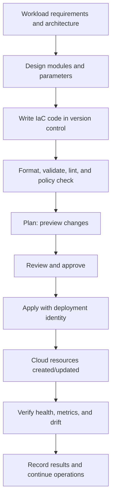
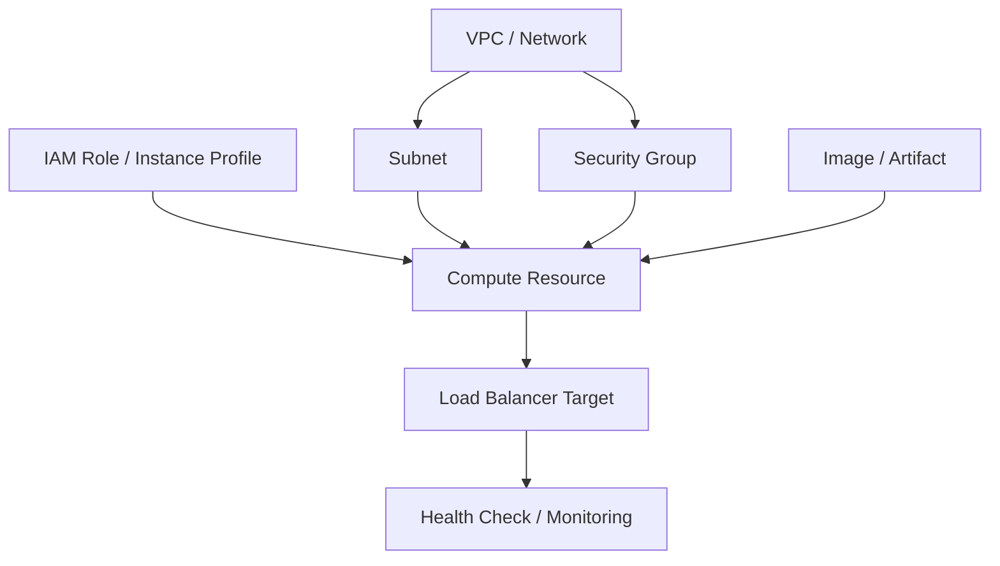
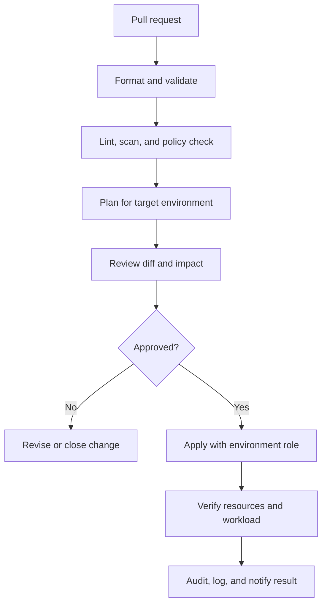
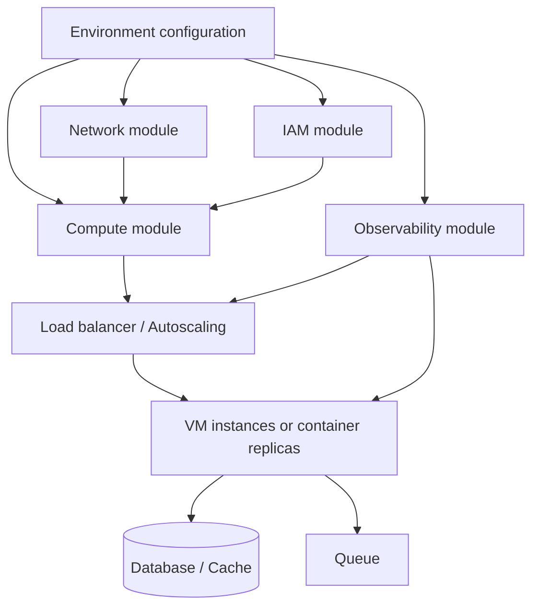

# Designing Compute Infrastructure as Code

Cloud compute infrastructure typically consists of virtual machines, virtual networks, disks, scaling groups, container clusters, workloads, and service identities. If resources are created manually via the console, configurations easily diverge across environments, changes become hard to trace, and recovery during incidents becomes difficult. **Infrastructure as Code (IaC)** solves this problem by describing infrastructure in files that can be version-controlled, validated, previewed, and deployed repeatably.

Good IaC design enables teams to provision compute consistently, control permissions and networking, deploy reviewable changes, scale with load, and manage costs. Within the scope of **CLOUD_CORE_SERVICES_COMPUTE**, IaC connects the choice of VM, container, or serverless with CPU, memory, network, storage, security, and operational configurations. Infrastructure code must reflect the desired state of the system while helping operators understand which resources are created, what they depend on, and who is responsible when changes occur.

## Learning Objectives

After this lesson, you will be able to:

- Explain IaC and distinguish the declarative approach from the imperative approach.
- Identify providers, resources, data sources, modules, variables, outputs, and state in an IaC project.
- Design code structure for compute infrastructure that is reusable across environments.
- Manage dependencies, state, drift, secrets, access permissions, and resource lifecycles.
- Build a workflow to validate, preview, approve, and deploy changes safely.
- Describe how IaC provisions VMs, scaling groups, container platforms, and serverless functions.
- Evaluate maintainability, reliability, and cost of an infrastructure-as-code design.

## 1. What Is IaC and What Problem Does It Solve?

IaC is the practice of describing infrastructure using configuration files or source code so that tools automatically create, update, and manage resources. Instead of documenting a list of manual clicks to perform in the console, teams describe the desired state: which network is needed, which machine type VMs use, where workloads run, what permissions are granted, and what labels resources must have.

For example, an application environment can be described as containing:

- A private network with subnets, routes, and firewall rules.
- A group of VMs or containers running the application.
- A load balancer distributing traffic to healthy instances.
- A workload identity with least-privilege permissions to read data.
- A storage, backup, logging, and alerting policy.

When these components live in code, teams can review changes, maintain history, run automated checks, and rebuild environments using the same process. IaC also reduces manual errors and creates an audit trail of approved configurations.

### 1.1. Declarative vs. Imperative Approaches

There are two common ways to describe infrastructure:

- **Declarative:** describes the final desired state. The tool compares the desired state against the current state and determines which resources need to be created, updated, or deleted.
- **Imperative:** describes the sequential commands or steps that must be executed to reach the desired state.

Conceptual example:

```text
Declarative:
  The environment requires 3 web instances in a private subnet.
  Each instance uses an approved image and the web-runtime role.

Imperative:
  Create the first instance.
  Create the second instance.
  Create the third instance.
  Attach the subnet, firewall, and role to each instance.
```

Declarative tools such as Terraform or OpenTofu are generally suited for managing the lifecycle of cloud resources. Imperative tools such as shell scripts, cloud CLIs, or configuration playbooks remain useful for bootstrapping and specific operational tasks. A system may combine both, but it must clearly establish which tool is the source of truth for each resource so two processes do not modify the same object concurrently.

### 1.2. Key Characteristics

| Characteristic | Meaning in Compute Operations |
|---|---|
| Reproducible | Environments can be rebuilt from code and managed inputs. |
| Versioned history | Every change is stored in version control with author attribution and review context. |
| Consistent | Environments use the same modules and rules, differing only in allowed parameters. |
| Previewable | Plans show which resources will be created, updated, or deleted before applying. |
| Testable | Code is formatted, validated, linted, and policy-checked before deployment. |
| Auditable | Changes, approvals, state, and deployment results can be traced. |
| Automatable | Pipelines can validate and deploy following a defined workflow. |

IaC does not automatically make an architecture correct or secure. A misconfiguration deployed automatically can create many broken resources very quickly. Quality depends on design, code review, testing, deployment permissions, and observability.

## 2. The IaC Provisioning Lifecycle

An IaC workflow usually starts from workload requirements, translates into configuration code, undergoes validation, and is then applied to a cloud account.



These steps form a loop. When requirements change, the team updates the code, re-runs checks, and previews the impact. The tool compares the configuration in code with state and actual resources to propose the next actions.

### 2.1. Core Components

| Component | Role |
|---|---|
| Provider | Plugin connecting to a cloud or platform API to manage resources. |
| Resource | An infrastructure object created or managed by IaC, such as a VM, subnet, disk, cluster, or function. |
| Data source | Reads information about existing resources or data without creating them. |
| Module | Groups related resources and configurations into a unit with clear input/output interfaces. |
| Variable | Input parameters such as region, machine type, subnet, replica count, or environment. |
| Local value | Computed value or expression reused within a configuration. |
| Output | Value published after applying, such as an endpoint or resource ID. |
| State | Record mapping IaC configurations to the actual resources managed by the tool. |
| Backend | Location where state is stored; remote backends typically support access control and state locking. |
| Dependency graph | Graph of dependency ordering helping the tool determine which resources to create first. |

### 2.2. Common Tools

- **Terraform and OpenTofu:** use declarative configuration, providers, and state to manage multiple cloud platforms.
- **CloudFormation, ARM/Bicep, and native tools:** describe resources within each provider's specific ecosystem.
- **Pulumi:** allows describing infrastructure using supported general-purpose programming languages.
- **Ansible and machine configuration tools:** commonly used to install packages, configure services, or bootstrap the OS after compute resources are created.

Do not pick a tool solely because it has many features. Consider the target platform, team skills, reviewability, state management, module ecosystem, policy enforcement, CI/CD integration, and operational overhead. In the following examples, Terraform HCL syntax is used to illustrate a common declarative workflow.

## 3. IaC Project Design Principles

An IaC project should allow readers to understand the system structure without having to trace hundreds of lines of duplicated configuration. The design needs to balance reusability, clarity, and level of abstraction.

### 3.1. Separating Platform and Workload Layers

Infrastructure can be divided into responsibility layers:

1. **Shared platform:** accounts/projects, networks, subnets, routes, DNS, logging, KMS, and baseline policies.
2. **Compute platform:** VM images, launch templates, node pools, container clusters, registries, or serverless platforms.
3. **Workload:** APIs, workers, functions, autoscaling, load balancers, service identities, and application configuration.
4. **Data and observability:** databases, volumes, object storage, backups, metrics, logs, and alerts.

Layering makes lifecycle management and deployment permissions clear. Application code changes should not force recreating the underlying network; subnet changes should not be buried inside a module deploying a small function.

### 3.2. Designing Modules Around Meaningful Boundaries

A module should represent an infrastructure capability with a stable interface, such as `network`, `compute_vm`, `container_service`, or `serverless_function`. A well-designed module typically has:

- Clearly named inputs with explicit data types.
- Validation for critical values.
- Outputs exposing only information needed by calling modules.
- Secure defaults, avoiding overly permissive access or wide-open ports.
- Standard tags/labels for cost allocation and owner identification.
- A README or documentation describing purpose, limitations, and usage examples.
- Managed versioning so interface changes can be controlled.

Avoid creating modules for single tiny resources where users must pass dozens of internal parameters. Also avoid creating one monolithic module that manages the entire account and every workload. Modules should reflect real change boundaries and ownership.

### 3.3. Separating Configuration by Environment

Development, staging, and production can use the same modules with different parameters:

| Parameter | Development | Staging | Production |
|---|---|---|---|
| Minimum replicas | Low | Close to production | Based on SLO and load |
| Compute size | Small for cost savings | Close to production config | Based on benchmarks and redundancy |
| Data | Test data | Mock or anonymized data | Business data under policy controls |
| Access permissions | Controlled dev team access | QA/operations teams | Least privilege, strict approvals |
| Backup and retention | Per testing needs | Test restore procedures | Per RPO/RTO and retention requirements |
| Changes | Can be auto-applied | Review before deployment | Controlled plan, approval, and deployment |

Avoid copying entire configuration directories for each environment and editing them manually. That creates near-duplicate copies that easily drift apart. Reuse modules and separate environments using variable files or isolated workspaces/state according to your chosen management model. Production needs dedicated state, permissions, and approval processes commensurate with its criticality.

### 3.4. Naming, Tagging, and Directory Structure

Resource names should help identify the environment, application, role, and deployment domain. Tags/labels may include `environment`, `service`, `owner`, `cost_center`, `managed_by`, and `data_classification` where permitted by policy.

An illustrative directory structure:

```text
infrastructure/
  modules/
    network/
    compute-vm/
    container-service/
    serverless-function/
  environments/
    dev/
      main.tf
      variables.tf
      outputs.tf
      dev.tfvars
    staging/
      main.tf
      variables.tf
      outputs.tf
      staging.tfvars
    production/
      main.tf
      variables.tf
      outputs.tf
      production.tfvars
```

This is just one way to organize code. For large projects, repositories or state can be split by domain/team to reduce blast radius. The key is having consistent conventions, clear state boundaries, and an understandable path from modules to deployment environments.

## 4. Describing Compute Infrastructure with IaC

Compute is a collection of resource types with different lifecycles. Modules should clearly describe resource configurations, dependencies, identities, networking, and replacement behavior during updates.

### 4.1. Virtual Machines and Scaling Groups

A VM typically requires these attributes:

- Approved Image/AMI or machine image.
- Machine type, vCPU, RAM, accelerators if applicable, and region/zone.
- Subnet, security group/firewall, NIC, and routes.
- System disk, data disks, encryption, and backup policy.
- Workload identity/instance profile and service access permissions.
- User data or bootstrap scripts for initial configuration.
- Tags, metrics, logs, health checks, and replacement policy.

For applications requiring scaling, you typically define a launch template or machine template alongside an autoscaling group or managed instance group. Code must specify min/max/desired capacity, health checks, load balancers, placement, and update policies. Avoid hardcoding a large fixed instance count when load fluctuates and the service can autoscale.

### 4.2. Container Platforms

IaC can create clusters, node pools, or task/container services, registries, IAM roles, networking, and load balancers. Separate responsibilities among the control plane, worker nodes, and workloads:

- Cluster module manages foundational settings, Kubernetes/platform versions, and API access permissions.
- Node pool or task module manages CPU, RAM, machine type, autoscaling, and placement.
- Workload module manages image digest, ports, health checks, secret references, resource requests/limits, and replicas.
- Network/storage module manages service discovery, ingress, network policies, and volumes.

Images should be referenced by immutable tags or verified digests. Using mutable tags like `latest` means a subsequent IaC run could pull different contents without the configuration code reflecting the change.

### 4.3. Serverless Functions

A function resource typically includes the package or artifact, runtime, handler, memory, timeout, environment configuration, execution role, event triggers, concurrency, and log retention. IaC must provision both permissions for the event source to invoke the function and permissions for the function to access target services.

Triggers such as queues, object storage, HTTP endpoints, or schedules should be declared alongside retry policies, dead-letter queues, and concurrency limits where supported by the platform. Secrets must only be referenced from a secret manager; never place secret values in variable files or source code.

### 4.4. GPU and Accelerator Resources

For GPU workloads, IaC needs to specify the instance/accelerator type, GPU count, regions offering that machine type, driver/image, host CPU and RAM, dataset storage, networking, and quotas. Do not specify only the GPU count while ignoring topology, network bandwidth, or storage throughput, as those components can bottleneck the pipeline.

Accelerator configurations are typically expensive and have tight regional quotas. Separate variables for machine type, device count, duration, region, and fallback strategy; add budgets/tags to track costs. Verify quotas and capacity availability before large-scale deployments.

## 5. Terraform Example: Deploying a Controlled VM

The example below illustrates an application VM on AWS using Terraform. The VPC/subnet, security group, and instance profile are already created by the platform layer and passed into the module. This separation allows the compute module to focus on the VM lifecycle while network policies and baseline permissions are reviewed where they are owned.

### 5.1. Provider and Version Declaration

```hcl
terraform {
  required_version = ">= 1.6.0, < 2.0.0"

  required_providers {
    aws = {
      source  = "hashicorp/aws"
      version = ">= 5.0, < 7.0"
    }
  }
}

provider "aws" {
  region = var.aws_region
}
```

Provider version constraints create a compatibility range. The `terraform.lock.hcl` file records the selected provider versions and checksums; commit this file to version control so runs produce consistent results. Cloud authentication should use roles or short-lived credentials provided by the deployment environment rather than hardcoding access keys in code.

### 5.2. Input Variable Declarations

```hcl
variable "aws_region" {
  description = "Region where the workload is deployed"
  type        = string
}

variable "ami_id" {
  description = "Validated and approved image ID"
  type        = string
}

variable "instance_type" {
  description = "EC2 instance type based on workload benchmarks"
  type        = string
}

variable "subnet_id" {
  description = "Private subnet created by the network module"
  type        = string
}

variable "security_group_ids" {
  description = "Reviewed security groups"
  type        = set(string)
}

variable "instance_profile_name" {
  description = "Least-privilege instance profile for the application"
  type        = string
}

variable "root_volume_size_gb" {
  description = "System disk capacity in GB"
  type        = number
  default     = 30

  validation {
    condition     = var.root_volume_size_gb >= 20 && var.root_volume_size_gb <= 500
    error_message = "Root volume size must be between 20 and 500 GB for the example module."
  }
}

variable "environment" {
  description = "Environment name"
  type        = string
}

variable "service_name" {
  description = "Workload or service name"
  type        = string
}
```

Validation helps catch certain invalid values early during planning. The 20–500 GB limit is only a rule for this example module; production modules should reflect actual application requirements and service limits. Do not turn an example value into a blanket limit for all workloads.

### 5.3. VM Resource Declaration

```hcl
resource "aws_instance" "app" {
  ami                    = var.ami_id
  instance_type          = var.instance_type
  subnet_id              = var.subnet_id
  vpc_security_group_ids = var.security_group_ids
  iam_instance_profile   = var.instance_profile_name

  monitoring = true

  metadata_options {
    http_endpoint = "enabled"
    http_tokens   = "required"
  }

  root_block_device {
    volume_type           = "gp3"
    volume_size           = var.root_volume_size_gb
    encrypted             = true
    delete_on_termination = true
  }

  tags = {
    Name        = "${var.service_name}-${var.environment}"
    Service     = var.service_name
    Environment = var.environment
    ManagedBy   = "terraform"
  }
}

output "instance_id" {
  description = "ID of the deployed VM"
  value       = aws_instance.app.id
}

output "private_ip" {
  description = "Private IP address of the VM"
  value       = aws_instance.app.private_ip
}
```

In the example:

- `ami_id` points to a validated and approved image.
- `instance_type` is chosen from CPU/RAM benchmarks and load characteristics.
- `subnet_id` and `security_group_ids` are supplied by the network module.
- `iam_instance_profile` attaches a workload identity with permissions to access required services.
- `metadata_options` requires tokens for the instance metadata service via IMDSv2.
- The root volume is encrypted and sized using a variable.
- Tags identify the owner and support cost allocation.

This is an illustrative EC2 resource example. For production use, add appropriate security group rules, backup policies, logging/monitoring agents, health checks, data protection, image updates, and instance replacement workflows. If the application requires HA or autoscaling, deploy via a launch template and autoscaling group rather than treating a single VM as the entire service.

### 5.4. Environment-Specific Inputs

An environment variable file can store non-sensitive parameters:

```hcl
aws_region             = "ap-southeast-1"
ami_id                 = "ami-0123456789abcdef0"
instance_type          = "t3.small"
subnet_id              = "subnet-0123456789abcdef0"
security_group_ids     = ["sg-0123456789abcdef0"]
instance_profile_name  = "web-runtime"
root_volume_size_gb    = 30
environment            = "staging"
service_name           = "orders-api"
```

The IDs and machine types here are illustrative values and must be replaced with verified resources in the target account/region. Production variable files must be reviewed and access-controlled. Never store passwords, tokens, private keys, or secrets in committed `.tfvars` files.

## 6. Dependency Graph and Provisioning Order

A compute workload has multiple dependencies. A VM requires a subnet and security group; a load balancer requires a listener and target group; an autoscaling group requires a launch template; a container service requires a cluster, role, network, and image; a function requires an execution role and trigger.



Terraform constructs a dependency graph from references between resources. For example, `subnet_id = aws_subnet.private.id` both retrieves the ID value and establishes a dependency relationship. The tool knows the subnet must exist before creating the VM.

### 6.1. Implicit and Explicit Dependencies

Prefer dependencies expressed through references to resource output attributes. `depends_on` should only be used when a real dependency exists that cannot be expressed through a direct reference, such as waiting for a policy attachment to complete before creating another resource even though the policy's output is not used.

Overusing `depends_on` can serialize operations that could otherwise run in parallel, make plans harder to interpret, and increase deployment times. If a dependency cycle appears, review module boundaries or how resources reference each other.

### 6.2. Data Sources and Externally Managed Resources

Data sources are useful when a module needs to read existing information, such as looking up a subnet, image, or account details. However, reading a resource does not mean IaC owns its lifecycle. Document clearly which resources are managed by the current module and which are managed by the platform team or another state.

Avoid having two states or two tools manage the same resource. Two controllers can continuously overwrite each other's configurations or cause hard-to-explain drift.

## 7. State, Backend, and Locking Management

State is a core component of tools like Terraform. It maps resource addresses in the configuration to the IDs and attributes of real-world objects. State enables the tool to know which resources belong to the project and what actions to take when configurations change.

### 7.1. Why Must State Be Protected?

State can contain:

- Resource IDs, addresses, metadata, and attributes.
- Outputs or variable values marked as sensitive.
- Certain secret values returned by providers or required by the tool to manage a resource.

Therefore, state must be treated as sensitive data. Committing state to Git or sharing it broadly can expose infrastructure topology and secrets. Use a remote backend with encryption, access control, versioning, and appropriate state locking.

### 7.2. Remote State and State Locking

In team environments, state should reside in a remote backend rather than each person keeping an independent local copy. A backend can provide:

- Centralized storage so pipelines and authorized team members share the same state.
- Encryption at rest and in transit.
- State locking during plan/apply operations as supported by the backend.
- Versioning or history to recover if state is corrupted or modified erroneously.
- Access control per environment or domain to restrict access scope.

Do not run concurrent apply operations against the same state if the backend does not support safe locking. When encountering a lock, verify which process is running and handle stale locks according to the tool's guidelines; never force-unlock arbitrarily, as doing so can corrupt state.

### 7.3. Splitting State by Impact Boundary

Splitting state limits blast radius and narrows access permissions. For example, baseline networking, container platforms, and individual production workloads can each have separate state. However, splitting too finely complicates cross-state dependencies and coordination workflows.

One way to decide is to ask:

- Does the component have its own lifecycle and owning team?
- Do changes to this component require broader permissions than other workloads?
- Does it need to be deployed or recovered independently?
- Which outputs do other modules need to read from this component?

Only split state when the benefits in permissions, lifecycle isolation, or blast radius outweigh the overhead of managing cross-state dependencies.

## 8. Drift and Managing Out-of-Band Changes

**Configuration drift** occurs when the actual state of resources differs from the state described in code. Drift can happen when an operator makes direct changes in the console, another automation modifies the resource, or a provider-managed service updates attributes on its own.

For example: IaC code restricts a security group to allow HTTPS only from the load balancer, but an operator opens SSH from the Internet during an incident. The next plan will detect the discrepancy and propose closing that rule.

### 8.1. How to Handle Drift

1. Run plan or a drift-detection tool in a non-mutating mode.
2. Determine whether the change was intentional, an emergency fix, or unauthorized.
3. If valid, update the IaC code to reflect the desired state and review it.
4. If invalid, plan how to bring the resource back to the standard state.
5. Document the incident, actor, rationale, and measures to prevent recurrence.

Do not blindly auto-apply every detected difference without review. A plan might propose destroying and recreating a VM, disk, or network; that action can cause downtime or data loss if resources are unprotected.

### 8.2. Importing Existing Resources

When migrating a manually created environment to IaC, you may need to import resources into state. Before importing:

- Confirm the resource belongs under the project's management and is not owned by another state.
- Write configuration accurately describing the state to maintain.
- Import using the mechanism appropriate for the tool and version.
- Run plan and adjust configuration until no unexpected changes remain.
- Record history and establish the management workflow for the resource going forward.

Importing only creates a link in state; it does not automatically generate complete configuration or prove the resource is currently secure.

## 9. Security in IaC Design

IaC has the authority to create resources and alter the security posture of an entire environment. Consequently, the repository, state, pipeline, and deployment identities are all critical parts of the attack surface.

### 9.1. Secret Management

- Never commit passwords, API tokens, private keys, or access keys to Git.
- Never pass secrets via command-line flags that may be recorded in logs or process lists.
- Use a secret manager, KMS, or the platform's short-lived credential mechanisms.
- Restrict who can read environment variables, state, plan artifacts, and pipeline logs.
- Understand that `sensitive = true` mainly masks values in certain outputs; it does not prevent secrets from being stored in state.
- Rotate credentials and revoke access when ownership changes or exposure is suspected.

### 9.2. Deployment Identities

IaC pipelines should use roles scoped specifically to the environment and resource groups being modified. Prefer federation or short-lived credentials over long-lived access keys. Production should have formal approvals, a dedicated deployment identity, audit logs, and state-scoped permissions.

Do not grant account-wide administrator permissions just to avoid permission errors on the first run. Analyze missing API actions and grant specific permissions. Permissions to delete or modify networking, IAM, and storage carry high impact and require stricter controls.

### 9.3. Controlling Network and Compute Configurations

Modules should enforce secure defaults:

- Place VMs in private subnets if workloads do not require public addresses.
- Security groups/firewalls should open only required ports and source ranges.
- Metadata services and instance identities should be protected using platform mechanisms.
- Disks, snapshots, and storage should be encrypted per policy.
- Workloads should use dedicated identities with least-privilege permissions.
- Containers should run non-root when possible, enforce CPU/RAM limits, and avoid privileged mode.
- Functions should have timeouts, concurrency, and triggers bounded to expected load.
- Images and artifacts should come from approved sources, use pinned versions/digests, and be scanned.

### 9.4. Pre-Deployment Policy Checks

Policy as Code can enforce rules such as:

- Disallow creating VMs with public IPs outside approved groups.
- Disallow creating unencrypted disks.
- Disallow opening management ports to the entire Internet.
- Require production resources to have owner, environment, and cost center tags.
- Prohibit workloads from using account-wide administrative roles.
- Block deploying images without a digest or that failed verification checks.

Policies should reflect real risks and allow legitimate exceptions. If rules are too rigid or lack an exception workflow, operations teams may find ways around controls instead of complying.

## 10. IaC Testing and Deployment Workflow

An IaC change should go through repeatable steps. Example with Terraform:

```bash
terraform fmt -check -recursive
terraform init -backend=true
terraform validate
terraform plan -out=tfplan
terraform show tfplan
terraform apply tfplan
```

These commands represent a basic flow. `init` downloads providers/modules and initializes the backend; `validate` checks structure and types; `plan` computes changes; `apply` executes the reviewed plan. In real pipelines, clearly specify the working directory, workspace/backend, environment variables, and authentication identity before running.

Plan files can contain sensitive data and must be protected just like state. A plan can also become stale if resources change after it is generated; prior to applying, follow plan-validity checks and approval workflows.

### 10.1. Illustrative CI/CD Pipeline



In this workflow:

- Pull requests must show both the code changes and the rationale.
- CI runs formatting, validation, linting, scanning, and policy checks.
- Plans are generated against the correct backend/state and environment.
- Reviewers inspect newly created resources, modified attributes, and deleted/replaced resources.
- Production applies only run after obtaining approvals required by organizational policy.
- After applying, the pipeline verifies health, endpoints, permissions, and baseline metrics.

### 10.2. Reading the Plan Before Apply

When reviewing a plan, check:

- Are any resources being deleted or replaced?
- Does the change affect subnets, routes, security groups, IAM, disks, or IP addresses?
- Do any attribute changes trigger restarts or downtime?
- Does it increase instance counts, GPUs, disks, or load balancers in a way that raises costs?
- Does any change weaken security, retention, or backup capabilities?
- Do any secrets or sensitive data appear in artifacts?

Do not approve merely because the plan command succeeded. Understand the impact of the proposed actions and confirm a rollback or recovery plan.

## 11. Resource Lifecycle and Replacement Management

Cloud resources cannot always be updated in place. Certain attributes of VMs, subnets, clusters, or disks force the tool to create a new resource and destroy the old one. Without understanding lifecycle behavior, a minor code edit can disrupt an application.

### 11.1. Update Strategies

- **In-place update:** modifies attributes directly on the existing resource if the API supports it.
- **Create before destroy:** creates the replacement resource before deleting the old one, where resource type and limits allow.
- **Rolling update:** replaces instances/replicas in batches to maintain capacity.
- **Blue/green:** deploys a new environment in parallel and switches traffic after verification.
- **Canary:** shifts a small portion of traffic to the new version for observation before expanding.

The right strategy depends on resource type, stateful data, capacity, quota, health checks, and downtime requirements. `create_before_destroy` does not automatically guarantee zero downtime; two resources may contend for names, IPs, volumes, or quotas. Clearly design traffic cutover points and data consistency mechanisms.

### 11.2. Meta-Arguments and Lifecycle Controls

Terraform provides mechanisms like `lifecycle` to control certain behaviors. Example:

```hcl
resource "example_resource" "critical" {
  name = "production-data"

  lifecycle {
    prevent_destroy = true
  }
}
```

This is an illustrative example, as `example_resource` is not a real provider resource. `prevent_destroy` can block some accidental deletions while the resource block remains in configuration, but it does not replace backups or approval workflows. Removing the configuration block, altering state, or acting outside IaC can still lead to resource loss without additional controls.

`ignore_changes` must also be used cautiously. It can be appropriate for attributes managed by an external system, but ignoring too many attributes can hide critical drift. Document who owns any ignored attribute and how it is verified.

### 11.3. Resource Deletion and Data Protection

Before deleting compute or storage, determine:

- Does the resource hold persistent data, or is it stateless compute?
- Will disks be deleted along with the VM upon termination?
- Can the latest snapshot/backup be restored?
- Are load balancers, DNS records, or clients currently pointing to the resource?
- Are there dependencies from other states or modules?
- Who approves the action, and is there a maintenance window?

In production, destroy operations must be restricted via permissions, plan reviews, and confirmation workflows. Do not use `terraform destroy` as routine cleanup without verifying state scope and data impact.

## 12. IaC Testing and Code Quality

Syntax checking is only the first step. A configuration can be syntactically valid yet create an unreachable network, a VM lacking permissions, a cluster with insufficient capacity, or a function that never receives events.

Useful verification layers:

1. **Format and validate:** catches formatting, syntax errors, invalid references, or type mismatches.
2. **Lint and static analysis:** detects anti-patterns, insecure configurations, or questionable provider usage.
3. **Security scan and policy:** checks public exposure, encryption, IAM, secrets, and required tags.
4. **Unit/module tests:** verifies input validation, outputs, and module logic using tool-supported test frameworks.
5. **Plan review:** verifies proposed actions against state and the live environment.
6. **Integration test:** deploys into a test environment and validates endpoints, permissions, health checks, and connectivity.
7. **Drift check:** periodically compares code against live resources.

### 12.1. Testing a Compute Module

A VM module can be tested against scenarios such as:

- Rejecting configurations missing an image ID or subnet ID.
- Blocking security groups that open management ports to the entire Internet if policy forbids it.
- Ensuring encrypted disks and workload identities are attached.
- Checking that required tags are propagated to resources.
- Confirming outputs do not accidentally expose secrets.
- Checking whether changing the machine type or image triggers replacement.

A container module can verify requests/limits, image digests, service account permissions, and readiness probes. A FaaS module can verify timeout, concurrency, role, triggers, and dead-letter configuration.

### 12.2. Post-Deployment Verification

After applying, verify live status:

- Has the VM booted, finished cloud-init/bootstrap, and is the agent sending metrics?
- Are container tasks/Pods healthy and receiving traffic?
- Does the function have permissions to read triggers and write outputs?
- Do security groups, routes, IAM, and secret references match the design?
- Does autoscaling scale up/down on signals without hitting quotas?
- Are backups, logs, dashboards, and alerts enabled?

A successful apply only tells you the resource creation/update API calls completed according to the tool. It does not prove the application is ready to serve business traffic.

## 13. Common IaC Design Mistakes

| Mistake | Consequence | Prevention |
|---|---|---|
| Hardcoding IDs, regions, or machine types across code | Hard to reuse and easy to deploy to the wrong region | Use variables, locals, and clear module interfaces |
| Duplicating configs across environments | Dev/staging/production gradually diverge | Share modules and parameterize intentional differences |
| Oversized modules | Hard to review, broad permissions, large blast radius | Split by lifecycle and ownership boundaries |
| Undersized modules | Excessive abstraction and internal parameters | Group resources into meaningful infrastructure capabilities |
| Local state or committing state to Git | Conflicts and exposure of topology/secrets | Remote backend, encryption, access control, and locking |
| Multiple states managing one resource | Mutual overwrites and continuous drift | Define a single owner for every resource |
| Applying without reviewing the plan | Unexpected resource deletion/replacement or overly open access | Review diffs, enforce approvals, and gate production |
| Storing secrets in tfvars or outputs | Credentials leaked in Git, state, or logs | Secret managers and short-lived credentials |
| Overusing `ignore_changes` | Important drift goes undetected | Only ignore attributes with a clear owner and rationale |
| Using mutable image tags | Deployments are not reproducible | Use immutable versions or digests |
| Automatic resource deletion on cleanup | Data loss or service disruption | Distinguish stateless/stateful, enforce backups, review destroys |
| Ignoring quotas and costs | Failed applies or unexpected bills | Check quotas, budgets, and autoscaling limits |

## 14. Design Example: Autoscaling API Platform

An e-commerce API system needs to serve traffic that fluctuates hourly. The IaC design can be organized into modules:



The network module creates the VPC/VNet, private subnets, routes, and security groups. The IAM module creates workload roles with permissions only for required services. The compute module creates the launch template or container service with an approved image, appropriate CPU/RAM, and health checks. The load balancer distributes traffic; autoscaling adds replicas when request rate or CPU exceeds thresholds. The observability module sets up logs, metrics, and alerts.

Decisions that should be reflected in code:

- `min_capacity`, `max_capacity`, and autoscaling signals are selected from benchmarks and SLOs.
- Instances/containers use private subnets; only the load balancer has a public entry point if required by the architecture.
- Images are pinned by version or digest.
- Workload identities avoid long-lived access keys.
- Databases and storage have separate state, backups, retention, and access permissions.
- Tags record service, environment, owner, and cost center.
- Production state is stored in a dedicated backend with locking and restricted apply permissions.

When releasing a new API version, the pipeline generates a plan, reviewers inspect modified resources, and then changes are applied using a rolling or canary strategy. Post-deployment, check health, latency, error rate, autoscaling, and database connectivity. If the new version fails, roll back the workload to the previous image; state and persistent data remain protected under their separate policies.

## 15. Production Readiness Checklist for IaC

**Design and Structure**

- [ ] Every resource has a single clear IaC owner.
- [ ] Modules reflect sensible workload boundaries and lifecycles.
- [ ] Environment configurations share common modules with controlled parameterization.
- [ ] Dependencies are expressed via references; `depends_on` is used only when necessary.
- [ ] Naming, tagging, and outputs follow organizational conventions.

**State and Security**

- [ ] State is stored in an appropriate backend with encryption and restricted access.
- [ ] State locking/versioning is enabled if supported by the backend.
- [ ] Secrets are excluded from Git, plan artifacts, and unprotected logs.
- [ ] Pipelines use short-lived roles/credentials and least-privilege permissions.
- [ ] Networks, disks, IAM, images, and runtimes have secure defaults.

**Validation and Deployment**

- [ ] Formatting, validation, linting, scanning, and policy checks run automatically.
- [ ] Plans are reviewed, especially deletions or replacements.
- [ ] Production applies require approval and maintain an audit trail.
- [ ] Post-deployment workload health checks are in place.
- [ ] Rollout, rollback, and drift-handling strategies exist.

**Operations and Cost**

- [ ] Quotas and provisioning capacity are checked before scaling.
- [ ] Autoscaling has appropriate min/max bounds and caps.
- [ ] Backup/restore procedures exist for persistent data.
- [ ] Metrics, logs, alerts, and an on-call/owner are defined.
- [ ] Tagging, budgets, and idle-resource reviews are in place.
- [ ] Processes exist for importing, upgrading modules/providers, and migrating state.

## 16. Conclusion

Designing compute infrastructure as code transforms cloud configurations into assets that can be reviewed, reproduced, tested, and version-controlled. An IaC project needs modules with clear interfaces, transparent dependencies, protected state, controlled plan/apply workflows, and appropriate security policies.

When applied to VMs, containers, serverless, or GPUs, code must completely capture CPU, memory, images, networking, identity, storage, scaling, and observability. IaC automates provisioning, but production quality still relies on testing, approvals, drift management, backups, rollout/rollback strategies, and cost tracking. Design modules around real lifecycles and ownership, then verify behavior via plans, test deployments, and post-apply workload checks.

## Key Terms to Remember

| Term | Meaning |
|---|---|
| Infrastructure as Code (IaC) | The practice of describing and managing infrastructure resources using code or configuration files. |
| Declarative | Approach describing the desired state so the tool determines the necessary changes automatically. |
| Imperative | Approach describing sequential commands or steps to achieve a desired state. |
| Provider | Plugin connecting an IaC tool to a platform's API. |
| Resource | An infrastructure object managed by IaC. |
| Data source | Mechanism for reading information about existing resources or data. |
| Module | Group of infrastructure configurations with defined input/output interfaces. |
| State | Record mapping configuration to real-world resources. |
| Backend | Location where state is stored, potentially providing locking, versioning, and access control. |
| Plan | Preview of resource creation, update, replacement, or deletion actions. |
| Apply | Execution of the changes identified by the plan. |
| Drift | Discrepancy between live resource state and the state managed in code/state. |
| Idempotency | Property where re-running the same configuration produces no additional changes beyond the desired state. |
| Policy as Code | Expressing security/operational rules as automated checks against configurations. |
| Blast radius | Scope of resources or services potentially impacted by a change or incident. |
| Remote state locking | Mechanism locking state during operations to prevent concurrent modifications by multiple processes. |
