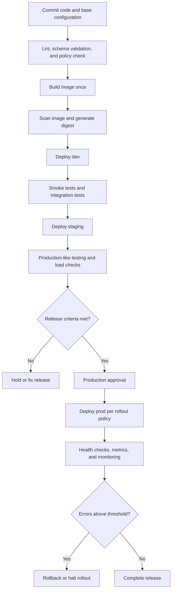

# Separating Compute Configurations Between Development and Production Environments

## Context: One Application, Multiple Operating Environments

An application typically passes through several environments before serving real users. The development (dev) environment supports coding, experimentation, and debugging. The testing or staging environment helps verify releases under production-like conditions. The production (prod) environment serves real traffic and real data, so it must prioritize availability, security, recoverability, and change control.

Environments may run the same application code yet require different compute configurations. Dev can use small VMs, fewer replicas, mock data, and auto-shutdown schedules. Production may need multiple availability zones, tight access restrictions, autoscaling, comprehensive monitoring, and failover capacity. Using a single configuration across every environment can cause teams to overspend in dev or accidentally ship unsafe experimental settings into production.

**Separating compute configurations by environment** is the practice of organizing infrastructure and runtime parameters so each environment has the right capacity, policies, and connectivity, while maintaining consistency across the application and deployment workflow.

Within the **CLOUD_CORE_SERVICES_COMPUTE** module, this topic connects selecting CPU, RAM, images, storage, networking, and security with automated provisioning, repeatable deployments, scaling, availability, and cost optimization.

## 1. Goals of Separating Environments

Separating environments is more than naming two groups of machines `dev` and `prod`. Each environment must have clear boundaries and purposes.

| Goal | Development | Production |
|---|---|---|
| Purpose | Development, experimentation, debugging | Serving real users and business workflows |
| Data | Synthetic, anonymized, or test datasets | Real data under retention and access policies |
| Compute capacity | Small, flexible, potentially ephemeral | Sized based on load, SLA/SLO, and redundancy |
| Replica count | Can be one replica or a few nodes | Typically multiple replicas distributed across fault domains if availability requires |
| Access permissions | Development team granted appropriate access for testing | Least privilege, approvals, and audit trails |
| Networking | Controlled test connectivity may be allowed | Strict segmentation, restricted ingress/egress, and private connectivity |
| Logging | Can raise verbosity for debugging | Structured, alerted, and scrubbed of sensitive data |
| Changes | Fast, frequent | Validated, approved, and backed by rollback plans |
| Cost | Prioritize savings and automatic reclamation | Balance cost against performance, availability, and risk |

Staging usually sits between dev and prod: configurations should resemble production closely to test deployment behavior, while data and access permissions remain restricted. Not every organization needs all three environments; what matters is clearly defining testing and operational boundaries.

## 2. Classifying Configurations: Shared vs. Environment-Specific

Before creating separate configuration files, determine which parameters genuinely need to differ. Duplicating entire configurations into independent copies causes environments to drift apart over time.

### 2.1. Shared Configuration

Attributes describing the application and operational standards can remain unified:

- Service name, application ports, and protocols.
- Runtime versions, foundational libraries, and OS requirements.
- Health endpoint paths, log formats, and baseline metrics.
- Resource tagging rules such as service, owner, and component.
- Baseline security policies, such as not running the application as root unnecessarily.
- CPU/RAM declaration structures and how autoscaling is structured, while specific values are overridden per environment.

### 2.2. Environment-Specific Configuration

Values that depend on the environment typically include:

- VM/instance size, node count, replica count, CPU, and RAM.
- Autoscaling min/max bounds, scaling thresholds, and buffer capacity.
- Region, availability zones, subnets, routes, firewalls, and load balancers.
- Volume types, sizes, performance tiers, and backup policies.
- Endpoints for databases, caches, queues, and external services.
- Log levels, sampling rates, retention, and alert thresholds.
- Quotas, concurrency limits, timeouts, and rate limits.
- Service identities, IAM permissions, and secret references.
- Cost tags, on/off schedules, and resource retention policies.

### 2.3. Keeping Secrets Out of Regular Configuration

Endpoints, bucket names, or log levels can usually be stored as configuration. Passwords, API tokens, private keys, certificate private keys, and credentials must be managed via a secret manager or appropriate secret provisioning mechanism. Configuration files should only contain names or paths referencing those secrets.

For example, `DATABASE_HOST` can be a configuration variable; `DATABASE_PASSWORD` should be fetched from a secret store using workload identity or short-lived authentication. Never commit secrets to Git, bake secrets into images, or pass secrets in user data readable via metadata/APIs.

## 3. Configuration Organization Models

An easy-to-manage approach is combining a shared base configuration with environment-specific override layers. Load precedence must be explicitly defined so a production setting is never accidentally overridden by a default value.

Example directory structure:

```text
deploy/
  base/
    app-config.yaml
    compute.yaml
    network-policy.yaml
  overlays/
    dev/
      compute.yaml
      app-config.yaml
    staging/
      compute.yaml
      app-config.yaml
    prod/
      compute.yaml
      app-config.yaml
  modules/
    compute/
      main.tf
      variables.tf
      outputs.tf
      environments/
        dev.tfvars
        staging.tfvars
        prod.tfvars
```

This is an illustrative layout, not a mandatory convention. With Kubernetes, you can use Helm values or Kustomize overlays; with Terraform, shared modules and separate variable files; with VM platforms, shared templates/images paired with environment-specific initialization parameters.

A base configuration can describe stable attributes:

```yaml
service:
  name: orders-api
  port: 8080
  health_path: /health/ready
compute:
  cpu_request: "500m"
  memory_request: "512Mi"
  cpu_limit: "2"
  memory_limit: "2Gi"
observability:
  metrics_enabled: true
  structured_logs: true
```

The dev layer overrides replica count and test endpoints:

```yaml
environment: dev
replicas: 1
autoscaling:
  enabled: false
database:
  host: dev-db.internal
logging:
  level: debug
  retention_days: 3
```

The production layer can specify different capacity and policies:

```yaml
environment: prod
replicas: 3
autoscaling:
  enabled: true
  min_replicas: 3
  max_replicas: 20
database:
  host: prod-db.internal
logging:
  level: info
  retention_days: 30
```

The hostnames and values in these examples are illustrative only. In a real system, endpoints must come from provisioned infrastructure; replica counts and retention periods must reflect load, business requirements, data policies, and budgets.

### 3.1. Configuration Merging Rules

A clear merging workflow typically follows these steps:

1. Load the version-controlled base configuration.
2. Load the override layer for the target environment.
3. Fetch secrets from the secret manager using the environment or workload identity.
4. Validate schema, data types, required fields, and safety bounds.
5. Produce the final deployment configuration and record the version/commit used for deployment.

Do not rely on arbitrary file ordering or allow environment variables to freely override every setting. Define explicit precedence and validation so it is always clear where the final value came from.

## 4. Separating Compute Settings: CPU, RAM, and Autoscaling

Dev and production generally have different load levels and objectives. Compute settings should reflect those objectives while retaining a uniform declaration structure for easy comparison.

### 4.1. CPU and Memory

In dev, smaller VMs or containers can reduce costs as long as they suffice for development and testing tasks. Production must be sized from benchmarks and live metrics: CPU utilization, throttling, memory working set, OOM events, latency, and throughput. Do not size production merely by multiplying dev vCPUs by an arbitrary constant.

For containers, `requests` typically influence scheduling decisions; `limits` cap maximum consumption enforced by the runtime. For VMs, the machine shape dictates allocated vCPU/RAM. Check quotas and capacity in the exact target region, machine family, and pool. Provisioning larger resources will not automatically speed up an application if the bottleneck is the database, locks, network, or algorithms.

### 4.2. Replica Counts and Autoscaling

Dev can run a single replica with autoscaling disabled if the goal is functional testing. Staging should test scale-out and scale-in whenever that is part of production behavior. Production generally needs a minimum replica count to preserve service continuity if an instance fails or during rollouts; min/max values must account for load, startup time, and quotas.

Conceptual example of a Kubernetes Deployment and HorizontalPodAutoscaler:

```yaml
apiVersion: apps/v1
kind: Deployment
metadata:
  name: orders-api
spec:
  replicas: 3
  selector:
    matchLabels:
      app: orders-api
  template:
    metadata:
      labels:
        app: orders-api
    spec:
      containers:
        - name: api
          image: registry.example.invalid/orders-api:1.8.0
          resources:
            requests:
              cpu: "500m"
              memory: "512Mi"
            limits:
              cpu: "2"
              memory: "2Gi"
          ports:
            - containerPort: 8080
```

Production can apply a separate HPA:

```yaml
apiVersion: autoscaling/v2
kind: HorizontalPodAutoscaler
metadata:
  name: orders-api
spec:
  scaleTargetRef:
    apiVersion: apps/v1
    kind: Deployment
    name: orders-api
  minReplicas: 3
  maxReplicas: 20
  metrics:
    - type: Resource
      resource:
        name: cpu
        target:
          type: Utilization
          averageUtilization: 65
```

HPA is an example of CPU-based autoscaling. Services may need other metrics such as queue depth, in-flight requests, or concurrency. Also, HPA does not add cluster nodes on its own when capacity runs out; configure a node autoscaler and ensure cloud quotas, subnet IPs, and regional capacity can accommodate new nodes.

### 4.3. Resource Schedules and Instance Types

Dev/test can use off-hours auto-shutdown schedules, preemptible/spot instances (if workloads tolerate interruption), or shared pools. Production usually requires stable capacity, instance replacement policies, and distribution across fault domains. Do not use preemptible instances for critical production workloads without designing for interruption tolerance and recovery.

## 5. Separating Network and Storage Configurations

Network and data boundaries are central to environment isolation. A misconfigured endpoint can cause a dev app to connect to a production database, or a production workload to inadvertently expose management ports to the Internet.

### 5.1. Networking

Define separate networks, subnets, and firewall policies for each environment. Depending on the required isolation level, dev and prod may reside in separate projects/accounts or VPCs/VNets. If sharing physical or logical networks, enforce strict segmentation, routing, and access rules.

| Component | Development | Production |
|---|---|---|
| VPC/VNet | Controlled dev or sandbox network | Production network with separate administrative boundary |
| Subnet | May be simpler, still access-restricted | Public/private segmentation by role |
| Ingress | Dev team or VPN/dev gateway only | Via load balancer, WAF, or approved entry gateway |
| Egress | Controlled access to tools needed for development | Restricted outbound targets; use proxy/NAT or private endpoints where appropriate |
| DNS | Separate internal/dev domain | Production domain with strict change control |
| Administration | Access from dev network or bastion | Bastion, session manager, or audited zero-trust access |

Do not rely on hostnames for environment isolation. Verify isolation via network policies, security groups/firewalls, route tables, IAM, and connectivity tests from live workloads.

### 5.2. Storage and Backups

Dev can usually use smaller volumes, lower performance tiers, or reproducible data. Production must select volume types based on IOPS, throughput, latency, durability, and recovery targets. Production backups need schedules, retention periods, encryption, access controls, and periodic restore testing.

Never share volumes or directly writable datasets between dev and prod. If production data is needed for testing, use anonymized or transformed copies under data governance policies in an environment with explicit permissions and expiration limits.

### 5.3. Databases and Supporting Services

Each environment should point to its corresponding database, cache, queue, and storage endpoints. Dev typically uses small dedicated databases or local/mock services; production uses services sized and protected according to business requirements. Endpoint configurations must be validated to prevent a dev deployment from accidentally pointing to production.

Schema migrations require testing and controlled rollout processes. Never automatically run destructive production migrations just because an application starts up. Separate migration steps from application rollouts, verify backward compatibility, and prepare recovery plans.

## 6. Environment-Specific Security and Identity

Each environment requires its own identity and access permissions. Accounts or workload identities used in dev must not have permission to read production secrets, buckets, or databases. Developers may have permission to create/delete dev resources; production changes require narrower permissions and auditing.

Principles to apply:

- Use separate accounts/projects/subscriptions or namespaces when strong administrative boundaries are required.
- Create dedicated IAM roles/service accounts per environment with least-privilege permissions.
- Separate secret stores, encryption keys, and certificates by environment.
- Never share credentials across dev, staging, and prod.
- Restrict production access by group, duration, and approval workflow.
- Log who changed a configuration, when, before/after values, and the reason.
- Scan images, packages, and configurations prior to deployment; patch vulnerabilities based on risk and operational schedules.

Settings like `debug=true`, broad management ports, or logs containing sensitive payloads may be acceptable in a sandbox but must never automatically carry over into production. Enforce policy checks for prohibited or mandatory settings before pipelines are allowed to deploy.

## 7. Maintaining Consistency Across Environments

Separating configurations does not mean creating completely different systems. If dev runs a different runtime, image, or architecture than production, bugs may surface only after release. The goal is to keep factors affecting application behavior as identical as possible while changing only values that genuinely depend on the environment.

### 7.1. Using the Same Built Artifact

Build the application once, tag it with an immutable version or digest, and promote that exact artifact through staging to production. Do not rebuild a different binary just because the target environment differs. Environment configuration is injected at deploy time or runtime.

Example:

```text
commit 8f31c2a
    |
    v
build image orders-api:1.8.0
    |
    v
image digest sha256:...
    |
    +--> deploy dev
    |
    +--> deploy staging
    |
    +--> deploy prod (after approval)
```

Image tags can change or be overwritten if the registry permits. For critical releases, deploy by immutable digest to guarantee the exact tested content is running.

### 7.2. Keeping Foundational Elements Close

Staging should closely match production in CPU architecture, runtime type, OS version, network path, storage class, and autoscaling mechanics whenever those factors affect test results. Scale can be smaller to save cost, but document differences and understand testing limitations.

Staging does not always need the exact same node count or capacity as production. For load testing, use an environment with sufficient capacity and representative mock data; for functional testing, a smaller scale can be acceptable.

### 7.3. Controlling Configuration Drift

Configuration drift occurs when live configurations diverge from declared configurations. For instance, an engineer edits a security group directly in the console without updating IaC; a subsequent deployment might overwrite the fix or leave an unmonitored gap open.

To minimize drift:

- Manage infrastructure with IaC or a version-controlled configuration system.
- Restrict manual changes; if an emergency fix is required, document it and reconcile it back into source code afterward.
- Run periodic plan/diff checks to compare live state against desired state.
- Protect state files, separate state by environment, and prevent multiple pipelines from modifying the same state concurrently.
- Use policy-as-code to validate configurations before applying.
- Record commit hashes, artifact digests, and deployment outcomes for each environment.

## 8. Deploying Configurations Through Pipelines

Pipelines should apply the same validation workflow across every environment, while permissions and release gates may vary. A common flow:



Verification steps should include:

1. **Syntax and schema:** valid YAML/JSON/HCL files; required fields present with correct types.
2. **Environment validation:** region, subnet, image, instance family, quota, and endpoints exist in the target environment.
3. **Policy check:** production does not enable debug mode, avoids non-compliant public IPs, does not expose management ports broadly, and includes required encryption/backups.
4. **Security scan:** images, dependencies, IaC, and configs are scanned per organizational procedures.
5. **Plan/review:** preview resources to create, modify, or delete; require approval when changes impact production.
6. **Deploy:** apply validated configuration using the tested artifact digest.
7. **Post-deploy verification:** verify VM/pod status, health endpoints, logs, metrics, error rates, and latency.

### 8.1. Rollout and Rollback

Production should use deployment strategies that limit blast radius, such as rolling updates, canary, or blue-green where supported by the platform. Start with a small fraction of traffic, monitor error rate, latency, saturation, and health checks, and only then expand.

Rolling back an application may simply mean reverting to the previous artifact digest, whereas rolling back infrastructure or database changes can be far more complex. Prefer backward-compatible data schema changes during transition phases. For irreversible changes, prepare backups, migration plans, and pre-tested recovery procedures.

### 8.2. Example IaC Parameters by Environment

A Terraform module can accept shared variables while each environment supplies its own value file:

```hcl
# variables.tf
variable "environment" {
  type = string
}

variable "instance_type" {
  type = string
}

variable "min_instances" {
  type = number
}

variable "max_instances" {
  type = number
}
```

```hcl
# environments/dev.tfvars
environment    = "dev"
instance_type  = "general-small"
min_instances  = 1
max_instances  = 2
```

```hcl
# environments/prod.tfvars
environment    = "prod"
instance_type  = "general-medium"
min_instances  = 3
max_instances  = 20
```

Apply using properly separated workspaces or backends/states, for example:

```bash
terraform plan -var-file="environments/dev.tfvars"
terraform apply -var-file="environments/dev.tfvars"
```

The commands above illustrate passing dev values. Production requires a dedicated state/backend and deployment permissions, plan review, and formal approval. Do not share state across environments if doing so lets an operation in one environment accidentally impact another environment's resources.

## 9. Testing Configurations Before Release

Configuration testing must validate both input values and actual workload behavior. A syntactically valid file can still point to the wrong subnet, lack quota, or provision a VM with insufficient RAM.

| Test Type | Example Content | Objective |
|---|---|---|
| Static validation | Schema, data types, required values, min/max bounds | Catch configuration errors early |
| Infrastructure plan | IaC diff, VM/node counts, volumes, IPs, and policy changes | Spot unintended changes |
| Security policy | Least-privilege IAM, encryption, ingress/egress, no exposed secrets | Prevent insecure configurations |
| Smoke test | Health endpoints, DNS, dependency connectivity | Verify newly deployed service can run |
| Integration test | Connections to databases, queues, storage, and related APIs | Verify components collaborate properly |
| Load test | Throughput, latency, CPU/RAM, autoscaling, and capacity | Verify configuration meets target load |
| Resilience test | Loss of an instance/node/zone, restarts, and recovery | Verify redundancy and self-healing |
| Restore test | Recovering volumes/databases from backups | Verify data is recoverable |

Dev can rely on fast checks and mock data. Staging should run production-like tests, especially for migrations, autoscaling, backup/restore, and rollouts. Production requires continuous monitoring and can use canary deployments or synthetic checks to detect post-deployment issues.

## 10. Managing Configurations and Sensitive Data

Configurations need clear owners, a source of truth, and change history. Each parameter should have one authoritative source; avoid having the same setting live across YAML files, pipeline variables, consoles, and secret stores without clear precedence rules.

Classify information by storage method:

| Information Type | Example | Management Approach |
|---|---|---|
| Non-sensitive config | Port, log level, replica count, feature flags | Version control and review |
| Environment parameters | Region, subnet ID, database host, storage class | Separate variable/overlay files with validation |
| Secrets | Passwords, tokens, private keys | Secret manager, least privilege, rotation |
| Infrastructure state | Terraform state, resource IDs, outputs | Backend with access control, encryption, and locking |
| Audit records | Modifier, timestamp, commit, plan, and outcome | Logging/audit system with appropriate retention |

Secret rotation should be designed so applications pick up new credentials without committing secrets to Git. During a secret exposure incident, revoke and rotate credentials, inspect audit logs, and determine the affected environment scope.

## 11. Tracking Cost and Resource Ownership

Separating environments makes cost allocation clearer when resources carry consistent tags or labels. Attach attributes such as `environment`, `service`, `owner`, `team`, `cost-center`, and `expires-at` to appropriate resources.

Common optimization measures:

- Schedule automatic shutdowns for idle dev VMs, clusters, or environments outside working hours.
- Reclaim expired volumes, IPs, snapshots, and test resources.
- Use smaller instances in dev whenever testing needs are met.
- Use autoscaling and right-sizing in production based on metrics while preserving needed headroom.
- Track costs by service and environment to detect anomalous resource growth.
- Set per-environment budgets/alerts; production cost alerts do not replace capacity and service health alerts.

Do not apply dev auto-reclamation policies to production. Production resources may need to remain provisioned even at low utilization to meet availability or recovery requirements.

## 12. Practical Workflow for Separating Dev and Prod

Follow this sequence when onboarding a new compute service into operations:

1. **Define goals and boundaries:** decide whether dev, staging, and prod are needed; determine projects/accounts, networks, and user groups for each environment.
2. **Establish configuration sources:** build shared modules or base configs; define which parameters will be overridden per environment.
3. **Design compute:** select images/runtimes, CPU/RAM, replicas, autoscaling, and reserve capacity per environment.
4. **Separate networks and storage:** define dedicated subnets, firewalls, endpoints, volumes, backups, and data policies.
5. **Configure identities and secrets:** create dedicated roles/service identities, secret stores, and access permissions; never share credentials across environments.
6. **Build the pipeline:** validate configurations, build artifacts once, deploy in dev → staging → prod order, and record digests/commits.
7. **Test:** run smoke, integration, load, resilience, and restore tests commensurate with risk.
8. **Approve and release:** review plans, approve production changes, roll out with monitoring, and prepare rollbacks.
9. **Monitor drift and cost:** compare live state against IaC and periodically audit tags, quotas, metrics, and budgets.

### Pre-Production Deployment Checklist

- [ ] Artifact has an immutable version/digest and was tested in earlier environments.
- [ ] CPU/RAM, replicas, quotas, and capacity meet target load plus headroom.
- [ ] Network opens only required flows; no non-compliant public management ports exist.
- [ ] IAM and workload identities use least privilege and are isolated from dev.
- [ ] Secrets are retrieved from a secret manager; none reside in images, Git, or user data.
- [ ] Storage is encrypted and backed up as required; restore procedures have been tested.
- [ ] Health checks, logs, metrics, and alerts are operational.
- [ ] Plans have been reviewed; production changes have an accountable owner and rollback plan.
- [ ] Tags/labels and budgets identify production costs.

## 13. Common Misconceptions

**Separating environments only requires changing names.** Naming something `dev` or `prod` creates no security boundary. You must separate identities, networks, data, permissions, and infrastructure state.

**Dev must match production on every metric.** Dev can be smaller and cheaper. What must stay aligned are factors affecting application behavior; scale differences should be documented and tested in staging.

**Production only needs higher CPU and RAM.** Availability also depends on replica counts, fault domains, storage, networking, quotas, autoscaling, health checks, and recoverability.

**Having separate config files means secrets are separated.** Secrets can still be copied into files or images. Use a secret manager and dedicated access controls.

**Building separately for each environment is safer.** Rebuilding can produce different artifacts. Build once and promote the same digest; vary only environment configuration.

**Editing directly in the console is fast and does not affect IaC.** Manual edits create configuration drift. If an emergency fix is required, document it and sync the change back to the official configuration source.

**Rollback always just means reverting to the previous app version.** Database, volume, or network changes may not reverse cleanly. Design compatible migrations and dedicated recovery plans.

## Conclusion

Separating compute configurations by environment gives each stage of development appropriate resources, networking, security, and operational policies. Base configurations and override layers maintain consistency, while values such as CPU/RAM, replicas, endpoints, subnets, secrets, and backups are managed individually per environment. Combining IaC, build-once artifacts, validation, policy checks, approval-gated pipelines, and configuration drift monitoring enables repeatable deployments, reduces configuration errors, and balances dev costs against production availability requirements.
