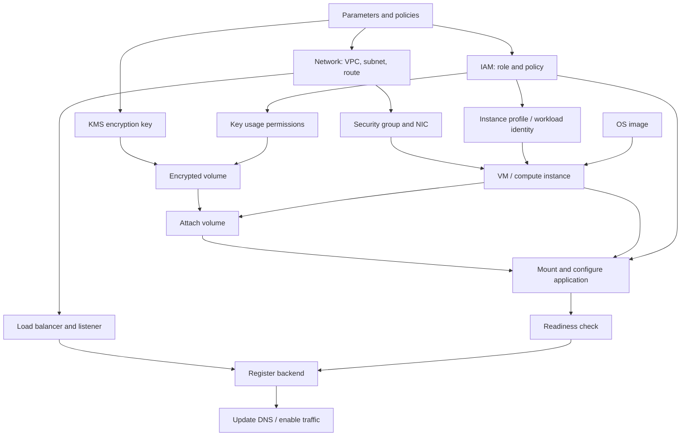

# Managing Dependencies Between Machines, Disks, Networks, and Access Permissions

## 1. Why Does Provisioning Order Matter?

A virtual machine may be created successfully yet the application inside still fails to work. The machine may lack an outbound network route, fail to read secrets, fail to attach a volume, fail to resolve DNS, or lack permission to access a required service. These failures commonly occur when cloud resources are created in an improper order or when a workflow only waits for resource creation to finish without verifying readiness.

A compute workload typically depends on multiple layers: identity and access permissions, networking, encryption keys, storage, images, virtual machines or containers, startup configuration, supporting services, and traffic entry points. These layers have prerequisite relationships. For example, an encrypted volume requires a KMS key and key usage permissions; a VM requires a subnet and network policies; an application requires the volume to be attached and mounted; a load balancer should only route requests to instances that have passed health checks.

Good automation models these relationships as a dependency graph and creates resources in a valid order. Independent branches can run in parallel. Steps requiring a service to be genuinely ready must have explicit wait conditions and checks. When tearing down or replacing a system, the sequence is usually reversed so resources still in use are not broken.

In this lesson, you will learn to:

- Distinguish creation dependencies, readiness dependencies, and runtime dependencies.
- Build a dependency graph across IAM, networking, keys, disks, compute, and applications.
- Choose a sensible provisioning order for VMs, containers, and serverless workloads.
- Use Infrastructure as Code (IaC), orchestration, retries, and health checks to coordinate workflows.
- Design repeatable bootstrapping, manage secrets safely, and avoid creating duplicate resources.
- Handle failures, replacements, rollbacks, and resource deletion in a safe order.

## 2. Understanding Dependency Types

### 2.1. Creation Dependency

A resource can only be created once another resource exists. For example, a network interface requires a subnet; a subnet requires a virtual network; an encrypted volume requires a key and key usage permissions; an instance requires a valid network interface or subnet.

This is the clearest relationship in IaC. Tools can infer ordering when one resource directly references an output or attribute of another resource. When no direct reference exists yet an ordering constraint is still required, an explicit dependency must be declared.

### 2.2. Readiness Dependency

The resource has been created, yet the service inside is not ready. A VM may report `running` while the operating system has not finished booting. A volume may be attached in the control plane before the block device appears in the OS. A database may exist before it accepts connections. A load balancer may have a listener while targets are not yet healthy.

Readiness dependencies require verification conditions, for example:

- The cloud API reports the instance in an appropriate status.
- The management agent or cloud-init reports bootstrap completion.
- The block device appears and is accessible inside the OS.
- The application returns HTTP 200 on its readiness endpoint.
- The database accepts connections and completes schema initialization.
- The target group reports enough healthy backends per policy.

Simply waiting for the resource creation call to return success is insufficient. Waits should have deadlines, bounded retries, and specific error messages.

### 2.3. Runtime Dependency

An application requires another service throughout operation. For example, an API needs a database, a worker needs a message queue, and a function needs object storage or a secrets service. Those services may be ready at deployment time yet experience transient connectivity loss later.

Runtime dependencies must be handled inside the application itself using timeouts, retries with backoff, circuit breakers, connection pools, and proper error handling. Initial provisioning order cannot guarantee a service stays up throughout the workload's lifetime.

### 2.4. Lifecycle Dependency

Deletion order typically runs in reverse of creation order. Stop receiving traffic before deleting backends, detach volumes before deleting instances if data must be preserved, delete attachments before volumes, and retain encryption keys until no data remains that requires decryption.

Some resources may be protected or have independent lifecycles, such as databases, data volumes, encryption keys, and backups. A routine destroy operation should never accidentally delete resources holding critical data.

### 2.5. Hard vs. Soft Dependencies

A **hard dependency** is mandatory. For example, an instance cannot attach a NIC to a non-existent subnet. A **soft dependency** improves operation but can be handled via fallback. For example, a telemetry service not yet being ready probably should not block the entire application startup if the application can still run safely without telemetry.

Proper classification prevents workflows from waiting indefinitely for a non-essential supporting service. For soft dependencies, define degraded behavior, alerts, and subsequent recovery paths.

## 3. Dependency Graphs and Execution Order

### 3.1. Directed Acyclic Graph (DAG) Model

Each resource or deployment step can be represented as a node. An edge `A -> B` means A must exist or satisfy a condition before B executes. A valid graph for a standard provisioning workflow must contain no dependency cycles.

Example of a VM workload with a dedicated data volume:



Network, IAM, key, and image branches can be prepared in parallel if no extra dependencies exist. The VM should only initialize once the subnet/NIC, identity, and image meet requirements. The application is marked ready only after the volume, configuration, and required access permissions are working.

### 3.2. Topological Ordering

A topological order is an execution order in which every node appears after the nodes it depends on. A graph can have multiple valid topological orders. This allows independent branches to run in parallel instead of serializing the entire workflow.

For example, while creating a subnet, you can simultaneously create the IAM role and encryption key. Once those branches finish, you can create the NIC, volume, and instance according to their respective relationships. If the encryption key requires a separate policy, that policy must be ready before creating the volume or before the workload accesses data.

If the graph has a cycle, revisit the design. One example is a VM needing DNS pointing to itself in order to boot, while the DNS record needs the VM's IP address. You can break cycles using stable addresses, load balancers, service discovery, or a post-creation configuration step.

### 3.3. Do Not Equate "Created" with "Ready to Use"

Cloud APIs are often asynchronous. A resource creation request may return an ID immediately while the control plane continues provisioning in the background. Some IAM, DNS, route, or policy changes also take time to propagate.

Therefore, each step must define clear completion conditions. For example:

| Step | Creation Completion Condition | Readiness Condition for Next Step |
|---|---|---|
| Create subnet | Subnet ID returned | Routes, IP ranges, and network policies applied |
| Assign IAM role | Role exists | Policy attached and workload receives identity/credentials |
| Create volume | Volume ID returned | Volume in attachable state and encryption key active |
| Create VM | Instance ID returned | OS boot finished; agent or health check responds |
| Attach volume | Control plane reports attached | Device visible in OS; filesystem mounted cleanly |
| Deploy application | Artifact installed | App passes readiness check and reaches dependencies |
| Create load balancer | Listener exists | Backends healthy and health check policy satisfied |

## 4. Building Dependency Order by Layer

### 4.1. Identity and Access Layer

IAM generally must be prepared before compute starts if the workload needs to access secrets, object storage, registries, databases, or configuration services during bootstrap.

Typical sequence:

1. Create the service account, role, or workload identity.
2. Create policies with least-privilege permissions.
3. Attach policies to the role or service identity.
4. Configure trust relationships so only the intended workload can assume the identity.
5. Assign the role to the VM, node, pod, or function.
6. Verify the workload can obtain temporary credentials and call the intended services.

Never embed long-lived access keys into images, user-data, bootstrap scripts, or source control. When using a secret manager, the workload identity must have permission to read the exact secret and version. If secrets are encrypted with KMS, appropriate decrypt permissions and a key policy allowing the principal are required.

Some services require a service-linked role or control plane permission to create resources on a customer's behalf. That is an infrastructure deployment permission, distinct from runtime permissions used by the application. Separate these two identities so application processes are not granted broad cloud administrative privileges.

### 4.2. Network Layer

Networking is usually created before compute because NICs and instances require valid subnets, routes, and access policies.

Basic network sequence:

1. Create the virtual network/VPC and IP address ranges.
2. Create subnets across availability zones or fault domains.
3. Create route tables, internal routes, NAT, or private connectivity as needed.
4. Create security groups/firewall rules and network ACLs per architecture.
5. Create private DNS zones, resolvers, or service endpoints if needed.
6. Create NICs or network interfaces for compute.
7. Create load balancers, listeners, and health checks; this can run in parallel with other branches if independent of backends.

Network rules should follow least privilege: open only necessary application ports, restrict source ranges, and separate management traffic from data traffic. Do not open SSH/RDP to the entire Internet just to simplify bootstrapping. Use a session manager, controlled bastion, or dedicated management channel.

For private applications, verify egress paths as well. A VM may obtain a private IP yet still fail to download packages or images if NAT, proxies, or private endpoints are missing. If a workload pulls secrets or images through private endpoints, those endpoints and associated DNS must be ready before bootstrapping.

### 4.3. Key and Storage Layer

Encrypted volumes can depend on a KMS key, key policy, and key usage permissions. For volumes created from snapshots, the source snapshot and snapshot read permissions are also dependencies. Block volumes are typically tied to a specific availability zone or placement domain; VM and volume locations must match.

Typical sequence:

1. Create or select the encryption key and policy.
2. Verify the deployment principal has permission to create volumes with that key.
3. Create the volume or restore from a snapshot.
4. Create the VM in a compatible zone.
5. Attach the volume to the VM.
6. Wait for the device to appear in the OS.
7. Identify the exact device by UUID, serial, or stable metadata.
8. Create a filesystem if it is a new volume and mount it at the designated mount point.
9. Set ownership, access permissions, and backup policies.

Never blindly format the first device found. A VM may have multiple disks; picking the wrong device can wipe data. Bootstrap scripts should check whether a filesystem already exists, mount by UUID or stable identifier, and ensure operations can re-run safely.

For network filesystems, prepare network routes, security rules, DNS, mount targets, and access permissions before mounting. For object storage, there is no attach step like block volumes; instead, the workload needs an endpoint, identity, and access policy.

### 4.4. Image and Compute Layer

Images must have the right OS, CPU architecture, drivers, and agents for the instance type. If a workload needs GPUs, verify the image contains compatible drivers/runtimes or has a tested installation process. Images should be managed using immutable versions so environments can be reproduced.

When creating a VM, typical dependencies include:

- Subnet, NIC, security group, or firewall policy.
- IAM role, instance profile, or workload identity.
- Image ID and boot configuration.
- Root volume, data volumes, or source snapshots.
- Placement, zone, quota, and instance type.
- Metadata service and startup configuration delivery mechanism.

Some components like NICs, root disks, and boot volumes are created together in the instance creation API. Even so, logically they still have dependency relationships and must be represented in configuration to avoid creating an instance with the wrong subnet, permissions, or image.

### 4.5. Bootstrap and Application Layer

After the VM boots, bootstrapping typically performs these steps:

1. Wait for network interfaces and DNS to work.
2. Obtain credentials via workload identity.
3. Fetch configuration and secrets from the appropriate management services.
4. Verify volumes and mount filesystems.
5. Install packages or pull artifacts from registries.
6. Configure services, environment variables, and directory permissions.
7. Start the application and observability agents.
8. Run readiness checks.

Bootstrapping must distinguish transient errors from configuration errors. Unpropagated DNS or temporary secret manager timeouts can be retried. Wrong image architecture, missing role permissions, or malformed filesystems must fail loudly so configurations are fixed rather than retrying forever.

## 5. Managing Ordering in Infrastructure as Code

### 5.1. Implicit Dependencies via References

IaC tools typically infer dependencies when an attribute of one resource references an output of another resource. For example, when an instance takes `subnet_id` from a subnet resource, the tool knows the subnet must be created before the instance.

The advantage is that the graph reflects real data relationships and stays maintainable. Whenever possible, pass outputs/inputs between modules instead of hardcoding IDs. This allows renaming or reconfiguring resources without manually editing multiple places.

### 5.2. Explicit Dependencies

Some relationships cannot be expressed via attribute references. For example, an instance may need to wait for an IAM policy attachment to finish, or a bootstrap step may need to wait for additional network configuration. In such cases, declare an explicit dependency such as `depends_on` in Terraform or `DependsOn` in CloudFormation.

Only declare explicit dependencies when there is a specific technical reason. Overly broad dependencies force resources to wait unnecessarily, reduce parallelism, and make deployment plans harder to understand. Creation-level dependencies also do not replace application-layer readiness checks.

Abbreviated HCL illustrative example:

```hcl
resource "example_instance" "app" {
  subnet_id         = example_subnet.private.id
  security_group_id = example_security_group.app.id
  image_id          = example_image.app.id
  role_id           = example_role.app.id

  # Use only when this relationship cannot be expressed via a referenced attribute.
  depends_on = [example_role_policy.app_runtime]
}
```

The resource names in the example are placeholders illustrating relationships; replace them with real cloud provider resource types. An instance finishing creation still does not prove the application has booted or policies have propagated to every runtime component.

### 5.3. Separating Modules by Responsibility Boundaries

A module structure can include:

- `network`: VPC/VNet, subnets, routes, firewalls, endpoints, and DNS.
- `identity`: roles, policies, trust relationships, and secret read permissions.
- `storage`: keys, volumes, snapshots, backups, and filesystems.
- `compute`: images, instances, NICs, autoscaling, and placement.
- `application`: bootstrapping, configuration, deployment, and health checks.
- `traffic`: load balancers, target registration, listeners, and public DNS.

Modules should publish necessary outputs such as subnet IDs, security group IDs, role IDs, volume IDs, instance IDs, and endpoints. Avoid having modules query or mutate another module's internal resources through unmanaged paths, as that obscures dependencies and invites drift.

### 5.4. Plan, Apply, and State

IaC typically runs a planning step (plan) before applying (apply). Plans reveal which resources will be created, modified, or deleted. State records the mapping between configuration and live resources; store state in a protected location with concurrent locking and backups.

Do not manually edit state without understanding the consequences. When resources already exist outside IaC, use proper import or adoption procedures. After applying, verify outputs, service status, and drift. A successful apply only indicates provider operations completed under the tool's conditions; it does not guarantee application readiness.

## 6. Orchestration, Readiness, and Retries

### 6.1. When Is Workflow Orchestration Needed?

For multi-step, multi-service workflows or long wait times, workflow orchestration manages state and coordination cleanly. A workflow can:

- Run independent branches in parallel.
- Wait for events or status updates from cloud APIs.
- Retry transient failures according to policy.
- Fail fast on errors that cannot be resolved automatically.
- Trigger compensation or rollback steps when a branch fails.
- Persist state to resume after a worker or scheduler restarts.

For simple workflows, IaC and bootstrap scripts may suffice. For complex, multi-branch, long-running, or approval-gated workflows, consider a state machine or dedicated orchestration service.

### 6.2. Bounded Retries

Errors like network timeouts, API throttling, DNS propagation delays, or not-yet-ready resources can be transient. Retries should use exponential backoff and jitter so multiple workers do not resend requests at the exact same instant.

Illustrative policy:

```text
attempt = 0
deadline = start_time + 10 minutes

while not ready and current_time < deadline:
    check status
    if ready: proceed
    if configuration error or non-retryable error: stop and report error
    wait min(max_delay, base_delay * 2^attempt) + jitter
    attempt = attempt + 1

if deadline exceeded: report timeout with latest status and logs
```

This is an illustrative algorithm, not a universal default for every service. Deadlines and retry limits must be based on SLOs, expected startup times, and API limits. Never retry infinitely, as that masks configuration bugs and keeps billable resources running for long periods.

### 6.3. Idempotency

An idempotent step can be re-executed without creating unintended side effects. For example, creating a directory if it does not exist, mounting a volume by UUID if not yet mounted, or applying a desired config instead of appending a line on every run.

For resource creation APIs, use an idempotency token if supported by the service. Otherwise, check whether the resource was already created on a previous attempt before creating again. Name, tag, and add metadata by workload/environment so resources can be traced and reconciled.

Idempotency is especially critical when a workflow times out after the cloud already created the resource but the response was lost. Blindly re-running can create duplicate VMs, volumes, IP addresses, or load balancers.

### 6.4. Readiness, Liveness, and Startup Probes

These three checks serve different purposes:

- **Startup probe:** indicates whether the application has finished initial startup. Useful for slow-starting apps or apps running boot-time migrations.
- **Readiness probe:** indicates whether an instance can accept traffic. If not ready, remove the instance from backend routing.
- **Liveness probe:** indicates whether the process is still alive or needs restarting. Do not use liveness checks to test every external dependency, as a brief database outage could cause all instances to restart in a loop.

Health endpoints should reflect the actual conditions needed to serve requests. If an application requires a database for business logic, readiness can verify database connectivity with a short timeout. However, a non-essential supporting service should not mark the entire application unhealthy if the app has a safe degraded mode.

## 7. VM Bootstrapping and Disk Management

### 7.1. Immutable Images vs. Boot-Time Configuration

There are two common ways to prepare machines:

- **Pre-baked image:** pre-installs the OS, agents, and base software inside a tested image. At boot, the VM only pulls environment configuration and required secrets.
- **Boot-time bootstrap:** uses cloud-init, user-data, startup scripts, or configuration management to install and configure software when the machine starts.

Immutable images keep boot times short and environments consistent. Bootstrapping is more flexible when configs change frequently, but depends on networking, package repositories, registries, and configuration services. Both can be combined: images carry base software while bootstrapping handles environment config and service startup.

### 7.2. Volume Attach and Mount Sequence

For block storage, distinguish control-plane state from OS state. After the API reports attach success, the OS may need extra time to detect the device. Scripts must wait for the right device to appear, check the filesystem, and mount it at the proper location.

Safe procedure:

1. Identify the volume by ID or metadata passed from IaC.
2. Wait for the volume to attach to the right instance.
3. Wait for the device to appear in the OS and identify it by serial/UUID or stable attribute.
4. Check for an existing filesystem.
5. Format only after confirming it is a new volume with no data to preserve and initialization is permitted.
6. Mount by UUID or stable identifier rather than mutable device names.
7. Verify mount success and access permissions before starting the application.

If a volume contains data to retain, never format it during bootstrapping. Take snapshots and backups per policy before filesystem modifications. Persistent mount configurations should handle temporary device absence so the system does not enter a hard-to-diagnose boot failure.

### 7.3. Operating System Service Dependencies

In Linux, systemd can express relationships among services, mounts, and networking. For example, an application requiring a mounted volume should declare a dependency on the corresponding mount point or device in its service unit. If an application calls network services immediately at boot, it may need `network-online.target`, though this target is meaningful only if the network manager genuinely waits for network configuration to complete.

Do not assume `network.target` means DNS, routes, or remote endpoints are ready. Applications still need timeouts and retries for network calls. Similarly, `After=` in systemd only orders unit startup; it does not verify that an external database is serving requests.

### 7.4. Protecting Secrets During Bootstrap

User-data or startup scripts may be stored in metadata, logs, or change history depending on the platform. Never put passwords, private keys, or long-lived tokens directly inside them. Instead, fetch secrets via workload identity and a secret manager, read only the exact secrets required, and avoid printing sensitive values to logs.

Also check metadata service access permissions. If the platform supports metadata endpoint protection, enable the appropriate mechanism to reduce the risk of untrusted processes stealing credentials. Secrets should have clear lifecycles, rotation capabilities, and audit logs.

## 8. Dependencies in Containers and Serverless

### 8.1. Containers and Kubernetes

Container images must exist in a registry, and nodes must have permission to pull them. Pods may depend on service accounts, secrets, config maps, persistent volume claims, storage classes, CSI drivers, network policies, and service discovery.

A common sequence:

1. Prepare the namespace, service account, and required RBAC/IAM permissions.
2. Prepare secrets/configs and secret manager access permissions.
3. Prepare storage classes, persistent volumes, or CSI dependencies if the workload requires persistent data.
4. Prepare network policies, services, and ingress.
5. Deploy the workload and wait for pod scheduling, image pull, and container startup.
6. Wait for startup/readiness probes to pass.
7. Add the pod to traffic-serving endpoints only once readiness succeeds.

Kubernetes controllers continuously reconcile desired state against actual state. While that helps self-heal some failures, it does not eliminate dependencies. For instance, a pod can remain Pending due to missing GPUs, unbound PVCs, or mismatched node affinity. Inspect events and conditions to diagnose the root cause.

### 8.2. Serverless Functions and Event Sources

Functions typically depend on an execution role, secrets, encryption keys, network configuration, layers/packages, and event sources. Triggers should not be enabled before the function, invoke permissions, and runtime dependencies are ready.

Typical deployment sequence:

1. Create the execution role and runtime policies.
2. Prepare secrets, KMS keys, and read/decrypt permissions.
3. Prepare VPC/subnets/security groups if the function needs private network access.
4. Package and deploy the function or container image.
5. Configure environment variables, timeout, memory, concurrency, and logging.
6. Grant permission for the event source to invoke the function.
7. Create the event mapping or trigger in a controlled state.
8. Test invocation, logs, retries, and dead-letter destinations.
9. Enable the trigger or route traffic once the function meets criteria.

Some platforms manage ordering between functions and event sources automatically at the control plane level. Even then, verify invoke permissions, retry behavior, duplicate event handling, and observability before enabling production triggers.

## 9. Failure Handling and Dependency-Aware Rollback

### 9.1. Classifying Failures

| Error Category | Example | Handling Approach |
|---|---|---|
| Configuration error | Wrong subnet, missing IAM permission, wrong image architecture | Halt step, clearly report resource/attribute to fix |
| Transient error | API timeout, throttling, unpropagated DNS | Retry with backoff and deadline |
| Readiness error | Slow VM boot, volume not yet visible, app unhealthy | Collect status/logs, wait within bounds, then fail clearly |
| Dependency error | Database or registry unreachable | Check network, DNS, IAM, endpoints, and service health |
| Partial failure | Network and IAM created but compute failed | Retain or clean up per policy, update workflow state |
| Data error | Wrong mount or failed schema migration | Stop traffic, preserve data, restore from backup/snapshot per procedure |

### 9.2. Rollback Does Not Always Mean Deleting Everything

For stateless resources, rollback can destroy instances or revert to a previous image/version. For stateful resources such as volumes, databases, object storage, and KMS keys, automatic deletion can cause data loss or render data undecryptable.

Design rollback by layer:

- Stop receiving traffic or drain backends from the load balancer.
- Stop applications or workers so no new data is written.
- Revert to the previous application version or restore configurations.
- Preserve volumes/databases and take snapshots if needed.
- Detach/delete attachments only after confirming no processes still use them.
- Retain encryption keys until data is migrated or retention periods expire.
- Clean up temporary resources against an approved list and update IaC state.

Some changes cannot be rolled back simply—for instance, breaking schema migrations or data written in a new format. In those cases, use expand-and-contract patterns, dual-read/write, or pre-tested backup/restore procedures.

### 9.3. Teardown in Reverse Order

Typical teardown sequence for a VM application:

1. Stop receiving traffic and update DNS or routes as planned.
2. Deregister backends from the load balancer and wait for connection draining.
3. Stop applications and workers.
4. Back up data or confirm data retention policies.
5. Detach volumes from instances if they must be kept.
6. Delete instances and temporary NICs.
7. Delete volumes only after confirming retention is unnecessary.
8. Delete load balancers, security rules, subnets, or networks once no dependent resources remain.
9. Revoke IAM roles and policies after workloads stop using them.
10. Disable or delete KMS keys only when no data, snapshots, or backups still require those keys.

Exact ordering depends on architecture. Never delete networks, roles, or keys solely because a VM was deleted; other workloads may still rely on those shared resources.

## 10. Dependency-Driven Implementation Examples

### Example 1: Application VM with a Dedicated Data Volume

An API runs on a VM in a private subnet. The application reads configuration from a secret manager and stores data on an encrypted volume. Traffic is routed to the VM only after the application is ready.

**Sequence:**

1. Create the VPC, subnet, routes, security groups, and required endpoints.
2. Create the KMS key, key policy, IAM role, and secret read permissions.
3. Create the encrypted volume in a compatible zone.
4. Create the NIC and VM from a tested image, attaching the runtime role.
5. Attach the volume and wait for the device to appear in the OS.
6. Bootstrap mounts the volume, fetches secrets, installs/configures the app, and starts the service.
7. Verify readiness, database connectivity, and write permissions to the volume.
8. Register the VM in the target group, wait for healthy status, and then open traffic.

**Verification points:** volume is attached to the right instance; filesystem was not accidentally formatted; role reads only needed secrets; VM has egress to dependencies; health check reflects actual serving capability.

### Example 2: Container Service Requiring Persistent Storage

A worker container runs on Kubernetes, reading messages from a queue and writing results to a persistent volume. The worker needs a service account to read the queue and a storage driver to mount the volume.

**Sequence:** prepare the namespace and IAM/RBAC; create the storage class/PVC and network policy; deploy secrets/configs; deploy the worker; wait for volume binding, pod scheduling, image pull, and readiness; only then increase consumer concurrency. If the worker does not require local state, consider object storage or a database instead of an attached volume so pods can be replaced easily.

**Verification points:** CSI driver is operational; volume zone matches the node; queue read and data write permissions follow least privilege; duplicate messages are handled on pod restart; readiness does not report success before the worker can actually process jobs.

### Example 3: Function Processing Object Storage Events

A function is invoked when a new file arrives. The function needs permissions to read source objects, write outputs, write logs, and decrypt configuration secrets.

**Sequence:** create the execution role and policies; prepare secrets/KMS; deploy the function; test direct invocation with sample data; create invoke permissions and event mapping; configure retries/dead-letter handling; finally enable the trigger on the bucket or event source.

**Verification points:** events cannot fire before permissions and the function are ready; function processing is idempotent; retries do not create duplicate records or objects; concurrency limits do not overwhelm downstream services.

## 11. Common Mistakes

- **Relying solely on declaration order in a file:** line order is not always the dependency graph. Express relationships via references or explicit dependencies.
- **Treating resource creation API success as readiness:** VMs, volumes, databases, and load balancers all need time to become ready.
- **Using `depends_on` instead of health checks:** IaC dependencies usually control only control-plane operation ordering, not application verification.
- **Creating VMs before runtime permissions exist:** bootstrapping may fail when fetching secrets, registry images, or configurations.
- **Missing egress or private endpoints:** a machine with valid IPs and security groups still cannot pull artifacts or call needed services.
- **Formatting volumes on every boot:** can wipe data if scripts re-run or devices enumerate with different names.
- **Embedding secrets in user-data or images:** secrets can leak through metadata, logs, state, or image registries.
- **Retrying infinitely:** keeps billable resources running and hides configuration errors.
- **Skipping idempotency:** re-running workflows can create duplicate VMs, volumes, or triggers.
- **Enabling traffic before readiness:** users receive errors while the application is still bootstrapping.
- **Deleting shared resources:** networks, IAM, or KMS may still serve other workloads.
- **Not keeping change history:** makes it hard to identify which step created a resource or why a dependency failed.

## 12. Pre-Automation Provisioning Checklist

- [ ] Listed all resources and dependencies of the workload.
- [ ] Distinguished creation, readiness, runtime, and lifecycle dependencies.
- [ ] Built an acyclic graph and identified branches that can run in parallel.
- [ ] Prepared IAM, trust relationships, secret permissions, and KMS policies.
- [ ] Created networks, routes, firewalls, DNS, and endpoints before workloads need them.
- [ ] Verified volume/storage placement, encryption, snapshots, and access permissions.
- [ ] Selected appropriate images, compute shapes, NICs, roles, and placement.
- [ ] Designed idempotent bootstrapping without static secrets and with safe logging.
- [ ] Waited for volume/device, network, service, and application readiness.
- [ ] Implemented bounded retries, backoff, jitter, and error classification.
- [ ] Registered backends or enabled event triggers only after dependencies are ready.
- [ ] Verified plan/state, drift, rollback, and protection for stateful resources.
- [ ] Designed reverse-order teardown that preserves required data and keys.
- [ ] Tested partial failures, workflow reruns, and recovery.

## 13. Conclusion

Compute provisioning is a workflow with many dependencies spanning identity, networking, encryption keys, storage, images, virtual machines or containers, bootstrapping, and traffic routing. Dependency graphs determine which steps must run first, which can run in parallel, and which conditions must be verified before proceeding.

Distinguish between a created resource and a ready service. Use IaC to declare resources and dependencies, orchestration to manage long-running workflows, bounded retries for transient errors, and health checks to confirm the application can serve traffic. Bootstrapping must be idempotent, secrets must be obtained via workload identity, and rollbacks and teardowns must protect volumes, databases, and encryption keys. When these principles are applied consistently, VM, container, and serverless systems can be deployed repeatably, diagnosed easily, and operated more securely.
