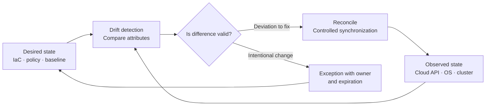

# Detecting Configuration Drift and Reconciling with Standard Configuration

In cloud infrastructure, virtual machines, networks, storage, access permissions, and operating system settings are typically provisioned using Infrastructure as Code (IaC) or configuration management tools. Over time, actual live state can diverge from declared configurations: someone opens an extra firewall port directly in the console, a machine's CPU is scaled up manually, a package is updated outside the pipeline, or an agent modifies a configuration file. This divergence is called **configuration drift**.

Drift can occur due to emergency interventions, manual edits, automation bugs, provider-side updates, or because the desired configuration does not adequately model dynamic values. If left undetected and unresolved, environments lose consistency, become hard to reproduce or audit, and can introduce security risks or unexpected costs.

Detecting drift is not merely finding two differing values. Operations teams must determine whether the change is legitimate, whether it affects services, which source is authoritative, and how to reconcile safely. Sometimes a live change is an emergency fix that should be ported back into source code; other times it is an unauthorized deviation that must be reverted. A sound workflow must distinguish between the two.

## 1. Desired State, Observed State, and Configuration Drift

**Desired state** is the target state described in IaC code, standard baselines, policies, or configuration management systems. It specifies which resources should exist and their critical attributes—such as instance type, VM count, subnet, firewall rules, disk capacity, package versions, and SSH policies.

**Observed state** is the live state read from the cloud control plane, operating system, Kubernetes API, or inventory tools. It reflects existing resources and their current values at the time of observation.

**Configuration drift** occurs when the observed state differs from the desired state on a managed attribute and that difference is not explained by dynamic rules or an approved exception.

For example, the standard configuration declares a security group allowing HTTPS only from the load balancer. An engineer opens SSH from the Internet to troubleshoot an incident and forgets to close it. The desired state still restricts traffic sources; the observed state now includes a public SSH rule. This is drift with security impact and requires prompt remediation.



The goal is not to force every value to match mechanically. The system must clearly define which attributes are managed, which values may change automatically, and which exceptions are time-bound. For example, VM counts in an autoscaling group fluctuate with load; that is expected behavior when desired state manages min/max/target policies rather than a fixed instance count.

## 2. Where Does Drift Occur?

Within a cloud compute infrastructure module, drift can occur across many layers:

| Layer | Drift Example | Potential Impact |
|---|---|---|
| Compute | Changing instance type, CPU options, VM count, or placement | Performance, cost, and availability change |
| Network | Opening extra ports, changing routes, subnets, IPs, or NICs | Connectivity loss, service exposure, or misrouting |
| Storage | Changing capacity, volume type, encryption, or retention | Cost, performance, and recoverability change |
| IAM / security | Adding permissions, switching roles, disabling encryption or logging | Expanded attack surface and policy violations |
| OS / guest | Modifying SSH, firewall, kernel parameters, services, or packages | Inconsistent environment, application errors |
| Image / boot | Using an outdated image, changing boot mode or drivers | Discrepancies when launching new machines or recovering |
| Accelerator | Changing GPU profile, drivers, or runtime | Workloads fail to run or performance shifts |
| Orchestration | Editing manifests, replicas, resource limits, or cluster policies | Workloads diverge from declarations and become hard to reproduce |

Drift can also appear in dependent resources such as DNS, load balancers, autoscaling policies, backup schedules, monitoring agents, and secret rotation. Consequently, inspection scope should follow system boundaries rather than just a list of VMs.

## 3. Common Causes

### Manual Changes Outside the Pipeline

Engineers edit resources directly through the console or CLI to resolve incidents, run experiments, or meet urgent requests. If those changes are not reflected back into IaC, subsequent deployments may overwrite them or compound discrepancies.

### Multiple Sources Managing the Same Resource

An attribute might be modified by Terraform, Ansible, custom scripts, and human operators. Without a clear tool designated as owner, systems can continuously overwrite each other's settings. For example, IaC sets one security rule while a bootstrap script appends another rule on every run.

### Under-Specified Configuration

If IaC code omits an attribute, the provider may apply a default. When provider defaults change or the resource is edited manually, observed state can diverge from what the team assumes is standard. Critical attributes must be explicitly declared or verified via policies.

### Automatic Changes Driven by Load or Service State

Autoscaling, rolling deployments, managed services, and schedulers frequently change instance counts or identities. This is not always drift requiring remediation. Dynamic attributes must be modeled properly—such as managing desired capacity or scaling policies rather than pinning individual instance IDs.

### Provider Updates and Changes

Cloud providers may update metadata, firmware, host status, service versions, or API defaults. Some changes are fully provider-managed and cannot or should not be forced back to an old value. Distinguish customer-managed attributes from service-managed attributes.

### Lack of Follow-Up After Emergency Changes

A break-glass change may be justified during an incident, yet becomes permanent drift if there is no ticket, owner, expiration, and follow-up step to update standard configurations. Emergency procedures must include post-incident review and documentation closure.

## 4. Classifying Drift Before Handling It

Not every discrepancy should be automatically reverted. Classify drift by origin and impact:

| Type | Description | Appropriate Handling |
|---|---|---|
| Unauthorized drift | Unapproved change or unknown origin | Investigate, assess risk, and generally revert to standard |
| Emergency drift | Temporary change made to restore service | Keep for a short duration, document, and port fix to code or revert |
| Approved change not yet in code | Approved change not yet reflected in IaC | Update desired state, then review and deploy |
| Dynamic state | Values changing due to autoscaling, scheduler, or runtime | Adjust management scope and comparison rules |
| Provider-managed change | Change managed by the platform | Verify documentation, record, and update baseline if needed |
| False positive | Difference due to read timing, eventual consistency, or unstable data | Re-run read, verify source, and refine detector |

Severity levels can be added based on scope and impact:

- **Critical:** opening public access outside policy, disabling encryption or auditing, altering privileged IAM roles, deleting backups, or breaking recoverability.
- **High:** modifying network routes, firewalls, disks, or compute in ways that risk outages or major costs.
- **Medium:** packages, OS configs, or operational parameters out of standard without immediate service impact.
- **Low:** metadata, tags, or attributes with no operational or security impact.

Severity depends on context. A rule opening a management port in an isolated test network carries different risk than the same rule on a public production system.

## 5. Detecting Drift by Comparing Desired and Observed State

### Obtaining Desired State from a Controlled Source

The authoritative source can be an IaC repository, Ansible configurations, policy-as-code, Kubernetes manifests, or OS baselines. Identify the approved version and deployed commit. Never compare live cloud resources against an unreleased code branch or an unreviewed local file.

### Collecting Observed State

Observed state can be collected from:

- Cloud APIs or inventory services to read instances, volumes, NICs, security groups, IAM, routes, and metadata.
- Configuration management agents to inspect packages, services, files, and kernel parameters inside the guest OS.
- Kubernetes APIs to inspect live objects, replicas, resource requests/limits, labels, and policies.
- Cloud audit logs to identify who changed what, when, and via which API.
- Monitoring and configuration inventories to track state over time.

Reading state should use least-privilege read-only permissions. Sensitive data such as secrets, private keys, and credential file contents must not be emitted into drift reports. Verify only security properties or appropriate fingerprints.

### Normalizing Before Comparing

Two configurations can express the same semantics differently. For example, firewall rule lists may return in a different order; provider-generated timestamps and IDs can vary; VM IP addresses in an autoscaling group are dynamic. Before comparing, normalize ordering, units, default values, and unmanaged attributes.

A good detector compares meaningful attributes rather than raw full JSON blobs. Byte-for-byte comparisons turn array reordering or provider-generated metadata into noisy false alerts.

### Scheduled vs. Event-Driven Detection

Two complementary detection modes exist:

- **Scheduled scan:** runs periodically, such as hourly or daily, to catch persistent deviations and audit all resources.
- **Event-driven detection:** subscribes to audit or configuration events to check immediately after a change occurs. This reduces drift dwell time but depends on event stream completeness.

Combine both. Event-driven checks enable fast response; scheduled scans catch missed events, detector failures, or drift from sources that do not emit events.

## 6. Tools and Interpreting Results

### Infrastructure as Code

With Terraform, `terraform plan` typically refreshes state from providers and compares it against declared configuration and stored state. The plan highlights resources modified outside Terraform and the actions required to converge back to configuration.

`terraform plan -refresh-only` focuses on showing changes from live infrastructure so operators can consider updating state. Running `terraform apply -refresh-only` updates Terraform state to match live reality; this **does not modify cloud resources back to desired state**. Accept refresh-only only when the live change was intentional and formally adopted into management decisions. If the change is unauthorized, remediate drift via a normal plan after impact assessment.

Example read-only inspection workflow:

```bash
# Initialize providers and modules from the current repository
terraform init

# Generate a plan and observe differences against live infrastructure
terraform plan

# Focus on live changes that would update state
terraform plan -refresh-only
```

Do not blindly run `terraform apply` merely because a plan shows changes. The plan may propose replacing or destroying resources, altering networking, or impacting data. Carefully read `will be updated`, `will be replaced`, and `will be destroyed` sections, and verify the origin of the change before applying.

### Configuration Management

Ansible can inspect machine configuration state using check mode and diff mode. Example:

```bash
# Simulate the playbook and display diffs that would be applied
ansible-playbook site.yml --check --diff
```

Check mode is a simulation; not every module supports it fully, and results do not replace testing in an appropriate environment. Diffs can expose sensitive file contents, so disable diff for tasks handling secrets or credential files. Use `no_log` and appropriate output protections.

### Cloud Configuration Inventory and Policy

Cloud inventory/configuration services can record resource configurations and change histories. Policy-as-code can enforce rules such as:

- Production VMs must have owner, environment, and cost center tags.
- Data disks must have encryption enabled.
- Security groups must not open management ports to the entire Internet without an exception.
- Production instances must have appropriate monitoring and backup policies.
- IAM roles must not grant broader permissions than the baseline.

Policies can run at resource creation time, in CI, or periodically against live environments. Deploy-time checks prevent new drift; continuous checks catch changes introduced afterward.

### GitOps and Kubernetes

In GitOps, a repository holds desired manifests; a controller compares live cluster state against desired state and can automatically reconcile. An `OutOfSync` status or equivalent indicates the live object differs from the manifest. However, certain fields populated automatically by Kubernetes controllers or admission webhooks may legitimately differ from the raw manifest.

When configuring autoscaling, do not let GitOps continuously force replica counts back to a fixed number if HPA controls scaling. Declare field ownership and configure ignore/managed fields according to the tool's documentation. If multiple controllers manage the same field, the system can oscillate continuously.

## 7. Distinguishing True Drift from Dynamic Changes

One major source of false positives is comparing attributes in ways incompatible with how the system operates.

Examples:

- An autoscaling group adjusts VM count with load; desired state should describe min/max/desired capacity or scaling policies, not necessarily a static list of instance IDs.
- DHCP assigns dynamic IPs; if IP address is not a pinned attribute, every IP change should not be flagged as drift.
- Providers append metadata or update host state; provider-managed attributes must be excluded from customer reconciliation scope.
- Kubernetes updates status, replicas, or controller-managed fields; compare spec fields within your management scope and understand field ownership.
- Secrets rotate periodically; detectors should check version or rotation status without logging secret values.

To reduce false positives:

1. Clearly define managed resources and attributes.
2. Normalize data and strip unstable metadata.
3. Identify which fields are managed by autoscalers, controllers, or providers.
4. Use time windows or retries to handle eventual consistency.
5. Attach time-bound, owned exceptions rather than permanent ignores.

Do not ignore an entire resource simply because a few fields are dynamic. Exclude only those specific attributes and continue monitoring the rest—especially security, encryption, and network exposure.

## 8. Reconciling Drift Back to Standard Configuration

When a detector flags drift, choose one of three paths:

1. **Revert actual state:** live state is wrong or unapproved; plan actions to bring the resource back to desired state.
2. **Update desired state:** live change was intentional and approved; update IaC or baselines, review, test, and release a new version.
3. **Create a time-bound exception:** the discrepancy must remain temporarily; document rationale, owner, risk, compensating controls, approver, and expiration date.

### Safe Reconciliation Workflow

1. **Confirm detection:** re-run the read to rule out transient errors and pinpoint the exact resource ID and drifted attribute.
2. **Trace the change source:** check audit logs, commits, tickets, pipelines, and action histories to identify who or what made the change.
3. **Assess impact:** determine whether the change affects security, traffic, data, performance, cost, or SLAs.
4. **Choose a resolution:** revert, update desired state, or grant a time-bound exception.
5. **Generate a plan:** preview actions to execute, dependencies, and replacement/destruction risks.
6. **Approve:** require owner or accountable approver sign-off for high-impact changes.
7. **Apply in small scope:** prefer canary or a subset of resources first, then expand once verified.
8. **Verify post-reconcile:** re-run the detector and check health, logs, metrics, and audit trails.
9. **Close the event:** store evidence, commits, approver, timestamps, and outcomes.

### Do Not Auto-Remediate Every Drift

Auto-remediation is useful for minor, low-risk, easily reversible deviations—such as adding a mandatory tag or restoring a standardized agent config. For changes that could cause data loss or service disruption, require approval and a rollout plan.

Cases requiring strict control:

- Changes to security groups, routes, firewalls, IAM, or access policies.
- Changes to volume size, type, or attachments.
- Changes to instance type, placement, or production node counts.
- Deleting resources or altering backup retention or encryption keys.
- Modifying database configurations, filesystems, or stateful data.

If an emergency change is currently keeping the service alive, immediately auto-reverting it could worsen the outage. Evaluate context and coordinate with the incident owner before reconciling.

## 9. Preventing Drift

Detecting and fixing drift is essential, but restricting out-of-band modifications and governing configuration sources reduces work long-term.

### One Authoritative Source per Attribute

Define which tool owns each configuration layer. For example, Terraform manages cloud resources; Ansible manages OS packages and files; Kubernetes controllers manage in-cluster workloads. Never allow two tools to write to the same attribute without an explicit ownership mechanism.

### Manage Changes Through Pull Requests and Pipelines

Configuration changes should pass through peer review, policy checks, planning, and approval before applying. Pipelines must log commits, actors, plans, and deployment outcomes for traceability.

### Restrict Manual Changes

Use IAM/RBAC to restrict direct editing rights in production. Grant permissions by role and time limit; use break-glass workflows with full audit logging for incidents. Do not grant permanent admin rights to everyone merely for operational convenience.

### Standardize Images and Configuration Management

Use golden images, patching pipelines, and configuration management tools so new machines start from the same baseline. Guest OS changes should be expressed as code, repeatable, and drift-checked. With immutable images, updates should build a new image and roll instances in batches.

### Reconcile Emergency Changes Back to Source

After an incident, review break-glass actions, update configuration code if the change is kept, or revert it if it was purely temporary. Every exception must have an owner and expiration date so temporary fixes do not turn into unmanaged configuration.

## 10. Real-World Examples

### Example 1: Security Group Exposes an Unexpected Port

Desired state allows only HTTPS from the load balancer to VMs. Audit logs show an engineer added TCP/22 from `0.0.0.0/0` to access a machine.

Handling workflow:

1. Verify the new rule and affected VMs/security groups.
2. Check whether an active incident or ticket requested emergency access.
3. If unapproved, remove the rule after confirming secure administrative access (such as a bastion or session manager) remains available.
4. If it is a valid emergency change, restrict source IPs, set an expiration and owner, and either update IaC or remove the rule when expired.
5. Re-run policy scans to confirm no non-compliant rules remain.

### Example 2: Production VM Resized Manually

IaC declares a VM using an instance family with 4 vCPUs and 16 GiB RAM. After a traffic spike, an operator upgrades the VM to 8 vCPUs and 32 GiB RAM directly in the console. The detector flags that the instance type differs from the repository configuration.

Do not immediately auto-downgrade the VM back to the old size, as that could starve the workload and re-trigger the incident. First inspect metrics and tickets to confirm whether the change was intentional. If the new size is the long-term solution, update IaC, review costs, and deploy via the pipeline. If it was a temporary measure, schedule an evaluation and re-check load after application tuning before returning the VM to the standard configuration.

### Example 3: Guest OS SSH Configuration Modified

The baseline requires disabling SSH password login and using only keys or session manager. Configuration management detects `PasswordAuthentication yes` on a VM.

Check audit logs and administrative history to locate the source of the edit. If no valid exception exists, run a reviewed playbook to restore the file, validate syntax before reloading SSH, and confirm an active administrative session remains open. Across machines with the same role, run check mode first and apply in small batches to avoid widespread lockout.

## 11. Measuring Drift Management Effectiveness

Operations teams should track both drift volume and remediation time. Useful metrics include:

| Metric | Meaning |
|---|---|
| Drift count | Open deviations by resource or attribute |
| Drift age | Time from detection until remediation or accepted exception |
| Mean time to detect (MTTD) | Average time from when drift occurs to when it is detected |
| Mean time to remediate (MTTR) | Average time to resolve drift |
| Critical drift rate | Percentage of total drift classified as critical |
| Repeat drift rate | Rate at which deviations recur after remediation |
| Exception overdue | Number of expired exceptions not yet closed |
| False positive rate | Percentage of alerts that are not actionable drift |
| IaC coverage | Percentage of critical resources managed and verified by code |

A falling drift count does not always mean a healthier system. Detectors might be disabled, scan scope narrowed, or resources missing from inventory. Track coverage, data freshness, and false positive rates alongside alert counts.

## 12. Operational Checklist

**Before enabling drift detection:**

- [ ] Identified the authoritative desired state source and approved version.
- [ ] Defined in-scope resources and managed attributes.
- [ ] Distinguished dynamic, provider-managed, and controller-managed fields.
- [ ] Configured least-privilege read access and protected sensitive data in reports.
- [ ] Selected appropriate scan schedules and event sources.
- [ ] Defined severities, owners, and alert routing channels.

**Before reconciling:**

- [ ] Confirmed drift with a fresh read and identified the exact resource ID.
- [ ] Checked audit logs, tickets, and pipeline history.
- [ ] Assessed impact on data, security, networking, SLAs, and cost.
- [ ] Selected revert, update desired state, or time-bound exception.
- [ ] Reviewed plan/diff and identified any replace or destroy actions.
- [ ] Obtained approvals for high-risk changes.
- [ ] Prepared rollback and post-apply verification steps.

**After reconciling:**

- [ ] Re-ran detector and confirmed converged state.
- [ ] Confirmed health checks, logs, metrics, and traffic show no degradation.
- [ ] Confirmed repository and documentation reflect the approved configuration.
- [ ] Saved audit trail, commit, owner, and outcomes.
- [ ] Closed exceptions or set new review deadlines.

## Conclusion

Configuration drift is the gap between live infrastructure state and approved standard configurations. Controlling drift requires maintaining versioned desired state, collecting reliable observed state, normalizing dynamic fields, and continuously comparing via IaC, configuration management, inventory, and policies. When deviations are detected, trace the source of change, assess risk, and decide whether to revert, update standard configuration, or grant a time-bound exception. Reconciliation must include plans, proper approvals, and post-apply verification to keep cloud infrastructure consistent, secure, and reproducible.
