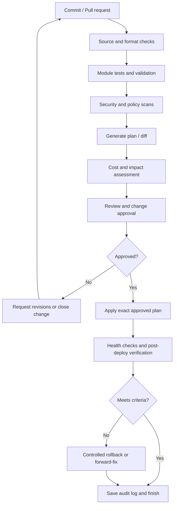

# Integrating Checks and Change Approvals in Infrastructure Pipelines

Cloud infrastructure is typically created and modified via Infrastructure as Code (IaC), image pipelines, and configuration management tools. A small code change can spin up additional virtual machines, alter routes, open network ports, replace volumes, or delete resources holding data. Therefore, infrastructure pipelines must validate changes before applying them and require approvals commensurate with the level of impact.

A well-designed pipeline provides evidence so reviewers understand **what changes will occur, which resources are affected, whether policies are met, and how to recover**. Pipelines should validate source code, analyze security, generate plans, estimate costs, collect approvals, apply the exact approved plan, and verify post-deployment status.

## 1. Why Do Infrastructure Pipelines Need Checks and Approvals?

Infrastructure changes differ from certain application changes because they directly affect shared resources and long-lived state. For example:

- Changing an instance family can trigger a VM reboot, switch CPU architecture, or require different drivers.
- Changing subnets, routes, or security groups can disrupt connectivity or expand the attack surface.
- Changing volume size, type, or encryption can impact data, performance, and cost.
- Changing an IAM role can grant broader permissions to workloads or operators.
- Deleting a stateful resource can cause data loss or leave the application unrecoverable.

Checking syntax alone lets pipelines accept configurations that are technically valid yet violate policy or cause unintended impact. Asking reviewers to inspect raw code diffs alone may hide which resources the provider will replace or destroy. Plans and automated checks turn code changes into actionable impact information.

Key workflow objectives include:

1. Catching configuration errors early before creating or modifying resources.
2. Blocking configurations that violate security, compliance, and internal standards.
3. Making impacts on resources, data, availability, and cost transparent.
4. Binding approvals to the exact commit, environment, and deployment plan.
5. Recording who made changes, who approved them, check results, and deployment status.
6. Verifying post-apply state and preparing remediation paths if checks fail.

## 2. Infrastructure Change Pipeline Architecture

Pipelines are typically split into two major phases. The validation phase runs when a pull request is opened or updated; the deployment phase runs only after the change has been reviewed and authorized for the corresponding environment.



Not every pipeline uses the same tools or stage names. What matters is that each stage has clear inputs, outputs, pass criteria, and owners.

## 3. Validation Layers Before Generating a Plan

### Format and Syntax Checks

Basic checks eliminate early errors:

- Format IaC code so diffs stay readable and consistent.
- Validate syntax, schemas, and data types.
- Verify module, provider, and tool version compatibility.
- Validate references, required variables, and input values.
- Check directory structure, naming conventions, and mandatory tags.

With Terraform, common commands include:

```bash
# Check formatting without modifying files automatically
terraform fmt -check -recursive

# Initialize providers/modules without touching backend state
terraform init -backend=false

# Validate configuration and relationships across components
terraform validate
```

In real pipelines, `terraform init` must use the lock file and provider versions pinned in the repository. Using `-backend=false` suits an isolated validation step; generating plans against a deployment environment requires properly configuring the backend and state access permissions.

### Code and Module Quality Checks

Linting and module tests uncover logic bugs, inconsistent conventions, or modules with unexpected inputs/outputs. Checks can include:

- Linting naming, tags, version constraints, and module layout.
- Verifying modules declare necessary outputs, variables, and validations.
- Unit tests for functions, templates, or configuration-generation logic.
- Testing modules in a sandbox account or project with test data.
- Checking idempotency and repeatability.

Do not treat `validate` passing as proof that resources will work properly. A valid configuration can still pick the wrong subnet, lack quota, or be incompatible with the workload. Critical modules therefore require integration testing in a test environment.

### Security and Secret Scanning

Pipelines should detect risks identifiable from source code and plans:

- Security groups or firewalls exposing management ports to the Internet.
- Disks or snapshots without policy-required encryption enabled.
- Storage buckets or volumes with unintended public access.
- IAM policies granting overly broad permissions or inappropriate wildcards.
- Disabled logging, backups, monitoring, or auditing.
- Images running unsupported versions or containing packages with critical vulnerabilities.
- Secrets, private keys, tokens, or passwords committed to the repository.

Tools such as Checkov, tfsec, Trivy, Gitleaks, or platform policy engines can support multiple check layers. Select rules aligned with your cloud, IaC version, and organizational policies; never assume one scanner covers all risks.

Secret scanning should run both on new changes and periodically across repositories. If a committed secret is discovered, removing it from the file does not make the old credential safe again; revoke or rotate the credential and inspect repository history per security procedures.

### Policy as Code

Policy as Code turns infrastructure standards into machine-evaluable rules checked in CI or prior to apply. Examples:

- Production instances must use approved images.
- Data volumes must have encryption enabled.
- Production workloads must have backups, monitoring, and owner tags.
- Security groups must not allow SSH/RDP from all addresses without an exception.
- IAM roles must not grant account-wide admin rights to regular applications.
- Instance families and regions must belong to the allowed list.

Policies can be enforced at multiple points: during code review, at plan generation, at deployment time, or via continuous runtime configuration checks. Early checks provide fast feedback; plan-level checks evaluate actual resources about to change; continuous checks detect drift introduced later.

## 4. Generating and Reading the Plan Before Apply

A plan describes the changes an IaC tool intends to execute when comparing configuration against state and live infrastructure. It is a primary artifact for reviewers to evaluate impact.

With Terraform, a typical workflow saves the plan as an artifact:

```bash
# Generate a plan that can be inspected and applied in a later step
terraform plan -out=tfplan

# Display the plan in human-readable form for review
terraform show tfplan

# Export JSON for policy engines or automated reports
terraform show -json tfplan > tfplan.json
```

`tfplan` can contain sensitive data, including values marked sensitive in configuration. Never make this artifact public or dump raw contents into unrestricted logs or comments. Protect read access, encrypt storage, enforce retention limits, and delete artifacts once no longer needed.

### Classifying Changes in a Plan

Reviewers should identify which category each change falls into:

| Change Type | Meaning | Questions to Ask |
|---|---|---|
| No-op | No changes to apply | Is the plan reading the right workspace and environment? |
| Create | Creating new resources | Are quota, subnet, IAM, tags, and budget appropriate? |
| In-place update | Modifying attributes on existing resources | Does it cause a reboot, disruption, or behavior shift? |
| Replace | Destroying/recreating or replacing resources | What happens to data, IPs, DNS, dependencies, and downtime? |
| Destroy | Deleting resources | Are there owner approval, backups, confirmation, and a recovery plan? |

Tools may use different symbols for update, replace, or destroy. Reviewers must read the tool's summary carefully and check whether a replacement also deletes disks, NICs, IPs, databases, or dependent resources.

### Questions to Answer When Reviewing a Plan

1. Was the plan generated from the exact commit, workspace, account/project, region, and environment?
2. Which resources will be created, updated, replaced, or deleted?
3. Do any changes affect data, networking, access permissions, or availability?
4. Are any attributes computed or unexpectedly altered by the provider?
5. Do changes comply with policies, tagging, encryption, backups, and monitoring?
6. How much will recurring and one-time costs change?
7. Are data migrations, traffic draining, maintenance windows, or rollbacks required?

Never approve based solely on diff line counts or a green pipeline badge. A tiny plan can still delete a critical database, while a large plan might only create harmless stateless resources.

## 5. Cost Estimation and Resource Limits

Infrastructure changes can raise costs by adding instances, moving to larger machine families, adding GPUs, expanding volume capacity, increasing network traffic, or keeping extra standby capacity.

Cost estimation in pipelines can use tools like Infracost or provider estimation features. Outputs are typically estimates based on configuration and point-in-time pricing rather than exact invoices. Actual bills depend on traffic, IOPS, snapshots, data transfer, licenses, discounts, reservations, and deployment regions.

When reviewing, check:

- Monthly or hourly cost before and after the change.
- New resources, retained resources, and deleted resources.
- Rollout-window costs when old and new groups run in parallel.
- Costs for backups, snapshots, static IPs, NAT, load balancers, and data transfer.
- Regional/zonal quotas and capacity, especially for GPUs or scarce instance types.
- Owner, environment, and cost center tags for post-deployment cost allocation.

For major changes, define budget thresholds or cost-increase percentages requiring extra approval. Do not use one threshold across all environments: a 20% increase in a sandbox may be fine, while a small change that permanently raises production baseline costs may warrant thorough review.

## 6. Designing Approval Mechanisms

Approvals should align with risk level, blast radius, and environment. Not every production change needs the same number of approvers, but changes affecting data, privileged access, or network connectivity require stricter controls.

### Source Code Approval vs. Deployment Approval

These two approvals answer different questions:

- **Code review:** does the repository change meet requirements, remain maintainable, follow standards, and have module owner sign-off?
- **Deployment approval:** can this specific plan be applied to this specific environment right now, given capacity, backups, maintenance windows, and on-call coverage?

An approved pull request does not mean every future apply is automatically permitted. Plans can change if state or live infrastructure changes; production environments may enforce dedicated approval gates.

### Risk-Based Authorization

| Risk Level | Example | Suggested Controls |
|---|---|---|
| Low | Editing tags, descriptions, or metadata with no runtime impact | One reviewer from the module-owning team; mandatory CI pass |
| Medium | Changing instance size, adding stateless VMs, or editing monitoring config | Technical reviewer and workload owner; inspect plan, cost, and health checks |
| High | Modifying routes, firewalls, IAM, volumes, encryption, or production autoscaling | Infrastructure reviewer and appropriate service/security owner; deployment approval and rollback plan |
| Very High | Deleting databases, broad administrative permission changes, or operations risking data loss | Multi-party approval, maintenance window, backup/restore proof, and manual confirmation before apply |

This is a reference model. Organizations must adapt it to their data classification, regulations, SLAs, and existing change management processes.

### Separation of Duties and Least Privilege

The change author should not be able to self-approve high-risk production changes. Enforce CODEOWNERS, required reviewers, branch protections, protected environments, and independent approval rules.

Pipelines should use dedicated service identities with permissions scoped strictly to the target workspace and environment. Prefer short-lived credentials via OIDC or workload identity mechanisms when supported by the platform instead of storing long-lived access keys in CI variables. Separate plan/read permissions from apply/write permissions where architecture and tooling allow.

## 7. Binding Approvals to the Exact Plan and Environment

A dangerous flaw occurs when reviewers approve one plan, yet the pipeline generates a fresh plan or applies a different commit. When that happens, what was approved no longer matches what executes.

To prevent this:

1. Bind the plan to the commit SHA, workspace, account/project, region, and environment.
2. Store plan artifacts where only authorized humans and pipelines can access them.
3. Render human-readable summaries while preserving full artifacts for auditing.
4. Approve the exact generated artifact/version with an expiration window.
5. Prior to apply, verify that commit and environment still match.
6. Apply the exact approved plan; never generate a new plan and apply it without re-review.
7. If state or live infrastructure changes and invalidates the plan, generate a new plan and re-run checks/approvals.

With Terraform, apply the saved plan file via `terraform apply tfplan`. Protect this file as a sensitive artifact and ensure it was created in the right context. Enable state locking on the backend if supported so two pipelines cannot write state or apply concurrently.

### Environment Locking and Concurrency Handling

Pipelines must prevent two deployments from modifying the same state or resource group simultaneously. Use backend state locking, CI concurrency groups, or deployment locks. Locks must release upon job completion, failure, or cancellation, with documented procedures for clearing stuck locks.

Avoid holding locks for long periods while waiting for manual approvals if the platform or backend is not designed for it. A better pattern is saving a time-bounded plan, checking state serial/version before applying, and regenerating the plan if state changed. Exact mechanics depend on the IaC tool and backend.

## 8. Illustrative Pipeline Example

The example below illustrates a general CI flow, not a turnkey runnable workflow. Stage names and configuration fields must be adapted to your CI/CD system and cloud provider.

```yaml
stages:
  - validate
  - test
  - security
  - plan
  - review
  - apply
  - verify

validate:
  steps:
    - terraform fmt -check -recursive
    - terraform init -backend=false
    - terraform validate

test:
  steps:
    - run_module_tests
    - run_policy_unit_tests

security:
  steps:
    - scan_iac
    - scan_secrets
    - evaluate_policy

plan:
  steps:
    - authenticate_with_short_lived_identity
    - terraform_init_with_locked_provider_versions
    - terraform_plan_saved_artifact
    - publish_protected_plan_summary
    - estimate_cost_delta

review:
  requirements:
    - required_code_owners_approve
    - plan_review_complete
    - environment_approval_if_required

apply:
  conditions:
    - approved_commit_matches_plan
    - target_environment_matches
    - plan_is_still_valid
  steps:
    - apply_approved_plan

verify:
  steps:
    - verify_resource_state
    - run_health_checks
    - run_smoke_tests
    - publish_deployment_record
```

Production pipelines must handle credentials, artifacts, locks, timeouts, retries, cancellations, and partial failures. Never place secrets in YAML files stored in repositories; use a secret manager or CI short-lived identities.

### Terraform Plan and Apply Example

A controlled manual workflow in a test environment can follow these steps:

```bash
# Validate configuration
terraform fmt -check -recursive
terraform validate

# Generate saved plan
terraform plan -out=tfplan

# Review plan before applying
terraform show tfplan

# Run only after the exact plan and environment are approved
terraform apply tfplan
```

In CI, the apply command must sit behind an approval gate and execute under an identity with appropriate write permissions. Never use `-auto-approve` to bypass external pipeline approvals; if CI enforces the approval gate, automated execution after the gate must still be bound strictly to the exact approved plan.

## 9. Post-Deployment Verification

A successful apply only tells you the tool executed the planned operations. It does not prove the application works properly. Post-apply, pipelines should verify both resource state and service behavior.

### Infrastructure Verification

- Instances, disks, NICs, routes, and security groups are in the expected state.
- Image, instance family, CPU, RAM, and accelerators match configuration.
- Encryption, backups, IAM, tags, and logging remain policy-compliant.
- No orphaned or legacy resources remain that were scheduled for reclamation.

### Service Verification

- Health endpoints return expected responses.
- Applications connect to databases, queues, object storage, and dependencies.
- Error rate, latency, CPU, memory, disk, and network stay within thresholds.
- Traffic shifts as planned; replicas and autoscaling function properly.
- Logs and metrics arrive at the monitoring system.

For high-impact changes, use canary or phased rollouts. After each phase, evaluate SLOs and metrics before expanding. If criteria are not met, halt the rollout and execute the prepared recovery plan.

## 10. Rollback and Forward-Fix

Not every infrastructure change can be rolled back by re-running an older IaC version. Some changes are destructive or irreversible, such as deleting volumes, modifying schemas, releasing IPs, or migrating data to a new format.

Before deployment, classify changes:

- **Reversible:** can be restored by applying the prior configuration, such as changing a non-destructive parameter.
- **Replaceable:** can provision new resources, shift traffic or dependencies, and then remove old resources.
- **Destructive / irreversible:** risks data loss or cannot restore prior state without backups/replication.

A rollback plan should specify which resources are restored, what data needs synchronization, traffic cutover timing, stop conditions, and the decision-maker. For minor configuration mistakes, a forward-fix via a new commit is sometimes safer than rolling back the entire infrastructure.

Never delete new resources or run broad `destroy` commands merely because a health check failed. First diagnose the root cause, protect required data, and take narrowly scoped actions.

## 11. Audit Trails and Change Evidence

Every change should leave a traceable record:

| Evidence | Contents to Retain |
|---|---|
| Change request | Objective, scope, owner, rationale, and risk level |
| Source revision | Commit SHA, pull request, and module version |
| CI result | Format, validate, test, scan, and policy results |
| Plan | Plan ID/hash, summary, environment, and creation timestamp |
| Approval | Approver, role, timestamp, and approved plan |
| Execution | Pipeline run ID, actor/service identity, apply timestamp, and outcome |
| Verification | Health checks, smoke tests, metrics, and post-deploy alerts |
| Recovery | Rollback/forward-fix, decision-maker, and final outcome |

Logs must be protected from tampering and must not contain unnecessary secrets or sensitive payloads. Retain them per organizational audit requirements and data policies.

## 12. Common Pipeline Design Mistakes

| Mistake | Consequence | Improvement |
|---|---|---|
| Checking syntax only | Valid config that is insecure or misdirected | Add scans, policies, plan reviews, and integration tests |
| Applying immediately after plan | Production changes go unreviewed | Add approval gates by environment and risk |
| Reviewing code but not the plan | Reviewers miss resources being replaced/destroyed | Display plan summaries and bind approvals to plan artifacts |
| Generating a fresh plan after approval | Executed changes differ from approved changes | Apply the exact plan; if stale, regenerate and re-review |
| Public plan artifacts | Potential exposure of sensitive data | Protect artifacts, restrict access and retention |
| Multiple pipelines applying the same state | Race conditions, lock conflicts, or inconsistent state | Enable state locking and concurrency controls |
| Long-lived credentials in CI | Higher risk of credential exposure | Use workload identity/OIDC and short-lived permissions |
| No post-apply verification | Resources exist yet the app is unhealthy | Add health checks, smoke tests, and SLO monitoring |
| Rollback equals running old code | Fails to restore deleted data or resources | Design backups, replication, and per-resource recovery |
| Excessive policy alert noise | Reviewers ignore warnings | Classify severities, fix false positives, manage time-bound exceptions |

## 13. Pipeline Evaluation Metrics

To improve quality, track:

- **Change failure rate:** percentage of changes causing rollbacks, incidents, or service degradation.
- **Lead time for change:** time from when a change is proposed until deployment.
- **Approval latency:** wait time for approvals by risk level and environment.
- **Policy violation rate:** number of violations blocked or requiring exceptions.
- **Plan-to-apply consistency:** percentage of applies executing the exact approved plan.
- **Drift after deployment:** deviations appearing after pipelines complete.
- **Post-deploy verification pass rate:** percentage of deployments passing health checks and smoke tests.
- **Rollback / recovery time:** time to restore service when a change fails.

Do not optimize speed metrics by skipping reviews or dropping mandatory checks. The goal is eliminating unnecessary wait times while preserving risk-appropriate evidence and controls.

## 14. Checklist Before Allowing Pipelines to Deploy to Production

**Source and Checks:**

- [ ] Changes are tied to a clear pull request, commit, and owner.
- [ ] Formatting, validation, linting, and module tests passed.
- [ ] Secret scans, IaC scans, and policy checks passed or have approved exceptions.
- [ ] Provider, module, and tool versions are pinned appropriately.

**Plan and Impact:**

- [ ] Plan was generated from the exact commit, workspace, account/project, and region.
- [ ] Creates, updates, replaces, and destroys are classified.
- [ ] Impacts on data, networking, IAM, SLAs, and dependencies are assessed.
- [ ] Cost estimates, quotas, and capacity are reviewed.
- [ ] Plan artifact is protected and still valid.

**Approval and Execution:**

- [ ] Appropriate reviewers approved both code and plan.
- [ ] Deployment approval is bound to the exact environment and plan.
- [ ] Apply permissions follow least privilege using an appropriate identity.
- [ ] State locking and concurrency controls are active.
- [ ] Pipeline applies the exact approved plan.

**Post-Deployment:**

- [ ] Live resources match the desired configuration.
- [ ] Health checks and smoke tests passed.
- [ ] Metrics, logs, and alerts show no degradation.
- [ ] Audit record is complete and free of secrets.
- [ ] Rollback or forward-fix plan is ready if needed.

## Conclusion

Infrastructure pipelines must combine code checks, module testing, security scanning, policies, planning, cost estimation, approvals, and post-deployment verification. Code review validates repository changes; deployment approval authorizes a specific plan for a specific environment. Protect plan artifacts, bind approvals to commits and workspaces, prevent concurrent applies, use short-lived credentials, and maintain audit trails. For high-risk changes, deploy in phases and prepare rollbacks or forward-fixes grounded in live operational data. This workflow ensures cloud infrastructure changes remain verifiable, traceable, and safe to operate.
