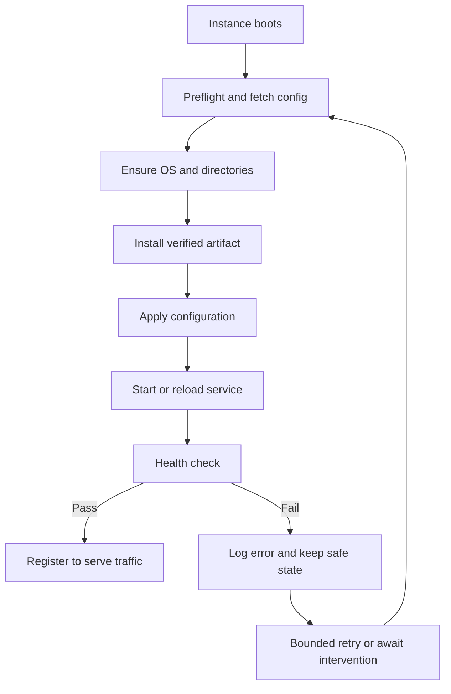
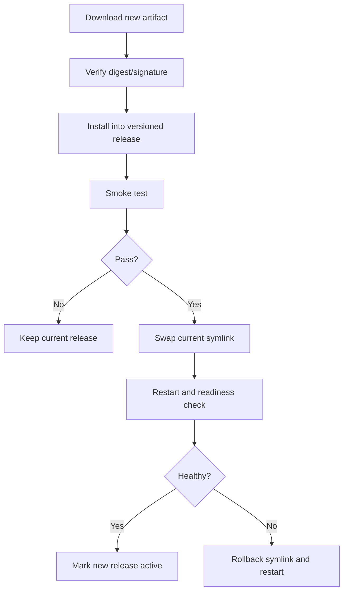

# Designing re-runnable and fault-recoverable bootstrap

When a new virtual machine is created, the operating system may already be booted while the application is still not ready to serve traffic. The machine still needs to install or verify packages, fetch configuration, register agents, download artifacts, create data directories, configure services, and verify connectivity to dependencies. This sequence of actions is commonly called **bootstrap**.

Automated bootstrap ensures new machines have a consistent configuration and reduces manual work. However, startup can be interrupted by flaky networking, temporarily unreachable repositories, cloud API rate limiting, machine reboots, or a configuration step failing partway through. Therefore, bootstrap must be designed to **re-run safely**, recognize completed work, resume after failures, and avoid corrupting an active working state.

This is a key part of cloud compute architecture: virtual machines, containers, and automated deployment services require reliable initialization to guarantee availability, scalability, and predictable operating costs.

## 1. What is bootstrap and when does it run?

Bootstrap is the process of bringing a compute environment from a newly initialized or unready state to a state that meets operational requirements. For a virtual machine, bootstrap may include:

- Identifying the instance, region, zone, and machine type.
- Configuring hostname, time, DNS, networking, and required certificates.
- Installing system packages, runtimes, and monitoring agents.
- Fetching application configuration from a config service or deployment system.
- Fetching secrets using an authorized workload identity.
- Downloading verified artifacts, installing them, and configuring services.
- Preparing directories, volumes, access permissions, and dependency schemas.
- Starting the application, running health checks, and registering with a load balancer or service discovery.

Bootstrap is typically triggered when:

1. Creating a new instance from a machine image.
2. Rebooting a machine after an incident or maintenance.
3. Creating replacement instances in an autoscaling group or instance pool.
4. Deploying a new application version.
5. Re-running a configuration step after detecting drift or fixing an error.

Not every operation needs to run on every boot. Distinguish between once-per-instance initialization tasks, per-boot tasks, and application version deployment tasks. Proper classification prevents reinstalling packages, overwriting data, or running unintended migrations.

## 2. Idempotency: running multiple times yields the same desired state

An operation is **idempotent** if executing it once or multiple times produces the same final state. For example, ensuring the directory `/opt/myapp` exists is idempotent: running the command multiple times does not create extra directories or corrupt existing contents.

Conversely, a command that appends a line to the end of a file on every run without checking first will create duplicate content. A command that creates a new account without checking if the account already exists may fail on subsequent runs.

| Operation | Error-prone approach when re-run | Idempotent design approach |
|---|---|---|
| Create directory | Call directory creation and treat "already exists" as a failure | Use an operation that ensures the directory exists, checking permissions and owner |
| Install packages | Reinstall via arbitrary download-and-extract scripts on every boot | Use a package manager and declare the desired version/state |
| Write configuration | Append the same configuration block on every run | Render the entire file from a canonical source, compare, and atomically replace on change |
| Create user/group | Always create new | Check and ensure the user/group exists with the desired attributes |
| Enable service | Launch multiple processes with manual commands | Use systemd or a service manager to enable/start according to declared state |
| Create cloud resources | Create a new resource on every run | Use IaC/state or APIs supporting upsert and idempotency keys |
| Send notifications or create tickets | Re-send on every retry | Use an idempotency key or store processing results keyed by event ID |

Idempotency does not mean skipping all actions if a marker file is present. It means each step inspects the current state and converges it to the desired state without producing repeated side effects.

## 3. Breaking bootstrap into small steps

A monolithic script performing every task sequentially makes it hard to tell which step succeeded if interrupted partway. Break bootstrap into steps with clear inputs, outputs, and completion criteria.

For example:

| Phase | Desired outcome | Verification method |
|---|---|---|
| Preflight | Access to required metadata, package repositories, and artifact registries | Check endpoints, DNS, IAM, and system clock |
| Prepare OS | Packages, users, directories, and system permissions match requirements | Check package versions, UID/GID, owner, and mode |
| Configure | Configuration files are valid and contain environment-appropriate values | Validate syntax, checksum, or content diff |
| Install | Exact artifact version is completely installed | Verify digest, release directory, and binary version |
| Activate | Service is enabled and running the intended release | Check systemd state and symlink/current version |
| Verify | Application is ready to serve | Health checks, dependency checks, and smoke tests |
| Register | Instance is placed into service | Check service discovery or target group status |

Each step should be runnable independently or safely re-runnable from the start. If installation succeeds but the health check fails, the next run can verify the existing artifact and continue activation or fix configuration without unnecessarily re-downloading and reinstalling everything.



## 4. Designing state and checkpoints

A checkpoint is a marker indicating that a step has completed. It can be a local state file, a record in an orchestration system, or state tracked by a configuration management tool.

A useful checkpoint should be associated with:

- The step name and step logic version.
- The applied artifact or configuration version.
- Completion timestamp.
- Verification result after that step.
- Most recent error details if the step has not completed.

Avoid storing only a single global `/var/lib/bootstrap-done` file for the entire workflow. If the script writes this marker before application installation finishes, subsequent runs may skip missing steps. Write checkpoints only after both execution and verification succeed.

### 4.1. Writing checkpoints atomically

When writing state files, write to a temporary file first and then rename within the same filesystem. This reduces the risk of leaving a half-written state file if power is lost or the process is killed.

```bash
write_checkpoint() {
  local name="$1"
  local value="$2"
  local dir="/var/lib/myapp-bootstrap"
  local tmp

  install -d -m 0750 "$dir"
  tmp="$(mktemp "$dir/.${name}.XXXXXX")"
  printf '%s\n' "$value" > "$tmp"
  chmod 0640 "$tmp"
  mv -f "$tmp" "$dir/$name"
}

# Call only after the corresponding step has completed and been verified.
write_checkpoint "runtime-version" "python-3.12"
```

A checkpoint is only an optimization signal to avoid repeating work. Before trusting a checkpoint, you can verify actual state: is the package still at the right version, does the binary still exist, does the config file match its checksum, and is the service running? If actual state has drifted, bootstrap must repair it.

### 4.2. Do not record completion too early

A safe execution order for a step is typically:

1. Validate input preconditions.
2. Apply the change.
3. Verify the outcome.
4. Write the completion checkpoint.

If step 2 fails, do not write the checkpoint. If step 3 fails, retain logs and allow the step to re-run. If an operation has irreversible side effects, use separate reconciliation or an idempotency key.

## 5. Retries, backoff, and error classification

Not all errors should be retried. Transient DNS failures, HTTP 429, timeouts, or starting dependency services may recover on their own. Configuration errors, missing IAM permissions, nonexistent artifacts, or checksum mismatches usually will not resolve by repeating the same request.

| Error category | Examples | Appropriate handling |
|---|---|---|
| Transient | Timeout, connection reset, HTTP 503 | Bounded retry with exponential backoff and jitter |
| Rate limited | HTTP 429, API throttling | Honor `Retry-After` if present, reduce rate, and retry |
| Missing dependency | DNS not ready yet, database starting up | Wait with backoff within a finite deadline |
| Configuration | Wrong URL, missing required variable, config syntax error | Stop and report error so configuration can be fixed |
| Permissions | IAM denied, token lacks required scope | Stop, inspect identity and permissions; do not retry continuously |
| Integrity | Digest mismatch, invalid signature | Reject artifact, log security event, and halt deployment |
| Compatibility | Incompatible runtime or schema | Stop, select compatible artifact/config, or run planned migration |

**Exponential backoff** increases the wait interval after each failure. Jitter adds a random offset so multiple machines do not retry simultaneously in a thundering herd once the service recovers.

Simple Bash example with a finite number of attempts:

```bash
retry() {
  local max_attempts="$1"
  shift
  local attempt=1
  local delay=2

  until "$@"; do
    if (( attempt >= max_attempts )); then
      echo "command failed after $attempt attempts: $*" >&2
      return 1
    fi

    # Small jitter to avoid multiple instances retrying at the exact same time.
    local jitter=$(( RANDOM % 3 ))
    sleep $(( delay + jitter ))
    delay=$(( delay * 2 ))
    (( attempt += 1 ))
  done
}

# Example: check an internal endpoint before proceeding.
retry 5 curl --fail --silent --show-error --max-time 3 \
  http://config.internal/health
```

In production, cap total retry time, maximum delay, and concurrent requests. For HTTP clients, handle error codes and `Retry-After` per the API contract. Do not retry non-idempotent operations such as creating payments or creating new resources without an idempotency key.

## 6. Preventing concurrent bootstrap processes

Two bootstrap processes running simultaneously can concurrently update the package database, overwrite configurations, swap release symlinks, or restart services. Proper synchronization locking is required.

On a single Linux host, `flock` can provide local locking:

```bash
#!/usr/bin/env bash
set -Eeuo pipefail

install -d -m 0755 /run/lock
exec 9>/run/lock/myapp-bootstrap.lock
flock 9

echo "bootstrap lock acquired"
# Bootstrap steps run sequentially here.
```

A local lock only prevents concurrent processes on the same host. If multiple machines modify a shared resource—such as a database schema or a control-plane record—you need a distributed lock or service-level coordination. Distributed locks must have leases/timeouts and handle lock-holder disconnection; never assume a lock can be held indefinitely.

## 7. Using cloud-init for its intended purpose

Cloud-init is a widely used tool for initializing Linux machines across cloud platforms. It can read metadata/user data, create users, write files, install packages, and run commands across boot stages.

Different cloud-init modules have different execution frequencies. `bootcmd` runs early on every boot; `runcmd` is prepared during the config stage and executed in the final stage of instance initialization on a per-instance basis. Do not put a long deployment workflow or tasks meant for every restart into `bootcmd`.

Simple cloud-config example:

```yaml
#cloud-config
package_update: true
packages:
  - nginx

write_files:
  - path: /etc/myapp/bootstrap.env
    owner: root:root
    permissions: "0640"
    content: |
      APP_ENV=production
      LOG_LEVEL=info

runcmd:
  - [systemctl, enable, nginx]
  - [systemctl, start, nginx]
```

This example demonstrates installing packages, writing configuration, and enabling/starting a service. In real environments, validate cloud-config syntax, avoid putting secrets in user data, and move complex logic into testable scripts or configuration tools. `systemctl enable` and `systemctl start` can be safely re-run in a proper workflow, but any invoked script must still handle its own idempotency.

### Cloud-init and systemd

Cloud-init fits initial provisioning. systemd fits managing services and tasks that run at boot or according to dependency conditions. You can let cloud-init install unit files and enable services; systemd will manage the application process lifecycle afterward.

Do not treat a "cloud-init finished" flag as proof that the application is healthy. Cloud-init can complete while the application service fails to start afterward. Dedicated application health checks and monitoring are required.

## 8. Example of a re-runnable bootstrap script

The following example ensures directories and configuration files exist, installs missing packages, enables the service, and restarts it only when configuration content changes. The script uses a local lock and exits on errors.

```bash
#!/usr/bin/env bash
set -Eeuo pipefail

APP_DIR="/opt/myapp"
CONFIG_FILE="/etc/myapp/app.conf"
LOCK_FILE="/run/lock/myapp-bootstrap.lock"

log() {
  printf '[bootstrap] %s\n' "$*"
}

on_error() {
  local code=$?
  log "failed at line ${BASH_LINENO[0]} with exit code ${code}"
  exit "$code"
}
trap on_error ERR

install -d -m 0755 /run/lock
exec 9>"$LOCK_FILE"
flock 9

log "ensuring required package is installed"
if ! dpkg-query -W -f='${Status}' nginx 2>/dev/null | grep -q 'install ok installed'; then
  apt-get update
  DEBIAN_FRONTEND=noninteractive apt-get install -y nginx
fi

log "ensuring application directories exist"
install -d -o root -g root -m 0755 "$APP_DIR"
install -d -o root -g root -m 0755 /etc/myapp

desired_config="$(mktemp)"
trap 'rm -f "$desired_config"' EXIT
cat > "$desired_config" <<'EOF'
listen_address=0.0.0.0
listen_port=8080
environment=production
EOF

if ! cmp -s "$desired_config" "$CONFIG_FILE" 2>/dev/null; then
  install -o root -g root -m 0640 "$desired_config" "${CONFIG_FILE}.new"
  mv -f "${CONFIG_FILE}.new" "$CONFIG_FILE"
  log "configuration changed; restarting service"
  systemctl enable myapp.service
  systemctl restart myapp.service
else
  log "configuration unchanged"
  systemctl enable myapp.service
  systemctl start myapp.service
fi

log "bootstrap steps completed"
```

The script above assumes the `nginx` package and `myapp.service` unit match the image or are provided by an application installation step. In real deployments, handle unreachable package repositories, validate configuration before replacing the file, and verify the service unit exists before enabling it. This sample must also be adapted per OS; `dpkg-query` and `apt-get` are for Debian/Ubuntu families.

The key point is that the script does not create duplicate directories, append configuration repeatedly, or restart unnecessarily when the desired file matches the current file. If a step fails, the next run can inspect state and continue.

## 9. Safe artifact deployment with release directories

Overwriting a running binary directly can leave the application in a half-old, half-new state if downloading or extraction is interrupted. A safer pattern is installing each version into its own directory, verifying it before activation, and atomically swapping the `current` symlink.

Example deployment flow:

1. Download the artifact into a temporary directory.
2. Verify the checksum or signature against trusted release metadata.
3. Extract into a new release directory without overwriting the running release.
4. Run configuration validation or smoke tests on the new release.
5. Create a temporary symlink pointing to the new release and rename it to update `current`.
6. Restart/reload the service and check readiness.
7. If checks fail, switch `current` back to the previous release and restore the service.
8. Delete old releases only after the rollback window has passed and no processes are using them.



Renaming a symlink on the same filesystem is typically atomic at the filename level. However, swapping a symlink alone does not guarantee the application has fully switched over; you must manage restarts, open connections, in-flight requests, and health checks.

## 10. Recovering from mid-execution failures

Bootstrap can fail at any step. Recovery strategies must be defined for each failure state.

| Failure point | Possible leftover state | Recovery action |
|---|---|---|
| Network loss during package download | Package database unchanged or metadata partially updated | Re-run package manager, use bounded retries, and verify package state |
| Interrupted artifact download | Partial download or leftover temporary files | Remove invalid temp files, re-download, and verify digest |
| Extraction failure | Incomplete release directory | Do not switch `current`; remove or replace the invalid release directory |
| Interrupted config write | Config file may be half-written | Write to a temp file then rename atomically; validate before activation |
| Service fails to start | Artifact/config installed but service unhealthy | Read logs, fix root cause, or roll back to previous release |
| Unable to fetch secrets | Application cannot establish dependency connections | Check workload identity/IAM, retry if transient; never write secrets to disk/logs |
| Bootstrap killed or VM rebooted | Some steps completed, others did not | Inspect actual state and checkpoints, then re-run idempotent steps |
| Database migration failure | Schema may be in an intermediate state | Use versioned migrations, coordination locks, and pre-planned fix/roll-forward procedures |

Good recovery starts with keeping the working state safe. Do not delete old releases before the new release passes health checks. Do not delete data volumes just because bootstrap re-runs. Do not automatically roll back database schemas if migrations were not designed to be reversible.

### 10.1. Retry or rollback?

Retry is appropriate when an error is likely transient and the operation can be repeated safely. Rollback is appropriate when a change has already been activated and causes the system to fail requirements. Certain errors require halting for intervention, such as invalid signatures, permission denials, or incompatible schemas.

Do not infinitely retry a configuration error. Doing so slows machine startup, increases load on dependency services, and masks the root cause. Set a deadline, log the exact failing step, and alert the monitoring system.

## 11. Bootstrap and Infrastructure as Code (IaC)

Bootstrap is often part of an IaC workflow, but the two layers have distinct responsibilities:

- **IaC** provisions and manages infrastructure resources such as VMs, networks, security groups, disks, IAM roles, and load balancers.
- **Configuration management** brings the OS and software on the VM to the desired state.
- **Application deployment** delivers a specific application version into the environment and verifies serving readiness.

For example, Terraform can create the VM and attach a role; cloud-init can install agents and prepare the OS; Ansible or a similar tool can apply configuration; and a release pipeline can deploy the artifact and run smoke tests.

Each tool maintains its own state model. Do not let two tools manage the same attribute without clear ownership conventions. For instance, if Terraform manages a security group, a bootstrap script should not modify that security group via cloud APIs; such changes create drift and may be overwritten on the next IaC apply.

For cloud resources, prefer idempotent APIs or IaC tools. When calling resource creation APIs, look up resources by a stable identifier first, use idempotency tokens when supported, and handle cases where a request times out even though the resource was created server-side.

## 12. Bootstrap in autoscaling and multi-instance environments

When autoscaling launches many VMs simultaneously, bootstrap can generate traffic spikes against package repositories, artifact registries, config services, secret managers, or databases. If all instances retry at the exact same moment, a transient outage can worsen.

Measures to consider:

- Use images with common base software pre-installed to reduce boot-time work.
- Keep bootstrap short and perform only instance- or environment-dependent steps.
- Use local caches or package/artifact mirrors where appropriate.
- Add jitter to retries and limit initialization concurrency.
- Use health checks and readiness gates so instances receive traffic only after becoming ready.
- Use lifecycle hooks or equivalent mechanisms to coordinate when an instance enters the load balancer.
- Design config services and secret managers to handle burst traffic.
- Test cold starts when scaling out many instances concurrently.

Avoid putting everything into user data if it makes boot times excessively long. Stable components belong in tested machine images; environment-dependent elements such as instance identity, deployment configuration, and secrets should be fetched during initialization or at runtime as needed.

## 13. Database migrations and irreversible side effects

A common mistake is running database migrations as a routine step inside every VM's bootstrap script. If autoscaling launches 10 instances, all 10 may run migrations simultaneously. This causes lock contention, schema errors, or duplicate migrations.

Manage migrations through a dedicated coordinated job or pipeline:

- Each migration has a unique version/ID and is recorded upon completion.
- Only one process is permitted to execute migrations at a time.
- Migrations must be tested against representative data and have backup/restore plans.
- Use expand/contract strategies when compatibility between old and new application versions is needed.
- Avoid dropping columns or changing data types in the same deployment wave if old instances are still running.
- If a migration fails, halt further rollout and follow a pre-prepared remediation procedure.

For external actions such as sending emails, generating invoices, or provisioning resources, use event IDs or idempotency keys so target systems recognize duplicate requests. You cannot rely solely on local checkpoints if the side effect already occurred on another system and the response was lost.

## 14. Health checks, readiness, and bootstrap observability

Bootstrap is complete only when the application meets defined readiness criteria. A running service process is not guaranteed to handle requests properly; it may not yet be connected to the database, have loaded models, or finished warming up.

Distinguish between:

- **Liveness:** is the process alive and capable of continuing to operate? Liveness failures may trigger a restart.
- **Readiness:** is the application ready to receive traffic? If not, the load balancer or orchestrator should not route requests to the instance.
- **Startup check:** is the application still within a valid startup phase or hung for too long? This prevents liveness probes from restarting slow-starting applications.

Recommended bootstrap observability signals:

- Total duration and per-step duration.
- Applied image, artifact, and configuration versions.
- Retry counts and retry reasons.
- Failing step, error codes, and logs with correlation IDs.
- Service status, health check status, and timestamp when the instance is registered for traffic.
- Count of instances failing bootstrap during the same scale-out event.

Do not log secrets, tokens, or full user data. Logs should contain enough detail for investigation without exposing credentials or sensitive data.

## 15. Testing re-runnability and recovery

You cannot confirm bootstrap safety from a single happy-path run. Test controlled repetition and interruption scenarios:

1. Run bootstrap twice consecutively and verify no unexpected state changes occur.
2. Kill the process after packages finish installing but before configuration completes; re-run and verify it resumes cleanly.
3. Make a dependency endpoint return timeouts/503s briefly; verify retries are bounded.
4. Intentionally supply an invalid checksum; verify the artifact is rejected and the active release remains untouched.
5. Make the health check fail after activating a new release; verify rollback works.
6. Start multiple bootstrap processes simultaneously; verify locking prevents conflicting changes.
7. Reboot the VM while bootstrap is running; verify the next boot recovers safely.
8. Launch multiple instances concurrently; verify config services, artifact registries, and secret managers are not overwhelmed.
9. Inspect logs and metrics; verify the failing step can be identified without leaking secrets.

Run these tests in a staging environment or dedicated test VMs with snapshots/backups and appropriate recovery plans. After changing scripts, images, or configuration tools, re-run the relevant scenarios.

## 16. Bootstrap design checklist

- [ ] Categorized steps into once-only, per-boot, and per-deploy.
- [ ] Each step has a clear desired state and verification method.
- [ ] Operations are safe to re-run or use idempotency keys.
- [ ] Checkpoints are written only after a step completes and passes verification.
- [ ] Configuration files and artifacts are written/installed in a way that avoids half-written states.
- [ ] Local locking prevents concurrent bootstrap processes on the same host; shared resources have separate coordination.
- [ ] Retries apply only to transient errors, with backoff, jitter, and a deadline.
- [ ] Configuration, permission, or integrity errors halt execution and report the root cause clearly.
- [ ] Secrets are fetched via workload identity/secret manager, not baked into images or user data.
- [ ] New releases are verified before activation; previous releases remain available for rollback.
- [ ] Database migrations and external side effects have separate coordination/idempotency mechanisms.
- [ ] Instances receive traffic only after passing readiness checks.
- [ ] Logging, metrics, correlation IDs, and alerts exist for bootstrap failures.
- [ ] Tested re-runs, interruptions, reboots, dependency failures, and concurrent scale-out.

## 17. Conclusion

Reliable bootstrap must be broken into small steps with clear desired states and safe re-runnability. Idempotency prevents repeated operations from causing side effects; checkpoints track completed steps; retries with backoff handle transient errors; locks prevent concurrent execution; versioned releases and health checks support rollback when a new version is unready.

Use cloud-init for initialization matching its lifecycle, systemd for service management, IaC for infrastructure resources, and deployment pipelines for releasing applications. Testing mid-run interruptions, reboots, and multi-instance scale-outs is how you verify the workflow recovers under real operational conditions.
