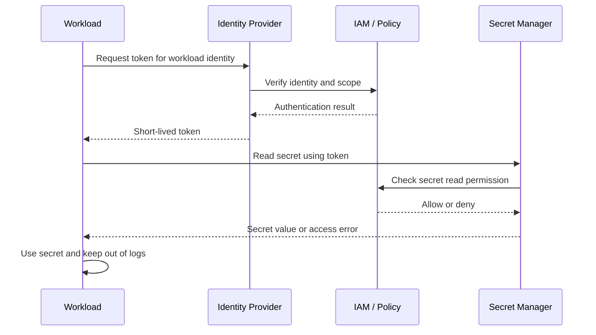

# Fetching secrets at runtime using workload identity

## Learning objectives

After this lesson, you will be able to:

- Explain workload identity and how a workload receives an identity without embedding long-lived access keys in source code or images.
- Describe the authentication flow from a VM, container, or application service to a secret manager.
- Grant least-privilege permissions so a workload reads only the exact secrets it needs.
- Fetch secrets via an SDK or platform-integrated mechanism, and handle caching and secret rotation.
- Diagnose identity, permission, network, and secret issues during startup or while the application is running.

## 1. Why do workloads need to fetch secrets at runtime?

Applications often need sensitive information to connect to databases, call external APIs, sign requests, or access other services. Such information can include passwords, API keys, tokens, private keys, or certificates. Collectively, these are called **secrets**.

A naive deployment approach puts secrets in source code, configuration files, or environment variables and packages them with the application. That approach introduces serious risks:

- Secrets can be pushed to Git, appear in logs, or be stored inside container images.
- Multiple environments end up sharing one value, making revocation and rotation hard to control.
- Anyone with permission to read the image or deployment configuration can extract the secret.
- When cloning VMs or containers, secrets are copied along with the workload.
- It is difficult to determine which application or identity read a secret at a specific point in time.

**Workload identity** allows a workload to prove its own identity to the cloud platform. Based on that identity, the system issues a short-lived credential or scoped token. The application uses this credential to call the secret manager and retrieve secrets at runtime.

This model separates three responsibilities:

1. Identifying which workload is requesting access.
2. Deciding which secrets that workload is permitted to read.
3. Delivering secrets to the application when needed while logging access activity.

A secret manager is a dedicated service for storing secrets, managing versions, enforcing permissions, and logging secret access. Workload identity is the identity mechanism that authorizes the application to call that service.

## 2. What is workload identity?

A workload identity is an identity bound to a running workload, such as:

- A VM or group of VMs.
- A container task or Kubernetes pod.
- A serverless function.
- A managed application service.
- A background job or deployment pipeline configured with its own identity.

The identity may be represented by a service account, managed identity, workload-attached role, or a principal linked via identity federation. Naming varies by provider, but the core idea is that the platform recognizes the workload from its managed configuration and execution context.

### 2.1. Key components

| Component | Role |
|---|---|
| Workload | Application running on a VM, container, or cloud service |
| Workload identity | Workload identifier used when requesting access |
| Identity provider / metadata service | Issues or assists in obtaining tokens proving identity |
| IAM / policy | Determines which actions an identity may perform on which resources |
| Secret manager | Stores secrets, versions, metadata, and access history |
| SDK / client library | Obtains tokens, calls the secret manager API, and handles responses |

Not every workload manages key generation on its own. For VMs, the platform may provide a managed identity or metadata service. For Kubernetes, a pod's service account can be linked to a cloud identity via OIDC tokens and federation. For serverless, the identity is typically attached directly to the service configuration.

### 2.2. Difference between user identity and workload identity

A user identity represents a human signing in to perform interactive actions, such as an administrator opening the cloud console. A workload identity represents an application or automated process.

Never use an engineer's personal account to configure production applications. When personnel change, personal permissions may be revoked or modified, causing application outages. Workload identities have their own lifecycle and permission boundaries, making them easy to audit and manage per service.

## 3. Runtime secret retrieval flow

A typical flow consists of these steps:

1. An administrator creates or selects a workload identity.
2. IAM grants that identity permission to read a specific secret.
3. The workload starts in an environment bound to that identity.
4. The application requests a token through the SDK, metadata service, or platform identity provider.
5. The platform authenticates the workload and returns a short-lived token.
6. The application sends the token to the secret manager to request reading the secret.
7. The secret manager verifies the token, policy, scope, and secret version.
8. If allowed, the secret manager returns the secret value over TLS.
9. The application uses the secret for the required connection or task while avoiding writing its value to logs.

Overview diagram:



The diagram depicts the general logic. On some platforms, the identity provider and IAM are integrated components; permission checks may happen within the same API call. The application does not necessarily observe all intermediate steps.

### 3.1. Short-lived tokens

Access tokens typically have an expiration time, audience, and usage scope. When a token expires, the SDK can automatically acquire a new one. This reduces the need to store long-lived keys inside workloads.

Distinguish between:

- **Identity token:** proves which principal the workload is and may be used in a federation or token exchange step.
- **Access token:** used to call the target service API, such as the secret manager.
- **Secret:** the sensitive data the application wants to read after being authenticated and authorized.

Some systems use the same token for multiple roles or have a dedicated token exchange step. Follow the exact flow supported by your SDK and platform, and never assume a token issued for one audience can call every service.

### 3.2. Do not embed credentials in images

Images should contain the application, libraries, non-sensitive configuration, and the identifier of the secret to fetch. Images should not contain:

- Long-lived access keys or service account keys.
- Production database passwords.
- Private keys shared across multiple environments.
- Long-lived access tokens.
- Configuration files containing real secrets.

You can include the secret name, project, or resource identifier in deployment configuration if those values are not sensitive. The application uses workload identity to retrieve the secret contents at runtime.

## 4. Binding identities to each workload type

### 4.1. VMs

For VMs, administrators typically attach a managed identity or service role when creating or updating the VM configuration. Applications inside the VM use an SDK or platform-provided metadata endpoint to obtain tokens.

Points to check:

- The identity is attached to the right VM or VM group.
- The VM has access to the identity endpoint per provider guidelines.
- Tokens are requested for the exact audience/resource of the secret manager.
- The application runs only under the required OS account.
- Untrusted processes on the same VM cannot arbitrarily obtain the workload's token.

If multiple applications with different trust levels run on the same VM, sharing a single identity can over-expand access. Separate workloads or identities along trust boundaries when needed.

### 4.2. Containers and Kubernetes

In Kubernetes, each pod can run under a Kubernetes ServiceAccount. Platforms commonly support binding a service account to a cloud identity via OIDC federation or an equivalent mechanism.

Reference workflow:

- Create a dedicated service account for the application.
- Configure the workload to run with that service account.
- Establish a binding linking the token's issuer, subject, and audience to the cloud identity.
- Grant an IAM role to the cloud identity to read the exact secret.
- Use a federation-capable SDK to obtain tokens and call the secret manager.

Example Kubernetes manifest illustrating a service account and pod. Cloud identity binding annotations are platform-specific, so add them per your provider's documentation:

```yaml
apiVersion: v1
kind: ServiceAccount
metadata:
  name: orders-api
  namespace: production
  # Add workload identity binding annotation per cloud provider.
---
apiVersion: apps/v1
kind: Deployment
metadata:
  name: orders-api
  namespace: production
spec:
  replicas: 2
  selector:
    matchLabels:
      app: orders-api
  template:
    metadata:
      labels:
        app: orders-api
    spec:
      serviceAccountName: orders-api
      containers:
        - name: app
          image: registry.example/orders-api:1.0.0
          env:
            - name: DB_SECRET_ID
              value: projects/app-prod/secrets/orders-db
```

In this example, DB_SECRET_ID is only a secret identifier, not the secret content. A real configuration requires the corresponding IAM binding and the annotation or federation mechanism of the platform in use.

Avoid sharing one broad-permission service account across an entire namespace if each application needs a different set of secrets. Separate service accounts per application or appropriate permission boundary.

### 4.3. Serverless and managed application services

For functions or managed application services, the identity is typically selected in the runtime configuration. The application uses an SDK or the platform's secret reference integration.

The advantage is not having to manage metadata endpoints or token files yourself. Even so, you must still:

- Attach the right runtime identity.
- Grant least-privilege secret read permissions.
- Confirm the runtime identity differs from the deployment identity.
- Check caching and secret update behavior when the platform injects secrets into the runtime.
- Separate permissions to deploy resources from permissions used by the application at runtime.

Having a pipeline with permission to deploy a service does not mean the running application process needs equivalent administrative permissions.

## 5. Granting least-privilege access to secrets

After creating the identity, the next step is granting permissions in IAM or the secret manager's policy. The **least privilege** principle requires that a workload hold only the permissions needed to perform its function.

For example, an order-processing API only needs to read its own database connection secret. It does not need permission to list all secrets, create new secrets, delete secrets, or read the payment service's secrets.

A policy should restrict by:

- **Principal:** the specific workload identity.
- **Resource:** the required secret or set of secrets.
- **Action:** only reading the required secret value or version.
- **Condition:** optionally scope by project, environment, network, tag, or other conditions if supported by the platform.

Reference permissions table:

| Workload | Permissions to grant | Permissions usually not needed |
|---|---|---|
| API reading database connection info | Read one specific database secret | Create, delete, or modify secrets |
| Email-sending worker | Read mail API secret | Read the API's database secret |
| Secret rotation job | Version update permission under a dedicated workflow | Full project admin permissions |
| Application deployment CI/CD | Permissions to deploy required resources | Read all production runtime secrets |

A generic policy can be expressed as follows. This is pseudocode to illustrate the concept, not a policy syntax directly usable on a specific cloud provider:

```json
{
  "principal": "workload:orders-api",
  "resource": "secret:orders-db",
  "actions": ["secret:read"],
  "effect": "allow"
}
```

Also inspect permissions inherited from projects, folders, organizations, or default roles. A broad policy at a parent level can nullify a narrow restriction on an individual secret.

## 6. Fetching secrets via SDK at runtime

Cloud SDKs typically support a **default credential chain** or **application default credentials**. In a cloud environment, the SDK locates the appropriate workload identity and refreshes tokens automatically as needed. API names and initialization differ across providers.

The application workflow should:

1. Read the secret identifier from non-sensitive configuration.
2. Initialize the SDK with the runtime credential provider.
3. Call the secret manager to retrieve the version active for the application.
4. Validate the response and handle errors.
5. Pass the secret into the required connection client.
6. Never print secret values, tokens, or sensitive request headers to logs.
7. Close or release resources when the application stops.

Python pseudocode example:

```python
import os

def load_database_secret(secret_client):
    secret_id = os.environ["DB_SECRET_ID"]

    # The SDK automatically acquires credentials from the runtime workload identity.
    # Do not pass access keys or service account keys in code.
    response = secret_client.access_secret_version(
        name=secret_id
    )

    secret_value = response.payload

    if not secret_value:
        raise RuntimeError("Database secret is empty")

    return secret_value


def create_database_connection(secret_client, db_driver):
    secret = load_database_secret(secret_client)

    # Pass the secret only to the component that needs it.
    connection = db_driver.connect(
        username=secret["username"],
        password=secret["password"],
        host=secret["host"],
        database=secret["database"],
    )

    return connection
```

This is provider-agnostic pseudocode. Method names, response types, and payload parsing must be replaced with the official SDK. In production applications, use secret objects or schema-validated data structures rather than assuming payloads are always dictionaries.

### 6.1. Fetch secrets at startup or on demand?

There are two common approaches:

- **Fetch at startup:** the application reads secrets before opening listeners or accepting traffic. This catches permission or configuration errors early, but secrets are refreshed only when the application restarts or via a dedicated refresh mechanism.
- **Fetch on demand:** the application calls the secret manager when needed. This picks up new versions faster, but increases latency and runtime dependence on secret manager availability.

A balanced option is fetching secrets at startup and caching them in memory with a bounded TTL, combined with refreshing before expiration or upon a rotation signal. For secrets used in long-lived connections, implement a mechanism to open new connections and close old ones when the secret changes.

### 6.2. Caching secrets

Caching reduces latency, API call volume, and cost. However, caching too long causes applications to keep using an old secret after rotation or revocation.

When designing caching, define:

- A TTL aligned with rotation frequency and security requirements.
- How to refresh before TTL expiration.
- How to behave when the secret manager is temporarily unreachable.
- How to replace connection pools or tokens tied to the old secret.
- How to clear secrets from memory when the workload stops, within what the language and runtime allow.

Do not write secrets into shared caches like Redis or disk caches without an explicit requirement and dedicated protection design. Process memory is usually simpler, though it can still be read via dumps, debuggers, or system admin privileges.

## 7. Rotating and revoking secrets

Secrets should be rotated periodically or upon signs of compromise. Secret managers usually support secret versions, allowing new versions to be created without directly overwriting the old value.

A safe rotation workflow typically includes:

1. Create a new credential on the target system, such as a new database password or new API key.
2. Store the new value as a new secret version.
3. Grant the workload permission to read the new version.
4. Update the application or refresh caches to use the new credential.
5. Verify live connectivity and operation.
6. Revoke the old credential after confirming no workloads are still using it.
7. Record the version, timestamp, and actor/process performing the change.

For databases, if only one password exists and it changes immediately, running instances may lose connectivity. You may need dual credentials coexisting during a transition window or a database-supported rotation workflow.

Do not delete the old version before workloads have transitioned to the new version and dependencies are verified. Conversely, do not retain old credentials indefinitely, as doing so increases the attack surface.

## 8. Protecting token and secret retrieval paths

Workload identity eliminates long-lived stored credentials, but does not render tokens and secrets harmless. A compromised process can still exercise its identity within its granted permissions.

Key protections:

- Use TLS to protect tokens and secrets in transit.
- Never write tokens, secrets, or Authorization headers to logs, traces, or exceptions.
- Do not pass tokens on command lines or in global environment variables if the SDK offers a safer credential provider.
- Restrict access to metadata endpoints; protect against SSRF and untrusted processes.
- Restrict token audience and lifetime as supported by the platform.
- Never share a single workload identity across multiple applications with differing trust levels.
- Harden the host, container runtime, service account tokens, and file permissions inside pods.
- Disable or revoke identities when workloads are decommissioned or no longer active.
- Enable audit logging for secret reads and monitor for anomalous access.

### 8.1. Risks from the metadata service and SSRF

Some platforms provide tokens through an internal VM metadata service. If an application has a Server-Side Request Forgery (SSRF) vulnerability, an attacker may trick the application into sending requests to the internal endpoint and extracting tokens.

To mitigate this risk:

- Use metadata service versions with request protection mechanisms when supported by the platform.
- Do not allow user-supplied URLs to arbitrarily reach link-local addresses or internal networks.
- Apply egress filtering and validate URL redirects.
- Do not run untrusted applications under the same identity permitted to read sensitive secrets.
- Use separate identities and least privilege for each workload.

Some platforms have metadata endpoints requiring session headers or tokens; others use federation or mounted credential files. Follow your platform's exact guidance rather than assuming endpoint behavior.

### 8.2. Limiting secret exposure inside the application

Even when retrieved securely, an application can still leak secrets through:

- Request/response logs or exception logs.
- Debug pages, verbose health endpoints, or diagnostic dumps.
- Crash dumps, heap dumps, and core dumps.
- Telemetry, APM, or tracing capturing parameters.
- Temporary files, shell history, or process monitoring tools.

Use log filters, mask sensitive data, and restrict read access to dumps. Never include secrets in user-facing error messages or metric labels.

## 9. Diagnosing secret retrieval failures

| Symptom | Possible cause | Investigation approach |
|---|---|---|
| Credentials not found | Workload has no attached identity or SDK does not detect runtime | Check identity config, SDK setup, and execution environment |
| Unauthorized / invalid token | Token expired, wrong audience, wrong issuer, or clock skew | Check token provider, audience, issuer, and time sync |
| Permission denied | Missing IAM permission or policy not bound to the right principal | Check principal, resource, action, and inherited permissions |
| Secret not found | Wrong project, secret ID, or version | Verify resource name and version |
| Timeout / connection refused | DNS, routing, firewall, proxy, or service endpoint | Check network path, TLS, and secret manager health |
| Old secret version returned | Cache not refreshed or pinned to a specific version | Check TTL, refresh logic, and alias/version in use |
| Works in staging but fails in production | Environments use different identities, policies, or secret scopes | Compare service accounts, roles, resource IDs, and deploy configs |

### Diagnostic workflow

1. Confirm the workload is running with the expected identity. Do not infer from the deployer's identity.
2. Check whether the SDK can obtain a token; log only error types and non-sensitive metadata.
3. Verify audience, issuer, expiration, and system time if using federation.
4. Inspect secret manager audit logs to see which principal called, which secret was requested, and why it was denied.
5. Check IAM bindings at the exact scope, including parent policies and extra conditions.
6. Verify the secret ID, project, version, and secret status.
7. Check DNS, routes, firewalls, proxies, and TLS certificates.
8. Inspect caches and connection pool lifecycles if the application is using a stale secret.
9. After fixing, verify with a controlled access test and monitor logs/audit records.

When sharing information with support teams, provide only the request ID, error code, non-sensitive principal, timestamp, and required resource identifier. Never send tokens or secret values.

## 10. Practical example: API reading a database password

An orders-api service running on Kubernetes needs to connect to the production database. The operations team wants to run multiple replicas and rotate the password without rebuilding the image.

Reference design:

- Each pod runs with a dedicated service account named orders-api.
- The service account is bound to a workload identity in the production project.
- IAM permits that identity to read only the orders-db secret.
- The image contains only the application and secret manager SDK.
- The Deployment passes the secret's resource ID via non-sensitive configuration.
- The application uses the SDK to fetch the secret at startup, then caches it in memory with a defined TTL.
- When a new secret version is published, the application refreshes the secret, builds a new connection pool, and verifies queries.
- After all replicas adopt the new credential, operations revokes the old credential.
- Audit logs are monitored to detect other workloads attempting to read the orders-db secret.

If one pod is compromised, this identity's access scope is restricted solely to the orders-api database secret. That pod cannot read the payment service's API key or secrets from other namespaces.

## 11. Deployment checklist

Before promoting a workload to production, verify:

- [ ] Workload has its own identity and does not rely on personal accounts.
- [ ] No long-lived access keys exist in source code, images, or repositories.
- [ ] SDK uses the credential provider appropriate for the runtime environment.
- [ ] Tokens have appropriate audience and expiration settings.
- [ ] IAM grants read access only to the required secrets.
- [ ] Secret manager is accessed over TLS through a controlled network path.
- [ ] Secrets never appear in logs, traces, metrics, dumps, or temporary files.
- [ ] Caching, refresh, and transient secret manager outage handling policies are defined.
- [ ] Rotation, verification, and old-credential revocation procedures exist.
- [ ] Audit logging is enabled with an assigned person or team responsible for monitoring.
- [ ] Runbooks exist for identity, permission, network, and secret version failures.
- [ ] Identity is revoked when the workload is deleted or decommissioned.

## 12. Common misconceptions

- **Workload identity is itself a secret.** Identity identifies the workload; tokens prove the identity; secrets are the data the workload wants to access.
- **Having a token lets you read every secret.** A token only proves identity within a scope. IAM still governs read access per resource.
- **Using a CI/CD service account for runtime applications.** Deployment pipelines and running applications have different purposes, lifecycles, and permissions; use separate identities.
- **Embedding secrets in images for faster startup.** Images are frequently copied and retained long-term. Fetch secrets at runtime or use platform-supported secret references.
- **Caching secrets indefinitely.** Applications may continue using credentials that were rotated or revoked. Use TTLs and a refresh strategy.
- **The secret manager rotates every credential by itself.** Secret managers can manage versions, but updating credentials in target systems and transitioning applications requires a proper workflow.
- **Workload identity prevents all forms of secret theft.** If a process is compromised, an attacker can use the workload's permissions. Apply least privilege, runtime hardening, and auditing.
- **Deploy permissions equal runtime permissions.** Deployment identities and application identities should be separated to limit blast radius if one component is compromised.

## 13. Self-check

**Scenario 1:** A container needs to read a database password. Should you store a service account key inside the Docker image for all replicas to share?

**Hint:** No. Bind a dedicated workload identity to the pod's service account, grant read permission for that exact secret, and let the SDK acquire short-lived tokens from the runtime.

**Scenario 2:** The application receives a Permission denied error even though a token was issued successfully. What should you check?

**Hint:** Check the principal's IAM policy on the exact secret, read action, resource scope, and policy conditions. A valid token does not automatically grant permission to read a secret.

**Scenario 3:** The secret was rotated, yet some replicas still connect using the old password. What could be the cause?

**Hint:** Those replicas may still be caching the secret or holding connection pools opened with the old credential. Refresh the secret, replace pools in a controlled manner, and revoke the old credential only after confirming transition completion.

**Scenario 4:** Audit logs show a workload reading many secrets unrelated to its function. How should you respond?

**Hint:** Verify the principal and activity, revoke or restrict excess permissions, inspect inherited policies, assess signs of compromise, and rotate any secrets at risk of exposure.

## Conclusion

Fetching secrets with workload identity allows applications to authenticate to the cloud using managed identities and short-lived tokens, then read secrets from a secret manager according to IAM permissions. To deploy securely, isolate identities per workload, scope permissions down to individual secrets, protect tokens and secrets throughout the application lifecycle, design controlled caching and rotation, and monitor audit logs. This approach applies to VMs, containers, Kubernetes, and serverless, with exact configuration depending on the cloud platform.
