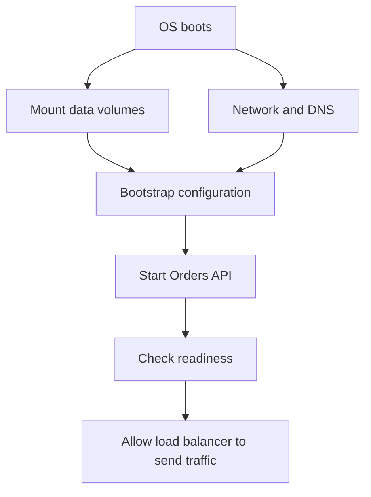

# Managing processes, services, and application startup order

A virtual machine may have booted successfully while the application is still not serving requests. The operating system needs to start background processes, attach volumes, configure networking, load configuration, and start dependent services. The application may also need to load data, connect to a database, and register with monitoring systems before it is ready to receive traffic.

Process and service management lets you control how an application starts, keeps running, logs, handles failures, and stops safely. Designing the right startup order prevents the application from running before required resources are ready and helps the VM recover reliably after reboots or incidents.

## 1. Distinguishing program, process, and service

These three concepts are related but distinct:

- **Program:** a collection of executable code and resources stored on disk, such as an executable binary or JAR file.
- **Process:** a running instance of a program, with its own PID, memory space, file descriptors, user permissions, and execution state.
- **Service:** a background software component providing functionality to the system or other applications. A service is typically monitored and controlled by a service manager.

For example, the file `orders-api.jar` is a program. When the JVM runs this file, the OS creates a Java process. If the process is configured to start automatically with the OS, is monitored, and has a restart policy, it becomes a system-managed service.

A service does not necessarily consist of a single process. It may spawn child processes, workers, or helpers. Conversely, a process can run in the foreground inside a container without needing a service manager inside the container. Management depends on the deployment model: traditional VMs typically use systemd or Windows Service Control Manager; containers typically let the runtime or orchestrator supervise the main process.

## 2. Lifecycle of a process

When a program starts, the operating system creates a process and allocates necessary resources. The process transitions through states such as running, runnable/scheduled, waiting on I/O, or terminated. Exact state names and display formats depend on the operating system.

A simplified lifecycle includes:

1. **Process creation:** the service manager or parent process invokes the executable.
2. **Initialization:** the program reads arguments and configuration, opens files, spawns threads, and prepares resources.
3. **Active execution:** handles requests, runs background tasks, or waits for events.
4. **Receiving a stop signal:** the OS or service manager asks the process to terminate.
5. **Cleanup:** the application stops accepting new work, finishes or cancels in-flight work, closes connections, and releases resources.
6. **Termination:** the process returns an exit code; the system records the result and may apply a restart policy.

A process can exit normally with exit code 0, or exit abnormally due to an error, signal, out-of-memory condition, or termination by the OS. The exit code is a useful signal, but it does not replace health checks: an alive process does not guarantee the application is handling requests properly.

On Linux, you can use `ps`, `top`, or `pgrep` to inspect processes. For example:

```bash
ps -eo pid,ppid,user,stat,etime,cmd --sort=pid
pgrep -af orders-api
```

`PID` is the process ID, `PPID` is the parent process ID, `USER` is the account running the process, and `STAT` indicates process state. These commands help locate running processes and parent-child relationships during troubleshooting.

Do not launch production applications from a temporary terminal session and close the window or disconnect SSH. The process may receive termination signals when the session ends, lose automatic startup after reboot, and lack a consistent recovery policy. Let the service manager or workload platform supervise the lifecycle.

## 3. The service manager and its role

A service manager is the component that manages starting, stopping, monitoring, and ordering system services. It allows operators to declare how an application should run instead of writing custom scripts to manage PIDs, poll processes, and restart manually.

On modern Linux, `systemd` is the standard service manager. It manages units such as service, target, mount, socket, and timer units. A unit file describes the program to run, account, working directory, dependencies, timeouts, and restart policy.

On Windows, the **Service Control Manager (SCM)** manages Windows services. Services register with SCM, declaring startup type, run-as account, dependencies, and recovery actions. SCM can start services at OS boot, on demand, or on configured triggers.

| Need | Linux with systemd | Windows |
|---|---|---|
| Declare service | `.service` unit file | Windows service registered with SCM |
| Start/stop | `systemctl start` / `systemctl stop` | Services console, `sc.exe`, or PowerShell service cmdlets |
| Auto-start at boot | `systemctl enable` | Startup type Automatic or Automatic (Delayed Start) |
| Check status | `systemctl status` | `Get-Service` or Services console |
| View logs | `journalctl` and application logs | Event Viewer and application logs |
| Failure recovery | `Restart=` in unit | Service recovery actions |

The service manager does not replace application-level recovery logic. It can detect process termination and restart the process, but it cannot fix bad configuration, lost database connections, or data errors on its own. Applications still need proper logging, health endpoints, and error handling.

## 4. Designing a systemd unit for an application

A systemd unit typically contains `[Unit]`, `[Service]`, and `[Install]` sections. The example below describes a Java service for an internal API:

```ini
[Unit]
Description=Orders API
Wants=network-online.target
After=network-online.target
RequiresMountsFor=/srv/orders

[Service]
Type=simple
User=orders
Group=orders
WorkingDirectory=/srv/orders
ExecStart=/usr/bin/java -jar /srv/orders/orders-api.jar
Restart=on-failure
RestartSec=5s
TimeoutStartSec=90s
TimeoutStopSec=30s
KillSignal=SIGTERM
EnvironmentFile=-/etc/orders/orders.env

[Install]
WantedBy=multi-user.target
```

This is an illustrative configuration. Paths, accounts, runtimes, and parameters must match the actual host. Environment files should contain only non-sensitive configuration or properly protected values; never place plaintext passwords or tokens in unit files or broadly readable metadata.

Meaning of key directives:

- `Description=` describes the service for easy operator identification.
- `Wants=` pulls another unit into the same startup transaction as a relatively weak dependency.
- `After=` defines ordering: this service starts after the listed unit if both are part of the transaction. It does not pull the other unit in by itself.
- `RequiresMountsFor=` requires mounts needed for the given path to be ready before the service starts.
- `User=` and `Group=` run the application under a dedicated least-privilege account.
- `WorkingDirectory=` sets the working directory of the process.
- `ExecStart=` specifies the primary launch command.
- `Restart=on-failure` instructs systemd to restart when the process exits with a failure condition as defined by systemd.
- `RestartSec=` sets the wait interval before restarting.
- `TimeoutStartSec=` and `TimeoutStopSec=` bound the duration of start and stop phases.
- `KillSignal=SIGTERM` selects the signal sent when requesting the process to stop.
- `WantedBy=multi-user.target` allows the service to be linked into the appropriate target when enabled.

After creating or editing a unit file, reload configuration and manage the service with:

```bash
sudo systemctl daemon-reload
sudo systemctl enable orders-api.service
sudo systemctl start orders-api.service
sudo systemctl status orders-api.service
```

`daemon-reload` tells systemd to re-read unit files. `enable` configures the service to be pulled into boot per `[Install]`; it does not mean the service is currently running. `start` starts the service immediately. `status` displays current state and recent log lines.

## 5. Understanding dependencies and startup ordering

Applications often depend on multiple components: filesystems, data volumes, networking, secret providers, agents, or background services. If a service starts before required preconditions are ready, it may fail or run in a degraded state.

In systemd, distinguish two types of relationships:

- **Dependency:** `Wants=`, `Requires=`, or related directives determine which units are pulled in or affect transaction outcomes.
- **Ordering:** `Before=` and `After=` determine start or stop order between units.

For example, `After=network-online.target` only sets ordering when that target is included in the transaction. To request the target be pulled in, pair it with `Wants=network-online.target`. However, `network-online.target` is only useful when a matching wait-online service is enabled and configured. Otherwise, the target may become active before the application can actually reach required endpoints.

`Requires=` expresses a stronger dependency than `Wants=`: if a required unit fails to start, the transaction may fail according to the declared relationship. Even so, a systemd-level dependency does not prove the dependent service is ready at the application level. For example, a database service may be active while still recovering data or not yet accepting connections.

Therefore, combine service ordering with application-level retry mechanisms and health checks. An API that depends on a database should retry connections with backoff, enforce timeouts, and report unready until it can serve traffic. Avoid building long, rigid dependency chains across all services if an application can recover gracefully from transient dependency unavailability.

A simple startup graph might look like this:



This diagram shows a logical sequence at the workload level. Actual ordering must be based on unit dependencies, bootstrap mechanisms, and how the platform provisions volumes, networking, and configuration.

## 6. Service types and readiness signaling

systemd supports several `Type=` options to determine how it knows a service has started:

| Type | How it works | Use case |
|---|---|---|
| `simple` | The process is launched; systemd considers the service started once the process is spawned per this type's rules | Foreground applications requiring no readiness handshake with systemd |
| `exec` | systemd waits for `execve()` to succeed before considering the command started | Catching missing or non-executable binaries early |
| `forking` | The program forks and the parent exits; systemd tracks the background process via PID configuration | Legacy daemons that daemonize themselves |
| `oneshot` | Runs a short command and exits; can remain marked active per configuration | One-time setup or configuration tasks |
| `notify` | Application sends a readiness signal to systemd via the notify mechanism | Applications that explicitly report when they are ready |

Avoid using `forking` for new applications if they can run in the foreground and let systemd supervise the process. With `Type=notify`, the application must actually send notifications such as `READY=1`; otherwise, the service may wait until timeout. Choose `Type=` based on actual program behavior, not out of a desire for the service to show "active" quickly.

systemd's active state also does not necessarily mean an HTTP endpoint is ready. You can use `Type=notify` if supported by the application while still maintaining independent health checks on the load balancer or monitoring system to verify real serving capability.

## 7. Restart policies and avoiding crash loops

A service manager can automatically restart a process when it fails. Restart policies must balance recovery resilience against the risk of masking configuration errors or creating continuous restart loops.

Common systemd options:

- `Restart=no`: do not restart automatically.
- `Restart=on-failure`: restart when the process fails according to systemd's failure conditions.
- `Restart=on-abnormal`: restart on abnormal termination such as signals or timeouts.
- `Restart=always`: restart even when the process exits cleanly, except under certain administrative stop actions.

For long-running API services, `on-failure` is usually a sensible starting point. `RestartSec=` helps prevent overly rapid restarts. Also review systemd's restart rate limits and logs to detect services failing repeatedly. Never blindly set `always` on one-shot tasks, as the service may loop endlessly after completing.

Restarting a process does not replace safe data handling. If an application stops mid-transaction, it must be able to recover transactions, process messages idempotently, or resume from a checkpoint. Otherwise, restarts can duplicate work or produce inconsistent data.

For Windows services, recovery actions can be configured to restart the service after the first or subsequent failures. Set appropriate delays and thresholds, and monitor Event Viewer for root causes. Both systemd and SCM manage only process lifecycles; neither automatically ensures business logic recovers properly.

## 8. Stopping services safely and handling shutdown

When a VM reboots, scales in, or is replaced, services need time to stop cleanly. If killed immediately, applications may lose buffered data, drop in-flight requests, fail to commit transactions, or leave inconsistent state.

A graceful shutdown workflow should include:

1. Stop accepting new requests or mark the instance unready.
2. Wait for the load balancer to stop sending traffic and drain existing connections.
3. Stop pulling new jobs from queues or schedulers.
4. Complete in-flight requests and transactions within a bounded time limit.
5. Flush logs, metrics, and necessary buffered data.
6. Close connection pools, thread pools, and external resources.
7. Exit before the deadline; if exceeded, the service manager may send a stronger signal.

On Linux, `SIGTERM` is typically the signal asking an application to shut down gracefully; `SIGKILL` forces immediate termination without allowing cleanup. Applications must register appropriate signal handlers or use frameworks/runtimes supporting graceful shutdown. Never catch and ignore `SIGTERM`.

With systemd, `TimeoutStopSec=` sets the wait period before systemd escalates to the next configured stop action. This value should exceed the maximum drain window allowed for the application, without being so long that instance replacement stalls. Align the service timeout with load balancer deregistration/drain intervals and platform shutdown deadlines.

## 9. Run-as permissions, environment, and resource limits

Services should run under dedicated accounts rather than `root` or Administrator unless administrative privileges are required. Grant only the permissions needed to read configuration files, write logs, access data directories, and bind required ports. This limits blast radius if the application has a vulnerability.

Never pass secrets on the command line because process arguments can appear in process listings or logs. Avoid placing secrets in unit files, images, user data, or broadly readable files. Use a secret manager or workload identity to supply secrets at runtime; protect configuration files with filesystem permissions and rotate credentials per policy.

On Linux, systemd can enforce resource limits via cgroups, for example:

```ini
[Service]
CPUQuota=200%
MemoryMax=2G
TasksMax=256
```

These values are illustrative limits. `CPUQuota=200%` corresponds to roughly two CPUs maximum under systemd quota accounting; `MemoryMax=` caps service cgroup memory; `TasksMax=` limits the number of tasks (including threads as counted by the kernel/systemd). Test carefully to avoid setting limits too low and causing throttling or OOM errors.

When sizing limits for a JVM, account for heap, metaspace, thread stacks, direct buffers, and native memory. `MemoryMax` applies to the entire cgroup, so do not set heap equal to the full cgroup limit. Monitor RSS, heap, garbage collection, CPU throttling, and OOM events after deployment.

## 10. Logging and observing services

When a service fails to start, logs are among the first data sources to check. Service configuration should send logs to stdout/stderr or journald per system standards, and applications should emit structured logs with request correlation IDs.

Useful Linux commands:

```bash
sudo systemctl status orders-api.service
sudo journalctl -u orders-api.service -b
sudo journalctl -u orders-api.service -f
sudo systemctl show orders-api.service
systemd-analyze critical-chain
systemd-analyze blame
```

- `systemctl status` shows service state, main PID, and recent log entries.
- `journalctl -u ... -b` views service logs from the current boot.
- `journalctl -f` follows new logs in real time.
- `systemctl show` prints service properties in machine-readable format.
- `systemd-analyze critical-chain` and `blame` help analyze boot duration and which units slow down startup.

On Windows, check service status with `Get-Service`, configuration details with `Get-CimInstance Win32_Service`, and error events in Event Viewer—especially logs from Service Control Manager and the application.

Monitor both service state and application signals:

- Service active/inactive state and restart count.
- PID, CPU, RSS/memory, and thread count.
- Time from boot until the service becomes ready.
- Error rate, p95/p99 latency, and in-flight requests.
- Connection status to databases, caches, queues, and dependent services.
- Count of readiness failures or instances ejected from backend pools.

Logs should record startup timestamps, bootstrap completion times, configuration errors, and shutdown reasons. Never log passwords, tokens, private keys, or unnecessary personal data.

## 11. Startup ordering at VM level and application level

Startup ordering can be divided into tiers, each with its own transition condition:

| Tier | Work | Transition condition |
|---|---|---|
| 1. Operating system | Boot kernel, mount base filesystems, and start init/service manager | Service manager is operational |
| 2. Guest infrastructure | Mount data volumes, configure network, DNS, and time sync | Required base resources are ready |
| 3. Bootstrap | Read metadata, generate config, fetch secrets, register agents | Bootstrap completes and is observable |
| 4. Background services | Start logging, monitoring, security agents, and runtimes | Agents are running or report clear error states |
| 5. Application | Start APIs, workers, and schedulers per dependencies | Processes running and readiness passes |
| 6. Traffic serving | Register backends or open traffic | Health checks pass and rollout policy permits |

Not every agent must block application startup. Classify dependencies as mandatory or optional. For instance, a required data volume must mount before the application starts; an optional analytics agent can start in parallel and should not disrupt the API if the agent fails.

If an application consists of multiple services, clearly specify which start first, which can run in parallel, and which require another service's readiness. Avoid dependency cycles. A cycle where the API waits for the worker, the worker waits for the API, and both wait on a shared target can hang or fail boot.

## 12. Example: deploying and verifying a service

Suppose a Linux VM runs Orders API from `/srv/orders/orders-api.jar`. The application uses the `orders` account, logs to stdout/stderr, and exposes a `/ready` endpoint. A deployment workflow might be:

1. Install an approved JRE and create the `orders` user/group.
2. Create the application directory, granting read access to the JAR file and write access to required data directories.
3. Deploy the versioned artifact and environment configuration without plaintext secrets.
4. Create the systemd unit file, verify syntax, and reload the daemon.
5. Enable the service if auto-start on boot is needed, then start the service.
6. Check service status and logs.
7. Wait for the readiness endpoint to pass before adding the instance to the load balancer.

Example post-deployment verification commands:

```bash
sudo systemd-analyze verify /etc/systemd/system/orders-api.service
sudo systemctl daemon-reload
sudo systemctl enable --now orders-api.service
sudo systemctl status orders-api.service
sudo journalctl -u orders-api.service -n 100 --no-pager
curl --fail --silent --show-error http://127.0.0.1:8080/ready
```

`systemd-analyze verify` catches common errors in unit files. `enable --now` both enables for future boots and starts the service immediately. The `curl` command is only an example; the endpoint, port, and authentication method must match your application. In a pipeline, verify both the exit code and the health response payload per the readiness contract, not merely that curl connected.

If the service is active yet readiness returns errors, check application logs, configuration, secrets, directory permissions, database connectivity, and bootstrap status. If the service restarts repeatedly, inspect `journalctl`, exit codes, signals, and resource limits before increasing restart rates.

## 13. Impact of startup ordering on deployment and recovery

Startup ordering affects both new deployments and incident recovery. When updating an application version, a sound workflow prepares the artifact and configuration first, stops accepting new traffic, drains requests, stops the old service, swaps the artifact, starts the new version, verifies readiness, and only then restores traffic.

For multi-instance deployments, use rolling or blue-green deployments. Either way, the new service should receive traffic only after health checks pass. If new instances are unready, halt the rollout and keep the old fleet serving per safety policy.

After an unplanned reboot, the service manager automatically starts enabled services. However, the application must still tolerate temporarily unavailable dependencies. Databases, DNS, or secret providers may recover more slowly than the application host. Retries with backoff, sensible timeouts, and readiness checks allow the application to recover without endless reboots.

For queue workers, ensure shutdown stops pulling new messages and finishes or nacks/returns in-flight messages per queue semantics. For schedulers, prevent multiple instances from executing the same job simultaneously unless guarded by distributed locks or leader election.

## 14. Common mistakes

- **Running applications inside an SSH session:** the process depends on the session and lacks managed lifecycle supervision. Use a service manager or workload runtime.
- **Using `After=` as a health check:** this directive orders units; it does not prove the dependent service is ready to serve requests. Use application-level retries and readiness checks.
- **Equating an active service with a healthy application:** the service manager may see an alive process while endpoints fail. Add proper health checks.
- **Restarting too fast:** configuration errors can trigger tight restart loops and flood logs. Configure `RestartSec`, restart rate limits, and alerting.
- **Running as root unnecessarily:** application bugs can compromise the entire host. Use a dedicated account with least privilege.
- **Forced shutdowns:** in-flight requests or transactions can be lost. Design connection draining and graceful shutdown with explicit deadlines.
- **Embedding secrets in unit files or images:** credentials can be read or copied. Use a secret manager and workload identity.
- **Creating dependency cycles:** services wait on each other and boot never completes. Map the dependency graph and define readiness conditions.
- **Skipping post-deploy log checks:** errors may only appear when the application initializes or connects to dependencies. Integrate log and health checks into the pipeline.

## 15. Service operations checklist

- [ ] Every service has a clear owner, purpose, and dependency list.
- [ ] Processes run in the foreground under an appropriate service manager or runtime.
- [ ] Services use dedicated accounts with least-privilege permissions.
- [ ] Unit or service configuration specifies explicit working directory, command, and environment.
- [ ] Dependencies and startup ordering are properly declared with no cycles.
- [ ] Applications retry transient dependencies with bounded timeouts.
- [ ] Restart policies include wait delays and alerts on repeated failures.
- [ ] Graceful shutdown includes draining, cleanup, and deadlines.
- [ ] Logs, metrics, and health checks are sufficient for diagnosis.
- [ ] Secrets are supplied at runtime and never appear on command lines or in images.
- [ ] CPU/RAM/task limits fit the workload and have been load tested.
- [ ] Pipelines admit instances to traffic only after readiness passes.

Process, service, and startup order management forms the foundation for reliable application operations on virtual machines. When the service manager owns process lifecycles, dependencies are declared accurately, and applications implement readiness and graceful shutdown, VMs can boot, deploy, recover, and stop through a consistent workflow.
