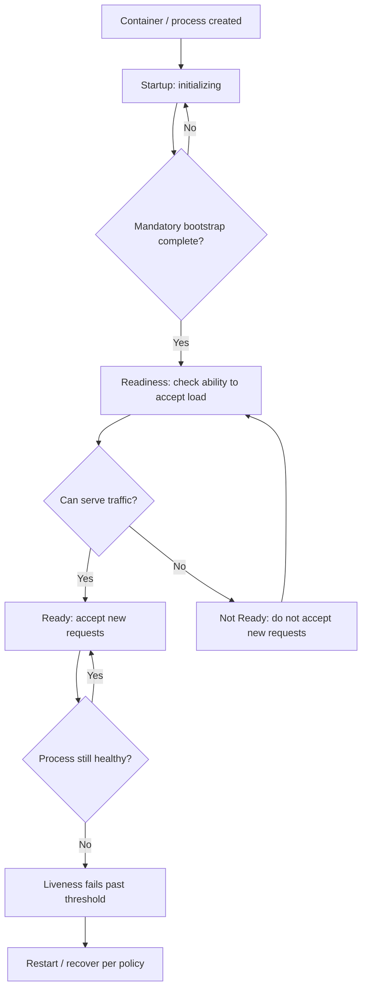
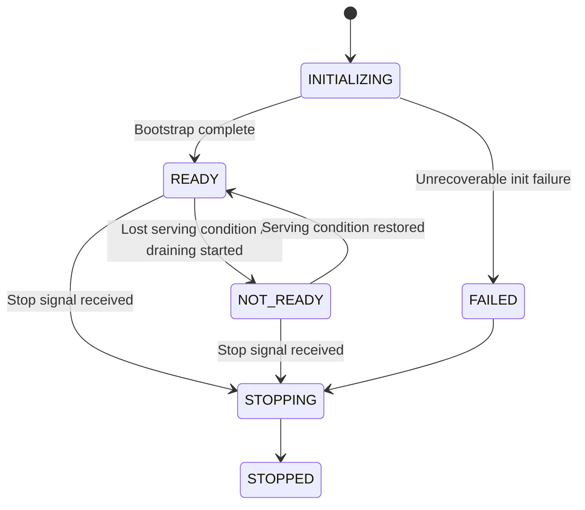
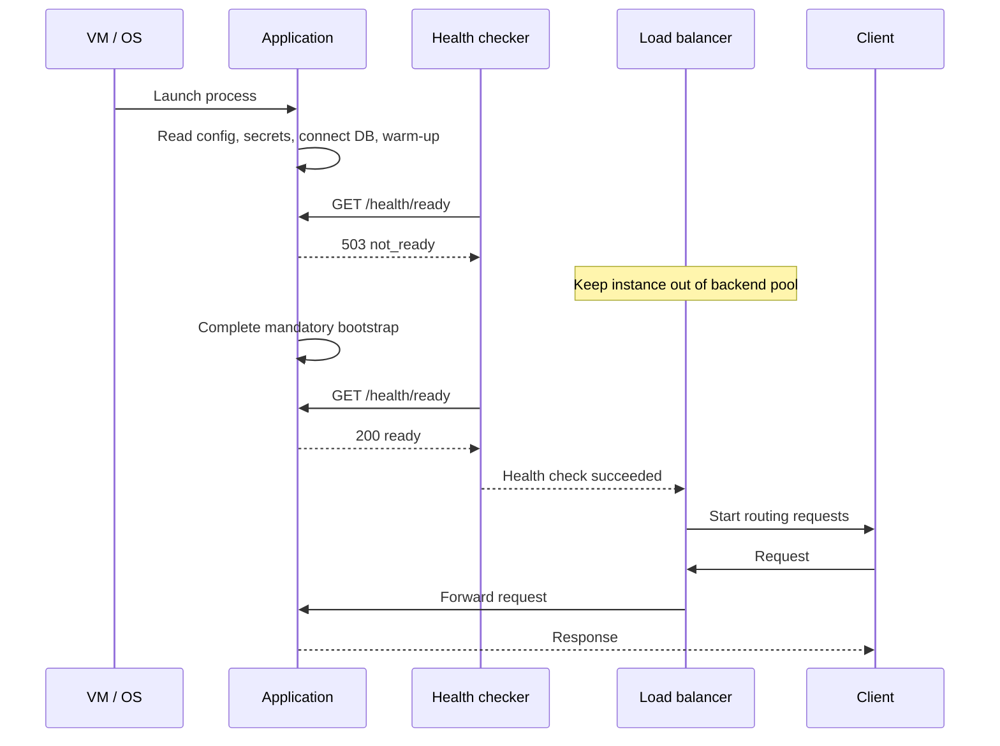
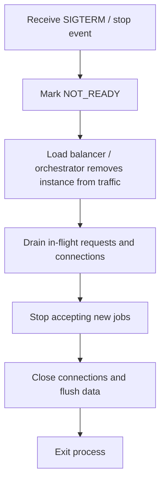

# Signaling readiness after application initialization completes

When a virtual machine or container first boots, the application process may already exist yet still not be ready to safely serve requests. The application may still be reading configuration, loading keys and certificates, connecting to a database, running migrations, loading models, or warming caches. If a load balancer sends traffic too early, users may receive errors even though the server reports a running state.

A **readiness signal** indicates that the application has completed mandatory initialization steps and can currently accept its assigned workload. This signal helps the deployment platform, load balancer, or orchestrator decide when to put an instance into service and when to temporarily remove it from traffic.

After this lesson, you will be able to:

- Distinguish startup state, readiness, and liveness.
- Define minimum conditions for an application to be considered ready.
- Design an endpoint or readiness mechanism that reflects actual state.
- Configure probes and integrate readiness with a load balancer or orchestrator.
- Avoid common mistakes such as reporting ready too early, checking dependencies too deeply, or restarting the application merely because an external service has a transient error.
- Coordinate readiness with graceful shutdown, connection draining, and rolling updates.

## 1. Why is a readiness signal needed?

A `running` state usually means only that the VM, container, or process has been launched. It does not prove the application is ready to process work. Completing bootstrap may take several additional seconds or minutes.

For example, an order management API boots in this sequence:

1. The OS boots and configures networking.
2. The Java runtime launches the application process.
3. The application reads configuration and fetches secrets from a secret manager.
4. The connection pool connects to the database.
5. The application loads business rules and warms caches.
6. The web server starts listening on the HTTP port.
7. Required routes can process valid requests.

If the load balancer only checks whether the TCP port is open, step 6 can place the machine into the backend pool even before step 4 or step 5 completes. Early requests may fail or be processed with missing data.

Readiness establishes a clear contract between the application and the platform: **admit an instance into service only when the application itself confirms it meets defined serving conditions**. When those conditions no longer hold, the application can report not ready so the platform stops sending new requests to that instance.

## 2. Distinguishing startup, readiness, and liveness

These three signals are often used together but serve different purposes.

| Signal | Question to answer | Typical platform reaction |
|---|---|---|
| Startup | Has the application completed its initial startup phase? | Allows subsequent checks to proceed; in Kubernetes, startup probes can delay readiness/liveness probes |
| Readiness | Can this instance accept new requests or work right now? | Adds to or removes from endpoints/backend pool; does not necessarily restart the process |
| Liveness | Is the process still functioning and capable of self-recovering? | May restart the container or process if the probe fails consecutively per policy |

An application can be alive yet not ready. For example, the process is not hung, but it is still loading mandatory data. An application can also become ready and later lose readiness temporarily because its connection pool is exhausted or it is draining for maintenance, while liveness remains healthy.



Do not use a single endpoint with one meaning for all three purposes when platform actions differ. A readiness failure should normally stop traffic routing; a liveness failure can trigger a restart. If liveness depends on an impaired database, many instances may restart simultaneously in a loop and worsen the outage.

## 3. Defining what "ready" means

Readiness must be defined by the instance's ability to perform its assigned work. Not every application needs the same set of conditions.

### Conditions that must typically be completed

- Required configuration has been read and validated; missing or invalid values have been detected.
- Required secrets, certificates, or workload identities are available and usable.
- The runtime and critical internal components are initialized.
- The server has bound its port and required routes are registered.
- Connections to mandatory dependencies have reached the minimum state needed to process requests.
- Required schemas or reference data are at a compatible version.
- Mandatory caches or models are loaded if requests cannot function without them.
- The instance has completed registration with service discovery or the platform's traffic admission mechanism if required by the workflow.

### Classifying dependencies

Do not turn every external service into a readiness condition. Classify dependencies by criticality:

| Dependency category | Examples | Readiness consideration |
|---|---|---|
| Mandatory for all requests | Authentication config, required encryption keys, primary transactional database | Not ready if the application cannot process safely without it |
| Mandatory for a subset of features | Reporting service, search system, dedicated payment service | Can use per-capability readiness or degraded mode if other features still operate safely |
| Optional or has fallback | Analytics, telemetry exporter, auxiliary recommendation system | Normally should not block whole-application readiness; record degraded status and alert separately |
| Startup-only | Loading config, loading models, reading certificate files | Check during startup/bootstrap; does not necessarily need re-checking on every readiness probe |

For example, a product-viewing API might serve content from cache when an analytics service is temporarily down. If readiness depends on analytics, the entire API is pulled from the load balancer even though core functionality works. Conversely, an order-creation API may require the transactional database; if it cannot persist orders, reporting ready causes user-facing errors.

### Capability-based readiness

For systems with multiple independent capabilities, a single binary ready/not-ready status can be too coarse. You can track capabilities separately—such as `orders`, `search`, and `reports`—and route or restrict features as supported by the platform.

If the load balancer understands only one health check per instance, define clearly which capabilities are the minimum required to enter the backend pool. The status of non-mandatory features should be exposed via metrics, dashboards, or dedicated diagnostic endpoints.

## 4. Designing a readiness endpoint

A common pattern is exposing an internal HTTP endpoint, for example:

- `GET /health/ready`
- `GET /readyz`
- `GET /actuator/health/readiness` if the framework and configuration provide this endpoint.

The endpoint should return quickly, deterministically, and without imposing noticeable load. Example convention:

| HTTP response | Suggested meaning |
|---|---|
| `200 OK` | Application currently satisfies readiness conditions |
| `503 Service Unavailable` | Application is not ready or is draining |
| Timeout / connection failed | Probe did not receive a response within the allowed time; platform treats probe as failed per configuration |

HTTP status codes are a common convention; confirm how your platform interprets status codes, timeouts, and redirects. Avoid returning `200` unconditionally just to keep probes green.

### Characteristics of a good endpoint

1. **Fast:** executes quickly with a strict timeout.
2. **Side-effect free:** does not create transactions, write data, or run migrations.
3. **Reflects current state:** does not merely check a flag latched long ago if the application can lose readiness later.
4. **Exposes no secrets:** responses never include passwords, tokens, connection strings, or personal data.
5. **Reachable by probes:** ports, routes, and firewalls permit the probing source to connect.
6. **Consistent semantics:** the same outcome consistently drives the same orchestration behavior.

Readiness endpoints should not run heavy queries, full table scans, or fan-out calls to many external services on every probe cycle. Doing so adds load and can cause probes themselves to trigger outages.

### Response examples

A successful response can be minimal:

```http
HTTP/1.1 200 OK
Content-Type: application/json

{"status":"ready"}
```

When not ready:

```http
HTTP/1.1 503 Service Unavailable
Content-Type: application/json

{"status":"not_ready"}
```

Do not expose internal error details on public endpoints. If diagnostics are needed, use an authenticated internal endpoint or protected dashboards and logs.

## 5. Implementing readiness state in the application

The application should manage initialization state explicitly. Never infer readiness solely from an open HTTP port or an exiting-free process.

A simple state machine might include:



You can use a thread-safe state flag updated after each bootstrap step. Once all mandatory conditions pass, the application transitions to `READY`. When graceful shutdown begins, it transitions to `NOT_READY` before stopping acceptance of new requests.

### Illustrative Java example

The snippet below illustrates managing readiness with a state flag. This is a conceptual example; production applications must integrate with framework lifecycle hooks, error handling, and proper synchronization.

```java
import java.util.concurrent.atomic.AtomicBoolean;

public final class ReadinessState {
    private final AtomicBoolean ready = new AtomicBoolean(false);

    public boolean isReady() {
        return ready.get();
    }

    public void markReady() {
        ready.set(true);
    }

    public void markNotReady() {
        ready.set(false);
    }
}
```

The bootstrap workflow can update state after completing mandatory components:

```java
public void initializeApplication() {
    readiness.markNotReady();
    loadAndValidateConfiguration();
    initializeCredentials();
    connectRequiredDatabase();
    loadRequiredReferenceData();
    warmUpMandatoryCache();
    readiness.markReady();
}
```

If a mandatory step fails, the application must decide whether to retry, abort startup, or remain not-ready. Never put `markReady()` inside a `finally` block, or the application could report ready even when bootstrap failed.

The HTTP endpoint simply reads the state:

```java
public HealthResponse readiness() {
    if (readiness.isReady()) {
        return new HealthResponse(200, "ready");
    }
    return new HealthResponse(503, "not_ready");
}
```

In multi-threaded or multi-component applications, readiness state should be updated from a single clear source of truth. Avoid letting multiple threads toggle flags inconsistently, which can cause the endpoint to report ready before a mandatory condition finishes.

## 6. Configuring readiness probes in container environments

Orchestrators can poll an endpoint or execute a check command periodically. In Kubernetes, `readinessProbe` determines whether a Pod is added to Service endpoints to receive traffic. Probe failure normally marks the Pod not ready without restarting the container just because readiness failed.

Example configuration:

```yaml
apiVersion: v1
kind: Pod
metadata:
  name: order-api
spec:
  containers:
    - name: app
      image: example/order-api:1.4.0
      ports:
        - name: http
          containerPort: 8080
      startupProbe:
        httpGet:
          path: /health/startup
          port: http
        periodSeconds: 5
        failureThreshold: 30
      readinessProbe:
        httpGet:
          path: /health/ready
          port: http
        periodSeconds: 5
        timeoutSeconds: 2
        failureThreshold: 2
        successThreshold: 1
      livenessProbe:
        httpGet:
          path: /health/live
          port: http
        periodSeconds: 10
        timeoutSeconds: 2
        failureThreshold: 3
```

Values are illustrative only. Choose `periodSeconds`, `timeoutSeconds`, `failureThreshold`, `successThreshold`, and startup windows from measured timings. `startupProbe` gives slow-starting applications sufficient time; while the startup probe has not yet succeeded, liveness and readiness probes are held off per Kubernetes behavior.

For workloads with long initialization times, thresholds set too low can trigger premature restarts before initialization finishes. Conversely, probes that are too infrequent or timeouts that are too long delay detection of bad states. Test both normal startup and slow startup scenarios.

### Key points when configuring probes

- Probes must target the container's exact port and path.
- Endpoints must not require interactive authentication that blocks probes; if protection is needed, restrict caller sources or use an appropriate probe mechanism.
- Avoid unnecessary reliance on public DNS or Internet routing.
- `timeoutSeconds` must exceed normal response time while remaining short enough to detect hangs.
- `failureThreshold` should absorb brief blips while still catching sustained failures.
- Readiness can use `successThreshold` greater than 1 to avoid admitting a Pod back to traffic after a single lucky check, depending on requirements.
- Do not configure both readiness and liveness to call the same deep check vulnerable to external service outages.

## 7. Integrating readiness with VMs and load balancers

For virtual machines, readiness signals can be exposed via an HTTP health endpoint, an agent, or the platform's backend registration mechanism. Load balancers typically send health checks to a configured port and path. An instance receives traffic only when marked healthy under service policy.

A typical deployment flow:



Status names and required consecutive successes differ across providers. Some load balancers require multiple consecutive successful probes before marking healthy; some enforce registration or deregistration delays. Consult service documentation and measure real state-transition timings.

### Readiness does not replace end-to-end checks

Load balancer health checks usually inspect each backend individually. They do not prove the entire user journey works. For instance, a readiness endpoint may return 200 while public DNS is wrong, TLS certificates are expired, or an external payment provider is down. Use synthetic monitoring or separate end-to-end checks to evaluate the complete path.

## 8. Combining readiness with graceful shutdown

Readiness is critical when stopping machines or deploying a new version. If a process exits immediately upon receiving a stop signal, the load balancer may still be routing requests to that instance.

A safe shutdown sequence typically includes:

1. Receive a stop signal (such as `SIGTERM` or a platform lifecycle event).
2. Transition readiness to `NOT_READY` to stop admitting new work.
3. Notify service discovery or the load balancer that the instance must be removed from the backend pool.
4. Wait through the drain window so in-flight requests and active connections complete within allowed bounds.
5. Stop pulling new messages from queues; finish or return in-flight jobs safely.
6. Close connection pools, flush required data, and release resources.
7. Exit the process before the termination grace period expires.



Drain time must be coordinated with deregistration delays, request timeouts, job processing times, and container or VM grace periods. If drain time exceeds the grace period, the platform may force-kill the process before completion. If readiness flips to not-ready too late, new requests can arrive while the application is closing.

For queue workers, readiness can reflect capacity to pull new messages. During shutdown, workers should stop polling or lower concurrency, finish in-flight messages, and ack/nack according to queue semantics. Never ack a message before work is durably persisted.

## 9. Avoiding readiness flapping and overly deep checks

**Readiness flapping** is rapid oscillation between ready and not-ready states over a short window. This causes constant backend pool churn, reduces capacity, and shifts extra load onto remaining instances.

Common causes:

- Readiness endpoint depends on an external service with fluctuating latency.
- Timeout is too short compared to normal response times.
- Check runs heavy queries or opens new connections on every probe.
- Caches are repeatedly warmed or memory spikes temporarily.
- A single transient error flips the instance to not-ready immediately.
- Simultaneous probes across many instances create a traffic spike against a dependency.

Mitigation measures:

- Use connection pools or managed connection states instead of opening new connections on every probe.
- Set timeouts and failure thresholds based on measured latency distributions.
- Check only the conditions genuinely required to serve requests.
- Add hysteresis or require consecutive failures/successes before changing state.
- Increase probe intervals or add jitter if supported by the platform/tooling.
- Track state transition counts and correlated causes.

Never hardcode readiness to always return green just to avoid flapping. If the application truly cannot handle requests, continuing to accept traffic widens the outage. Tune criteria and thresholds to accurately reflect capacity.

## 10. Readiness and external dependencies

A difficult question is whether to check databases, caches, message brokers, or external APIs inside readiness. The answer depends on the dependency's role in the request path.

### When should a dependency be checked?

Include a dependency in readiness if its absence prevents the instance from safely performing its core function. For instance, an order-writing service cannot report ready if it cannot write to the transactional datastore.

Even then, checks must be lightweight and bounded. Use connection pool state, recently validated connections, or a tightly controlled lightweight query. Never run table scans or write/delete operations on every probe.

### When should a dependency not block readiness?

If a dependency serves only secondary functionality or the application has a safe fallback, do not mark the whole instance not-ready during a temporary outage of that dependency. For example, a telemetry exporter failure should not stop an API from serving requests. Record degraded metrics, alert, and restrict the affected secondary feature.

### Avoiding failure loops

Suppose the primary database experiences an outage. If every API instance performs deep database checks in both readiness and liveness, readiness turns red and liveness may restart all containers. When the database recovers, all containers boot at once, creating a connection storm that overwhelms the database again.

A better design:

- Readiness reflects whether the instance can still serve core functionality per policy.
- Liveness checks only whether the process is deadlocked or in an unrecoverable state.
- Connection pools enforce limits, timeouts, and circuit breakers.
- Retries use backoff and jitter; avoid synchronized retry storms.
- Dashboards display dependency status separately so operators see the root cause.

## 11. Measuring and monitoring readiness

Readiness should be observed as an operational signal, not treated merely as an endpoint for load balancers.

Useful metrics:

- Time from process start to first transition to ready.
- Percentage of ready instances by service, zone, and version.
- Count of ready/not-ready transitions over a time window.
- Duration instances spend in not-ready state and associated reasons.
- Counts of probe timeouts, HTTP 5xx responses, or connection failures.
- Request error rate immediately after instances become ready.
- Drain duration and count of in-flight requests/jobs during shutdown.
- Rollout success rate, rollout duration, and rollback count.

Alert if a new version shows an unusual jump in bootstrap time, ready instance counts drop below threshold, or readiness flapping exceeds normal bounds. Tag metrics with version/build IDs to pinpoint which change triggered the regression.

Never include user IDs, tokens, or sensitive data in metric labels. High-cardinality labels such as request IDs can also make observability systems expensive and slow to query.

## 12. Implementation example: multi-step Java API startup

Suppose a Java API runs in a container. The application must load configuration, authenticate with a secret manager, build a database connection pool, and load a mandatory product catalog.

**State design:** the process starts in `INITIALIZING`; `/health/startup` succeeds only when bootstrap steps finish or within the permitted startup window. `/health/ready` returns 503 while incomplete, when the connection pool fails core requirements, or when the application is draining. `/health/live` checks only that the process and event loop remain responsive.

**Orchestration settings:** the startup probe allows maximum startup duration based on measurements. The readiness probe polls more frequently with a short timeout. The liveness probe is less sensitive than readiness and does not call the database.

**When admitting traffic:** the Service selects only ready Pods. External load balancers register backends only after health checks pass the success threshold. Once ready, the API continues tracking database errors and cache state through separate metrics.

**When deploying a new version:** new Pods receive traffic only after becoming ready. Old Pods receive SIGTERM, flip to not-ready, wait for in-flight requests to drain, stop pulling new jobs, and then close connection pools. Rolling updates cap the number of unavailable Pods to preserve serving capacity.

### Illustrative timeline

```text
Time       Application state                Traffic routing
0s         Process starts                   No traffic routed
4s         Reads config and fetches secrets No traffic routed
9s         Connects to database             No traffic routed
14s        Loads data and warms caches      No traffic routed
20s        Startup complete, readiness 200  Health checks begin
25s        Meets healthy threshold          Added to backend pool
...        Serving requests                 Normal traffic
Shutdown   Readiness 503, draining          Stop sending new requests
```

These milestones are illustrative only. Measure real timings under cold starts, high load, and slow dependency responses.

## 13. Testing readiness before production deployment

An endpoint returning 200 in development is not enough to prove readiness works properly. Test these scenarios:

1. **Normal startup:** instance transitions to ready only after all mandatory steps finish.
2. **Slow startup:** dependencies respond slowly but eventually succeed; startup probe does not restart prematurely.
3. **Bad configuration or invalid secrets:** application refuses to report ready; logs contain diagnostics without leaking secrets.
4. **Temporarily unreachable database:** readiness follows policy; liveness does not trigger a restart loop.
5. **Optional dependency failure:** core features still receive traffic if fallback exists; degraded status is observed.
6. **Readiness flapping:** timeouts and thresholds absorb short spikes while still detecting sustained outages.
7. **Graceful shutdown:** instance becomes not-ready before exiting; in-flight requests drain within limits.
8. **Rolling update:** enough instances stay ready throughout; new Pods do not receive traffic prematurely.
9. **Instance or zone loss:** remaining instances have sufficient capacity and are not overloaded by shifted traffic.

During testing, record timestamps for process start, startup success, readiness success, backend healthy status, and first successful request. These milestones expose delays or failing bootstrap steps.

## 14. Common mistakes

**Reporting ready as soon as the HTTP port opens.** The web server may listen before the database, caches, or mandatory data are ready. Tie readiness to actual serving conditions.

**Using readiness in place of liveness.** Readiness failures should normally only remove an instance from traffic. Reserve restarts for processes incapable of recovering on their own.

**Putting every dependency into readiness.** A single auxiliary service outage can pull the entire application out of traffic. Classify dependencies and design fallbacks.

**Probes executing heavy queries.** Probes can add load, time out, and trigger not-ready loops. Keep endpoints lightweight, fast, and bounded.

**Failing to switch not-ready on shutdown.** Load balancers may route new requests to a terminating process. Flip state first and coordinate drain delays.

**Setting thresholds without measuring startup time.** Values too low cause premature restarts; values too high delay failure detection. Use measured startup metrics and failure tests.

**Not monitoring start-to-ready duration.** A change can stretch bootstrap from seconds to minutes without failing probes. Track metrics and alert on trends.

## 15. Pre-release readiness checklist

- [ ] Clearly defined minimum conditions for an instance to accept requests or jobs.
- [ ] Distinguished startup, readiness, and liveness; each signal drives an appropriate action.
- [ ] Readiness endpoint reflects current state rather than merely checking a running process.
- [ ] Dependencies are classified as mandatory, per-capability, or optional.
- [ ] Probes are lightweight, fast, have timeouts, and expose no sensitive data.
- [ ] Startup probe or equivalent gives sufficient headroom for cold starts.
- [ ] Readiness is integrated with Services, load balancers, or service discovery.
- [ ] Graceful shutdown flips not-ready before draining and stopping the process.
- [ ] Timeouts, failure thresholds, success thresholds, and grace periods have been tested.
- [ ] Metrics exist for bootstrap duration, ready ratio, flapping, and probe errors.
- [ ] Tested dependency outages, slow startups, rolling updates, and instance loss.
- [ ] Rollout thresholds, rollback plans, and adequate capacity exist during deployments.

## 16. Self-check

1. A container is in the Running state, yet the API returns errors because it has not connected to the database. Why does Running not mean Ready?
2. How do readiness and liveness differ in the action the orchestrator takes?
3. When should a database be a readiness condition? Why should a telemetry exporter usually not block API readiness?
4. Which bootstrap steps should complete before an application reports ready?
5. Why should a readiness endpoint be fast and avoid deep queries on every probe?
6. During shutdown, why must the application switch to not-ready before closing the server and connection pools?
7. An application restarts repeatedly during a temporary database outage. How should startup, readiness, and liveness designs be reviewed?
8. What timestamps should be measured to evaluate readiness during a rolling update?

Readiness is an operational commitment between the application and the platform: an instance accepts new work only when it is prepared to execute it. When signals are properly designed, integrated with traffic routing, and coordinated with graceful shutdown, bootstrap and deployments run more reliably, startup errors decrease, and user experience is protected.
