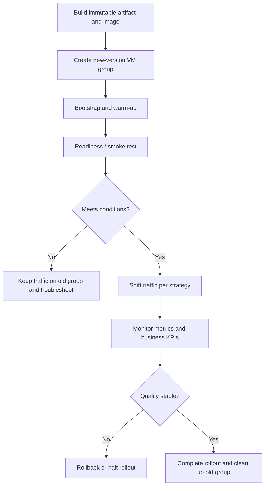
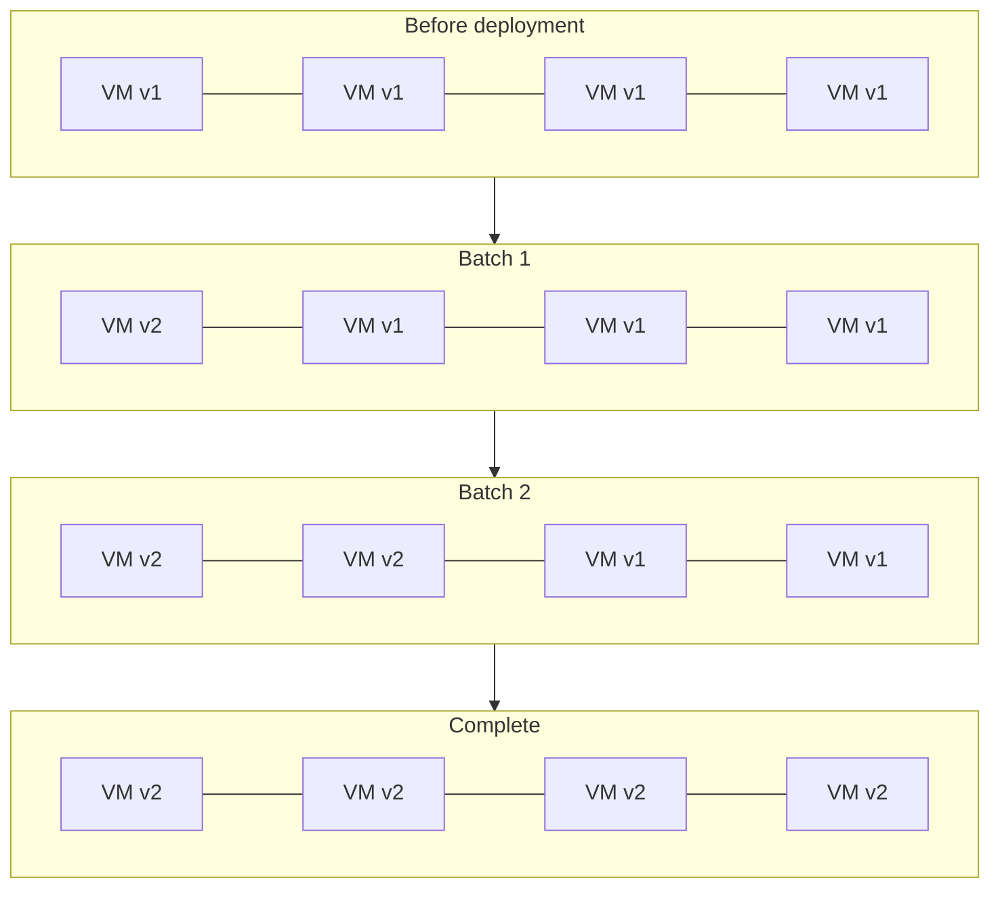
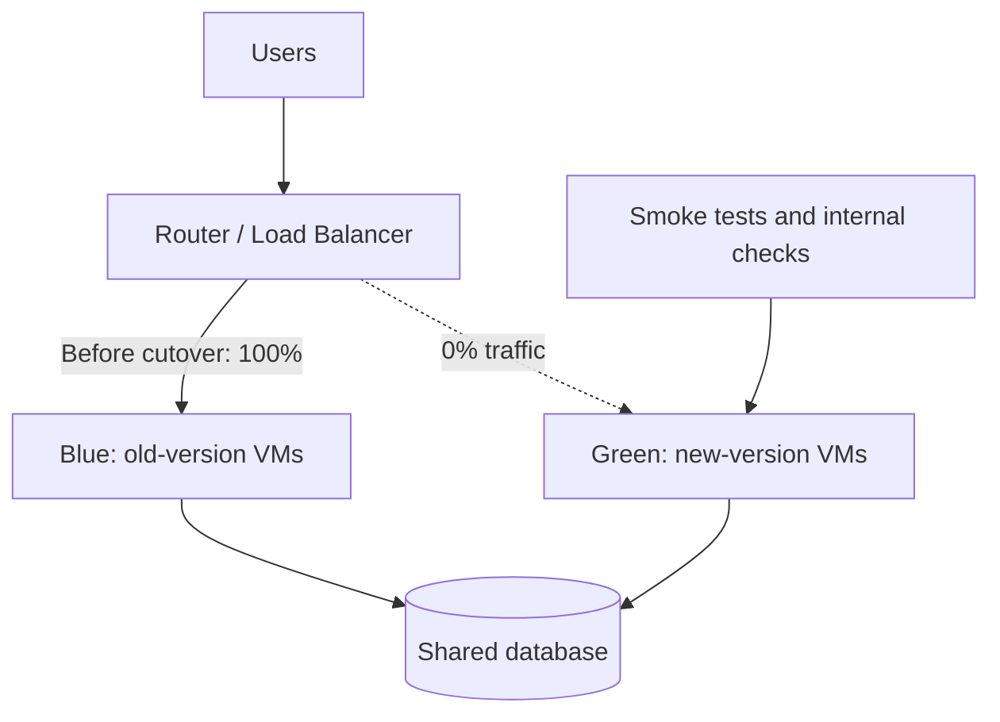
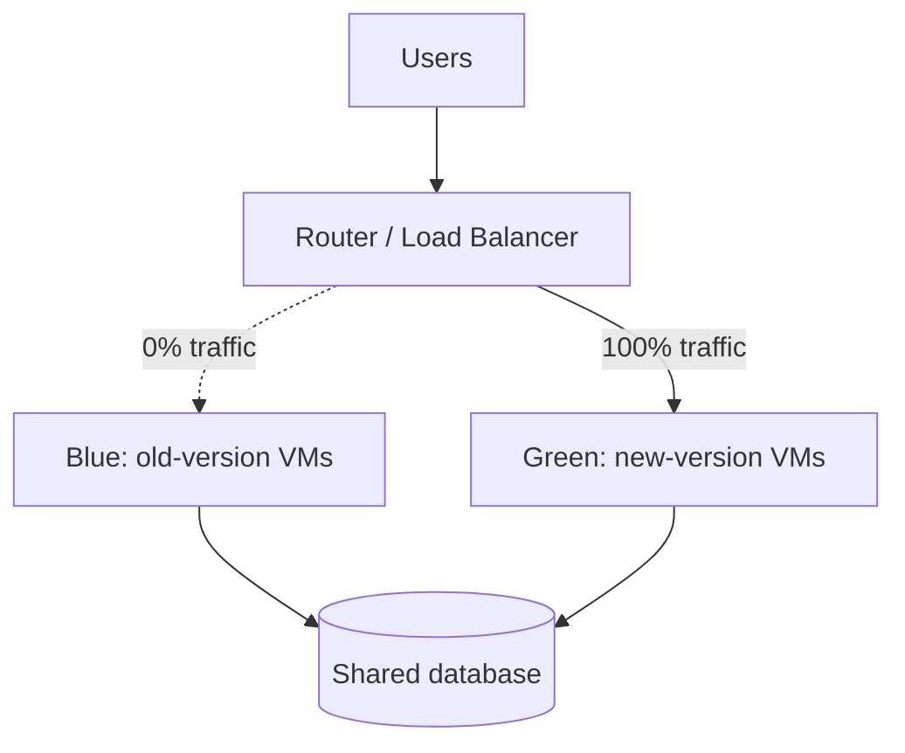
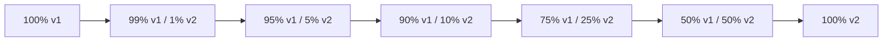
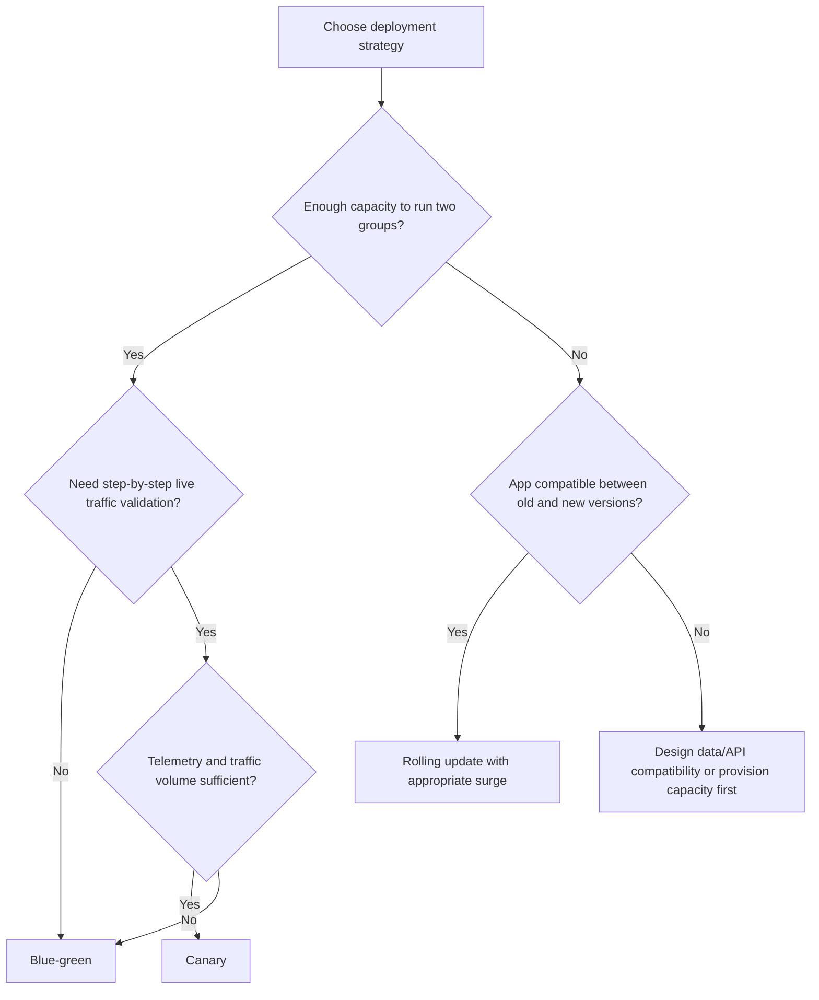
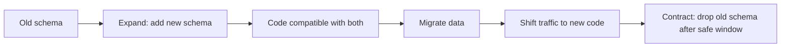
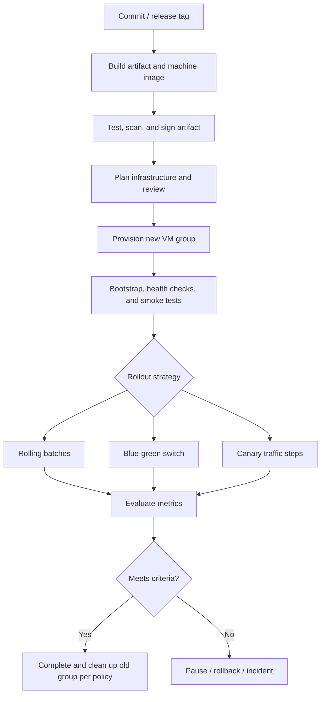

# Rolling update, blue-green, and canary on VM groups

When deploying a new application version across a group of virtual machines (VMs), the goal is not merely to boot new machines. The system must continue serving users while replacing instances, route traffic to the right version, detect failures early, and retain a path to revert when quality degrades. Three common strategies are **rolling update**, **blue-green deployment**, and **canary release**. They differ in how VM groups are provisioned, how traffic is shifted, how risk is controlled, and how much spare capacity is required.

In the **CLOUD_CORE_SERVICES_COMPUTE** module, these strategies tie directly to choosing VM types, CPU, memory, networking, load balancers, autoscaling, health checks, security, and cost. A sound deployment plan must account for application startup time, capacity headroom, database connections, sessions, background jobs, data compatibility, and observability signals. Updating an image or launch template is only part of the process; the new version must receive traffic only once it is ready and meets defined health criteria.

## Learning objectives

After this lesson, you will be able to:

- Explain rolling update, blue-green, and canary deployments on VM groups.
- Select a deployment strategy based on downtime tolerance, capacity, risk, and rollback requirements.
- Design load balancers, health checks, connection draining, and warm-up for safe traffic cutovers.
- Calculate surge capacity, max unavailable, and compute headroom during deployment.
- Manage configuration, images, launch templates, application versions, and infrastructure via IaC/automation.
- Handle sessions, workers, database migrations, and the impact of stateful changes.
- Build a canary workflow with clear metrics, abort thresholds, and rollback criteria.
- Evaluate outcomes by availability, latency, error rate, throughput, and deployment cost.

## 1. Why is a group deployment strategy needed?

An application running across multiple VMs typically sits behind a load balancer. The load balancer distributes requests across eligible healthy instances. When releasing a new version, operations must replace part or all of the instance fleet without losing capacity to handle load.

Stopping all old VMs before launching new ones can cause an outage during bootstrapping, configuration loading, database connections, and health checks. Launching all new VMs simultaneously can exceed quotas, exhaust IP addresses, hit capacity limits, or create a startup load spike against the database. Shifting traffic too early sends requests to unready instances. Failing to retain the old version or maintain schema compatibility can make rollback unable to restore service.

Therefore, fleet deployments must coordinate three lifecycles simultaneously:

1. **Compute lifecycle:** create, boot, verify, admit to service, drain, and terminate VMs.
2. **Traffic lifecycle:** register targets, run health checks, shift traffic weights, stop new requests, and finish in-flight connections.
3. **Application/data lifecycle:** load the version, maintain configuration compatibility, migrate data, handle sessions, background jobs, and side effects.



A deployment strategy must define up front what "ready" means, what "success" means, and which conditions force an abort. Never wait for user complaints before deciding to roll back.

## 2. The three deployment strategies

### 2.1. Rolling update

A rolling update replaces old VMs in batches. At any moment, only part of the fleet is being replaced; remaining instances continue serving traffic. Once a new batch boots and passes health checks, the orchestrator advances to the next batch.



In this four-VM example, new machines are introduced one by one. In larger fleets, multi-instance batches can be replaced at once, provided remaining healthy instances can carry the load.

**Advantages:**

- Does not require keeping an entire new fleet alongside the entire old fleet throughout the deployment.
- Works naturally with autoscaling groups or managed instance groups that support instance refresh/rolling replacement.
- Allows tuning rollout speed and replacement batch size.
- Extra resource overhead is generally lower than blue-green when gradual replacement and capacity headroom are balanced.

**Limitations:**

- For a period of time, old and new versions run concurrently; APIs and schemas must stay compatible.
- Rollback can be slow because batches must be replaced again.
- Misconfigured batch sizes or health checks can shrink total fleet capacity during rollout.
- Bugs that only trigger under heavy load may go undetected in a small initial batch.

Rolling updates fit stateless applications or workloads with shared state stores, cross-version compatibility, and frequent releases with moderate resource headroom.

### 2.2. Blue-green deployment

Blue-green maintains two independent environments capable of serving the same application:

- **Blue** is the group currently serving production traffic.
- **Green** is the new group provisioned in parallel and verified before taking traffic.

Once Green passes checks, the system shifts traffic from Blue to Green via a load balancer, listener, DNS, or another routing mechanism. If the new version fails and data remains compatible, traffic can be switched back to Blue.



After Green is verified:



**Advantages:**

- Allows testing the entire new group before shifting production traffic.
- Fast traffic cutover when routers and health checks are properly prepared.
- Clear rollback path by switching traffic back to the old group.
- Enables comparing both environments or running smoke tests against Green.

**Limitations:**

- Requires enough capacity to run both fleets simultaneously; compute, IP, disk, and network costs can increase substantially.
- Shared databases or services remain a risk point if the new version alters schemas or writes incompatible data.
- Keeping Blue around too long can let configurations drift or incur unnecessary cost.
- Shifting traffic does not automatically migrate in-memory sessions, caches, or running jobs.

Blue-green fits systems requiring rapid version cutover, possessing spare capacity, and able to operate two independent groups during testing/cutover.

### 2.3. Canary release

Canary exposes the new version to a small slice of traffic or a subset of users first. Operations observes metrics and business behavior, then increases the traffic share incrementally if criteria are met. If quality drops, halt the rollout or shift traffic back to the stable version.

Example traffic progression:



Percentages are illustrative only. Real percentages must reflect traffic volume, risk level, minimum sample sizes, and observability depth. At low traffic, 1% may yield only a handful of requests—too little data to draw conclusions. On a very high-volume system, 1% may already represent substantial load.

**Advantages:**

- Limits the initial blast radius of defects.
- Surfaces issues that appear only with live production traffic or real data.
- Builds confidence progressively before migrating all users.
- Can combine with feature flags, tenant cohorts, or header-based routing.

**Limitations:**

- Requires precise routing and version-segmented metrics.
- Requires sufficient sample volume and observation windows; overly short canaries miss infrequent bugs.
- Two versions writing data concurrently can cause conflicts or divergent results.
- Sticky sessions, caches, and user-cohort differences can skew comparisons.
- Automated abort/rollback logic must be tuned to avoid false triggers from metric noise.

Canary suits higher-risk changes in systems with strong telemetry and enough traffic to evaluate the new version step by step.

## 3. Comparing and choosing a strategy

| Criterion | Rolling update | Blue-green | Canary |
|---|---|---|---|
| How VMs change | Replace batch by batch within the same group or instance group | Build new group in parallel, then switch traffic | Build small new group, send partial traffic, then expand |
| How traffic shifts | Load balancer updates targets as each VM becomes healthy | Shift most or all traffic to the new group | Shift traffic by percentage weight or user cohort |
| Extra resources | Low to moderate, depending on surge | Usually highest because both groups coexist | Grows with canary size and rollout phase |
| Full cutover speed | Batch by batch | Can be fast at switch time | Gradual across observation steps |
| Rollback | Re-roll batches or revert launch template | Switch router back to old group | Drop new version traffic weight to 0% or safe level |
| Version coexistence risk | Yes | Possible while Blue/Green overlap | Yes during evaluation and ramp-up |
| Observability requirement | Per-batch health and metrics | Green health and whole-system health post-switch | Per-version metrics, sufficient samples, and automated criteria |
| Best suited for | Regular releases, version-compatible apps | Rapid cutover needs with spare capacity | Risky changes needing validation under live traffic |

No strategy guarantees zero downtime by itself. Outcomes depend on application startup, health checks, capacity, load balancers, databases, sessions, and incident response procedures.

### 3.1. Decision tree



If spare capacity is unavailable and versions are incompatible, resolve that constraint before deploying. Do not force a strategy and hope the system survives.

## 4. Preparing VM groups and artifacts

A deployment strategy is reliable only when every VM running the same version is created from the exact same tested artifact and configuration.

### 4.1. Build once, deploy to many environments

The workflow should produce an immutable versioned artifact or machine image:

1. Build the application from a specific commit.
2. Run unit tests, integration tests, dependency scans, and security checks.
3. Package the application into an image or artifact.
4. Attach a version/commit ID and checksum; store in a registry or artifact repository.
5. Create a machine image or launch template referencing that artifact.
6. Promote the same artifact across staging and production without rebuilding different contents per environment.

Version identifiers might include `orders-api-2026.11.22.3` or a commit SHA. When using machine images, record the image ID, build ID, OS version, runtime, and bootstrap configuration. Avoid mutable tags like `latest` in production rollouts because rollback will struggle to pinpoint exact contents.

### 4.2. Launch templates and VM groups

A launch template or machine template should pin:

- Machine image or image ID.
- VM type and matching CPU architecture.
- vCPU, RAM, and accelerators if required by the workload.
- Subnets, security groups, and network interfaces.
- IAM instance profile or workload identity.
- Disks, encryption, mounts, and bootstrap settings.
- Versioned user data/cloud-init or startup scripts.
- Tags, logging agents, monitoring agents, and shutdown configuration.

For autoscaling groups or managed instance groups, manage desired/min/max capacity, health checks, cooldown/warm-up, placement, and refresh policies. Every rollout should create a traceable new revision rather than manually editing individual VMs.

### 4.3. Bootstrap must be repeatable

Bootstrap must finish before a VM enters service targets. The startup script should:

- Install or fetch the pinned version of the artifact.
- Verify checksums or signatures if required by policy.
- Load configuration and secrets from controlled sources via workload identity.
- Start services and set up logging and monitoring.
- Report bootstrap success or failure status.
- Exit with a clear error code if the machine cannot be brought into service.

Bootstrap should be idempotent so it can re-run safely when a VM reboots or initialization is retried. Never write secrets into user data, public images, or bootstrap logs.

## 5. Health checks, readiness, and traffic draining

A VM in the `running` state does not guarantee the application is ready. The OS may be up while packages are still installing, models are still loading, caches are cold, database connections are unestablished, or dependencies are failing.

### 5.1. Distinguishing check layers

| Check | Question | Examples |
|---|---|---|
| Instance/VM health | Is the machine healthy at the infrastructure layer? | System checks, instance checks, agent status |
| Process/liveness | Is the application process still running? | Process check or liveness endpoint |
| Readiness | Can the application accept new requests? | Endpoint checking mandatory dependencies and initialization state |
| Synthetic/smoke test | Do core business flows work? | Calling login or test-read endpoints |
| SLO/metrics | Is the version serving at expected quality? | Error rate, latency, throughput, saturation |

Liveness and readiness serve different goals. An unready instance must not receive traffic, yet not every transient dependency blip should trigger continuous process restarts. Design health checks to avoid restart loops that amplify load during dependency outages.

### 5.2. Load balancer health checks

Health checks must configure:

- Application-appropriate endpoint and port.
- Interval, timeout, and consecutive failure/success thresholds.
- Expected response codes or body validation.
- Grace period for VMs still bootstrapping.
- Unhealthy target handling and new target registration timing.

A health endpoint should not return success merely because the process exists if the application cannot serve requests yet. Conversely, if the endpoint checks every non-critical dependency, a minor auxiliary failure can remove the entire VM fleet from the load balancer. Select only dependencies mandatory for the primary serving path.

### 5.3. Connection draining and deregistration delay

When removing an old VM from a load balancer, requests or connections may still be active. Connection draining (or deregistration delay/connection termination depending on the platform) allows in-flight requests to finish within a configured window.

A graceful shutdown sequence typically follows:

1. Mark the instance as not accepting new requests or begin target deregistration.
2. Wait for the load balancer to stop sending new traffic.
3. Let in-flight requests complete within timeout bounds.
4. Stop pulling new jobs from queues or schedulers.
5. Finish, checkpoint, or hand off in-progress jobs.
6. Close connections, flush logs/metrics, and stop the process.
7. Terminate the VM after the drain period expires.

Drain duration must align with request timeouts, longest job durations, and platform shutdown limits. Too short a drain aborts active requests; too long prolongs rollouts and holds old resources longer.

### 5.4. Warm-up and slow start

A newly started application may need time to populate caches, JIT-compile, initialize connection pools, or load models. Sending full traffic the instant health checks pass can overload the instance early on.

Use warm-up periods, load balancer slow-start, or stepped traffic ramping. Health checks confirm the ability to accept requests; warm-up confirms the ability to sustain full load. Configure these separately when applications have meaningful initialization overhead.

## 6. Calculating capacity during rollout

During deployment, some VMs may be booting or draining. Remaining healthy VMs must handle peak load without breaching account quotas or budget limits.

### 6.1. Rolling update: max surge and max unavailable

- **Max surge:** the number of new VMs allowed above desired capacity during rollout.
- **Max unavailable:** the maximum number of VMs allowed to be temporarily out of service during rollout.

Example for a 10-VM group:

| Configuration | Max VMs during rollout | Max unavailable VMs | Notes |
|---|---:|---:|---|
| Surge 0, unavailable 1 | 10 | 1 | Replace one at a time after stopping one; capacity dips temporarily |
| Surge 2, unavailable 0 | 12 | 0 | Launch up to 2 new VMs before terminating old ones; needs extra quota/capacity |
| Surge 2, unavailable 1 | 12 | 1 | Allows more flexible replacement while still requiring headroom planning |

This illustrates the concept; parameter names and behaviors differ across Auto Scaling Groups, Managed Instance Groups, and orchestration tools. Always check service-specific documentation.

A rough capacity check:

```text
Healthy capacity during rollout
  = remaining healthy VMs × safe capacity per VM

Minimum condition:
  Healthy capacity >= expected load during rollout window

Extra VMs needed for surge
  = max(0, number of new VMs provisioned concurrently)
```

Do not size against 100% theoretical capacity per VM. Use benchmarked safe utilization thresholds to preserve headroom for traffic bursts, a zone failure, or an instance loss.

### 6.2. Blue-green: nearly double capacity

If Blue has 10 VMs and Green also needs 10 VMs, parallel operation may require 20 VMs—plus load balancers, disks, IPs, and supporting resources. If quota allows only 12 VMs, full blue-green is impossible without raising quotas, shrinking group size, or picking another strategy.

Benchmark and warm up Green's capacity before switching. Do not scale down Blue immediately after cutover if an observation and rollback window is needed.

### 6.3. Canary: small group, yet sufficient capacity

Putting 1 canary VM alongside 20 VMs does not guarantee it receives exactly 5% of traffic. Load balancers may distribute unevenly, one VM may receive burst traffic, or session affinity may skew distribution. Use weighted routing or controlled routing rules and verify actual traffic share via metrics.

The canary needs enough CPU/RAM and workers to handle its assigned traffic. If the canary group is undersized, resource starvation itself can trigger errors absent from the full production fleet. When comparing versions, keep per-instance compute specs equivalent or account clearly for differences.

### 6.4. Quotas, zones, and capacity reservations

Before rollout, verify vCPU quotas, per-family instance limits, IP addresses, disks, load balancer targets, and VM type availability across zones. GPUs or specialized instance types often face tighter quotas and supply constraints.

If your plan requires surge or parallel fleets, verify capacity before deployment time. For critical workloads, consider capacity reservations or multi-zone/instance-type fallback strategies per provider capabilities. Never swap instance types casually if differences in CPU architecture, network throughput, or local storage alter application behavior.

## 7. Managing sessions, caches, and background jobs

Fleet deployments often keep old and new versions running concurrently. This affects ephemeral data, user sessions, and running jobs.

### 7.1. Sessions and user state

If sessions live only in VM RAM, users lose sessions when load balancers route requests to another VM or replace old VMs. Options include:

- Store sessions in a shared store such as Redis or a database.
- Use stateless/token-based sessions if compatible with your security model.
- Use sticky sessions temporarily during transition only when truly required, never as a substitute for durable state management.
- Ensure the new version can read sessions created by the old version during rollout.

Sticky sessions can skew traffic distribution and make canary results unrepresentative. If used, measure request distribution and plan how sessions behave when a VM leaves the pool.

### 7.2. Caches

Local caches on newly launched VMs start cold. Shifting traffic increases cache misses, potentially spiking load on databases or downstream services. Consider cache warming, rate limiting, prefetching, or gradual traffic ramping. For shared caches, ensure key formats and serialization remain compatible between old and new versions.

### 7.3. Workers and long-running jobs

Queue workers and scheduled jobs need dedicated drain procedures:

- Stop pulling new jobs before terminating the VM.
- Let in-progress jobs finish if time permits.
- For long jobs, checkpoint progress or safely return messages to the queue.
- Use appropriate visibility timeouts/leases and idempotency so redelivered jobs do not produce duplicate side effects.
- Prevent two versions from running the same scheduled side-effecting job without leader election or distributed locks.

API and worker deployments may need separate cadences. A new worker may expect a changed message schema; ensure producers and consumers stay compatible during the transition.

## 8. Database migrations and version compatibility

Application rollback works safely only when the old version can still work with data written by the new version. Schema incompatibility is a leading cause of failed rollbacks even when old VMs are still intact.

### 8.1. Expand-contract strategy

A safe schema evolution typically splits into phases:

1. **Expand:** add new columns, tables, or fields without breaking the current version.
2. **Dual compatibility:** deploy code able to read both old and new formats; dual-write under controlled rules if needed.
3. **Migrate:** backfill data in batches with progress tracking and safe re-runnability.
4. **Switch:** move workload traffic to the new version once data and code are ready.
5. **Contract:** drop old fields/structures only after confirming no old versions or legacy consumers remain.



Never combine dropping old columns into the initial deployment if you still need rollback capability. Destructive migrations require backups, restore verification, and separate approval.

### 8.2. Application rollback and data rollback are separate

Routing traffic back to old VMs does not undo migrations. If the new version wrote data in a format the old code cannot parse, reverting code can worsen failures. Clarify beforehand:

- Are old and new schemas bidirectionally compatible?
- Is new data written that the old version cannot read?
- Are migrations re-runnable or reversible?
- Is a forward-fix required instead of a rollback?
- Do backups and point-in-time recovery satisfy RPO/RTO?

In many cases, the safest pattern is maintaining compatible schemas and rolling back code/traffic; if irreversible data changes occurred, push a forward fix rather than reverting to old code.

## 9. Detailed rolling update design

A rolling update on a VM group can follow these steps:

1. Verify artifact/image, launch template revision, quotas, and capacity.
2. Check current group health, live traffic load, and headroom.
3. Choose batch size, max surge, max unavailable, and warm-up duration.
4. Launch a new batch of VMs from the new image/launch template.
5. Wait for bootstrap, readiness, and smoke tests to pass.
6. Register new targets with the load balancer; wait for healthy status and warm-up.
7. Drain a batch of old VMs, finish requests/jobs, and deregister targets.
8. Monitor error rate, latency, CPU, memory, and business metrics.
9. If thresholds pass, proceed to the next batch; otherwise pause or roll back.
10. Once the entire new group is healthy and stable, verify running versions and terminate old VMs.

### 9.1. Rollout policy configuration example

Conceptual YAML example:

```yaml
deployment:
  strategy: rolling
  target_group: orders-api
  artifact_version: "2026.11.22-3"
  capacity:
    desired: 10
    max_surge: 2
    max_unavailable: 1
  health:
    path: /ready
    interval_seconds: 10
    healthy_threshold: 3
    unhealthy_threshold: 3
    warmup_seconds: 90
  draining:
    deregistration_delay_seconds: 60
    shutdown_grace_seconds: 75
  rollout:
    batch_size: 2
    pause_after_batch_seconds: 120
```

This illustrates a hypothetical deployer configuration, not a universal cloud provider schema. Tune values based on bootstrap time, request timeouts, longest processing times, traffic load, and application health checks. In this example, shutdown grace should exceed or align with drain duration; avoid inconsistent timeouts across layers.

### 9.2. Rollout abort conditions

Automatically halt or require operator review if:

- Unhealthy target ratio exceeds threshold.
- Error rate spikes above baseline or breaches SLO.
- p95/p99 latency rises persistently.
- CPU/RAM or database connection pools hit saturation.
- Queue depth or job processing duration climbs rapidly.
- Bootstrap failures, crash loops, or migration failures occur.
- Remaining healthy VMs drop below minimum required capacity.

Define both absolute thresholds and baseline-relative thresholds. A 1% error rate might be tolerable in testing but unacceptable for a payment API; thresholds must reflect SLOs and business criticality.

## 10. Detailed blue-green design

Blue-green separates compute groups from the traffic switch point. It can be implemented with two autoscaling groups, two managed instance groups, or two independent VM pools.

### 10.1. Cutover workflow

1. Blue continues serving 100% of traffic.
2. Provision Green from the new image/launch template revision.
3. Wait until all Green VMs finish bootstrap and pass health checks.
4. Run internal smoke tests against a private endpoint or test target.
5. Verify database, secret, cache, queue connectivity, and workload permissions.
6. Warm up Green using synthetic or bounded internal traffic.
7. Switch the listener/router to Green.
8. Monitor technical and business metrics throughout the bake window.
9. If criteria pass, retain Green and terminate Blue after the designated rollback window.
10. If criteria fail, shift traffic back to Blue and investigate Green.

### 10.2. Blue retention window

Keep Blue long enough to catch delayed failures, without holding it so long that cost and configuration drift grow unnecessarily. Retention duration should account for:

- Daily peak and off-peak traffic cycles.
- Completion times for long jobs and requests.
- Delay before data or batch-processing errors surface.
- Rollback speed and data compatibility window.
- Costs of VMs, disks, IPs, and attached resources.

Before deleting Blue, confirm no traffic, sessions, jobs, DNS queries, or consumers still depend on the old group. Once Blue is terminated, rolling back may require re-provisioning VMs and waiting through bootstrap again.

### 10.3. Shifting traffic with a load balancer

A load balancer can route to either the Blue or Green target group. Ensure the new target group is healthy before switching. With DNS-based switching, client DNS caching and TTLs can keep sending traffic to the old group for some time; direct listener switching is usually easier to control when supported by the architecture.

Never update DNS and terminate Blue immediately. Account for TTLs, HTTP keep-alive connections, resolver caches, and drain windows. Keeping Blue online during the transition handles clients still hitting the old endpoint.

## 11. Detailed canary design

Canary requires deterministic, measurable traffic splitting that can scale up or down safely.

### 11.1. Traffic splitting methods

Traffic can be routed by:

- Listener or target group weights.
- Request ratios at an API gateway or proxy.
- Selected tenants or user cohorts.
- Headers, cookies, or feature flags.
- A dedicated VM group receiving internal test traffic.

User/tenant-based routing can keep individual users pinned to one version during testing. However, the canary cohort must represent real production load and behavior; selecting only internal users or one customer tier can bias results.

### 11.2. Choosing traffic steps and observation windows

Sample progression:

| Phase | New version traffic | Gate to advance |
|---|---:|---|
| Internal smoke/canary | Test traffic only | Health, auth, and basic business flows pass |
| Step 1 | 1–5% | Minimum sample count reached, no spike in critical errors |
| Step 2 | 10–25% | Latency and error rate within thresholds |
| Step 3 | 50% | No business degradation or resource saturation |
| Step 4 | 100% | Metrics remain stable across designated bake window |

Never advance steps solely because a fixed timer expired. Ensure sufficient request volume, user diversity, and elapsed time to observe infrequent workflows like payments, batch jobs, or reporting.

### 11.3. Metrics and automated canary evaluation

Monitor at minimum:

- Request rate and actual request count hitting each version.
- Error rate by HTTP status code and application error type.
- p50/p95/p99 latency per endpoint and version.
- CPU, RAM, network, connection pools, and queue depth on the canary group.
- Business success rates: checkout, order creation, login, or job completion.
- Security signals such as auth failures, unexpected access denials, and audit events.

Compare canary against the baseline during the same time window and on equivalent request types. Comparing only aggregate error rates lets high-volume old traffic mask new-version bugs. Tag metrics and logs with `version`, `deployment_id`, `target_group`, or `instance_group`.

An evaluation policy should define three outcomes:

- **Pass:** sufficient samples collected and all key metrics within thresholds.
- **Fail:** critical errors or abort threshold breached; drop new traffic to 0% and open an incident.
- **Inconclusive:** insufficient samples or unreliable metrics; hold current weight, extend observation, or add synthetic checks.

Automated rollback should not trigger on a single brief spike. Use evaluation windows, sustained-breach thresholds, minimum sample sizes, and immediate overrides for critical errors. For security breaches or data loss, abort immediately even at low sample counts.

## 12. Rollback and post-deployment recovery

Rollback belongs in the deployment plan before work starts. Teams must know which artifact to revert to, where traffic is controlled, and whether data remains compatible.

### 12.1. Rollback by strategy

| Strategy | Typical rollback action | Risks to address |
|---|---|---|
| Rolling | Stop remaining batches; revert launch template/image to desired stable version and replace rolled-out VMs | Must re-replace instances; rollback takes time while two versions coexist |
| Blue-green | Shift traffic back to Blue; keep Green for investigation | Blue may be stale or schemas/data may have changed |
| Canary | Set new version weight to 0% or disable canary cohort | Requests already handled by the new version may leave side effects; verify data |

### 12.2. Rollback runbook

A runbook can include:

1. Identify the deployment ID, failing version, and impacted user scope.
2. Halt the rollout or freeze the deployment pipeline.
3. Route traffic back to the stable version using the planned mechanism.
4. Preserve logs, metrics, traces, and failing VMs for investigation if safe.
5. Inspect databases, queues, caches, and side effects from processed requests.
6. Confirm health, latency, error rates, and business metrics recover.
7. Communicate status, record the timeline, and document root cause.
8. Resume rollout only after a fix is verified and newly approved.

Do not delete a failing fleet before capturing investigative evidence unless security or cost risks demand immediate termination. If retaining VMs for debugging, isolate them from live traffic and protect data on disk.

### 12.3. Rollback is not always the right option

If the new version applied an incompatible schema change, emitted external notifications, or executed irreversible transactions, reverting to old code can make things worse. In such cases, execute a forward-fix, compensating migration, or data recovery procedure. Runbooks must distinguish code rollback, traffic rollback, and data rollback.

## 13. Automating rollouts with IaC and pipelines

IaC defines launch templates, autoscaling groups, target groups, listeners, health checks, scaling policies, and deployment permissions. Pipelines orchestrate provisioning order, verification, traffic shifting, and old-resource cleanup.

### 13.1. What should be managed as code

- Image IDs or artifact versions.
- Launch template revisions and VM types.
- Desired/min/max capacity, max surge, and batch size.
- Subnets, security groups, instance profiles, and disk encryption.
- Target groups, health checks, listener rules, and traffic weights.
- Warm-up, deregistration delay, and shutdown grace periods.
- Metrics, alarms, log retention, and deployment tags.
- Rollback policies and old-group retention windows.

Avoid burying every runtime step inside a single un-gated `apply`. Infrastructure provisioning and traffic cutover can be separate pipeline stages so operators can pause after the new group is ready but before admitting production traffic.

### 13.2. Sample deployment pipeline



### 13.3. Rollout orchestration pseudocode

```python
def deploy_group(release, strategy, policy):
    candidate = provision_vm_group(release, policy.capacity)

    wait_for_bootstrap(candidate, timeout=policy.bootstrap_timeout)
    wait_for_readiness(candidate, timeout=policy.readiness_timeout)
    run_smoke_tests(candidate)

    if strategy == "rolling":
        for batch in plan_batches(candidate, policy.batch_size):
            add_targets(batch)
            wait_until_healthy(batch)
            warm_up(batch)
            drain_old_batch(batch)
            if not evaluate_health(policy.metrics):
                pause_rollout()
                rollback_to_previous_release()
                return "ROLLED_BACK"

    elif strategy == "blue-green":
        switch_traffic(candidate, weight=100)
        if not evaluate_during_bake(policy.metrics, policy.bake_time):
            switch_traffic(previous_group(), weight=100)
            return "ROLLED_BACK"

    elif strategy == "canary":
        for weight in policy.canary_weights:
            switch_traffic(candidate, weight=weight)
            result = evaluate_canary(policy.metrics, policy.min_samples)
            if result == "FAIL":
                switch_traffic(candidate, weight=0)
                return "ROLLED_BACK"
            if result == "INCONCLUSIVE":
                pause_for_more_samples()

    verify_full_release(candidate)
    retain_previous_group(policy.rollback_window)
    return "COMPLETED"
```

This is illustrative pseudocode, not a production script. `switch_traffic`, `evaluate_health`, and `drain_old_batch` must be implemented against platform APIs with timeouts, safe retries, idempotency, logging, and proper permissions. Real implementations must also handle mid-flight errors, canceled pipelines, and operator-restarted workflows.

### 13.4. Idempotency and pipeline state

Pipelines can retry after runner disconnects or apply timeouts. Each step should carry a deployment ID and inspect current resource state before acting. For example, if new VMs were created before the pipeline recorded the result, a retry must not spawn a duplicate VM group.

Persist release ID, launch template version, target group, traffic weights, last completed step, and start timestamp. Allow only one active rollout per workload at a time, or enforce locking/serialization so two versions never fight over traffic controls.

## 14. Practical example: updating an API across a 12-VM group

An ordering API runs on 12 VMs behind an Application Load Balancer. Each VM has 2 vCPU and 4 GiB RAM. Peak load is roughly 900 requests/second; benchmarks show one VM safely handles up to 100 requests/second within target latency. While 12 VMs give 1,200 requests/second benchmarked capacity, never run at saturation since headroom is needed for a VM or zone failure.

The new version updates the authentication library and optimizes database queries. The team wants to limit risk and preserve rollback capability.

### 14.1. Preparation

- Build artifact `orders-api-2026.11.22-3` and a new machine image.
- Run authentication tests, API contract tests, database compatibility checks, and security scans.
- Verify the new schema remains compatible with old code.
- Confirm quota for up to 14 VMs if rolling with surge 2.
- Configure `/ready` to return success only after app initialization and mandatory dependency connections succeed.
- Set deregistration delay to 60 seconds and shutdown grace to 75 seconds after checking request timeouts.
- Tag metrics, logs, and VMs with `release_id`.

### 14.2. Executing the rolling update

With 12 VMs, operations selects `max_surge=2`, `max_unavailable=1`, and batch size 2. The workflow launches up to two new VMs, waits for readiness, registers targets, and warms up. It then drains two old VMs and advances to the next batch.

In each batch, the pipeline monitors:

- Healthy target count and active serving VMs.
- Error rate and p95/p99 latency per release ID.
- CPU/RAM, database connection count, and queue depth.
- Order creation success rate and authentication errors.

If error rates breach thresholds across two consecutive windows or critical business errors occur, the pipeline stops the next batch. Because the schema stays compatible, the team can replace new VMs with the old image in a reverse rollout. If bad data was written, follow the data remediation runbook rather than only swapping images.

### 14.3. Alternative canary trial

If the team wants to test the new version against live traffic first, it can launch a 2-VM canary group starting at 5% traffic. Once sufficient samples and stable metrics are collected, ramp to 10%, 25%, 50%, and 100%. Ensure the 2 canary VMs have enough capacity for their assigned share; monitor actual request distribution rather than trusting weight settings blindly.

If traffic at a given hour is too low to meet the minimum sample size, hold the canary at its current weight or run supplementary synthetic tests. Never ramp traffic merely to meet a schedule without sufficient evidence.

## 15. Common pitfalls and how to prevent them

| Mistake | Consequence | Prevention |
|---|---|---|
| Registering VMs immediately upon OS boot | Requests hit unready applications | Use readiness checks, bootstrap signals, and warm-up |
| Health check inspects only the process | VM appears healthy while API fails | Check readiness endpoint and run smoke tests |
| Rolling too many VMs simultaneously | Capacity drops; quota or database overloaded | Smaller batches, bounded surge, and headroom checks |
| Missing connection draining | Long requests drop when VMs terminate | Deregister targets, drain, and use graceful shutdown |
| Incompatible schemas across versions | Code rollback breaks data reads/writes | Expand-contract and compatibility testing |
| Canary too small or too short | Too few samples to catch bugs | Minimum sample size and load-appropriate bake time |
| Looking only at aggregate metrics | New-version errors masked by old fleet | Tag metrics and logs with version/deployment ID |
| Sticky sessions skewing distribution | Canary gets wrong share or biased cohorts | Measure real traffic and use shared session stores |
| Deleting old group immediately after switch | Lose rollback path and debug data | Retain old group through rollback window |
| Using mutable image tags | Cannot reliably reproduce old version | Use immutable artifact/version/digest |
| Concurrent rollout pipelines | Conflicting control over weights and VM groups | Lock per workload and persist deployment state |
| Skipping quota/zone checks | Cannot launch replacement VMs on time | Preflight capacity, quota, and fallback plans |
| Auto-rollback on a single brief spike | False rollbacks from metric noise | Evaluation windows, sustained thresholds, and minimum samples |

## 16. Production deployment checklist

**Pre-deployment**

- [ ] Artifact and machine image have immutable versions, checksums, or clear provenance.
- [ ] Application, API contract, security, and database compatibility tests passed.
- [ ] Strategy, batch size, surge/unavailable limits, and bake time are selected.
- [ ] Quotas, capacity, zones, IPs, disks, and load balancer targets are verified.
- [ ] Rollback version, rollback owner, and abort triggers are defined.
- [ ] Baseline dashboards and release/deployment ID-tagged metrics exist.

**During deployment**

- [ ] New VMs finish bootstrap before accepting traffic.
- [ ] Readiness and smoke tests pass; warm-up is sufficiently long.
- [ ] Load balancer routes traffic only to healthy targets.
- [ ] Connection draining and graceful shutdown are enforced.
- [ ] Remaining healthy VMs maintain enough capacity for traffic load.
- [ ] Error rates, p95/p99 latency, CPU/RAM, database, and business metrics stay within thresholds.
- [ ] Pipeline supports safe pause/retry and prevents overlapping rollouts.

**Post-deployment**

- [ ] 100% of traffic is on the new version and metrics stayed stable across the bake window.
- [ ] No sessions, jobs, or targets still depend on the old group.
- [ ] Database migrations and data integrity are verified.
- [ ] Old group is retained or cleaned up per the approved rollback window.
- [ ] Costs of VMs, disks, IPs, and temporary resources are reviewed.
- [ ] Release ID, timestamps, metrics, incidents, and rollout outcomes are recorded.

## 17. Conclusion

Rolling updates replace VMs batch by batch, blue-green maintains two fleets in parallel before switching traffic, and canary routes a slice of traffic to the new version for validation before scaling out. Choosing among them depends on capacity, cutover requirements, version compatibility, risk profile, and telemetry quality.

Safe deployments coordinate VM lifecycles, health checks, load balancers, warm-up, connection draining, sessions, workers, and database migrations. Pin artifacts, plan quotas and surge capacity ahead of time, define abort criteria, keep a rollback path, and verify metrics after every step. A deployment succeeds only when the new version delivers expected business quality under real production load.

## Key terms to remember

| Term | Meaning |
|---|---|
| Rolling update | Replacing VMs in batches while the remaining fleet continues serving. |
| Blue-green deployment | Running old and new fleets in parallel and shifting traffic between them. |
| Canary release | Exposing a small fraction of traffic to the new version before expanding. |
| Load balancer | Component distributing traffic across eligible healthy targets. |
| Readiness check | Check verifying whether an application is ready to accept new requests. |
| Liveness check | Check verifying whether a process/application is still functioning. |
| Connection draining | Stopping new requests and letting in-flight requests/connections finish before removing a target. |
| Warm-up | Period where an application initializes caches, connections, or resources before taking full load. |
| Max surge | Number of extra instances permitted above desired capacity during rollout. |
| Max unavailable | Maximum number of instances permitted to be temporarily out of service during rollout. |
| Bake time | Observation period for a new version at a traffic level before advancing to the next step. |
| Expand-contract | Phased compatible schema evolution strategy prior to removing legacy structures. |
| Forward fix | Patching the current version forward when rolling back is unsafe. |
| Rollback window | Duration for retaining the previous version or rollback capability after release. |
| Deployment ID | Identifier for a single deployment linking artifacts, metrics, logs, and events. |
