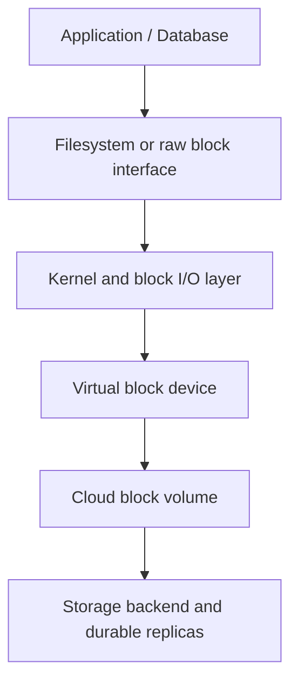
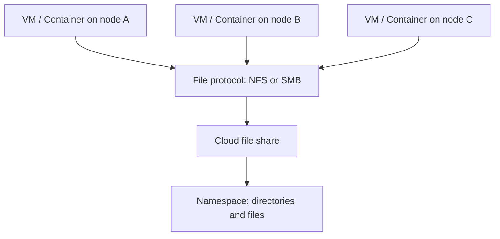
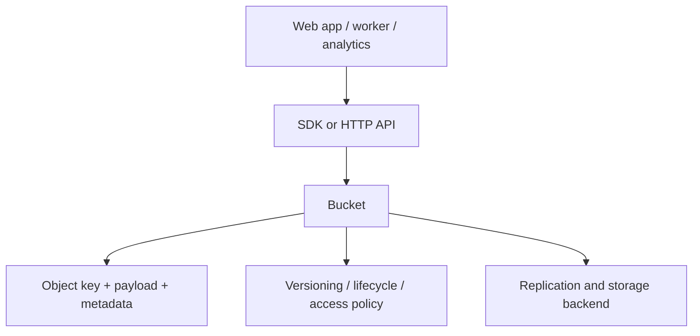
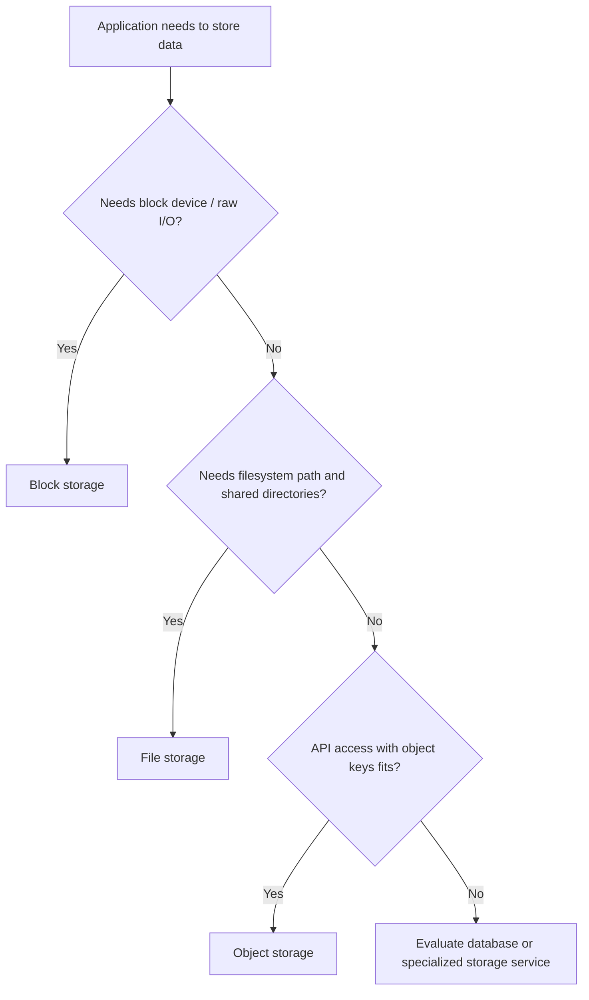
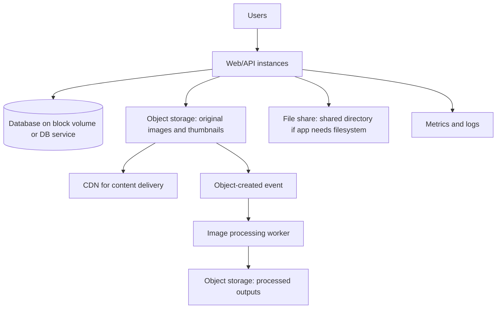

# Block Storage, File Storage, and Object Storage from an Application Perspective

## Context: How Do Applications See Data?

A cloud application may need to store an operating system, databases, user files, images, videos, backups, or analytics data. These data types have different access patterns. Databases often need to read and write small blocks of data with low latency; multiple servers may need to read the same directory concurrently; a web application may store millions of images and serve them over HTTP.

The cloud provides three common storage models:

- **Block storage:** provides block-level devices for a server or VM to format into a filesystem or use directly for a database.
- **File storage:** provides a hierarchical filesystem of directories and files, typically accessed via protocols such as NFS or SMB.
- **Object storage:** stores data as objects inside a bucket/container, accessed via API or HTTP rather than mounted like a conventional disk.

The core difference lies in **the interface the application uses and the semantics of read/write operations**. Choosing the right model affects how the application organizes data, sharing across multiple VMs, performance, scalability, security, durability, and cost.

In the **CLOUD_CORE_SERVICES_COMPUTE** module, understanding these three models helps design VMs, containers, and compute services with appropriate data storage while avoiding confusion between CPU/RAM capacity and storage I/O characteristics.

## 1. The Three Models from an Application Viewpoint

| Characteristic | Block storage | File storage | Object storage |
|---|---|---|---|
| Data unit | Block/sector on a device | File and directory | Object consisting of data, key, and metadata |
| Typical interface | Block device; filesystem or raw block API | NFS, SMB, or equivalent file protocol | REST/HTTP API, SDK, CLI |
| Addressing | Offset/block within a volume; file path after formatting | Hierarchical path such as `/shared/report.csv` | Bucket and object key such as `media/2026/photo.jpg` |
| Concurrent access | Typically attached to one host; multi-attach requires support and proper clustering | Multiple clients can access the same directory tree | Multiple clients call APIs on the same or different objects |
| Data modification | Read/write by block; filesystem manages files and metadata | Create, read, write, rename, delete files/directories | PUT/GET/LIST/DELETE objects and metadata |
| Commonly prioritized attributes | IOPS, latency, throughput, and filesystem control | File sharing, namespace, and access permissions | Massive scale, durability, API access, and cost per capacity |
| Common use cases | Boot disks, databases, transactional workloads | Shared home directories, shared content, working directories | Images/videos, logs, backups, data lakes, artifacts |

No single model is best for every workload. The same application can combine all three: block volumes for databases, a file share for data multiple machines must read together, and object storage for images or backups.

## 2. Block Storage: The Application Sees a Block Device

### 2.1. How It Works

Block storage provides a VM or host with a block-level storage device, similar to a disk connected to a computer. The operating system can create partitions, filesystems such as ext4/XFS/NTFS, and mount them to a directory. Databases or specialized applications can also access the block device directly if designed to do so.

Applications typically interact with files through a filesystem. The filesystem translates read/write operations into block requests to the device; the block storage service processes those requests at the storage layer. Therefore, block storage does not inherently provide directory structures, filenames, or POSIX permissions. Those functions are handled by the filesystem or host-side software.



### 2.2. Attaching a Volume to a VM

A volume is typically created in a region or availability zone and attached to a compatible VM. After attaching, the operating system detects the device; the operator can partition/format it if the volume is new, then mount it to a mount point.

Illustrative example on Linux, assuming the newly detected device is `/dev/vdb`:

```bash
# View existing devices and filesystems
lsblk -f

# Only format after confirming this is a new volume with no data to preserve
sudo mkfs.ext4 /dev/vdb

# Create mount point and mount the volume
sudo mkdir -p /data
sudo mount /dev/vdb /data

# Verify capacity and mount
df -h /data
```

Device names inside a VM can change depending on the driver, instance type, and attachment order. Before formatting, verify the exact volume and ensure no data needs to be preserved. For production environments, configure persistent mounting across reboots using a UUID or an appropriate device management mechanism; do not rely on `/dev/...` names that can change.

### 2.3. Strengths and Limitations

Block storage is well suited when applications need fine-grained I/O operations, a familiar filesystem, and configurable per-volume performance. Many services let you select volume types based on IOPS, throughput, latency, and durability targets. Capacity or performance can often be scaled depending on the service, sometimes requiring subsequent partition/filesystem expansion inside the guest OS.

Ordinarily, a standard filesystem should only be mounted and written to by one host at a time. Some services support multi-attach, but attaching the same block device to multiple VMs does not automatically make the filesystem safe. A cluster-aware filesystem, distributed lock, or an application/database cluster with proper write coordination is required. If multiple hosts write concurrently to a filesystem that does not support concurrent access, metadata and data can be corrupted.

Block volumes are also typically scoped to a specific zone or instance type. Moving a volume to another VM may require detaching/attaching, stopping the workload, or waiting for synchronization. Consequently, HA design must consider volume failover, replication, snapshots, and recovery time.

### 2.4. Suitable Workloads

- Boot volumes holding the VM's operating system.
- Databases requiring random I/O, transactions, and filesystem control.
- Enterprise applications storing state on a single VM's local filesystem.
- Queues, indexes, or workloads requiring predictable latency and IOPS.
- Data volumes requiring snapshots/backups and a lifecycle independent of the VM.

For databases, choose the volume type based on read/write patterns, block size, queue depth, IOPS, and throughput. Increasing volume capacity alone does not necessarily increase performance; some services tie performance to volume type or provisioned IOPS settings.

## 3. File Storage: The Application Works with a Shared Directory Tree

### 3.1. How It Works

File storage provides a hierarchical namespace of directories and files. Applications use familiar operations such as open, read, write, rename, create directory, and delete file. A file share can be mounted from multiple VMs or hosts over the network using NFS (common in Linux/Unix) or SMB (common in Windows), depending on the service.



The key aspect is that multiple clients can see the same directory tree. When one machine creates or updates a file, other machines can access that data according to protocol and service semantics. File storage typically handles metadata, locking, and access permissions at the service layer; applications must still adhere to proper file sharing and locking practices.

### 3.2. Mounting a File Share

Conceptual example on Linux with NFS:

```bash
sudo mkdir -p /mnt/shared
sudo mount -t nfs nfs.example.internal:/exports/team /mnt/shared
```

Example on Windows mapping an SMB share as a network drive:

```powershell
New-PSDrive -Name Z -PSProvider FileSystem `
  -Root "\\fileserver.example.internal\team" -Persist
```

These are illustrative examples; the protocol, server/export/share name, and mount options must come from the actual service. In the cloud, configure routes, DNS, firewalls, and permissions so clients can reach the file service. Do not expose NFS/SMB broadly to the Internet; prefer private networks and proper identities.

### 3.3. Concurrent Sharing, Locking, and Permissions

File storage is useful when multiple VMs need to read/write documents, user directories, or working data together. However, allowing multiple clients to mount simultaneously does not mean every application operation is automatically safe under concurrency.

For example, two processes updating the same configuration file concurrently can overwrite each other's changes. Applications need file locks, atomic renames, lease mechanisms, or a coordination service if multiple writers can modify the same data. Locking behavior and cache consistency depend on the protocol, version, and service configuration.

Access control can combine share/export-level permissions, user identity, UID/GID, ACLs, or Windows permissions. When running containers, ensure the UID/GID and directory permissions match the process inside the container. If mounting a share across multiple workloads, separate directories or permissions by tenant to prevent cross-access.

### 3.4. Strengths and Limitations

File storage is convenient when applications are already built around paths and filesystem operations. Multiple machines can share data without building custom file synchronization. It is a strong choice for home directories, team shared folders, CMS platforms, web content requiring a filesystem, file processing pipelines, or legacy applications requiring NFS/SMB.

On the other hand, file storage depends on the network. Latency of metadata operations like `stat`, `lookup`, `open`, and `rename` can impact workloads that create many small files or traverse large directories. Throughput and IOPS often have limits per share, capacity, configuration, or service tier. When many clients access the same hot file or directory, locking and contention can become a bottleneck.

File storage is not always the optimal choice for massive data lakes, globally distributed static content, or databases requiring low-latency block I/O. Benchmark against realistic patterns—especially the small-to-large file ratio, client count, metadata operation count, and concurrency.

## 4. Object Storage: The Application Interacts via API

### 4.1. How It Works

Object storage stores each unit of data as an object inside a bucket or container. An object typically consists of a payload, an identifying key, and metadata. Applications read/write objects via HTTP/SDK APIs; common operations include PUT (upload), GET (download), HEAD (read metadata), LIST, and DELETE.

An object key is typically a string such as `images/2026/11/photo-001.jpg`. The `/` character is usually just a naming convention to create the appearance of hierarchy; many object storage systems do not have physical directories like a filesystem. Consequently, renaming an object may actually involve copying to a new key and deleting the old key, depending on the API and tooling.



### 4.2. Accessing via API Instead of Mounting a Filesystem

Example uploading and downloading an object using the S3-compatible AWS CLI:

```bash
aws s3 cp ./report.csv s3://analytics-data/reports/report.csv
aws s3 cp s3://analytics-data/reports/report.csv ./report-copy.csv
```

The command illustrates the S3 interface; endpoints, credentials, and bucket permissions must be configured for the provider in use. In applications, use official SDKs or compatible APIs, workload identities, and short-lived credentials. Avoid embedding long-lived access keys in source code or images.

Object storage is typically easy to access over HTTP and integrates smoothly with web applications, workers, analytics systems, and CDNs. An object can be downloaded directly from a browser via a short-lived signed URL or through an authenticated backend, depending on the security model.

### 4.3. Metadata, Versioning, and Lifecycle

Metadata stores attributes such as content type, checksum, timestamp, tags, or application information. Choose a consistent key naming convention and set necessary metadata at upload time; do not rely on renaming directories as on a filesystem.

Common features in object storage include:

- **Versioning:** retains multiple versions of the same object key for recovery from accidental overwrites or deletions, depending on configuration.
- **Lifecycle policy:** automatically transitions objects to cheaper storage classes or deletes them after a retention period.
- **Replication:** copies objects to another region or account according to policy.
- **Multipart upload:** splits large objects into parts for parallel upload and resumes if a part fails.
- **Retention/Object Lock:** retains objects for a specified period or under immutability/WORM protection if supported by the service.
- **Event notification:** emits events when objects are created/deleted to trigger workers or pipelines.

Versioning and replication can increase billable storage capacity. Lifecycle policies must align with access patterns and retention obligations; do not delete objects solely based on age if legal or operational requirements still apply.

### 4.4. Semantics and Limitations

Object storage does not provide full POSIX filesystem semantics. Applications generally cannot open a file and perform random writes at an arbitrary offset like a block device; many APIs update an object by writing a new object or replacing the existing one. Renaming, file locking, appending, and multi-object transactions are not equivalent to a filesystem or database.

Many modern object storage services provide strong read-after-write consistency for objects, but you should not assume every provider, listing API, intermediate cache, or integrated system shares the same semantics. Verify specific consistency guarantees, especially when an application updates an object and immediately relies on LIST results or events.

Object storage excels with large objects, huge object counts, data that rarely receives partial updates, and API-driven access. For workloads requiring continuous random updates, file locking, or multi-record transactions, a database or block/file storage is more appropriate.

## 5. Performance: Measuring the Application's Actual I/O Pattern

Storage cannot be compared by a single GB/s figure alone. An application may be bottlenecked by latency, operations per second, throughput, request size, concurrency, or metadata/API overhead.

### 5.1. Key Metrics

| Metric | Meaning | When it matters |
|---|---|---|
| Latency | Time to complete a single I/O operation | Database transactions, small requests, metadata operations |
| IOPS | Read/write operations per second | Random I/O, databases, many small files |
| Throughput | Data volume transferred per second | Streaming, backups, large files, media |
| Queue depth | Number of I/O requests queued or executing concurrently | Optimizing parallelism and detecting queuing |
| Request size | Size of each read/write operation | Impacts achievable IOPS and throughput |
| Metadata rate | Rate of create/list/stat/open/rename operations | File shares and apps with many small files |
| Error/retry rate | Rate of errors, timeouts, and required retries | Application stability and performance under load |

A sequential workload reading large video files typically cares about throughput. A database performing many small block reads/writes typically cares about latency and IOPS. A pipeline opening millions of small files can be bottlenecked by metadata operations even when total data transferred is low.

### 5.2. Request Size and I/O Limits

Approximate throughput can be conceptualized as:

```text
Throughput ~= IOPS x Average request size
```

For example, 5,000 IOPS with an average request size of 16 KiB corresponds to roughly 78 MiB/s by theoretical multiplication. Actual figures also depend on overhead, read/write ratio, queue depth, service limits, caching, and measurement methodology. If request size increases, the same IOPS can yield higher throughput; conversely, a workload with many small requests can achieve high IOPS while producing modest throughput.

### 5.3. Latency and Queuing

When storage becomes overloaded, requests wait in queues and latency rises. Increasing queue depth can help utilize the device and achieve higher throughput up to a point, but excessively deep queues increase wait time and tail latency. For interactive applications, p95/p99 latency can matter more than average throughput.

Measure performance under production-like conditions: matching file sizes, read/write ratios, client counts, concurrency, cache state, and run duration. A sequential benchmark on one large file does not represent random database I/O; benchmarking a single VM does not represent dozens of clients mounting a shared file system.

## 6. Durability, Availability, and Consistency

Storage may advertise high durability, yet applications still need to understand how data is protected and recovered. Three concepts must be distinguished:

- **Durability:** the probability that written data will not be lost over the retention period.
- **Availability:** the ability to access the service and data when needed.
- **Consistency:** what clients observe after read/write operations and when multiple clients update the same data.

A service can have high durability yet be temporarily unavailable during a network or zone outage. Replication improves fault tolerance, but it does not replace backups: application bugs, accidental deletions, or ransomware can be replicated to the replicas.

### 6.1. Snapshots, Backups, and Replication

A snapshot typically captures the state of a volume or dataset at a logical point in time. A backup may encompass multiple volumes, application configurations, databases, and retention policies. Replication maintains copies in another location to improve availability or recover from regional/zonal failures.

For databases, a crash-consistent snapshot may be equivalent to the state after an abrupt power loss. To achieve application-consistency, coordinate with the database or filesystem to flush data and record a consistent state. Check how the service takes snapshots and quiesce the application if needed.

A backup is only valuable if it can be restored. Test restoring into an isolated environment, verifying the data, recovery time, and access permissions. Establish RPO (acceptable data loss) and RTO (target recovery time) to select backup schedules, replication, and failover strategies.

### 6.2. Consistency and Concurrent Updates

With block storage, the filesystem and database manage write ordering, caching, journals, and transactions. With file storage, semantics depend on NFS/SMB and cache/locking configuration. With object storage, read-after-write, versioning, conditional requests, and listing semantics depend on the specific API.

When multiple workers update the same data item concurrently, use locks, versions/ETags, conditional writes, transactions, or an appropriate coordination mechanism. Never assume two concurrent writers will automatically merge safely.

## 7. Data Security Across Each Model

Storage often holds critical data and can outlive VMs. You must protect data in transit, data at rest, access identities, and the deletion lifecycle.

| Protection layer | Block storage | File storage | Object storage |
|---|---|---|---|
| Encryption at rest | Encrypt volume/snapshot with appropriate keys | Encrypt share or backend per service | Encrypt objects with service-managed or customer-managed keys |
| Encryption in transit | Block connection channel or host-level encryption if needed | TLS/SMB encryption or private network per service | HTTPS/TLS for APIs |
| Access control | Volume attach permissions, IAM, and guest filesystem permissions | Export/share permissions, identity, UID/GID, ACLs | IAM/bucket policies, access points, signed URLs |
| Isolation | Volume and project/account | Share, export, directory, and ACLs | Bucket, prefix, account, and policies |
| Audit | Volume create/attach/detach actions and guest access | Share/ACL changes and client logs if available | API access logs, object-level audit if supported by service |
| Secure deletion | Delete volumes, snapshots, keys, and copies per policy | Delete files/shares and replicas/backups | Delete markers/versions, lifecycle, retention, and object lock |

Practical principles:

- Grant least-privilege permissions to VMs, containers, users, and service accounts.
- Encrypt sensitive data both at rest and in transit.
- Avoid public access by default; open public access only for objects intended for public distribution.
- Manage keys and secrets separately, tracking rotation and decryption permissions.
- Enable appropriate auditing and monitor for anomalous access.
- Define retention, legal holds, and deletion procedures before enabling automated lifecycle rules.

## 8. Choosing Storage Based on Application Requirements

Start from how the application reads/writes and shares data, then select the service. The following table provides directional guidance and does not replace benchmarking or verifying provider semantics.

| Application need | Usually suitable choice | Reason |
|---|---|---|
| VM boot disk | Block | The OS requires a bootable block device |
| Transactional database on a VM | Block or managed database service | Needs suitable latency, IOPS, and write semantics |
| Multiple VMs accessing a shared directory | File | Shared namespace and file-sharing protocol |
| CMS or legacy app needing shared filesystem paths | File | Compatible with file/directory operations |
| User images/videos and static content | Object | Massive scale, API/HTTP access, and CDN integration |
| Backups, archives, and long-term logs | Object or backup service | Lifecycle, versioning, and low-cost storage tiers |
| Data lakes and analytics datasets | Object | Large-scale object storage with analytics tool integration |
| High-speed regenerable scratch data | Local ephemeral SSD or high-performance block | Prioritizes speed; data can be regenerated or stored durably elsewhere |

### 8.1. Quick Decision Tree



If an application has multiple types of data, choose per data group rather than forcing everything into one storage type. For instance, database metadata can live on a block volume; actively edited user files can reside on a file share; uploaded images and backups can be stored as objects.

## 9. Integrating Storage with VMs, Containers, and Serverless

### 9.1. VMs

VMs typically use a block volume as a boot disk and can attach additional data volumes. File shares are mounted over the network when multiple VMs need to access the same directory. Object storage is accessed via SDK/API from applications or agents running inside the VM.

When designing VMs, identify which data must survive VM replacement. Temporary data can reside on ephemeral disks or local SSDs; durable data must live on volumes or storage services with retention policies. Avoid storing the sole copy of data on the boot disk if rebuild or termination workflows can wipe the disk.

### 9.2. Containers and Kubernetes

A container image should contain code and required dependencies; do not use image layers to store long-lived application data. The writable layer of a container's filesystem is typically tied to the container lifecycle; when a pod is replaced, that data may be lost.

Kubernetes provides abstractions for attaching storage:

- **emptyDir:** temporary storage lasting for the lifetime of a Pod; suitable for caches or regenerable scratch data.
- **PersistentVolume (PV):** represents a durable storage resource provisioned in the cluster.
- **PersistentVolumeClaim (PVC):** a workload's request for capacity and access modes.
- **StorageClass:** describes the storage tier and how volumes are dynamically provisioned.
- **CSI driver:** connects Kubernetes to the platform's block/file storage service.

Example PVC requesting a 20 GiB volume:

```yaml
apiVersion: v1
kind: PersistentVolumeClaim
metadata:
  name: database-data
spec:
  accessModes:
    - ReadWriteOnce
  storageClassName: fast-block
  resources:
    requests:
      storage: 20Gi
```

A Pod can mount the claim into a container:

```yaml
apiVersion: v1
kind: Pod
metadata:
  name: database
spec:
  containers:
    - name: db
      image: example.invalid/database:stable
      volumeMounts:
        - name: data
          mountPath: /var/lib/database
  volumes:
    - name: data
      persistentVolumeClaim:
        claimName: database-data
```

`ReadWriteOnce` generally indicates the volume can be mounted read-write by one node at a time under Kubernetes/CSI semantics; do not oversimplify it as allowing only a single Pod in all cases. `ReadWriteMany` typically requires a file storage backend supporting multiple nodes. Actual access modes and attachment capabilities depend on the CSI driver and cloud service.

Object storage is typically accessed directly from the application via SDK/API. A CSI/FUSE gateway can present objects as a filesystem, but this compatibility layer does not turn object storage into a full POSIX filesystem. Check semantics around renames, locking, random writes, and caching before using it with legacy applications.

### 9.3. Serverless

Serverless functions typically provide a temporary filesystem in the execution environment, but the environment lifecycle may be short or unpredictable. Do not treat temporary directories as durable storage. For data that must be retained, functions can call object APIs, databases, or platform-supported file/block services.

Object storage pairs well with event-driven workflows: when a new object is uploaded, an event triggers a function to process it, generate thumbnails, or extract metadata, then write the output as another object. For workloads requiring a mounted file share or block device, verify that the serverless runtime supports those connections along with timeout, network, and concurrency limits.

## 10. Designing Applications to Use Storage Effectively

### 10.1. Sizing and Partitioning Data

For block storage, choose block sizes, filesystems, and queue depths tailored to the application. For file storage, avoid generating excessive unnecessary metadata operations; batch small files or cache results when appropriate. For object storage, use multipart uploads for large objects and design keys that simplify retrieval, partitioning, and lifecycle management.

### 10.2. Caching at the Right Layer

Caching reduces storage accesses and improves latency. Caches can live in application memory, local SSDs, CDNs, or dedicated cache services. However, caching introduces invalidation and consistency challenges: define TTLs, versioned keys, update strategies, and stale-data handling.

For static content stored in object storage, a CDN offloads the origin and brings content closer to users. For file shares, client caching must be configured according to application semantics. For databases on block storage, database/OS-level caching must be accounted for to avoid misinterpreting raw I/O metrics.

### 10.3. Retries, Timeouts, and Idempotency

Applications must handle timeouts and transient errors when accessing storage. Retries require exponential backoff and a maximum retry count to avoid amplifying outages. For write operations, account for the possibility that a request completed on the storage backend even if the client never received the response.

For object storage, use unique keys, conditional requests, checksums, or versions to avoid unintended overwrites. For file storage, use atomic renames or locks when updating shared files. For block/databases, rely on transactions and the DBMS recovery mechanisms.

### 10.4. Monitoring and Alerting

Storage monitoring should combine service-level metrics with application-level metrics:

- Read/write p50, p95, and p99 latency.
- IOPS, throughput, queue depth, and throttling rate.
- Used capacity, growth rate, and remaining free space.
- Errors, timeouts, retries, rate-limited requests, and dropped connections.
- File metadata operations, client counts, and contention metrics if exposed by the service.
- Object request rate, object count, capacity by storage class, and retrieval costs.
- Backup success rate, restore duration, and replication lag.

A full volume can halt application writes even when CPU/RAM have plenty of headroom. A file share overloaded with metadata operations can slow down an application despite low throughput. Object storage can incur significant request or egress charges even when stored capacity barely grows. Dashboards should therefore surface both infrastructure and application perspectives.

## 11. Cost and Data Lifecycle

Storage costs go beyond price per GiB-month. Depending on the model and provider, charges may include provisioned capacity, IOPS/throughput, API requests, snapshots, replication, retrieval, egress, minimum class capacity/duration, and backup costs.

| Model | Cost factors to watch | Optimization measures |
|---|---|---|
| Block | Volume size, performance tier, provisioned IOPS, snapshots, and copies | Right-size volumes, tune IOPS to workload, delete expired snapshots after checking retention |
| File | Share capacity, provisioned throughput/capacity, client count, or service tier | Separate workloads, clean temporary files, pick the right tier, reduce redundant metadata operations |
| Object | Capacity by storage class, PUT/GET/LIST requests, retrieval, replication, and egress | Lifecycle policies, compression, CDN/caching, multipart uploads, and reducing unnecessary requests |

Lifecycle policies transition infrequently accessed data to cheaper storage classes or delete it after a set period. Factor in retrieval times, retrieval fees, minimum storage durations, and legal requirements. A cheap archive tier may be unsuitable if the application needs immediate reads.

Classify data by lifecycle stage:

1. **Hot:** accessed frequently, requires low latency.
2. **Warm:** accessed intermittently, still needs relatively fast retrieval.
3. **Cold/archive:** rarely accessed, prioritizes low storage cost and tolerates longer restore times.
4. **Ephemeral:** regenerable temporary data that can reside on local disks or scratch space.

Never delete data solely because it is infrequently accessed. Verify ownership, retention rules, backups, legal holds, and deletion approval workflows.

## 12. Storage Design Example for a Web Application

Suppose a web application has an API, a database, image upload functionality, and image-processing workers. An architecture could divide storage as follows:



In this design:

- The database stores metadata such as owner, object name, access permissions, and processing status. Transactional data requires storage with database-appropriate semantics.
- Original images and thumbnails are stored as objects; the API issues signed URLs or serves them via CDN according to access policies.
- Workers receive events, read the object, process it, and write the output object. Because jobs may retry, idempotency is needed to avoid duplicate outputs or incorrect overwrites.
- A file share is only necessary if the application or existing tools genuinely require a shared filesystem; do not add a file storage layer if object APIs suffice.
- Logs, metrics, and backups are managed under separate retention and compliance policies.

This design avoids storing large images inside the database or relying on a single VM's local filesystem. When an API instance is replaced, objects persist and other workers can continue processing.

## 13. Migrating Data Between Storage Models

Migrating from block to file or object storage is more than copying bytes. Applications may rely on filesystem semantics, paths, permissions, locking, timestamps, atomic renames, or partial updates. List these dependencies before migrating.

A typical migration workflow includes:

1. **Profile the workload:** measure capacity, file/object counts, average sizes, read/write ratios, latency, IOPS, throughput, and concurrency.
2. **Identify semantics to preserve:** permissions, ownership, locking, versioning, consistency, metadata, atomic updates, and concurrent access.
3. **Design the mapping:** map volumes/paths to shares or buckets/keys; define naming, metadata, checksums, and partitioning schemes.
4. **Test copy:** use a representative dataset, comparing checksums, permissions, and access times.
5. **Sync deltas:** while the source system remains live, copy incremental changes using an appropriate mechanism.
6. **Cut over the application:** pause writes or use controlled dual-writes, switch endpoints/mounts/configs, and verify access.
7. **Monitor and prepare rollback:** watch errors, latency, and missing/duplicate data; keep the old source for a safe grace period before decommissioning.

When moving from a filesystem to object storage, code changes may be needed to adopt SDKs/APIs, handle uploads/downloads, metadata, and URLs. A FUSE layer or gateway can give legacy applications path-level compatibility, but benchmark and validate semantics before using it in production.

## 14. Common Misconceptions

**Block storage and file storage are the same because both can hold files.** Block storage provides a raw device; the host filesystem creates files and directories. File storage provides a shared file namespace over a network protocol.

**Attaching the same block volume to multiple VMs is always safe.** Multi-attach is safe only when the service, filesystem, and application coordinate concurrent writes. Otherwise, the filesystem can be corrupted.

**File storage is just object storage with folders.** File storage offers filesystem operations and protocol semantics; object storage offers an object API. Prefixes in object keys are typically just naming conventions.

**Object storage can replace any filesystem.** Object APIs do not inherently provide full POSIX semantics like random writes, locking, and atomic renames. Applications may need to change how they access data.

**Larger capacity means higher performance.** Performance also depends on IOPS, throughput, latency, queue depth, volume type, request size, and service limits.

**Replication replaces backups.** Replication can replicate accidental deletions or corrupted data. You still need backups with retention policies and tested restores.

**Mounting object storage via FUSE makes it equivalent to a file share.** FUSE only provides a compatibility layer; semantics and performance still depend on the underlying object API.

## 15. Checklist for Choosing Application Storage

Before choosing a service, answer these questions:

- [ ] Does the application need raw block I/O, filesystem paths, or an object API?
- [ ] Is data updated by block, by file, or as whole objects?
- [ ] Do one or multiple VMs/containers need to read and write the same data?
- [ ] Are POSIX permissions, ACLs, locking, atomic renames, or transactions required?
- [ ] Is the workload random I/O, sequential, small files, large objects, or metadata-heavy?
- [ ] What are the latency, IOPS, throughput, and concurrency targets?
- [ ] Is the data regenerable, or must it survive VM/pod replacement?
- [ ] Have RPO, RTO, snapshots, backups, replication, and restores been defined?
- [ ] Are IAM permissions, encryption, network paths, auditing, and retention appropriate?
- [ ] Have costs for capacity, requests, IOPS, retrieval, egress, and replicas been calculated?
- [ ] Have you benchmarked with production-like patterns and tested failure/recovery scenarios?

## Conclusion

Block storage provides block devices for VMs or hosts to manage filesystems and I/O; file storage provides a directory tree shareable over protocols like NFS/SMB; object storage stores data by object key accessed via API/HTTP. Applications should select storage based on read/write semantics, data sharing requirements, latency, IOPS, throughput, durability, recoverability, and cost. Many systems combine all three models: block for databases or boot disks, file for shared directories, and object for large content, backups, or analytics datasets. Good design starts from the application's access patterns, then validates through benchmarks, security reviews, and restore testing.
