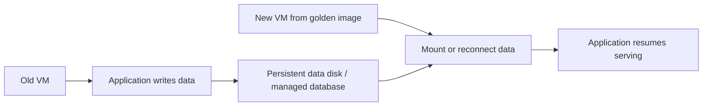

# Managing Persistent Data When Machines Are Replaced or Deleted

Virtual machines can be newly created, replaced, resized, or deleted during operations. If application data resides only on temporary disks tied to the machine's lifecycle, replacing a VM can cause data loss. For a system to keep operating after a machine failure or redeployment, you must design storage independently of the compute lifecycle, define explicit disk retention/deletion policies, and test recovery capability.

In cloud compute architecture, **data persistence** depends on more than just the disk type. It also depends on how the application writes data, snapshot and backup mechanisms, resource deletion policies, encryption, replication across failure domains, and restore procedures. This lesson explains how to manage data so VMs can be replaced or deleted without losing critical data—while also avoiding unintended data retention and uncontrolled costs.

## 1. Decoupling Data Lifecycle from VM Lifecycle

A VM comprises compute along with associated resources such as boot disks, data disks, network interfaces, IP addresses, and identities. These resources can have distinct lifecycles. When a VM is deleted, the platform may delete the boot disk, keep the data disk, or follow policies configured by the creator.

The key is determining **which data must survive after the VM disappears**. For example:

- The operating system and temporary files can be recreated from a golden image.
- Temporary logs or caches can be lost without affecting system correctness if another source of truth exists.
- User files, databases, queue state, or business data must reside on durable storage with appropriate backup mechanisms.
- Secrets and credentials should live in a secret manager, not inside disk images or shared data disks.

A common pattern is keeping compute replaceable: launch a new VM from a golden image, reattach the data volume, or reconnect to an independent storage service. That way, a VM failure does not mean business data loss.



The diagram illustrates only the concept of decoupling compute from data. Volume reattachment, ownership handoff, data synchronization, and application startup must follow platform capabilities and filesystem/database rules.

## 2. Distinguishing Compute-Attached Storage Types

Cloud services offer multiple storage types differing in durability, performance, sharing capability, and cost.

| Storage type | Characteristics | Used for | What to watch |
|---|---|---|---|
| Local/ephemeral disk | Tied to the host or instance lifecycle; usually high performance | Caches, scratch space, temp data, regenerable buffers | May be lost on VM stop, terminate, host failure, or replacement depending on service |
| Persistent block volume | Volume relatively independent of the VM; can detach/attach per policy | Databases, app filesystems, data needing block access | Must manage attachment, filesystems, snapshots, and deletion policy |
| File storage | Provides shared filesystem over the network | Shared files, home directories, content accessed by multiple VMs | Must understand locking, throughput, latency, quotas, and permissions |
| Object storage | Stores objects via API; highly scalable and durable | Backups, media, logs, artifacts, unstructured data | App must use API/object semantics; not a block device for arbitrary mounting |
| Managed database/storage service | Provider manages part of backups, replication, and failover | Structured data or stateful services | Must check RPO/RTO, retention, exports, and remaining operational duties |

Never assume every disk visible inside the guest OS is durable. A disk can appear as a block device while still being local ephemeral storage. Always verify the volume type in the control plane and service documentation.

### 2.1. Ephemeral Storage

Ephemeral storage fits data that can be regenerated. For instance, an application can store caches, temporary downloads, intermediate batch job data, or scratch directories on local SSD. Using local disks can provide suitable performance and cost, but they must never be treated as the sole copy of data that must be preserved.

Behavior during stop, restart, terminate, or host failure depends on the specific local disk type and platform. Some lose data on VM termination; others preserve data across reboots but not across stop/host replacement. Read the exact lifecycle specification for the chosen disk type.

### 2.2. Persistent Block Volumes

A persistent block volume is managed as an independent storage resource. A VM uses the volume by attaching it, after which the OS detects the block device, creates or recognizes a filesystem, and mounts it into an application directory.

Volumes can usually survive VM deletion if delete-on-termination or an equivalent policy is configured to retain them. However, detach/attach capabilities have limits: some volumes attach to only one VM at a time; some services support multi-attach but require a cluster-aware filesystem or application concurrency control.

### 2.3. File and Object Storage

File storage is useful when multiple VMs need access to the same directory tree. Object storage fits unstructured data, backups, and artifacts accessed via API. If an application is designed to use object storage or a managed database, data can exist independently of VMs without managing volume attachments or mounts.

Choose storage based on access patterns, latency, throughput, IOPS, object/file sizes, sharing needs, consistency requirements, data transfer costs, and recoverability.

## 3. Defining Disk Lifecycle Policies

When creating a VM or volume, specify what happens when the machine is deleted. Platforms usually offer options to retain or delete disks, though field names and defaults vary.

| Scenario | Typically appropriate policy | Pre-execution checks |
|---|---|---|
| Deleting a stateless VM with a recreatable boot disk | Boot disk may be deleted with the VM | Golden image is ready; no unique data sits on the boot disk |
| Replacing a VM whose data disk holds business data | Retain data disk, detach cleanly, attach to new VM | App stopped writing; clean filesystem; matching zone/region and permissions |
| Deleting a test/sandbox VM | Delete disks too once confirmed no data needs to be kept | No data needed for investigation, archival, or compliance |
| Deleting a VM involved in incident investigation | Isolate and retain disks/snapshots per evidence procedures | Preserve logs, chain of custody, and access controls |
| Deleting a machine with retention requirements | Retain backups for the policy period, then delete per workflow | Retention period, legal hold, and deletion evidence |

Do not rely on VM or disk names to infer whether data can be deleted. Use tags/labels, inventories, and managed resource relationships to identify the owner, environment, data classification, and retention policy.

### 3.1. Delete-on-Termination and Equivalent Options

Some platforms have an attribute controlling whether the boot volume or attached volumes are deleted when an instance terminates. In AWS EC2, this behavior is typically controlled by the `DeleteOnTermination` attribute in the block device mapping. Azure and Google Cloud offer equivalent options in disk/VM configuration and resource deletion workflows.

Before deleting a VM, check:

- Which disk is the boot disk and which disks hold application data.
- The deletion policy of each disk.
- Whether the disk is retained independently or bound to a resource group/instance lifecycle.
- Whether snapshots or backups have completed and can be restored.
- Whether the volume is currently mounted or used by another VM.
- Whether retention, legal hold, or security investigation requirements apply.

Do not treat retaining a disk as a backup. If a disk suffers accidental deletion, logical corruption, ransomware encryption, or an application bug overwriting data, the live disk may not restore a prior healthy state.

## 4. Attaching a Data Volume to a New VM

A common scenario is replacing a failed VM with a new VM from a golden image and reattaching the data volume. The procedure must ensure the volume was detached safely and the filesystem is never written to concurrently from two machines.

General workflow:

1. Identify the VM, volume, and data to preserve using inventory records.
2. Stop the application or switch the workload to read-only mode to halt writes.
3. Flush data to disk and unmount the filesystem on the old VM.
4. Detach the volume via the platform API and confirm the attachment has ended.
5. Launch or select the new VM from an approved image.
6. Attach the volume to the new VM within a supported topology location.
7. Verify the device, filesystem, UUID, ownership, and mount point.
8. Inspect data and access permissions before starting the application.
9. Start the application, verify health checks, and monitor logs.
10. Keep the old VM isolated until cutover is confirmed and decommissioning policies are satisfied.

### 4.1. Linux Example

Device names inside the guest OS can change after reattaching. Do not assume a volume will always appear under the same name like `/dev/sdf`. Use a UUID or filesystem label for stable mounting.

Inspect devices and filesystems:

```bash
lsblk -f
blkid
```

Create the mount point and mount the existing filesystem:

```bash
sudo mkdir -p /srv/app-data
sudo mount UUID=<filesystem-uuid> /srv/app-data
```

To mount automatically after reboot, declare the UUID in `/etc/fstab` after verifying the filesystem and mount options:

```text
UUID=<filesystem-uuid>  /srv/app-data  ext4  defaults,nofail  0  2
```

`nofail` allows the VM to continue booting when the volume is absent, though it is unsuitable for every workload. If the application strictly requires this data, startup configuration should verify the mount point and refuse to start the service when the volume is missing, rather than running mistakenly against an empty directory on the boot disk.

Never create a new filesystem with `mkfs` on a volume holding data to preserve. Filesystem creation overwrites existing metadata and renders data inaccessible.

### 4.2. Avoiding Concurrent Attachment of Non-Shared Filesystems

A standard filesystem like ext4 or XFS must not be mounted read-write concurrently on multiple VMs simply because the platform permits multi-attach volumes. If multiple machines must access the same data, use a cluster filesystem with locking support, file storage, or an application mechanism designed for concurrent access.

Attaching a read-write volume to two VMs without coordination can corrupt the filesystem and data. Always verify multi-attach limits, filesystem type, read-only/read-write modes, and application support.

## 5. Snapshots, Backups, and Replication

All three mechanisms protect data, yet they solve different objectives.

| Mechanism | Objective | What can it recover? | Limitations |
|---|---|---|---|
| Snapshot | Capture volume state at a point in time | Block volume contents at capture time | May be application-inconsistent if writes are active |
| Backup | Create recovery copies per policy and retention | Data or systems within backup scope | Must verify schedules, immutability, storage location, and restore capability |
| Replication | Maintain data copies in another volume/node/zone/region | Can continue serving when a replica or failure domain fails | Accidental deletion, encryption, or corruption can be replicated |
| Archive | Store long-term data at lower storage cost | Historical data or compliance archives | Retrieval latency and restore fees can be high |

Snapshots can be part of a backup strategy, but a single snapshot in the same account and region is insufficient protection against every failure. Consider deletion permissions, shared blast radius, retention, cross-copying, and recoverability.

### 5.1. Crash-Consistent vs. Application-Consistent Snapshots

If a snapshot is taken while a VM or application is actively writing, the captured state may be equivalent to a sudden power loss. The filesystem or database may need to run recovery upon startup. This is typically called **crash-consistent**.

An **application-consistent** snapshot coordinates with the application so data is flushed or writes are paused before capture. Mechanisms may use a guest agent, database backup API, filesystem freeze, or provider tooling. For databases, use database-supported backup/replication mechanisms rather than assuming a single volume snapshot is always transactionally consistent.

If a database spans multiple volumes—such as data, logs, and journals—take a coordinated multi-volume snapshot or use a backup tool capable of coordinating across volumes. Snapshotting individual volumes at different instants can yield an unrecoverable state.

### 5.2. Replication Does Not Replace Backups

Replication increases availability when a volume or zone fails. However, if a user accidentally drops a table, an application writes bad data, or ransomware encrypts files, those changes can replicate to the surviving replica.

Point-in-time backups, adequate retention, and copies with separated deletion permissions allow recovering to a state prior to the incident. For critical data, combine replication for service continuity with backups for historical data recovery.

## 6. Designing Backups Around RPO and RTO

Two common objectives in data protection design are:

- **RPO (Recovery Point Objective):** the maximum acceptable amount of data loss, typically expressed as the time interval between the last backup/replication and the incident.
- **RTO (Recovery Time Objective):** the maximum acceptable time to restore service after an incident.

For example, a system with a 15-minute RPO and a 2-hour RTO needs backup or replication ensuring target data loss stays within 15 minutes, paired with a restore procedure completable within 2 hours. Daily snapshots alone will not meet this RPO without additional log backups or replication.

Backup design must answer:

1. Which data needs protection and how critical is each category?
2. What are the RPO/RTO targets for each service?
3. What schedule do backups run on, and are successes/failures monitored?
4. In which account, project, subscription, region, or system are backups stored?
5. Who has permission to read, modify, delete, or shorten retention?
6. Is data encrypted in transit and at rest?
7. Are restores tested periodically, and is actual recovery time measured?

Do not measure only backup job success rates. What matters is restoring the right data, from the right point in time, within the target duration.

## 7. Protecting Backups Against Accidental Deletion and Ransomware

Backups are valuable when attackers or operational mistakes cannot easily delete all copies alongside the primary data.

Common safeguards:

- Store a backup copy in a separate account/project or security boundary.
- Use dedicated IAM permissions for the backup service; restrict deletion and retention modification rights.
- Enable immutable backups or retention locks where supported by the platform.
- Use object versioning or object locks for eligible datasets.
- Replicate backups to another region if disaster recovery requires it.
- Encrypt backups and manage keys independently; ensure keys remain available throughout the retention period.
- Log creation, deletion, retention changes, and restore operations.
- Test emergency recovery accounts and access procedures when primary IAM is disrupted.

Immutability does not remove governance responsibilities. Choose sensible retention periods, understand legal hold conditions and storage costs, and verify post-retention expiration/deletion complies with data policies.

## 8. Encryption and Key Management for Persistent Data

Persistent volumes, snapshots, and backups may contain sensitive data. Enable encryption at rest and protect data in transit between VMs and storage services.

Common options:

- Platform-managed encryption using the service's default keys.
- Encryption with customer-managed keys in KMS or a key management service.
- OS-level or application-level encryption when specific requirements apply.

Customer-managed keys give organizations control over usage permissions, rotation, and revocation, but they also add operational responsibility. If a key is disabled, deleted, or loses access permissions, volumes and backups may become unreadable. Protect key policies, separate key administration from VM administration, log key usage, and plan key recovery procedures.

Snapshots typically inherit or require selecting encryption settings per service. When copying snapshots across regions or accounts, verify destination keys, key usage permissions, and encryption policies. Never assume a copy automatically uses the same key or can be restored in another account.

## 9. Procedure for Replacing a VM While Preserving Data

A controlled VM replacement workflow can be divided into stages:

### Before Replacement

- Identify the VM, boot disk, data disks, file storage, and databases used by the application.
- Verify the latest snapshot/backup and its completion status.
- Confirm RPO/RTO and the rollback plan.
- Confirm whether volumes support detach, multi-attach, or are bound to a specific zone.
- Announce maintenance or drain traffic to another instance if needed.

### During Cutover

- Pause writes or place the application into maintenance mode.
- Flush data, stop the database following engine procedures, and unmount volumes if appropriate.
- Detach volumes cleanly; never force-detach while the old machine is still writing unless executing an assessed incident procedure.
- Create the new VM from a golden image and configure identity/networking.
- Attach the volumes or restore data from snapshots/backups.
- Verify filesystems, permissions, mount configurations, and data.
- Run application validation checks before admitting traffic.

### After Cutover

- Monitor application errors, latency, I/O, filesystems, and database recovery.
- Verify new data is written to the intended volume.
- Confirm backup jobs continue running on the new resources.
- Retain the old resources for the rollback window or delete per approved policy.
- Update inventory and application-to-volume mappings.

## 10. Safe VM Deletion Procedure

Deleting a VM can cascade to deleting disks, network interfaces, snapshots, or related resources depending on configuration. Before executing, follow a clear verification checklist.

1. Identify the VM's owner, environment, and data classification.
2. Verify traffic has been drained or the application stopped properly.
3. Determine which disks hold unique data and which can be recreated.
4. Verify backups and restore capability for data that must be retained.
5. Check retention, legal hold, security investigation, and compliance requirements.
6. Confirm delete/retain policies for every disk, NIC, snapshot, and related resource.
7. Execute deletion under a change record or authorized workflow.
8. Verify resource states after deletion and update inventory.
9. Revoke unnecessary identities, credentials, and access rights.
10. Monitor costs of any retained volumes/snapshots and assign an owner and review date.

For a compromised VM, do not delete it immediately before preserving evidence. You may need to isolate networking, retain snapshots/disks per forensic guidelines, and log operator actions. Only dispose of data per deletion policy once investigation and retention obligations conclude.

## 11. Examples Across Cloud Platforms

Service names and lifecycle details vary by SKU, region, and disk type. The examples below illustrate resource classification only; consult current documentation for the exact service before automating deletion.

| Platform | Persistent block storage | Local/ephemeral storage | Common data protection capabilities |
|---|---|---|---|
| AWS | Amazon EBS volumes | EC2 instance store on supported instance types | EBS snapshots, AWS Backup, snapshot copies, lifecycle and retention policies |
| Azure | Azure Managed Disks | Temporary disk on supported VMs | Disk snapshots, Azure Backup, Recovery Services vaults, and retention policies |
| Google Cloud | Persistent Disk and Hyperdisk on supported machine types | Local SSD on supported machine types | Disk snapshots, backup plans, and regional replication where supported |

Across all three platforms, distinguish boot disks from data disks, inspect deletion policies upon VM deletion, and verify snapshots/backups reside in appropriately independent fault domains. A service name alone does not guarantee data survival if lifecycle settings or deletion permissions are misconfigured.

## 12. Automating Storage Lifecycle with Infrastructure as Code

When provisioning VMs and volumes with Terraform, Bicep, CloudFormation, or similar tools, encode lifecycle policies explicitly in configuration and review them as part of infrastructure changes.

Attributes to manage:

- Whether disks are created inline with the VM or independently.
- Deletion policy when the VM is deleted.
- Encryption keys and key usage permissions.
- Snapshot/backup policies, retention, and copy targets.
- Tags/labels for owner, application, environment, data classification, and cost center.
- Protection for critical resources against accidental destruction.
- Dependencies among VMs, volumes, mount configuration, and applications.

Some IaC tools provide attributes such as `prevent_destroy`, retain policies, or deletion protection. These help reduce accidental deletions but do not replace backups. When intentional deletion is required, change workflows should review blast radius and provide a controlled way to lift protection.

Illustrative HCL example of an independently managed volume protected from accidental destruction:

```hcl
resource "aws_ebs_volume" "application_data" {
  availability_zone = var.availability_zone
  size              = 200
  type              = "gp3"
  encrypted         = true

  tags = {
    Name        = "application-data"
    Environment = var.environment
    Owner       = "platform-team"
  }

  lifecycle {
    prevent_destroy = true
  }
}
```

This example illustrates independent volume management and destroy protection only. Real deployments should declare keys, throughput/IOPS, attachments, backup policies, and organizational tags. `prevent_destroy` can block certain Terraform plans from destroying resources, yet it does not stop someone with permissions from deleting directly via the cloud console/API.

## 13. Monitoring and Testing Recovery Capability

Persistent storage must be monitored both technically and at the policy level:

- Used capacity and growth rate.
- IOPS, throughput, latency, and queue depth.
- Volume attachment states and filesystem errors.
- Snapshot/backup status, timestamp of the latest backup, and backup age.
- Actual restore duration and restored data volume.
- Replication status, lag, and synchronization errors.
- Access permissions, retention changes, snapshot deletions, and KMS operations.
- Costs for volumes, snapshots, backups, archives, and cross-region transfer.

Periodic restore testing should include:

1. Selecting a backup per policy and recording the target data timestamp.
2. Restoring into an isolated environment without overwriting production data.
3. Checking filesystem integrity, checksums, database consistency, and business data.
4. Measuring recovery duration and comparing against RTO.
5. Identifying the latest recoverable point and comparing against RPO.
6. Documenting issues, refining runbooks, and retesting.

A green backup job only indicates the tool finished its run. Only a successful restore proves the recovery path works under test conditions.

## 14. Common Design Mistakes

**Storing the sole copy of data on a local disk.** When a VM or host is replaced, data can be lost. Use persistent storage or an appropriate data service for data that must survive.

**Assuming every disk survives VM deletion.** Boot disks and data disks may have different deletion policies. Check the lifecycle attribute of each disk before deleting.

**Treating snapshots as complete backups.** Snapshots may share the same account, region, or deletion permissions as primary data. Implement retention, independent copies, and restore tests.

**Snapshotting a writing database without coordination.** Crash-consistent snapshots may require recovery and are not necessarily transactionally consistent across multiple volumes. Use database backup APIs or proper quiesce hooks.

**Attaching the same filesystem read-write to multiple VMs.** Non-cluster filesystems can suffer corruption. Use shared filesystems or supported locking mechanisms.

**Deleting a VM before verifying backups.** You may lose the last recoverable copy of data. Verify backups and test restores before deleting unique data.

**Overlooking encryption keys.** Volumes or snapshots may survive yet become unreadable if keys are deleted or access is lost. Protect key lifecycles alongside data lifecycles.

**Failing to update inventory after VM replacement.** Operations teams may accidentally delete a volume used by a new VM or leave orphaned disks behind. Maintain accurate workload-to-storage mappings.

## 15. Pre-Replacement / Pre-Deletion Checklist for VMs

- [ ] Classified data to retain, regenerable data, and temporary data.
- [ ] Identified local disks, boot disks, data disks, file/object storage, and related databases.
- [ ] Checked delete-on-termination or equivalent deletion policies for every disk.
- [ ] Verified the latest backup/snapshot and restore capability.
- [ ] Confirmed workload RPO/RTO targets are defined and met by the current approach.
- [ ] Stopped application writes or transitioned to a consistent state before detach/snapshot.
- [ ] Verified volumes can detach/attach on the target VM and zone.
- [ ] Checked filesystem, UUID, permissions, and mount point on the new VM.
- [ ] Confirmed no two VMs write concurrently to a non-multi-attach filesystem.
- [ ] Encrypted volumes, snapshots, and backups; verified keys remain available through retention.
- [ ] Checked legal hold, retention, and investigation requirements before deletion.
- [ ] Updated inventory, owner, tags, and application-volume mappings.
- [ ] Configured monitoring for backups, replication, capacity, I/O, and costs.
- [ ] Tested restores and recorded actual recovery times.

## 16. Conclusion

For data to survive VM replacement or deletion, business data must be decoupled from the compute lifecycle. Local/ephemeral disks fit regenerable temporary data; persistent volumes, file/object storage, or managed databases fit durable data depending on access patterns. Deletion policies for every disk—especially boot disks versus data disks—must be explicitly defined.

Snapshots, backups, and replication serve distinct roles: snapshots capture point-in-time state, backups provide retention-backed recoverability, and replication maintains copies against failures. Combining these mechanisms with RPO/RTO targets, encryption, key management, restore testing, and safe detach/attach workflows lets systems replace machines without losing essential data while retiring resources cleanly and controlling costs.
