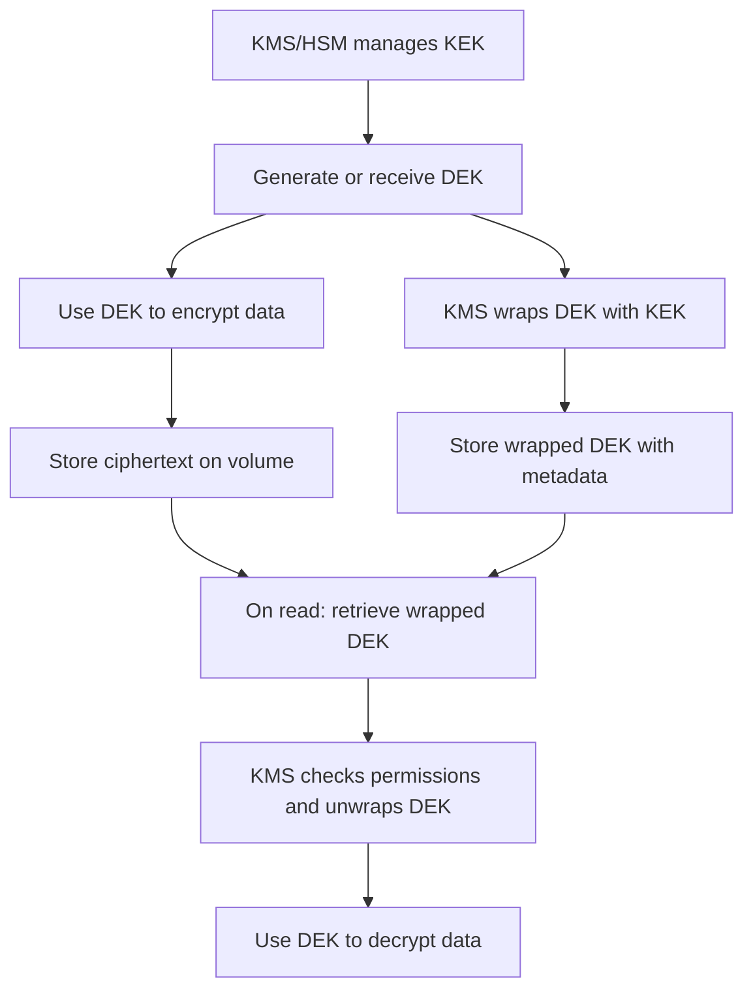
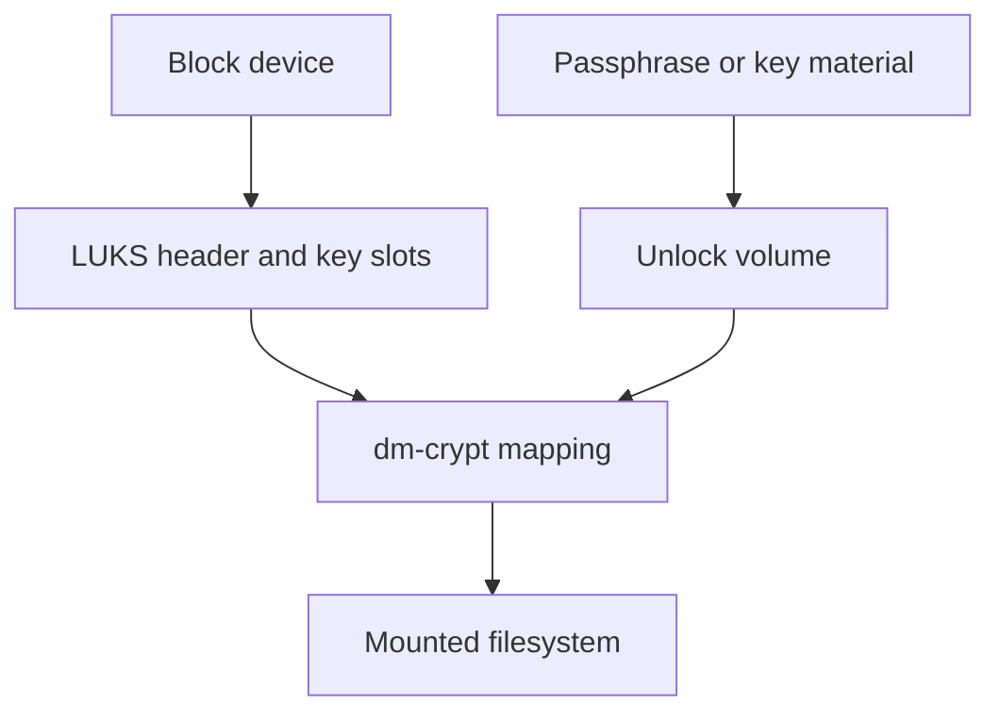

# Disk Encryption and Key Usage Permission Management

## Learning Objectives

After this lesson, you will be able to:

- Explain the purpose and scope of disk encryption in cloud computing environments.
- Distinguish provider-managed encryption, customer-managed keys, and encryption inside the operating system.
- Describe how envelope encryption uses a Data Encryption Key (DEK) and a Key Encryption Key (KEK).
- Design least-privilege KMS access permissions for VMs, services, and operators.
- Plan key rotation, revocation, backup, and recovery without losing the ability to read data.
- Verify encryption coverage across disks, snapshots, images, and backups throughout the VM lifecycle.

## 1. Why Encrypt Disks?

A virtual machine (VM) disk can contain the operating system, business data, databases, logs, temporary files, and configuration details. When disks are stored on cloud infrastructure, data may exist in multiple copies or states: volumes attached to VMs, snapshots, images, backups, cross-region replicas, or internal replicas managed by the provider.

Disk encryption transforms plaintext data into ciphertext using cryptographic algorithms and keys. Anyone without permission to use the appropriate key cannot read the data contents normally, even if they obtain a copy of the encrypted data blocks.

Encryption helps mitigate risks when:

- Physical storage media is misplaced or improperly decommissioned.
- Snapshots, backups, or images are copied outside their intended boundary.
- Someone can access stored data blocks yet lacks permission to use the decryption key.
- An organization must satisfy data protection policies, audit requirements, or industry regulations.

Disk encryption does not solve every security problem on its own. While a VM is running and the volume is unlocked, the operating system and authorized applications can still read plaintext data. If a VM administrator account is compromised, an attacker can access data through the OS even if the volume is encrypted. Therefore, encryption must be paired with IAM, workload identity protection, OS access controls, backups, and monitoring.

### Distinguishing Data States

| State | Examples | Common controls |
|---|---|---|
| Data at rest | Block volumes, boot disks, snapshots, backups | Disk encryption, object/backup encryption, key management |
| Data in transit | VMs exchanging network traffic, apps querying databases | TLS, VPN, or protected transport channels |
| Data in use | Data in RAM, CPU registers, application memory | Process isolation, memory protection, confidential computing where appropriate |

Disk encryption primarily protects data at rest. It does not replace TLS for network connections, nor does it automatically encrypt all data residing in RAM.

## 2. Cloud Disk Encryption Layers

A compute service may support multiple encryption layers. Feature names and implementations vary by provider, yet they can be categorized by where encryption occurs.

### 2.1. Encryption at the Provider's Storage Layer

The cloud provider encrypts data when writing to physical storage media and decrypts it when serving authorized read requests. Applications and the operating system typically require no changes to how they read or write data.

Characteristics:

- Usually integrated into block storage or managed disk services.
- Can be enabled by default or enforced automatically via account/organization policies.
- Can use provider-managed keys or customer-specified keys.
- Helps protect data on storage infrastructure and service-managed replicas within supported scope.

Read documentation carefully to verify exactly which components are encrypted: volume data, caches, snapshots, replicas, metadata, or only primary data blocks. Never assume enabling volume encryption automatically encrypts every export or copy in another service.

### 2.2. OS-Managed or Application-Managed Encryption

Encryption can happen inside the guest OS before data is written to the volume. Examples:

- Linux uses LUKS/dm-crypt to encrypt partitions or volumes.
- Windows uses BitLocker to encrypt volumes.
- Applications or databases can encrypt files, tables, or data fields at the application layer.

This layer gives the organization additional control over how data is encrypted and how keys are used. However, it increases operational responsibility: managing volume unlock keys, handling unattended boot, recovering from lost keys, monitoring mount failures, and planning recovery workflows.

If a VM must unlock a volume automatically at boot, keys must not be stored in plaintext inside images or startup scripts. Use integrations with KMS, TPM/vTPM, or an appropriate secret service, and restrict key retrieval permissions to the exact workload identity.

### 2.3. Layered (Combined) Encryption

Some architectures use cloud storage-layer encryption alongside guest-OS encryption simultaneously. The two layers can serve different control objectives:

- The storage layer protects data replicas on underlying storage infrastructure.
- The guest-OS layer lets the organization control keys and volume-unlock policies inside the VM.

Multi-layer encryption adds complexity, processing overhead, and recovery requirements. Use it only when there is a clear requirement for separation of duties, control, or compliance. Test its impact on performance, boot, snapshots, backups, and recovery procedures.

## 3. Provider-Managed Keys vs. Customer-Managed Keys

When enabling volume encryption, establish who controls the key and who operates the key lifecycle.

| Model | Who manages the key | Customer control | Primary responsibilities |
|---|---|---|---|
| Provider-managed key | Cloud provider | Typically fewer customizations; keys used per service policy | Provider manages protection, storage, and most lifecycle operations |
| Customer-managed key (CMK) | Customer manages policies and permissions; KMS/HSM stores and performs cryptographic operations | Controls usage permissions, policies, rotation schedules, and key state within platform scope | Customer manages IAM, permissions, monitoring, rotation, and recoverability |
| Customer-provided key (CPK) or request-supplied key | Customer supplies key material per service mechanism | Higher control over key material, but must adhere to storage and transmission requirements | Key protection, distribution, rotation, and availability |
| External key management (EKM/HYOK) | Customer or external KMS/HSM system | Keys can be held outside the cloud per supported architecture | Operating connectivity, availability, latency, auditing, and recovery of the external key system |

Terms like CMK, CPK, BYOK (Bring Your Own Key), and HYOK (Hold Your Own Key) do not mean identical things across providers. Consult documentation for the exact service. For instance, BYOK may refer solely to importing key material into the cloud's KMS; once imported, that material may still be stored and processed inside the provider's KMS. HYOK usually emphasizes keeping key material outside the cloud, though not every service supports it.

### When to Choose Provider-Managed Keys?

This model fits when an organization needs encryption by default, wants to minimize key operations overhead, and has no requirement to manage custom key policies. It can be a good fit for development, testing, or workloads with standard control requirements.

### When to Choose Customer-Managed Keys?

CMKs fit when an organization needs to:

- Separate data access governance from workload administration.
- Grant or revoke key usage permissions by workload identity.
- Record key usage activity in audit logs.
- Proactively rotate, disable, or schedule deletion of keys.
- Enforce distinct key policies by data classification, environment, or business unit.

Greater control also introduces operational risk. If a key is disabled, deleted, or has access permissions mistakenly revoked, VMs may become unable to read volumes or snapshots. Consequently, CMKs require clear change management, monitoring, and recovery workflows.

## 4. How Envelope Encryption Works

KMS services typically use envelope encryption to avoid encrypting large volumes of data directly with a single root key.

Two primary key types:

- **DEK (Data Encryption Key):** the data key used to encrypt actual data blocks or payloads.
- **KEK (Key Encryption Key):** the key used to encrypt/wrap the DEK. In KMS, this is often referred to as a key-encryption key or customer-managed key.

Conceptual flow:



The process typically runs as follows:

1. The storage service asks KMS to generate or protect a DEK.
2. The DEK encrypts data using a suitable algorithm, typically authenticated symmetric encryption.
3. KMS uses the KEK to wrap the DEK into a wrapped key.
4. The storage service stores the ciphertext, wrapped DEK, and required metadata.
5. When reading, the service asks KMS to unwrap the wrapped DEK.
6. KMS checks identity, permissions, and policies before returning the DEK or permitting decryption.
7. The service uses the DEK to decrypt data and serve it to the VM.

KEK material is typically protected inside KMS or an HSM and never exported in plaintext. DEKs may be handled in the service's memory while needed; exact caching behavior and exposure scope depend on the provider's architecture.

### Why Not Encrypt the Entire Disk Directly with the KEK?

Disks can be massive and require continuous reads and writes. KMS is typically optimized for key operations, not encrypting every storage block at volume I/O speeds. Envelope encryption uses DEKs at the data plane and relies on the KEK solely to protect DEKs. As a result, KMS does not have to process every byte read from or written to disk.

### Illustrative Example

A database volume holds 2 TiB of data. The storage service uses one or more DEKs to encrypt the data according to its design. Each DEK is wrapped by a CMK in KMS. When an administrator revokes permission to use that CMK, the service may become unable to unwrap the DEKs to read data. Ciphertext remains on the volume, yet usability of the data is halted.

This demonstrates that key usage permission is part of data availability, not merely a security setting.

## 5. KMS, HSM, and Key Operations

**KMS (Key Management Service)** is a key management service providing APIs to create, store, use, rotate, and control permissions over keys. KMS typically integrates with block storage, databases, object storage, backups, and other services.

**HSM (Hardware Security Module)** is a dedicated hardware device or environment designed to protect key material and perform cryptographic operations. Some KMS offerings use HSMs under the hood; others provide dedicated HSM or external HSM options.

Common operations:

- Creating keys or importing key material.
- Reading key metadata and state.
- Granting encrypt/decrypt permissions or issuing service grants.
- Rotating keys or creating new key versions.
- Disabling, re-enabling, or scheduling deletion.
- Reviewing audit logs and key usage history.
- Backing up or restoring key material if supported by the platform.

Not every key can be exported or backed up. Some key types are generated and held strictly inside an HSM; recoverability depends on the KMS type, key type, and provider procedures.

### Attributes to Manage

| Attribute | Operational meaning |
|---|---|
| Key ID / Key ARN / resource name | Key identifier referenced by workloads |
| Key state | Enabled, disabled, pending deletion, or equivalent state |
| Key policy / IAM policy | Who can administer the key and who can use it |
| Key version | Key material version used for cryptographic operations |
| Rotation setting | Schedule or mechanism for creating new versions |
| Region / location | Key location and the scope of services allowed to use it |
| Audit events | History of administrative and key usage operations |

Attribute names vary across platforms. Distinguish **key management** permissions from **key usage** permissions. Someone permitted to enable/disable or delete keys does not necessarily need permission to decrypt data; workloads only need permission to use the key per the service's protocol.

## 6. Designing Least-Privilege Key Access

KMS permissions must be granted to the exact identity and exact operations needed. Avoid granting decrypt permissions to an entire project or all users simply because one VM needs to read a volume.

### 6.1. Using Workload Identities

Each application or VM should use a dedicated service identity—such as a managed identity, instance profile, or service account depending on the platform. The storage service can be authorized to use the key via a service identity or grant.

Benefits:

- Avoids embedding long-lived access keys or secrets in images.
- Allows revoking permissions for one workload without impacting others.
- Audit logs tie key usage directly to a specific identity.
- Simplifies enforcing distinct permissions for production, staging, and development.

### 6.2. Separating Administration from Usage

A reference permission model:

| Role | Appropriate permissions | Should not be granted by default |
|---|---|---|
| Key administrator | Create, configure, rotate, disable keys per procedure | Reading application data or arbitrary decryption usage |
| Security auditor | View policies, metadata, and audit logs | Modifying keys or decrypting data |
| Storage service identity | Use the key for operations needed to encrypt/decrypt DEKs | Deleting keys, changing policies, or administering KMS |
| VM/application identity | Data access per design; call KMS only if guest encryption requires it | Key administration or decrypt permissions across all data |
| Backup/restore service identity | Use required keys to create and restore copies | Unrestricted administrative rights across all keys |

This is a reference model. With storage-service-managed encryption, VMs usually do not call KMS directly on every read; the storage service performs the operations using granted permissions. With LUKS or BitLocker inside the guest OS, the workload or boot sequence may need access to KMS/secret services to retrieve the volume unlock key.

### 6.3. Scoping Permissions Precisely

When designing policies, specify:

- Which principal is permitted to use the key.
- Which operations are required: encrypt, decrypt, generate data key, re-encrypt, or create grant.
- Which specific key is referenced.
- Which resources or services are authorized to use the key.
- Which conditions must hold: project, account, region, encryption context, resource tags, or network endpoints if supported by the platform.
- Who is allowed to modify policies, revoke grants, or delete the key.

Never grant overly broad permissions just to make VM creation succeed. If a service reports missing KMS permissions, inspect the error details to identify the denied principal and operation, then grant only the minimum required permission.

### 6.4. Avoiding Keys in Images and Configuration

Never place plaintext keys, volume passphrases, or long-lived secrets in:

- Golden images or VM templates.
- User data, startup scripts, or `cloud-init`.
- Source code repositories or shared configuration files.
- Logs, support tickets, or pipeline outputs.
- Environment variables that persist longer than needed.

Instead, workloads should authenticate using a platform-issued identity and obtain key usage permissions via policy. If the guest OS requires a passphrase to unlock LUKS, design a secure secret retrieval mechanism and test boot/recovery behavior when KMS is unavailable.

## 7. Key Rotation and Key Versions

Key rotation is replacing key material on a schedule or in response to a security event. The goal is to limit the lifetime of any single key and reduce blast radius if a key is exposed.

Distinguish between:

- **Creating a new key version:** KMS generates or imports new material under the same logical key or a different key ID.
- **KEK rotation:** updating the key used to wrap DEKs.
- **Data re-encryption:** reading old data, decrypting it, and re-encrypting it with a new DEK.
- **Re-wrapping DEKs:** using a new KEK to re-wrap existing DEKs without re-encrypting all underlying data.

Some services automatically use the new KEK version for new data while retaining older versions to decrypt previously encrypted data. Rotating a CMK does not necessarily mean every data block on the volume is re-encrypted. Read service documentation to understand exactly how existing ciphertext is handled.

### Reference Rotation Workflow

1. Identify which keys are referenced by volumes, snapshots, backups, and images.
2. Check retention policies and decryption requirements for older data.
3. Create or activate a new key version via the supported workflow.
4. Update policies or configuration so new data uses the new version.
5. Perform re-wrapping or re-encryption if mandated by security requirements.
6. Test reading volumes, taking snapshots, and restoring backups with the new version.
7. Monitor KMS errors and audit logs during the transition.
8. Retire older versions only once confirmed no data or copies still rely on them.

Never delete old key versions merely because automatic rotation is enabled. Old snapshots or long-term backups may still require those versions for decryption.

## 8. Disabling, Revoking, and Deleting Keys

These actions carry distinct impacts:

- **Disable:** temporarily prevents key usage. Encrypted data still exists, yet may become unreadable while the key is disabled.
- **Revoke grant or permission:** stops a specific principal or service from continuing to use the key under previously granted rights.
- **Schedule deletion:** schedules key deletion after a mandatory KMS waiting period. During that window, deletion can be canceled if the platform allows it.
- **Delete/destroy key material:** removes key material. Without a recoverable copy, data encrypted under that key may become permanently unreadable.

Before disabling or deleting a key, inventory every dependency:

- Boot disks and data disks attached to VMs.
- Snapshots and backups still within retention.
- Images created from encrypted volumes.
- Copies in other regions or accounts.
- Detached volumes still kept for storage.
- Disaster recovery systems and offline backups.

A deleted key can prevent a VM from booting or attaching volumes. For a boot disk, the consequence can be a completely unbootable VM. For a data disk, applications may fail to open databases or read data.

### Emergency Revocation on Suspected Compromise

If key compromise or unauthorized key permission usage is suspected:

1. Identify affected keys, workloads, data, and account scope.
2. Use audit logs to pinpoint the principal and timestamps of anomalous actions.
3. Revoke grants or permissions for the compromised principal; consider disabling the key per incident response plans.
4. Assess impact on running VMs, volumes, snapshots, and backups.
5. Create a new key and migrate workloads to the new key using supported procedures.
6. Re-wrap or re-encrypt data where necessary.
7. Verify recoverability and document the incident following incident response procedures.

Never delete a key immediately upon detecting suspicious activity. Deleting a key can turn a security incident into irreversible data loss.

## 9. Encrypting Boot Disks, Data Disks, Snapshots, and Backups

Encryption must be evaluated across the entire data lifecycle, not just the initial volume.

| Component | What to verify |
|---|---|
| Boot disk | Is it encrypted by default; can the VM boot with a CMK; which services need KMS permissions |
| Data disk | Which key is used; are key swaps or re-encryption supported; how it attaches to another VM |
| Snapshot | Does the snapshot inherit the source key or use a new key; sharing and restore permissions |
| Machine image | Does the image hold encrypted data; do target users have permission to use the key |
| Backup | At which layer are backups encrypted; does the key remain available throughout retention |
| Cross-region copy | Does the target region have a compatible KMS key; is re-encryption with a target-region key required |
| Export/download | Does exported data remain encrypted; who has decryption rights after download |

These behaviors depend on the service. Some platforms allow snapshots encrypted with the same source key; others require specifying a destination key when copying across regions or accounts. Never assume a snapshot is automatically independent of the original key.

### Recovery Scenarios to Test

- Create a snapshot from an encrypted volume and restore it into a new volume.
- Attach the restored volume to a different VM with appropriate permissions.
- Restore a backup in another region using a destination key.
- Boot a VM from a boot disk created from an encrypted image.
- Restore after the old key has rotated while older versions remain intact.
- Restore after workload identity changes or grants must be recreated.

A backup marked successful that cannot be decrypted is not a usable backup. Test restores periodically and record recovery times, required permissions, key versions, and data verification results.

## 10. Volume Encryption Inside Linux and Windows

Guest-OS encryption can add organizational control, yet must be designed from image creation onward.

### 10.1. Linux with LUKS/dm-crypt

LUKS (Linux Unified Key Setup) is a key-management format for encrypted volumes built on `dm-crypt`. An encrypted device can be opened as a decrypted mapped device for the filesystem to use.

Conceptual flow:



The commands below illustrate operations strictly on a test device. They can destroy data on the target device; back up data and verify the exact device before running them.

```bash
# Inspect block devices and filesystems
lsblk -f

# Initialize LUKS on a test device (erases existing data on the device)
sudo cryptsetup luksFormat /dev/sdX

# Open the encrypted volume
sudo cryptsetup open /dev/sdX secure-data

# Create a filesystem on the mapped device
sudo mkfs.ext4 /dev/mapper/secure-data

# Mount the filesystem
sudo mkdir -p /mnt/secure-data
sudo mount /dev/mapper/secure-data /mnt/secure-data

# When finished, unmount and close the mapping
sudo umount /mnt/secure-data
sudo cryptsetup close secure-data
```

In this example, `/dev/sdX` is a placeholder name. Never run commands on a real device without verifying the exact volume. The LUKS header contains metadata required to unlock the volume; losing or corrupting the header can render data inaccessible. Back up headers following security procedures and protect those backups as sensitive information.

For boot volumes, integrate unlocking into `initramfs` and the boot sequence. If using TPM or KMS for automatic unlocking, test recovery when the VM changes hosts, firmware updates, PCR values change, or KMS connectivity is lost.

### 10.2. Windows with BitLocker

BitLocker encrypts volumes and can use a TPM to protect the volume unlock key. In cloud VMs, TPM/vTPM availability, Secure Boot, and boot protection depend on VM type and OS.

When designing BitLocker:

- Confirm the VM supports vTPM if using a TPM protector.
- Store recovery keys in a controlled repository and test retrieval.
- Restrict recovery key read permissions by role and enable audit logging.
- Test reboots, VM configuration changes, and snapshot restores.
- Never store recovery keys in images, scripts, or support tickets.

BitLocker inside the guest OS and disk encryption performed by the cloud provider are two distinct layers. Decide whether the organization needs one layer or both combined, who manages keys, and how recovery works if access is lost.

## 11. Verifying Encryption Status and Key Permissions

Exact commands and APIs vary by cloud provider. A general verification workflow should include:

1. Inspect volume attributes to confirm encryption is enabled and check the key reference.
2. Inspect key metadata to confirm key state, region, and policy.
3. Check which principal the storage service or VM uses to access the key.
4. Review policies/grants for accurate operations and scope.
5. Read audit logs to confirm encrypt/decrypt or generate-data-key calls succeed.
6. Take a test snapshot and restore it to a test VM.
7. Validate restored data with checksums or application checks.

Example Linux commands to inspect volume encryption inside the guest:

```bash
# View block devices and filesystems
lsblk -f

# View currently open encrypted devices
sudo cryptsetup status secure-data

# View LUKS info (metadata only, does not display passphrases)
sudo cryptsetup luksDump /dev/sdX
```

These commands inspect only the guest-OS layer. If the volume is encrypted in the cloud storage infrastructure, check encryption status, key ID, and audit logs in the provider's console/API.

## 12. Common Troubleshooting

| Symptom | Possible cause | Investigation approach |
|---|---|---|
| VM fails to boot after enabling boot disk encryption | Missing KMS permissions, bad guest-OS unlock config, or incompatible boot chain | Check boot diagnostics, KMS audit logs, and boot configuration |
| Cannot attach encrypted data disk | Service principal lacks key permission, key disabled, or region mismatch | Inspect key state, policy, grants, and region scope |
| Snapshot succeeds but restore fails | Missing permission on source/target key or key deleted | Verify key references and restore service permissions |
| App cannot read volume after key rotation | Old key version unavailable or DEK not properly re-wrapped | Check key versions and rotation workflow |
| KMS returns AccessDenied | Wrong principal, missing operation, policy, or unmet context condition | Read audit events to identify the denied principal and API operation |
| VM boots slowly or fails when KMS is unavailable | Guest encryption depends on KMS during boot | Inspect network path, endpoints, timeouts, and recovery options |
| Backup cannot restore in another region | Key available only in source region or target key missing | Provision target-region key and test copy/restore |

### Troubleshooting Workflow

1. Identify which encryption layer is failing: storage encryption, guest-OS encryption, or application-level encryption.
2. Identify involved resources and keys via volume ID, snapshot ID, and key reference.
3. Inspect key state, policy, grants, principal, and audit logs.
4. Verify region, account, and encryption context conditions.
5. If permissions are missing, grant exact least-privilege access per governance workflows.
6. If a key is disabled, assess impact and re-enable only after confirming root cause, approver, and scope.
7. If recovery is needed, use verified snapshots/backups and keys in a test environment.
8. Once service is restored, re-verify permissions, audit logs, and restore capability.

Never create a new key and immediately swap the key reference when a volume fails to unlock. A new key cannot decrypt ciphertext encrypted under the old key. First locate the original key, check its state, and assess its recoverability.

## 13. Practical Example: Encrypting Boot Disk and Database Disk

An internal system uses two volume types:

- A boot disk holding Linux and operational tooling.
- A data disk holding database data, requiring long-term retention and daily snapshots.

The security team requires CMKs to separate key management from VM administration. Reference architecture:

- Create a dedicated CMK for production data in KMS.
- Designate a key administrator to manage policies and rotation.
- Grant key usage permissions to the storage service identity scoped to the right account and region.
- Provision boot and data disks with platform-supported encryption settings.
- Use a dedicated VM identity to access the application and data via IAM.
- Enable audit logging for administrative and key-usage operations.
- Create a test snapshot, then restore the volume under the same policy.
- Replicate backups to a standby region with a pre-provisioned destination key.
- Rehearse scenarios where a key is disabled or grants are lost and require recovery.

In operations, the team does not grant CMK deletion rights to VM administrators. Key rotation or state changes require approval, dependency checks, and restore testing. As a result, key usage rights are governed independently of machine operations.

## 14. Common Misconceptions

- **A volume showing an encrypted icon means every copy is protected.** Verify snapshots, backups, images, exports, and cross-region replicas for each service.
- **CMK means the customer keeps key material outside the cloud.** CMKs are typically stored and used inside the provider's KMS; BYOK/HYOK have distinct meanings.
- **Automatic key rotation re-encrypts the entire disk.** Rotation may only create a new KEK version; older data and DEKs still require decryption per the service's mechanism.
- **A VM with admin rights needs KMS admin rights.** Workloads usually need narrowly scoped key usage permissions; administrative rights should remain separated.
- **Disabling a key affects only new data.** A disabled key can render existing data unreadable as well.
- **Deleting a key is like deleting a volume.** Volume ciphertext may remain, yet losing the key can make data permanently unrecoverable.
- **Disk encryption protects running VM data from all administrators.** Once the volume is unlocked, the OS and authorized processes can still read plaintext data.
- **Encrypted backups are enough without testing restores.** Verify that permissions and keys actually allow data recovery.

## 15. Self-Check

**Scenario 1:** A volume is encrypted with a CMK. The operations team disables the key to test policy enforcement, and the application can no longer read the volume. Why?

**Hint:** The storage service needs to use the key to unwrap DEKs or perform cryptographic operations. When the CMK is disabled, key usage is blocked and the volume can become inaccessible. Assess impact before changing key state.

**Scenario 2:** An organization enables automatic rotation for a CMK. Can older key versions be deleted immediately?

**Hint:** No. Older snapshots, backups, or ciphertext may still require older versions for decryption. Identify all dependencies and test restores before removing them.

**Scenario 3:** A VM must mount a LUKS volume at boot. Should the passphrase be placed in `cloud-init`?

**Hint:** Never store long-lived secrets in user data or startup scripts. Use workload identity and secure key/secret retrieval mechanisms, and test boot behavior when KMS is unavailable.

**Scenario 4:** An encrypted snapshot in region A needs to be restored in region B. What must be verified?

**Hint:** Confirm the service supports copying encrypted snapshots, verify the destination key in region B, check restore identity permissions, and understand re-encryption behavior. Run a test restore before relying on disaster recovery copies.

**Scenario 5:** A user has permission to read a snapshot but lacks permission to use the CMK. Can that user read plaintext data?

**Hint:** Under CMK and envelope encryption models, permission to read ciphertext does not automatically grant permission to unwrap the DEK. Still, verify the exact service behavior for snapshot sharing and key permissions.

## Conclusion

Disk encryption protects stored data by pairing ciphertext with policy-managed keys. In the cloud, you must understand encryption layers, key models, and how KMS grants access to storage services or workload identities. Envelope encryption separates data keys from management keys; CMKs increase control while also making key usage permissions part of availability. Manage permissions with least privilege, rotate keys deliberately, protect older key versions, and test restores for volumes, snapshots, images, and backups before going to production.
